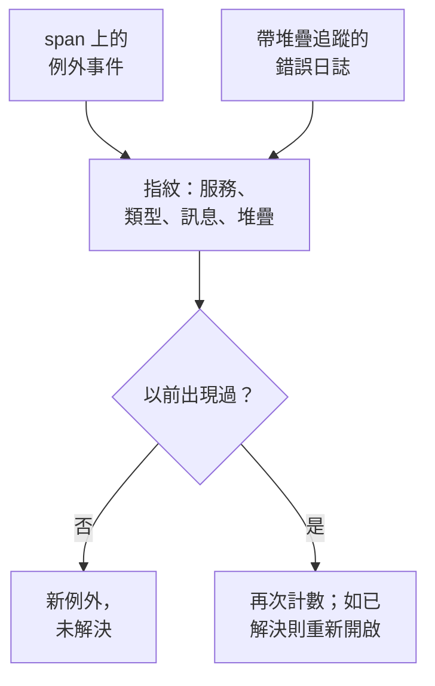

# 例外狀況追蹤

例外狀況追蹤收集你的程式碼擲回的錯誤，並把同一個錯誤的每次出現歸併為一個例外，附帶它的堆疊追蹤、趨勢以及它發生時所在的請求。像處理待辦清單一樣分流它們：修正、標記為已解決，或封存雜訊，並讓 AI 為它能修正的例外開啟 pull request。

:::cards
- [例外從何而來](#例外從何而來): 你的服務已經在傳送的 span 和日誌。
- [分流清單](#分流清單): 未解決的在前，雜訊隱藏。
- [例外的頁面](#例外的頁面): 堆疊追蹤、各次出現和上下文。
- [用 AI 修正](#用-ai-修正): 一個包含修正或迴歸測試的 pull request。
:::

## 例外從何而來

你不需要單獨傳送例外。OneUptime 會在你的服務已經傳送的遙測中找到它們：

- span 上的例外事件，也就是 OpenTelemetry 的 `recordException()` 寫入的內容；
- 帶有 `exception.type`、`exception.message` 或 `exception.stacktrace` 屬性的日誌；
- 嚴重程度為 Error 或 Fatal、訊息中包含堆疊追蹤的日誌，前提是該日誌不是在 span 內寫入的（span 已經報告了它）。

每次出現都會與同一錯誤之前的出現歸併為一個例外：

- **每個服務和錯誤對應一個例外。** 指紋由服務、例外類型、訊息和堆疊追蹤生成。每次呼叫都會變化的值會先被去掉：UUID 和其他 ID、時間戳記、IP 位址和電子郵件地址，以及七位或更多位的數字。因此 `Order id=1042 not found` 和 `Order id=2077 not found` 是同一個例外。
- **新的出現會重新開啟已解決的例外。** 如果你解決之後它又發生了，表示修正沒有生效。
- **已封存的例外保持封存。** 它的新出現仍會被計數，但不再傳送通知。

> [!TIP]
> 要讓預期內的錯誤（例如你的服務拒絕的無效輸入）不進入例外狀況追蹤，請在 span 的例外事件上把 `error.class` 屬性設定為 `user-error` 或 `expected-denial`。這樣 OneUptime 就不會為它記錄例外。

## 開始之前

- **正在到達的 span 或日誌。** 使用 [OpenTelemetry](/docs/telemetry/open-telemetry) 檢測你的服務。**設定指南** 分頁會顯示適合你的語言的程式碼。
- **可以讀取遙測的角色。** Project Owner、Project Admin、Project Member、Viewer、Telemetry Admin、Telemetry Member 或 Telemetry Viewer，或者擁有 Read Telemetry Service Exception 權限的自訂角色。解決和封存需要 Project Owner 或 Project Admin，或者 Edit Telemetry Service Exception 權限。

## 分流清單

:::steps
### 開啟例外清單

前往 **產品 → 可觀測性 → 例外**。**例外** 分頁上的徽章統計未解決的問題，清單開啟時顯示 **未解決** 的例外。

### 選擇狀態

在 **未解決**、**已解決**、**已封存** 和 **全部** 之間切換。清單上方的圖表顯示隨時間推移，有多少次出現是 **未處理** 的，有多少次是 **已處理** 的。

### 選擇什麼算作問題

預設的 **問題** 會隱藏使用者錯誤和預期內的拒絕，讓清單只顯示需要修正的內容。**User errors** 只顯示這些錯誤，**全部** 顯示所有例外。

### 搜尋和篩選

輸入查詢，例如 `type:TypeError env:production`，請參閱 [搜尋語法](/docs/telemetry/search-syntax#例外)；或者點選 **篩選器** 側欄中的值：一個服務、一台主機或其他資源、一個 **例外類型**、一個 **環境** 或一個 **Error Class**。

### 開啟一個例外

點選一列即可開啟例外的頁面。
:::

## 例外的頁面

頁面的側邊選單把你對例外能做的事歸在一起：

| 頁面 | 顯示內容 |
| --- | --- |
| **概覽** | 訊息、服務、發生的頻率、首次和上次出現的時間、隨時間的趨勢，以及最近一次出現：版本、環境、span、追蹤和使用者工作階段。 |
| **堆疊追蹤** | 堆疊的各個框架。對於瀏覽器程式碼，在你為該版本上傳 [原始碼對應](/docs/telemetry/source-maps) 後，會顯示原始檔案和行。 |
| **Occurrences** | 每一次出現，以及它的時間、訊息和它所在的追蹤。 |
| **Context** | 最近一次出現的屬性、錄製過的話還有它的工作階段重播，以及導致它的步驟。 |
| **日誌** | 最近一次出現前後寫入的日誌。 |
| **AI Assistance** | 修正或測試該例外的 AI 任務。 |
| **設定** | 解決或封存該例外。它位於 **Manage** 下，該部分預設摺疊。 |

## 解決、重新開啟和封存

例外頁面頂部的按鈕以及它的 **設定** 頁面可以變更它的狀態：

| 操作 | 何時使用 | 接下來會發生什麼 |
| --- | --- | --- |
| **解決** | 你已經部署了修正。 | 它離開 **未解決** 清單。新的出現會重新開啟它。 |
| **Reopen** | 修正沒有生效。 | 它再次變為未解決。 |
| **封存** | 它是你不打算修正的雜訊。 | 它離開清單。新的出現會被計數，但不再傳送通知。 |
| **取消封存** | 你想再次收到它的訊息。 | 它回到它所屬的清單。 |

**設定** 顯示最後是誰、在什麼時候解決或封存了該例外。它的按鈕顯示為 **標記為已解決** 或 **標記為未解決**，以及 **封存** 或 **取消封存**。

## 錯誤類別

每個例外都有一個錯誤類別，說明這是誰的問題。OneUptime AI 在分流關於該例外的洞察（例如新出現或激增的例外）時設定它：請參閱 [AI SRE](/docs/ai/ai-sre#洞察主動偵測)。尚未被分流的例外保持為 `unknown`。

| 類別 | 含義 | 在 **問題** 中 |
| --- | --- | --- |
| `code-fault` | 程式碼中的缺陷。AI 會自行修正的唯一類別。 | 是 |
| `infrastructure` | 逾時、連線斷開或資源耗盡。 | 是 |
| `unknown` | 尚未分類。 | 是 |
| `user-error` | 使用者無效輸入導致的結果。 | 否 |
| `expected-denial` | 檢查正常發揮作用，例如被拒絕的登入。 | 否 |

在 AI 洞察的設定中開啟 **封存預期內的例外** 後，分流判定為預期內拒絕的例外會自動為你封存。

## 用 AI 修正

**AI Assistance** 頁面提供三項任務。每一項都作為 AI 任務執行，在你的程式碼存放庫中開啟一個 pull request：

| 任務 | pull request 做什麼 |
| --- | --- |
| **Fix this exception with AI** | 修正根本原因。點擊 **用 AI 修正** 啟動它。 |
| **Generate Regression Test** | 新增一個測試，在缺陷修正之前它會一直失敗。 |
| **改善錯誤處理** | 針對預期內的錯誤：更早驗證輸入，讓使用者資料不出現在訊息中，並把錯誤標記為已處理。 |

AI 首先需要三樣東西：一個 LLM 提供者、一個已連線的存放庫（位於 GitHub、GitLab、Forgejo 或 Gitea，或任何 Git 伺服器），以及一個上線並執行任務的 AI 代理程式。頁面會逐一檢查，並連結到缺少的部分。例外處於已解決或已封存狀態時，這些任務會暫停。請參閱 [程式碼](/docs/ai/ai-agent)。

## 例外洞察

**洞察** 分頁統計你的 **未解決**、**已解決** 和 **已封存** 例外以及解決率，並列出最常見的例外、它們影響的服務以及最近出現的例外。

## 疑難排解

:::details 我剛擲回的例外不在清單中
先檢查清單的檢視方式：**問題** 會隱藏使用者錯誤和預期內的拒絕，所以請選擇 **全部**。然後擴大時間範圍，並檢查該例外是否記錄在 span 上，或記錄在帶有堆疊追蹤的日誌中。
:::

:::details 一個錯誤顯示為多個例外
指紋包含訊息和堆疊追蹤。當它們不同時，例如訊息中嵌入了每次呼叫都會變化的短數字或名稱，每種變體都會成為單獨的例外。
:::

:::details 已解決的例外不斷回來
新的出現會刻意重新開啟已解決的例外：錯誤仍在發生。檢查修正是否已進入報告該錯誤的版本，如果你不想再收到它的訊息，就把這個例外封存。
:::

## 後續步驟

:::cards
- [例外狀況監控](/docs/monitor/exceptions-monitor): 在例外激增時收到警示。
- [原始碼對應](/docs/telemetry/source-maps): 為瀏覽器程式碼提供可讀的堆疊追蹤。
- [程式碼](/docs/ai/ai-agent): AI 如何修正程式碼並開啟 pull request。
- [追蹤瀏覽器](/docs/telemetry/traces-explorer): 檢視例外發生時所在的請求。
:::
