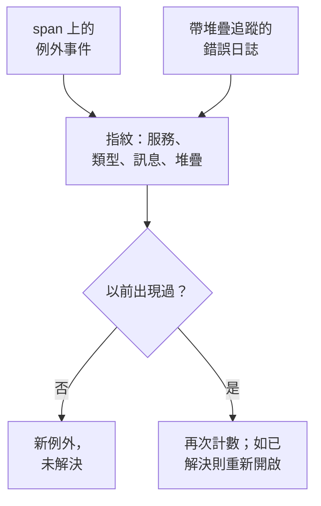

# 例外狀況追蹤

例外狀況追蹤收集你的程式碼擲回的錯誤，並把同一個錯誤的每次出現歸併為一個例外，附帶它的堆疊追蹤、趨勢以及它發生時所在的請求。像處理待辦清單一樣分流它們：修正、標記為已解決，或封存雜訊，並讓 AI 為它能修正的例外開啟 pull request。

:::cards
- [例外從何而來](#例外從何而來): 你的服務已經在傳送的 span 和日誌。
- [分流清單](#分流清單): 未解決的在前，雜訊隱藏。
- [例外的頁面](#例外的頁面): 堆疊追蹤、各次出現和上下文。
- [用 AI 修正](#用-ai-修正): 一個包含修正或迴歸測試的 pull request。
- [用 AI 尋找並修正新出現和激增的例外](#用-ai-尋找並修正新出現和激增的例外): 為 OneUptime 發現的例外開啟的 pull request。
:::

## 例外從何而來

你不需要單獨傳送例外。OneUptime 會在你的服務已經傳送的遙測中找到它們：

- span 上的例外事件，也就是 OpenTelemetry 的 `recordException()` 寫入的內容；
- 帶有 `exception.type`、`exception.message` 或 `exception.stacktrace` 屬性的日誌；
- 嚴重程度為 Error 或 Fatal、訊息中包含堆疊追蹤的日誌，前提是該日誌不是在 span 內寫入的（span 已經報告了它）。

每次出現都會與同一錯誤之前的出現歸併為一個例外：

- **每個服務和錯誤對應一個例外。** 指紋由服務、例外類型、訊息和堆疊追蹤生成。每次呼叫都會變化的值會先被去掉：UUID 和其他 ID、時間戳記、IP 位址和電子郵件地址，以及七位或更多位的數字。因此 `Order id=1042 not found` 和 `Order id=2077 not found` 是同一個例外。 新的例外則按其類型以及堆疊追蹤中您自己程式碼的函式和檔案分組：行號、函式庫框架和訊息都不計入，因此由同一段程式碼拋出的變體是同一個例外。沒有堆疊追蹤時，按上述方式由訊息分組。在此分組方式之前記錄的例外保持原來的分組。
- **新的出現會重新開啟已解決的例外。** 如果你解決之後它又發生了，表示修正沒有生效，該例外會被標記為 **回歸**。解決之前發生、但較晚才到達 OneUptime 的出現不會重新開啟它。
- **已封存的例外保持封存。** 它的新出現仍會被計數，但不再傳送通知。

> [!TIP]
> 要讓預期內的錯誤（例如你的服務拒絕的無效輸入）不進入例外狀況追蹤，請在 span 的例外事件上把 `error.class` 屬性設定為 `user-error` 或 `expected-denial`。這樣 OneUptime 就不會為它記錄例外。

## 開始之前

- **正在到達的 span 或日誌。** 使用 [OpenTelemetry](/docs/telemetry/open-telemetry) 檢測你的服務。**設定指南** 分頁會顯示適合你的語言的程式碼。
- **可以讀取遙測的角色。** Project Owner、Project Admin、Project Member、Viewer、Telemetry Admin、Telemetry Member 或 Telemetry Viewer，或者擁有 Read Telemetry Service Exception 權限的自訂角色。解決和封存需要 Project Owner 或 Project Admin，或者 Edit Telemetry Service Exception 權限。

## 分流清單

:::steps
### 開啟例外清單

前往 **產品 → 可觀測性 → 例外**。**例外** 分頁上的徽章統計未解決的問題，清單開啟時顯示 **未解決** 的例外。

### 選擇狀態

在 **未解決**、**已解決**、**已封存** 和 **全部** 之間切換。清單上方的圖表顯示隨時間推移，有多少次出現是 **未處理** 的，有多少次是 **已處理** 的。標記為 **回歸** 的列在解決後再次出現，標記為 **新增** 的列在過去 24 小時內首次出現。

每一列也會顯示該例外在所選時間範圍內影響了多少使用者，以及一個顯示其在該範圍內出現情況的小圖表。出現透過例外事件、其 span 或日誌記錄、或其資源上的 `user.id`、`enduser.id` 或 `enduser.pseudo.id` 屬性標明使用者；未標明使用者的出現不計入。

### 選擇什麼算作問題

預設的 **問題** 會隱藏使用者錯誤和預期內的拒絕，讓清單只顯示需要修正的內容。**User errors** 只顯示這些錯誤，**全部** 顯示所有例外。

### 搜尋和篩選

輸入查詢，例如 `type:TypeError env:production`，請參閱 [搜尋語法](/docs/telemetry/search-syntax#例外)；或者點選 **篩選器** 側欄中的值：一個服務、一台主機或其他資源、一個 **例外類型**、一個 **環境** 或一個 **Error Class**。**指派給我的** 只顯示指派給你的例外，排序選單可以依 **最近出現**、**首次出現** 或 **事件最多** 排列清單。

### 開啟一個例外

點選一列即可開啟例外的頁面。
:::

## 例外的頁面

頁面的側邊選單把你對例外能做的事歸在一起：

| 頁面 | 顯示內容 |
| --- | --- |
| **概覽** | 訊息、服務、發生的頻率、首次和上次出現的時間、隨時間的趨勢，以及最近一次出現：版本、環境、span、追蹤和使用者工作階段。在頂端，AI 開啟時顯示 OneUptime AI 對所發生情況的說明。 |
| **堆疊追蹤** | 堆疊的各個框架。對於瀏覽器程式碼，在你為該版本上傳 [原始碼對應](/docs/telemetry/source-maps) 後，會顯示原始檔案和行。 |
| **Occurrences** | 每一次出現，以及它的時間、訊息和它所在的追蹤。 |
| **Context** | 最近一次出現的屬性、錄製過的話還有它的工作階段重播，以及導致它的步驟。 |
| **日誌** | 最近一次出現前後寫入的日誌。 |
| **AI Assistance** | 修正或測試該例外的 AI 任務。 |
| **設定** | 解決或封存該例外。它位於 **管理** 下，該部分預設摺疊。 |

## 解決、重新開啟和封存

例外頁面頂部的按鈕、它的 **設定** 頁面以及清單中它所在列的 ⋯ 選單可以變更它的狀態：

| 操作 | 何時使用 | 接下來會發生什麼 |
| --- | --- | --- |
| **解決** | 你已經部署了修正。 | 它離開 **未解決** 清單。新的出現會重新開啟它。 |
| **在下一版本中解決** | 修正會在你的下一個版本中發布。 | 它離開 **未解決** 清單。來自它最後出現的那個版本的出現不會重新開啟它，來自其他任何版本的出現會重新開啟它。 |
| **重新開啟** | 修正沒有生效。 | 它再次變為未解決。 |
| **封存** | 它是你不打算修正的雜訊。 | 它離開清單。新的出現會被計數，但不再傳送通知。 |
| **取消封存** | 你想再次收到它的訊息。 | 它回到它所屬的清單。 |

只要例外的出現註明了版本（資源屬性 `service.version`），**在下一版本中解決** 就位於 **解決** 旁邊的選單、列的 ⋯ 選單、**批次動作** 和 **設定** 中。

**設定** 顯示最後是誰、在什麼時候解決或封存了該例外。它的按鈕顯示為 **標記為已解決** 或 **標記為未解決**，以及 **封存** 或 **取消封存**。

要一次變更多個，請在清單中勾選它們所在的列，或勾選列上方的核取方塊以選取此頁所有例外，然後使用 **批次動作** 中的相同動作。結果會說明哪些例外已變更、哪些保持不變以及原因。

例外標題中的 **指派** 會將它交給一個人或一個團隊，移除所選即取消指派。每一列都會顯示負責人，列的 ⋯ 選單提供 **指派給我**，**批次動作** 中的 **指派給…** 可以一次指派多個。被指派的人或團隊的每位成員都會依其 [通知設定](/docs/notifications/notification-settings) 中 **指派給我的例外** 一列收到通知；進行指派的人不會收到。

例外 **概覽** 底部的 **活動** 依由新到舊的順序顯示誰在何時變更了它：誰解決、重新開啟、封存或指派了它，誰將另一個例外合併到它或取消合併了一個，以及它在解決後何時再次出現。每一次變更都在那裡，無論是在例外頁面、清單、**批次動作**、透過 API 還是由 OneUptime 本身進行，使用 API 金鑰進行的變更會帶有該金鑰的名稱。

## 錯誤類別

每個例外都有一個錯誤類別，說明這是誰的問題。OneUptime AI 在分流關於該例外的洞察（例如新出現或激增的例外）時設定它：請參閱 [AI SRE](/docs/ai/ai-sre#洞察主動偵測)。尚未被分流的例外保持為 `unknown`。

| 類別 | 含義 | 在 **問題** 中 |
| --- | --- | --- |
| `code-fault` | 程式碼中的缺陷。AI 會自行修正的唯一類別。 | 是 |
| `infrastructure` | 逾時、連線斷開或資源耗盡。 | 是 |
| `unknown` | 尚未分類。 | 是 |
| `user-error` | 使用者無效輸入導致的結果。 | 否 |
| `expected-denial` | 檢查正常發揮作用，例如被拒絕的登入。 | 否 |

在 AI 洞察的設定中開啟 **封存預期內的例外** 後，分流判定為預期內拒絕的例外會自動為你封存。

## 用 AI 說明

在例外的 **概覽** 頂端，**使用 OneUptime AI 說明** 會詢問 OneUptime AI 出了什麼問題。它會讀取最近一次出現的堆疊追蹤、追蹤和日誌，以及例外開始前後該服務的部署，並在 **事件經過** 卡片中回答：

| 部分 | 內容 |
| --- | --- |
| **事件經過** | 一兩句話的說明、OneUptime AI 的把握程度，以及故障所在：程式碼、相依套件、基礎架構、錯誤輸入或設定。 |
| **可能的根本原因** | 原因，以及顯示該原因的框架、span、日誌行或部署。 |
| **建議的修正** | 需要修改什麼。 |
| **排查位置** | 應先開啟的堆疊追蹤框架。 |
| **後續步驟** | 最多三個用於確認或修正的步驟。 |

說明會儲存在例外上，下一個開啟它的人可以立即閱讀，**重新說明** 會要求新的說明。**開啟修正的拉取請求** 會開啟該例外的 **AI Assistance** 頁面，**追問** 會針對該例外開啟 Ask AI。

ID、電子郵件地址、IP 位址和權杖會從傳送的所有內容中移除，span 的屬性只傳送少數幾個，例如路由和狀態碼。說明會使用專案的 LLM 供應商和 AI 點數，在 **啟用 AI** 關閉時不提供。任何能讀取該例外的人都可以要求說明。

卡片下方的 **相似的例外** 列出最多五個與此例外相似的其他例外：去掉取值後 **相同訊息** 的、程式碼中 **相同程式碼位置** 的，或大部分詞語相同的 **相似訊息** 的。同一個根本原因可能分散在多個例外中，因此 **使用 OneUptime AI 檢查** 會說明每個例外是 **很可能是同一個錯誤**、**相關的錯誤** 還是 **不同的錯誤**，以及原因。檢查會使用專案的 AI 額度，並且在 **啟用 AI** 關閉時不會提供。結果會保存到下一次出現為止。

對於 OneUptime AI 判斷為 **很可能是同一個錯誤** 且屬於同一服務的例外，可用旁邊的 **合併** 將其合併到此例外：它已有的和新的出現從此計入此例外並顯示在此頁面上，它也會從清單中移除。下方的 **已合併到此例外** 列出已合併的例外，每項旁邊或已合併例外自己頁面上的 **取消合併** 會讓它回到清單中自己的位置，連同此後的出現。合併和取消合併需要編輯例外的權限。

## 用 AI 修正

**AI Assistance** 頁面提供三項任務。每一項都作為 AI 任務執行，在你的程式碼存放庫中開啟一個 pull request：

| 任務 | pull request 做什麼 |
| --- | --- |
| **Fix this exception with AI** | 修正根本原因。點擊 **用 AI 修正** 啟動它。 |
| **Generate Regression Test** | 新增一個測試，在缺陷修正之前它會一直失敗。 |
| **改善錯誤處理** | 針對預期內的錯誤：更早驗證輸入，讓使用者資料不出現在訊息中，並把錯誤標記為已處理。 |

AI 首先需要三樣東西：一個 LLM 提供者、一個已連線的存放庫（位於 GitHub、GitLab、Forgejo 或 Gitea，或任何 Git 伺服器），以及一個上線並執行任務的 AI 代理程式。頁面會逐一檢查，並連結到缺少的部分。例外處於已解決或已封存狀態時，這些任務會暫停。請參閱 [程式碼](/docs/ai/ai-agent)。啟動任務需要編輯其所在存放庫的權限：只能讀取該例外的人可以看到它的任務，但無法啟動。

## 用 AI 尋找並修正新出現和激增的例外

OneUptime 每 15 分鐘檢查一次你的例外，尋找新出現的例外、突然發生得頻繁得多的例外，以及例外沒有堆疊追蹤的服務，並將發現連同證據記錄為 AI 洞察。接著 OneUptime AI 會調查每一則，並為它能修正的每一則開啟 pull request。絕不會自動合併：每個 pull request 都由你的團隊審查。

| 發現 | OneUptime 何時記錄 | pull request |
| --- | --- | --- |
| **新例外** | 在最近 24 小時內首次出現、且已經發生 3 次或更多次的例外。 | 修正該例外，或更好地處理它。 |
| **例外激增** | 在最近一小時內發生 10 次或更多次、達到其之前 24 小時每小時發生率 5 倍或更多的例外。 | 修正該例外，或更好地處理它。 |
| **缺少堆疊追蹤** | 某個服務在最近一天記錄的例外沒有堆疊追蹤，且合計發生 20 次或更多次。 | 讓該服務為每個例外記錄堆疊追蹤。 |

新出現或激增的例外的 pull request 就是該例外自己的 AI 任務，也就是其 **AI Assistance** 頁面啟動的那個任務，它會等待 OneUptime AI 調查完這則發現。如果找到出錯的程式碼（`code-fault`），pull request 會像 **Fix this exception with AI** 那樣修正它。如果發現的是預期內的錯誤（`user-error` 或 `expected-denial`），pull request 會像 **改善錯誤處理** 那樣更好地處理該錯誤。其他任何結論都不會自行開啟 pull request。開啟 **封存預期內的例外** 後，預期內拒絕會改為被封存，不會得到 pull request。

OneUptime AI 只會為在你自己的程式碼中擲回的例外自行開啟 pull request：也就是堆疊追蹤中包含你的程式碼的框架、而不只是函式庫或執行階段的框架的例外。如果有人未合併就關閉了某個 pull request，該例外的自動 pull request 就會暫停。任何人仍可以在這則發現上透過 **用 AI 修正** 要求其中任何一個。

### 開啟

**例外 → 人工智慧 → 設定** 中有 **尋找並修正新出現和激增的例外** 開關，新專案預設開啟。在它關閉期間，新出現和激增的例外照舊由 AI 洞察處理：請參閱 [AI SRE](/docs/ai/ai-sre#洞察主動偵測)。當 **啟用 AI** 關閉時，這些例外仍會被發現，但 OneUptime AI 不會對它們做任何事。要開啟 pull request，OneUptime AI 需要在 [程式碼](/docs/ai/ai-agent) 中連接的存放庫：頁面會先說明缺少什麼。每個存放庫的程式碼都在該存放庫於「程式碼」中選擇的 Runner 上修改。

OneUptime AI 每天（UTC）最多自行開啟 5 個 pull request，每則發現一個，且絕不超過存放庫對開啟中的 AI pull request 的上限。

### AI 規則

沒有規則時，OneUptime AI 會立即調查它發現的每個例外，並為每個它能修正的例外開啟 pull request。**更多設定** 下的 **AI 規則** 會分三步縮小範圍：

| 步驟 | 決定什麼 |
| --- | --- |
| **比對** | 哪些服務：所選的服務、帶有特定標籤的服務，或名稱符合某個模式的服務。 |
| **調查** | **立即**，或 **僅在等待後仍被發現時**：在等待期間消失的例外不會被調查。 |
| **修正** | **不修正**、**修正前先詢問** 或 **無需詢問直接修正**。先詢問時，pull request 交給人來開啟：這則發現會提供 **用 AI 修正**。 |

在 **更多欄位** 中，規則會選擇 OneUptime AI 可為其使用的程式碼存放庫、MCP 伺服器和 LLM 供應商。若未選擇任何項目，它可以使用全部，並使用專案的預設 LLM 供應商。

### 查看它做了什麼

- **例外 → 人工智慧 → 洞察** 列出 OneUptime 發現的內容，每則發現都附有證據，其中包括其堆疊追蹤中你的程式碼的框架。**View Exception Group** 會開啟該例外；對於某個服務缺少堆疊追蹤的發現，**在例外中開啟** 會開啟該服務最近一天未解決的例外。
- **例外 → 人工智慧 → 日誌** 依最新優先列出每次調查和每個 pull request，以及各自的狀態和每次調查的發現。
- pull request 會說明開啟它的原因，並附有指向其發現的連結。新出現或激增的例外的 pull request 還會連結到該例外，並顯示在該例外的 **AI Assistance** 頁面上。在「程式碼」中，其任務會寫明它修正的例外，或它來自的發現。

## 例外洞察

**洞察** 分頁統計你的 **未解決**、**已解決** 和 **已封存** 例外以及解決率，並列出最常見的例外、它們影響的服務以及最近出現的例外。

分頁頂端的 **最新動態** 透過 **使用 OneUptime AI 摘要** 讓 OneUptime AI 摘要最近 24 小時內首次出現的例外，以及解決後又再次出現的例外：先用幾句話概括全部，再逐條用一行說明每個例外，最緊急的排在最前，並連結到該例外。摘要在你要求時產生，並保存到下一次出現為止，因此再次要求不會產生費用，會使用專案的 AI 額度，並且在 **啟用 AI** 關閉時不會提供。

## 疑難排解

:::details 我剛擲回的例外不在清單中
先檢查清單的檢視方式：**問題** 會隱藏使用者錯誤和預期內的拒絕，所以請選擇 **全部**。然後擴大時間範圍，並檢查該例外是否記錄在 span 上，或記錄在帶有堆疊追蹤的日誌中。
:::

:::details 一個錯誤顯示為多個例外
指紋包含訊息和堆疊追蹤。當它們不同時，例如訊息中嵌入了每次呼叫都會變化的短數字或名稱，每種變體都會成為單獨的例外。 新的例外則按您自己程式碼的函式分組，因此這主要涉及之前記錄的例外；在 **相似的例外** 中合併屬於同一個錯誤的兩個例外。
:::

:::details 已解決的例外不斷回來
新的出現會刻意重新開啟已解決的例外：錯誤仍在發生。檢查修正是否已進入報告該錯誤的版本，如果你不想再收到它的訊息，就把這個例外封存。如果發布期間舊版本的 Pod 仍在回報它，請改用 **在下一版本中解決**。
:::

## 後續步驟

:::cards
- [例外狀況監控](/docs/monitor/exceptions-monitor): 在例外激增時收到警示。
- [原始碼對應](/docs/telemetry/source-maps): 為瀏覽器程式碼提供可讀的堆疊追蹤。
- [程式碼](/docs/ai/ai-agent): AI 如何修正程式碼並開啟 pull request。
- [追蹤瀏覽器](/docs/telemetry/traces-explorer): 檢視例外發生時所在的請求。
:::
