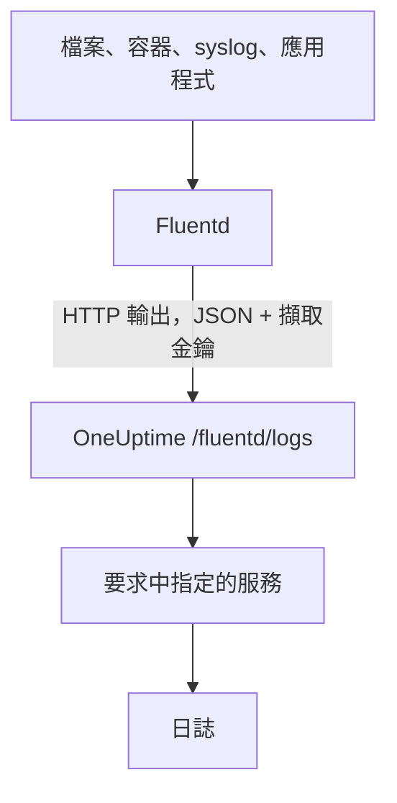

# Fluentd

[Fluentd](https://www.fluentd.org/) 可以從檔案、容器、syslog、應用程式以及[許多其他來源](https://www.fluentd.org/datasources)收集日誌。它內建的 [HTTP 輸出](https://docs.fluentd.org/output/http)會把日誌傳送到 OneUptime 的 Fluentd 端點，之後就能在 **產品 → 日誌** 中搜尋這些日誌。

:::cards
- [設定 Fluentd](#設定-fluentd): 加入一個指向 OneUptime 的 HTTP 輸出。
- [記錄的讀取方式](#記錄的讀取方式): 哪些欄位會成為訊息、嚴重性與屬性。
- [自行託管的 OneUptime](#自行託管的-oneuptime): 讓 Fluentd 傳送到你自己的執行個體。
:::

## 運作方式



Fluentd 以 JSON 格式批次傳送記錄，擷取金鑰放在 `x-oneuptime-token` 標頭中，服務名稱放在 `x-oneuptime-service-name` 中。OneUptime 會把每筆記錄變成該服務的一筆日誌，並在第一次傳送時建立該服務。

## 開始之前

- **安裝 Fluentd**：請參閱[安裝指南](https://docs.fluentd.org/installation)。
- **一個 OneUptime 專案。** 在 OneUptime Cloud 上，遙測資料依擷取的 GB 計費（請參閱[價格](https://oneuptime.com/pricing)），而且 Free 方案的專案必須先新增付款方式才能傳送遙測資料。
- **一個遙測擷取金鑰。** 如果還沒有，請依下列步驟建立：

:::steps
### 開啟擷取金鑰

前往 **產品 → 專案設定**，在側邊選單中展開 **遙測與 APM**，然後選擇 **擷取金鑰**。


### 建立金鑰

點選 **建立擷取金鑰**。對話框已經填好金鑰名稱，並選好 **伺服器**（應用程式或 Collector 傳送資料時使用的金鑰類型），因此直接點選 **建立擷取金鑰** 即可建立，也可以先重新命名。

### 複製機密

新金鑰會在自己的頁面中開啟。複製它的 **密鑰金鑰**：這就是下方設定中的 `YOUR_SERVICE_TOKEN`。


:::

## 設定 Fluentd

Fluentd 的設定檔通常是 `/etc/fluent/fluentd.conf`，舊的 td-agent 套件則是 `/etc/td-agent/td-agent.conf`。

:::steps
### 加入 HTTP 輸出

加入一個把記錄傳送到 OneUptime 的 `<match>` 區段。把 `YOUR_SERVICE_TOKEN` 換成你的擷取金鑰，把 `YOUR_SERVICE_NAME` 換成日誌要顯示的名稱（任何名稱都可以）：

```text title="fluentd.conf"
# Send the time Fluentd gave each event: the HTTP output sends only the record
<filter **>
  @type record_transformer
  enable_ruby true
  <record>
    fluentd_time ${time.utc.strftime("%Y-%m-%dT%H:%M:%S.%NZ")}
  </record>
</filter>

# Match all patterns
<match **>
  @type http

  endpoint https://oneuptime.com/fluentd/logs
  open_timeout 2

  headers {"x-oneuptime-token":"YOUR_SERVICE_TOKEN", "x-oneuptime-service-name":"YOUR_SERVICE_NAME"}

  content_type application/json
  json_array true

  # Send a batch again when OneUptime is busy (429) or restarting (502, 503, 504)
  retryable_response_codes 429,502,503,504

  <format>
    @type json
  </format>
  <buffer>
    # Keep the batches on disk until OneUptime takes them: a restart of Fluentd loses none
    @type file
    path /var/log/fluent/buffer/oneuptime
    total_limit_size 512m
    flush_interval 10s
    chunk_limit_size 900k
    # Try again at least every 30 seconds, for up to 72 hours
    retry_max_interval 30s
    retry_timeout 72h
  </buffer>
</match>

# Keep Fluentd's own logs out of OneUptime
<label @FLUENT_LOG>
  <match **>
    @type null
  </match>
</label>
```

`json_array true` 讓緩衝區的每個區塊都以一個 JSON 陣列傳送，`flush_interval 10s` 則每 10 秒傳送一次緩衝區。`chunk_limit_size 900k` 讓每個要求都小於 1 MB，這是 OneUptime 在這個端點上接受的上限。

Fluentd 本身的預設設定也可以：不設定 `content_type` 和 `json_array true` 時，Fluentd 會傳送以換行分隔的 JSON，每行一筆記錄，OneUptime 會把每一行讀成它所代表的記錄，無論是否使用 `compress gzip`。

`@type file` 把尚未傳送的批次保存在 `path` 指定的資料夾中，因此重新啟動 Fluentd 不會遺失其中任何一批；記憶體中的緩衝區（Fluentd 的預設）會遺失其中保存的內容。Fluentd 的使用者必須能寫入該資料夾：`/var/log/fluent` 是 fluent-package 的，`/var/log/td-agent` 是 td-agent 的，`/fluentd/log` 是 `fluent/fluentd` 映像檔的。`total_limit_size 512m` 讓那裡最多保存 512 MB；滿了之後，Fluentd 在送出一批資料之前不再接收記錄。

`retryable_response_codes 429,502,503,504` 會在 OneUptime 忙碌（`429`）或正在重新啟動（`502`、`503`、`504`）時重新傳送一批資料；沒有這一項，Fluentd 遇到 `503` 以外的任何回應都會丟棄這批資料。`retry_max_interval 30s` 讓兩次重試之間最多等待 30 秒，`retry_timeout 72h` 則會丟棄 72 小時後仍無法傳送的一批資料。`record_transformer` 過濾器把 Fluentd 給每筆記錄的時間作為 `fluentd_time` 加入記錄：HTTP 輸出只傳送記錄本身，而 OneUptime 從記錄中讀取日誌的時間。

### 重新啟動 Fluentd

重新啟動 Fluentd 服務，讓它載入新的輸出。

### 確認日誌已送達

下一次排清後幾秒內，日誌就會出現在 **產品 → 日誌** 中。服務會列在 **產品 → 服務** 下；如果它之前不存在，OneUptime 會建立它。
:::

## 完整範例

這份設定在連接埠 `24224` 上透過 Fluentd 的 forward 協定只接收來自本主機的記錄，並把它們全部傳送到 OneUptime：

```text title="fluentd.conf"
####
## Source descriptions:
##

## built-in TCP input
## @see https://docs.fluentd.org/input/forward
<source>
  @type forward
  port 24224
  # This host alone: see "Take records from other hosts" to open it
  bind 127.0.0.1
</source>

# Send the time Fluentd gave each event: the HTTP output sends only the record
<filter **>
  @type record_transformer
  enable_ruby true
  <record>
    fluentd_time ${time.utc.strftime("%Y-%m-%dT%H:%M:%S.%NZ")}
  </record>
</filter>

<match **>
  @type http

  endpoint https://oneuptime.com/fluentd/logs
  open_timeout 2

  headers {"x-oneuptime-token":"YOUR_SERVICE_TOKEN", "x-oneuptime-service-name":"YOUR_SERVICE_NAME"}

  content_type application/json
  json_array true

  # Send a batch again when OneUptime is busy (429) or restarting (502, 503, 504)
  retryable_response_codes 429,502,503,504

  <format>
    @type json
  </format>
  <buffer>
    # Keep the batches on disk until OneUptime takes them: a restart of Fluentd loses none
    @type file
    path /var/log/fluent/buffer/oneuptime
    total_limit_size 512m
    flush_interval 10s
    chunk_limit_size 900k
    # Try again at least every 30 seconds, for up to 72 hours
    retry_max_interval 30s
    retry_timeout 72h
  </buffer>
</match>

# Keep Fluentd's own logs out of OneUptime
<label @FLUENT_LOG>
  <match **>
    @type null
  </match>
</label>
```

`bind 127.0.0.1` 只接收來自本主機的記錄，例如 Docker 的 `fluentd` 日誌驅動程式傳往 `localhost:24224` 的記錄。若要把不同的來源當成不同的服務傳送，請為每個標籤使用一個 `<match>` 區段，並各自設定 `x-oneuptime-service-name` 和緩衝區的 `path`：兩個緩衝區使用同一路徑時，Fluentd 無法啟動。

## 接收來自其他主機的記錄

使用 `bind 0.0.0.0` 而沒有 `<security>` 區段時，任何能連到連接埠 `24224` 的人都可以用你的擷取金鑰向 OneUptime 傳送日誌。若要接收其他主機上 Fluentd 或 Fluent Bit 的記錄，請在所有位址上監聽，要求每個傳送端提供共用金鑰，並使用 TLS。把完整範例的 `<source>` 區段替換為：

```text title="fluentd.conf on this host"
<source>
  @type forward
  port 24224
  bind 0.0.0.0
  <transport tls>
    cert_path /etc/fluent/certs/fluentd.crt
    private_key_path /etc/fluent/certs/fluentd.key
  </transport>
  <security>
    self_hostname fluentd.example.com
    shared_key YOUR_SHARED_KEY
  </security>
</source>
```

`cert_path` 和 `private_key_path` 是本主機名稱（這裡是 `fluentd.example.com`）的憑證及其私密金鑰，Fluentd 的使用者必須能讀取它們。私密金鑰沒有密碼短語時 Fluentd 會發出警告；`private_key_passphrase` 用來設定密碼短語。把 `YOUR_SHARED_KEY` 換成一個很長的隨機密鑰，例如用 `openssl rand -base64 32` 產生的，並給每個傳送端設定同一個：

```text title="fluentd.conf on each sender"
<match **>
  @type forward
  transport tls
  # The certificate of the authority that signed this host's; not needed for a public one
  tls_cert_path /etc/fluent/certs/ca.crt
  <security>
    self_hostname app-1.example.com
    shared_key YOUR_SHARED_KEY
  </security>
  <server>
    host fluentd.example.com
    port 24224
  </server>
  <buffer>
    @type file
    path /var/log/fluent/buffer/forward
  </buffer>
</match>

# Keep Fluentd's own logs out of OneUptime
<label @FLUENT_LOG>
  <match **>
    @type null
  </match>
</label>
```

Fluent Bit 的 `forward` 輸出接受同樣的設定：`Shared_Key`、`Self_Hostname`、`tls On` 和 `tls.ca_file`。

沒有金鑰或不使用 TLS 的傳送端會被拒絕。金鑰本身從不經過網路：雙方各自證明自己持有它。沒有 TLS，主機之間網路上的任何人都能讀取這些記錄。只在主機防火牆中對傳送資料的主機開放連接埠 `24224`。如果 Fluentd 透過日誌指南的 Docker Compose 檔案執行，也要在那裡把連接埠發佈到所有位址（`"24224:24224"`），並把憑證所在的資料夾掛載到容器中。

## 記錄的讀取方式

OneUptime 會從每筆記錄讀取下列欄位：

| 日誌欄位 | 從記錄中下列欄位裡最先出現的一個讀取 | 說明 |
| --- | --- | --- |
| 內文 | `message`、`log`、`msg`、`body`、`text` | 日誌行。這些欄位都沒有的記錄會整筆以 JSON 儲存。 |
| 嚴重性 | `level`、`severity`、`loglevel`、`log_level`、`priority`、`severityText`、`severity_text` | 例如 `trace`、`debug`、`info`、`notice`、`warn`、`error`、`critical` 與 `fatal` 這類名稱，不分大小寫。其他任何值都會儲存為 `Unspecified`。 |
| 追蹤 ID | `trace_id`、`traceId`、`traceid` | 把日誌關聯到它的追蹤。 |
| Span ID | `span_id`、`spanId`、`spanid` | 把日誌關聯到它的 span。 |
| 服務 | `x-oneuptime-service-name` 標頭 | 沒有設定該標頭時為 `Fluentd`。 |
| 時間 | `time`、`timestamp`、`@timestamp`、`ts`、`fluentd_time` | ISO 8601 時間，例如 `2026-11-14T08:00:00.123Z`，或自紀元起的秒、毫秒、微秒或奈秒；沒有時區的時間按 UTC 處理。早於 2000 年或超前一天以上的時間不會被讀取。讀取時間的欄位不會儲存為屬性。沒有時間的記錄按 OneUptime 收到它的時間儲存。 |

其他每個欄位都會成為一個名為 `fluentd.` 加欄位名稱的屬性，可以用來搜尋與篩選：例如 `container_name` 欄位在日誌瀏覽器中就是 `@fluentd.container_name`。巢狀物件會以點號展開，例如 `fluentd.kubernetes.pod_name`，清單則以 JSON 儲存。

Fluentd 日誌會像其他日誌一樣，經過你的[日誌管道](/docs/telemetry/log-pipelines)、捨棄過濾器與遮蔽規則。

## 自行託管的 OneUptime

把 `endpoint` 中的 `https://oneuptime.com` 換成你的 OneUptime 執行個體的 URL：`http(s)://YOUR_ONEUPTIME_HOST/fluentd/logs`。

## 疑難排解

:::details Fluentd 記錄了來自 HTTP 輸出的 `401`
擷取金鑰缺少、未知或已過期。檢查 `headers` 中 `x-oneuptime-token` 的值。
:::

:::details Fluentd 記錄了 `402` 或 `422`
`402`：在 OneUptime Cloud 上，專案使用 Free 方案且沒有付款方式。請在 **專案設定 → 帳單與發票 → 帳單** 中新增。`422`：金鑰已停用，或是瀏覽器金鑰。請在金鑰的設定中重新開啟 **已啟用**，或建立一個 **伺服器** 金鑰。
:::

:::details Fluentd 記錄了 `413`
要求超過了 1 MB，這是 OneUptime 在這個端點上接受的上限。請像上面的設定那樣，在 `<buffer>` 區段設定 `chunk_limit_size 900k`。
:::

:::details Fluentd 記錄了 `429`、`502`、`503` 或 `504`
OneUptime 忙碌或正在重新啟動。像上面的設定那樣在 `<match>` 區段加上 `retryable_response_codes 429,502,503,504`，Fluentd 就會保留這批資料並重新傳送；沒有這一項，Fluentd 會丟棄這批資料。在 `<buffer>` 區段加上 `@type file`，Fluentd 重新啟動時也會保留這批資料。
:::

:::details 日誌顯示的是 OneUptime 收到它們的時間，而不是它們自己的時間
OneUptime 從日誌的記錄中讀取它的時間，而 Fluentd 的 HTTP 輸出只傳送記錄本身。`<parse>` 區段會把 `time` 欄位作為事件時間從記錄中取出：請在其中加上 `time_key fluentd_time`，讓它不讀取任何記錄的時間，並保留 `time` 原樣。再加上上面設定中的 `record_transformer` 過濾器：它把 Fluentd 給每筆記錄的時間作為 `fluentd_time` 加入記錄。
:::

:::details `time` 為 `null`、`true`、清單或物件的 JSON 行始終沒有到達
Fluentd 的 `json` 剖析器把一行的 `time` 欄位讀作事件時間，並且會在沒有任何警告的情況下丟棄 `time` 既不是文字也不是數字的行。像上面一樣在它的 `<parse>` 區段加上 `time_key fluentd_time`：這樣 Fluentd 會把 `time` 原樣留在記錄中。有了上面的 `record_transformer` 過濾器，OneUptime 會按 Fluentd 讀取它的時間 `fluentd_time` 儲存日誌；沒有它，則按 OneUptime 收到它的時間儲存。
:::

:::details 日誌歸到了 `Fluentd` 服務下
缺少 `x-oneuptime-service-name` 標頭。請在每個 `<match>` 區段的 `headers` 中加上它。
:::

:::details 日誌內文顯示了整筆記錄的 JSON
OneUptime 會從記錄中 `message`、`log`、`msg`、`body` 或 `text` 裡最先出現的一個讀取內文，這些都沒有時就儲存整筆記錄。請把保存日誌行的欄位重新命名為其中之一，例如使用 Fluentd 的 `record_transformer` 過濾器。
:::

如果對設定有任何問題或需要協助，請寄信至 support@oneuptime.com。

## 後續步驟

:::cards
- [日誌管道](/docs/telemetry/log-pipelines): 剖析並豐富 Fluentd 傳送的日誌。
- [搜尋語法](/docs/telemetry/search-syntax): 在日誌瀏覽器中尋找日誌。
- [Fluent Bit](/docs/telemetry/fluentbit): 一個透過 OpenTelemetry 傳送、更輕量的代理程式。
- [日誌監控](/docs/monitor/logs-monitor): 出現符合的日誌時發出警示。
:::
