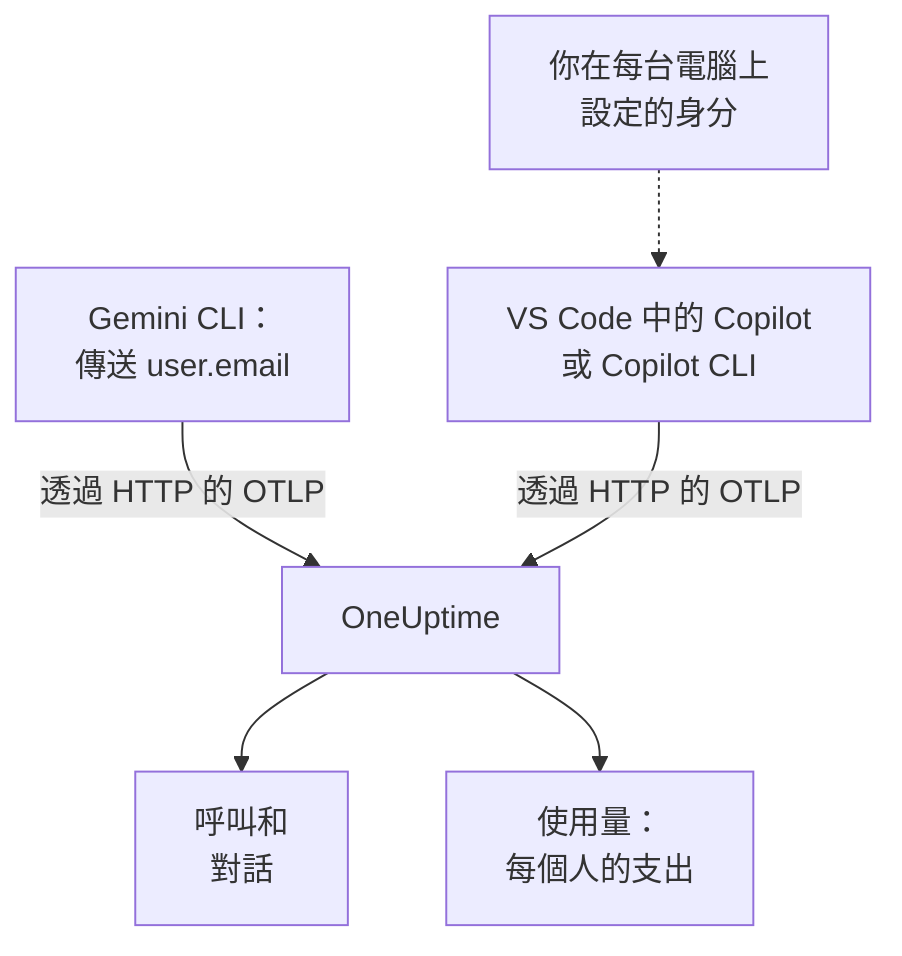

# Gemini CLI 與 GitHub Copilot

Gemini CLI 和 GitHub Copilot 都能自己匯出 OpenTelemetry：把它們指向 OneUptime，它們的模型呼叫、token、成本和工具呼叫就會抵達 [AI / LLM](/docs/telemetry/ai-llm-observability)，與你自己應用程式的 AI 呼叫放在一起。兩者在成本分攤最重要的一點上不同：Gemini CLI 在每筆記錄上都指出是誰，而 Copilot 誰也不指出，所以你需要自己為每位開發人員署名。

:::cards
- [Gemini CLI](#設定-gemini-cli): 開啟含追蹤的遙測，並直接傳送到 OneUptime。
- [GitHub Copilot](#設定-github-copilot): 從 VS Code 或 Copilot CLI 匯出。
- [為每位開發人員署名](#為每位開發人員署名): Copilot 沒有提供的身分。
- [疑難排解](#疑難排解): 沒有資料抵達時要檢查什麼。
:::

## 運作方式



| | Gemini CLI | GitHub Copilot |
| --- | --- | --- |
| 傳送 | 追蹤、指標和日誌 | 追蹤、指標和事件，僅來自其代理程式功能 |
| 指出是誰 | 登入時為 `user.email` | 無：由你設定 `enduser.id` 和 `user.email` |
| 提示文字 | 傳送，除非你關閉 `logPrompts` | 不傳送，除非你開啟 `captureContent` |
| 預設傳送到 | `http://localhost:4317`，透過 gRPC | `http://localhost:4318`，透過 HTTP |

## 開始之前

- 一把擷取金鑰：開啟 **專案設定 → 遙測與 APM → 擷取金鑰** ，按一下 **建立擷取金鑰** 。
- 你的 OTLP 基礎 URL：`https://oneuptime.com/otlp`，如果你自行託管 OneUptime，則為 `https://YOUR-ONEUPTIME-HOST/otlp`。
- 金鑰透過每個匯出請求的 `x-oneuptime-token` 標頭傳遞。

## 設定 Gemini CLI

Gemini CLI 會傳送追蹤、指標和日誌事件，並在有人登入時於每筆記錄加上 `user.email`。OneUptime 把 `user.email` 讀作員工，所以不需要對照表、也不需要逐台電腦設定，就能看到每個人的支出。

:::steps
### 開啟遙測

在每台電腦的使用者設定檔中，或在存放庫的 `.gemini/settings.json` 中新增一個 `telemetry` 區塊：

```json title="~/.gemini/settings.json"
{
  "telemetry": {
    "enabled": true,
    "target": "local",
    "otlpEndpoint": "https://oneuptime.com/otlp",
    "otlpProtocol": "http",
    "otlpHeaders": {
      "x-oneuptime-token": "YOUR_INGESTION_TOKEN"
    },
    "traces": true,
    "logPrompts": false
  }
}
```

### 開始新的工作階段

Gemini CLI 在啟動時讀取設定，所以請重新啟動它並執行一個提示。

### 檢查資料是否抵達

開啟 **產品 → AI / LLM → 呼叫** ：呼叫會列在服務 `gemini-cli` 下，並帶有模型和 token。
:::

這個區塊中有三項設定比其他的更重要：

- `otlpProtocol: "http"`。除非另行指定，Gemini CLI 會使用 gRPC。透過 HTTP 時，它會自己在基礎 URL 後加上 `/v1/traces`、`/v1/metrics` 和 `/v1/logs`。OneUptime 也在 443 連接埠接受 gRPC（請參閱 [透過 gRPC 的 OTLP](/docs/telemetry/open-telemetry#透過-grpc-的-otlp)），但 HTTP 比較簡單。
- `traces: true`。它預設為關閉，沒有它，Gemini CLI 的 span 既不帶模型也不帶 token 計數，就無法計價。Gemini CLI 也不傳送成本指標：若要看到它的呼叫花了多少錢，請開啟追蹤。
- `logPrompts: false`。請閱讀下方的警告。

> [!WARNING]
> `logPrompts` 預設為 `true`，所以一開啟遙測，就會傳送工程師輸入的文字：其中常常有原始程式碼、客戶資料和貼上的認證資訊。請在開啟遙測的同一次變更中把它設為 `false`。如果你需要提示來除錯，請刻意做出決定，並用 **追蹤 → 設定** 下的清除規則遮蔽必須遮蔽的內容。

### 適用大量電腦的設定

每項設定都有環境變數，而且環境變數優先於存放庫中的 `.gemini/settings.json`，因此很適合用來承載透過 MDM 推送的統一原則：

```bash
export GEMINI_TELEMETRY_ENABLED=true
export GEMINI_TELEMETRY_TARGET=local
export GEMINI_TELEMETRY_OTLP_ENDPOINT="https://oneuptime.com/otlp"
export GEMINI_TELEMETRY_OTLP_PROTOCOL=http
export GEMINI_TELEMETRY_OTLP_HEADERS="x-oneuptime-token=YOUR_INGESTION_TOKEN"
export GEMINI_TELEMETRY_TRACES_ENABLED=true
export GEMINI_TELEMETRY_LOG_PROMPTS=false
```

| 設定 | 變數 | 預設值 | 作用 |
| --- | --- | --- | --- |
| `enabled` | `GEMINI_TELEMETRY_ENABLED` | `false` | 開啟遙測 |
| `target` | `GEMINI_TELEMETRY_TARGET` | `local` | `local` 傳送到你設定的端點；`gcp` 傳送到 Google Cloud |
| `otlpEndpoint` | `GEMINI_TELEMETRY_OTLP_ENDPOINT` | `http://localhost:4317` | 遙測送往何處 |
| `otlpProtocol` | `GEMINI_TELEMETRY_OTLP_PROTOCOL` | `grpc` | `grpc` 或 `http` |
| `otlpHeaders` | `GEMINI_TELEMETRY_OTLP_HEADERS` | 無 | 每次匯出攜帶的標頭：檔案中為物件，變數中為 `key=value` 配對或 JSON |
| `traces` | `GEMINI_TELEMETRY_TRACES_ENABLED` | `false` | 把模型、token 和承載資料放到 span 上 |
| `logPrompts` | `GEMINI_TELEMETRY_LOG_PROMPTS` | `true` | 把提示文字放進日誌事件 |
| `outfile` | `GEMINI_TELEMETRY_OUTFILE` | 無 | 改為把遙測寫入檔案，以查看將會傳送什麼 |

命令列旗標優先於 `GEMINI_TELEMETRY_*` 變數，後者優先於標準的 `OTEL_EXPORTER_OTLP_*` 變數，再後者優先於 `settings.json`。Gemini CLI 也會讀取 `OTEL_EXPORTER_OTLP_HEADERS`，所以你已經為其他工具設定的標頭也會傳給它。

:::details 改為透過 OpenTelemetry Collector 傳送
每台電腦一個收集器，或每個團隊一個，可以在遙測抵達 OneUptime 之前進行批次處理、重試和路由。讓 Gemini CLI 維持預設值（透過 gRPC 傳送到 `http://localhost:4317`），由收集器加上金鑰：

```yaml title="otel-collector-config.yaml"
receivers:
  otlp:
    protocols:
      grpc:
        endpoint: 0.0.0.0:4317
      http:
        endpoint: 0.0.0.0:4318

exporters:
  otlphttp:
    endpoint: "https://oneuptime.com/otlp"
    headers:
      "x-oneuptime-token": "YOUR_INGESTION_TOKEN"

service:
  pipelines:
    traces:
      receivers: [otlp]
      exporters: [otlphttp]
    metrics:
      receivers: [otlp]
      exporters: [otlphttp]
    logs:
      receivers: [otlp]
      exporters: [otlphttp]
```

執行收集器的方法請參閱 [OpenTelemetry](/docs/telemetry/open-telemetry)。
:::

### Gemini CLI 傳送的內容

| 指標 | 攜帶的內容 |
| --- | --- |
| `gen_ai.client.token.usage` | 輸入和輸出 token：OneUptime 計數的序列 |
| `gemini_cli.token.usage` | 以 Gemini CLI 自己的名稱記錄的相同 token，外加它的 `thought`、`cache` 和 `tool` token；不計數，以免 token 被重複計算 |
| `gen_ai.client.operation.duration` | 每次模型呼叫花了多久 |
| `gemini_cli.api.request.count` | 模型呼叫 |
| `gemini_cli.tool.call.count` | 工具呼叫 |
| `gemini_cli.session.count` | 已啟動的工作階段 |
| `gemini_cli.lines.changed` | 代理程式修改的行數 |

它的日誌事件包括 `gemini_cli.user_prompt`、`gemini_cli.api_request`、`gemini_cli.api_response`、`gemini_cli.api_error`、`gemini_cli.tool_call` 和 `gemini_cli.file_operation`。每筆記錄都帶有 `session.id`、`installation.id`、`active_approval_mode`，有人登入時還帶有 `user.email`。OneUptime 把 `session.id` 讀作對話 ID，所以無論一個 Gemini CLI 工作階段用了多少個追蹤，它都會在 **對話** 下顯示為一段對話。

這些指標是一般的 OpenTelemetry 指標：你可以把其中任何一個繪製到儀表板上，或用 [指標監控](/docs/monitor/metrics-monitor) 針對它發出警示。

## 設定 GitHub Copilot

GitHub 只為 Copilot 的代理程式功能記載了 OpenTelemetry：

| 功能 | 傳送 OpenTelemetry |
| --- | --- |
| VS Code 中的 Copilot Chat 和代理程式模式 | 是 |
| Copilot CLI | 是 |
| Copilot SDK | 是 |
| JetBrains IDE 中的代理程式工作流程 | 是，在 Copilot 外掛程式的設定中設定 |
| 行內完成、github.com 上的 Copilot、Copilot 程式碼審查 | 未記載 |

所以一個主要使用行內完成的團隊，無論匯出怎麼設定，在 OneUptime 中看起來都像沒有活動。

:::tabs
@tab VS Code
```json title="settings.json"
{
  "github.copilot.chat.otel.enabled": true,
  "github.copilot.chat.otel.exporterType": "otlp-http",
  "github.copilot.chat.otel.otlpEndpoint": "https://oneuptime.com/otlp",
  "github.copilot.chat.otel.captureContent": false
}
```
@tab Copilot CLI
```bash
export COPILOT_OTEL_ENABLED=true
export OTEL_EXPORTER_OTLP_ENDPOINT="https://oneuptime.com/otlp"
export OTEL_EXPORTER_OTLP_HEADERS="x-oneuptime-token=YOUR_INGESTION_TOKEN"
```
@tab 受管理的設定
```json
{
  "telemetry": {
    "enabled": true,
    "endpoint": "https://oneuptime.com/otlp",
    "protocol": "http/protobuf",
    "serviceName": "github-copilot",
    "captureContent": false,
    "lockCaptureContent": true,
    "headers": {
      "x-oneuptime-token": "YOUR_INGESTION_TOKEN"
    }
  }
}
```
:::

- VS Code 的設定中沒有用於標頭的鍵：請像 Copilot CLI 一樣，在 VS Code 啟動時所在的環境中設定 `OTEL_EXPORTER_OTLP_HEADERS`。環境變數優先於 VS Code 的設定。
- 受管理的設定由企業推送到 VS Code 和 Copilot CLI，它在 `headers` 中攜帶金鑰，並且優先於每位開發人員自己的設定。`lockCaptureContent` 會讓所有人的提示擷取保持關閉。那裡的 `protocol` 是傳輸格式，`http/protobuf` 或 `http/json`。
- `captureContent` 預設為關閉，所以除非你開啟它，否則不會傳送提示和回答。

## 為每位開發人員署名

Copilot 不會傳送 OneUptime 可以使用的身分。它的 `captureIdentity` 設定會加上 `user.name`，Copilot CLI 可能會加上 `enduser.pseudo.id`，但 OneUptime 都不會把它們讀作員工。沒有身分時，Copilot 的全部支出都會落在 **使用量** 分頁上的一列 **未歸屬** 中。

請在每台電腦上，在 VS Code 和 Copilot CLI 啟動時所在的環境中設定身分：可以是 shell 設定檔，也可以是你的 MDM 執行的指令碼。

```bash
export OTEL_RESOURCE_ATTRIBUTES="enduser.id=alice@example.com,user.email=alice@example.com,team.id=platform,cost_center=eng-tools"
```

| 屬性 | OneUptime 將其讀作 |
| --- | --- |
| `enduser.id` | 員工的 ID |
| `user.email` | 員工的電子郵件：**使用量** 分頁顯示的名稱 |
| `team.id`、`team`、`cost_center`、`department` | 團隊或成本中心 |

這些是資源屬性，所以它們會以 `resource.enduser.id`、`resource.user.email` 等形式抵達：OneUptime 讀取每個身分和團隊鍵時，有沒有 `resource.` 前置詞都可以。Gemini CLI 已經會傳送 `user.email`；只需要為了團隊給它設定 `OTEL_RESOURCE_ATTRIBUTES`。

- 請在第一次呼叫之前設定身分：沒有身分就抵達的呼叫，事後無法歸屬。
- 不要在 Copilot 的受管理設定中設定 `resourceAttributes`：它們優先於 `OTEL_RESOURCE_ATTRIBUTES`，會取代你在每台電腦上設定的身分。
- 不要使用 `gen_ai.user` 或 `llm.user`。在為客戶提供服務的應用程式中，它們指的是客戶，所以 OneUptime 永遠不會把它們讀作員工。

## Copilot 的資料看起來是什麼樣子

Copilot 遵循 OpenTelemetry GenAI 慣例，所以它的呼叫會像你自己應用程式的呼叫一樣出現在 **呼叫**、**對話** 和 **使用量** 中。

| Span | 每個對應 |
| --- | --- |
| `invoke_agent` | 一輪代理程式互動 |
| `chat` | 一次模型呼叫 |
| `execute_tool` | 一次工具呼叫 |
| `execute_hook` | 一次掛鉤執行 |

它的 span 帶有模型、`gen_ai.usage.input_tokens`、`gen_ai.usage.output_tokens` 和 `gen_ai.conversation.id`，所以一整輪代理程式互動會顯示為一段對話。兩種功能也都會傳送 `gen_ai.client.token.usage` 和 `gen_ai.client.operation.duration` 指標，並在 OTLP 日誌訊號上傳送事件：在你放在中間的任何收集器中，請保留一個 `logs` 管線。

OneUptime 依每次呼叫的模型和 token，按照 **定價** 下的費率為它計價。這是這些 token 以定價計算的花費，而不是 GitHub 向你收取的費用：Copilot 依授權席次和進階請求計費。

授權席次、席次活動和進階請求計費完全不在 OpenTelemetry 中：它們在 GitHub 的 REST API 中，而 OneUptime 不會讀取該 API。席次和帳單數字請從 GitHub 取得。

## 疑難排解

:::details Gemini CLI 沒有任何資料抵達
常見原因是端點是 HTTP URL，而 `otlpProtocol` 仍是預設的 `grpc`。請把 `otlpProtocol` 設為 `http`，並檢查 `otlpEndpoint` 是否是以 `/otlp` 結尾的基礎 URL，以及是否設定了 `x-oneuptime-token` 標頭。暫時設定 `outfile`，就能查看 Gemini CLI 會傳送什麼。
:::

:::details Gemini CLI 的呼叫抵達了，但沒有模型、token 或成本
`traces` 處於關閉狀態。請開啟它：沒有它，Gemini CLI 的 span 既不帶模型也不帶 token 計數，它也不會傳送成本指標。
:::

:::details Copilot 的支出顯示為未歸屬
身分沒有抵達匯出工具。請檢查 `OTEL_RESOURCE_ATTRIBUTES` 是否設定在 VS Code 或 Copilot CLI 啟動時所在的環境中，以及 Copilot 的受管理設定是否設定了會取代它的 `resourceAttributes`。
:::

:::details Copilot 完全沒有傳送任何資料
請檢查你預期的那些人使用的是代理程式功能而不是行內完成，以及 `OTEL_EXPORTER_OTLP_HEADERS` 是否攜帶了金鑰：VS Code 自己的設定做不到這一點。
:::

:::details 金鑰遭到拒絕
金鑰缺少、未知或已過期時，OneUptime 會回應 `401`；金鑰已停用或是瀏覽器金鑰時，會回應 `422`。請使用伺服器金鑰，並透過 `x-oneuptime-token` 傳送。
:::

## 後續步驟

:::cards
- [AI 程式設計助理](/docs/telemetry/ai-coding-assistants): 誰在用哪個工具，以及每個人和每個團隊的花費。
- [AI / LLM 可觀測性](/docs/telemetry/ai-llm-observability): OneUptime 讀取的屬性、成本的計算方式，以及每日預算。
- [AI 閘道](/docs/telemetry/ai-gateways): 透過閘道接入沒有自己匯出功能的工具。
:::
