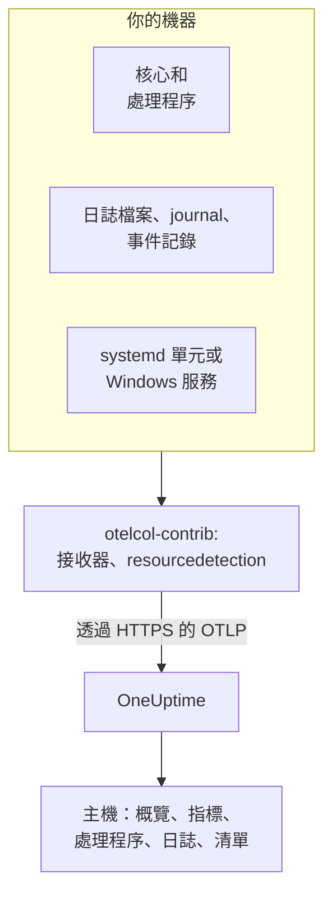

# 主機 OpenTelemetry Collector

在 Linux、macOS 或 Windows 機器上執行 OpenTelemetry Collector，將機器的指標、處理程序、日誌和服務狀態傳送到 OneUptime。機器會出現在 **產品 → 基礎設施 → 主機** 下，並擁有自己的頁面，不需要安裝任何 OneUptime 代理程式：Collector 就是上游的 `otelcol-contrib` 發行版本。[主機監控](/docs/monitor/host-monitor) 會根據它傳送的資料發出警示。

:::cards
- [安裝 Collector](#安裝-collector): 在 Linux、macOS 或 Windows 上只需三個步驟。
- [選擇要收集的內容](#選擇要收集的內容): 指標、檔案日誌、journal、事件記錄和服務狀態。
- [清單屬性](#清單屬性ipmac序號製造商型號韌體): 供 CMDB 使用的 IP、MAC、序號、製造商、型號和韌體。
- [減少傳送量](#減少收集的資料量): 更少的日誌行、更長的間隔、更少的序列。
:::

## 運作方式

Collector 透過接收器讀取機器，為每筆記錄加上機器的身分識別，並使用你的擷取金鑰透過 OTLP 傳送到 OneUptime。OneUptime 會根據第一批指標註冊主機，並在資料送達時填入其頁面。



| 你在主機上看到的內容 | 來源 |
| --- | --- |
| **概覽** 和 **指標** | `hostmetrics` 接收器：CPU、記憶體、磁碟、檔案系統、網路、負載、分頁。 |
| **處理程序** | `hostmetrics` 的 `process` 抓取器：每個處理程序一組序列。 |
| **日誌** | `filelog`、`journald` 和 `windowseventlog` 接收器。 |
| **Systemd Units**（Linux） | `systemd` 接收器。 |
| **服務**（Windows） | `windows_service` 接收器。 |
| 清單項目 | `resourcedetection` 處理器，以及 [你自行加上的屬性](#清單屬性ipmac序號製造商型號韌體)。 |
| **代理程式版本** | `resource` 處理器中的 `oneuptime.agent.version`。 |

當攜帶 `host.name` 的批次同時攜帶 `hostmetrics` 或 `process` 指標，或 `os.type` 屬性時，主機就會被註冊。`resourcedetection` 處理器會設定這些全部，所以每份設定都把它放在第一位。只有 `host.id` 或 `host.arch` 不會註冊主機；攜帶 Kubernetes 身分（`k8s.cluster.name`、`k8s.node.name`、`k8s.pod.name`）的遙測會改為歸入其叢集：請使用 [Kubernetes 代理程式](/docs/telemetry/kubernetes-agent) 監控 Kubernetes 節點。

## 開始之前

- 一把擷取金鑰。在 **專案設定 → 遙測與 APM → 擷取金鑰** 下建立一把並複製其值。Collector 會將其作為 `x-oneuptime-token` 標頭傳送。
- 機器上的系統管理員權限：Linux 和 macOS 上的 `sudo`，Windows 上以系統管理員身分執行的 PowerShell。
- 從機器到你的 OneUptime URL 的輸出 HTTPS。
- Collector 的 contrib 發行版本 `otelcol-contrib`。核心 `otelcol` 組建缺少這些設定所使用的接收器和處理器。`systemd` 接收器（Linux）從 v0.143.0 起可用，`windows_service` 接收器（Windows）從 v0.155.0 起可用；下面的指令會安裝 v0.161.0，也就是 OneUptime 固定的版本。

## 安裝 Collector

:::steps
### 儲存設定

將以下內容儲存為 `config.yaml`，放在你將執行安裝指令的資料夾中，並將 `YOUR_TELEMETRY_INGESTION_TOKEN` 替換為你的擷取金鑰（如果你自行託管，也要將端點替換為你自己的 URL）。

:::tabs
@tab Linux
```yaml title="config.yaml"
receivers:
  hostmetrics:
    collection_interval: 30s
    scrapers:
      cpu:
        metrics:
          system.cpu.utilization:
            enabled: true
          system.cpu.logical.count:
            enabled: true
      memory:
        metrics:
          system.memory.utilization:
            enabled: true
      disk:
      filesystem:
        metrics:
          system.filesystem.utilization:
            enabled: true
      load:
      network:
      paging:
      processes:
      process:
        mute_process_name_error: true
        mute_process_exe_error: true
        mute_process_io_error: true
        metrics:
          process.cpu.utilization:
            enabled: true
          process.memory.utilization:
            enabled: true

  # The systemd journal: every unit's logs, info and above.
  journald:
    directory: /var/log/journal
    priority: info

  # Powers the Systemd Units tab (otelcol-contrib v0.143.0+).
  systemd:
    collection_interval: 30s
    units: ["*.service"]
    metrics:
      systemd.service.cpu.time:
        enabled: false

processors:
  # Stamps host.name, host.id and os.type: this is how OneUptime attaches
  # telemetry to the host. Without it the host's pages stay empty.
  resourcedetection:
    detectors: [system, env]
    system:
      hostname_sources: [os]
      resource_attributes:
        host.name:
          enabled: true
        host.id:
          enabled: true
        host.arch:
          enabled: true
        host.ip:
          enabled: true
        host.mac:
          enabled: true
        os.type:
          enabled: true
        os.description:
          enabled: true
        os.version:
          enabled: true
  # The collector release this config is for: the host's Agent Version.
  resource:
    attributes:
      - key: oneuptime.agent.version
        value: "0.161.0"
        action: upsert
  batch:

exporters:
  otlphttp/oneuptime:
    endpoint: https://oneuptime.com/otlp
    headers:
      x-oneuptime-token: YOUR_TELEMETRY_INGESTION_TOKEN

service:
  pipelines:
    metrics:
      receivers: [hostmetrics, systemd]
      processors: [resourcedetection, resource, batch]
      exporters: [otlphttp/oneuptime]
    logs:
      receivers: [journald]
      processors: [resourcedetection, resource, batch]
      exporters: [otlphttp/oneuptime]
```
@tab macOS
```yaml title="config.yaml"
receivers:
  hostmetrics:
    collection_interval: 30s
    scrapers:
      cpu:
        metrics:
          system.cpu.utilization:
            enabled: true
          system.cpu.logical.count:
            enabled: true
      memory:
        metrics:
          system.memory.utilization:
            enabled: true
      disk:
      filesystem:
        metrics:
          system.filesystem.utilization:
            enabled: true
      load:
      network:
      paging:
      processes:
      process:
        mute_process_name_error: true
        mute_process_exe_error: true
        mute_process_io_error: true
        metrics:
          process.cpu.utilization:
            enabled: true
          process.memory.utilization:
            enabled: true

  filelog/system:
    include:
      - /var/log/install.log
      - /var/log/wifi.log
    start_at: end

processors:
  # Stamps host.name, host.id and os.type: this is how OneUptime attaches
  # telemetry to the host. Without it the host's pages stay empty.
  resourcedetection:
    detectors: [system, env]
    system:
      hostname_sources: [os]
      resource_attributes:
        host.name:
          enabled: true
        host.id:
          enabled: true
        host.arch:
          enabled: true
        host.ip:
          enabled: true
        host.mac:
          enabled: true
        os.type:
          enabled: true
        os.description:
          enabled: true
        os.version:
          enabled: true
  # The collector release this config is for: the host's Agent Version.
  resource:
    attributes:
      - key: oneuptime.agent.version
        value: "0.161.0"
        action: upsert
  batch:

exporters:
  otlphttp/oneuptime:
    endpoint: https://oneuptime.com/otlp
    headers:
      x-oneuptime-token: YOUR_TELEMETRY_INGESTION_TOKEN

service:
  pipelines:
    metrics:
      receivers: [hostmetrics]
      processors: [resourcedetection, resource, batch]
      exporters: [otlphttp/oneuptime]
    logs:
      receivers: [filelog/system]
      processors: [resourcedetection, resource, batch]
      exporters: [otlphttp/oneuptime]
```
@tab Windows
```yaml title="config.yaml"
receivers:
  hostmetrics:
    collection_interval: 30s
    scrapers:
      cpu:
        metrics:
          system.cpu.utilization:
            enabled: true
          system.cpu.logical.count:
            enabled: true
      memory:
        metrics:
          system.memory.utilization:
            enabled: true
      disk:
      filesystem:
        metrics:
          system.filesystem.utilization:
            enabled: true
      load:
      network:
      paging:
      processes:
      process:
        mute_process_name_error: true
        mute_process_exe_error: true
        mute_process_io_error: true
        metrics:
          process.cpu.utilization:
            enabled: true
          process.memory.utilization:
            enabled: true

  windowseventlog/system:
    channel: System
    start_at: end

  windowseventlog/application:
    channel: Application
    start_at: end

  windowseventlog/security:
    channel: Security
    start_at: end

  # Powers the Services tab (otelcol-contrib v0.155.0+).
  windows_service:
    collection_interval: 30s

processors:
  # Stamps host.name, host.id and os.type: this is how OneUptime attaches
  # telemetry to the host. Without it the host's pages stay empty.
  resourcedetection:
    detectors: [system, env]
    system:
      hostname_sources: [os]
      resource_attributes:
        host.name:
          enabled: true
        host.id:
          enabled: true
        host.arch:
          enabled: true
        host.ip:
          enabled: true
        host.mac:
          enabled: true
        os.type:
          enabled: true
        os.description:
          enabled: true
        os.version:
          enabled: true
  # The collector release this config is for: the host's Agent Version.
  resource:
    attributes:
      - key: oneuptime.agent.version
        value: "0.161.0"
        action: upsert
  batch:

exporters:
  otlphttp/oneuptime:
    endpoint: https://oneuptime.com/otlp
    headers:
      x-oneuptime-token: YOUR_TELEMETRY_INGESTION_TOKEN

service:
  pipelines:
    metrics:
      receivers: [hostmetrics, windows_service]
      processors: [resourcedetection, resource, batch]
      exporters: [otlphttp/oneuptime]
    logs:
      receivers:
        - windowseventlog/system
        - windowseventlog/application
        - windowseventlog/security
      processors: [resourcedetection, resource, batch]
      exporters: [otlphttp/oneuptime]
```
:::

每份設定都是儀表板在 **產品 → 基礎設施 → 主機 → 文件** 下寫出的那份，另外加上一條日誌管道：處理器為 `resourcedetection`、`resource` 和 `batch`，匯出器為 `otlphttp/oneuptime`。它沒有設定 `service.name`，因此主機的遙測屬於主機本身，歸檔為 `host/<hostname>`。只有當你希望它改為歸入同名的遙測服務時，才在 `resource` 處理器中加入 `service.name`。

### 安裝並啟動 Collector

:::tabs
@tab Linux
在 Debian 或 Ubuntu 上：

```bash
VERSION=0.161.0                      # the release OneUptime pins
ARCH=$(dpkg --print-architecture)   # amd64 or arm64

curl -fL -o /tmp/otelcol-contrib.deb \
  "https://github.com/open-telemetry/opentelemetry-collector-releases/releases/download/v${VERSION}/otelcol-contrib_${VERSION}_linux_${ARCH}.deb"
sudo dpkg -i /tmp/otelcol-contrib.deb
```

在 RHEL、CentOS、Fedora 或 Amazon Linux 上：

```bash
VERSION=0.161.0
ARCH=$(uname -m | sed 's/x86_64/amd64/;s/aarch64/arm64/')

curl -fL -o /tmp/otelcol-contrib.rpm \
  "https://github.com/open-telemetry/opentelemetry-collector-releases/releases/download/v${VERSION}/otelcol-contrib_${VERSION}_linux_${ARCH}.rpm"
sudo rpm -Uvh /tmp/otelcol-contrib.rpm
```

套件會安裝 `/usr/bin/otelcol-contrib` 和一個 systemd 單元，並以預設設定啟動它。放入你的設定，讓 Collector 的使用者能讀取 journal，然後重新啟動：

```bash
sudo install -m 0644 config.yaml /etc/otelcol-contrib/config.yaml
sudo usermod -aG systemd-journal otelcol-contrib
sudo systemctl enable otelcol-contrib
sudo systemctl restart otelcol-contrib
sudo systemctl status otelcol-contrib
```

封裝好的單元以非特權的 `otelcol-contrib` 使用者執行 Collector。`systemd-journal` 群組讓它能讀取 journal；若要追蹤 `/var/log` 中的檔案（在 Debian 和 Ubuntu 上可由 `adm` 群組讀取），也要加入該群組。若要讓 `process` 抓取器看到其他使用者的處理程序，請授予它 `CAP_SYS_PTRACE` 能力。
@tab macOS
```bash
VERSION=0.161.0
ARCH=$(uname -m | sed 's/x86_64/amd64/')   # arm64 on Apple silicon, amd64 on Intel

curl -fL -o /tmp/otelcol-contrib.tar.gz \
  "https://github.com/open-telemetry/opentelemetry-collector-releases/releases/download/v${VERSION}/otelcol-contrib_${VERSION}_darwin_${ARCH}.tar.gz"

sudo mkdir -p /usr/local/otelcol-contrib /usr/local/bin /etc/otelcol-contrib
sudo tar -xzf /tmp/otelcol-contrib.tar.gz -C /usr/local/otelcol-contrib
sudo ln -sf /usr/local/otelcol-contrib/otelcol-contrib /usr/local/bin/otelcol-contrib
sudo install -m 0644 config.yaml /etc/otelcol-contrib/config.yaml
```

建立 `/Library/LaunchDaemons/com.oneuptime.otelcol-contrib.plist`，讓 launchd 隨 Mac 啟動 Collector，並在它停止時重新啟動：

```xml title="/Library/LaunchDaemons/com.oneuptime.otelcol-contrib.plist"
<?xml version="1.0" encoding="UTF-8"?>
<!DOCTYPE plist PUBLIC "-//Apple//DTD PLIST 1.0//EN" "http://www.apple.com/DTDs/PropertyList-1.0.dtd">
<plist version="1.0">
<dict>
  <key>Label</key><string>com.oneuptime.otelcol-contrib</string>
  <key>ProgramArguments</key>
  <array>
    <string>/usr/local/bin/otelcol-contrib</string>
    <string>--config=/etc/otelcol-contrib/config.yaml</string>
  </array>
  <key>RunAtLoad</key><true/>
  <key>KeepAlive</key><true/>
  <key>StandardOutPath</key><string>/var/log/otelcol-contrib.out.log</string>
  <key>StandardErrorPath</key><string>/var/log/otelcol-contrib.err.log</string>
</dict>
</plist>
```

載入它：

```bash
sudo launchctl load -w /Library/LaunchDaemons/com.oneuptime.otelcol-contrib.plist
sudo launchctl list | grep otelcol-contrib
```

請使用這個 tarball，而不是 Homebrew：Homebrew formula 是核心組建，使用此設定時會拒絕啟動。
@tab Windows
在以系統管理員身分執行的 PowerShell 中，於包含 `config.yaml` 的資料夾裡整段執行這個區塊：每一行都依賴其上方的變數。

```powershell
$VERSION = "0.161.0"                          # the release OneUptime pins; v0.155.0+ has the Services tab
$ARCH    = "amd64"                            # use "arm64" on ARM hosts
$dest    = "C:\Program Files\otelcol-contrib"
$tar     = "$env:TEMP\otelcol-contrib.tar.gz"

# Note the "-contrib" in the asset name; otelcol_... is the wrong archive.
$url = "https://github.com/open-telemetry/opentelemetry-collector-releases/releases/download/v$VERSION/otelcol-contrib_${VERSION}_windows_${ARCH}.tar.gz"

New-Item -ItemType Directory -Force -Path $dest | Out-Null
Invoke-WebRequest -Uri $url -OutFile $tar
tar -xf $tar -C $dest                          # tar.exe ships with Windows 10 1803+ / Server 2019+
Get-ChildItem $dest                            # expect otelcol-contrib.exe, not otelcol.exe
Copy-Item config.yaml "$dest\config.yaml" -Force

# --% hands the rest of the line to sc.exe unchanged, so its quoting
# survives PowerShell — keep the command on one line.
sc.exe --% create "otelcol-contrib" binPath= "\"C:\Program Files\otelcol-contrib\otelcol-contrib.exe\" --config=\"C:\Program Files\otelcol-contrib\config.yaml\"" start= auto DisplayName= "OpenTelemetry Collector (OneUptime)"
sc.exe description "otelcol-contrib" "Collects host telemetry and forwards it to OneUptime over OTLP."
sc.exe start "otelcol-contrib"
sc.exe query "otelcol-contrib"
```

該服務以 `LocalSystem` 執行，可以讀取 `Security` 事件記錄和所有 Windows 服務。在 Windows 上，`load` 抓取器只是根據 *Processor Queue Length* 計數器模擬負載平均值，從 0 開始。

資產名稱必須以 `otelcol-contrib_` 開頭。核心的 `otelcol_<version>_windows_amd64.tar.gz` 封存檔會解壓出 `otelcol.exe`，它沒有 `windowseventlog` 或 `windows_service` 接收器；將它重新命名為 `otelcol-contrib.exe` 也不會加入這些接收器。比較喜歡安裝程式？同一個 [發行頁面](https://github.com/open-telemetry/opentelemetry-collector-releases/releases) 提供已簽署的 `otelcol-contrib_<version>_windows_x64.msi`，它會為你註冊服務：將它指向這個 `config.yaml`，並讓服務維持使用 `LocalSystem`。
:::

### 檢查主機是否出現

開啟 **產品 → 基礎設施 → 主機 → 所有主機**。第一批指標送達後（通常在 30 秒內），主機會以其主機名稱出現，其 **概覽**、**指標**、**處理程序** 和 **日誌** 頁面也會填入資料。如果沒有出現，請查看 Collector 本身的日誌：

:::tabs
@tab Linux
```bash
sudo journalctl -u otelcol-contrib -f
```
@tab macOS
```bash
tail -f /var/log/otelcol-contrib.err.log
```
@tab Windows
```powershell
Get-WinEvent -LogName Application -MaxEvents 20 | Where-Object ProviderName -eq "otelcol-contrib"
```
:::
:::

若要產生一行測試日誌，請執行 `logger "hello from oneuptime"`（Linux、macOS）或 `eventcreate /T INFORMATION /ID 999 /L APPLICATION /SO OneUptimeTest /D "hello from oneuptime"`（Windows，系統管理員權限），然後查看主機的 **日誌** 頁面。

## 選擇要收集的內容

每份設定的結構都相同：用來讀取內容的接收器，`resourcedetection`、`resource` 和 `batch` 處理器，以及 `otlphttp/oneuptime` 匯出器。將下面的接收器加入 `receivers:` 及其管道中，然後重新啟動 Collector（`sudo systemctl restart otelcol-contrib`；在 Mac 上先 `launchctl unload` 再 `load`；在 Windows 上 `Restart-Service otelcol-contrib`）。將每個片段合併到你的設定已有的區段中：第二個 `processors:` 或 `service:` 鍵會取代第一個。

### 主機指標

`hostmetrics` 適用於所有作業系統。它每隔 `collection_interval` 從核心讀取 CPU、記憶體、磁碟、檔案系統、網路、負載、分頁和處理程序。`*.utilization` 指標和 `system.cpu.logical.count` 在接收器中預設為關閉，而主機的圖表和 Host 警示範本會讀取它們，所以請像上面的設定那樣保持啟用。`process` 抓取器為 **處理程序** 頁面提供資料；它也是序列的最大來源（請參閱 [減少傳送量](#減少收集的資料量)）。

在 Linux 上，Collector 會讀取 `/proc` 和 `/sys`。容器中的 Collector 必須掛載主機的這兩個目錄並設定 `HOST_PROC` 和 `HOST_SYS`（請參閱 [在 Docker 容器中](#在-docker-容器中)）；原生安裝則不需要任何東西。

### 檔案日誌

使用 `filelog` 接收器追蹤磁碟上的任何日誌檔案，並將其加入 `logs` 管道：

```yaml
receivers:
  filelog/app:
    include:
      - /var/log/myapp/*.log
    start_at: end
    multiline:
      # A new entry starts with a timestamp; continuation lines (the
      # "at ...", "File ...", "Caused by: ..." frames) are folded into it.
      line_start_pattern: '^\d{4}-\d{2}-\d{2}[ T]\d{2}:\d{2}:\d{2}'
```

`start_at: end` 只讀取新的行；若要在第一次執行時從頭讀取檔案，請使用 `beginning`。Collector 會記住它在每個檔案中的位置，因此重新啟動後能正確接續。

OneUptime 會掃描 error 和 fatal 等級日誌行中的堆疊追蹤，並將其分組為主機下的 **例外**。為此，多行堆疊追蹤（Java、Python、.NET、Ruby）必須以單一記錄送達，這正是 `multiline` 的作用；沒有它，每個框架都會變成一筆獨立的日誌。如果你的應用程式能自行寫入 OpenTelemetry 的 `exception.type`、`exception.message` 和 `exception.stacktrace` 屬性，那就更加可靠。

在 systemd 主機上，`/var/log/syslog` 和 `/var/log/messages` 重複了 journal 中已有的內容，所以只讀取其中之一。

### systemd journal

在 systemd 主機上，`journald` 接收器會在同一處讀取所有單元的日誌，並附帶其結構化欄位。上面的 Linux 設定會讀取所有 `info` 及以上等級的日誌；若要縮小到部分單元：

```yaml
receivers:
  journald:
    directory: /var/log/journal
    units:
      # Drop this list to ingest everything; restrict it to limit volume.
      - ssh.service
      - cron.service
      - nginx.service
    priority: info
```

該接收器會執行每台 systemd 主機都有的 `journalctl`，而 Collector 的使用者必須屬於 `systemd-journal` 群組。

### Linux 服務（systemd 單元，指標）

主機的 **Systemd Units** 頁面列出每個單元及其狀態，資料來自 [`systemdreceiver`](https://github.com/open-telemetry/opentelemetry-collector-contrib/tree/main/receiver/systemdreceiver)（設定類型 `systemd`），它是 Windows 上 **服務** 頁面在 Linux 上的對應功能。上面的 Linux 設定會啟用它：

```yaml
receivers:
  systemd:
    collection_interval: 30s
    # The service manager to read: "system" (default) or "user".
    scope: system
    # Which units to scrape, as systemctl unit patterns. The default is
    # every service; widen it to include timers, sockets or mounts, or
    # narrow it to cut volume on hosts with hundreds of units:
    units: ["*.service"]
    # units: [nginx.service, postgresql.service, "*.timer"]
    metrics:
      # Per-service CPU time is on by default and doubles this receiver's
      # datapoint count. The Systemd Units tab does not use it, so turn it
      # off unless you chart it. On v0.142.0 the key is
      # systemd.unit.cpu.time — naming a metric the running build does not
      # have stops the collector at startup.
      systemd.service.cpu.time:
        enabled: false

service:
  pipelines:
    metrics:
      receivers: [hostmetrics, systemd]
      processors: [resourcedetection, resource, batch]
```

該接收器首次隨 `otelcol-contrib` v0.142.0 推出，而 v0.143.0 是第一個值得執行的版本。在更舊的版本上，加入 `systemd` 會在啟動時以 `'receivers' unknown type: "systemd"` 失敗；唯獨 v0.142.0 將其 CPU 指標命名為 `systemd.unit.cpu.time`，並在每個單元上尋找 cgroup 統計資料，這會為每個非 `.service` 單元記錄一個抓取錯誤。

它以狀態集合的形式發出 `systemd.unit.state`：每次抓取時，每個單元的每個可能狀態（`active`、`reloading`、`inactive`、`failed`、`activating`、`deactivating`、`maintenance`、`refreshing`）各得到一個資料點，目前所處的狀態為 `1`，其餘為 `0`。單元名稱是資源屬性 `systemd.unit.name`，狀態是資料點屬性 `systemd.unit.active_state`。由於單元名稱是資源屬性，`resourcedetection` 必須保留在指標管道中：它會將 `host.name` 加到每個單元的資源上，沒有它，樣本就永遠不會關聯到主機。

它透過系統 D-Bus，使用 `systemctl list-units` 所用的唯讀呼叫讀取單元狀態，而 systemd 允許非特權使用者進行這些呼叫。因此，以 `otelcol-contrib` 使用者（而非 root）執行的封裝服務不需要額外權限。但它確實需要匯流排：容器中的 Collector 沒有 `/run/dbus/system_bus_socket`，除非你掛載主機的通訊端，所以請使用原生安裝。該接收器處於 alpha 階段，僅適用於 Linux。

> [!WARNING]
> 狀態集合在每次抓取時每個單元產生八個資料點，預設開啟的 `systemd.service.cpu.time` 再加兩個（`user` 和 `system`）：每次抓取每個單元 10 個資料點。一台每 30 秒追蹤 300 個單元的主機，光是這個接收器每分鐘就會傳送約 6,000 個資料點，關閉 CPU 指標後約為 4,800 個。在整個機群中啟用之前，請先將 `units:` 縮小到你會針對其發出警示的服務，或調高 `collection_interval`。

### Apple Unified Log

macOS 將系統日誌寫入 Apple Unified Log（使用 `log show` 和 `log stream` 讀取），而不是 `/var/log/system.log`。若要收集它，請用一個小型指令碼 `/usr/local/otelcol-contrib/log-stream.sh` 將其串流寫入檔案：

```bash title="/usr/local/otelcol-contrib/log-stream.sh"
#!/bin/bash
exec /usr/bin/log stream --style ndjson --level info \
  --predicate 'subsystem != "com.apple.cfnetwork"' \
  >> /var/log/apple-unified.log
```

讓它可以執行，並在 launchd 下執行它（快速測試可用 `nohup`），然後讓 `filelog` 接收器指向該檔案：

```yaml
receivers:
  filelog/apple-unified:
    include:
      - /var/log/apple-unified.log
    start_at: end
    operators:
      - type: json_parser
        timestamp:
          parse_from: attributes.timestamp
          layout: "%Y-%m-%d %H:%M:%S.%f%j"
```

許多 Mac 機群只需要主機指標和少量檔案日誌就足夠了，不需要統一日誌。

### Windows 事件記錄

上面的 Windows 設定會訂閱 `System`、`Application` 和 `Security` 通道。若要將大流量的 `Security` 通道縮小到部分事件 ID：

```yaml
windowseventlog/security:
  channel: Security
  start_at: end
  query: "*[System[(EventID=4625 or EventID=4740)]]"
```

若要讀取其他通道（*Event Viewer → Applications and Services Logs* 下的任何通道），請使用其確切名稱：

```yaml
windowseventlog/iis:
  channel: Microsoft-IIS-Logging/Logs
  start_at: end
```

### Windows 服務（指標）

主機的 **服務** 頁面列出每個 Windows 服務及其狀態和啟動類型，資料來自 [`windowsservicereceiver`](https://github.com/open-telemetry/opentelemetry-collector-contrib/tree/main/receiver/windowsservicereceiver)（設定類型 `windows_service`）。它從 v0.155.0 起包含在 `otelcol-contrib` 中：在更早的版本上，加入 `windows_service` 會在啟動時以 `'receivers' unknown type: "windows_service"` 失敗。上面的 Windows 設定會啟用它：

```yaml
receivers:
  windows_service:
    collection_interval: 30s
    # Collect every service by default. To cut volume — and avoid the
    # "access denied" noise from services the collector can't open —
    # list just the ones you care about:
    # include_services: [Spooler, W3SVC, MSSQLSERVER]
    # Or collect everything except a few:
    # exclude_services: [TrustedInstaller]

service:
  pipelines:
    metrics:
      receivers: [hostmetrics, windows_service]
```

它會為每個服務發出一個 `windows.service.status` 量測值，也就是 Win32 服務狀態（`4` 表示執行中，`1` 表示已停止），並附帶 `name` 和 `startup_mode` 屬性。Collector 以 `LocalSystem` 讀取每個服務，並略過無法開啟的服務。該接收器處於 alpha 階段，僅適用於 Windows；如果某個服務的抓取錯誤或 `access denied` 影響到其他服務，請用 `include_services` 加以限制。

`include_services` 只能縮小集合。如果你列出了服務卻仍然看到所有服務，表示編輯後的設定尚未送達正在執行的 Collector：請重新啟動服務，檢查 `include_services` 是否為與 `collection_interval` 同一縮排的非空清單，並給 **服務** 頁面幾分鐘時間，直到變更前回報的服務離開其滾動時間範圍。名稱是確切且區分大小寫的服務索引鍵名稱（`Spooler`、`W3SVC`），可用 `Get-Service | Select-Object Name` 列出。

### 標籤

任何以 `oneuptime.label.` 開頭的資源屬性都會成為主機上的專案標籤：`oneuptime.label.<dimension>=<value>` 即標籤 `<dimension>:<value>`。為它們加入一個處理器，並在管道中引用它：

```yaml
processors:
  resource/oneuptime-labels:
    attributes:
      - key: oneuptime.label.team
        value: payments
        action: upsert
      - key: oneuptime.label.env
        value: production
        action: upsert

service:
  pipelines:
    metrics:
      processors: [resourcedetection, resource, resource/oneuptime-labels, batch]
```

標籤比對不區分大小寫，因此既有的 `Production` 標籤會被重複使用而不會重複建立，而在 OneUptime 中加入的標籤也永遠不會被 Collector 移除。

### 清單屬性（IP、MAC、序號、製造商、型號、韌體）

每台主機也會得到一個清單項目：CMDB 匯出所讀取的記錄。它的詳細資料直接來自你傳送的遙測上的資源屬性，因此送達的內容就是 CMDB 同步能夠擷取的內容。

| 你想要的資訊 | 屬性 | 來源 |
| --- | --- | --- |
| IP 位址 | `host.ip` | `resourcedetection`，機器有多個時以逗號連接 |
| MAC 位址 | `host.mac` | `resourcedetection`，每個已啟用的介面一個，以逗號連接 |
| 架構 | `host.arch` | `resourcedetection` |
| 機器 ID | `host.id` | `resourcedetection`：Windows 上為機器 GUID，Linux 上為 `/etc/machine-id` |
| 作業系統 | `os.type`、`os.description`、`os.version` | `resourcedetection` |
| 序號 | `host.serial_number` | 由你從 WMI 或 DMI 讀取後加上 |
| 製造商 | `device.manufacturer` | 由你從 WMI 或 DMI 讀取後加上 |
| 型號 | `device.model.name` | 由你從 WMI 或 DMI 讀取後加上 |
| 韌體（BIOS 或 UEFI）版本 | `device.firmware.version` | 由你從 WMI 或 DMI 讀取後加上 |

上面的設定啟用了所有可偵測的屬性：在 system 偵測器中，預設只開啟 `host.name` 和 `os.type`，這就是它們在 `resource_attributes` 下列出其他屬性的原因。如果你自己撰寫設定，請保留這個 `resourcedetection` 區塊：沒有它就沒有 `host.name`，也就完全沒有主機和清單項目。

#### 序號、製造商、型號和韌體版本沒有偵測器

它們存放在機器的韌體中，而 Collector 不會讀取韌體。在 Linux 上，這也不是你能變更的設定：封裝的 Collector 以非特權的 `otelcol-contrib` 使用者執行，而 `/sys/class/dmi/id/product_serial` 只有 root 可以讀取。因此，請在佈建機器時讀取一次，並用一個專用的處理器將它們加到資源上：

```yaml
processors:
  resource/oneuptime-hardware:
    attributes:
      - key: host.serial_number
        value: "7XYZ123"
        action: upsert
      - key: device.manufacturer
        value: "Dell Inc."
        action: upsert
      - key: device.model.name
        value: "OptiPlex 7090"
        action: upsert
      - key: device.firmware.version
        value: "1.21.0"
        action: upsert

service:
  pipelines:
    metrics:
      processors: [resourcedetection, resource, resource/oneuptime-hardware, batch]
```

將 `resource/oneuptime-hardware` 加入你已有的處理器清單，而不是把這一行貼上覆蓋原有的那行：拿掉 `resource`，主機就會失去它的 **代理程式版本**。無論哪種方式，都要把 `resourcedetection` 放在第一位：正是它將批次關聯到主機。

`host.manufacturer`、`host.model.name`、`host.firmware.version` 和 `host.bios.version` 也會被接受為替代寫法，並儲存在上面的 `device.*` 鍵下，因此無論用哪種寫法的設定都會落在同一處；兩者都存在時，以 `device.*` 的值為準。序號則相反：`device.serial_number` 會被接受並儲存為 `host.serial_number`。

> [!NOTE]
> 在沒有主機身分的資源上，`device.manufacturer` 代表「行動應用程式」：它是將批次標記為行動版真實使用者監控的屬性之一。主機的資源一定帶有 `host.name` 或 `host.id`，因此像上面這樣的 Collector 設定永遠不會被誤認為手機，但請不要在行動應用程式的 SDK 設定中重複使用同一個區塊。

#### 讀取這些值

在 Windows 上，以系統管理員身分在 PowerShell 中執行。它會輸出你執行所在機器的 YAML 區塊：

```powershell
$bios = Get-CimInstance -ClassName Win32_BIOS
$cs   = Get-CimInstance -ClassName Win32_ComputerSystem

# Quote for YAML: trim, escape any embedded quote, wrap in single quotes.
# The cast to string first is what keeps this working on machines whose
# firmware leaves a field empty — .Trim() on $null throws.
function Format-YamlValue($value) {
  "'" + ("$value".Trim() -replace "'", "''") + "'"
}

@"
  resource/oneuptime-hardware:
    attributes:
      - key: host.serial_number
        value: $(Format-YamlValue $bios.SerialNumber)
        action: upsert
      - key: device.manufacturer
        value: $(Format-YamlValue $cs.Manufacturer)
        action: upsert
      - key: device.model.name
        value: $(Format-YamlValue $cs.Model)
        action: upsert
      - key: device.firmware.version
        value: $(Format-YamlValue $bios.SMBIOSBIOSVersion)
        action: upsert
"@
```

它會輸出一個已經縮排好的處理器項目：將它加入你已有的 `processors:` 區塊中，而不是作為第二個 `processors:` 鍵。請使用 `Get-CimInstance`；已淘汰的 `Get-WmiObject` 在 PowerShell 7 及更新版本中已不存在。韌體留空的欄位會輸出為 `''`：請移除該屬性，而不是傳送空值。虛擬機器通常根本沒有序號。

在 Linux 上，以 root 身分執行：

```bash
cat /sys/class/dmi/id/product_serial   # host.serial_number
cat /sys/class/dmi/id/sys_vendor       # device.manufacturer
cat /sys/class/dmi/id/product_name     # device.model.name
cat /sys/class/dmi/id/bios_version     # device.firmware.version
```

四項中只有 `bios_version` 任何使用者都能讀取。在沒有 `/sys/class/dmi` 的機器上，`dmidecode -s system-serial-number`、`-s system-manufacturer`、`-s system-product-name` 和 `-s bios-version` 會傳回相同的值。虛擬機器會在這裡回報其 Hypervisor（`QEMU`、`VMware, Inc.`、`Amazon EC2`），這通常正是你在 CMDB 中想要的。

在 Mac 上：

```bash
ioreg -l | awk -F'"' '/IOPlatformSerialNumber/{print $4}'   # host.serial_number
sysctl -n hw.model                                          # device.model.name
system_profiler SPHardwareDataType | awk -F': ' '/System Firmware Version/{print $2}'   # device.firmware.version
```

製造商是 `Apple Inc.`。`hw.model` 傳回的是型號識別碼，例如 `Mac14,7` 或 `MacBookPro18,3`，而不是行銷名稱，Mac 不會回報行銷名稱：如有需要，請在 CMDB 中對應該識別碼。無論如何都將它放在 `device.model.name` 中：不論批次還帶有什麼，`device.model.identifier` 都會將它標記為行動應用程式，因此加上它的 Mac 會被歸為手機，並與其主機分離。

#### 改用環境變數

`env` 偵測器已開啟，因此可以用 `OTEL_RESOURCE_ATTRIBUTES` 取代處理器：

```text
OTEL_RESOURCE_ATTRIBUTES=host.serial_number=7XYZ123,device.manufacturer=Dell%20Inc.,device.model.name=OptiPlex%207090
```

對每個值進行百分比編碼。該變數會以 W3C Baggage 的 `key=value` 清單讀取，其中 `,` 和 `=` 用來分隔項目，而空格在不同 Collector 版本之間無法通用；加上引號也沒有用，`device.manufacturer="Dell Inc."` 可能會連同引號一起作為值送達。在 Windows 上，`[System.Uri]::EscapeDataString($value)` 可以為值編碼。

請在 Collector 自己的服務上設定它，切勿在整台機器範圍內設定：

- **Linux:** 執行 `sudo systemctl edit otelcol-contrib`，然後加入一個包含 `Environment="OTEL_RESOURCE_ATTRIBUTES=…"` 的 `[Service]` 區段。
- **Windows:** `HKLM\SYSTEM\CurrentControlSet\Services\otelcol-contrib` 下的 `Environment` 值（類型 `REG_MULTI_SZ`）。`sc.exe create` 無法設定服務環境變數，而 `setx` 設定的變數，正在執行的服務永遠不會再讀取。

> [!WARNING]
> 請不要在整台機器範圍內設定它（`setx /M`、`/etc/environment`）。機器上的每個 OpenTelemetry SDK 處理程序都會繼承 `OTEL_RESOURCE_ATTRIBUTES`，因此你的應用程式會將機器的 `device.manufacturer` 回報為自己的，而帶有 `device.manufacturer` 卻沒有 `host.name` 或 `host.id` 的應用程式資源會被識別為行動應用程式，進而與其服務分離。

處理器比較容易設定正確：它在設計上就只作用於 Collector，而且一台機器的這些值永遠不會變更。除非你已經在用範本產生環境檔案，否則請優先使用處理器。

#### MAC 位址不是手動加上的值

`host.mac` 和 `host.ip` 一樣來自 `system` 偵測器：每個已啟用的網路介面一個位址（不含迴路介面），採用 OpenTelemetry 規定的 IEEE 格式（`AC-DE-48-23-45-67`）。執行 Docker 或 Hyper-V 的機器也會回報其虛擬交換器，這就是該值為清單的原因。回報全零預留位置（`00-00-00-00-00-00`）的介面會被排除。

機器上沒有任何東西會回報可升級到的韌體版本，因此 OneUptime 記錄的是已安裝的版本。

#### 檢查是否生效

在 **產品 → Inventory** 下開啟主機的項目，查看其 **資產詳細資料** 卡片。這些值會在下一批資料送達後幾分鐘內出現；Collector 尚未回報的詳細資料會顯示為未知，並附有返回本節的連結。由於它們是加上的而不是偵測到的，所以不會自行更新：在更換主機板、更新韌體或重新安裝映像後，請重新加上。

## 執行 Collector 的其他方式

### 在 Docker 容器中

在包含 `config.yaml` 的資料夾中，於一個能看到主機處理程序和檔案系統的容器裡執行 Collector：

```bash
docker run -d \
  --name otel-collector \
  --restart unless-stopped \
  --network host \
  --pid host \
  -v $(pwd)/config.yaml:/etc/otelcol-contrib/config.yaml:ro \
  --volume /:/hostfs:ro,rslave \
  -e HOST_PROC=/hostfs/proc \
  -e HOST_SYS=/hostfs/sys \
  -e HOST_ETC=/hostfs/etc \
  -e HOST_VAR=/hostfs/var \
  -e HOST_RUN=/hostfs/run \
  -e HOST_DEV=/hostfs/dev \
  otel/opentelemetry-collector-contrib:0.161.0 \
  --config /etc/otelcol-contrib/config.yaml
```

`--network host`、`--pid host`、`/hostfs` 掛載以及 `HOST_*` 變數，讓 `hostmetrics` 和 `process` 讀取主機的核心，而不是容器的。請只使用設定中的指標管道：該映像檔沒有 `journalctl`，而 `systemd` 接收器需要主機的 D-Bus。

### 使用發行版本 tarball

無法使用套件時，請解壓縮靜態二進位檔，並為它建立一個專用的 systemd 單元：

```bash
VERSION=0.161.0
ARCH=$(uname -m | sed 's/x86_64/amd64/;s/aarch64/arm64/')

curl -fL -o /tmp/otelcol.tar.gz \
  "https://github.com/open-telemetry/opentelemetry-collector-releases/releases/download/v${VERSION}/otelcol-contrib_${VERSION}_linux_${ARCH}.tar.gz"
sudo mkdir -p /opt/otelcol-contrib
sudo tar -xzf /tmp/otelcol.tar.gz -C /opt/otelcol-contrib
sudo install -m 0644 config.yaml /opt/otelcol-contrib/config.yaml
```

```ini title="/etc/systemd/system/otelcol-contrib.service"
[Unit]
Description=OpenTelemetry Collector
After=network.target

[Service]
ExecStart=/opt/otelcol-contrib/otelcol-contrib --config /opt/otelcol-contrib/config.yaml
Restart=on-failure
RestartSec=5s
User=root

[Install]
WantedBy=multi-user.target
```

```bash
sudo systemctl daemon-reload
sudo systemctl enable --now otelcol-contrib
```

`User=root` 讓這個單元能讀取每個日誌檔案和每個處理程序；上面的套件安裝是非特權的替代方案。

### 在 Kubernetes 節點上

Kubernetes 節點在 OneUptime 中不是主機：它們的遙測帶有 Kubernetes 身分，會歸入叢集。請安裝 [Kubernetes 代理程式](/docs/telemetry/kubernetes-agent)：每個節點都會出現在其叢集的 **節點** 頁面上，與它的 Pod 並列。

## 升級 Collector

本頁的每份設定都在其 `resource` 處理器中將對應的 Collector 版本加為 `oneuptime.agent.version`。OneUptime 會在主機的 **概覽** 上將其顯示為 **代理程式版本**，當 OneUptime 固定了更新的版本時，旁邊會出現警告標誌。選取該標誌即可查看如何依你的安裝方式升級。

若要手動升級，請依安裝此版本的方式使用新的 `VERSION` 安裝新版本（在 Debian 和 Ubuntu 上，`sudo dpkg -i --force-confold` 會不經詢問地保留你的設定），將 `config.yaml` 中的 `oneuptime.agent.version` 設為相同版本，然後重新啟動 Collector。設定中沒有加上版本的 Collector 不會顯示版本，也永遠不會出現警告標誌。

## 減少收集的資料量

設定由你掌控，因此除非你加入的接收器讀取了某些內容，否則不會有任何東西離開機器。如果主機傳送的資料超出你的需求（表現為擷取量增加，在 OneUptime Cloud 上則是成本增加），就在這裡精簡。兩個最大的調整手段是讀取哪些日誌，以及多久抓取一次指標；其餘的交給 `filter` 處理器。一次只調整一個手段，並在每次編輯後重新啟動 Collector。

### 資料量從何而來

| 訊號 | 最大的驅動因素 | 降低方法 |
| --- | --- | --- |
| 日誌 | 每個檔案、journal 單元或事件通道中的每一行 | 更少的接收器、更窄的 `units:` 或 `query:`、依嚴重性的 `filter` |
| 主機指標 | 抓取頻率乘以序列數 | 更長的 `collection_interval`、更少的抓取器 |
| 指標基數 | 每處理程序指標：每個處理程序一組序列 | 移除或縮小 `process` 抓取器 |
| systemd 單元 | 每次抓取每個單元 10 個資料點（狀態集合和 CPU） | 更窄的 `units:`、關閉 CPU 指標、更長的 `collection_interval` |

### 只讀取你需要的日誌

日誌幾乎總是占比最大的部分，而 Collector 只會讀取你列出的內容，所以少列一些：

- 讓 `filelog` 指向特定檔案，而不是範圍廣泛的萬用字元：用 `/var/log/myapp/error.log`，而不是 `/var/log/**`。
- 將 `journald` 縮小到你在意的單元，並提高 `priority`，在 `info` 和 `debug` 離開機器之前就將其捨棄：

```yaml
receivers:
  journald:
    directory: /var/log/journal
    units:
      - ssh.service
      - nginx.service
    priority: warning # info and debug are dropped before export
```

- 用 `query:` 將大流量的 `Security` 事件通道縮小到你稽核的事件 ID（如 [Windows 事件記錄](#windows-事件記錄) 中所示），或者乾脆移除該通道。

### 降低指標抓取頻率

`hostmetrics` 的資料量隨 `collection_interval` 變化：如果 30 秒的解析度超出你的需求，改為 60 秒可將資料點減半。

```yaml
receivers:
  hostmetrics:
    collection_interval: 60s
```

### 縮小依處理程序抓取的範圍

`process` 抓取器會為每個執行中的處理程序發出一組序列，因此在忙碌的機器上，它是序列的最大來源。如果你不需要 **處理程序** 頁面，就移除它，或者只保留重要的處理程序（無論哪種方式都保留 `processes`，也就是少量的處理程序計數）：

```yaml
receivers:
  hostmetrics:
    collection_interval: 60s
    scrapers:
      cpu:
      memory:
      disk:
      filesystem:
      network:
      load:
      paging:
      processes: # aggregate counts only — cheap
      process:
        mute_process_name_error: true
        mute_process_exe_error: true
        mute_process_io_error: true
        include:
          names: [nginx, postgres, node]
          match_type: strict
```

這會將接收器精簡為預設指標：如果你使用主機的圖表和 Host 警示範本，請將上面設定中 `cpu`、`memory`、`filesystem` 和 `process` 下的 `metrics:` 區塊放回去。

### 縮小 systemd 單元範圍

`systemd` 接收器每次抓取時會為每個單元的每個狀態傳送一個資料點，也就是每個單元八個，再加上預設開啟的 `systemd.service.cpu.time` 的兩個，因此其資料量取決於 `units:` 比對到多少個單元。預設的 `["*.service"]` 包含數十個從不變更狀態的一次性單元。請列出你會針對其發出警示的單元，除非你會繪製 CPU 圖表，否則請關閉 CPU 指標：

```yaml
receivers:
  systemd:
    collection_interval: 60s
    units: [nginx.service, postgresql.service, ssh.service]
    metrics:
      # On otelcol-contrib v0.142.0 this key is systemd.unit.cpu.time.
      systemd.service.cpu.time:
        enabled: false
```

兩者結合後，一台有 300 個單元的主機每分鐘的資料點會從約 6,000 個降到遠低於 100 個。從清單中移除的單元會在幾分鐘後離開 **Systemd Units** 頁面，也就是其最後的樣本移出滾動時間範圍之後。

### 使用 filter 處理器捨棄記錄

當你需要某個接收器、但不需要它的全部輸出時，請加入 [`filter`](https://github.com/open-telemetry/opentelemetry-collector-contrib/tree/main/processor/filterprocessor) 處理器。它會評估一個 [OTTL](https://github.com/open-telemetry/opentelemetry-collector-contrib/blob/main/pkg/ottl/README.md) 條件，並在傳送任何內容之前捨棄所有符合的記錄。

捨棄低於某個嚴重性的日誌：

```yaml
processors:
  filter/drop-low-severity:
    error_mode: ignore
    logs:
      log_record:
        # Drop anything less severe than WARN (info, debug, trace).
        # The UNSPECIFIED guard is required — see the warning below.
        - "severity_number != SEVERITY_NUMBER_UNSPECIFIED and severity_number < SEVERITY_NUMBER_WARN"
```

> [!WARNING]
> 保留 `UNSPECIFIED` 防護。`SEVERITY_NUMBER_UNSPECIFIED` 為 `0`，`SEVERITY_NUMBER_WARN` 為 `13`，因此單獨的 `severity_number < SEVERITY_NUMBER_WARN` 對每筆從未剖析過嚴重性的記錄都為真。一般的 `filelog` 接收器不會從行中剖析嚴重性，所以沒有防護時，這個條件會悄悄刪除它讀取的每一行，而且任何地方都不會出現錯誤。有了防護，未剖析的記錄會被保留，並以嚴重性 `Unspecified` 送達，這告訴你需要的是嚴重性剖析器。

若要依嚴重性正確篩選檔案日誌，請先在接收器上用 [`severity_parser`](https://github.com/open-telemetry/opentelemetry-collector-contrib/blob/main/pkg/stanza/docs/operators/severity_parser.md) 運算子剖析出嚴重性：

```yaml
receivers:
  filelog/app:
    include:
      - /var/log/myapp/*.log
    start_at: end
    operators:
      # Pull a level out of lines like "2026-01-01 ERROR something broke".
      - type: regex_parser
        regex: '(?i)(?P<level>TRACE|DEBUG|INFO|WARN(?:ING)?|ERROR|FATAL)'
        parse_from: body
        # Lines with no recognisable level fall through unparsed rather
        # than being discarded, and are then kept by the guard above.
        on_error: send
      - type: severity_parser
        parse_from: attributes.level
        preset: default
        mapping:
          warn: warning
          error: err
          fatal: panic
```

在 systemd 主機上，journal 完全不需要這些：`journald` 的 `priority:` 會在 `journalctl` 內部依等級篩選。

依確切名稱或模式捨棄你不繪製圖表的指標：

```yaml
processors:
  filter/drop-metrics:
    error_mode: ignore
    metrics:
      metric:
        # Exact metric name.
        - 'name == "system.paging.faults"'
        # Or a whole family. IsMatch is RE2 and UNANCHORED, so anchor it
        # yourself with ^ when you mean "starts with".
        - 'IsMatch(name, "^system\\.paging\\.")'
```

若只要傳送一組固定的指標，請反轉條件：`filter` 會捨棄符合的內容，因此 `not (...)` 會捨棄你沒有列出的所有內容。請將條件保持在同一行：

```yaml
processors:
  filter/allowlist:
    error_mode: ignore
    metrics:
      metric:
        - 'not (name == "system.cpu.utilization" or name == "system.memory.utilization" or name == "system.filesystem.utilization")'
```

允許清單是一把大鐵鎚：你忘記列出的東西都會消失，連同建立在它們之上的監控器。最好捨棄少數你不需要的指標，或者移除產生它們的抓取器：從未收集的指標不需要任何篩選成本。

然後將處理器加入它的管道中，放在 `batch` 之前：

```yaml
service:
  pipelines:
    metrics:
      receivers: [hostmetrics]
      processors: [filter/drop-metrics, resourcedetection, resource, batch]
      exporters: [otlphttp/oneuptime]
    logs:
      receivers: [journald]
      processors: [filter/drop-low-severity, resourcedetection, resource, batch]
      exporters: [otlphttp/oneuptime]
```

如果管道引用了設定中未定義的處理器或匯出器，Collector 會在啟動時停止。請保留將遙測關聯到主機的 `resourcedetection`，以及回報 Collector 版本的 `resource`。`filter` 是 contrib 處理器，因此核心組建會拒絕此設定。

### 精簡的起點

一台只傳送指標、間隔較長且沒有依處理程序序列的主機，是最小的實用設定：

```yaml title="config.yaml"
receivers:
  hostmetrics:
    collection_interval: 60s
    scrapers:
      cpu:
        metrics:
          system.cpu.utilization:
            enabled: true
          system.cpu.logical.count:
            enabled: true
      memory:
        metrics:
          system.memory.utilization:
            enabled: true
      disk:
      filesystem:
        metrics:
          system.filesystem.utilization:
            enabled: true
      load:
      network:
      paging:
      processes:

processors:
  # Stamps host.name, host.id and os.type: this is how OneUptime attaches
  # telemetry to the host. Without it the host's pages stay empty.
  resourcedetection:
    detectors: [system, env]
    system:
      hostname_sources: [os]
      resource_attributes:
        host.name:
          enabled: true
        host.id:
          enabled: true
        host.arch:
          enabled: true
        host.ip:
          enabled: true
        host.mac:
          enabled: true
        os.type:
          enabled: true
        os.description:
          enabled: true
        os.version:
          enabled: true
  # The collector release this config is for: the host's Agent Version.
  resource:
    attributes:
      - key: oneuptime.agent.version
        value: "0.161.0"
        action: upsert
  batch:

exporters:
  otlphttp/oneuptime:
    endpoint: https://oneuptime.com/otlp
    headers:
      x-oneuptime-token: YOUR_TELEMETRY_INGESTION_TOKEN

service:
  pipelines:
    metrics:
      receivers: [hostmetrics]
      processors: [resourcedetection, resource, batch]
      exporters: [otlphttp/oneuptime]
```

需要時，再加回一條帶有較窄 `filelog` 或 `journald` 接收器的 `logs` 管道。

> [!CAUTION]
> 請注意你削減的內容。日誌監控器需要日誌送達，因此篩選掉某個嚴重性或通道會讓監控它的監控器沉默，而 Host 警示範本需要 `*.utilization` 指標。請削減你不會據此採取行動的資料，而不是監控器正在監控的資料，並在調整下一個手段之前，於一兩天後在 **專案設定 → 使用歷程** 下檢查降幅（用量以天計算）。

## 自行託管 OneUptime 和 Proxy

在自行託管的 OneUptime 上，請讓匯出器指向你自己的執行個體；如果它只支援 HTTP，請使用 `http://` 及其連接埠：

```yaml
exporters:
  otlphttp/oneuptime:
    endpoint: https://your-oneuptime-host.example.com/otlp
    headers:
      x-oneuptime-token: YOUR_TELEMETRY_INGESTION_TOKEN
```

在 Proxy 後方，Collector 會使用標準的 `HTTPS_PROXY`、`HTTP_PROXY` 和 `NO_PROXY` 變數。請在它的服務上設定這些變數：

- **Linux:** 一個 drop-in 檔案 `/etc/systemd/system/otelcol-contrib.service.d/proxy.conf`，其中包含 `[Service]` 區段和 `Environment="HTTPS_PROXY=http://proxy.example.com:3128"`；然後執行 `sudo systemctl daemon-reload` 並重新啟動 Collector。
- **macOS:** plist 中的 `EnvironmentVariables` 字典。
- **Windows:** `HKLM\SYSTEM\CurrentControlSet\Services\otelcol-contrib` 下的 `Environment` 值。

## AI 代理程式

Collector 傳送主機回報的內容；**主機 AI 代理程式** 則讓 OneUptime AI 在調查該主機上的事件或警示時，直接詢問主機本身。它會執行唯讀指令（`systemctl status nginx --no-pager -n 50`、`journalctl -u nginx -n 200 --no-pager`、`df -h`、`free -m`、`ps aux --sort=-%cpu`、`ss -tulpn`），而且只有在你允許時才會套用修正，例如重新啟動指定的 systemd 單元。它是一個 Linux 容器（映像檔 `oneuptime/resource-ai-agent:release`），有自己的安裝程式，需要 Docker（系統引擎，而不是 rootless Docker）和 Docker Compose 外掛程式：

```bash
curl -fsSL https://raw.githubusercontent.com/OneUptime/oneuptime/master/agents/HostAIAgent/install.sh -o install.sh
sudo bash install.sh
```

- **AI 調查預設為開啟。** 代理程式連線後，OneUptime AI 會用它來調查該主機上的事件和警示，主機的 **概覽** 會顯示代理程式的狀態。若要停止，請在代理程式執行的位置設定 `ONEUPTIME_AI_INVESTIGATION=false`（AI 代理程式頁面上 **AI 可以執行的操作** 下的 **變更** 會顯示方法），或移除代理程式。
- 它以 `HOST_NAME` 註冊；留空則使用主機自己的主機名稱，除非你設定了其他名稱，這也是此 Collector 以 `host.name` 回報的名稱。兩者必須一致，代理程式才能服務此 Collector 建立的主機。它會出現在 OneUptime 中該主機的 **AI 代理程式** 頁面上。
- 它透過 `nsenter` 進入主機的命名空間來執行主機自己的程式，因此它以特權模式、以 root 身分並使用 `pid: host` 執行：它就是主機上的 root。代理程式的指令原則就是界限：除非你設定 `ONEUPTIME_AI_ALLOW_WRITES=true`，否則只執行唯讀指令；從不執行 shell、`sudo` 或其清單以外的程式；也從不變動它自己、此 Collector 的單元或 `ONEUPTIME_AI_PROTECTED_TARGETS` 中的任何內容。
- 設定 `ONEUPTIME_AI_ALLOW_WRITES=true` 後，`ONEUPTIME_AI_WRITE_TARGETS`（完整的單元名稱，例如 `nginx.service,app-*`）會限制修正可以觸及哪些單元。`ONEUPTIME_AI_FIXES` 決定修正如何執行，可選 `ask-for-approval`（由人逐一核准）、`automatic` 或 `bypass-approval`，AI 代理程式頁面會以唯讀方式顯示它；安裝程式會將這兩個值從其環境寫入代理程式的 `.env`（[由代理程式設定的 AI 可以執行的操作](/docs/ai/infrastructure-ai-agents#what-ai-may-do-set-by-the-agent)）。

它可以執行什麼、修正如何運作以及如何疑難排解，請參閱 [Infrastructure AI Agents](/docs/ai/infrastructure-ai-agents#hosts)。

## 疑難排解

:::details OneUptime 中沒有出現主機
1. 查看 Collector 的日誌中是否有匯出錯誤（請參閱 [檢查主機是否出現](#檢查主機是否出現)）。在設定中加入 `service.telemetry.logs.level: debug` 可取得更多細節。
2. HTTP `401` 表示擷取金鑰遺失、錯誤或已過期；`422` 表示它已被停用，或是無法傳送主機遙測的瀏覽器金鑰。請在 **專案設定 → 遙測與 APM → 擷取金鑰** 下建立一把金鑰，並更新 `x-oneuptime-token`。
3. 檢查機器能否連線到 OneUptime：在同一台機器上執行 `curl -v https://oneuptime.com/otlp`（或你的自行託管 URL）。
4. 將 `resourcedetection` 保留在指標管道中：它會設定 `host.name`，而 OneUptime 正是藉此識別主機。
:::

:::details Collector 無法讀取 journal 或日誌檔案
封裝的 Collector 以非特權的 `otelcol-contrib` 使用者執行。將它加入能讀取日誌的群組，然後重新啟動它：journal 使用 `sudo usermod -aG systemd-journal otelcol-contrib`，在 Debian 和 Ubuntu 上 `/var/log` 的大部分內容使用 `adm` 群組。對於 `journald`，`journalctl` 必須在 Collector 的 `PATH` 中，而且 `/var/log/journal` 必須存在（`sudo systemd-tmpfiles --create --prefix /var/log/journal` 會建立它）。
:::

:::details Windows 服務因 Error 2: The system cannot find the file specified 而失敗
服務控制管理員找不到註冊服務時所用的程式。執行 `sc.exe qc "otelcol-contrib"`，並將 `BINARY_PATH_NAME` 與 `C:\Program Files\otelcol-contrib` 中的內容比較。幾乎總是因為下載了核心的 `otelcol_<version>_windows_amd64.tar.gz` 封存檔：它會解壓出 `otelcol.exe`，而服務指向的是 `otelcol-contrib.exe`，只有 `otelcol-contrib_<version>_...` 封存檔中才有它。請重新下載 contrib 資產；不要重新命名 `otelcol.exe`，那樣反而會導致下面的 `1064`。另一個原因是沒有加上引號的 `binPath=`：經過 `C:\Program Files` 的路徑會在空格處被切開，除非完全依照安裝步驟所示加上引號。
:::

:::details Windows 服務因 Error 1064 而失敗
服務管理員已啟動程式，但 Collector 在啟動期間結束了。重新命名的 `otelcol.exe` 就會這樣：核心組建沒有 `windowseventlog` 或 `windows_service` 接收器，因此會拒絕該設定。沒有加上引號的 `--config` 路徑也會如此，它會在 `Program Files` 的空格處被切開。檢查你手上的版本：

- `otelcol-contrib.exe --version` 應輸出 `otelcol-contrib version ...`；`otelcol version ...` 則是被重新命名的核心組建。
- `otelcol-contrib.exe components` 應在接收器中列出 `windowseventlog` 和 `windows_service`（不是 `hostmetrics`，核心組建也有它）。
- 在前景執行以查看真正的錯誤：`& "C:\Program Files\otelcol-contrib\otelcol-contrib.exe" --config="C:\Program Files\otelcol-contrib\config.yaml"`。
- *Event Viewer → Windows Logs → Application* 中來源為 `otelcol-contrib` 的項目，記錄了被服務管理員吞掉的啟動錯誤。
:::

:::details Security 事件記錄傳回 access denied
服務缺少權限。請以 `LocalSystem`（`sc.exe create` 的預設值）執行它，或為其帳戶授予 *Manage auditing and security log* 使用者權限。
:::

:::details systemd 接收器回報 D-Bus 錯誤，或 Systemd Units 頁面是空的
- Collector 無法連線到系統匯流排：請檢查 `/run/dbus/system_bus_socket` 是否存在，以及 Collector 的使用者能否開啟它；以該使用者身分執行 `systemctl list-units` 是最快的檢查方式。不需要 root。容器中的 Collector 看不到匯流排，除非你掛載主機的通訊端。
- 接收器正在執行但頁面是空的：請將 `resourcedetection` 保留在同一個指標管道中。該接收器只會將 `systemd.unit.name` 附加到每個單元的資源上，因此沒有 `resourcedetection` 就沒有 `host.name`，樣本永遠不會關聯到主機。
- 每個單元都有抓取錯誤，或 Collector 因未知指標而拒絕啟動，這是版本不一致：v0.142.0 會在每個單元上讀取 cgroup 統計資料，並將其 CPU 指標稱為 `systemd.unit.cpu.time`；v0.143.0 及更新版本只讀取服務，並將其稱為 `systemd.service.cpu.time`。請執行 v0.143.0 或更新版本，並在任何 `metrics:` 覆寫中使用你的組建所用的鍵名。
:::

:::details CPU 和記憶體圖表或 Host 警示範本沒有資料
它們會讀取 `system.cpu.utilization`、`system.memory.utilization` 和 `system.filesystem.utilization`，除非你啟用，否則 `hostmetrics` 會讓它們保持關閉。請將上面設定中 `cpu`、`memory` 和 `filesystem` 下的 `metrics:` 區塊複製到你的設定中，然後重新啟動 Collector。
:::

:::details 資料太多或帳單過高
請參閱 [減少收集的資料量](#減少收集的資料量)：縮小接收器範圍（Windows 通道、systemd 單元、日誌檔案）、降低抓取頻率、縮小依處理程序抓取的範圍，或在傳送前用 `filter` 處理器捨棄記錄。
:::

## 後續步驟

:::cards
- [主機監控](/docs/monitor/host-monitor): 針對 CPU、記憶體、磁碟和處理程序發出警示。
- [日誌監控](/docs/monitor/logs-monitor): 針對日誌模式發出警示，例如 5 分鐘時間範圍內的登入失敗。
- [匯出至 CMDB](/docs/inventory/cmdb-sync): 將清單屬性傳送到你的 CMDB。
- [伺服器 / 虛擬機器監控](/docs/monitor/server-monitor): 也從外部監控伺服器的可連線性。
:::
