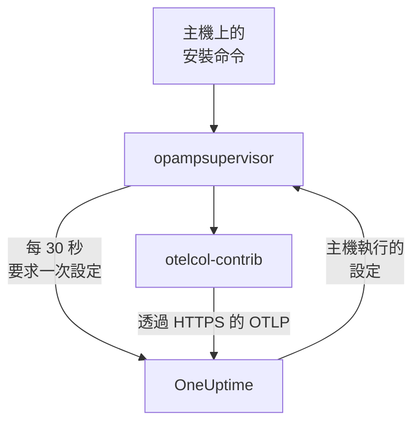

# 主機

用一個命令把 Linux、Windows 或 macOS 機器新增到 OneUptime。這個命令會在主機上安裝 OpenTelemetry Collector，OneUptime 會把設定傳給收集器並保持最新：不需要撰寫 `config.yaml`，也不需要把它複製到每台主機或保持一致。要變更主機收集的內容，只需編輯一次收集器設定，它適用的每台主機都會在一分鐘內收到變更。

:::cards
- [新增主機](#新增主機): 在 Linux、Windows 或 macOS 上執行一個命令。
- [變更主機收集的內容](#變更主機收集的內容): 依系統與標籤劃分的收集器設定，保留每個版本。
- [檢查主機的收集器](#檢查主機的收集器): 它執行的設定、設定的版本，以及設定無法啟動的原因。
- [設定可以做什麼](#設定可以做什麼): 讀取主機，且只傳送到這個 OneUptime。
:::

## 運作方式

這個命令會從 OpenTelemetry Collector 的發行版本安裝兩個程式，並以發行版本公布的 SHA-256 逐一驗證：讀取主機的收集器 `otelcol-contrib`，以及執行收集器、並讓收集器維持使用 OneUptime 透過 OpAMP（OpenTelemetry Agent Management Protocol）傳送之設定的 `opampsupervisor`。兩者都以 `oneuptime-collector` 服務執行。



監督程式大約每 30 秒以你的擷取金鑰向 OneUptime 要求一次主機的設定，並回報主機執行的是哪個設定以及它是否已啟動。監督程式第一次連線時，主機就會以機器名稱註冊到 **主機** 中，隨著指標與記錄送達，它的頁面會逐步填滿。

每台主機會執行一個設定，依以下順序選出：

| 主機執行的設定 | 條件 |
| --- | --- |
| 在主機的 **收集器** 頁面上為它選定的設定 | 有人選定了一個設定。 |
| **收集器設定** 中第一個適用於它的設定 | 設定是針對主機的系統，且若設定指定了標籤，主機具有其中之一時，該設定即適用。 |
| 其系統的 OneUptime 預設設定 | 沒有適用的設定。 |

OneUptime 預設設定在任何系統上都會讀取 CPU、記憶體、磁碟、檔案系統、網路與處理程序；在 Linux 上，若主機有 journal 與 systemd 單元，也會讀取它們；在 Windows 上讀取 System、Application 與 Security 事件記錄以及 Windows 服務；在 macOS 上讀取 `/var/log` 中的安裝記錄與 Wi-Fi 記錄。它會排除在設計上就是滿的檔案系統，例如 snap 套件和 macOS 的 `/dev`，因此它們永遠不會讓 High Filesystem Usage 範本一直觸發。它會隨 OneUptime 的發行版本更新，因此使用預設設定的主機會獲得 OneUptime 對它的改進。

## 開始之前

- 一個擷取金鑰。**新增主機** 會為你建立一個，你也可以選擇在 **專案設定 → 遙測與 APM → 擷取金鑰** 下建立的金鑰。
- 主機上的系統管理員權限：在 Linux 與 macOS 上使用 `sudo`，在 Windows 上使用以系統管理員身分執行的 PowerShell。
- 使用 systemd 的 Linux、Windows 10 或 Windows Server 2019 及更新版本，或是 Apple 晶片或 Intel 上的 macOS。
- 從主機到你的 OneUptime URL 的輸出 HTTPS，可直接連線，也可透過代理伺服器。

## 新增主機

:::steps
### 開啟新增主機

開啟 **產品 → 基礎設施 → 主機**，然後選擇 **新增主機**。選擇主機執行的系統：Linux、Windows 或 macOS。Kubernetes 叢集的節點則改由 [Kubernetes Agent](/docs/telemetry/kubernetes-agent) 監控。

### 選擇擷取金鑰

選擇一個金鑰，或在對話方塊中建立一個。下方的命令會填入它。

### 在主機上執行命令

從對話方塊複製命令，在主機上執行。大約需要一分鐘。以下是相同的命令，範例部分會換成你的 OneUptime URL 與金鑰：

:::tabs
@tab Linux
```bash
curl -fsSL https://oneuptime.com/docs/static/scripts/host-collector/install.sh | sudo sh -s -- --url https://oneuptime.com --key YOUR_INGESTION_KEY
```
@tab macOS
```bash
curl -fsSL https://oneuptime.com/docs/static/scripts/host-collector/install.sh | sudo sh -s -- --url https://oneuptime.com --key YOUR_INGESTION_KEY
```
@tab Windows
```powershell
[Net.ServicePointManager]::SecurityProtocol = [Net.ServicePointManager]::SecurityProtocol -bor [Net.SecurityProtocolType]::Tls12; & ([scriptblock]::Create((Invoke-RestMethod -Uri 'https://oneuptime.com/docs/static/scripts/host-collector/install.ps1'))) -Url 'https://oneuptime.com' -Key 'YOUR_INGESTION_KEY'
```
:::

每個 OneUptime 都提供自己的安裝程式，因此自行架設的 OneUptime 會提供其自身發行版本的安裝程式：把兩處的 `https://oneuptime.com` 都換成你的 URL。

### 等待主機

對話方塊的最後一步會在主機連線時提示你，並附上指向它的連結。在清單中，它會顯示為 **正在啟動**，直到第一批指標送達（通常在一分鐘內），之後顯示為已連線，其收集器為 **執行中**。主機的 **拓撲** 頁面將在其上執行的內容、呼叫它的內容以及它呼叫的內容繪製在一張地圖上：請參閱 [拓撲](/docs/telemetry/topology#開啟資源自己的地圖)。
:::

## 為主機加上標籤

在命令中加上標籤，主機從連線的那一刻起就會帶有這些標籤：

:::tabs
@tab Linux
```bash
curl -fsSL https://oneuptime.com/docs/static/scripts/host-collector/install.sh | sudo sh -s -- --url https://oneuptime.com --key YOUR_INGESTION_KEY --label env=production --label team=payments
```
@tab macOS
```bash
curl -fsSL https://oneuptime.com/docs/static/scripts/host-collector/install.sh | sudo sh -s -- --url https://oneuptime.com --key YOUR_INGESTION_KEY --label env=production --label team=payments
```
@tab Windows
```powershell
[Net.ServicePointManager]::SecurityProtocol = [Net.ServicePointManager]::SecurityProtocol -bor [Net.SecurityProtocolType]::Tls12; & ([scriptblock]::Create((Invoke-RestMethod -Uri 'https://oneuptime.com/docs/static/scripts/host-collector/install.ps1'))) -Url 'https://oneuptime.com' -Key 'YOUR_INGESTION_KEY' -Label 'env=production','team=payments'
```
:::

`env=production` 會成為標籤 `env:production`。標籤只會新增，不會被移除：以另一個標籤再次執行命令，主機就會同時帶有兩個標籤。你也可以在 **主機** 清單中或透過 **標籤規則** 為主機加上標籤。指定了標籤的收集器設定只適用於具有其中之一的主機，因此同一個命令搭配不同的標籤，就能讓每組主機使用各自的設定。

## 變更主機收集的內容

:::steps
### 建立收集器設定

開啟 **產品 → 基礎設施 → 主機 → 收集器設定**，然後選擇 **建立收集器設定**。為它指定名稱、它所針對之主機的系統，若只想涵蓋其中部分主機，再指定這些主機的標籤。它的設定會從該系統的 OneUptime 預設設定開始。

### 編輯它的 config.yaml

在設定的頁面上選擇 **編輯設定**，修改 YAML 並儲存。OneUptime 會先檢查它，對無法傳送的設定予以拒絕並說明原因：請參閱 [設定可以做什麼](#設定可以做什麼)。

### 查看它送達主機

每次儲存的變更都是一個新版本，它適用的主機會在一分鐘內收到。設定的 **主機** 清單會顯示每台主機、其收集器的狀態以及它執行的版本。
:::

主機會執行清單中第一個適用於它的設定：在 **收集器設定** 中拖曳列即可變更順序。把範圍最窄的設定放在前面，例如針對 `env:production` Web 伺服器的設定，把範圍寬的設定放在後面，例如針對所有 Linux 主機的設定。清單下方的 **OneUptime 預設設定** 卡片會顯示沒有適用設定時主機執行的內容。

### 版本與還原

設定的 **版本** 清單會保留每次儲存的變更，最新的在前，並記錄儲存者與儲存時間。選擇 **檢視** 閱讀某個版本，選擇 **還原** 把它再次傳送到主機：它會另存為新版本，並註明還原的是哪個版本，因此清單始終能說明每台主機收到了什麼。

### 為單一主機選擇設定

在主機的 **收集器** 頁面上選擇 **變更設定**，然後只為這台主機選擇一個設定。可選的設定包括針對該主機系統的設定與針對任何系統的設定。選擇「自動」即可讓主機重新依清單選擇。所選設定被刪除的主機會自動回到依清單選擇。

### 設定無法啟動時

監督程式在切換到新設定之前會先用收集器檢查它，如果新設定無法啟動，就會回到最後一個可運作的設定。主機在此期間持續傳送資料。主機的 **收集器** 頁面會顯示 **設定失敗** 以及收集器提供的原因，例如收集器無權讀取的記錄檔，而且在設定變更之前，OneUptime 不會再傳送該設定給這台主機。在主機上修正原因後，選擇 **再試一次** 再傳送一次。

## 設定可以做什麼

OneUptime 傳送的設定會在它適用的每台主機上執行，因此 OneUptime 每次儲存時都會檢查它，並拒絕違反規則的設定：

| 規則 | 原因 |
| --- | --- |
| 只能使用 OneUptime 清單中的 receivers、processors、exporters、extensions 與 connectors | 它讀取主機與主機上的服務。執行程式或讀取雲端或叢集憑證的元件不在清單中。 |
| 資料只能透過 exporter `otlp_http` 離開主機，傳往 `${env:ONEUPTIME_URL}/otlp`，並帶上標頭 `x-oneuptime-token: ${env:ONEUPTIME_INGESTION_KEY}` | 每台主機都以安裝時的金鑰傳送到這個 OneUptime。沒有任何設定包含金鑰。 |
| `${env:NAME}` 是它唯一可以使用的 `${...}` | `${file:...}` 或 `${https:...}` 會在每台主機上被讀取，並可能被轉送出去。 |
| 不允許執行程式或傳送所讀取檔案的設定，例如 journald 的 `journalctl_path` | 設定只能讀取主機，不能做更多事。 |

儘管如此，設定仍可能是主機無法執行的設定，例如針對其他系統的 receiver，或主機上不存在的記錄檔。每台主機上的收集器會在切換前檢查這一點，詳見 [設定無法啟動時](#設定無法啟動時)。

## 檢查主機的收集器

開啟主機及其 **收集器** 頁面。頁面會顯示收集器的狀況、它執行的設定與 **為何是此設定**、它執行的版本、它的 **最後回報** 與 **收集器版本**。**在主機上** 下方列出了從主機上的 shell 檢查它的命令：服務是否在執行、它的記錄以及重新啟動。

:::tabs
@tab Linux
```bash
sudo systemctl status oneuptime-collector
sudo journalctl -u oneuptime-collector -n 50
sudo systemctl restart oneuptime-collector
```
@tab macOS
```bash
sudo launchctl print system/com.oneuptime.collector
sudo tail -n 50 /usr/local/oneuptime-collector/log/collector.log
sudo launchctl kickstart -k system/com.oneuptime.collector
```
@tab Windows
```powershell
Get-Service oneuptime-collector
Get-WinEvent -FilterHashtable @{ LogName = 'Application'; ProviderName = 'oneuptime-collector' } -MaxEvents 50 | Format-List TimeCreated, Message
Restart-Service oneuptime-collector
```
:::

在 Linux 上，收集器以無特權使用者 `oneuptime-collector` 執行，並屬於 `systemd-journal` 與 `adm` 群組，以便讀取 journal 與 `/var/log` 中的記錄。在 macOS 上，它像 launchd 常駐程式一樣以 root 執行；在 Windows 上以 LocalSystem 執行，以便讀取每個事件記錄與 Windows 服務。

## 手動設定的主機

依照 [主機 OpenTelemetry Collector](/docs/telemetry/host-otel-collector) 指南自行安裝收集器的主機會繼續照常回報，OneUptime 不會傳送設定給它。若要交給 OneUptime 管理，請開啟該主機的 **收集器** 頁面：那裡的命令帶有 `--replace-existing`，它會停止並停用手動安裝的收集器（`otelcol-contrib` 服務），讓主機不會重複回報。主機會保留其名稱、歷程與標籤。

## 安裝選項

再次執行命令即可變更其中任何一項，或升級到較新的發行版本：它會取代先前安裝的內容，並讓主機在 OneUptime 中維持原樣。

| Linux 與 macOS | Windows | 作用 |
| --- | --- | --- |
| `--url URL` | `-Url URL` | OneUptime 的位址。 |
| `--key KEY` | `-Key KEY` | 你專案的遙測擷取金鑰。 |
| `--label KEY=VALUE` | `-Label KEY=VALUE` | 為主機加上標籤。多個標籤請重複此選項；在 Windows 上以逗號列出。 |
| `--env NAME=VALUE` | `-EnvVar NAME=VALUE` | 為讀取 `${env:NAME}` 的設定提供收集器一個環境變數。 |
| `--version VERSION` | `-Version VERSION` | 要安裝的收集器發行版本，預設為 0.161.0。 |
| `--download-url URL` | `-DownloadUrl URL` | 從與 GitHub 資料夾結構相同的鏡像下載發行版本。 |
| `--proxy URL` | `-Proxy URL` | 讓下載與收集器的所有流量都透過 HTTP 代理伺服器。 |
| `--replace-existing` | `-ReplaceExisting` | 停止並停用手動安裝的收集器。 |
| `--uninstall` | `-Uninstall` | 移除收集器以及命令安裝的所有內容。 |

## 解除安裝

:::tabs
@tab Linux
```bash
curl -fsSL https://oneuptime.com/docs/static/scripts/host-collector/install.sh | sudo sh -s -- --uninstall
```
@tab macOS
```bash
curl -fsSL https://oneuptime.com/docs/static/scripts/host-collector/install.sh | sudo sh -s -- --uninstall
```
@tab Windows
```powershell
& ([scriptblock]::Create((Invoke-RestMethod -Uri 'https://oneuptime.com/docs/static/scripts/host-collector/install.ps1'))) -Uninstall
```
:::

主機會連同其歷程保留在 OneUptime 中：在 **主機** 清單中封存或刪除它。

## 疑難排解

:::details 命令顯示 OneUptime 拒絕了金鑰
HTTP `401`：金鑰錯誤、已過期或已被刪除。HTTP `422`：金鑰已停用、是瀏覽器金鑰，或已綁定到單一服務。在 **新增主機** 中選擇一個已啟用的伺服器金鑰，然後再次執行命令：它會取代主機上的金鑰。
:::

:::details 主機沒有出現
檢查主機能否透過 HTTPS 連到你的 OneUptime URL，然後用 [檢查主機的收集器](#檢查主機的收集器) 中對應系統的命令查看收集器的記錄。
:::

:::details 主機回報其設定失敗
主機的 **收集器** 頁面會顯示設定無法啟動的原因。主機會繼續執行最後一個可運作的設定，並在設定變更或你選擇 **再試一次** 時再次收到失敗的設定。
:::

:::details 主機顯示「未回報」
OneUptime 已超過 15 分鐘沒有收到主機監督程式的訊息。請檢查 `oneuptime-collector` 服務是否在執行，以及主機是否仍能連到 OneUptime。
:::

## 後續步驟

:::cards
- [主機 OpenTelemetry Collector](/docs/telemetry/host-otel-collector): 改為自行安裝收集器並撰寫其設定。
- [主機監控器](/docs/monitor/host-monitor): 根據主機回報的內容發出警示。
- [擷取金鑰](/docs/telemetry/ingestion-keys): 建立、限定與輪替主機傳送時使用的金鑰。
- [Kubernetes Agent](/docs/telemetry/kubernetes-agent): 監控叢集的節點與工作負載。
:::
