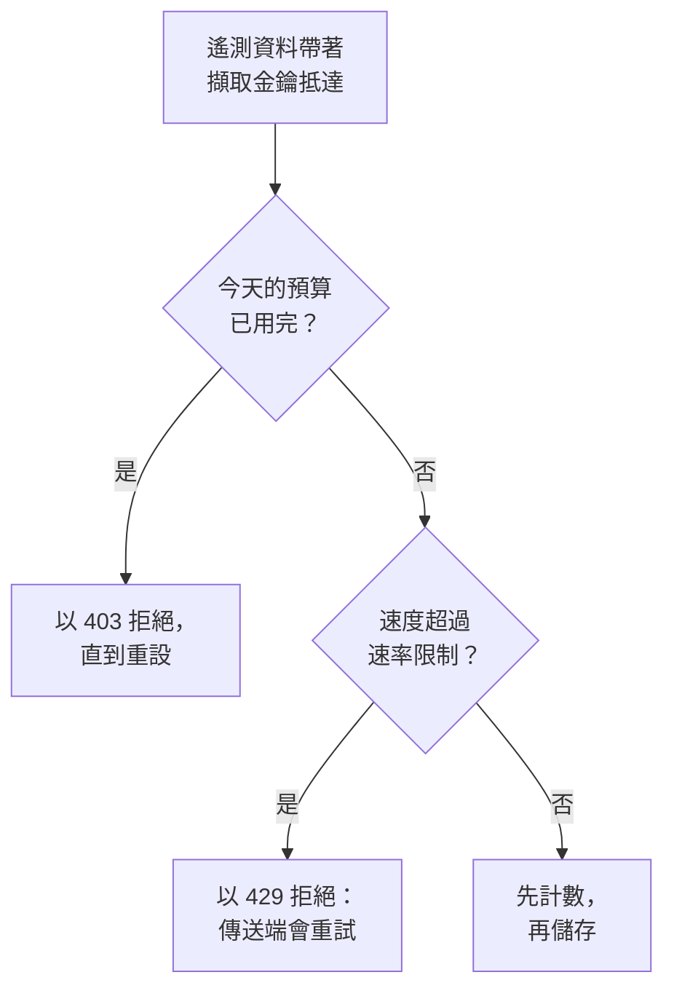

# 擷取預算

擷取預算限制一個專案一天內傳送的遙測資料量，這樣某個吵雜的服務或失控的日誌迴圈就無法佔滿你的儲存空間。執行個體管理員為每個訊號設定每日預算，可以針對所有專案，也可以針對單一專案；任何能夠編輯擷取金鑰的人，都可以為該金鑰設定一個更小的自有預算。每個預算還可以設定每秒的速率限制。

:::cards
- [預算如何運作](#預算如何運作): 三個層級，在遙測資料抵達時計數。
- [設定所有專案的預設預算](#設定所有專案的預設預算): 在 Admin Dashboard 的設定中。
- [為擷取金鑰設定自有預算](#為擷取金鑰設定自有預算): 專案預算中的一部分。
- [針對預算設定警示](#針對預算設定警示): 在預算用完之前，以及用完之時。
:::

## 預算如何運作

遙測資料在抵達時計數：計入其專案對應訊號的預算；如果其擷取金鑰有自有預算，也計入該金鑰的預算。每日預算一旦用完，該訊號就會遭到拒絕，直到預算重設。



- **三個層級。** 執行個體的預設值適用於每個專案。執行個體管理員可以改為給某個專案設定它自己的預算，或者完全不設限制。金鑰的預算只是對其專案預算的細分：它可以更小，但絕不能更大。
- **五種訊號。** 日誌、追蹤、指標、效能剖析資料和安全事件各有自己的預算。工作階段重播有其自己的限制：請參閱 [工作階段重播](/docs/telemetry/session-replay)。
- **位元組依解壓縮後的大小計數。** 請求依其本文解壓縮後的大小計數，因此壓縮請求不會改變計入的量。一個 GB 為 1024³ 位元組，一個 MB 為 1024² 位元組。
- **計數的是抵達的資料，而不是儲存的資料。** 之後被 [捨棄過濾器](/docs/telemetry/drop-filters-and-scrub-rules) 移除的遙測資料仍會計數，因此預算顯示的數值可能高於 [遙測使用量](/docs/telemetry/usage) 頁面，後者統計的是已儲存的資料。
- **最後一個請求會被完整儲存。** 在預算仍有餘裕時抵達的請求會被完整儲存，因此一個已用完的預算可能顯示略高於 100%。
- **設定預算之前，不會限制任何內容。** 每個安裝一開始都沒有預算，沒有預算的專案根本不會被計數。
- **變更會在一分鐘內傳到每台伺服器。**
- **無法計數時，遙測資料仍會被接受。** 預算在 Valkey 中計數。在無法連線到 Valkey 期間，OneUptime 會儲存遙測資料而不對其計數，而不是拒絕它，預算頁面也會說明這一點。

## 開始之前

- **執行個體和專案的預算需要 Admin Dashboard。** 在自行託管的安裝上，只有執行個體管理員可以設定它們。專案的擁有者和管理員可以看到專案的預算，但無法變更。
- **金鑰的自有預算需要能夠編輯擷取金鑰的角色。** Project Owner 或 Project Admin，或者擁有 Edit Ingestion Key 權限的自訂角色。
- **查看預算需要能看到專案使用量的角色。** 能看到 [遙測使用量](/docs/telemetry/usage) 頁面的角色，都能在該頁面上看到專案的預算。

## 設定所有專案的預設預算

:::steps
### 開啟擷取預算

在 Admin Dashboard 中，前往 **設定 → 遙測 → 擷取預算**。側邊選單中的 **遙測** 預設為收合：點選它即可展開。

### 設定每日預算

在 **預設每日預算** 卡片上，點選 **編輯預設每日預算**，為每個要限制的訊號輸入 GB 數，例如 **日誌（GB/天）**，然後點選 **儲存變更**。訊號留空則表示無限制。

### 視需要設定速率限制

在 **預設速率限制** 卡片上，點選 **編輯預設速率限制**，為訊號輸入每秒的 MB 數，例如 **日誌（MB/秒）**。速率限制可以防止一次突發流量在幾分鐘內用完一天的預算。
:::

**警告與重設** 卡片包含警告閾值和預算日的重設時間：請參閱 [警告與重設](#警告與重設)。

## 設定單一專案的預算

:::steps
### 開啟專案

在 Admin Dashboard 中，前往 **專案**，點選該專案，然後點選其側邊選單中的 **擷取預算**。頁面開啟時會顯示該專案今天已用掉多少預算。

### 設定其每日預算

在 **此專案的每日預算** 卡片上，點選 **編輯每日預算**。為訊號輸入 GB 數以取代執行個體預設值，或輸入 0 表示完全不限制。訊號留空則保留執行個體預設值。

### 設定其速率限制

在 **此專案的速率限制** 卡片上，點選 **編輯速率限制**，並以同樣的方式設定：輸入每秒的 MB 數，輸入 0 表示無限制，留空則使用執行個體預設值。
:::

專案成員可以在其 [遙測使用量](/docs/telemetry/usage) 頁面上以唯讀方式看到這些預算。

## 為擷取金鑰設定自有預算

金鑰的預算是其專案預算的一部分：用自己的金鑰大量傳送資料的傳送端，會在該金鑰的預算處被擋下，而專案的其他金鑰仍可繼續傳送。

:::steps
### 開啟金鑰

前往 **專案設定 → 遙測與 APM → 擷取金鑰**，然後點選該金鑰。側邊選單中的 **遙測與 APM** 預設為收合：點選它即可展開。

### 設定其預算

在 **擷取預算** 卡片上，點選 **編輯擷取預算**。在 **每日預算** 步驟中為每個要限制的訊號輸入每天的 GB 數，在 **速率限制** 步驟中輸入每秒的 MB 數。訊號留空則該金鑰沒有自有預算。

### 儲存預算

點選 **儲存變更**。金鑰的預算不能超過其專案的預算：OneUptime 會拒絕這樣的預算，並說明它最多可以是多少。
:::

- **兩個預算都會計數。** 以該金鑰傳送的遙測資料會同時計入金鑰的預算和專案的預算，先用完的那個會拒絕它。
- **調低的專案預算同樣約束金鑰。** 當專案的預算被調低到低於某個金鑰的預算時，該金鑰會受專案預算的約束。

## 傳送端看到什麼

| 情況 | 透過 HTTP | 透過 OTLP/gRPC | 傳送端的處理 |
| --- | --- | --- | --- |
| 每日預算已用完 | `403` | `RESOURCE_EXHAUSTED` | 捨棄該批次：在重設之前重試也無濟於事 |
| 超過速率限制 | `429` 加 `Retry-After` | `RESOURCE_EXHAUSTED` 加重試延遲 | 在延遲之後重試該批次 |

每次拒絕都會說明原因。透過 OTLP/HTTP 時，其本文是一個 `google.rpc.Status`，依請求傳送時所用的格式採用 protobuf 或 JSON，因此傳送端的日誌會顯示如下原因：

```text
This project's daily logs ingestion budget of 10 GB is used up, so OneUptime is not storing logs from this project until the budget resets at 2026-11-10 00:00 UTC.
```

- **其他 HTTP 傳送端會收到 JSON。** Fluent Bit、Fluentd、syslog 和其他 HTTP 端點會收到 `error`、`message` 和 `resetsAt`，遇到速率限制時還會收到 `retryAfterSeconds`。
- **MQTT 和雲端資料流無法得到通知。** 透過 MQTT 或從雲端供應商的資料流抵達的遙測資料，在其預算用完後會被捨棄。速率限制不適用於它：它無法被重新傳送。
- **拒絕會被計數。** 已用完的預算所拒絕或捨棄的資料計為已捨棄，速率限制拒絕的每個請求計為已節流：請參閱 [查看今天的使用量和捨棄量](#查看今天的使用量和捨棄量)。

## 警告與重設

- **警告。** 當每日預算超過警告閾值（除非執行個體管理員變更，否則為 80%）時，專案的擁有者會收到一封電子郵件，各個探索器也會在該訊號的資料上方顯示橫幅。預算用完時，他們還會再收到一封電子郵件。每個預算的每種電子郵件每天最多寄送一次。
- **重設。** 除非執行個體管理員變更，否則每個預算日都在 00:00 UTC 重新開始。**警告與重設** 卡片設定 **警告閾值（%）**（1 到 99）、**重設時間**（格式為 HH:MM）和 **重設時區**：點選 **編輯警告與重設**。
- **日光節約時間。** 重設會依循該時區的時鐘，因此時鐘調整的那個預算日會縮短或延長一小時。若重設時間落在時鐘跳過的時段內，重設會在跳變之後相應的時長發生。
- **變更重設會開始新的一天。** 變更重設時間或時區會立即開始一個新的預算日，此時尚未計入任何資料。

## 查看今天的使用量和捨棄量

前往 **專案設定 → 遙測與 APM → 使用量**。只要專案設定了預算或速率限制，頁面最上方就會顯示 **擷取預算** 卡片，擁有自有預算的金鑰則列在 **擷取金鑰預算** 卡片上：

| 欄 | 顯示內容 |
| --- | --- |
| **訊號** | 該列對應的訊號。 |
| **今日已用** | 自預算日開始以來計入的量，以及它佔預算的比例。 |
| **每日預算** | 生效的預算及其設定位置：**執行個體預設值**、**為此專案設定** 或 **此金鑰自有**。 |
| **速率限制** | 生效的速率限制。 |
| **已捨棄** | 因預算用完而遭拒絕或捨棄的資料。 |
| **已節流** | 速率限制拒絕的請求數。 |
| **狀態** | **在預算內**、**已超過警告閾值** 或 **已用完**；只有速率限制的訊號顯示 **無每日預算**；無法讀取計數時顯示 **未知**。 |

- **在金鑰的頁面上**，**今日預算使用量** 卡片顯示該金鑰已用掉多少自有預算。
- **在各個探索器中**，日誌、追蹤、指標、效能剖析和安全事件資料上方的橫幅會在該訊號的預算超過警告閾值或已用完時提示，並提供 **查看預算** 以開啟使用量頁面。
- **在 Admin Dashboard 中**，專案的 **擷取預算** 頁面顯示相同的數字。

## 針對預算設定警示

OneUptime 每 5 分鐘把每個預算當天的數字寫成專案的指標，[指標監控](/docs/monitor/metrics-monitor) 可以像針對其他任何指標一樣針對它們發出警示：

| 指標 | 單位 | 包含內容 |
| --- | --- | --- |
| `oneuptime.telemetry.budget.used.bytes` | `By` | 自預算日開始以來計入每日預算的位元組數。 |
| `oneuptime.telemetry.budget.used.percent` | `%` | 同一數值，以每日預算的百分比表示。達到 100 或以上時，該訊號會遭到拒絕，直到重設。 |
| `oneuptime.telemetry.budget.dropped.bytes` | `By` | 自預算日開始以來因預算用完而遭拒絕或捨棄的位元組數。 |
| `oneuptime.telemetry.budget.throttled.requests` | `{request}` | 自預算日開始以來速率限制拒絕的請求數。 |

每個資料點都帶有以下屬性：

| 屬性 | 值 |
| --- | --- |
| `projectId` | 專案的 ID。 |
| `signal` | `logs`、`traces`、`metrics`、`profiles` 或 `security-events`。 |
| `scope` | `project`；對於金鑰的自有預算為 `ingestion-key`。 |
| `ingestionKeyId` | 金鑰的 ID，用於金鑰的自有預算。 |
| `ingestionKeyName` | 寫入資料點時金鑰的名稱，用於金鑰的自有預算。 |

若要在專案的日誌預算用到 90% 時收到通知，請針對 `oneuptime.telemetry.budget.used.percent` 建立一個指標監控，依 `signal` 為 `logs`、`scope` 為 `project` 篩選，並在最大值高於 90 時發出警示：

- **以最大值彙總。** 在一個預算日內，每個數字只會增加。
- **使用 15 分鐘或更長的時間範圍。** 每 5 分鐘寫入一個資料點，而不含任何資料點的時間範圍會解決警示。
- **預期會有缺口，而不是零。** 數值為 0 時，或無法讀取計數期間，不會寫入任何內容。
- **它們不產生任何費用。** 這些指標不計入任何預算，也不計為遙測使用量，其保留時間與監控指標相同：除非執行個體管理員變更，否則為 30 天。以 `oneuptime.telemetry.budget.` 開頭的指標名稱保留給它們使用：你的應用程式以這樣的名稱傳送的指標會被捨棄。

## 疑難排解

:::details Collector 在匯出時記錄 403
專案或金鑰針對該訊號的每日預算已用完，在預算重設之前，Collector 會捨棄它無法傳送的資料。請查看使用量頁面上的 **今日已用**。請執行個體管理員提高專案的預算，或者減少傳送量：捨棄過濾器在這裡幫不上忙，因為它是在遙測資料計數之後才將其移除的。
:::

:::details Collector 記錄 429 並重試
它的傳送速度超過了速率限制所允許的速度。它會在 `Retry-After` 延遲之後重試，因此除非其佇列已滿，否則不會遺失任何資料。請提高速率限制，或讓傳送更加平均。
:::

:::details 今日已用高於遙測使用量頁面顯示的數值
預算在遙測資料抵達時依解壓縮後的大小計數，包括之後被捨棄過濾器移除的資料。使用量頁面統計的是已儲存的資料，而且要到隔天才統計。
:::

:::details 預算顯示無法讀取今天的計數
OneUptime 無法連線到用於預算計數的 Valkey。在恢復連線之前，遙測資料會被儲存而不計數，任何預算都不會生效。
:::

## 後續步驟

:::cards
- [遙測使用量](/docs/telemetry/usage): 查看每個專案和服務傳送了什麼。
- [捨棄過濾器與清理規則](/docs/telemetry/drop-filters-and-scrub-rules): 停止儲存你不需要的遙測資料。
- [擷取金鑰](/docs/telemetry/ingestion-keys): 每個傳送端一個金鑰，這樣每個傳送端都可以有自己的預算。
- [指標監控](/docs/monitor/metrics-monitor): 針對預算指標設定警示。
:::
