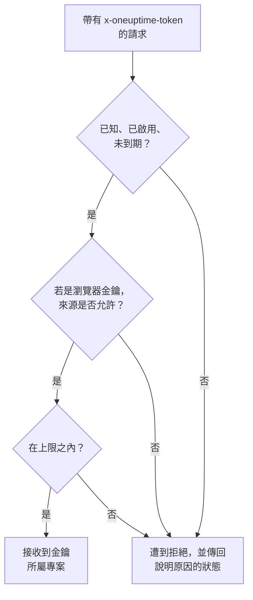

# 擷取金鑰

擷取金鑰把你的遙測連結到你的專案。應用程式、OpenTelemetry Collector 和代理程式會在每個請求中傳送它，OneUptime 會把它們的日誌、追蹤和指標歸入該金鑰所屬的專案。本頁說明如何建立金鑰、選擇哪種類型，以及如何保護金鑰。

:::cards
- [建立擷取金鑰](#建立擷取金鑰): 一個名稱、一個類型和一個要複製的密鑰值。
- [伺服器還是瀏覽器](#伺服器還是瀏覽器): 傳送端需要哪種金鑰。
- [鎖定瀏覽器金鑰](#鎖定瀏覽器金鑰): 來源、一個服務名稱和一個上限。
- [輪替、停用或刪除金鑰](#輪替停用或刪除金鑰): 金鑰外洩時該怎麼做。
:::

## 如何檢查金鑰

每個請求都帶著金鑰的密鑰值，通常放在 `x-oneuptime-token` 標頭中。OneUptime 會查找該金鑰，確認它仍可傳送，然後才把資料接收到金鑰所屬的專案中。



- **金鑰決定專案。** 你從不傳送專案 ID：用某個金鑰傳送的資料會進入該金鑰所屬的專案。
- **變更會在一分鐘內傳到每台伺服器。** 停用金鑰、重設其密鑰值，或變更其來源、到期時間或上限，大約一分鐘內生效。
- **伺服器金鑰就是密碼。** 任何拿到它的人都能向你的專案傳送遙測。請把它存放在伺服器的機密設定中，切勿放進原始碼控制或網頁。

## 伺服器還是瀏覽器

依金鑰將要存放的位置選擇類型。金鑰建立後就無法變更類型。

| | **伺服器** | **瀏覽器** |
| --- | --- | --- |
| 用途 | 在你營運的機器上執行的應用程式、collector 和代理程式 | 網頁，以及 React Native Session Replay |
| 傳送內容 | 所有類型的遙測，送往所有端點 | 追蹤、日誌、指標和 Session Replay |
| 是否為機密 | 是：請把它保存在你的伺服器上 | 否：任何檢視頁面的人都能讀取它 |
| 來源 | 不檢查 | 只接受列出的來源 |
| 每分鐘請求數 | 無上限，除非你設定了上限 | 6,000，除非你設定了其他上限 |

在其他所有地方，OneUptime 都會拒絕瀏覽器金鑰，例如透過 gRPC 和 MQTT、用於效能剖析資料、Syslog、Fluent Bit 和 Fluentd，以及上傳 source map。若要把傳送端換成另一種類型，請建立該類型的金鑰，把傳送端切換到新金鑰，然後刪除舊金鑰。

## 開始之前

- **能夠管理擷取金鑰的角色。** Project Owner 或 Project Admin，或者擁有 Create Telemetry Ingestion Key 權限的自訂角色。Telemetry 角色不包含擷取金鑰。
- **在 OneUptime Cloud 上，需要付款方式。** 遙測依用量計費，因此 Free 方案的專案需要先新增付款方式才能建立金鑰。此時建立對話方塊最後會有一個顯示價格的 **帳單** 步驟。

## 建立擷取金鑰

:::steps
### 開啟擷取金鑰

前往 **專案設定 → 遙測與 APM → 擷取金鑰**。側邊選單中的 **遙測與 APM** 預設為收合：點選它即可展開。清單會顯示每個金鑰的 **名稱**、**類型**、**Last Used** 和 **描述**。

### 為金鑰命名並選擇類型

點選 **建立擷取金鑰**。對話方塊一開始的名稱是 **伺服器金鑰**，類型是 **伺服器**。選擇 **金鑰類型**，並依將要使用它的程式重新命名金鑰，例如 `checkout-collector`。**描述** 位於 **進階** 下方。

### 新增瀏覽器金鑰的來源

**瀏覽器** 類型的金鑰會在下一步 **瀏覽器設定** 中要求填寫 **允許的來源**，並在 **進階** 下方提供 **固定的服務名稱**。請參閱 [鎖定瀏覽器金鑰](#鎖定瀏覽器金鑰)。

### 建立金鑰並複製密鑰值

點選 **建立擷取金鑰**。金鑰自己的頁面會開啟：複製它的 **密鑰金鑰**，交給你的傳送端。
:::

每個產品的 **設定指南** 都從 **選擇擷取金鑰** 開始，它會列出該指南可以使用的金鑰，並可當場建立一個。之後指南中的程式碼片段都會帶上這個金鑰。

## 使用金鑰傳送遙測

傳送端把密鑰值放在 `x-oneuptime-token` 標頭中：

```text
x-oneuptime-token: YOUR_ONEUPTIME_INGESTION_KEY
```

- OpenTelemetry SDK 從 `OTEL_EXPORTER_OTLP_HEADERS` 讀取它。請參閱 [OpenTelemetry 快速入門](/docs/telemetry/open-telemetry#快速入門)。
- 透過 OTLP/gRPC 時，它放在 `x-oneuptime-token` 中繼資料中。
- MQTT 裝置把它當作密碼傳送。請參閱 [IoT 裝置](/docs/telemetry/iot-devices)。
- OneUptime 也會從 `x-oneuptime-ingestion-key` 或 `x-oneuptime-service-token` 標頭讀取金鑰，一些較舊的設定會傳送這些標頭。

## 鎖定瀏覽器金鑰

瀏覽器金鑰位於你的頁面中，任何人都能複製它。以下設定限制了副本能做的事。在金鑰頁面上透過 **編輯遙測 擷取 Key** 變更它們。

| 設定 | 作用 |
| --- | --- |
| **允許的來源** | 接受該金鑰的唯一來源。來自其他任何來源的請求，或完全沒有 `Origin` 標頭的請求，都會遭到拒絕。瀏覽器金鑰必須至少保留一個來源。 |
| **固定的服務名稱** | 把金鑰透過 OTLP/HTTP 傳送的所有內容都歸入這一個服務，無論傳送端設定了什麼 `service.name`。如此一來，金鑰的副本只能寫入該服務。 |
| **Requests Per Minute Limit** | 該金鑰每分鐘可被接受的最大請求數，由所有訪客共用。留空時，瀏覽器金鑰的上限為 6,000。 |
| **到期於** | 過了這個日期，金鑰就會遭到拒絕，已公開的副本也隨之失效。 |

來源由通訊協定、主機和選用的連接埠組成：`https://app.example.com` 不包含 `https://app.example.com:8443`。開頭的一個 `*.` 涵蓋所有子網域，但不包含網域本身。React Native Session Replay 會傳送精確的 `app://` 識別碼，不能使用萬用字元：

```json
[
  "https://app.example.com",
  "https://*.example.com",
  "app://com.example.mobile"
]
```

[服務目錄](/docs/telemetry/services#服務如何進入目錄) 說明了固定的名稱如何決定服務。Kubernetes 代理程式的 Runner 和 AI 代理程式，以及基礎設施 AI 代理程式，不會使用固定了名稱的金鑰註冊：請給它們一個沒有固定名稱的伺服器金鑰。

## 輪替、停用或刪除金鑰

金鑰的頁面會顯示它的 **狀態**、隱藏在 **Click to reveal** 後面的 **密鑰金鑰**，以及它的 **Last Used At**：OneUptime 最後一次接受以它傳送的資料的時間。

| 目的 | 操作 | 傳送端看到的結果 |
| --- | --- | --- |
| 立即停用金鑰，之後還能恢復 | 點選 **編輯遙測 擷取 Key**，開啟 **存取與限制** 並關閉 **已啟用**。狀態會顯示 **Disabled — telemetry refused**。 | 重新啟用之前傳回 `422` |
| 替換外洩的密鑰值 | 點選 **重設密鑰** 並確認。金鑰保留其設定，並取得新的密鑰值。 | 傳送新密鑰值之前傳回 `401` |
| 永久停用金鑰 | 點選頁面底部的 **刪除遙測 擷取 Key**。 | `401` |

若要在不遺失資料的情況下更換密鑰值，請建立第二個金鑰，把傳送端移過去，等舊金鑰的 **Last Used At** 不再變動後再刪除它。**Last Used At** 每隔幾分鐘更新一次，而不是每個請求都更新。

## 疑難排解

遭拒的請求會收到一個狀態和一句說明原因的話。

| 回應 | 含義 |
| --- | --- |
| `401` 加 `Missing ingestion token` | 請求中沒有金鑰。請在 `x-oneuptime-token` 中傳送它。 |
| `401` 加 `Invalid ingestion token` | 沒有金鑰使用這個密鑰值：它被打錯、已重設或已刪除。 |
| `401` 加 `This telemetry ingestion key expired.` | 它的 **到期於** 已過。請設定較晚的日期，或改用另一個金鑰。 |
| `402` 加 `Add a payment method` | 在 OneUptime Cloud 上，專案處於 Free 方案，而且還沒有付款方式。 |
| `422` 加 `This telemetry ingestion key has been disabled.` | 有人關閉了 **已啟用**。 |
| `422` 加 `A browser ingestion key cannot be used for` | 瀏覽器金鑰到達了只接受伺服器金鑰的端點。 |
| `422` 加 `did not send an Origin header` | 瀏覽器金鑰是從瀏覽器之外傳送的。請在那裡改用伺服器金鑰。 |
| `422` 加 `is not allowed for this browser ingestion key` | 頁面的來源不在 **允許的來源** 中。 |
| `422` 加 `is pinned to a single service` | 有人用設定了 **固定的服務名稱** 的金鑰註冊代理程式。請改用沒有固定名稱的伺服器金鑰。 |
| `429` 加 `Too many telemetry requests for this ingestion key` | 金鑰達到了它的 **Requests Per Minute Limit**。匯出工具會在 `Retry-After` 的時間之後重試。 |

關於 OTLP 匯出工具可能收到的其他回應，請參閱 [回應](/docs/telemetry/open-telemetry#回應)。

:::details 停用金鑰一分鐘後仍有資料到達
每台 OneUptime 伺服器最多會把它所知道的金鑰資訊保留一分鐘，因此變更大約一分鐘內會傳到所有伺服器。之後的請求會遭到拒絕。
:::

:::details 瀏覽器金鑰在我的筆電上可用，但在正式環境中不可用
來源包含通訊協定和連接埠。`http://localhost:3000` 和 `https://app.example.com` 是不同的來源：請把提供該頁面的每個來源都列出來。
:::

:::details Last Used At 仍然顯示從未
自從 OneUptime 開始記錄該金鑰的使用情況以來，沒有任何東西用它傳送過資料。請檢查你的傳送端是否持有這個金鑰的密鑰值，以及它們的請求是否到達 OneUptime。
:::

## 後續步驟

:::cards
- [OpenTelemetry](/docs/telemetry/open-telemetry): 用你的金鑰傳送追蹤、指標和日誌。
- [服務目錄](/docs/telemetry/services): 查看你的遙測所歸入的服務。
- [資料保留](/docs/telemetry/data-retention): 決定資料保留多長時間。
- [捨棄過濾器與清理規則](/docs/telemetry/drop-filters-and-scrub-rules): 在儲存之前捨棄或遮罩資料。
:::
