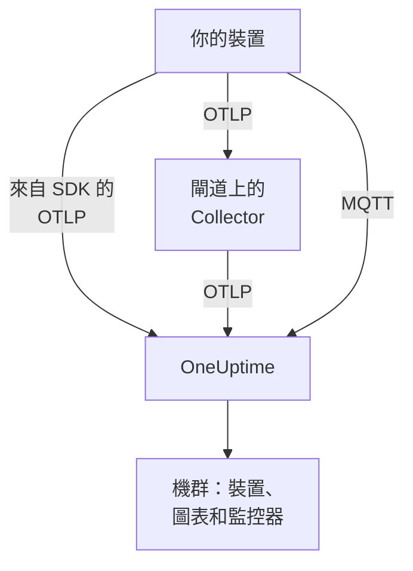

# IoT 裝置

OneUptime 會根據 IoT 裝置（感測器、閘道、控制器和邊緣設備）傳送的一小組 `iot_*` 指標，監控它們組成的機群。它會將裝置分組為機群，維護每個機群的裝置清單，並繪製它們的電量、訊號、溫度、CPU、記憶體和可用性圖表。裝置上不需要安裝任何 OneUptime 代理程式：裝置會傳送標準的 OpenTelemetry，或發布到 OneUptime 的 MQTT 端點。[IoT 裝置監控](/docs/monitor/iot-device-monitor) 會根據它們傳送的資料發出警示。

:::cards
- [選擇傳送方式](#選擇傳送方式): OpenTelemetry SDK、閘道上的 Collector 或 MQTT。
- [透過 MQTT 傳送指標](#透過-mqtt-傳送指標): 主題、每裝置認證和 Last Will。
- [指標慣例](#指標慣例): OneUptime 用於繪圖和警示的 `iot_*` 名稱。
- [疑難排解](#疑難排解): 缺少機群、缺少裝置、離線切換。
:::

## 運作方式

每個讀數都屬於一個機群和一台裝置。OneUptime 會根據第一個讀數建立機群，將每台新裝置加入機群的清單中，並在之後每個讀數送達時更新裝置的最新值。透過 OpenTelemetry 和透過 MQTT 傳送的讀數會進入相同的機群、清單、圖表和監控器。



## OneUptime 如何為 IoT 建立模型

- **機群**：一組裝置，例如 `building-a-sensors` 或 `field-gateways`。它來自 `iot.fleet.name` 資源屬性，在 OneUptime 中會顯示為遙測服務 `iot/<fleet>`。也請設定 `service.name=iot/<fleet>`，讓日誌和指標歸入同一個服務。
- **裝置**：機群中的一台裝置，由每個資料點上的 `device.id` 屬性命名。機群的清單以 `device.id` 為鍵。

| 屬性 | 設定位置 | 必要 | 說明 |
| --- | --- | --- | --- |
| `iot.fleet.name` | 資源 | 是 | 裝置所屬的機群。它會成為 OneUptime 服務 `iot/<fleet>`。 |
| `device.id` | 每個資料點 | 是 | 裝置的穩定 ID，在其機群中唯一。 |
| `iot.device.kind` | 每個資料點 | 否 | 裝置類別，例如 `Device`、`Sensor` 或 `Gateway`。預設為 `Device`。 |
| `iot.device.type` | 每個資料點 | 否 | 用於篩選監控器的更細類型或型號，例如 `temp-sensor`。 |
| `iot.device.firmware` | 每個資料點 | 否 | 裝置回報的韌體版本。 |

透過 MQTT 時，主題會替你設定機群和裝置。

## 選擇傳送方式

| 方式 | 適用情境 | 需要 |
| --- | --- | --- |
| [OpenTelemetry SDK](#透過-opentelemetry-sdk-傳送指標) | 裝置執行 OpenTelemetry SDK，而且自己能連線到 OneUptime。 | 裝置上的擷取金鑰。 |
| [OpenTelemetry Collector](#透過-opentelemetry-collector-傳送指標) | 許多裝置透過閘道回報。 | 執行 Collector 的閘道。 |
| [MQTT](#透過-mqtt-傳送指標) | 裝置已經使用 MQTT，或應在斷線的那一刻回報離線。 | 任何透過 WebSocket 連線的 MQTT 用戶端。 |

## 開始之前

- 一把擷取金鑰。在 **專案設定 → 遙測與 APM → 擷取金鑰** 下建立一把並複製其值。裝置會將其作為 `x-oneuptime-token` 標頭傳送，或作為 MQTT 密碼傳送。
- 從裝置或閘道到你的 OneUptime URL 的網路存取。
- 每組裝置的機群名稱，以及每台裝置的穩定 ID。

## 透過 OpenTelemetry SDK 傳送指標

:::steps
### 讓 SDK 指向 OneUptime

在裝置上設定標準的 OpenTelemetry 環境變數。將金鑰、機群名稱和裝置 ID 替換為你自己的：

```bash
export OTEL_EXPORTER_OTLP_ENDPOINT=https://oneuptime.com/otlp
export OTEL_EXPORTER_OTLP_PROTOCOL=http/protobuf
export OTEL_EXPORTER_OTLP_HEADERS=x-oneuptime-token=YOUR_TELEMETRY_INGESTION_TOKEN
export OTEL_RESOURCE_ATTRIBUTES=iot.fleet.name=building-a-sensors,device.id=sensor-001,service.name=iot/building-a-sensors
```

請保持 `iot.fleet.name` 不變：變更它會註冊一個新的機群。

### 將讀數記錄為 IoT 指標

將每個讀數以使用某個 [慣例名稱](#指標慣例) 的指標發出，並為每個資料點加上 `device.id` 屬性：

| 指標 | 值 | 資料點屬性 |
| --- | --- | --- |
| `iot_device_up` | `1` | `device.id=sensor-001` |
| `iot_battery_percent` | `87` | `device.id=sensor-001` |
| `iot_temperature_celsius` | `21.5` | `device.id=sensor-001` |

清單以資料點的 `device.id` 為鍵，而不是以資源的為鍵，因此除了在 `OTEL_RESOURCE_ATTRIBUTES` 中設定之外，也要在每個測量值上設定它。
:::

然後 [檢查機群是否出現](#檢查機群是否出現)。

## 透過 OpenTelemetry Collector 傳送指標

當許多裝置透過閘道回報時，請在閘道上執行 OpenTelemetry Collector。它會接收來自裝置的 OTLP，為每個讀數加上機群標識，並將其轉送到 OneUptime。

:::steps
### 儲存閘道的設定

將以下內容儲存為閘道上的 `config.yaml`：

```yaml title="config.yaml"
receivers:
  otlp:
    protocols:
      grpc:
        endpoint: 0.0.0.0:4317
      http:
        endpoint: 0.0.0.0:4318

processors:
  batch:
    send_batch_size: 512
    timeout: 5s
  resource:
    attributes:
      - key: iot.fleet.name
        value: field-gateways
        action: upsert
      - key: service.name
        value: iot/field-gateways
        action: upsert

exporters:
  otlphttp:
    endpoint: "https://oneuptime.com/otlp"
    headers:
      "x-oneuptime-token": "YOUR_TELEMETRY_INGESTION_TOKEN"

service:
  pipelines:
    metrics:
      receivers: [otlp]
      processors: [resource, batch]
      exporters: [otlphttp]
```

- `otlp` 會透過 gRPC（`4317`）和 HTTP（`4318`）接收來自裝置的資料。也可以透過 Collector 支援的任何其他方式（MQTT 橋接、檔案日誌）接收讀數，並讓它們經過同一條管道傳送。
- `resource` 會為每個讀數加上機群標識。請為每個閘道設定 `iot.fleet.name` 以及與之相符的 `service.name=iot/<fleet>`，讓每個閘道的裝置落入各自的機群。
- 在每個資料點上保留 `device.id`，以及 `iot.device.kind`、`iot.device.type` 和 `iot.device.firmware` 中的任何一個，讓 OneUptime 能區分機群中的裝置。
- `otlphttp` 會使用擷取金鑰透過 HTTPS 傳送到 OneUptime。預設的 protobuf 編碼和 `encoding: json` 都會被接受。

### 在閘道上執行 Collector

:::tabs
@tab Docker
在包含 `config.yaml` 的資料夾中執行它：

```bash
docker run -d \
  --name otel-collector \
  --restart unless-stopped \
  -p 4317:4317 \
  -p 4318:4318 \
  -v $(pwd)/config.yaml:/etc/otelcol-contrib/config.yaml:ro \
  otel/opentelemetry-collector-contrib:0.161.0 \
  --config /etc/otelcol-contrib/config.yaml
```
@tab otelcol-contrib
如果閘道上已經有 `otelcol-contrib`，請讓它指向該檔案：

```bash
otelcol-contrib --config config.yaml
```
:::

接著裝置會將 OTLP 傳送到閘道，例如在每台裝置的 SDK 中設定 `OTEL_EXPORTER_OTLP_ENDPOINT=http://<gateway-host>:4318`。
:::

然後 [檢查機群是否出現](#檢查機群是否出現)。

## 透過 MQTT 傳送指標

OneUptime 有自己的 MQTT 端點，因此使用 MQTT 的裝置可以直接向它發布讀數，不需要 SDK、Collector 或橋接。透過 MQTT 送達的資料與 OTLP 走同一條管道：會建立機群、更新清單，所有 IoT 監控器和警示範本的運作方式都相同。

### 端點

| 傳輸方式 | 位址 | 說明 |
| --- | --- | --- |
| 透過 WebSocket 的 MQTT | `wss://<your-host>/mqtt` | 適用於所有部署，經由一般的 HTTPS 連接埠。 |
| 透過 TCP 的 MQTT | `<app-host>:1883` | 僅限自行託管，在你公開它之前只能在叢集或 Compose 網路內部使用。連接埠為 `MQTT_INGEST_PORT`。 |

### 驗證

- **使用擷取金鑰**：將其作為 MQTT 密碼傳送。使用者名稱會被忽略；如果你的用戶端只有使用者名稱欄位，就把金鑰填在那裡。這適合代表許多裝置發布資料的閘道。
- **使用每裝置認證**：建議用於直接連線的裝置。開啟機群的 **Device Registry** 頁面並註冊該裝置，使用它作為 `device.id` 的 **Device ID**。裝置的 **MQTT Username** 就是它的使用者名稱，**MQTT Password (Secret)** 就是它的密碼。

裝置認證只能在它自己的 `oneuptime/<fleet>/<device>/` 主題下發布。你可以撤銷單一裝置，而不影響機群中的其他裝置：關閉它的 **已啟用** 開關或刪除它，已連線的裝置會在大約一分鐘內被中斷。已註冊的裝置沉默後會以離線狀態留在清單中，即使它在沒有 Last Will 的情況下停止運作，Device Offline 警示範本也會為它觸發。

OneUptime 會在 CONNECT 階段以傳回碼 4（bad username or password）拒絕錯誤的認證，因此設定錯誤的裝置會明確地失敗。瀏覽器金鑰在 MQTT 上會被拒絕。

### 主題和酬載

在固定的 `oneuptime/` 前置詞下發布。機群和裝置區段不得包含 `/`、`+` 或 `#`，不得以 `$` 開頭，長度最多為 100 個字元。

| 主題 | 酬載 |
| --- | --- |
| `oneuptime/<fleet>/<device>/telemetry` | 由讀數組成的 JSON 物件：`{"metrics":{"iot_temperature_celsius":21.5}}`，或一個其數值欄位即為指標的扁平物件。 |
| `oneuptime/<fleet>/<device>/metrics/<metricName>` | 單一值：純數字（`23.4`）或 `{"value":23.4}`。 |
| `oneuptime/<fleet>/<device>/status` | `online` 或 `offline`（也可以是 `1` 或 `0`、`true` 或 `false`、`up` 或 `down`）。它會設定 `iot_device_up`。 |

遙測酬載也可以帶有 `"attributes"`，也就是加在每個資料點上的字串對應（可用於 `iot.device.kind`、`iot.device.type`、`iot.device.firmware` 或你自己的標籤），以及 `"timestamp"`，格式為 ISO 8601 或 Unix 秒或毫秒。兩者都是選用的：沒有 `timestamp` 時，會使用 OneUptime 收到讀數的時間。

### 使用 Last Will 偵測離線

在 `oneuptime/<fleet>/<device>/status` 上註冊一個酬載為 `offline` 的 MQTT Last Will。如果裝置停止運作或從網路中斷線，OneUptime 會在其工作階段結束的那一刻為它發布 `iot_device_up = 0`，進而觸發內建的 Device Offline 警示範本，並在清單中將該裝置標記為停止運作，不需要輪詢。連線後向同一個主題發布 `online`，裝置就會再次顯示為運作中。

### 範例

:::tabs
@tab mosquitto_pub
在自行託管的執行個體上，透過原始 TCP：

```bash
mosquitto_pub -h YOUR-ONEUPTIME-APP-HOST -p 1883 \
  -u oneuptime -P "YOUR_TELEMETRY_INGESTION_TOKEN" \
  -t "oneuptime/building-a-sensors/sensor-001/telemetry" \
  -m '{"metrics":{"iot_device_up":1,"iot_battery_percent":87,"iot_temperature_celsius":21.5},"attributes":{"iot.device.type":"temp-sensor","iot.device.firmware":"1.4.2"}}'
```
@tab Node.js
使用 `mqtt` 套件，透過 WebSocket，連線到 oneuptime.com 或任何自行託管的執行個體：

```javascript
const mqtt = require("mqtt");

const client = mqtt.connect("wss://oneuptime.com/mqtt", {
  username: "oneuptime", // ignored — the token below is what authenticates
  password: "YOUR_TELEMETRY_INGESTION_TOKEN",
  will: {
    topic: "oneuptime/building-a-sensors/sensor-001/status",
    payload: "offline",
  },
});

client.on("connect", () => {
  client.publish("oneuptime/building-a-sensors/sensor-001/status", "online");
  setInterval(() => {
    client.publish(
      "oneuptime/building-a-sensors/sensor-001/telemetry",
      JSON.stringify({
        metrics: {
          iot_device_up: 1,
          iot_battery_percent: readBattery(),
          iot_temperature_celsius: readTemperature(),
        },
      }),
    );
  }, 60 * 1000);
});
```
@tab Python
使用 `paho-mqtt`，透過 WebSocket：

```python
import json
import paho.mqtt.client as mqtt

client = mqtt.Client(transport="websockets")
client.username_pw_set("oneuptime", "YOUR_TELEMETRY_INGESTION_TOKEN")
client.tls_set()
client.will_set("oneuptime/building-a-sensors/sensor-001/status", "offline")
client.ws_set_options(path="/mqtt")
client.connect("oneuptime.com", 443)

client.publish("oneuptime/building-a-sensors/sensor-001/status", "online")
client.publish(
    "oneuptime/building-a-sensors/sensor-001/telemetry",
    json.dumps({"metrics": {"iot_device_up": 1, "iot_temperature_celsius": 21.5}}),
)
```
:::

### 限制和傳遞

- 該端點只接收讀數：訂閱會被拒絕（SUBACK 失敗），保留的訊息也不會被儲存。
- 擷取為至少一次。使用 QoS 1 可讓 OneUptime 確認每次發布；在確認遺失後，QoS 1 或 2 的重新傳送可能會產生重複的資料點。
- 超過 128 KB 或包含超過 100 個指標的發布會被捨棄，而宣告超過這個大小的封包會導致連線關閉。
- 發布到這些主題以外的訊息或酬載格式錯誤的訊息會被接受然後捨棄，因為 MQTT 3.1.1 沒有針對單一訊息的錯誤。OneUptime 會記錄一則附有原因的警告（`MQTT: dropped publish to …`）。
- 在 WebSocket 端點上，請將 MQTT keepalive 保持在 5 分鐘以內。輸入端會關閉閒置 300 秒的 WebSocket，這會觸發 Last Will 和一次誤報的 Device Offline 警示。用戶端程式庫的預設值（`mqtt` 和 `paho-mqtt` 為 60 秒）沒有問題，而 TCP 端點沒有這樣的限制。

## 指標慣例

OneUptime 會辨識以下 `iot_*` 指標名稱。只傳送對你的裝置有意義的那些：缺少的指標不會繪製圖表。每個資料點都帶有裝置的 `device.id`（透過 MQTT 時由主題指明裝置）。

| 指標名稱 | 意義 |
| --- | --- |
| `iot_device_up` | 可用性：`1` 表示運作中且可連線，`0` 表示停止運作。IoT Device 監控器會讀取它。 |
| `iot_device_info` | 僅用於識別。它帶有 `device.id`、類別、類型和韌體，因此裝置在回報讀數之前就會出現在清單中。 |
| `iot_battery_percent` | 電池電量，`0` 到 `100`（%）。 |
| `iot_signal_strength_dbm` | 以 dBm 表示的無線訊號強度，例如 Wi-Fi、LoRa 或行動網路的 RSSI。 |
| `iot_temperature_celsius` | 裝置或感測器的溫度，單位為 °C。 |
| `iot_cpu_usage_ratio` | 以 `0` 到 `1` 的比率表示的 CPU 使用率。OneUptime 會將其儲存並顯示為百分比。 |
| `iot_memory_usage_bytes` | 使用中的記憶體，單位為位元組。 |
| `iot_memory_size_bytes` | 裝置上的記憶體總量，單位為位元組。 |
| `iot_uptime_seconds` | 裝置自上次開機以來的秒數。 |

## 檢查機群是否出現

1. 檢查裝置、閘道上的 Collector 或 MQTT 用戶端是否在沒有錯誤的情況下傳送：在其日誌中尋找匯出失敗和 HTTP `401` 或 `422` 回應，或以傳回碼 4 被拒絕的連線。
2. 開啟 **產品 → 基礎設施 → IoT → All Fleets**。在第一批讀數送達後大約一分鐘內，機群會以 `iot/<fleet>` 出現。
3. 開啟機群的 **Devices** 頁面。你傳送過資料的每台裝置都應列在其中，並顯示其最新的電量、訊號、溫度、CPU、記憶體以及運作中或停止運作的狀態。
4. 開啟機群的 **指標** 頁面，即可繪製任何 `iot_*` 序列的圖表。

## 自行託管 OneUptime

讓端點指向你自己的執行個體：

```bash
export OTEL_EXPORTER_OTLP_ENDPOINT=https://your-oneuptime-host.example.com/otlp
```

或在 Collector 中：

```yaml
exporters:
  otlphttp:
    endpoint: https://your-oneuptime-host.example.com/otlp
    headers:
      "x-oneuptime-token": "YOUR_TELEMETRY_INGESTION_TOKEN"
```

對於 MQTT，請連線到 `wss://your-oneuptime-host.example.com/mqtt`，或為無法使用 WebSocket 的裝置公開 app 服務的原始 MQTT TCP 連接埠（`MQTT_INGEST_PORT`，預設為 `1883`）。在 app 服務上設定 `MQTT_INGEST_ENABLED=false` 可關閉兩個 MQTT 接聽程式。如果執行個體只支援 HTTP，請使用 `http://`（MQTT 使用 `ws://`）及其連接埠。

## 疑難排解

:::details 機群沒有出現
1. 檢查 `iot.fleet.name` 是否為資源屬性（而不是資料點標籤），以及 `service.name` 是否為 `iot/<fleet>`。
2. 檢查端點是否為 `https://oneuptime.com/otlp`（或你的自行託管 `…/otlp`），以及 `x-oneuptime-token` 標頭是否攜帶有效的擷取金鑰。
3. 透過 MQTT 時，檢查主題是否嚴格遵循 `oneuptime/<fleet>/<device>/…`：建立機群的正是主題中的機群區段。
:::

:::details 清單中缺少裝置
1. 為每個資料點加上 `device.id` 標籤：裝置以它為鍵。透過 MQTT 時，它就是主題中的裝置區段。
2. 對於尚未回報讀數的裝置，請傳送 `iot_device_info`（或透過 MQTT 傳送一則 `status` 訊息），讓它出現在清單中。
3. 請保持 `device.id` 的值不變：變動的 ID 會產生重複的裝置。
:::

:::details 匯出器傳回 HTTP 401 或 422
`401` 表示擷取金鑰遺失、錯誤或已過期；`422` 表示它已被停用，或是無法傳送裝置遙測的瀏覽器金鑰。請在 **專案設定 → 遙測與 APM → 擷取金鑰** 下建立一把新金鑰，並更新 `x-oneuptime-token` 標頭。
:::

:::details MQTT 連線遭拒，並顯示 "bad username or password"
OneUptime 會在 CONNECT 階段以傳回碼 4 拒絕錯誤的認證。請檢查密碼是否為未被停用或過期的有效擷取金鑰；對於已註冊的裝置，則檢查是否為該認證的密鑰，並以其 **MQTT Username** 作為使用者名稱。瀏覽器金鑰在 MQTT 上會被拒絕。
:::

:::details 裝置在執行中卻變為離線
在 WebSocket 端點上，輸入端會關閉閒置 300 秒的連線，這會觸發 Last Will 和一次誤報的 Device Offline 警示。請將 MQTT keepalive 保持在 5 分鐘以內：用戶端程式庫預設的 60 秒沒有問題。
:::

:::details 讀數沒有顯示在機群的圖表上
1. 使用 [指標慣例](#指標慣例) 中確切的 `iot_*` 名稱：其他名稱會被儲存為一般指標，不會填入 IoT 圖表。
2. 以 `0` 到 `1` 的比率傳送 `iot_cpu_usage_ratio`；OneUptime 會將其顯示為百分比。
3. 裝置開始回報後，第一批資料點可能需要最多一分鐘才會出現。
:::

## 後續步驟

:::cards
- [IoT 裝置監控](/docs/monitor/iot-device-monitor): 當裝置離線、電量不足或過熱時發出警示。
- [OpenTelemetry](/docs/telemetry/open-telemetry): OneUptime 如何接收來自任何 SDK 或 Collector 的 OTLP。
- [主機 OpenTelemetry Collector](/docs/telemetry/host-otel-collector): 監控 Linux、macOS 或 Windows 閘道本身。
:::
