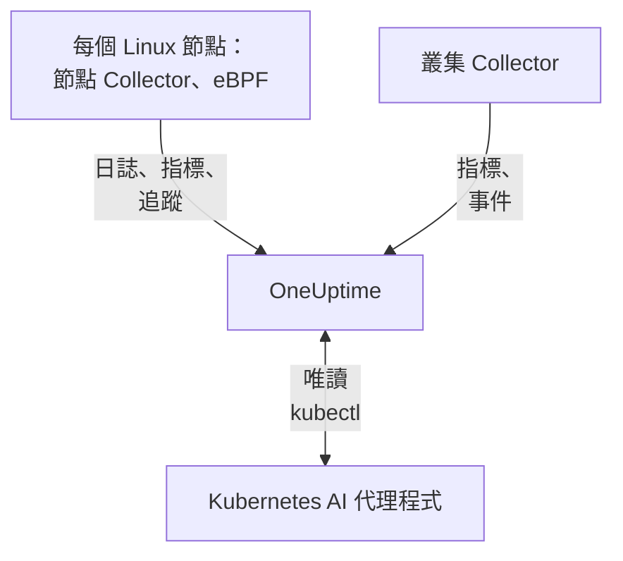

# Kubernetes 代理程式

OneUptime Kubernetes 代理程式是一個 Helm chart，它會收集叢集的指標、事件和 Pod 日誌，並藉助 eBPF 收集每個 Pod 的追蹤、要求指標、服務圖和網路流量，不需修改程式碼，也不需要 SDK。它也會執行 [Kubernetes AI 代理程式](#kubernetes-ai-代理程式)，讓 OneUptime AI 在調查事件或警示時執行唯讀的 `kubectl`。一條 `helm install` 即可部署；[Kubernetes 監控](/docs/monitor/kubernetes-monitor) 會根據它傳送的資料發出警示。

:::cards
- [安裝代理程式](#安裝代理程式): 使用 Helm 的四個步驟。
- [設定選項](#設定選項): 篩選器、取樣、控制平面、服務網格、成本和標籤。
- [Kubernetes AI 代理程式](#kubernetes-ai-代理程式): 供 OneUptime AI 使用的唯讀 `kubectl`，以及在你允許時進行的修正。
- [減少傳送量](#減少收集的資料量): 依影響大小排列的調整手段。
:::

## 運作方式

該 chart 會在自己的命名空間中執行幾個工作負載。每個工作負載都會使用你提供的擷取金鑰，透過 OTLP 將收集到的資料傳送到你的 OneUptime URL，而叢集會以你在 `clusterName` 中指定的名稱自行註冊。



| 工作負載 | 類型 | 作用 | 執行條件 |
| --- | --- | --- | --- |
| 叢集 Collector | Deployment | 來自 Kubernetes API 的叢集指標、Kubernetes 事件，以及 Pod、節點和工作負載的規格。 | 一律執行 |
| 節點 Collector | DaemonSet | 來自 `/var/log/pods` 的 Pod 日誌、kubelet 和 cAdvisor 指標，以及節點的作業系統指標。 | 除 EKS Fargate 外的所有環境 |
| eBPF 檢測（OBI） | DaemonSet | 來自每個 Pod 的 HTTP、gRPC、SQL 和 Redis 追蹤與要求指標，以及服務地圖。 | 預設執行，GKE Autopilot 和 EKS Fargate 除外 |
| Kubernetes AI 代理程式 | Deployment | OneUptime AI 調查事件或警示時使用的唯讀 `kubectl`。 | 預設執行 |
| 日誌追蹤器 | Deployment | 在節點 Collector 無法讀取時，透過 Kubernetes API 取得 Pod 日誌。 | 使用 `gke-autopilot` 和 `eks-fargate` 預設集時 |
| 成本引擎和輪詢器 | Deployments | 依命名空間、工作負載和 Pod 統計的支出。 | 設定 `cost.enabled=true` 時 |

所有代理程式映像檔都只支援 Linux，因此所有工作負載都會固定在 Linux 節點上。

## 開始之前

- 一個執行 v1.23 或更新版本的 Kubernetes 叢集，以及已設定為可連線到它的 `kubectl`。
- Helm 3。升級會使用 `--reset-then-reuse-values`，這需要 Helm 3.14 或更新版本。
- 一把擷取金鑰。在 **專案設定 → 遙測與 APM → 擷取金鑰** 下建立。代理程式會將其作為 `x-oneuptime-token` 標頭傳送，因此專案 API 金鑰在這裡無法使用。
- 叢集的名稱，在專案中唯一且保持不變，例如 `prod-us-east-1`：叢集會以這個名稱出現在 OneUptime 中。
- 從叢集到你的 OneUptime URL 的輸出 HTTPS。

## 安裝代理程式

:::steps
### 加入 Helm 儲存庫

```bash
helm repo add oneuptime https://helm-chart.oneuptime.com
helm repo update
```

### 安裝 chart

將 `YOUR_ONEUPTIME_URL`、`YOUR_ONEUPTIME_API_KEY`（擷取金鑰）和叢集名稱替換為你的值，並選擇符合你平台的分頁（請參閱 [選擇預設集](#選擇預設集)）。

:::tabs
@tab Standard
自行管理的叢集、EKS on EC2、GKE Standard、AKS、minikube、kind 和 k3s：

```bash
helm install kubernetes-agent oneuptime/kubernetes-agent \
  --namespace oneuptime-agent \
  --create-namespace \
  --set oneuptime.url="YOUR_ONEUPTIME_URL" \
  --set oneuptime.apiKey="YOUR_ONEUPTIME_API_KEY" \
  --set clusterName="my-cluster" \
  --set aiAgent.enabled=true
```
@tab GKE Autopilot
```bash
helm install kubernetes-agent oneuptime/kubernetes-agent \
  --namespace oneuptime-agent \
  --create-namespace \
  --set oneuptime.url="YOUR_ONEUPTIME_URL" \
  --set oneuptime.apiKey="YOUR_ONEUPTIME_API_KEY" \
  --set clusterName="my-cluster" \
  --set aiAgent.enabled=true \
  --set preset=gke-autopilot
```
@tab EKS Fargate
```bash
helm install kubernetes-agent oneuptime/kubernetes-agent \
  --namespace oneuptime-agent \
  --create-namespace \
  --set oneuptime.url="YOUR_ONEUPTIME_URL" \
  --set oneuptime.apiKey="YOUR_ONEUPTIME_API_KEY" \
  --set clusterName="my-cluster" \
  --set aiAgent.enabled=true \
  --set preset=eks-fargate
```
:::

**AI 調查預設為開啟。** `aiAgent.enabled=true` 會在 Collector 旁邊執行 [Kubernetes AI 代理程式](#kubernetes-ai-代理程式)：當此叢集上出現事件或警示時，OneUptime AI 會使用唯讀的 `kubectl`（`get`、`describe`、`logs`、`events`、`top`）進行調查，不做任何變更。在你允許之前，修正會保持關閉。若要在不啟用它的情況下安裝，請改用 `--set aiAgent.enabled=false`。

### 檢查 Pod 是否正在執行

```bash
kubectl get pods -n oneuptime-agent
```

每個 Pod 應在一兩分鐘內進入 `Running`：

:::tabs
@tab Standard
叢集 Collector、AI 代理程式，以及每個節點上的一個節點 Collector 和一個 eBPF Pod：

```text
NAME                                          READY   STATUS    RESTARTS   AGE
kubernetes-agent-xxxxxxxxxx-xxxxx             1/1     Running   0          1m
kubernetes-agent-ai-agent-xxxxxxxxxx-xxxxx    1/1     Running   0          1m
kubernetes-agent-ebpf-xxxxx                   1/1     Running   0          1m
kubernetes-agent-logs-xxxxx                   1/1     Running   0          1m
```
@tab GKE Autopilot
節點 Collector 仍會執行，在沒有 `hostPath` 的情況下讀取 kubelet 和 cAdvisor 指標，同時一個日誌追蹤器 Deployment 會透過 Kubernetes API 讀取 Pod 日誌：

```text
NAME                                          READY   STATUS    RESTARTS   AGE
kubernetes-agent-xxxxxxxxxx-xxxxx             1/1     Running   0          1m
kubernetes-agent-ai-agent-xxxxxxxxxx-xxxxx    1/1     Running   0          1m
kubernetes-agent-logs-yyyyyyyyyy-yyyyy        1/1     Running   0          1m
kubernetes-agent-logs-xxxxx                   1/1     Running   0          1m
```
@tab EKS Fargate
三個 Deployment，沒有 DaemonSet：Fargate 會為每個 Pod 分配專屬的微型虛擬機器，而且從不排程 DaemonSet，因此那裡沒有節點指標：

```text
NAME                                          READY   STATUS    RESTARTS   AGE
kubernetes-agent-xxxxxxxxxx-xxxxx             1/1     Running   0          1m
kubernetes-agent-ai-agent-xxxxxxxxxx-xxxxx    1/1     Running   0          1m
kubernetes-agent-logs-yyyyyyyyyy-yyyyy        1/1     Running   0          1m
```
:::

### 在 OneUptime 中找到叢集

開啟 **產品 → 基礎設施 → Kubernetes → 所有叢集**。幾分鐘內，叢集會以其 `clusterName` 出現，節點、Pod 和工作負載也會填入。Kubernetes AI 代理程式會在叢集 **人工智慧** 下的 **代理程式** 頁面上顯示為已連線。
:::

## 選擇預設集

`preset` 會選擇適用於你平台的預設值：Pod 日誌是透過 `hostPath` 從節點讀取，還是透過 Kubernetes API 讀取，以及哪些工作負載可以用特權模式執行。

| `preset` | 適用於 | Pod 日誌 | 節點指標 |
| --- | --- | --- | --- |
| `standard`（預設） | 自行管理的叢集、**EKS on EC2**、**GKE Standard**、**AKS**、minikube、kind、k3s | 節點 Collector 透過 `hostPath` 讀取 `/var/log/pods`（負擔最低） | Kubelet、cAdvisor 和節點的作業系統指標 |
| `gke-autopilot` | **GKE Autopilot** | 日誌追蹤器透過 Kubernetes API 讀取（沒有 `hostPath`，沒有主機存取權） | Kubelet 和 cAdvisor，不使用 `hostPath` |
| `eks-fargate` | **EKS Fargate** | 日誌追蹤器透過 Kubernetes API 讀取（沒有 `hostPath`，沒有主機存取權） | 無：Fargate 不執行 DaemonSet |

如果不確定，請從 `standard` 開始。如果安裝因提到 `hostPath` 的 Pod Security 錯誤而失敗，請使用 `preset=gke-autopilot`（在 Fargate 上為 `eks-fargate`）重新安裝。GKE Autopilot 和 EKS Fargate 也會拒絕 eBPF 和效能分析工具所需的特權 Pod，因此這兩個預設集會將它們都排除在外。

## 收集的內容

| 類別 | 資料 |
| --- | --- |
| 節點指標 | CPU、記憶體、檔案系統和網路使用量 |
| Pod 指標 | CPU、記憶體、網路和重新啟動次數 |
| 容器指標 | 每個容器的 CPU 和記憶體 |
| 叢集指標 | 節點狀況、可配置資源、Pod 數量 |
| Kubernetes 事件 | 警告、錯誤和排程事件 |
| Pod 日誌 | 每個容器的 stdout 和 stderr（標準叢集上透過 `hostPath`，Autopilot 和 Fargate 上透過 Kubernetes API） |
| 應用程式追蹤（eBPF，預設開啟） | 來自每個 Pod 的 HTTP、gRPC、SQL 和 Redis Span，不需 SDK 或修改程式碼 |
| HTTP RED 指標（eBPF） | 每個服務的 `http.server.request.duration`，以及要求和回應的本文大小 |
| 服務圖（eBPF） | 呼叫端到被呼叫端的要求速率、延遲和錯誤邊，用於繪製服務地圖 |
| 網路流量指標（eBPF） | Pod 之間的 TCP 和 UDP 位元組與封包計數器，附帶 Kubernetes 中繼資料 |
| TCP 統計（eBPF） | 節點層級的來回時間、連線失敗和重新傳輸計數器 |
| 工作負載成本（需選擇啟用，`cost.enabled=true`） | 依命名空間、工作負載和 Pod 統計的支出（含閒置和效率），以及節點和磁碟區的每小時成本：請參閱 [Kubernetes 成本可觀測性](/docs/telemetry/kubernetes-cost) |

## 設定選項

下面的每個選項都是一個 Helm 值。可在安裝時設定，或對已安裝的代理程式使用 `helm upgrade ... --reset-then-reuse-values --set <value>` 設定。

### 命名空間篩選

`namespaceFilters.rules` 會將命名空間模式分別套用到四個範圍：

| 範圍 | 篩選位置 | 影響範圍 |
| --- | --- | --- |
| `podLogs` | hostPath filelog 接收器或 API 日誌追蹤器 | 僅 Pod 的 stdout 和 stderr；Kubernetes 事件和稽核日誌不受影響 |
| `ebpfDiscovery` | OBI 的處理程序探索 | 來自符合工作負載的 eBPF 追蹤和 eBPF 指標 |
| `metrics` | 在 Collector 中，加入 Kubernetes 中繼資料之後 | 帶有命名空間的指標序列；不帶命名空間的節點和叢集序列會保留 |
| `traces` | 在 Collector 中，加入 Kubernetes 中繼資料之後 | eBPF Span 以及應用程式透過 OTLP 推送的 Span |

模式會比對整個命名空間名稱，並可使用 `*`（`team-*`）。如果某個範圍有任何 `include` 規則，則該範圍只保留符合的命名空間，而且 `exclude` 規則一律優先。預設規則只在 `podLogs` 和 `ebpfDiscovery` 中排除 `kube-system`。

若要將 Pod 日誌和 eBPF 探索限制在部分命名空間：

```bash
helm install kubernetes-agent oneuptime/kubernetes-agent \
  --namespace oneuptime-agent \
  --create-namespace \
  --set oneuptime.url="YOUR_ONEUPTIME_URL" \
  --set oneuptime.apiKey="YOUR_ONEUPTIME_API_KEY" \
  --set clusterName="my-cluster" \
  --set-json 'namespaceFilters.rules=[{"action":"include","namespaces":["default","production","staging"],"scopes":["podLogs","ebpfDiscovery"]}]'
```

若要停止某個嘈雜命名空間的日誌，同時保留它的 eBPF 追蹤、服務地圖和指標，請將排除範圍限定在 `podLogs`：

```bash
  --set-json 'namespaceFilters.rules=[{"action":"exclude","namespaces":["kube-system"],"scopes":["podLogs","ebpfDiscovery"]},{"action":"exclude","namespaces":["noisy-*"],"scopes":["podLogs"]}]'
```

`podLogs` 和 `ebpfDiscovery` 規則會在來源端篩選：被排除的日誌檔案永遠不會被開啟，被排除的工作負載永遠不會被檢測。`metrics` 和 `traces` 規則則在之後、在 Collector 中、命名空間附加到資料之後才生效。

#### 依命名空間篩選指標和追蹤

若也要篩選帶有命名空間的指標或 Span，請將這些範圍加入規則中：

```bash
  --set-json 'namespaceFilters.rules=[{"action":"exclude","namespaces":["kube-system","noisy-*"],"scopes":["podLogs","ebpfDiscovery","metrics","traces"]}]'
```

> [!NOTE]
> 節點層級和叢集層級的指標一律會保留。命名空間屬於 Pod 而不屬於節點，因此節點 CPU、節點記憶體和檔案系統使用量等序列沒有可比對的內容，永遠不會被捨棄：範圍為 `metrics` 的規則會削減每個 Pod 的序列，而不會隱藏出問題的節點。

Kubernetes 事件無法在代理程式端依命名空間篩選：它們來自 `k8sobjects` 接收器，沒有 `k8s.namespace.name` 屬性（命名空間在事件本文中），因此篩選器沒有可比對的內容。請改為在 OneUptime 中透過 **日誌 → 設定 → 捨棄過濾器** 捨棄它們。

### 依日誌嚴重性篩選

`filters.logs.minSeverity` 會在代理程式端、在傳送任何內容之前，捨棄低於某個嚴重性的 Pod 日誌記錄：

```bash
  --set filters.logs.minSeverity=WARN
```

它接受 `TRACE`、`DEBUG`、`INFO`、`WARN`、`ERROR` 和 `FATAL`。`WARN` 會保留 WARN、ERROR 和 FATAL，捨棄 INFO、DEBUG 和 TRACE；預設值（`""`）會保留所有內容。它在兩種日誌模式下都會生效（`daemonset` 模式下透過 Collector，`api` 模式下在日誌追蹤器內部），因此預設集永遠不會悄悄把它關掉。

容器執行階段不會記錄嚴重性，因此代理程式會從日誌文字本身讀取嚴重性（`[ERROR]`、`WARN:`、`"level":"info"`、…）。沒有可辨識等級的行會如何處理取決於日誌模式，因為兩種模式掌握的資訊不同：

| 模式 | 沒有等級的行 | 原因 |
| --- | --- | --- |
| `daemonset` | `stderr` 視為 ERROR（保留），`stdout` 視為 INFO（被 WARN 臨界值捨棄） | 容器執行階段會記錄每一行來自哪個串流。 |
| `api` | 一律保留 | Kubernetes 的 `pods/log` API 會將 stdout 和 stderr 合併為一個串流，沒有逐行標記，因此代理程式不去猜測，而是保留該行。 |

所以 `api` 模式刻意比 `daemonset` 模式捨棄得更少：Python traceback 或 `npm ERR!` 不帶嚴重性關鍵字，悄悄刪除它們正是臨界值應該避免的失敗。在混合模式（`logs.windowsPods.enabled`）下，兩列規則都會依節點作業系統套用：Linux Pod 遵循 `daemonset`，Windows Pod 遵循 `api`。

兩種模式在篩選之前都會將多行事件重新組合，因此 Java 堆疊追蹤會依其第一行判斷，整體保留或整體捨棄。

> [!IMPORTANT]
> Kubernetes 事件和資源規格永遠不會被它篩選。它們來自 Kubernetes API，沒有自己的嚴重性，因此臨界值會刪除整個資料流，包括你最需要的 `FailedScheduling`、`BackOff` 和 `OOMKilling` 警告。它們數量少而價值高，所以代理程式一律會傳送它們；若要精簡它們，請在 OneUptime 中使用 **日誌 → 設定 → 捨棄過濾器**。

### 依名稱包含或排除指標

`filters.metrics` 決定哪些指標會離開叢集，作用於所有接收器。

捨棄幾個嘈雜的指標（拒絕清單，通常是你想要的）：

```bash
  --set-json 'filters.metrics.exclude=["k8s.volume.available","k8s.volume.capacity"]'
```

只傳送一組固定的指標（允許清單：其他所有指標都會被捨棄）：

```bash
  --set-json 'filters.metrics.include=["k8s.pod.cpu.utilization","k8s.pod.memory.usage"]'
```

依模式而不是確切名稱比對：

```bash
  --set filters.metrics.matchType=regexp \
  --set-json 'filters.metrics.exclude=["^container_network_"]'
```

| 鍵 | 意義 |
| --- | --- |
| `filters.metrics.exclude` | 要捨棄的指標名稱。在 `include` 之後套用，因此排除一律優先。 |
| `filters.metrics.include` | 不為空時，只會傳送這些指標。 |
| `filters.metrics.matchType` | `strict`（確切名稱，預設）或 `regexp`（RE2，不錨定）。 |

- `regexp` 不錨定：`system.cpu` 也會比對到 `system.cpu.time`。如果你指的正好是一個指標，請加上錨點（`^system\.cpu$`）。
- RE2 沒有前瞻，因此 `^(?!container_)` 無法編譯。若要表達「除此之外的全部」，請使用 `include`，而不是否定模式。
- `include` 一次作用於所有接收器。漏掉某個指標的允許清單會悄悄移除建立在它之上的監控器，所以除非你需要一個封閉集合，否則請優先使用 `exclude`。
- 清單請使用 `--set-json`（或 values 檔案）：一般的 `--set` 會取代清單，而不是附加。

> [!WARNING]
> 在推出之前先測試模式。Collector 會在啟動時編譯模式，因此無效的模式不會悄悄出錯：Collector 會拒絕啟動並陷入當機迴圈，連同它的指標一起拖垮該 Collector 的日誌。Helm 無法編譯 RE2，因此 `helm upgrade` 會毫無異議地接受錯誤的模式。

### 追蹤取樣

上面的篩選器會移除一類遙測：一個命名空間、一個嚴重性、一個指標名稱。取樣則會保留所有類別，改為稀釋整體數量。將 `sampling.traces.percentage` 設定為要保留的追蹤比例：

```bash
helm upgrade kubernetes-agent oneuptime/kubernetes-agent \
  --namespace oneuptime-agent --reset-then-reuse-values \
  --set sampling.traces.percentage=10
```

這樣每十筆追蹤會保留一筆，其餘九筆會在離開叢集之前就在代理程式端被捨棄。

- **你得到的是完整的追蹤，而不是片段。** 判定依據的是追蹤 ID 的雜湊，而不是對每個 Span 擲硬幣，因此一筆追蹤的所有 Span 會一起保留或一起捨棄，保留下來的追蹤可以從頭讀到尾。
- **以指標為基礎的監控器不受影響。** OBI 會根據每個要求計算 eBPF RED 指標（要求速率、錯誤率、持續時間），這些指標走的是不經過取樣器的指標管道。設為 10% 時，你會得到十分之一的追蹤，而速率、錯誤和延遲仍然精確。
- **以 Span 為基礎的監控器會受影響。** OneUptime 根據 Span 本身統計的任何內容都會依比率縮小：請參閱下面的警告。

| 鍵 | 意義 |
| --- | --- |
| `sampling.traces.percentage` | 要保留的追蹤百分比，0 到 100。預設 `100`（全部保留）。 |
| `sampling.traces.hashSeed` | 追蹤 ID 雜湊的種子。預設 `22`。 |

- `0` 不會保留任何追蹤。它是一個比率，不是開關：在 eBPF DaemonSet 持續執行並產生成本的同時，它會刪除每一筆追蹤。如果不需要追蹤，請使用 `ebpf.enabled=false`；如果不需要追蹤但需要 RED 指標和服務地圖，請保持 eBPF 開啟並刻意設定 `0`。
- 它只在 `ebpf.enabled` 開啟時生效：否則沒有追蹤管道，該值不會有任何作用。
- 它只對追蹤取樣。刻意不提供 `sampling.logs` 或 `sampling.metrics`：請參閱下面的說明。
- 小數需要 `--set-json`，而且有下限。`--set sampling.traces.percentage=0.5` 會失敗，因為 Helm 會將 `0.5` 讀成字串：請使用 `--set-json 'sampling.traces.percentage=0.5'` 或 values 檔案。低於約 `0.0061` 時，比率會無條件捨去為零，行為與 `0` 完全相同，而且不會報錯；`0.01`（萬分之一）是能依其字面意義運作的最小值。
- 多個叢集預設即可正常運作。兩個代理程式只有在 `hashSeed` 和 `percentage` 都一致時才會保留同一筆追蹤，而兩者在各處的預設值都相同，因此跨兩個叢集的追蹤會完整保留。只有在需要讓兩個取樣層彼此獨立時才變更 `hashSeed`：使用相同的種子時，較低的比率保留的是較高比率所保留追蹤的子集。
- Pod 日誌永遠不會被取樣，因此在 `ebpf.logToTraceCorrelation: true` 時，每筆日誌記錄仍帶有追蹤 ID，而這些追蹤只有被保留的那部分存在。於是大約 (100 − `percentage`)% 的日誌記錄會連結到不存在的追蹤；從追蹤跳到其日誌則不受影響。

> [!WARNING]
> 設定此項時，請重新調整以 Span 為基礎的監控器。取樣會減少送達 OneUptime 的 Span，因此任何對它們計數的東西都會計得更少：針對 `Span Count` 的 **追蹤** 監控器和針對 `Exception Count` 的 **例外** 監控器只會看到昨天資料量的大約 `percentage`%。依未取樣流量調好的臨界值會悄悄地不再被越過：監控器不會報錯，只是變得沉默。請將這些臨界值除以相同的係數；比率作用於整個叢集，因此無法豁免任何服務。錯誤分組的退化比線性更糟：常見的例外仍會出現，但罕見的一次性例外更可能直接消失，而不是以十分之一的頻率出現。

> [!NOTE]
> 為什麼沒有日誌或指標取樣：Collector 的取樣器完全無法對指標取樣。它可以對日誌取樣，但它的隨機性來自追蹤 ID，而 Pod 日誌沒有追蹤 ID，因此每筆日誌記錄的雜湊都相同，日誌取樣率會依種子不同而全部保留或全部刪除。與其提供一個會悄悄刪除日誌的設定，chart 選擇不提供。若要精簡日誌，請使用 [依日誌嚴重性篩選](#依日誌嚴重性篩選) 和 [命名空間篩選](#命名空間篩選)，它們對移除的內容都很精確。

### 停用日誌收集

如果你不需要 Pod 日誌：

```bash
helm install kubernetes-agent oneuptime/kubernetes-agent \
  --namespace oneuptime-agent \
  --create-namespace \
  --set oneuptime.url="YOUR_ONEUPTIME_URL" \
  --set oneuptime.apiKey="YOUR_ONEUPTIME_API_KEY" \
  --set clusterName="my-cluster" \
  --set logs.enabled=false
```

你的指標不受影響：節點 Collector 會繼續執行以收集 kubelet、cAdvisor 和主機指標，只是不再讀取 Pod 日誌。只有以日誌為基礎的警示會停止，其他一切照舊。

### 強制使用特定的日誌收集模式

`logs.mode` 會覆寫預設集的選擇，而且一律優先於預設集：

- `logs.mode=daemonset`：hostPath DaemonSet（負擔最低；需要 `hostPath`）。
- `logs.mode=api`：Kubernetes API 日誌追蹤器 Deployment（適用於任何叢集）。
- `logs.mode=disabled`：沒有 Pod 日誌。

模式只決定 Pod 日誌從哪裡來：無論哪種模式都會收集節點指標，因此 `api` 和 `disabled` 都會保留你的 kubelet、cAdvisor 和主機指標。例外取決於平台：EKS Fargate 完全無法排程 DaemonSet，因此沒有節點 Collector，也沒有節點、Pod 或容器指標。GKE Autopilot 會執行節點 Collector，但會封鎖 `hostPath`，因此它會收集 kubelet 和 cAdvisor 指標，但不會收集讀取主機 `/proc` 和 `/sys` 的 `hostmetrics` 指標（磁碟 I/O、inode、網路卡錯誤）。

在帶有 Windows 節點集區的叢集上，`daemonset` 模式只涵蓋 Linux 節點，因為所有代理程式映像檔都只支援 Linux。加入 `--set logs.windowsPods.enabled=true`，即可在其旁邊執行 API 日誌追蹤器，只處理 Windows 節點上的 Pod：Linux Pod 會繼續在節點本機追蹤檔案，兩者永遠不會重複傳送同一行。這需要一個至少與 chart 一樣新的 `kubernetes-log-tailer` 映像檔：較舊的映像檔會忽略這項限制，並將 Linux 日誌傳送兩次。

### 啟用控制平面監控

叢集的 **控制平面** 頁面會繪製 etcd、API 伺服器、排程器和控制器管理員的圖表。當 `controlPlane.enabled` 為 `true` 時，代理程式會抓取這四者：

```bash
helm upgrade kubernetes-agent oneuptime/kubernetes-agent \
  --namespace oneuptime-agent \
  --reset-then-reuse-values \
  --set controlPlane.enabled=true
```

每個元件都會在其自身清單中的位址上被抓取：`controlPlane.etcd.endpoints`、`controlPlane.apiServer.endpoints`、`controlPlane.scheduler.endpoints` 和 `controlPlane.controllerManager.endpoints`。抓取會在代理程式的 Pod 中執行，而該 Pod 沒有主機網路，因此預設值（`https://localhost:<port>/metrics`）指向的是該 Pod 本身：請將每個清單設定為該 Pod 能夠連線的位址。在任何叢集內部，API 伺服器都會在 `https://kubernetes.default.svc:443/metrics` 上回應：

```bash
helm upgrade kubernetes-agent oneuptime/kubernetes-agent \
  --namespace oneuptime-agent \
  --reset-then-reuse-values \
  --set controlPlane.enabled=true \
  --set "controlPlane.apiServer.endpoints={https://kubernetes.default.svc:443/metrics}"
```

`controlPlane.enabled` 會一次開啟全部四項抓取。如果某個元件無法透過其端點連線（受管理叢集上的 etcd、排程器和控制器管理員，或者仍使用其 `localhost` 預設值時），它的抓取在每個間隔都會失敗：Collector 會記錄一個抓取錯誤並將目標回報為停止運作，除此之外沒有任何變化。

代理程式只透過 HTTPS 抓取，使用服務帳戶的權杖，不使用用戶端憑證。因此：

- **etcd** 需要一個不要求用戶端憑證的 HTTPS 指標位址。etcd 常用的指標連接埠都無法使用：`2381` 上的純文字 HTTP（kubeadm 的 `--listen-metrics-urls`）會被當作 HTTPS 抓取而失敗，而 `2379` 需要用戶端憑證。
- **排程器**（`10259`）和 **控制器管理員**（`10257`）提供 HTTPS 並接受權杖，但 kubeadm 會在控制平面節點上將它們繫結到 `127.0.0.1`：它們需要一個代理程式的 Pod 能夠連線的 `--bind-address`。

受管理的 Kubernetes 服務（EKS、GKE、AKS）不會公開 etcd、排程器或控制器管理員，因此這些分頁在那裡會保持空白。在某個分頁的指標送達之前，**控制平面** 頁面會顯示需要設定的內容來取代圖表，並附上可複製的指令。

### 啟用 CoreDNS 指標

**控制平面** 頁面的 **CoreDNS** 分頁會繪製 DNS 查詢、延遲、快取和轉送的圖表。收集這些指標預設為關閉：

```bash
helm upgrade kubernetes-agent oneuptime/kubernetes-agent \
  --namespace oneuptime-agent \
  --reset-then-reuse-values \
  --set coreDns.enabled=true
```

代理程式會抓取 `kube-system` 中帶有 `k8s-app=kube-dns` 標籤的 Pod 的 `9153` 連接埠，這正是 kubeadm 叢集、EKS 和 AKS 上執行 CoreDNS 的方式。如果你的 CoreDNS 在別處執行，也要設定 `coreDns.namespace`、`coreDns.service`（`k8s-app` 標籤）和 `coreDns.port`。GKE 執行的是 kube-dns（dnsmasq）或 Cloud DNS，而不是 CoreDNS，因此該分頁在那裡會保持空白。

### 啟用服務網格指標

叢集的 **服務網格** 頁面會繪製 Istio 和 Linkerd 的圖表。代理程式會抓取一個網格，也就是 `serviceMesh.provider` 指定的那個（`istio` 或 `linkerd`）：

```bash
helm upgrade kubernetes-agent oneuptime/kubernetes-agent \
  --namespace oneuptime-agent \
  --reset-then-reuse-values \
  --set serviceMesh.enabled=true \
  --set serviceMesh.provider=istio
```

對於 Istio，它會讀取每個 `istio-proxy` sidecar 的 Envoy 統計資料（連接埠 `15090`）；對於 Linkerd，則讀取每個 `linkerd-proxy` 的管理連接埠。兩種網格的控制平面都不會被抓取：istiod（**Pilot** 卡片）以及 Linkerd 的 identity、destination 和 proxy-injector 元件（**控制平面** 卡片）會在它們各自的管理連接埠上提供指標，因此這些卡片會顯示這項說明來取代圖表。

### 代理程式不收集的指標

有些圖表顯示的指標代理程式並不抓取：**控制平面** 頁面上的 **kube-proxy**；**服務網格** 頁面上的 **Cilium**（使用 Hubble）；以及 Istio 和 Linkerd 分頁上網格本身的控制平面（**istiod**，以及 Linkerd 的 identity、destination 和 proxy-injector 元件）。當這些指標透過其他方式送達 OneUptime 時，這些圖表就會填入資料，例如由你自己的 [OpenTelemetry Collector](/docs/telemetry/open-telemetry) 抓取它們，並將資源屬性 `k8s.cluster.name` 設定為叢集的名稱（代理程式的 `clusterName`）。不使用 kube-proxy 執行的叢集完全沒有 kube-proxy 指標。

### 啟用成本可觀測性

在叢集的 **Costs** 頁面上查看每個命名空間、工作負載和 Pod 的成本，以及閒置容量和每個 request 的使用比例：

```bash
helm upgrade kubernetes-agent oneuptime/kubernetes-agent \
  --namespace oneuptime-agent \
  --reset-then-reuse-values \
  --set cost.enabled=true
```

光是這樣就是完整的安裝：chart 內建了開放原始碼的 [OpenCost](https://opencost.io) 引擎（以及它所需的小型 Prometheus），不需任何認證即可根據雲端供應商的公開價格為你的節點和磁碟區定價。它會增加兩個小型 Pod，第一批成本會在第一個小時結束後出現。已經在執行 Kubecost 或 OpenCost？改為加入 `--set cost.engine.url=<its service URL>`，就不會內建任何東西。地端叢集可以用 `cost.opencost.customPricing` 設定費率表。包含地端定價和疑難排解的完整指南請參閱 [Kubernetes 成本可觀測性](/docs/telemetry/kubernetes-cost)。

### 使用專案標籤自動加上標籤

任何以 `oneuptime.label.` 開頭的資源屬性都會成為專案標籤，附加到叢集以及此代理程式回報的服務和主機上：`oneuptime.label.<dimension>=<value>` 即標籤 `<dimension>:<value>`。在安裝時使用 `--set oneuptime.labels.<key>=<value>` 傳入標籤：

```bash
helm install kubernetes-agent oneuptime/kubernetes-agent \
  --namespace oneuptime-agent \
  --create-namespace \
  --set oneuptime.url="YOUR_ONEUPTIME_URL" \
  --set oneuptime.apiKey="YOUR_ONEUPTIME_API_KEY" \
  --set clusterName="prod" \
  --set oneuptime.labels.team=payments \
  --set oneuptime.labels.env=production \
  --set oneuptime.labels.region=us-east-1
```

或者將它們放在 values 檔案中：

```yaml title="values.yaml"
oneuptime:
  url: YOUR_ONEUPTIME_URL
  apiKey: YOUR_ONEUPTIME_API_KEY
  labels:
    team: payments
    env: production
    region: us-east-1
clusterName: prod
```

標籤比對不區分大小寫，因此你手動建立的既有 `Production` 標籤會被重複使用而不會重複建立，而在 OneUptime 中加入的標籤也永遠不會被代理程式移除。

## 透過 eBPF 取得應用程式追蹤和 HTTP 指標（預設開啟）

該 chart 會在每個節點上執行一個 [OpenTelemetry eBPF Instrumentation (OBI)](https://opentelemetry.io/docs/zero-code/obi/) DaemonSet。它會將 eBPF 程式載入核心，擷取每種受支援執行階段（Go、.NET、Java、Node.js、Python、Ruby、Rust）的 HTTP 和 HTTPS、gRPC、SQL 及 Redis 流量，不需 SDK，也不需要 sidecar。接著，追蹤和要求指標會經由叢集內的 Collector 傳送到 OneUptime。

它需要帶有 BTF 的 Linux 核心 5.8 或更新版本（Debian 11+、Ubuntu 20.10+、Fedora 34+、RHEL 和 Stream 9+ 上預設具備），而且其 DaemonSet 會以特權模式執行，因為載入 eBPF 程式需要這樣做。

### eBPF 追蹤的樣貌

eBPF 看到的是網路呼叫，而不是你的程式碼，因此一筆追蹤是由服務處理的要求以及它在處理過程中發出的呼叫所構成：

- **一個要求及其呼叫構成一筆追蹤。** 進入服務的要求是根 Span，名為 `<METHOD> <route>`，服務在處理它時發出的 HTTP、gRPC、SQL 和 Redis 呼叫則是它的子 Span。（對於 Node.js，這仰賴 OBI 的 Node.js 代理程式，chart 會透過 `ebpf.nodejs.enabled` 開啟它。）並行要求透過同一個共用連線發出的呼叫（Redis 用戶端中很常見）不一定都能區分開來，因此其中一些不會被放入它們所屬要求的追蹤中。
- **對另一個節點上服務的呼叫會開始一筆新的追蹤。** 除非有東西將追蹤內容傳遞過去：OpenTelemetry SDK，或下文介紹的需選擇啟用的內容傳播。當兩端在同一個節點上執行時，OBI 能看到兩端並自行將它們關聯起來。
- **不是由要求發起的工作是獨立的。** 輪詢 Redis 的佇列 worker 或 cron 工作，沒有其呼叫可歸屬的要求。
- **資料庫伺服器通常是獨立的。** 資料庫通訊協定不會攜帶追蹤內容，因此除非呼叫端在同一個節點上執行，否則 OBI 在資料庫伺服器內部為每個命令記錄的 Span 都是只有一個 Span 的追蹤。

這些獨立的資料庫呼叫會以只有一個 Span、以單純命令命名（`set`、`evalsha`、`SELECT`）的追蹤送達，在忙碌的叢集上，它們可能占 OBI 擷取內容的大部分。預設情況下，代理程式會在它們離開叢集之前將其捨棄：資料庫伺服器自身的 Span，它一定會與呼叫端的 Span 重複（`ebpf.dropDatabaseServerSpans=true`），以及不屬於任何追蹤的應用程式呼叫（`ebpf.dropUnlinkedDatabaseCalls=true`）。要求追蹤內的應用程式資料庫呼叫會被保留，你的應用程式透過自身 SDK 傳送的 Span 永遠不會被變動，資料庫指標仍會統計每一個命令。

有一項取捨：OneUptime 會透過資料庫用戶端 Span 探索資料庫，並將它們繪製在服務地圖上。只有背景工作與之通訊的資料庫（worker 的佇列、cron 工作的資料倉儲）就不再能從追蹤中被探索到，並會在服務地圖上顯示為遠端端點。它的指標不受影響。設定 `ebpf.dropUnlinkedDatabaseCalls=false` 可保留這些 Span。

背景工作的 HTTP 和 gRPC 呼叫（透過 HTTP 查詢 ClickHouse 的 worker、續訂其 Kubernetes 租用的控制器）同樣會以只有一個 Span 的追蹤送達（`POST /`、`PUT /apis/*/...`）。設定 `ebpf.dropUnlinkedClientCalls=true` 可將它們也捨棄，連同 OBI 未能放入所屬要求追蹤、看起來一樣的呼叫；資料庫、訊息和 GenAI 呼叫（包括 MCP）永遠不會因此被捨棄。它預設為關閉，因為它會損失資料：當被呼叫的服務在同一個節點上執行時，OBI 會將該服務處理的要求關聯到這次呼叫之下，於是這次呼叫成為該追蹤的根，捨棄它就會讓追蹤失去根。開啟 `ebpf.contextPropagation` 時，這在任何節點上都會發生，對擁有自己 OpenTelemetry SDK 的服務也一樣。服務地圖也會讀取這些呼叫：只有背景工作呼叫的相依項目此時只能根據 OBI 的服務圖指標繪製，而在要求內也看得到的邊只會統計那些呼叫。服務的概覽會統計其 Span，因此 Span 大多是這類呼叫的 worker 或探查會顯示少得多的要求數，其錯誤率和 p95 延遲也以剩下的 Span 計算。OBI 的用戶端要求指標仍會統計每一次呼叫。

在自行託管的 OneUptime 上，請先升級伺服器，再升級代理程式：此 chart 執行的 eBPF 追蹤器（OBI v0.14）為被呼叫服務命名以及回報訊息代理程式自身 Span 的方式，是舊版 OneUptime 伺服器無法讀取的。

名稱來自流量。HTTP Span 在 OBI 能讀取時會使用應用程式的路由範本，否則使用由 URL 產生的模式，其中類似 ID 的路徑區段會被替換為 `*`；設定 `ebpf.routes.patterns` 可自行命名。OBI 能讀取 Go（net/http、Gorilla mux、Gin）、Java（Spring、JAX-RS）、Node.js（Express、Fastify、Koa、NestJS、Next.js）、Python（Django、FastAPI、Flask）、Ruby（Rails）、.NET（ASP.NET Core 屬性路由）和 PHP（Symfony、Laravel、Slim）應用程式的路由範本。`OrderService.charge` 這類應用程式層級的名稱只存在於程式碼中，需要 OpenTelemetry SDK。

如果某個應用程式已經透過 OpenTelemetry SDK 匯出追蹤，OBI 會察覺並停止為它傳送 eBPF 追蹤，因此它不會被追蹤兩次（`ebpf.excludeOtelInstrumentedServices=true`，OBI 的預設值）。如果該 SDK 回報給另一個專案，而你也想在這個專案中取得該應用程式的 eBPF 追蹤，請將其設定為 `false`。

### 停用 eBPF 自動檢測

在以下情況下關閉 eBPF：

- 你在 **GKE Autopilot** 或 **EKS Fargate** 上安裝：這些平台會拒絕特權 Pod，因此 `preset=gke-autopilot` 和 `preset=eks-fargate` 已經為你排除了 eBPF，連同效能分析工具。
- 節點執行的核心早於 5.8，而且沒有 BTF 回溯移植。
- 你已經在每個應用程式中透過 OpenTelemetry SDK 傳送追蹤，也不需要 eBPF 指標。（如果只是追蹤，則不需要關閉：如上所述，OBI 會對它發現自行匯出追蹤的應用程式停止傳送 eBPF 追蹤。）

```bash
helm install kubernetes-agent oneuptime/kubernetes-agent \
  --namespace oneuptime-agent \
  --create-namespace \
  --set oneuptime.url="YOUR_ONEUPTIME_URL" \
  --set oneuptime.apiKey="YOUR_ONEUPTIME_API_KEY" \
  --set clusterName="my-cluster" \
  --set ebpf.enabled=false
```

### 個別開關各個訊號系列

除了一個之外，其餘預設都會開啟。使用 `--set ebpf.features.<name>=false` 關閉任意一個：

| `ebpf.features.*` | 預設 | 增加的內容 |
| --- | --- | --- |
| `httpMetrics` | 開 | 每個服務的 HTTP 和 gRPC RED 指標（要求速率、延遲、錯誤） |
| `spanMetrics` | 開 | Span 呼叫次數和持續時間（`traces.span.metrics.*`） |
| `serviceGraph` | 開 | 呼叫端到被呼叫端的邊指標，用於繪製服務地圖 |
| `networkMetrics` | 開 | Pod 之間的 TCP 和 UDP 流量計數器 |
| `networkInterZoneMetrics` | 關 | 網路指標的跨區域變體（基數加倍） |
| `tcpStats` | 開 | 節點層級的 TCP 來回時間、連線失敗和重新傳輸計數器 |

跨服務的追蹤內容傳播預設為關閉：OBI 會注入 W3C `traceparent`，讓從 Pod A 到 Pod B 的要求在任何地方都沒有 SDK 的情況下顯示為一筆追蹤。使用 `--set ebpf.contextPropagation=true` 選擇啟用。它所需的核心不超出代理程式其餘部分的要求，也沒有任何核心版本會讓它失效。

它之所以預設關閉，是因為注入標頭意味著改寫已在傳輸中的流量：純文字 HTTP 要求會在核心中就地擴充，而 TLS 和原始 TCP 則會透過 Traffic Control 掛鉤附加一個 TCP 選項。如果連線的位元組計算沒有被精確修正，資料串流就會錯位；已回報的症狀是，經過 nginx 等 L7 Proxy 的傳輸在回應超過約 64KB 後於本文中途停住，而小型要求仍能正常運作。請不要因為核心版本較舊就排除這種可能：在 5.17 以下的核心上，OBI 會退回到有界掃描程式，並以同樣的方式改寫流量。追蹤、RED 指標和服務地圖都不依賴它；若要跨服務關聯，OpenTelemetry SDK 會在使用者空間傳播 `traceparent`，不需在核心中改寫流量，是更安全的選擇。

## Kubernetes AI 代理程式

當此叢集上出現事件或警示時，OneUptime AI 會進行調查。chart 中的 **Kubernetes AI 代理程式** 會為它提供一個終端機：它會像值班工程師那樣執行唯讀的 `kubectl`（describe 出問題的 Pod、讀取其事件、查看當機容器的日誌、檢查節點容量），並在事件頁面上引用它執行的每一個指令。

該代理程式 **預設為開啟** 且 **唯讀**：一個小型 Deployment（`kubernetes-agent-ai-agent`，Pod 標籤 `component=ai-agent`，映像檔 `oneuptime/kubernetes-ai-agent`），其 ServiceAccount 只能讀取。它會使用與 Collector 相同的 `oneuptime.apiKey` 和 `clusterName` 自行註冊，因此不需要在儀表板中進行任何設定：叢集的 **AI 代理程式** 頁面（Kubernetes → 叢集 → 人工智慧 → 代理程式）會在一分鐘內顯示其為已連線，而該狀態旁邊 **⋯** 選單中的 **測試連線** 會透過它執行 `kubectl version` 和 `kubectl auth can-i --list`。AI 用它做過的一切都在叢集的 **AI 日誌** 頁面（人工智慧 → 日誌）上，而關於該叢集值得了解的內容——反覆出現的問題及其原因、造成其中大多數問題的節點或工作負載、AI 修正了什麼——則在 **AI Insights** 頁面（人工智慧 → Insights）上。該代理程式內建一個固定版本的 kubectl（v1.36.4）。它不是 Runner，也永遠不會出現在 Runbooks → Runners 下：OneUptime 從不提供它認證資料，從不在它上面執行 runbook，它也永遠不會被接受為自動修復規則的指令 Runner。

對於在 AI 代理程式出現之前安裝的代理程式，請先重新整理 chart 索引，然後升級（在自行託管的 OneUptime 上，請先升級 OneUptime——請參閱 [升級代理程式](#升級代理程式)）：

```bash
helm repo update
helm upgrade kubernetes-agent oneuptime/kubernetes-agent \
  --namespace oneuptime-agent --reset-then-reuse-values \
  --set aiAgent.enabled=true
```

如果你安裝代理程式時使用的發行版本名稱和命名空間不同，請使用你的（`helm list -A | grep kubernetes-agent` 會列出它們）。如果不執行 `helm repo update`，Helm 可能會解析到你當初安裝時的 chart，而該 chart 不認識 `aiAgent`，會以 `Additional property aiAgent is not allowed` 失敗。發布的 chart 版本會跟隨 OneUptime 版本，因此如果 `helm show values oneuptime/kubernetes-agent | grep aiAgent` 什麼也沒輸出，表示你的索引仍是舊的。若要在不執行 AI 代理程式的情況下執行 chart，請傳入 `--set aiAgent.enabled=false`。

### AI 可以執行的操作

OneUptime AI 在叢集上可以執行的操作是透過 chart 中的兩個值設定的，叢集的 AI 代理程式頁面會在 **AI 可以執行的操作** 下顯示它們，但無法在那裡變更：

- `aiAgent.investigation` — `true`：AI 在調查叢集上的事件或警示時會執行唯讀的 `kubectl`。`false`：它仍會調查，但只使用 OneUptime 已有的資料。
- `aiAgent.fixes` — `off`、`ask-for-approval`、`automatic` 或 `bypass-approval`（請見下文）。除 `off` 外的每個等級都會授予 AI 代理程式寫入權限；`off` 不授予任何權限，代理程式隨後會自行拒絕每一次寫入。

AI 代理程式會將這兩個值回報給 OneUptime，OneUptime 會將其套用到叢集，並拒絕在其他任何地方（AI 代理程式頁面、API 或 Terraform）所做的變更。該頁面上的 **變更** 會顯示你所選選項對應的指令。兩者在 `values.yaml` 中都未設定：兩者都未設定的發行版本會讓代理程式使用它自己的預設值（調查開啟、修正關閉），而 OneUptime 只會將這些預設值套用到沒有人在其 AI 代理程式頁面上選擇過設定的叢集——有人在那裡選擇的設定會維持原樣，頁面會顯示如何將它們移到 chart 中。

### 讓 AI 修正它發現的問題

在你用 `aiAgent.fixes` 開啟之前，修正會一直處於關閉狀態——這是一個獨立的選用步驟，它也會授予 AI 代理程式寫入權限。建議的方式是只在 AI 可以修正的命名空間中授予權限，並關閉節點作業：

```bash
helm repo update
helm upgrade kubernetes-agent oneuptime/kubernetes-agent \
  --namespace oneuptime-agent --reset-then-reuse-values \
  --set aiAgent.enabled=true \
  --set aiAgent.investigation=true \
  --set aiAgent.fixes=ask-for-approval \
  --set "aiAgent.remediation.namespaces={web,api}" \
  --set aiAgent.remediation.nodeOperations=false
```

或者在整個叢集範圍內授予：

```bash
helm repo update
helm upgrade kubernetes-agent oneuptime/kubernetes-agent \
  --namespace oneuptime-agent --reset-then-reuse-values \
  --set aiAgent.enabled=true \
  --set aiAgent.investigation=true \
  --set aiAgent.fixes=ask-for-approval \
  --set-json 'aiAgent.remediation.namespaces=[]'
```

你列出的每個命名空間都必須已經存在：chart 會在每個命名空間中建立一個 RoleBinding，但從不建立命名空間，因此缺少任何一個都會讓整個升級失敗——連同 Collector 的升級——並回報 `namespaces "api" not found`。請先建立它，或將它從清單中移除；在刪除命名空間之前，也要先將它從清單中移除。升級時省略該旗標會保留已儲存的清單；`--set-json 'aiAgent.remediation.namespaces=[]'`（Helm 3.10+）會恢復為整個叢集範圍——不要用 `={}`，Helm 會將它讀成一個空白名稱。在 `--reuse-values` 下，`--set aiAgent.remediation.namespaces=null` 不會重設已儲存的清單：Helm 會保留已儲存的清單。`aiAgent.remediation.nodeOperations=false` 讓修正不觸及節點；將其設定為 `true` 可允許 AI 對節點執行 cordon、uncordon、drain 和 taint。

`aiAgent.fixes` 會選擇修正的執行方式；若要再次關閉修正，請使用 `--set aiAgent.fixes=off` 升級，這也會移除寫入權限：

- **ask-for-approval** — OneUptime AI 會撰寫確切的 `kubectl` 計畫，由人在事件上一鍵核准；
- **automatic** — 安全的變更會自動執行；風險較高的變更永遠不會自動執行。當一輪只能找到風險較高的修正時，它會在結束時提出這些修正以供一鍵核准；當它也執行了一個安全的修正時，只有在驗證顯示該安全修正沒有讓訊號恢復時，才會提出風險較高的修正（也就是會請求核准的後續輪次）；
- **bypass-approval** — AI 不會詢問：原則允許的每一項變更都會自動執行，包括後續輪次；但在每小時斷路器觸發、另一輪無人值守的 OneUptime AI 仍在變更或驗證同一個叢集，或它緊接在一個復原未完成的修正之後時，該輪會請求核准。

無論哪種模式，在 kube-system、kube-public 或 kube-node-lease 中的寫入一律需要人來核准，對節點的 `drain`、`taint` 和 `patch` 也是如此（drain 會驅逐每個命名空間中的 Pod，包括代理程式自己的，而 `NoExecute` taint 也會這樣，無論它是透過 `kubectl taint` 還是節點 `patch` 設定的）；自訂資源會依其命名空間判斷，即使它的名稱與內建類型相同；而且 AI 代理程式永遠不會變更它自己命名空間中的任何內容、`aiAgent.remediation.namespaces` 之外的任何內容，或在 `aiAgent.remediation.nodeOperations=false` 時變更節點上的任何內容。OneUptime 會從 AI 代理程式回報的內容中讀取這個範圍，並在提出或核准這類修正時就予以拒絕，而不只是在代理程式中拒絕。在兩種無人值守模式下，當每小時斷路器觸發，或另一輪無人值守的執行已經占用了該叢集時，該輪會提出其計畫以供核准，而不是直接執行。關於每種模式可以執行什麼，以及指令原則會直接拒絕什麼，請參閱 [AI SRE — 叢集存取](/docs/ai/ai-sre)。

**寫入權限代表什麼。** 在一個命名空間中對工作負載、Pod 和 CronJob 的 patch/update，以及對 Job 的 create，等同於在該命名空間中以任何 ServiceAccount 執行任何映像檔並讀取其 Secret——Pod 範本可以指定任何映像檔、ServiceAccount 和 Secret 磁碟區。因此，chart 的 RBAC 限定的是 AI 代理程式可以在 *哪裡* 寫入，而不是寫入能做什麼：指令原則會拒絕 Pod 範本的安全性修補、取代 Pod 規格或整個 `containers` 清單的修補、`set serviceaccount`、`create … --image`、`expose --overrides`（它可以建立 Job 或任何其他類型的物件，而不是 Service），以及不是 JSON 的修補本文。它不會拒絕 `set image` 或對映像檔欄位的修補：這是一種風險較高的變更——新映像檔會以工作負載自己的 ServiceAccount 執行，並帶有其 Secret——除非叢集略過核准或其允許清單包含該指令，否則需要人來核准。當 `aiAgent.remediation.namespaces` 為空時，寫入角色會繫結到整個叢集範圍，RBAC 無法將它擋在 kube-system、kube-public、kube-node-lease 或代理程式自己的命名空間之外；在那裡由原則和 AI 代理程式守住底線。列出命名空間後，chart 只會在這些命名空間中繫結它，在其他任何地方的寫入都會在提出或核准時被拒絕，並在 AI 代理程式中再次被拒絕。

### AI 代理程式的值

`aiAgent.remediation.*` 和 `aiAgent.extraEnv` 在 `values.yaml` 中沒有設定，因此儲存在舊的 `aiAccess` 鍵下的值會持續生效，直到你設定它們為止（請參閱 [升級代理程式](#升級代理程式)）。表中為它們列出的預設值只在 `aiAgent` 鍵和 `aiAccess` 鍵都未設定時才適用。`aiAgent.investigation` 和 `aiAgent.fixes` 也沒有設定，因此在叢集的 AI 代理程式頁面上選擇的 AI 設定會一直保留，直到你設定其中之一。

| 值 | 預設 | 作用 |
| --- | --- | --- |
| `aiAgent.enabled` | `true` | 以唯讀 RBAC（整個叢集範圍）執行 Kubernetes AI 代理程式。`false` 會移除它。 |
| `aiAgent.investigation` | 未設定（`true`） | OneUptime AI 在調查時是否執行唯讀的 `kubectl`。叢集的 AI 代理程式頁面會以唯讀方式顯示它。 |
| `aiAgent.fixes` | 未設定（`off`） | `off`、`ask-for-approval`、`automatic` 或 `bypass-approval`。除 `off` 外的每個等級都會授予下面的寫入動詞。叢集的 AI 代理程式頁面會以唯讀方式顯示它。 |
| `aiAgent.remediation.enabled` | `false` | 已被 `aiAgent.fixes` 取代，只在後者未設定時讀取。也會授予 OneUptime AI 的修正所用的寫入動詞：對 Deployments、StatefulSets、DaemonSets、ReplicaSets（及其 scale 子資源）、Jobs、CronJobs、Pods 和 HPA 的 patch/update；對 Jobs 和 HPA 的 create；只對 Pods 和 Jobs 的 delete。它從不授予 Secrets、`exec`、`attach`、`port-forward`、CRD 或 RBAC 寫入權限，因此對任何其他類型的變更——刪除 Deployment、為 Service 或 ConfigMap 加上標籤——即使獲得核准也會以 `Forbidden` 失敗。 |
| `aiAgent.remediation.namespaces` | `[]` | 只在這些命名空間中繫結寫入角色，每個命名空間一個 RoleBinding；在其他任何地方的寫入都會在提出或核准時被拒絕，並被 AI 代理程式拒絕。每個命名空間都必須已經存在，否則升級會失敗。為空時會繫結到整個叢集範圍；`--set-json 'aiAgent.remediation.namespaces=[]'` 會重設已儲存的清單（在 `--reuse-values` 下，`--set aiAgent.remediation.namespaces=null` 不會重設已儲存的清單）。不能列出代理程式自己的命名空間。 |
| `aiAgent.remediation.nodeOperations` | `true` | 搭配 `remediation.enabled`，也會在整個叢集範圍內授予 cordon/uncordon/taint（對節點的 patch）和 drain（Pod 驅逐）。設定為 `false` 可讓修正不觸及節點：沒有節點 RBAC，節點作業會在提出或核准時被拒絕，AI 代理程式也會拒絕它們（`ONEUPTIME_KUBECTL_ALLOW_NODE_OPERATIONS=false`）。 |
| `aiAgent.image.repository` | `oneuptime/kubernetes-ai-agent` | 代理程式映像檔。如果節點無法從 Docker Hub 提取，請將其指向你的鏡像。 |
| `aiAgent.image.tag` | `release` | `release` 會隨每個 OneUptime 版本變動；若要固定，請指定一個版本。 |
| `aiAgent.image.pullPolicy` | `release` 為 `Always`，固定標籤為 `IfNotPresent` | 留空即使用該預設值，如此節點上快取的代理程式永遠不會在升級後繼續存在。 |
| `aiAgent.imagePullSecrets` | `[]` | 私人登錄或鏡像的提取密鑰，格式為 `[{name: <secret>}]`。 |
| `aiAgent.resources` | requests `50m` / `64Mi`，limits `500m` / `256Mi` | 代理程式在指令之間處於閒置狀態。 |
| `aiAgent.extraEnv` | `[]` | 代理程式容器的額外 `EnvVar` 物件——例如在輸出 Proxy 後方使用的 `HTTPS_PROXY` / `NO_PROXY`，代理程式會遵循它們。chart 自己設定的名稱（例如 `ONEUPTIME_KUBECTL_ALLOW_WRITES`、`ONEUPTIME_KUBECTL_WRITE_NAMESPACES`、`ONEUPTIME_KUBECTL_ALLOW_NODE_OPERATIONS` 或 `ONEUPTIME_KUBERNETES_CLUSTER_NAME`）會導致轉譯失敗，而不是悄悄取代 chart 的值。 |

### 如果 AI 代理程式沒有連線

如果幾分鐘後 AI 代理程式頁面仍顯示代理程式未連線，請查看它的日誌：

```bash
kubectl logs -n oneuptime-agent -l component=ai-agent --tail=100
```

- **"This OneUptime server does not have the Kubernetes AI agent API"** — chart 比你的 OneUptime 伺服器更新。請升級 OneUptime，或安裝與你的伺服器相符的 chart 版本（`--version <your OneUptime version>`）。代理程式每 5 分鐘重試一次。
- **會自行解除的拒絕** — 先前的代理程式 Pod 仍在回報（沒有正常關閉就被取代的 Pod），或舊的叢集內 Runner 在升級期間仍在關閉。代理程式會在伺服器指定的等待時間之後重試。
- **需要你處理的拒絕** — `clusterName` 為空或過長，或專案已達到 AI 代理程式的上限；日誌會指出需要變更什麼。如果代理程式始終無法連線，而且其日誌顯示 `Another Kubernetes AI agent for cluster "<name>" is online`，表示兩個安裝共用了同一個 `clusterName`（AI 代理程式頁面也會對此發出警告）：已經連線的那個只要在執行就會一直占用它，因此請為每個叢集提供自己的 `clusterName`，或移除多餘的發行版本。帶有 **Pinned Service Name** 的擷取金鑰無法註冊代理程式——請給 chart 一把不帶它的金鑰。

AI 代理程式頁面上代理程式狀態旁邊 **⋯** 選單中的 **重設代理程式**，會在你確認後讓伺服器忘記該代理程式的金鑰（Project Owner、Project Admin 或擁有 **Edit Auto Remediation Rule** 權限者可以執行）；Pod 會在幾分鐘內自行重新連線。代理程式的就緒狀態不依賴 OneUptime，因此設定錯誤的 AI 代理程式永遠不會讓 `helm upgrade --wait` 失敗——只有無法提取映像檔的 Pod 才會。

## 升級代理程式

當代理程式比你的 OneUptime 舊時，叢集 **叢集詳細資料** 中的 **代理程式版本** 旁邊會出現警告標誌。選取該標誌即可看到這個指令。

```bash
helm repo update
helm upgrade kubernetes-agent oneuptime/kubernetes-agent \
  --namespace oneuptime-agent \
  --reset-then-reuse-values
```

`--reset-then-reuse-values`（Helm 3.14+）會保留你設定的值（預設集、叢集名稱、篩選器），其他所有值都取自新的 chart；任何新的 `--set` 覆寫都在其基礎上傳入。在 Helm 3.13 或更早版本上，請改為帶上你設定的值進行升級：

```bash
helm repo update
helm get values kubernetes-agent --namespace oneuptime-agent -o yaml > values.yaml && \
  helm upgrade kubernetes-agent oneuptime/kubernetes-agent \
  --namespace oneuptime-agent -f values.yaml
```

請不要使用 `--reuse-values`：它也會保留你升級前那個 chart 的預設值，因此新 chart 的預設值（包括其 eBPF 映像檔）永遠不會生效。當某個發行版本使用的是舊 chart 的預設值時，Helm 在安裝或升級後輸出的說明最後會出現一則警告，以及修正它的指令。

如果升級以 `namespaces "<name>" not found` 失敗，表示 `aiAgent.remediation.namespaces`（或較舊的 `aiAccess.remediation.namespaces`）列出了一個不存在（或已不再存在）的命名空間：chart 會在每個列出的命名空間中放置一個 RoleBinding，但從不建立命名空間。請建立該命名空間，或用移除該命名空間的清單進行升級（`--set "aiAgent.remediation.namespaces={web}"`），或使用 `--set-json 'aiAgent.remediation.namespaces=[]'` 恢復為整個叢集範圍的繫結。在 `--reuse-values` 下，`--set aiAgent.remediation.namespaces=null` 不會重設已儲存的清單，因此會以同樣的錯誤失敗。

> **eBPF Span 指標有了新名稱。** `ebpf.features.spanMetrics` 現在會傳送 `traces.span.metrics.calls` 和 `traces.span.metrics.duration`（秒），而不是 `traces_spanmetrics_calls_total` 和 `traces_spanmetrics_latency`：同樣的序列，使用 OBI 保留的名稱（它已淘汰舊名稱）。以舊名稱為基礎的儀表板、圖表或指標監控器在升級後不會再收到新資料，也不會報錯——請將它改用新名稱，並更新任何引用舊名稱的 `filters.metrics` 項目。

### 升級到 Kubernetes AI 代理程式

chart 現在預設會執行 [Kubernetes AI 代理程式](#kubernetes-ai-代理程式)。它取代了早期版本中由 `aiAccess.enabled=true` 安裝的叢集內 Runner（`component=ai-runner`）。升級之前：

- **自行託管的 OneUptime：請先升級 OneUptime 伺服器。** AI 代理程式需要一個舊伺服器所沒有的 API。面對舊伺服器，它會記錄 "This OneUptime server does not have the Kubernetes AI agent API" 並每 5 分鐘重試一次——而升級已經移除了舊的叢集內 Runner，因此在伺服器升級之前，OneUptime AI 無法使用 kubectl。如果你暫時無法升級伺服器，請安裝與其相符的 chart 版本（`--version <your OneUptime version>`）。
- **升級會新增一個提取 `docker.io/oneuptime/kubernetes-ai-agent` 的 Pod。** 如果你的節點透過鏡像或映像檔允許清單提取，而且你使用 `--wait` 或 `--atomic`、Terraform 或 Flux（兩者預設都會等待）進行升級，請先鏡像該映像檔並設定 `aiAgent.image.repository`（對於私人登錄也要設定 `aiAgent.imagePullSecrets`）——或傳入 `--set aiAgent.enabled=false`。否則該 Pod 永遠不會就緒，升級會逾時，而 `--atomic` 會復原整個發行版本，包括 Collector。

你的 `aiAccess` 設定會沿用：

- 寫入權限（`aiAccess.enabled` 加上 `aiAccess.remediation.enabled`）、`aiAccess.remediation.namespaces`、`aiAccess.remediation.nodeOperations` 和 `aiAccess.extraEnv` 會持續生效，直到你設定對應的 `aiAgent.*` 值，後者一律優先。使用 `--set aiAgent.fixes=off` 撤銷寫入權限，使用 `--set-json 'aiAgent.remediation.namespaces=[]'` 恢復為整個叢集範圍，使用 `--set-json 'aiAgent.extraEnv=[]'` 清除已儲存的 Proxy 設定。
- `aiAccess.enabled=false` 不會關閉 AI 代理程式；`--set aiAgent.enabled=false` 才會。
- `aiAccess.image` 和 `aiAccess.resources` 不會沿用：AI 代理程式是不同的映像檔，有它自己的 `aiAgent.image` 和 `aiAgent.resources`。
- 在 OneUptime 中，每個叢集都會保留其 AI 設定，但升級伺服器時會做兩項變更：如果有人解除繫結或刪除了某個叢集的 Runner（叢集內 Runner 或任何其他 Runner），該叢集啟動時 **使用 kubectl 調查** 和修正都會處於關閉狀態（請在其 AI 代理程式頁面上重新開啟）；而對於專案從未開啟 **Enable AI Command Execution** 的叢集，**自動** 或 **略過核准** 會變為 **請求核准**——那個開關過去會擋住這些修正，而透過 AI 代理程式進行的修正已不再需要它。

若要回退，請使用 `helm rollback kubernetes-agent <revision> --namespace oneuptime-agent`（`helm history` 會列出修訂版本），而不是 `helm upgrade --version <older version>`：舊 chart 的 schema 會拒絕儲存在發行版本中的 `aiAgent` 值。在升級後一週內，復原會帶回叢集內 Runner，而且一旦 AI 代理程式停止，它會自行重新連線。超過這個期限，OneUptime 可能已經移除了舊的 Runner（叢集的 **Feed** 會顯示時間）。此時復原後的 Runner 會連線，但不會被使用，直到你用 API 或 Terraform 再次將它繫結到叢集（叢集的 **AI Access Runner**；Project Owner、Project Admin 或擁有 **Edit Auto Remediation Rule** 權限者可以執行），或再次升級 chart。

Kubernetes AI 代理程式與 OneUptime 12 中已停用的 AI Agent 無關。

## 解除安裝代理程式

```bash
helm uninstall kubernetes-agent --namespace oneuptime-agent
kubectl delete namespace oneuptime-agent
```

叢集會連同它傳送過的資料一起保留在 OneUptime 中，並顯示為已中斷。如果不再需要，請透過其選單中的 **刪除叢集** 將其刪除。

## 減少收集的資料量

代理程式開箱即用的設定以涵蓋範圍為優先：它會從整個叢集傳送指標、Pod 日誌和 eBPF 追蹤，因此每個儀表板和監控器從第一天起就能運作。在大型或忙碌的叢集上，這可能超出你的需求，表現為擷取量增加（在 OneUptime Cloud 上還表現為成本增加）。這裡的內容都不是必要的，但如果某個叢集傳送的資料超出你的需求，這些就是需要變更的設定，大致依影響大小排列。每一項都是 Helm 值：在 `helm upgrade --reset-then-reuse-values` 上用 `--set` 套用它，並用同樣的方式復原。

### 資料量從何而來

| 訊號 | 最大的驅動因素 | 降低方法 |
| --- | --- | --- |
| Pod 日誌 | 整個叢集中每個容器的每一行 | `namespaceFilters`、`filters.logs.minSeverity`、`logs.enabled`、`logs.mode` |
| eBPF 追蹤和 Span 指標 | 每個受檢測處理程序的每個要求對應一筆追蹤 | `sampling.traces.percentage`、`ebpf.enabled`、`ebpf.features.*`、`ebpf.autoTargetExe`、`ebpf.excludeExePaths` |
| 指標資料點 | 代理程式的抓取頻率乘以 Pod 和容器的數量 | `collectionInterval`、`hostMetrics.collectionInterval`、`cadvisor.scrapeInterval` |
| 指標基數 | 不同序列的數量（每個容器、每個 PVC……） | `filters.metrics.exclude`、帶有 `metrics` 範圍的 `namespaceFilters.rules`、`cadvisor.metricsAllowlist`、`kubeletstats.volumeMetrics` |
| 需選擇啟用的附加功能 | 效能分析、稽核日誌、控制平面、跨區域指標 | 保持關閉，也就是其預設狀態 |

削減資料量有三種方式，值得弄清楚你使用的是哪一種：

- **在接收器端**：資料根本不會被收集。Pod 日誌上的 `namespaceFilters`、`cadvisor.metricsAllowlist`、更長的 `collectionInterval`。它沒有執行成本，還能同時節省 CPU、輸出流量和擷取量，所以只要它能滿足你的需求，就優先使用它。
- **在篩選處理器端**：資料被收集後，在傳送之前被捨棄。`filters.logs.minSeverity`、`filters.metrics.*`，以及範圍為 `metrics` 或 `traces` 的 `namespaceFilters.rules`。會多占用一點 Collector 的 CPU，但它跨所有接收器生效，而且能表達接收器無法表達的條件。
- **在取樣器端**：資料被收集後，保留其中具代表性的一部分。`sampling.traces.percentage`。另外兩種方式會移除一整類遙測；取樣則會保留所有類別並加以稀釋，因此保留下來的資料仍然完整且具代表性。

這三種方式都無法復原：你捨棄的東西永遠不會送達 OneUptime，而這三種方式都可能讓監控器變得沉默。前兩種會透過移除監控器所監控的對象讓其沉默。取樣的影響範圍較窄：eBPF RED 指標會在取樣器之前計算，因此指標監控器會保持精確，但統計 Span 的監控器（針對 `Span Count` 的 **追蹤**、針對 `Exception Count` 的 **例外**）看到的數量會依比例減少，需要重新調整臨界值。如果想以後再決定，請在 OneUptime 中捨棄資料（**日誌 → 設定 → 捨棄過濾器**、**指標 → 設定 → 管道規則**）：這仍會產生輸出流量成本，但不需重新部署即可變更。

### 先削減 Pod 日誌

容器日誌幾乎總是擷取量中占比最大的部分：叢集中每個容器的每一行都是一筆記錄。

- 只想要部分命名空間的日誌？使用 `podLogs` 包含規則。比對會在來源端進行，因此被篩選掉的命名空間永遠不會被讀取，eBPF 遙測也不受影響：

```bash
helm upgrade kubernetes-agent oneuptime/kubernetes-agent \
  --namespace oneuptime-agent --reset-then-reuse-values \
  --set-json 'namespaceFilters.rules=[{"action":"include","namespaces":["default","production"],"scopes":["podLogs"]}]'
```

- 若要保留除一組嘈雜命名空間之外的所有命名空間，請使用帶有 `"namespaces":["noisy-*"]` 和 `"scopes":["podLogs"]` 的排除規則。
- 只在意警告和錯誤？`filters.logs.minSeverity` 會在代理程式端捨棄其餘日誌。在日誌量大的叢集上，這往往是單項最大的削減，因為 INFO 和 DEBUG 占了應用程式寫入內容的大部分（嚴重性如何讀取，請參閱 [依日誌嚴重性篩選](#依日誌嚴重性篩選)）：

```bash
helm upgrade kubernetes-agent oneuptime/kubernetes-agent \
  --namespace oneuptime-agent --reset-then-reuse-values \
  --set filters.logs.minSeverity=WARN
```

- 完全不需要在 OneUptime 中查看 Pod 日誌？關閉它們：

```bash
helm upgrade kubernetes-agent oneuptime/kubernetes-agent \
  --namespace oneuptime-agent --reset-then-reuse-values \
  --set logs.enabled=false
```

這只會停止 Pod 日誌。節點、Pod 和容器指標會繼續傳送，以它們為基礎的監控器（OOM kill、CPU 節流、PVC 磁碟空間不足）也會繼續運作：節點 Collector 仍會保留，只是不再讀取 `/var/log/pods`。`logs.mode: api` 和 `logs.mode: disabled` 也是如此。

### 精簡 eBPF 自動檢測

eBPF 不需修改程式碼就能為你提供追蹤、RED 指標、服務地圖和網路流量指標，但它也是第二大的資料來源：每個要求一個 Span，每個服務還有好幾個指標系列。

- 已經透過 OpenTelemetry SDK 傳送追蹤，或不想要自動追蹤？關閉 eBPF：

```bash
helm upgrade kubernetes-agent oneuptime/kubernetes-agent \
  --namespace oneuptime-agent --reset-then-reuse-values \
  --set ebpf.enabled=false
```

- 保留追蹤，捨棄較重的指標系列。[訊號系列表格](#個別開關各個訊號系列) 列出了每個 `ebpf.features.*` 旗標；網路指標和 Span 指標是最大的，關閉它們仍會保留追蹤、HTTP RED 指標和服務地圖：

```bash
helm upgrade kubernetes-agent oneuptime/kubernetes-agent \
  --namespace oneuptime-agent --reset-then-reuse-values \
  --set ebpf.features.networkMetrics=false \
  --set ebpf.features.tcpStats=false \
  --set ebpf.features.spanMetrics=false
```

- 讓 `ebpf.features.networkInterZoneMetrics` 保持關閉（也就是其預設值）：它會讓網路流量序列加倍。
- 只對你在意的執行階段進行檢測。預設情況下，OBI 會附加到它辨識出的每個處理程序（`ebpf.autoTargetExe: "*"`）；縮小它，或將二進位檔加入略過清單（chart 值中的 `ebpf.excludeExePaths`），以減少代理程式產生的服務和追蹤。`--set` 會依逗號切分，因此請跳脫兩個模式之間的逗號：

```bash
helm upgrade kubernetes-agent oneuptime/kubernetes-agent \
  --namespace oneuptime-agent --reset-then-reuse-values \
  --set 'ebpf.autoTargetExe=*/python\,*/java'
```

### 降低抓取頻率

指標資料量與代理程式的抓取頻率成正比。將間隔加倍，該指標的資料點大約會減半，涵蓋範圍相同，只是解析度較粗。如果 30 秒的解析度超出你的需求，改為 60 或 120 秒是一項幅度大且安全的削減：

```bash
helm upgrade kubernetes-agent oneuptime/kubernetes-agent \
  --namespace oneuptime-agent --reset-then-reuse-values \
  --set collectionInterval=60s \
  --set hostMetrics.collectionInterval=60s \
  --set cadvisor.scrapeInterval=60s
```

- `collectionInterval`（預設 `30s`）驅動節點、Pod 和容器指標（`kubeletstats`）以及叢集狀態指標（`k8s_cluster`）：指標資料量的大部分都來自這裡。
- `hostMetrics.collectionInterval` 和 `cadvisor.scrapeInterval` 涵蓋節點的作業系統指標以及節流和 OOM 計數器。
- `resourceSpecs.interval`（預設 `300s`）會設定讀取完整資源規格（標籤、註解、狀態）的頻率：如果規格變更不需要很快顯示，就調高它。
- 選用的抓取器有各自的間隔：`kubeStateMetrics.scrapeInterval`、`serviceMesh.*.scrapeInterval`、`coreDns.scrapeInterval`、`csi.scrapeInterval`。

### 控制指標基數

基數，也就是不同序列的數量，與頻率同樣重要，因為每個序列都會個別儲存和計費。

- cAdvisor 刻意採用允許清單。cAdvisor 接收器（預設開啟）可以發出數百個指標；chart 只會轉送監控器使用的少數幾個（`cadvisor.metricsAllowlist`）。請保持清單簡短：每個項目都會依容器保存，因此多一個指標就會乘以叢集的容器數量。kube-state-metrics 預設為關閉；如果你開啟它（`kubeStateMetrics.enabled=true`），它的 `kubeStateMetrics.metricsAllowlist` 也會以同樣的方式運作。
- 每個 PVC 的磁碟區指標（`kubeletstats.volumeMetrics.enabled`，預設開啟）會為每個 Pod 的每個 PVC 發出一個序列：對大多數叢集來說沒有問題，但在擁有數千個 PVC 的有狀態工作負載（Kafka、資料庫）上會很多。如果你不監控 PVC 磁碟空間，請在那裡使用 `--set kubeletstats.volumeMetrics.enabled=false` 關閉它們。
- 飽和度指標（`kubeletstats.utilizationMetrics.enabled`，預設開啟）會增加 8 個衍生的「占 request 或 limit 的 %」指標系列。它們不需要額外的抓取，但如果你不使用針對 limit 的 CPU 和記憶體監控器，請使用 `--set kubeletstats.utilizationMetrics.enabled=false` 捨棄它們。
- 對於接收器允許清單無法表達的內容，請用作用於所有接收器的 `filters.metrics.exclude` 依名稱捨棄指標（請參閱 [依名稱包含或排除指標](#依名稱包含或排除指標)）：

```bash
helm upgrade kubernetes-agent oneuptime/kubernetes-agent \
  --namespace oneuptime-agent --reset-then-reuse-values \
  --set filters.metrics.matchType=regexp \
  --set-json 'filters.metrics.exclude=["^container_network_"]'
```

- 用範圍為 `metrics` 的排除規則捨棄整個命名空間的指標。每個 Pod 和每個容器的序列會被篩選，而不帶命名空間的節點和叢集序列一律保留：

```bash
helm upgrade kubernetes-agent oneuptime/kubernetes-agent \
  --namespace oneuptime-agent --reset-then-reuse-values \
  --set-json 'namespaceFilters.rules=[{"action":"exclude","namespaces":["noisy-*"],"scopes":["metrics"]}]'
```

### 讓較重的選用功能保持關閉

這些功能預設為關閉，因為它們會增加負載。只有在你使用它們提供的功能時才開啟，如果只是試用，請再關閉：

| 值 | 增加的內容 |
| --- | --- |
| `profiling.enabled` | 一個持續性的 CPU 效能分析 DaemonSet，比 eBPF 追蹤更重 |
| `auditLogs.enabled` | 每個 Kubernetes API 要求都會成為一筆日誌記錄（資料量大） |
| `controlPlane.enabled` | etcd、API 伺服器、排程器和控制器管理員指標 |
| `kubeStateMetrics.enabled` | CrashLoop、ImagePull 和排程原因指標（增加一個 kube-state-metrics Deployment 和一項抓取） |
| `ebpf.features.networkInterZoneMetrics` | 網路流量序列加倍 |
| `serviceMesh.enabled` / `csi.enabled` / `coreDns.enabled` | 更多 Prometheus 抓取工作 |
| `cost.enabled` | 工作負載成本（內建 OpenCost 和一個小型 Prometheus；每小時成本列和嚴格限定允許清單的指標抓取；擷取量適中，多兩個 Pod） |

### 對追蹤取樣而不是捨棄

上面的每項設定都是透過放棄某些東西來換取資料量的減少：你不再監控的命名空間、不再保留的嚴重性、不再收集的指標系列。取樣是個例外，在忙碌的叢集上，它往往能以最小的損失帶來最大的削減：

```bash
helm upgrade kubernetes-agent oneuptime/kubernetes-agent \
  --namespace oneuptime-agent --reset-then-reuse-values \
  --set sampling.traces.percentage=10
```

這會讓追蹤資料量減少 90%，而你保留的追蹤是完整的，RED 指標也會保持精確。你放棄的主要是範例追蹤：當監控器觸發時，你能開啟的追蹤只有原本的十分之一。在每秒處理數千個相同要求的叢集上，這通常是划算的交換；在安靜的叢集上則不然，因為你可能沒有出問題的那種罕見要求的範例。請先檢查統計 Span 的監控器（請參閱 [追蹤取樣](#追蹤取樣)），而當你想完全停止對某些東西進行檢測時，請優先關閉 eBPF 功能。

### 精簡的起點

為了在每個監控器仍然運作的前提下減少傳送量，這個設定檔會保持完整的指標涵蓋範圍，同時削減推高資料量的兩樣東西：日誌行和 eBPF Span：

```yaml title="lean-values.yaml"
# lean-values.yaml
oneuptime:
  url: YOUR_ONEUPTIME_URL
  apiKey: YOUR_ONEUPTIME_API_KEY
clusterName: my-cluster

# Halve the metric data points. Coarser resolution, same coverage.
collectionInterval: 60s
hostMetrics:
  collectionInterval: 60s
cadvisor:
  scrapeInterval: 60s

# Keep pod logs, but only ship the ones worth alerting on. (Metrics do
# not depend on this — the node collector runs either way.)
logs:
  enabled: true
  mode: daemonset

filters:
  logs:
    minSeverity: WARN # drop INFO / DEBUG / TRACE at the agent

namespaceFilters:
  rules:
    - action: exclude
      namespaces: [kube-system]
      scopes: [podLogs, ebpfDiscovery]
    - action: exclude
      namespaces: [noisy-*]
      scopes: [podLogs]

ebpf:
  enabled: true
  features:
    networkMetrics: false # the heaviest eBPF families
    tcpStats: false
    spanMetrics: false
```

```bash
helm upgrade --install kubernetes-agent oneuptime/kubernetes-agent \
  --namespace oneuptime-agent --create-namespace \
  -f lean-values.yaml
```

視需要進一步收緊：將 `minSeverity` 提高到 `ERROR`，將 `metrics` 加入命名空間規則的範圍，或者如果你已經透過 OpenTelemetry SDK 傳送追蹤，就設定 `ebpf.enabled=false`。

> [!CAUTION]
> 請注意你削減的內容。有些監控器依賴特定的訊號：關閉 `cadvisor` 會移除 OOM kill 和 CPU 節流監控器，關閉 `kubeletstats.volumeMetrics` 會移除 PVC 磁碟空間不足監控器，關閉日誌會移除以日誌為基礎的警示。`sampling.traces.percentage` 不會移除任何監控器，但會依比例縮小以 Span 為基礎的監控器（針對 `Span Count` 的 **追蹤**、針對 `Exception Count` 的 **例外**），因此請重新調整它們的臨界值。請削減你不會據此採取行動的訊號，而不是監控器正在監控的訊號。

### 衡量效果

遙測用量以天計算，因此請在一兩天內於 **專案設定 → 使用歷程** 下查看趨勢：它不會在你套用變更的那一刻就有所變化。一次只變更一項設定（先關閉日誌，再調高間隔，再精簡 eBPF），這樣你就能分辨每一項的效果，而不是一下子把所有東西都調低，結果失去了你依賴的監控器。

## 疑難排解

請先執行診斷指令碼。它會檢查 Pod 的健康狀況、解碼並驗證擷取金鑰、檢查叢集能否連線到 OneUptime，並詢問 OneUptime 是否接受你的金鑰，然後輸出一個指出最可能原因的結論：

```bash
curl -fsSL https://raw.githubusercontent.com/OneUptime/oneuptime/master/HelmChart/Public/kubernetes-agent/troubleshoot.sh \
  | bash -s -- -n oneuptime-agent
```

它只會讀取叢集的狀態並執行幾項探查，不會變更任何東西。若要取得最準確的輸出流量測試，請先使用 `--set debug.enabled=true` 安裝：這會在代理程式的 Pod 中加入一個小型網路工具 sidecar，讓指令碼測試 Collector 自己的對外路徑。

:::details 安裝因 "hostPath volumes are not allowed" 或 Pod Security 錯誤而失敗
你的叢集會拒絕 `hostPath`，就像 GKE Autopilot 和 EKS Fargate 一樣。請切換到 API 模式的預設集。它也會排除 eBPF 和效能分析工具，因為它們需要這些平台拒絕的特權 Pod：

```bash
helm repo update
helm upgrade kubernetes-agent oneuptime/kubernetes-agent \
  --namespace oneuptime-agent \
  --reset-then-reuse-values \
  --set preset=gke-autopilot   # or eks-fargate
```
:::

:::details 叢集顯示為已中斷
叢集的連線狀態取決於送達的遙測：如果大約 15 分鐘沒有資料送達，叢集就會顯示為已中斷。因此，「已中斷」和「沒有指標」幾乎總是同一個原因：OneUptime 沒有接受代理程式的遙測。

最常見的原因（尤其是在重新安裝之後）是擷取金鑰錯誤或已被撤銷。OneUptime 會拒絕這類金鑰：OTLP 端點會對遺失、未知或已過期的金鑰傳回 HTTP `401`，對已停用的金鑰或瀏覽器金鑰傳回 `422`。兩者都不會重試，因此 Collector 會捨棄每個批次，並為每個批次記錄一則 `Exporting failed. Dropping data.` 錯誤，而 Pod 仍會維持 Running 和 Ready，這讓這一行很容易被忽略。

1. 檢查代理程式的 Pod 是否正在執行：`kubectl get pods -n oneuptime-agent`
2. 查看指標 Collector 的日誌：`kubectl logs -n oneuptime-agent -l component=metrics-collector -c otel-collector`（回報 `HTTP Status Code 401` 或 `422` 的 `Exporting failed` 行表示金鑰遭拒）
3. 詢問 OneUptime 是否接受你的金鑰（`200` 表示有效，`401` 表示未知或已撤銷）：

```bash
curl -i -H "x-oneuptime-token: <YOUR_API_KEY>" https://oneuptime.com/otlp/v1/validate
```

4. 如果傳回 `401`，表示你發行版本中的金鑰錯誤或已被撤銷。從 **專案設定 → 遙測與 APM → 擷取金鑰** 複製一把有效的金鑰並部署它：

```bash
helm upgrade kubernetes-agent oneuptime/kubernetes-agent \
  --namespace oneuptime-agent --reset-then-reuse-values \
  --set oneuptime.apiKey=<LIVE_KEY>
```

5. 檢查 `oneuptime.url` 是否正確，以及叢集能否透過網路連線到它。
6. 如果你在重新安裝時變更了 `clusterName`，代理程式會顯示為一個新叢集，而舊叢集會維持已中斷：這是預期的行為，舊叢集已經過時。
:::

:::details 沒有出現指標
1. 首先排除擷取金鑰遭拒的情況：這是最常見的原因，而且從代理程式一側很難看出來。請參閱上面的 *叢集顯示為已中斷*，或執行診斷指令碼。
2. 檢查叢集的 **叢集名稱 (clusterName)** 是否與你傳入的 `clusterName` 一致。它位於叢集 **設定** 頁面的 **叢集詳細資料** 中；若要更正，請選擇 **編輯詳細資料** 並展開 **更多欄位**。
3. 檢查 RBAC 權限：`kubectl get clusterrolebinding | grep kubernetes-agent`
4. 在 Collector 的日誌中尋找匯出錯誤。
:::

:::details 沒有出現 Pod 日誌（API 模式）
1. 檢查日誌追蹤器 Pod 是否為 Ready：`kubectl get pods -n oneuptime-agent -l component=log-collector`
2. 檢查它的 `/healthz`：日誌追蹤器會在連接埠 `13133` 上回應，傳回其作用中串流的數量和最近一次匯出錯誤。
3. 查看它的日誌：`kubectl logs -n oneuptime-agent deployment/kubernetes-agent-logs`
4. 在非常大的叢集上，單一複本可能成為瓶頸：在 `namespaceFilters.rules` 中使用範圍為 `podLogs` 的包含規則，將命名空間分散到多個發行版本中。
:::

:::details eBPF Pod 當機迴圈或無法啟動
查看它們的日誌：

```bash
kubectl logs -n oneuptime-agent -l component=ebpf-instrument --tail=200
```

- **核心太舊，或沒有 BTF。** OBI 需要帶有 BTF 的 Linux 5.8 或更新版本；請在節點上執行 `uname -r`。如果無法升級，請使用 `--set ebpf.enabled=false` 關閉 eBPF。
- **特權 Pod 遭到拒絕。** 在 GKE Autopilot 和 EKS Fargate 上，它們的預設集已經排除了 eBPF；在其他受限的叢集上，請關閉 eBPF。
- **主機上沒有掛載 `debugfs` 或 `tracefs`。** `tcpStats` 系列會附加到需要它們的核心追蹤點。chart 會透過 `hostPath` 掛載兩者；如果你的主機沒有它們，請使用 `--set ebpf.features.tcpStats=false` 只關閉這個系列。
:::

:::details 沒有出現應用程式追蹤
1. 檢查 eBPF DaemonSet 是否正常：`kubectl get pods -n oneuptime-agent -l component=ebpf-instrument`
2. 開啟 OBI 的追蹤輸出，檢查它是否擷取到流量：設定 `--set ebpf.printTraces=true --set ebpf.logLevel=debug`，然後查看 `kubectl logs -n oneuptime-agent -l component=ebpf-instrument --tail=200`。
3. 如果 OBI 輸出了 Span，但儀表板上沒有顯示，問題就出在從 Collector 到 OneUptime 的匯出：請查看指標 Collector 的日誌。
:::

## 後續步驟

:::cards
- [Kubernetes 監控](/docs/monitor/kubernetes-monitor): 針對當機迴圈、OOM kill、CPU 節流和磁碟已滿發出警示。
- [Kubernetes 成本可觀測性](/docs/telemetry/kubernetes-cost): 查看每個工作負載的成本，以及應縮減哪些 request。
- [資料庫](/docs/telemetry/databases): 叢集中的資料庫工作負載會被探索到，並擁有自己的頁面。
- [主機 OpenTelemetry Collector](/docs/telemetry/host-otel-collector): 監控 Kubernetes 之外的 Linux、macOS 和 Windows 機器。
:::
