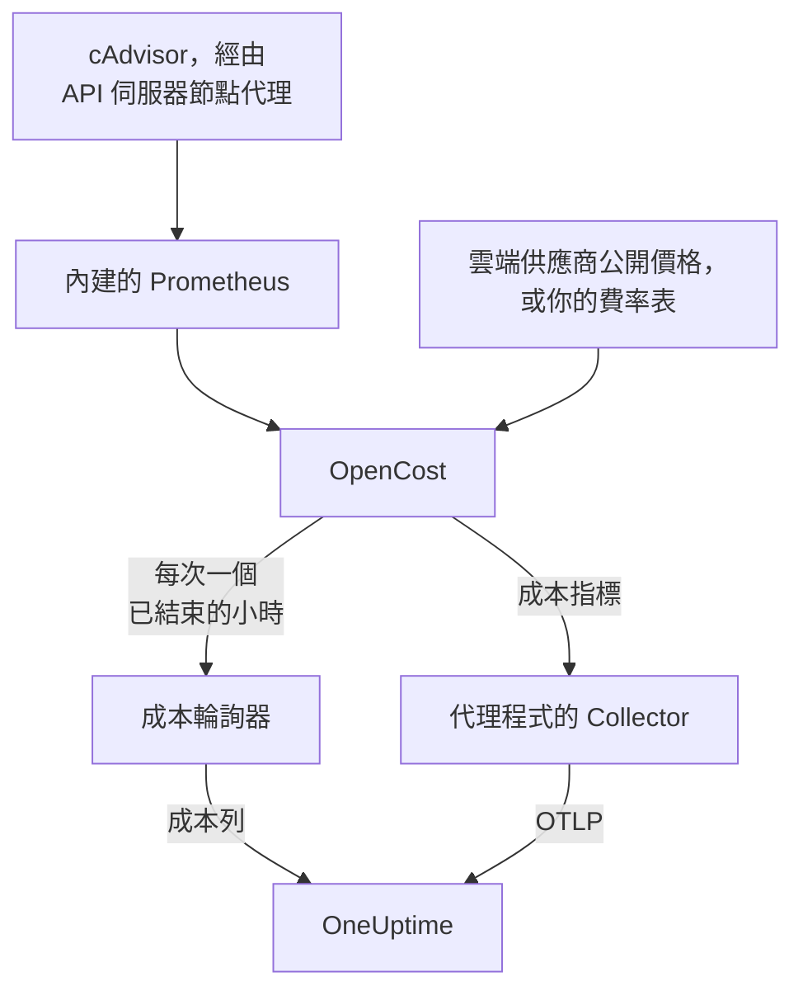

# Kubernetes 成本可觀測性

查看每個 Kubernetes 工作負載的成本——依命名空間、工作負載和 Pod 統計的支出、閒置容量，以及每個 request 實際被使用了多少——就在 [Kubernetes 代理程式](/docs/telemetry/kubernetes-agent) 已經收集的指標、日誌和追蹤旁邊。一個 Helm 值即可開啟，不需要任何雲端認證，接著叢集的 **Costs** 頁面會告訴你應該縮減哪些 request。

:::cards
- [開啟它](#開啟成本可觀測性): 一條 `helm upgrade`。
- [使用你自己的引擎](#已經在執行-kubecost-或-opencost): 讓代理程式指向 Kubecost 或 OpenCost。
- [資源規格調整](#資源規格調整): request 建議，以及它們是如何得出的。
- [疑難排解](#疑難排解): 頁面是空的、缺少建議。
:::

## 運作方式

設定 `cost.enabled=true` 後，chart 會在代理程式旁邊執行四樣東西：



1. **OpenCost**：開放原始碼的成本引擎（Apache-2.0，CNCF；也是 Kubecost 所依據的 [cost-model](https://github.com/kubecost/cost-model)）。它會監看叢集，為你的節點、磁碟區和負載平衡器定價，並算出每個工作負載的成本。
2. **一個小型 Prometheus**：OpenCost 需要它來保存用量和價格歷程。它執行一個複本，保留 7 天的歷程，而且只抓取兩個目標：透過 API 伺服器節點代理存取的 cAdvisor，以及 OpenCost 本身（它會發出自己的資源 request 指標，因此不涉及 kube-state-metrics）。它從不公開到叢集之外，其資料也從不離開叢集。
3. **成本輪詢器**（`cost.agent`）。每個小時結束後，它會讀取一次 OpenCost 的 Allocation API，並為每個工作負載向 OneUptime 傳送一列成本：CPU、記憶體、GPU、磁碟區、網路、負載平衡器和閒置，以及效率。每個小時只會傳送一次；伺服器會略過它已經有的小時，因此重新啟動不會把支出計算兩次。
4. **一項成本指標抓取**（`cost.metrics`）。代理程式的 Collector 會抓取 OpenCost 的成本指標，並與叢集的其餘指標一起傳送。

OpenCost 會根據雲端供應商的公開價格（AWS、Google Cloud、Azure）為節點定價，不需要任何認證。沒有雲端公開價格的叢集可以改為設定 [費率表](#地端和裸機定價)。

## 開啟成本可觀測性

:::steps
### 使用 cost.enabled 升級代理程式

```bash
helm upgrade kubernetes-agent oneuptime/kubernetes-agent \
  --namespace oneuptime-agent \
  --reset-then-reuse-values \
  --set cost.enabled=true
```

這就是一次完整的安裝：額外兩個小型 Pod，也就是 OpenCost 和它的 Prometheus。如果你以其他發行版本名稱或命名空間安裝了代理程式，請使用你的（`helm list -A | grep kubernetes-agent` 會列出它們）。

### 等待第一個小時結束

第一批成本會在第一個完整的小時結束後出現，而且 OpenCost 啟動後需要幾分鐘來為它的第一個小時定價。

### 開啟 Costs 頁面

- **產品 → 基礎設施 → Kubernetes → Costs** 會顯示專案中所有叢集的支出。
- 在某個叢集上，**Costs** 會顯示其支出趨勢、依 CPU、記憶體和儲存空間拆分的 **Spend by Namespace**、**Spend by Workload**、閒置支出、效率，以及 **Right-Sizing** 卡片。
:::

成本指標（`node_total_hourly_cost`、`pv_hourly_cost` 等）都是一般指標：它們會出現在指標瀏覽器中、自訂儀表板上和指標監控器中。若要使用現成的儀表板，請前往 **產品 → 儀表板**，選取 **建立儀表板**，然後挑選 **Kubernetes Cost Dashboard**：其中包含節點每小時成本趨勢、CPU 和記憶體單價，以及磁碟區和負載平衡器的支出。

## 已經在執行 Kubecost 或 OpenCost？

改為讓代理程式指向你的引擎，就不會內建任何東西：

```bash
helm upgrade kubernetes-agent oneuptime/kubernetes-agent \
  --namespace oneuptime-agent \
  --reset-then-reuse-values \
  --set cost.enabled=true \
  --set cost.engine.url=http://kubecost-cost-analyzer.kubecost.svc.cluster.local:9090
```

| 引擎 | 常用的服務 URL |
| --- | --- |
| OpenCost | `http://opencost.opencost.svc.cluster.local:9003` |
| Kubecost | `http://kubecost-cost-analyzer.kubecost.svc.cluster.local:9090` |

Allocation API 路徑會被自動找到（Kubecost 為 `/model/allocation`，OpenCost 為 `/allocation/compute` 或 `/allocation`）。只有在安裝方式不尋常時才需要設定 `cost.engine.allocationPath`。若要取得記憶體建議，也要設定 `cost.engine.prometheusUrl`（請參閱 [建議背後的資料](#建議背後的資料)）。

## 地端和裸機定價

節點沒有公有雲公開價格的叢集可以設定費率表。接著 OpenCost 會根據這些數字為每種資源定價，單位均為美元每資源小時：

```yaml title="values.yaml"
cost:
  enabled: true
  opencost:
    customPricing:
      enabled: true
      cpuPerCoreHour: "0.031611"       # ~$23 per core-month
      ramPerGiBHour: "0.004237"        # ~$3 per GiB-month
      storagePerGBHour: "0.00005479452" # ~$0.04 per GB-month
      gpuPerHour: "0.95"
```

## 值得了解的設定

全部都是選用的；chart 的 `values.yaml` 中有完整清單：

```yaml title="values.yaml"
cost:
  agent:
    windowSeconds: 3600   # allocation window length (hourly = native)
    includeIdle: true     # ship the engine's __idle__ allocation
    currency: USD         # currency code shown in the UI (informational)
  prometheus:
    retention: 7d         # bundled TSDB history; right-sizing reads peaks back over days
    persistence:
      enabled: false      # set true for a small PVC; emptyDir otherwise
  metrics:
    enabled: true         # cost metrics for dashboards / Metric Explorer
    scrapeInterval: 60s
```

## 資源規格調整

叢集 **Costs** 頁面上的 **Right-Sizing** 卡片，會為每個有足夠歷程資料的容器建議 CPU 和記憶體 request，並依每項變更每月能節省多少進行排序。

建議值是觀察到的需求加上 25% 的餘裕，並取整為可以直接貼到資訊清單中的值（CPU 以 10m 為單位，記憶體以 16Mi 為單位）：

- CPU 會根據每小時平均用量的第 95 百分位數決定：高到足以涵蓋實際負載，又低到不會因為一次尖峰就讓 request 在整整一個月內都偏大。
- 記憶體會根據工作集的峰值決定，而從不使用平均值（請參閱 [建議背後的資料](#建議背後的資料)）。

只會建議 request，不會建議 limit。request 是排程器預留的量，也是計算帳單的依據，因此它才是影響成本的數字。limit 則是關於行為異常的容器應該被節流還是被終止的決定，這是用量資料無法替你做出的。

每個容器都會與其目前的 request 進行比較：

| 判定 | 意義 |
| --- | --- |
| 過度配置（Over-provisioned） | 它預留的明顯多於它使用的。節省就來自這裡。 |
| 配置不足（Under-provisioned） | 它預留的少於它使用的，因此會被節流或面臨 OOM kill 的風險。修正它需要花錢，卡片會將其顯示為增加。 |
| 未設定 request | 沒有可以縮減的東西，但排程器無法安全地放置該容器，而且在資源吃緊時它會最先被驅逐。 |

與建議值相差在 15% 以內的容器會被視為規格合適，不會列出：沒有人應該為了把 request 削減 3% 而去編輯資訊清單。

有兩道防護讓建議保持可靠。一個工作負載至少需要 24 小時的成本時間範圍才會被評估規格，因為四小時的時間範圍可能剛好碰上夜間批次工作處於閒置狀態，進而建議將它縮減到零。此外，節省額是根據你正在查看的時間範圍長度推算的，而不是根據列數，因此 Deployment 的節省額不會乘以其複本數。這項估算假設支出與引擎配置的量成比例，也就是 `max(request, usage)`；對於過度配置的容器，這個值就是 request，因此節省額是精確的。

### 建議背後的資料

除了支出之外，輪詢器還會收集建議所需的資料：每個容器的 CPU 和記憶體 request、limit 以及用量。

記憶體還需要另一個資料來源。Allocation API 只會回報每個時間範圍的平均值，而每小時平均值會掩蓋導致容器被 OOM kill 的突增，因此據此決定記憶體規格是危險的。所以輪詢器會改為從 Prometheus 讀取每個容器的記憶體峰值，並依 `(namespace, pod, container)` 進行關聯：

- 使用內建引擎（預設）時，它會使用 chart 內建的 Prometheus。不需要任何設定。
- 使用你自己的引擎（`cost.engine.url`）時，請將 `cost.engine.prometheusUrl` 指向一個抓取 cAdvisor 的 Prometheus，如果其抓取工作的名稱不是 `kubernetes-nodes-cadvisor`，也要設定 `cost.engine.prometheusCadvisorJob`。
- 沒有 Prometheus 時，CPU 建議仍可根據已儲存的每小時平均值正常運作，而記憶體建議會被省略，而不是靠猜測得出。

Prometheus 中斷永遠不會停止支出的收集：峰值只是附加資訊，該小時會在沒有峰值的情況下傳送。CPU 刻意不使用 Prometheus：CPU request 過大只會導致節流，而記憶體 request 過小則會讓容器被終止，因此每小時平均值用於 CPU 是安全的；而且在整個叢集中查詢每個容器的 CPU 速率負擔很重，足以壓垮一個小型 Prometheus。

## 針對成本發出警示

成本指標都是一般指標，因此 [指標監控器](/docs/monitor/metrics-monitor) 可以像對待其他任何指標一樣對它們發出警示：例如，當平均 `node_total_hourly_cost` 超出預算時，或者當叢集中出現某個本不應存在的磁碟區類別的 `pv_hourly_cost` 時。

## 資料模型和保留

成本列會儲存在 ClickHouse 中，每個叢集、時間範圍、命名空間、控制器、Pod 和容器各一列。它們會遵循叢集的遙測保留設定：叢集的 `retainTelemetryDataForDays`，未設定時則使用專案的資料保留設定。閒置容量和未配置容量會以一般列的形式儲存在 `__idle__` 和 `__unallocated__` 命名空間下，因此可以像工作負載支出一樣進行分組和篩選。

## 疑難排解

:::details Costs 頁面是空的
查看成本輪詢器的日誌：`kubectl logs -n oneuptime-agent deploy/kubernetes-agent-cost`。（當發行版本名稱不包含 `kubernetes-agent` 時，Deployment 名稱為 `<release>-kubernetes-agent-cost`；`kubectl get deploy -n oneuptime-agent` 會列出它們。）`HTTP 401` 表示 OneUptime 拒絕了擷取金鑰。`did not answer any known allocation path` 表示引擎尚未就緒（內建的 OpenCost 需要幾分鐘為其最初幾個小時定價），或 `cost.engine.url` 有誤。
:::

:::details 內建的 OpenCost 未就緒
查看它的日誌：`kubectl logs -n oneuptime-agent deploy/kubernetes-agent-opencost`。日誌會說明它偵測到哪個雲端供應商，以及它的價格資料是否已載入。
:::

:::details OpenCost 日誌顯示 mkdir /var/configs: permission denied
較舊的 chart 在執行 OpenCost 時沒有可寫入的設定目錄，因此 `Error downloading default pricing data` 會讓其 Allocation API 無法回應、輪詢器停滯，而 Pod 仍維持 `Running`，`/healthz` 仍顯示正常，節點成本指標也仍在發布。目前的 chart 已修正此問題：執行 `helm repo update`，然後使用 `--reset-then-reuse-values` 升級。成本列會在下一次輪詢時出現。
:::

:::details Kubernetes Cost Dashboard 沒有資料
該範本會讀取被抓取的成本指標：請檢查 `cost.metrics.enabled` 是否為 `true`。
:::

:::details Right-Sizing 卡片是空的
要麼時間範圍短於一項建議所需的 24 小時（請擴大範圍），要麼每個容器都已在其建議 request 的 15% 以內，卡片會說明這一點。
:::

:::details 記憶體建議顯示為 -，但 CPU 建議正常
沒有任何記憶體峰值送達 OneUptime，因此記憶體規格沒有被決定，而不是根據平均值猜測。使用你自己的引擎時，請設定 `cost.engine.prometheusUrl`。卡片會說明這影響了多少個容器。
:::

:::details 數字與引擎本身的 UI 不一致
OneUptime 會將引擎的調節調整計入每個成本組成部分，並傳送完整的、已結束的小時：目前小時的支出會在該小時結束後出現。
:::

:::details 內建的 Prometheus 重新啟動過
使用預設的 `emptyDir` 儲存空間時，重新啟動會遺失幾個小時的用量歷程，因此這些小時的成本可能會偏低。如果這對你很重要，請設定 `cost.prometheus.persistence.enabled=true`。
:::

## 後續步驟

:::cards
- [Kubernetes 代理程式](/docs/telemetry/kubernetes-agent): 安裝代理程式，以及它收集的其他所有內容。
- [指標監控](/docs/monitor/metrics-monitor): 當支出超出預算時發出警示。
- [Kubernetes 監控](/docs/monitor/kubernetes-monitor): 同時針對叢集的健康狀況發出警示。
:::
