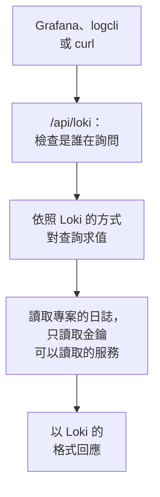

# 用 LogQL 查詢日誌

LogQL 是 Grafana Loki 的查詢語言。OneUptime 會針對專案的日誌回應 Loki 的查詢 API，因此 Grafana 的 Loki 資料來源、logcli 或任何 Loki 用戶端都能讀取這些日誌，你為 Loki 撰寫的儀表板和儲存的查詢也能繼續使用。

:::cards
- [連接 Grafana](#連接-grafana): 把 OneUptime 新增為 Loki 資料來源。
- [日誌的標籤](#日誌的標籤): 串流選擇器比對什麼。
- [支援的 LogQL 功能](#支援的-logql-功能): 日誌查詢、剖析器和指標查詢。
- [限制](#限制): 查詢可以讀取多少內容，以及多久一次。
:::

## 運作方式

Grafana 像詢問 Loki 一樣詢問 OneUptime。OneUptime 會檢查 API 金鑰能否讀取專案的日誌，只讀取它可以讀取的服務，並依照 Loki 的方式對查詢求值。



## 開始之前

- **有日誌送達。** 用 [OpenTelemetry](/docs/telemetry/open-telemetry) 傳送，或者從 Promtail、Grafana Alloy、Fluent Bit 或 Vector 透過 [Loki 的推送 API](/docs/telemetry/compatible-endpoints) 傳送。
- **可以讀取日誌的專案 API 金鑰**，需具備專案擁有者、專案管理員、專案成員、檢視者、遙測管理員、遙測成員或遙測檢視者角色，或者 Read Logs 權限。僅限部分服務的金鑰只能讀取這些服務的日誌。請參閱 [建立 API 金鑰](/docs/api-reference/api-reference#建立-api-金鑰)。在 OneUptime Cloud 上，API 金鑰需要 **Growth** 方案。
- **不能使用擷取金鑰。** 擷取金鑰只用於傳送遙測資料，不能讀取任何內容，因此 Grafana 無法用它登入。

## 連接 Grafana

:::steps
### 建立 API 金鑰

在 OneUptime 中，開啟 **專案設定 → 進階 → API 金鑰**，然後點選 **建立API 金鑰**。為金鑰指派一個可以讀取遙測的角色，或者 Read Logs 權限。

### 新增 Loki 資料來源

在 Grafana 中，開啟 **Connections → Data sources → Add data source**，然後選擇 **Loki**。

### 輸入 URL

將 **URL** 設為你的 OneUptime 位址加上 `/api/loki`。在 OneUptime Cloud 上，就是 `https://oneuptime.com/api/loki`。

### 傳送 API 金鑰

在 **HTTP headers** 底下，新增標頭 `Authorization`，值為 `Bearer`，後接一個空格和你的 API 金鑰。也可以使用基本驗證：使用者名稱任意，密碼填寫 API 金鑰。

### 儲存並測試

點選 **Save & test**。Grafana 會執行一個查詢，並告訴你資料來源運作正常。
:::

之後，Explore、日誌行上方的日誌量、標籤瀏覽器和儀表板都會像讀取 Loki 一樣讀取 OneUptime。logcli 和其他任何 Loki 用戶端的用法都相同。使用 curl：

```bash title="Query OneUptime's Loki API"
curl -G -H "Authorization: Bearer $ONEUPTIME_API_KEY" \
  "https://oneuptime.com/api/loki/loki/api/v1/query_range" \
  --data-urlencode 'query={service_name="checkout"} |= "error"'
```

## 日誌的標籤

串流選擇器比對日誌的屬性，名稱與 Loki 3 為 OpenTelemetry 日誌取的名稱相同：

| 在 OneUptime 中 | 在 LogQL 中 |
| --- | --- |
| 資源屬性 `service.name` | 標籤 `service_name` |
| 資源屬性 `k8s.pod.name` | 標籤 `k8s_pod_name` |
| 屬性 `http.method` | 標籤 `http_method` |
| Loki 用戶端傳送的標籤，例如 `job` | 標籤 `job` |
| 日誌的嚴重程度 | 標籤 `detected_level`：`trace`、`debug`、`info`、`warn`、`error`、`fatal` 或 `unknown` |

- **每個屬性都是標籤。** 日誌查詢依標籤組合傳回串流，每種組合一個串流，因此屬性不同的日誌屬於不同的串流，這與 Loki 3 對帶有結構化中繼資料的日誌的回應方式相同。
- **日誌本身的屬性優先**，當它的資源也有同名屬性時。
- **選擇器要指定一個值**，與 Loki 的要求相同：至少有一個比對條件是不帶該標籤的日誌無法滿足的，例如 `{service_name="checkout"}` 或 `{service_name=~"check.+"}`。

可以從以下查詢開始：

```text title="LogQL"
# The checkout service's lines that say error
{service_name="checkout"} |= "error"

# Requests slower than 250ms, read from JSON lines
{service_name="checkout"} | json | duration > 250ms

# Error logs per second, by service
sum by (service_name) (rate({detected_level="error"} [5m]))
```

## 支援的 LogQL 功能

- **日誌查詢**：使用 `=`、`!=`、`=~` 和 `!~` 的串流選擇器；可帶 `or` 的行篩選器 `|=`、`!=`、`|~` 和 `!~`；`json` 和 `logfmt` 剖析器；針對文字、數字、時長和大小的標籤篩選器，可帶 `and`、`or` 和 `__error__`；使用 `{{.label}}` 的 `line_format`；`drop`、`keep` 和 `decolorize`。
- **指標查詢**：`count_over_time`、`rate`、`bytes_over_time`、`bytes_rate` 和 `absent_over_time`；針對用 `unwrap`（可帶 `duration()` 或 `bytes()`）取出的標籤的 `rate`、`sum_over_time`、`avg_over_time`、`min_over_time`、`max_over_time`、`first_over_time`、`last_over_time`、`stddev_over_time`、`stdvar_over_time` 和 `quantile_over_time`；以及 `offset`。
- **在它們之外**：帶 `by` 或 `without` 的 `sum`、`avg`、`min`、`max`、`count`、`stddev`、`stdvar`、`topk` 和 `bottomk`；算術運算、比較（可帶 `bool`）、`and`、`or` 和 `unless`，以及 `on`、`ignoring`、`group_left` 和 `group_right`；`sort`、`sort_desc`、`label_replace` 和 `vector()`。

`pattern`、`regexp` 和 `unpack` 剖析器、`label_format`、帶具名欄位的 `json`、`ip()` 篩選器，以及超出 `{{.label}}` 的 `line_format` 範本暫不支援。使用它們的查詢會被拒絕，並在訊息中指出名稱。

## API

API 在 `/api/loki` 底下以 `GET` 或 `POST` 回應 Loki HTTP API 的路由：

| 路由 | 傳回的內容 |
| --- | --- |
| `/loki/api/v1/query_range` | 日誌查詢從 `start` 到 `end` 的行，或在每個 `step` 上的指標查詢。 |
| `/loki/api/v1/query` | 某一時刻（`time`，預設為現在）的指標查詢。 |
| `/loki/api/v1/labels` | `query` 選取的日誌或所有日誌的標籤名稱。 |
| `/loki/api/v1/label/<name>/values` | 一個標籤的值。 |
| `/loki/api/v1/series` | `match[]` 選取的日誌的標籤組合。 |

時間可以是自 1970 年以來的奈秒數、Unix 秒數或 RFC 3339，未另行指定時，範圍是 `end` 之前的一小時。日誌查詢傳回 `limit` 行，預設 100 行，除非指定 `direction=forward`，否則最新的排在前面。回應採用 Loki 的格式，錯誤與 Loki 一樣是純文字。`/loki/api/v1/status/buildinfo` 以 Loki 3 伺服器的身分回應。

## 限制

每個查詢都有上限，因此包含大量面板的儀表板也無法讓 OneUptime 超載：

| 限制 | 值 |
| --- | --- |
| 日誌查詢傳回的行 | 5,000 |
| 剖析器之後的篩選器捨棄部分日誌時，日誌查詢讀取的日誌 | 20,000 |
| ClickHouse 無法計數時，指標查詢自行讀取的日誌 | 100,000 |
| 指標查詢傳回的序列 | 500 |
| 範圍查詢中單一序列的資料點 | 11,000 |
| 一次讀取傳回的日誌 | 64 MB |
| 一次讀取可用的時間 | 30 秒 |
| 一個專案每分鐘可以傳送的查詢 | 1,200 |

管線只有行篩選器的指標查詢，例如 `sum(count_over_time({service_name="checkout"} |= "error" [5m]))`，會在日誌所在的地方計數，因此完全不讀取日誌行。

## 疑難排解

:::details Grafana 顯示資料來源無法運作
檢查 URL 是否以 `/api/loki` 結尾，以及 `Authorization` 標頭是否包含 `Bearer`、一個空格和 API 金鑰。擷取金鑰，或沒有可讀取日誌之角色的 API 金鑰，會被拒絕：請在 **專案設定 → 進階 → API 金鑰** 中為金鑰指派這樣的角色。
:::

:::details "queries require at least one regexp or equality matcher that does not have an empty-compatible value"
選擇器在沒有指定值的情況下比對日誌，例如 `{service_name=~".*"}`。請新增一個指定值的比對條件，例如 `{service_name="checkout"}`。
:::

:::details "This project sent more queries this minute than OneUptime answers."
這個專案的儀表板和用戶端在這一分鐘內向 API 傳送了超過 1,200 個查詢。面板會在下一分鐘重新載入；請降低儀表板的重新整理頻率，以免超出上限。
:::

## 後續步驟

:::cards
- [日誌瀏覽器](/docs/telemetry/logs-explorer): 不必撰寫查詢就能搜尋和篩選日誌。
- [PromQL](/docs/telemetry/promql): 用 PromQL 查詢指標，也可以透過 Grafana 的 Prometheus 資料來源查詢。
- [日誌監控](/docs/monitor/logs-monitor): 針對日誌的數量和內容發出警示。
:::
