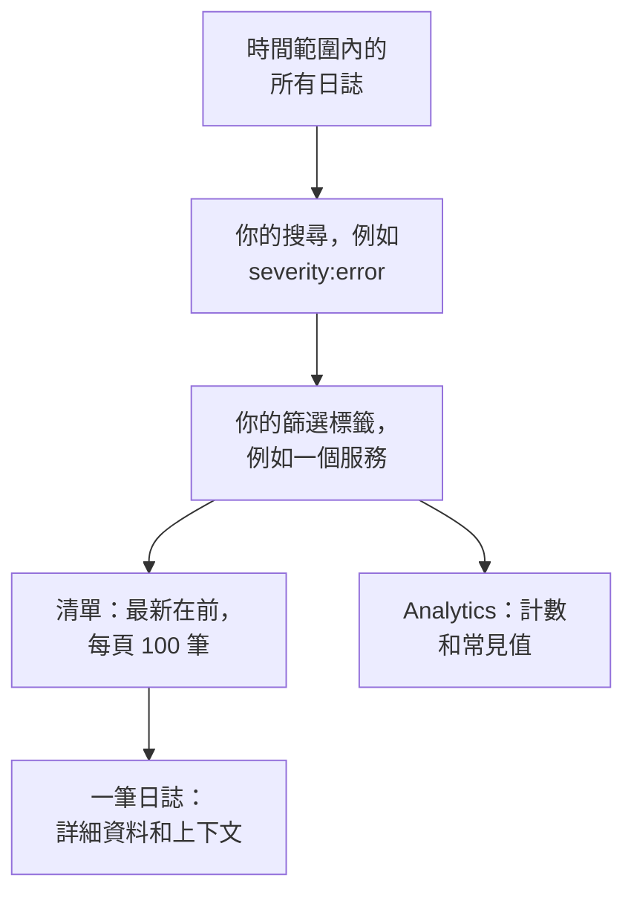

# 日誌瀏覽器

日誌瀏覽器是你搜尋和閱讀服務、主機和代理程式傳送到 OneUptime 的日誌的地方。把數百萬行縮小到真正重要的幾行，即時追蹤新到達的日誌，用圖表展示它們，並儲存團隊經常回頭查看的檢視。

:::cards
- [尋找日誌行](#尋找日誌行): 一個時間範圍、一次搜尋和幾個篩選條件。
- [閱讀日誌](#閱讀日誌): 它的屬性、它的追蹤以及它周圍的行。
- [即時追蹤日誌](#即時追蹤日誌): 每 10 秒出現新行。
- [儲存檢視](#儲存檢視): 為所有人保留搜尋、篩選條件和欄。
- [日誌洞察](#日誌洞察): 主要錯誤、嚴重程度分布，以及誰在記錄什麼。
- [用 AI 尋找並修正錯誤日誌、缺少的日誌和雜訊日誌](#用-ai-尋找並修正錯誤日誌缺少的日誌和雜訊日誌): 修正錯誤、補上未記錄的日誌並減少雜訊日誌行的 Pull Request。
:::

## 瀏覽器如何縮小日誌範圍

**檢視者** 分頁上的一切都作用於同一組日誌：時間範圍內、與你的搜尋和每個篩選標籤都符合的日誌。改變其中任何一項，清單、數量圖表和側欄中的計數都會一起變化。

瀏覽器有五個分頁：

| 分頁 | 用途 |
| --- | --- |
| **檢視者** | 搜尋、篩選和閱讀日誌。開啟時顯示最近一小時的日誌，最新在前，每頁 100 筆。 |
| **洞察** | 服務在某個時間範圍內記錄了什麼，以及哪裡出了問題。 |
| **人工智慧** | OneUptime 在你的日誌中發現的錯誤日誌、缺少的日誌記錄和雜訊日誌，以及 OneUptime AI 對它們做了什麼。請參閱 [用 AI 尋找並修正錯誤日誌、缺少的日誌和雜訊日誌](#用-ai-尋找並修正錯誤日誌缺少的日誌和雜訊日誌)。 |
| **設定指南** | 如何使用你的某個 [擷取金鑰](/docs/telemetry/ingestion-keys)，透過 OpenTelemetry、Fluent Bit 或 Fluentd 傳送日誌。 |
| **設定** | 日誌到達時會發生什麼：**管道**、**捨棄過濾器**、**清理規則** 和 **記錄規則**。 |

## 開始之前

- **正在到達的日誌。** 透過 [OpenTelemetry](/docs/telemetry/open-telemetry)、[Fluent Bit](/docs/telemetry/fluentbit)、[Fluentd](/docs/telemetry/fluentd) 或 [Syslog](/docs/telemetry/syslog) 傳送。**設定指南** 分頁會顯示適合你的語言或收集器的設定。
- **可以讀取遙測的角色。** Project Owner、Project Admin、Project Member、Viewer、Telemetry Admin、Telemetry Member 或 Telemetry Viewer，或者擁有 Read Telemetry Service Log 權限的自訂角色。角色的範圍決定你能看到誰的日誌：請參閱 [遙測](/docs/permissions/index#遙測)。

## 尋找日誌行

:::steps
### 開啟檢視者

前往 **產品 → 可觀測性 → 日誌**。**檢視者** 依最新在前的順序列出最近一小時的日誌，並顯示它們的 **時間**、**服務**、**嚴重程度** 和 **訊息**。

### 選擇時間範圍

在時間選擇器中選擇一個範圍，或者在清單上方的數量圖表上拖曳，放大某個峰值。雙擊圖表即可縮小回去。請參閱 [放大時間範圍](/docs/telemetry/charts-and-time-ranges)。

### 搜尋

在搜尋框中輸入查詢並按 Enter，例如 `severity:error service:checkout timeout`。單獨的詞會搜尋訊息，`@key:value` 會搜尋某個屬性。請參閱 [搜尋語法](/docs/telemetry/search-syntax#日誌)。

### 用篩選條件縮小範圍

點選 **篩選器** 側欄中的某個值，把它新增為篩選標籤：一個嚴重程度、一個服務，或者傳送日誌的主機、叢集或其他資源。每個值都會顯示有多少筆日誌帶有它。在手機上，點選 **篩選器** 開啟側欄。

### 開啟日誌

點選一列。它的詳細資料會在清單旁邊開啟。
:::

你的搜尋、篩選標籤和時間範圍都儲存在頁面網址中，因此重新整理、書籤或分享出去的連結都會開啟相同的日誌。

## 閱讀日誌

詳細資料面板有兩個分頁：

| 分頁 | 顯示內容 |
| --- | --- |
| **詳細資料** | **日誌內文**，有的話還有它的 **追蹤 ID**、**跨度 ID** 和 **工作階段**，以及它的 **屬性**，可以清單或 JSON 形式檢視。 |
| **Context** | 這筆日誌在相鄰日誌中的位置。**Nearby (service + time)** 顯示同一服務中它前後各五行，**This trace** 顯示其追蹤中最多 100 筆日誌。 |

- 點選追蹤 ID，即可在 [追蹤瀏覽器](/docs/telemetry/traces-explorer) 中開啟整個請求。
- 指向一個屬性並點選它的篩選圖示，即可搜尋該值，也可以複製它。你還可以把所有屬性一次性複製為 JSON。
- **This trace** 只對在追蹤內寫入的日誌出現。

## 即時追蹤日誌

點選清單上方的 **即時**。瀏覽器會跳到依最新在前排序的第一頁，並每 10 秒檢查一次新日誌，因此日誌行會隨著服務寫入而出現。

當你變更搜尋、篩選條件或時間範圍，或轉到結果的其他頁面時，即時模式會自動關閉：它只顯示最新的日誌。再次點選 **即時** 即可繼續。

## 選擇欄並匯出

- **欄位** 選擇清單顯示的內容。**時間**、**服務**、**嚴重程度** 和 **訊息** 排在最前；你可以新增 **追蹤 ID**、**跨度 ID** 或任意屬性，上下移動欄，或用 **重設** 還原預設。
- **匯出** 下載你正在檢視的這一頁日誌。**匯出為 CSV** 寫出你顯示的欄；**匯出為 JSON** 寫出每筆日誌的所有欄位及其全部屬性。
- 將指標移到標題列上，拖曳欄名末端的線即可加寬或縮窄該欄；按兩下這條線可讓欄符合其內容。清單會在這個瀏覽器中記住你的欄寬；標題列末端的 **重設欄寬** 會讓每一欄恢復原本的寬度。

## 儲存檢視

儲存的檢視會以一個名稱保留搜尋、篩選標籤、時間範圍、欄、排序和每頁筆數。

:::steps
### 設定檢視

搜尋、篩選，並選擇你想保留的欄。

### 儲存它

開啟 **已儲存的檢視** 並點選 **+ 儲存目前檢視**。輸入 **名稱**；如果希望任何人開啟日誌時都開啟這個檢視，請勾選 **設為預設**；然後點選 **儲存檢視**。

### 使用它

從 **已儲存的檢視** 中選擇檢視即可套用它，選擇 **清除檢視** 則回到沒有篩選條件的最近一小時。指向清單中的檢視可以 **編輯** 或 **刪除** 它；在它套用中時，還可以用你的變更 **更新** 它。
:::

儲存的檢視屬於專案，因此專案中的每個人都看到同一個清單。像最近一小時這樣的滾動範圍會保持滾動：檢視顯示的是你開啟它之前的一小時，而不是你儲存它時的那一小時。專案還沒有預設檢視時，下一個儲存的檢視會成為預設檢視，並且一個專案同一時間只有一個預設檢視。

## 用圖表展示日誌

把清單切換到 **Analytics**，就可以統計日誌而不是逐筆閱讀。選擇時間序列、排行清單或表格；統計所有日誌，或某個欄位的唯一值；依嚴重程度、服務、追蹤、span 或任意屬性分組，然後再依第二個欄位分組。排行清單或表格顯示前 5、10、25 或 50 個分組。

點選 **清單** 回到日誌行本身。

## 開啟相關的追蹤和指標

**已儲存的檢視** 旁邊的 **追蹤** 和 **指標** 按鈕會針對同一時間視窗開啟 [追蹤瀏覽器](/docs/telemetry/traces-explorer) 或 [指標瀏覽器](/docs/telemetry/metrics-explorer)，並盡可能帶上該瀏覽器能使用的篩選條件。指向按鈕即可看到它無法帶過去的內容。

## 日誌洞察

**洞察** 分頁顯示服務在某個時間範圍內記錄了什麼，以及哪裡出了問題。用時間選擇器旁邊的下拉式選單把它限定到部分服務、主機或叢集。

| 面板 | 顯示內容 |
| --- | --- |
| 摘要卡片 | **日誌總數**、**錯誤**、**Distinct errors** 和 **Reporting sources**。 |
| **Severity distribution** | 日誌依嚴重程度的分布。 |
| **Top errors** | 以 Error 或 Fatal 嚴重程度記錄的不同訊息，出現最多的在前。 |
| **Sources reporting logs** | 每個服務、主機或其他來源的日誌量和錯誤訊號。 |

選擇一個主要錯誤，可以檢視它周圍發生了什麼：它何時發生、各次出現的共同點、它在哪裡發生、帶有它的追蹤，以及它最近的日誌行。**Open matching logs** 會在 **檢視者** 中開啟這些日誌，**用 AI 說明** 會開啟 [詢問 AI](/docs/ai/ask-ai)，把錯誤及其證據作為可編輯的提示詞。

## 用 AI 尋找並修正錯誤日誌、缺少的日誌和雜訊日誌

OneUptime 每小時在每個服務最近一小時的日誌中尋找反覆記錄的錯誤、沒有記錄的失敗以及塞滿日誌的行，並將發現連同證據記錄為 AI 洞察。接著 OneUptime AI 會調查每一則，並開啟一個修正它的 Pull Request。絕不會自動合併：每個 Pull Request 都由你的團隊審查。

OneUptime 會記錄三類發現：

| 發現 | OneUptime 何時記錄 | Pull Request |
| --- | --- | --- |
| **錯誤日誌** | 某個服務在這一小時內以 Error 或 Fatal 記錄同一則訊息 20 次或更多，且該訊息有自己的詞語、不帶例外狀況。帶著例外狀況或包含堆疊追蹤記錄的訊息，會改在 [例外狀況追蹤](/docs/telemetry/exceptions) 中追蹤。 | 修正該錯誤被記錄的原因，或以它應有的層級記錄它。 |
| **缺少的日誌記錄** | 某個操作的跨度在這一小時內至少有 20 個失敗，占其 5% 或更多，同時該服務至少有 100 筆日誌帶有追蹤 ID，而該操作最近 20 個失敗的請求都沒有寫下任何日誌行。或者某個服務在這一小時內傳送了 500 筆或更多日誌和 100 個或更多跨度，而帶有追蹤 ID 的日誌不到 1%。 | 在失敗發生的地方記錄該失敗，或讓該服務的日誌帶上追蹤 ID。 |
| **雜訊日誌** | 一則以低於 Error 的層級記錄的訊息，占某個服務這一小時內日誌行的 25% 或更多，約 10,000 行或更多。 | 減少記錄該行：改為 Debug、每批記錄一次，或完全不記錄。 |

一則發現會把訊息保存為模式：數字和 ID 等逐行變化的部分會被遮蔽。Pull Request 以這個模式來要求，絕不使用照原樣記錄的日誌行；OneUptime AI 也被要求絕不記錄機密或個人資料，也不把日誌行複製到 Pull Request 中。

只有在找到出錯的程式碼後，OneUptime AI 才會自行為錯誤日誌開啟 Pull Request。來自其他地方的錯誤，例如某個相依服務停機，不會得到 Pull Request，除非有人透過 **用 AI 修正** 要求一個。

### 開啟

**日誌 → 人工智慧 → 設定** 中有 **尋找並修正錯誤日誌、缺少的日誌和雜訊日誌** 開關，新專案預設開啟。當 **啟用 AI** 關閉時，仍會發現錯誤日誌、缺少的日誌和雜訊日誌，但 OneUptime AI 不會對它們做任何事。要開啟 Pull Request，OneUptime AI 需要在 [程式碼](/docs/ai/ai-agent) 中連接的儲存庫：頁面會先說明缺少什麼。每個儲存庫的程式碼都在該儲存庫於「程式碼」中選擇的 Runner 上修改。

OneUptime AI 每天（UTC）最多自行開啟 5 個 Pull Request，這一上限由它修正的所有遙測資料共用，每則發現一個，且絕不超過儲存庫對開啟中的 AI Pull Request 的上限。

### AI 規則

沒有規則時，OneUptime AI 會立即調查它在你的日誌中發現的每個問題，並為每個它能修正的問題開啟 Pull Request。**更多設定** 下的 **AI 規則** 會分三步縮小範圍：

| 步驟 | 決定什麼 |
| --- | --- |
| **比對** | 哪些服務：所選的服務、帶有特定標籤的服務，或名稱符合某個模式的服務。 |
| **調查** | **立即**，或 **僅在等待後仍被發現時**：在等待期間消失的問題不會被調查。 |
| **修正** | **不修正**、**修正前先詢問** 或 **無需詢問直接修正**。先詢問時，Pull Request 交給人來開啟：這則發現會提供 **用 AI 修正**。 |

在 **更多欄位** 中，規則會選擇 OneUptime AI 可為其使用的程式碼儲存庫、MCP 伺服器和 LLM 供應商。若未選擇任何項目，它可以使用全部，並使用專案的預設 LLM 供應商。

### 查看它做了什麼

- **日誌 → 人工智慧 → 洞察** 列出 OneUptime 發現的內容，每則發現都附有證據和 **在日誌中開啟**，它會在 **檢視者** 中開啟這則發現所涉及的、發現當時那一小時的日誌行。不寫日誌行的失敗沒有可開啟的日誌行：改由 **在追蹤中開啟** 開啟它失敗的 span。對於錯誤日誌，**建立監測器** 會設定一個計算該訊息日誌行數的日誌監測器。
- **日誌 → 人工智慧 → 活動** 依最新優先列出每次調查和每個 Pull Request，以及各自的狀態。已完成的調查也會說明 OneUptime AI 發現了什麼，例如錯誤的原因在程式碼之外，這就是該錯誤日誌沒有自動得到 Pull Request 的原因。
- 在「程式碼」中，任務會說明是 OneUptime 啟動的，並附有指向其發現的連結，Pull Request 則會說明開啟它的原因。

## 日誌到達時會發生什麼

**設定** 分頁包含 OneUptime 在儲存每筆日誌之前套用的規則。它們作用於之後到達的日誌，而不是已儲存的日誌。每筆日誌保留多久，也是在它到達時決定的：請參閱 [資料保留](/docs/telemetry/data-retention)。

| 規則 | 作用 |
| --- | --- |
| **捨棄過濾器** | 捨棄你不想保留的日誌，或者只保留其中的一部分樣本。請參閱 [捨棄或取樣記錄](/docs/telemetry/drop-filters-and-scrub-rules#捨棄或取樣記錄)。 |
| **清理規則** | 遮蓋敏感資料，例如電子郵件地址和卡號。請參閱 [清理敏感資料](/docs/telemetry/drop-filters-and-scrub-rules#清理敏感資料)。 |
| **管道** | 從訊息中解析出欄位、修正嚴重程度、重新命名屬性。請參閱 [日誌管道](/docs/telemetry/log-pipelines)。 |
| **記錄規則** | 把符合的日誌轉換為指標。請參閱 [日誌記錄規則](/docs/telemetry/log-recording-rules)。 |

## 鍵盤快捷鍵

在檢視者中按 `?` 即可檢視這些快捷鍵。

| 按鍵 | 作用 |
| --- | --- |
| `j` / `k` | 移到下一筆或上一筆日誌。 |
| Enter | 開啟或關閉所選日誌。 |
| Esc | 關閉詳細資料面板。 |
| `/` | 跳到搜尋框。 |
| ⌘ + Enter 或 Ctrl + Enter | 套用搜尋。 |
| `?` | 顯示或隱藏快捷鍵。 |

## 疑難排解

:::details 沒有日誌出現
先擴大時間範圍：檢視者開啟時只顯示最近一小時。如果清單仍然為空，請把你的設定與 **設定指南** 對照，並檢查你的角色範圍是否涵蓋傳送日誌的服務。
:::

:::details 搜尋顯示逾時
執行超過 45 秒的搜尋會被停止。選擇更短的時間範圍，或新增一個精確值（例如某個服務），讓 OneUptime 能夠使用它的索引。請參閱 [搜尋語法](/docs/telemetry/search-syntax#須知)。
:::

:::details Live 總是自動關閉
即時模式只追蹤最新的日誌，因此變更搜尋、篩選條件、時間範圍或頁面都會關閉它。設定好篩選條件後，再次點選 **即時**。
:::

## 後續步驟

:::cards
- [搜尋語法](/docs/telemetry/search-syntax): 搜尋框能理解的所有篩選條件。
- [日誌監控](/docs/monitor/logs-monitor): 當你搜尋的日誌出現時收到警示。
- [日誌管道](/docs/telemetry/log-pipelines): 把日誌行的一部分變成可用於篩選的屬性。
- [追蹤瀏覽器](/docs/telemetry/traces-explorer): 跨服務追蹤一筆日誌所屬的請求。
:::
