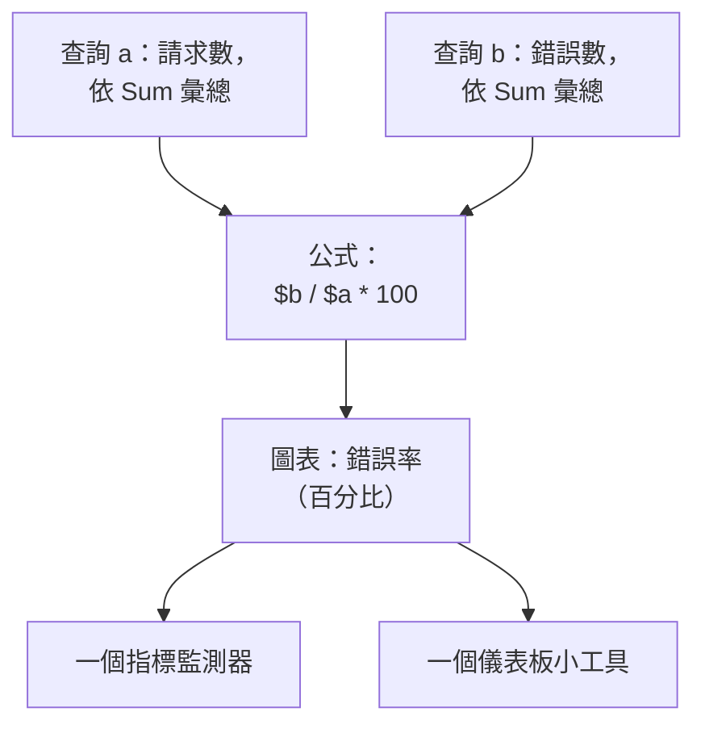

# 指標瀏覽器

指標是你的服務和基礎設施隨時間報告的數字：請求數、延遲、CPU、佇列深度。指標瀏覽器列出你的專案收到的每個指標，為其中任何一個繪製圖表，用公式組合它們，並把圖表變成監測器或儀表板小工具。

:::cards
- [尋找指標](#尋找指標): 搜尋指標名稱清單。
- [為指標繪製圖表](#為指標繪製圖表): 彙總、篩選和分組一個查詢。
- [用公式組合查詢](#用公式組合查詢): 錯誤率和其他比率。
- [使用你繪製的圖表](#使用你繪製的圖表): 監測器、儀表板小工具或連結。
- [用 AI 改進指標並新增缺少的指標](#用-ai-改進指標並新增缺少的指標): 修正你的指標並補上服務缺少之指標的 Pull Request。
:::

## 瀏覽器的運作方式

瀏覽器有兩層。**檢視者** 分頁列出你的專案收到的指標。點選其中一個，指標瀏覽器就會以針對它的查詢開啟：一個指標、如何彙總它，以及如何篩選和分組它。每個查詢都是一個變數，即 `a`、`b` 等，公式可以使用它們。

瀏覽器有五個分頁：

| 分頁 | 用途 |
| --- | --- |
| **檢視者** | 指標清單，每個指標都帶有一個小圖表和最新值。開啟時顯示最近一小時。 |
| **洞察** | 哪些服務報告指標，以及報告了多少。 |
| **人工智慧** | OneUptime 發現的記錄值過多或桶不合適的指標和缺少的指標，以及 OneUptime AI 對它們做了什麼。請參閱 [用 AI 改進指標並新增缺少的指標](#用-ai-改進指標並新增缺少的指標)。 |
| **設定指南** | 如何使用你的某個擷取金鑰，透過 OpenTelemetry 傳送指標。 |
| **設定** | **管道規則** 和 **記錄規則**：指標到達時會發生什麼。 |

## 開始之前

- **正在到達的指標。** 透過 [OpenTelemetry](/docs/telemetry/open-telemetry) 傳送，或者從代理程式傳送，例如 [主機 OpenTelemetry Collector](/docs/telemetry/host-otel-collector) 或 [Kubernetes 代理程式](/docs/telemetry/kubernetes-agent)。
- **可以讀取遙測的角色。** Project Owner、Project Admin、Project Member、Viewer、Telemetry Admin、Telemetry Member 或 Telemetry Viewer，或者擁有 Read Telemetry Service Metrics 權限的自訂角色。它能讀取哪些指標，請參閱 [遙測](/docs/permissions/index#遙測)。

## 尋找指標

前往 **產品 → 可觀測性 → 指標**。**檢視者** 依名稱列出你的專案收到的每個指標，每個都帶有該時間範圍的小圖表和最新值。

- 用單獨的詞或 `name:` 搜尋名稱，例如 `name:http.server` 會找到 `http.server.request.duration`。請參閱 [搜尋語法](/docs/telemetry/search-syntax#指標)。
- 在側欄中依 **服務** 篩選，只查看某一個服務報告的指標。
- 點選一個指標，即可在指標瀏覽器中為它繪製圖表。

## 為指標繪製圖表

:::steps
### 開啟指標

在 **檢視者** 中點選該指標。瀏覽器會以一個查詢 `a` 開啟，沿用清單的時間範圍和篩選條件。

### 選擇彙總方式

在 **Aggregate by** 下，選擇如何合併圖表中每個點內的值：預設的 Avg、Sum、Min、Max、Count，或一個百分位數 P50、P75、P90、P95 或 P99。直方圖指標（例如請求持續時間）的百分位數根據它的桶計算得出。

### 篩選和分組

開啟 **Filters & grouping**。**Filter by attributes** 只保留屬性符合的資料點，例如某一個 `http.route`；**分組依據** 為你所選屬性的每個值畫一條線，例如每台主機一條線。

### 調整圖表

開啟 **Display Settings**，選擇 **Chart type**（折線、面積或長條），設定要畫在圖表上的 **Warning Threshold** 和 **Critical Threshold**，或者開啟 **Convert to per-second rate**。
:::

> [!TIP]
> 只增不減的計數器（例如 `system.disk.io`）以速率檢視最清楚。開啟 **Convert to per-second rate**，顯示它變化的快慢，而不是它的累計總數；瀏覽器發現這樣的計數器時會建議你這樣做。

每個查詢都畫在自己的圖表上。要把一個查詢畫在與上一個查詢相同的圖表上，請在它的 **Display Settings** 中開啟 **Overlay with previous query**。

## 用公式組合查詢

:::steps
### 新增查詢

為你需要的每個指標點選 **新增指標**。新查詢依序是 `b`、`c` 等。

### 新增公式

點選 **新增公式**，用查詢的變數、運算子 `+`、`-`、`*`、`/`、`%` 和 `^` 以及括號編寫 **公式**。要得到百分比形式的錯誤率，請寫 `$b / $a * 100`。
:::

變數可以帶或不帶 `$`，大小寫均可。如果公式引用了你沒有定義的查詢，它會提示這一點，而不是繪製圖表。

## 圍繞圖表繼續探索

圖表上方的按鈕作用於你正在檢視的時間範圍：

| 按鈕 | 作用 |
| --- | --- |
| **日誌** | 以此時間範圍和你的篩選條件開啟 [日誌瀏覽器](/docs/telemetry/logs-explorer)。 |
| **追蹤** | 以此時間範圍和你的篩選條件開啟 [追蹤瀏覽器](/docs/telemetry/traces-explorer)。 |
| **調查** | 開啟一個側邊面板，顯示此時間範圍內的日誌、追蹤和例外。 |
| **事件** | 在圖表上標出此時間範圍內的事件和警示。 |
| **Compare** | 在每個圖表上用虛線畫出上一個週期，讓你看出發生了什麼變化。 |

在圖表上拖曳可以放大某個時刻，雙擊可以縮小回去：請參閱 [放大時間範圍](/docs/telemetry/charts-and-time-ranges)。

## 使用你繪製的圖表

- **操作 → 從此檢視建立監測器** 會開啟一個新的指標監測器，並預先填好這些查詢和公式。請參閱 [指標監控](/docs/monitor/metrics-monitor)。
- **操作 → Add to dashboard** 會把圖表新增到你選擇的儀表板。你需要有編輯該儀表板的權限。
- **複製連結** 複製指向這個檢視的連結：查詢、公式和時間範圍都完全一致。
- **已儲存的檢視** 以一個名稱為專案中的每個人保留該檢視。**檢視者** 有自己的儲存檢視，用於它的搜尋和篩選條件。儲存的檢視與 [日誌瀏覽器](/docs/telemetry/logs-explorer#儲存檢視) 中的用法相同。

## 指標洞察

**洞察** 分頁統計某個時間範圍內的指標：**使用中的指標**、**回報服務** 以及每個服務的平均數。它把指標分成若干類別，並列出報告這些指標的服務。

## 用 AI 改進指標並新增缺少的指標

OneUptime 每小時在你的服務最近一小時傳送的指標中尋找記錄的值過多或直方圖桶不合適的指標，以及沒有傳送任何指標的繁忙服務，並將發現連同證據記錄為 AI 洞察。接著 OneUptime AI 會調查每一則，並開啟一個修正它的 Pull Request。絕不會自動合併：每個 Pull Request 都由你的團隊審查。

OneUptime 會仔細讀取這一小時內你的服務傳送資料點最多的 10 個指標（每個至少有 1,000 個資料點），並記錄三類發現：

| 發現 | OneUptime 何時記錄 | Pull Request |
| --- | --- | --- |
| **高基數** | 程式碼在其中某個指標上設定的屬性在這一小時內取了 1,000 個或更多的值，例如使用者 ID 或完整的 URL，因此每個值都成為單獨的一條序列。或者某個服務的 50 個或更多指標名稱是同一個名稱，只是其中的 ID 不同。 | 不再於該指標上記錄這個值，或從其名稱中去掉 ID。 |
| **不合適的直方圖桶** | 其中某個指標是一個記錄了 1,000 個或更多值的直方圖，其中 90% 或更多的值落在最小的桶裡或高於最大的桶，或者它根本沒有桶，因此無法區分它的百分位數。 | 為直方圖設定與其值相符的桶，或修正它的單位。 |
| **缺少的指標** | 某個服務在這一小時內傳送了 1,000 個或更多 span，卻從未傳送過指標。 | 將其最繁忙操作的請求數、錯誤數和持續時間新增為指標。 |

發現從不儲存屬性的值：只儲存屬性的名稱、它取了多少個值以及這些值的樣子。

### 開啟

**指標 → 人工智慧 → 設定** 中有 **改進指標並新增缺少的指標** 開關，新專案預設開啟。當 **啟用 AI** 關閉時，仍會發現你指標中的問題，但 OneUptime AI 不會對它們做任何事。要開啟 Pull Request，OneUptime AI 需要在 [程式碼](/docs/ai/ai-agent) 中連接的儲存庫：頁面會先說明缺少什麼。每個儲存庫的程式碼都在該儲存庫於「程式碼」中選擇的 Runner 上修改。

OneUptime AI 每天（UTC）最多自行開啟 5 個 Pull Request，每則發現一個，且絕不超過儲存庫對開啟中的 AI Pull Request 的上限。

### AI 規則

沒有規則時，OneUptime AI 會立即調查它在你的指標中發現的每個問題，並為每個它能修正的問題開啟 Pull Request。**更多設定** 下的 **AI 規則** 會分三步縮小範圍：

| 步驟 | 決定什麼 |
| --- | --- |
| **比對** | 哪些服務：所選的服務、帶有特定標籤的服務，或名稱符合某個模式的服務。 |
| **調查** | **立即**，或 **僅在等待後仍被發現時**：在等待期間消失的問題不會被調查。 |
| **修正** | **不修正**、**修正前先詢問** 或 **無需詢問直接修正**。先詢問時，Pull Request 交給人來開啟：這則發現會提供 **用 AI 修正**。 |

在 **更多欄位** 中，規則會選擇 OneUptime AI 可為其使用的程式碼儲存庫、MCP 伺服器和 LLM 供應商。若未選擇任何項目，它可以使用全部，並使用專案的預設 LLM 供應商。

### 查看它做了什麼

- **指標 → 人工智慧 → 洞察** 列出 OneUptime 發現的內容，每則發現都附有證據和 **在指標中開啟**，它會開啟這則發現所涉及服務的指標，時間為發現當時那一小時。沒有指標的服務會改為提供 **在追蹤中開啟**：即它的指標原本應衡量的那些 span。
- **指標 → 人工智慧 → 日誌** 依最新優先列出每次調查和每個 Pull Request，以及各自的狀態和每次調查的發現。
- 在「程式碼」中，任務會說明是 OneUptime 啟動的，並附有指向其發現的連結，Pull Request 則會說明開啟它的原因。

## 指標到達時會發生什麼

**指標 → 設定 → 管道規則** 會在指標儲存之前、到達之時變更它們。規則依清單順序執行，你可以拖曳來調整順序；針對單一服務的規則先於針對所有服務的規則執行。

| 規則類型 | 作用 |
| --- | --- |
| 篩選器(允許清單) | 只保留符合的資料點，捨棄其餘的。 |
| 捨棄 | 捨棄符合的資料點。 |
| 重新命名指標 | 重新命名指標。 |
| 重新命名屬性 | 在符合的資料點上重新命名屬性的鍵。 |
| 新增屬性 | 為符合的資料點新增一個屬性。 |
| 移除屬性 | 移除一個屬性，例如取值太多而沒有用處的屬性。 |
| 遮蔽屬性 | 用預留位置替換屬性的值。 |
| 範例 | 保留符合資料點中的一定百分比。 |

**指標 → 設定 → 記錄規則** 每分鐘根據其他指標計算出新的指標。記錄規則的工作方式請參閱 [日誌記錄規則](/docs/telemetry/log-recording-rules)。

## 疑難排解

:::details 計數器的圖表只升不降
這是一個累積計數器。在查詢的 **Display Settings** 中開啟 **Convert to per-second rate**。
:::

:::details 清單顯示找不到指標
先清除你的搜尋和篩選標籤。如果清單仍然為空，表示還沒有指標到達 OneUptime：請把你的設定與 **設定指南** 對照。
:::

:::details 某個服務的指標不見了
在 **檢視者** 中依該 **服務** 篩選，並擴大時間範圍。如果仍然看不到，可能是你的角色範圍不包括該服務：請參閱 [遙測](/docs/permissions/index#遙測)。
:::

## 後續步驟

:::cards
- [指標監控](/docs/monitor/metrics-monitor): 當指標越過臨界值時收到警示。
- [建立儀表板](/docs/dashboards/authoring): 把你的圖表並排放在一起。
- [搜尋語法](/docs/telemetry/search-syntax): 搜尋框能理解的所有篩選條件。
:::
