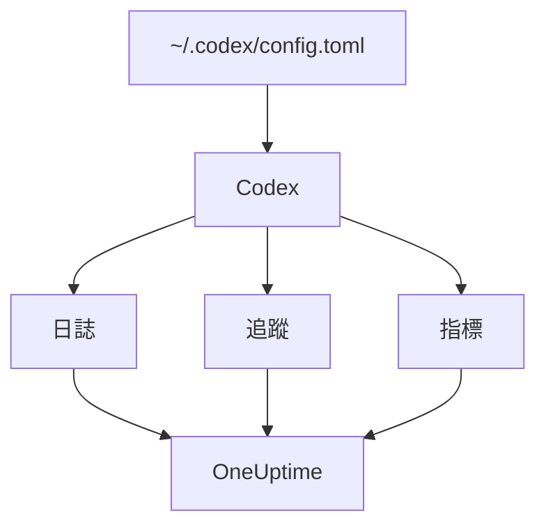

# OpenAI Codex

Codex CLI 內建三個 OpenTelemetry 匯出器，分別用於日誌、追蹤和指標。在 `~/.codex/config.toml` 中把它們指向 OneUptime，Codex 的每一輪都會帶著 token 和成本抵達，中間不需要任何包裝器或 Proxy。

:::cards
- [設定 Codex](#設定-codex): 一個 `[otel]` 區塊，每種訊號一個完整 URL。
- [把使用量歸屬到人](#把-codex-使用量歸屬到人): Codex 在 span 和指標上不指明任何人，因此需要由你設定。
- [token 和成本](#token-和成本): OneUptime 讀取哪種訊號，以及會顯示什麼。
- [疑難排解](#疑難排解): 什麼都沒有抵達時要檢查什麼。
:::

## 運作方式

每個匯出器會把一種訊號傳送到它自己的 URL。追蹤和日誌在你設定之前是關閉的；指標則不是。



> [!WARNING]
> 除非你變更這一點，否則 Codex 會把指標傳送給 OpenAI。在發行版本中，`metrics_exporter` 預設為 `statsig`，會把指標傳送到 `https://ab.chatgpt.com/otlp/v1/metrics`。像下方這樣把 `metrics_exporter` 設為 OTLP 匯出器，或設為 `none`，就能停止傳送。在 `[analytics]` 中設定 `enabled = false` 也能停止 Statsig 預設行為，但你設定的 OTLP 指標匯出器仍會繼續運作。

## 開始之前

1. 在 **專案設定 → 遙測與 APM → 擷取金鑰** 下建立遙測擷取金鑰。
2. 你的 OTLP 端點是 `https://oneuptime.com/otlp`；如果你自行託管 OneUptime，則是 `https://YOUR-ONEUPTIME-HOST/otlp`。
3. 每次匯出都會在 `x-oneuptime-token` 標頭中傳送金鑰。

## 設定 Codex

:::steps
### 加入 otel 區塊

把以下內容放入 `~/.codex/config.toml`。它會開啟全部三種訊號，同時取代 Statsig 預設設定：

```toml title="~/.codex/config.toml"
[otel]
environment = "prod"
log_user_prompt = false

[otel.exporter.otlp-http]
endpoint = "https://oneuptime.com/otlp/v1/logs"
protocol = "binary"
headers = { "x-oneuptime-token" = "YOUR_INGESTION_TOKEN" }

[otel.trace_exporter.otlp-http]
endpoint = "https://oneuptime.com/otlp/v1/traces"
protocol = "binary"
headers = { "x-oneuptime-token" = "YOUR_INGESTION_TOKEN" }

[otel.metrics_exporter.otlp-http]
endpoint = "https://oneuptime.com/otlp/v1/metrics"
protocol = "binary"
headers = { "x-oneuptime-token" = "YOUR_INGESTION_TOKEN" }

[otel.span_attributes]
"user.id" = "dev@example.com"
"user.email" = "dev@example.com"
"team" = "platform"
```

### 為每個匯出器提供完整 URL

Codex 會原樣使用每個 `endpoint`：它不會像大多數 SDK 那樣附加 `/v1/logs`、`/v1/traces` 或 `/v1/metrics`。如果三個匯出器都只設定為 `https://oneuptime.com/otlp`，就什麼也傳送不出去，而且不會出現錯誤。

### 執行一輪

啟動一個互動式 `codex` 工作階段，問一個小問題，讓這一輪結束。接著在 OneUptime 中開啟 **日誌** ：Codex 的事件，例如 `codex.conversation_starts`、`codex.api_request` 和 `codex.turn_cost`，會出現在那裡。
:::

> [!IMPORTANT]
> Codex 會忽略 `[otel]` 下它不認得的鍵，而且不會發出警告。它的鍵使用底線命名（`trace_exporter`、`metrics_exporter`、`span_attributes`），但匯出器名稱和 TLS 欄位使用連字號命名（`otlp-http`、`ca-certificate`）。寫成 `trace-exporter` 會直接關閉追蹤，且不會出現任何錯誤。

## 設定鍵

| 鍵 | 預設值 | 作用 |
| --- | --- | --- |
| `environment` | `"dev"` | 設定資源屬性 `env` |
| `log_user_prompt` | `false` | 在 `codex.user_prompt` 上傳送提示文字；否則顯示為 `[REDACTED]` |
| `log_agent_responses` | `false` | 把代理程式的最終回答傳送到日誌匯出器 |
| `exporter` | `none` | 日誌匯出器 |
| `trace_exporter` | `none` | 追蹤匯出器 |
| `metrics_exporter` | `statsig` | 指標匯出器：請務必設定 |
| `span_attributes` | — | 新增到每個匯出的 span 上的屬性 |
| `tracestate` | — | W3C `tracestate` 成員 |
| `tool_result` | `{ max_bytes = 2048 }` | 日誌記錄保留多少工具結果，以 UTF-8 位元組計 |

匯出器可以是 `none`、`statsig`、`otlp-http` 或 `otlp-grpc`。`otlp-http` 接受 `endpoint`、`headers`、`protocol`（`"binary"` 或 `"json"`，OneUptime 兩者都接受）和 `tls`（`ca-certificate`、`client-certificate`、`client-private-key`）；`otlp-grpc` 接受相同的內容，但沒有 `protocol`。

## 把 Codex 使用量歸屬到人

Codex 只在一個地方指明開發人員：

- **日誌記錄** 帶有 `user.account_id` 和 `user.email`。
- **span** 不帶：Codex 刻意把兩者都排除在追蹤之外。
- **指標** 也不帶：它們帶有 `auth_mode`、`session_source`、`originator`、`service_name`、`model` 和 `app.version`，但沒有人員。

OneUptime 會從 span 和指標資料點讀取人員，絕不從日誌記錄讀取。因此請在 `[otel.span_attributes]` 中自行為每個 span 標註身分：

```toml title="~/.codex/config.toml"
[otel.span_attributes]
"user.id" = "dev@example.com"
"user.email" = "dev@example.com"
"team" = "platform"
"cost_center" = "eng-123"
```

`user.id` 是 OneUptime 優先使用的鍵，`user.email` 用於填入電子郵件欄。Codex 沒有資源屬性，因此請在這裡一併設定團隊鍵（`team.id`、`team`、`cost_center`、`department`）。這個區塊位於每位開發人員自己的設定檔中：請透過你的 dotfiles 或 MDM 設定檔依開發人員發佈。如果使用只有一個身分的共用檔案，所有人的支出都會記到一個人身上。

## token 和成本

| 訊號 | Codex 傳送什麼 | OneUptime 如何處理 |
| --- | --- | --- |
| 追蹤 | `gen_ai.usage.input_tokens`、`gen_ai.usage.output_tokens` 和快取 token，但沒有模型 | 依人員統計 token；無法為其計價 |
| 指標 | 依 `token_type` 劃分的 `codex.turn.token_usage`，以及以百萬分之一美元計的 `codex.turn.cost_microusd` | 把成本換算為 USD；只在 span 沒有回報的地方讀取指標 |
| 日誌 | 帶有 `usage.estimated_usd` 和人員的 `codex.turn_cost` | 儲存在 **日誌** 瀏覽器中；不與支出關聯 |

使用上方的設定時， **使用量** 分頁上的結果如下：

- token 來自 span，依人員劃分，`codex.turn.token_usage` 不會再疊加上去：兩者絕不相加（ [原因](/docs/telemetry/ai-llm-observability#span-優先指標補充) ）。
- Codex 的 span 不指明模型，因此 OneUptime 無法為其計價，它們的成本為 0。於是成本總數會從 `codex.turn.cost_microusd` 取得 Codex 的成本，並為你換算為 USD。
- **員工** 、 **團隊** 和 **模型** 表格顯示 span 的資料列：有依人員的 token，但沒有依人員的成本。
- 沒有追蹤時，改由指標填入這些表格，只有成本，而且全部歸入 **未歸屬** ，因為 Codex 的指標不指明任何人。

最精確的每輪成本（並帶有人員資訊）是日誌記錄 `codex.turn_cost`。OneUptime 目前還不會把日誌記錄與支出關聯，但請保持日誌匯出器開啟：等到支援時，歷史資料已經在那裡了。

## 在 CI 中以及作為 MCP 伺服器使用 Codex

`codex`、`codex exec` 和 `codex mcp-server` 都會從同一個 `[otel]` 區塊建構遙測，並使用全部三個匯出器。`codex exec` 的執行帶有 `originator` `codex_exec`，`codex mcp-server` 以 `codex_mcp_server` 的身分匯出，因此你可以依這些值把 CI 和 MCP 執行與互動式工作階段區分開來。

## 隱私

`log_user_prompt` 和 `log_agent_responses` 預設為 `false`：請保持關閉。`codex.user_prompt` 事件仍會抵達，但提示被取代為 `[REDACTED]`，因此你保留了這一輪、它的 token 和成本，卻沒有提示文字。無論這些開關如何設定，人員（`user.email`、`user.account_id`）都在日誌記錄上。

如果為了調查而開啟內容， **追蹤 → 設定** 下追蹤的 **清理規則** 和 **捨棄過濾器** 會在儲存前加以遮罩或捨棄。

## 使用 OpenAI API 取代 Codex

OpenAI 的平台 API 本身不會傳送 OpenTelemetry：每個 span 都來自對你自己用戶端的檢測。有三種檢測可與 OneUptime 搭配使用：

- **OpenTelemetry** ：適用於 Python 的 `opentelemetry-instrumentation-genai-openai`，它取代了 `opentelemetry-instrumentation-openai-v2`。是否記錄訊息由 `OTEL_INSTRUMENTATION_GENAI_CAPTURE_MESSAGE_CONTENT` 決定。
- **OpenLLMetry** （Traceloop）：`opentelemetry-instrumentation-openai`。
- **OpenInference** （Arize）：`openinference-instrumentation-openai`。

依照 [AI / LLM 可觀測性](/docs/telemetry/ai-llm-observability) 中的說明，把其中任一種指向 OneUptime。它們都不知道你的員工是誰：請自行設定 `user.id`。

**OpenAI Agents SDK** 會把追蹤傳送到 OpenAI 自己的端點，而不是透過 OTLP。請用 `opentelemetry-instrumentation-openai-agents-v2` 或 `openinference-instrumentation-openai-agents` 進行橋接，它們會把 SDK 的 span 交給 OTLP 匯出器。

## 疑難排解

:::details 什麼都沒有抵達
先檢查三個 `endpoint` 值：每個都必須以 `/v1/logs`、`/v1/traces` 或 `/v1/metrics` 結尾。然後檢查 `x-oneuptime-token` 標頭：OneUptime 會拒絕錯誤的金鑰。
:::

:::details 日誌抵達了，但追蹤始終沒有抵達
尋找 `[otel]` 下拼寫錯誤的鍵：Codex 會默默忽略它。最常見的是把 `trace_exporter` 寫成了 `trace-exporter`。
:::

:::details Codex 的成本出現在總數中，但每個人都顯示 $0
這是預期行為：Codex 的 span 帶有 token 但沒有模型，因此無法計價，而成本指標不指明任何人。請參閱 [token 和成本](#token-和成本)。
:::

:::details 所有人的支出都顯示在一個人名下
每台機器上都是同一個 `[otel.span_attributes]` 身分。請為每位開發人員設定各自的身分。
:::

## 後續步驟

:::cards
- [AI 程式設計助理](/docs/telemetry/ai-coding-assistants): 支出如何在所有程式設計助理之間歸屬。
- [AI / LLM 可觀測性](/docs/telemetry/ai-llm-observability): 你自己的 AI 呼叫的對話、警示、成本和預算。
- [AI 閘道](/docs/telemetry/ai-gateways): 一個為每次模型呼叫提供追蹤和計價的閘道。
:::
