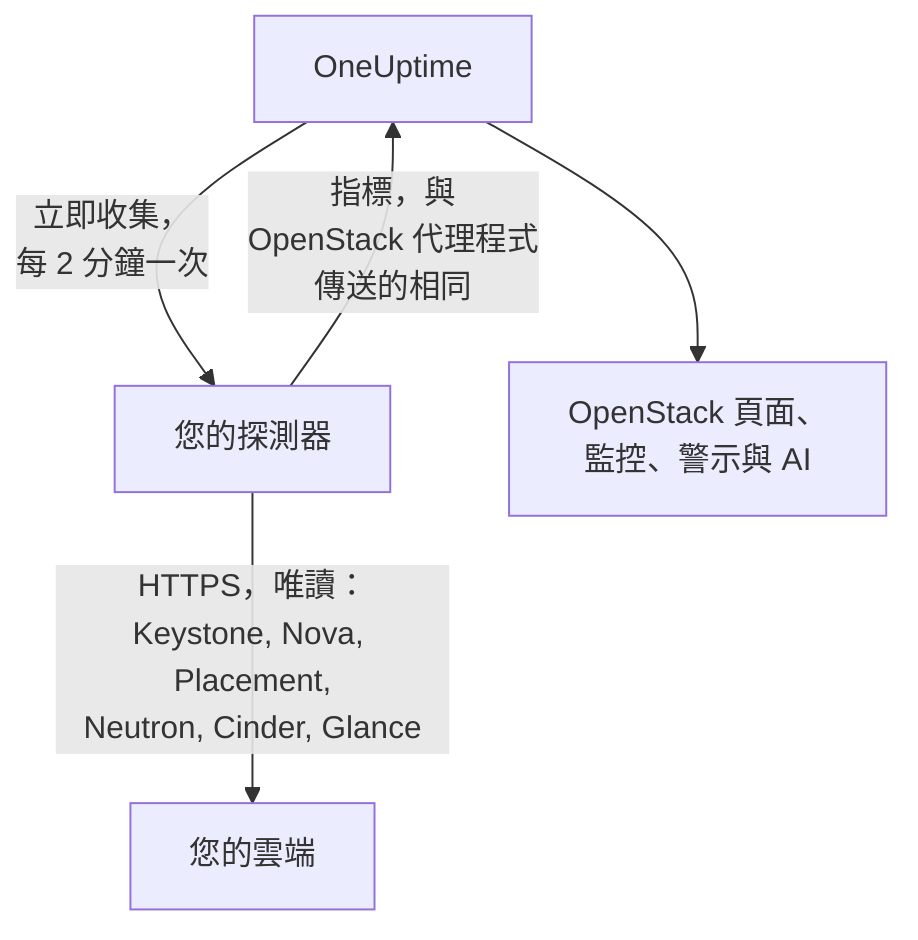

# 不使用代理程式的 OpenStack

無需安裝任何東西即可監控 OpenStack 雲端：在 OneUptime 中輸入 Keystone 的位址與應用程式憑證，選擇可連線到該雲端的探測器，探測器就會收集與 [OpenStack 代理程式](/docs/telemetry/openstack)相同的資料。不需要安裝、升級或持續執行代理程式，也不必另外準備專用機器。

> [!IMPORTANT]
> 探測器只會以 HTTPS 與雲端通訊。憑證及其權杖絕不會透過純 HTTP 傳送，而 DevStack 與 Kolla-Ansible 預設以純 HTTP 提供 API。對於這類雲端，請為其 API 啟用 TLS，或改用與雲端並行運作的 [OpenStack 代理程式](/docs/telemetry/openstack)。連線測試發現純 HTTP 位址時會提示這一點。

:::cards
- [開始之前](#開始之前)：一個可連線到 API 的探測器，以及一組憑證。
- [連接雲端](#連接雲端)：位址、憑證、測試與名稱。
- [疑難排解](#疑難排解)：各個訊息的意義與解決方法。
:::

## 運作方式



探測器每兩分鐘讀取您所選每個區域的每項服務，並將結果傳送到 OneUptime。資料的格式與 OpenStack 代理程式傳送的完全相同，因此每個 OpenStack 頁面、[OpenStack 監控](/docs/monitor/openstack-monitor)與警示範本都以同樣方式讀取。

每項服務各自獨立讀取，且與其他服務同時進行。Neutron 失敗或卡住只會損失 Neutron 的數列，Nova 的資料仍照常送達，但 Nova 自己有一個例外：它會針對列出的每個執行個體詢問 Neutron。因此在 Neutron 停擺期間，探測器會保留上次讀到的執行個體，只詢問有變動的部分。如果有執行個體發生變動，或探測器剛啟動，Nova 同樣無法回答該清單：Nova 會顯示為失敗，其他數列仍會送達，每個執行個體在其頁面上維持上次的狀態，直到 Neutron 恢復。

Heat、Magnum、Manila、Trove、Gnocchi、Designate、Swift 與 Barbican 會在 Keystone 的目錄列出它們時才讀取。沒有執行這些服務的雲端不會因此產生任何負擔，連線測試也不會提到它們，並且[不會留下任何痕跡](/docs/telemetry/openstack#heat-與-magnum)。

在目錄中有 Octavia 的雲端上，探測器會以各一次列表讀取其負載平衡器、集區、接聽程式與 amphora，接著對每個集區的成員，以及每個狀態為 `ACTIVE` 的負載平衡器與接聽程式的流量計數器，各發出一次請求。擁有 3 個負載平衡器、1 個集區與 1 個接聽程式的雲端，每次收集需要 9 個請求；測試環境記錄到的真實 DevStack 恰好就是這個數字。每次收集最多讀取 25 個集區的成員與 50 個計數器，優先讀取最久未讀的，其餘維持上次讀取時的內容。Octavia 的計數器是累計值，因此探測器會保留每個計數器的上次讀數，並繪製兩次讀數之間每秒的差值：圖表從第二次收集開始，計數器若減少（接聽程式被重建），該區間不會繪製任何東西。OVN 提供者的每個計數器都回報 0，這是一條平線，並非故障。

讀取 amphora 的每個動作都需要 Octavia 的管理員規則。權限低於管理員的憑證只能看到自己專案的負載平衡器、集區、接聽程式與成員，以及自己的計數器，看不到 amphora：Load Balancers 頁面會說明這點，但不會有任何警告。在沒有負載平衡器的專案上，監控角色什麼都看不到。`load-balancer_global_observer` 在此版本中所有讀取都會被拒絕。

對探測器而言，停止的 Octavia API 會顯示為 `up 0`，這是代理程式的匯出器無法表達的。

## 探測器還是代理程式？

| | 探測器（本頁） | OpenStack 代理程式 |
|---|---|---|
| 您要執行什麼 | 您已在執行的探測器，或新的探測器 | 代理程式，位於專用機器上 |
| 憑證存放位置 | 在 OneUptime 中加密保存，只傳送給探測器 | 在代理程式的 `clouds.yaml` 檔案中 |
| 需要連線到什麼 | 以 HTTPS 連線到 Keystone 與各服務的 API | Keystone 與各服務的 API |
| 使用純 HTTP 的 API | 不收集：權杖絕不以未加密方式傳送 | 會收集 |
| 最大雲端規模 | 已針對模擬雲端（非真實雲端）測試過 [200,000 個執行個體](/docs/telemetry/openstack-very-large-clouds)，最多分十次上傳，每次 48 MiB | 尚未測試到任何規模：[它的擷取](/docs/telemetry/openstack-very-large-clouds#透過代理程式)遠在此之前就會逾時 |
| 服務日誌與 AI 代理程式 | 不包含 | 包含 |
| 雲端所依賴的元件：RabbitMQ、MariaDB、Memcached、HAProxy、OVN、libvirt | 不包含：探測器只讀取雲端的 API | 包含，並指明其目標 |
| 每個執行個體來自 libvirt 或 Ceilometer 的實際 CPU、記憶體與磁碟 | 不包含 | 包含，並指明其匯出器 |
| 登入 Keystone 的次數 | 每個權杖有效期間一次，通常是一小時 | 每次擷取一次 |
| 單一專案上的一般 `reader` | 該專案的執行個體、磁碟區與網路 | 該專案的磁碟區與網路，沒有執行個體 |

兩者傳送的數列相同，因此頁面與監控在兩種方式下都能運作。探測器還會傳送只有原生用戶端才讀得到的內容：執行個體的位址、任務狀態與故障訊息，其開機所用的映像，操作員是否強制將某個 Nova 服務停用，DHCP 代理程式服務哪些網路，哪個儲存集區存放某個磁碟區，執行個體、磁碟區或映像上次變更的時間，以及每個磁碟區快照與備份的狀態。Cinder 只會對它視為管理員的憑證說明哪個集區存放某個磁碟區。在執行 [Heat 或 Magnum](/docs/telemetry/openstack#heat-與-magnum) 的雲端上，它還會傳送堆疊或叢集失敗的原因、堆疊擁有哪些執行個體與磁碟區、每個叢集的專案、範本與 Kubernetes 版本，以及 Heat 的各個引擎與 Magnum 的各個 conductor 是否在運作。

如果需要服務日誌、AI 代理程式、雲端所依賴的元件與每個執行個體的實際用量，或雲端的 API 只支援純 HTTP（DevStack 與 Kolla-Ansible 預設如此），或雲端大到必須[從其資料庫讀取](/docs/telemetry/openstack-very-large-clouds#資料庫路徑)，請選擇代理程式。其他情況請選擇探測器：不需要安裝任何東西，而且能讀到更多 Nova 與 Cinder 提供的資訊。[超大型 OpenStack 雲端](/docs/telemetry/openstack-very-large-clouds)說明了這兩種方式在各種規模下的成本。

您可以隨時在雲端的 **設定** 頁面將其從一種方式切換到另一種。

## 開始之前

- **一個能以 HTTPS 連線到 Keystone 與每項服務 API 的探測器。** 通常是位於雲端網路中的[自訂探測器](/docs/probe/custom-probe)。Keystone 的目錄會指出各項服務的回應位址，探測器會連線到這些位址，因此每個位址都必須能從探測器連線，且每個都必須是 HTTPS。在 OneUptime Cloud 上，共用探測器永遠不會收到 OpenStack 憑證，因此請自行新增探測器。在自行託管的執行個體上，該執行個體自己的探測器也可以收集。
- **一組憑證。** 最好使用應用程式憑證，因為它可以限制為只能讀取，也可以設定到期。使用者名稱與密碼同樣可用，但可以執行其帳戶所能做的任何事。

OpenStack 沒有全域唯讀角色，因此探測器能看到多少取決於憑證：

| 層級 | 需要什麼 | 探測器讀取什麼 |
|---|---|---|
| 完整檢視 | 一個帳戶的應用程式憑證，該帳戶在自己專屬的專案上擁有 `admin`，並以存取規則限制為只能讀取 | 除了 Keystone 的使用者與群組以外的所有內容，規則刻意將這兩者排除 |
| 僅基礎架構 | 在一個專屬、不存放任何東西且配額為零的專案上的 `oneuptime_monitoring` 與 `reader` 角色，以及 OpenStack 代理程式隨附的政策檔案 | 虛擬化主機、Nova 的服務、Neutron 的代理程式、位址集區、Placement、專案清單，以及每個專案的執行個體。磁碟區、網路與路由器僅限已指派角色之處。不含 `cinder-volume` 與 `cinder-scheduler` 的狀態或儲存集區：Cinder 自己的程式碼要求管理員身分 |
| 專案檢視 | 單一專案上的一般 `reader` | 該專案的執行個體、磁碟區與網路，沒有基礎架構 |

連線測試會說明一組憑證相當於其中哪一層級，並在其自身專案內有東西時發出警告：在 Cinder 的 `enforce_new_defaults` 關閉（這是它自己的預設值）的情況下，專案上的任何角色（包含 `reader`）都能建立該專案的磁碟區。

> [!IMPORTANT]
> 以存取規則限制的應用程式憑證，會被任何 `keystonemiddleware` 未設定 `service_type` 的服務以 `401` 拒絕。連線測試會針對每次讀取說明這一點。請在各服務的設定中設定它，然後重新啟動。[建立憑證](/docs/telemetry/openstack#建立憑證)提供了規則、政策檔案與各服務的設定，而[各層級讀取的內容](/docs/telemetry/openstack#每個層級讀取什麼)是真實雲端的回應結果。

## 連接雲端

:::steps
### 開啟您的雲端
在 OneUptime 中開啟 **OpenStack → All Clouds**，然後按一下 **連接雲端**。

### 輸入位址與憑證
輸入 `clouds.yaml` 或 `openrc` 檔案中的 `auth_url`，例如 `https://keystone.example.com:5000/v3`，以及應用程式憑證的 ID 與密鑰。選擇可連線到該雲端的探測器。

### 測試連線
按一下 **測試連線**。探測器會登入，嘗試每次收集在各區域所做的每項讀取，然後登出。它會說明目錄列出哪些區域、憑證能讀取什麼、被拒絕什麼、缺少它會有哪些頁面沒有資料，以及開放權限的那一行設定。某項讀取失敗不會中止測試。

### 信任雲端的憑證
擁有自己憑證授權單位的雲端，會出示探測器不信任的憑證。此時測試會顯示該憑證與出示它的主機。請將其指紋與 API 本身的指紋比對，然後按一下 **信任此憑證**。每項服務各有主機的雲端，可能每項服務都有一張憑證，最多可以信任 32 張。

### 選擇區域並連接
選擇要讀取的區域，為雲端命名，然後按一下 **連接雲端**。隨後會開啟該雲端的頁面。
:::

雲端的 **概覽** 會顯示 **資料收集** 卡片。在第一次收集之前（會在一分鐘內開始）顯示 **檢查中**，之後顯示 **收集中**，各個頁面隨之填入資料。如果部分服務已讀取而另一項沒有，卡片會指出是哪一項。如果沒有探測器來收集該雲端達 15 分鐘（因為離線或版本太舊），無論上次收集的結果如何，都會顯示 **未在收集** 並說明原因。

雲端 **設定** 頁面上的 **資料收集** 卡片保存了您連接它時使用的內容：


## 從 API 或 Terraform 連接雲端

雲端的連線設定是 API 中 [OpenStack Cloud 資源](/reference/open-stack-cloud)的一般欄位，位於 `/api/openstack-cloud`，因此完全不用儀表板也能連接雲端。在 Terraform 中是 `oneuptime_openstack_cloud`：

```hcl
resource "oneuptime_openstack_cloud" "prod_eu" {
  name                      = "prod-eu"
  collection_method         = "Probe"
  auth_url                  = "https://keystone.example.com:5000/v3"
  credential_kind           = "applicationCredential"
  application_credential_id = var.openstack_application_credential_id
  credential_secret         = var.openstack_application_credential_secret
  collection_probe_id       = oneuptime_probe.eu_west.id
  collection_regions        = jsonencode(["RegionOne"])

  # A cloud with its own certificate authority: the fingerprints it presents.
  trusted_certificate_fingerprints = jsonencode(["AB:CD:EF:..."])
}
```

若使用使用者名稱與密碼，請將 `credential_kind` 設為 `password`，並設定 `keystone_username`、`project_name`，以及在它們不是 `Default` 時設定 `user_domain_name` 與 `project_domain_name`。`endpoint_interface`、`collection_interval_in_minutes` 與 `collection_options` 是表單收在 **更多欄位** 底下的項目。只有 `name` 是必填，因為由代理程式傳送資料的雲端不會有這些欄位。

`credential_secret` 是唯寫欄位，因此任何讀取都不會回傳它，Terraform 也不會把它放進計畫或輸出。[已儲存憑證的規則](#已儲存的憑證)在此同樣適用：變更位址、探測器或受信任的憑證時，必須在同一個請求中提供密鑰。探測器回報的內容，例如 `collection_status`、`collection_error` 與 `presented_certificate`，可以讀取但不能設定。

## 對您的雲端有什麼負擔

監控絕不能成為拖垮雲端的原因，因此收集在設計上就很溫和：

- **一次登入，持續使用。** 權杖會一直使用到到期前五分鐘。登入是出狀況的 Keystone 最承受不起的動作。
- **分頁列表。** 每個列表都以 `limit` 與 `marker` 一次讀取一千列。
- **依變更讀取執行個體。** 在每半小時一次的完整讀取之間，探測器會以 `changes-since` 只向 Nova 詢問自上次讀取以來有變動的部分。
- **虛擬化主機的資源清單只讀一次。** 清單變動時，Placement 會推進提供者的世代，一次列表呼叫就能說明所有提供者的情況，因此只有在這時才會重新讀取。
- **有上限的負載。** 每個項目需要一次呼叫的讀取，每次收集超過 2,000 次時會輪流進行，而限額在超過 250 個專案後也是如此。本次沒有讀取的內容會以上次讀取的值傳送，因此任何數列都不會出現空缺，負載也不再隨雲端成長。
- **只讀需要的欄位。** Neutron 的列表會指明所需欄位，安全群組則只要求其 ID。
- **絕不疊加。** 耗時超過間隔的收集會被略過，而不是與下一次並行執行。
- **時間預算。** 一次收集可使用其間隔的十分之九，最多十分鐘。到時已讀取的內容會被傳送，逾時的服務會說明這一點。
- **退避。** 被要求以 `429` 或 `Retry-After` 等待時，探測器會等待。回應 `429`、`503` 或完全沒有回應的服務會先被放著一分鐘，然後兩分鐘、四分鐘，最長半小時，在等待期間其數列持續顯示它已停擺。
- **放慢。** 若某個回應比該服務通常的速度慢三倍，且至少一秒，或無論通常速度如何都超過五秒，該服務的下一次請求就會延後同樣的時間。**資料收集** 卡片會說明何時發生過。
- **被拒絕的憑證等待最久。** 重複嘗試會鎖定帳戶，因此它先等待五分鐘，然後十分鐘，最長一小時。您更正後的憑證會立即重試。

- **大型雲端讀得較少。** 超過 5,000 個執行個體後，雲端只保留計數及其組成部分，不再有每個執行個體或每個磁碟區的數列，除非您在其 **設定** 頁面的 **每個執行個體的實際用量** 中另行選擇。有變動的內容、您選擇保留的內容，以及警示正在監看的內容，仍會在每次收集時送出。其餘的則輪流送出，**資料收集** 卡片會說明輪一圈需要多久。

在預設值下，每次收集時，一個區域需要 7 次 Nova 呼叫、7 次 Neutron 呼叫與 5 次 Cinder 呼叫，一次 Placement 呼叫，以及每個虛擬化主機再兩次，最多再 4 次用來詢問 Placement [每種規格能容納多少個](/docs/telemetry/openstack#容量)，並且大約每五分鐘有 5 次 Keystone 呼叫與 1 次 Glance 呼叫。虛擬化主機的資源清單只讀取一次，只有在 Placement 表示它已變更時才再讀。超過一千列的列表，每一千列需要一次呼叫。每個有變動的執行個體會再多一次 Nova 呼叫，用來讀取它經歷了什麼，每次收集最多讀取 25 個：安靜的雲端不會有這類呼叫。在 ML2/OVS 上，Neutron 對每個路由器多一次呼叫，用來詢問哪些 L3 代理程式持有它，並且每十分鐘對每個 DHCP 代理程式（最多 20 個）呼叫一次，詢問它服務哪些網路。DHCP 代理程式更多的雲端會輪流處理，超過摘要規模的雲端會省略這項，緩慢的 Neutron 則完全不會被詢問。使用 OVN 的雲端沒有可詢問的對象。[超大型 OpenStack 雲端](/docs/telemetry/openstack-very-large-clouds#控制平面的負擔)說明了在各種規模下，這相當於每分鐘多少請求。

執行 Manila 的雲端大約每五分鐘需要對它進行 2 次呼叫，執行 Trove 的需要 1 次，Gnocchi 1 次，Barbican 3 次。Designate 需要 2 次，每個狀態不是 `ACTIVE` 的區域再加 1 次，每次收集最多 50 次。Swift 對憑證自己的專案需要 1 次，若有 `ResellerAdmin`，每個其他專案再加 1 次，每次收集最多 200 次。執行 Heat 或 Magnum 的雲端，大約每五分鐘需要對 Heat 呼叫 2 次、對 Magnum 呼叫 3 次。兩者的列表都不完整：Magnum 的列表沒有說明叢集屬於誰或為何失敗，Heat 的列表也沒有說明堆疊擁有什麼。因此當叢集或堆疊的狀態有變動時，探測器還會單獨讀取它，每次收集兩者各最多 25 個。更多的雲端會在接下來的收集中持續補齊，而保持不變的則永遠不會被重複讀取。

有三項功能預設為關閉，需要您自行開啟，位置在雲端 **設定** 頁面 **資料收集** 卡片中的 **預設之外還讀取什麼**，或在連接時的 **更多欄位** 底下，因為每一項都會增加雲端的負擔：

| 選項 | 您會得到什麼 | 成本 |
|---|---|---|
| 連接埠 | 每個連接埠一條數列，以及有多少連接埠沒有位址或有負載平衡器停擺 | 對您指定的每個網路或專案進行一次分頁列表，若未指定則列出所有連接埠。未限定範圍的連接埠列表可能讓大型雲端上的 Neutron 飽和 |
| 專案限額 | 每個專案的配額與限制 | 每個專案四次呼叫，每次收集最多 250 個專案 |
| Swift 的儲存伺服器 | 每個伺服器是否有回應、其複寫狀況，以及它們的環是否一致，需以 `host:port` 指定各伺服器的 `/recon` 連接埠。只有執行 Swift 的雲端才提供此選項，在其第一次收集讀取 Swift 之後，會出現在它的 **設定** 頁面 | 每次收集每個伺服器 5 次呼叫。不會有任何憑證傳給它們 |

## 憑證

探測器絕不略過憑證驗證。每個連線都會完成完整的 TLS 握手，然後：

- 若沒有信任任何憑證，API 的憑證必須來自探測器所在機器信任的授權單位，且對應其回應的位址；
- 若已信任某些憑證，API 必須出示恰好是這些憑證之一，以其 SHA-256 指紋識別。其他一律不接受，即使是公開信任的憑證也一樣。

要檢查指紋，請在探測器的機器上執行：

```bash
openssl s_client -connect keystone.example.com:5000 </dev/null | openssl x509 -noout -fingerprint -sha256
```

憑證更新後，收集會停止並顯示 **API 的憑證已變更**，同時顯示新的憑證。在您於雲端的 **概覽** 或 **設定** 頁面信任它之前，不會傳送任何資料。

## 已儲存的憑證

密鑰會加密且為唯寫：沒有人能讀回它，API 也永遠不會回傳它。它只會傳送給收集該雲端的探測器，由探測器保存在記憶體中。

已儲存的憑證只會傳送到輸入時對應的位址、經由該探測器，並對應當時的憑證。變更位址、探測器或受信任的憑證時，會再次要求提供密鑰，因此能編輯雲端的人無法把它送到別處。信任探測器在已儲存位址找到的憑證會保留它，信任較少的憑證也一樣。

目錄受到與您輸入的位址相同的規則約束，因為權杖會送到目錄所指的任何地方。無論是目錄指出的位址，還是主機名稱解析的結果，探測器都不會連線到迴路、連結本地或雲端中繼資料位址，而且它連線的是已檢查過的位址，而不是片刻之後 DNS 回答的位址。它也不會跟隨重新導向。

## 在代理程式與探測器之間切換

開啟雲端的 **設定** 頁面。其 **資料收集** 卡片對由代理程式傳送資料的雲端提供 **使用探測器收集**，對由探測器收集的雲端提供 **使用 OpenStack 代理程式**。切換到代理程式會清除已儲存的憑證。

> [!WARNING]
> 探測器第一次收集成功後，請停止 OpenStack 代理程式。兩者同時執行期間，每個指標都會送達兩次。

超過 [5,000 個執行個體](/docs/telemetry/openstack-very-large-clouds#摘要模式)後，探測器的第一次收集會了解整個雲端，但只送出其中一部分，因此新雲端的列表會在第一輪內逐步填滿，**資料收集** 卡片會說明何時全部到齊。

## 裸機

在目錄中有 Ironic 的雲端上，探測器會讀取其節點，並依名稱要求每個欄位，因此收集時絕不會讀取節點的 `driver_info`。它會補上代理程式的匯出器所沒有的內容：節點的驅動程式、其 conductor、其故障以及失敗原因。Ironic 可能在約一分鐘內清空 `last_error`，因此頁面會保留收集所見的最後一個值，並說明時間。

探測器會先讀取目錄，因此能指出 Ironic 的 API 已停擺，這是代理程式的匯出器做不到的。沒有 Ironic 的雲端不會被詢問任何與它有關的事。

Ironic 只會讓專案看到它所擁有的節點，並拒絕它取得 conductor 清單。依 Ironic 的預設政策，只有系統範圍的憑證能讀取這些，而探測器的憑證不能是系統範圍，因為它是用同一組憑證讀取 Nova 的列表。因此除非雲端的政策讓其角色擁有 `baremetal:node:list_all` 與 `baremetal:conductor:get`，否則探測器只會看到其專案擁有的節點，沒有 conductor，頁面也會這樣說明。其餘內容請見[裸機](/docs/telemetry/openstack#裸機)。

## 參考

| 設定 | 預設值 | 備註 |
|---|---|---|
| 收集頻率 | 2 分鐘 | 1 至 60 分鐘。較不頻繁地收集大型雲端，可減輕其負擔。無論其餘服務多常收集，Keystone 與 Glance 大約每五分鐘讀取一次。 |
| 端點介面 | public | 使用目錄中的哪個 URL：public、internal 或 admin。 |
| 同時收集數 | 每個探測器 4 個 | 慢於間隔的收集會被略過，絕不疊加。 |
| 最大上傳 | 48 MiB | 一次收集會依需要分成多次上傳，最多十次。超過 [5,000 個執行個體](/docs/telemetry/openstack-very-large-clouds#摘要模式)後，沒有變動的內容會輪流送出。 |
| 對每項服務的請求 | 一次一個 | Placement 每個提供者的呼叫則一次四個。 |
| 等待單一回應 | 60 秒 | 遇到 `429` 或伺服器錯誤時，總共嘗試三次。 |
| 連線測試 | 90 秒內開始 | 若沒有探測器及時接手，或執行超過 3 分鐘，測試會被判定為失敗。一個專案中最多可同時有五個測試在等待或執行。 |

## 疑難排解

:::details API 的憑證不受信任
雲端出示的是其自有授權單位的憑證。請將顯示的指紋與 API 的憑證比對，然後按一下 **信任此憑證**。
:::

:::details API 的憑證已變更
憑證已更新，或有人正在中間攔截。在您信任新憑證之前，不會傳送任何資料。請檢查其指紋，然後信任它。
:::

:::details 驗證 URL 無效
請輸入 Keystone 的 HTTPS 位址，例如 `https://keystone.example.com:5000/v3`。純 HTTP 的位址在傳送任何東西之前就會被拒絕。對於 API 只支援純 HTTP 的雲端，請啟用 TLS，或使用 [OpenStack 代理程式](/docs/telemetry/openstack)。
:::

:::details 目錄列出了純 HTTP 端點
憑證的權杖絕不會以未加密方式傳送。請為該 API 啟用 TLS、選擇其他端點介面，或對此雲端使用 [OpenStack 代理程式](/docs/telemetry/openstack)。在它讀取的每個 API 都改用 HTTPS 之前，連線測試都會失敗。在收集時，只有擁有該端點的服務會缺少資料：其他服務照常讀取。
:::

:::details Keystone 拒絕了憑證
ID、密鑰或密碼有誤、已過期或已被刪除，或其帳戶失去了在該專案上的角色。請建立新的憑證，並在雲端 **設定** 頁面使用 **編輯連線** 輸入。
:::

:::details 該帳戶在該專案上沒有角色
使用者名稱與密碼已登入，但不是登入該專案。請檢查專案名稱與兩個網域。應用程式憑證可以避免這個問題：它在建立時就已限定範圍。
:::

:::details 憑證無法讀取監控所需的內容
測試會列出每個被拒絕的讀取、缺少它時哪些內容會沒有資料，以及開放權限的那一行設定。具有存取規則的憑證出現 `401`，表示規則沒有列出該路徑，或該服務的 `keystonemiddleware` 沒有設定 `service_type` 且尚未重新啟動。
:::

:::details 探測器得不到雲端的回應
探測器的網路無法連線到該 API。請在防火牆中放行，或選擇位於雲端網路中的探測器。每項服務的位址各自不同：訊息會指出是哪一個沒有回應。
:::

:::details 該連接埠沒有任何回應
請檢查位址與連接埠。Keystone 通常使用 5000，或在 443 之後接 `/identity` 這類路徑。
:::

:::details 安全連線失敗
該位址可能指向一個不使用 HTTPS 的連接埠。請檢查。如果雲端的 API 只支援純 HTTP，請啟用 TLS，或使用 OpenStack 代理程式。
:::

:::details OneUptime 不會連線到此位址
該位址或目錄所列的某項內容，本身就是或解析為迴路、連結本地或雲端中繼資料位址。請使用 API 在您的網路中回應的位址。
:::

:::details 此位址不是 Keystone
請輸入 `clouds.yaml` 或 `openrc` 檔案中的 Identity 端點，也就是它的 `auth_url`。
:::

:::details 區域不在目錄中
請從目錄列出的區域中選擇。連線測試會列出它們。
:::

:::details Keystone 失敗中
Keystone 回應了伺服器錯誤。探測器在兩次登入之間會等待更久，直到它恢復，而沒有登入就無法讀取其他任何東西。請檢查 Keystone 的服務及其背後的資料庫。
:::

:::details 服務已停止或太忙而無法回應
它持續回應 `429` 或伺服器錯誤，因此探測器在兩次收集之間會等待更久，直到它恢復。請檢查它是否在執行，然後檢查其負載。降低收集頻率對忙碌的服務有幫助。
:::

:::details 收集耗時過長
雲端的回應對這個間隔來說太慢。請降低收集頻率，或檢查其負載。
:::

:::details 探測器沒有接手
探測器離線，或執行的 OneUptime 版本比 OpenStack 收集功能更舊。請在 **探測器** 頁面確認它已連線，並更新它。雲端的卡片在收集逾期 15 分鐘後也會顯示這一點，無論上次收集的結果如何，探測器恢復時它會自動消失。
:::

:::details 此雲端太大，無法由探測器收集
它的指標超過一次收集可傳送的量，而且此雲端被設定為保留每個執行個體的數列。請改為在其 **設定** 頁面的 **每個執行個體的實際用量** 下讓它保留計數，或使用 [OpenStack 代理程式](/docs/telemetry/openstack)。[摘要模式](/docs/telemetry/openstack-very-large-clouds#摘要模式)說明了這樣會放棄什麼。
:::

## 後續步驟

:::cards
- [OpenStack 監控](/docs/monitor/openstack-monitor)：針對服務、虛擬化主機、執行個體、網路與磁碟區設定警示。
- [自訂探測器](/docs/probe/custom-probe)：在雲端的網路中執行探測器。
- [OpenStack 代理程式](/docs/telemetry/openstack)：改用代理程式收集雲端。
:::
