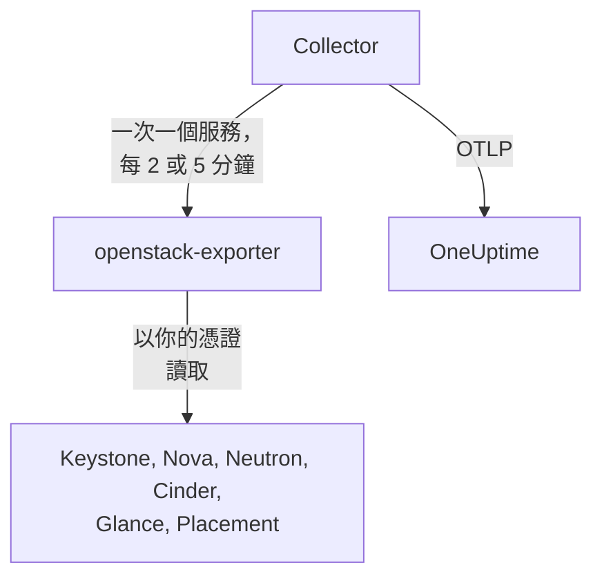

# OpenStack 代理程式

OneUptime OpenStack 代理程式用來監控 OpenStack 雲端：包含所有區域中的服務與代理程式、虛擬化主機、執行個體、網路、路由器、磁碟區、儲存池、映像檔與專案。它使用你選定的憑證讀取雲端的 API，並把找到的資料傳送到 OneUptime，雲端就會連同它的區域、虛擬化主機與專案一起顯示在那裡。[OpenStack 監測器](/docs/monitor/openstack-monitor)會針對收到的資料發出警示，而[探測器](/docs/telemetry/openstack-agentless)不需要安裝任何東西就能收集雲端資料。

:::cards
- [探測器或代理程式？](/docs/telemetry/openstack-agentless#探測器還是代理程式)：兩種方式都適用的雲端，該選哪一個。
- [選擇它能看到多少](#選擇代理程式能看到多少)：OpenStack 沒有全域唯讀角色，因此分成三個層級。
- [安裝代理程式](#安裝代理程式)：先建立憑證，再使用安裝指令碼、Docker Compose，或完全不使用 Docker。
- [它對你的雲端造成的負擔](#它對你的雲端造成的負擔)：每項設定會讀取什麼，以及如何變更。
- [容量](#容量)：每種規格還能再放進多少個，以及各項資源還有幾天會用滿。
- [支出](#支出)：誰在使用什麼、依你的價格或 CloudKitty 的計價換算是多少，以及哪些可以回收。
- [狀態頁面與通知專案](#狀態頁面與通知專案)：一個步驟為每個區域建立一個頁面，並且只通知受故障影響的專案。
- [服務日誌](#服務日誌)：已解析的日誌，並可跨服務追蹤一個請求。
- [生命週期事件](#生命週期事件)：來自通知或探測器的執行個體操作，會顯示在動態與圖表上。
- [誰做了什麼](#誰做了什麼)：把稽核軌跡送進安全事件。
- [追蹤請求](#透過控制平面追蹤請求)：一個已簽署的請求，在整個控制平面中被追蹤。
- [從外部檢查](#從外部檢查雲端)：從雲端外部的探測器確認是否真的有人能啟動執行個體。
- [沒有網際網路時](#沒有網際網路時)：代理程式的四個映像檔，以及如何複製到你自己的登錄庫。
- [依部署工具](/docs/telemetry/openstack-deployment-tools)：Kolla-Ansible、OpenStack-Ansible、OpenStack-Helm、Atmosphere、Sunbeam、Red Hat 與 Mirantis。
- [疑難排解](#疑難排解)：診斷指令碼，以及常見的問題。
:::

## 運作方式

代理程式是兩個固定版本的上游程式及其設定，執行在同一台機器上：[openstack-exporter](https://github.com/openstack-exporter/openstack-exporter) 讀取雲端的 API 並轉換成 `openstack_*` 序列，OpenTelemetry Collector 則一次向它索取一個 OpenStack 服務，在每個序列上標記其來源的雲端與區域，再傳送到 OneUptime。你的控制器或運算節點上不會執行任何東西，除非你加上會讀取它們日誌的選用[日誌設定檔](#服務日誌)。



雲端會在收到第一筆資料時自行註冊，名稱就是代理程式在每個指標上標記的 `openstack.cloud.name`。一個代理程式監看一個雲端：一個 Keystone，搭配一個或多個區域。

## 開始之前

- Docker Engine 20.10 或更新版本，並安裝 Docker Compose v2 外掛程式；若要不使用 Docker 執行，則需要一台 Linux 機器（x86_64 或 arm64），具備 systemd 235 或更新版本、glibc 2.34 或更新版本（RHEL 9、Ubuntu 22.04、Debian 12）以及 root 權限。
- 從該機器到 Keystone 以及各服務公開端點的網路路徑。
- `openstack` 命令列工具，並以能建立下方憑證的身分使用。
- 一個擷取金鑰。在 **專案設定 → 遙測與 APM → 擷取金鑰** 下建立一個，並複製它的值。
- 從該機器到你的 OneUptime URL 的對外 HTTPS 連線。

### 在哪裡執行代理程式

請在它所監看的雲端之外執行代理程式：例如獨立硬體上的小型虛擬機器、管理主機，或另一個雲端。雲端內部的代理程式會隨著故障的雲端一起沉默，而沉默看起來就像一個健康的雲端停止回報。

## 選擇代理程式能看到多少

OpenStack 沒有全域唯讀角色，這是監控它最困難的地方：

- `reader` 在除了 Keystone 與 Ironic 之外的所有地方，都限定在某個專案內。
- 虛擬化主機、服務、代理程式、儲存池與 Placement 預設需要 admin。
- 政策覆寫無法開放 Neutron 或 Cinder 中所有專案的清單，因為它們在自己的程式碼中以 admin 情境來限定範圍。
- Cinder 的服務與儲存池，對 admin 以外的任何人都回應 `403`，這來自 Cinder 自己的程式碼，而且是在政策已通過之後。任何覆寫都無法開放它們。
- Neutron 與 Cinder 對一般 reader 回應 `200`，但只包含該 reader 自己專案的資料。看起來成功了，其實沒有。
- 在 Cinder 的 `enforce_new_defaults` 關閉的情況下（這是 Cinder 自己的預設值），專案上的任何角色都能建立該專案的磁碟區，包括 `reader` 與 `oneuptime_monitoring`。在 Epoxy、Flamingo 與 Gazpacho 上，一般 reader 以及真實專案上的該角色都建立了磁碟區（`202`）。在 Hibiscus 上兩者都被拒絕（`403`），因為 DevStack 只在那裡開啟 `enforce_new_defaults`。真實專案上的唯讀角色並不是唯讀。

所以有三個層級，每個層級都有代價。可以的話，請從第一級開始。

| 層級 | 需要什麼 | 能看到什麼 | 看不到什麼 |
| --- | --- | --- | --- |
| **1. 完整檢視** | 一個在自有專案上擁有 `admin` 的帳號所建立的應用程式憑證，以存取規則限制為只能讀取，並在每個服務上設定 `service_type` | 代理程式進行的每一項讀取，以及只有此層級看得到的 `cinder-volume` 與 `cinder-scheduler` 狀態和儲存池 | Keystone 的使用者與群組，這是刻意的。它無法寫入：每次寫入都回應 `401` |
| **2. 僅基礎設施** | 在一個不存放任何東西、配額為零的自有專案上，具備 `oneuptime_monitoring` 與 `reader` 角色，以及代理程式隨附的政策覆寫 | Keystone 的所有專案、網域、服務與端點，Nova 的全部內容（包含每個專案的伺服器），Placement 的全部內容，以及 Neutron 的代理程式與 IP 可用性 | Neutron 的網路、子網路、路由器、浮動 IP 與連接埠，以及 Cinder 的磁碟區與快照，都只限於它自己的專案，因此在空專案上只會看到共用與外部的部分。沒有 `cinder-volume` 或 `cinder-scheduler` 狀態，也沒有儲存池。它無法寫入：每次寫入都回應 `403`，或因配額而回應 `409` 與 `413` |
| **3. 專案檢視** | 在真實專案上的一般 `reader`，適用於監看由他人營運之雲端中自己那一部分的團隊 | 該專案來自 Cinder 與 Neutron 的磁碟區、網路與路由器 | 所有基礎設施：沒有虛擬化主機、服務、代理程式、儲存池或容量。透過代理程式也看不到執行個體，因為匯出器對所有專案的讀取會被拒絕。而且在許多雲端上，`reader` 在那裡可以寫入 |

**Block Storage Service Down**、**Storage Pool Warning** 與 **Storage Pool Critical** 範本需要第 1 級。**Compute Service Down**、**Network Agent Down** 以及 Placement 與虛擬化主機的範本需要第 1 或第 2 級，而第 3 級完全讀不到執行個體。

### 每個層級讀取什麼

以下是五個真實雲端的回應，涵蓋 Epoxy、Flamingo、Gazpacho（OVN 與 OVS）以及 Hibiscus。每個儲存格都是依據這些錄製的結果寫成。

| 讀取 | 第 1 級：完整檢視 | 第 2 級：僅基礎設施 | 第 3 級：專案檢視 |
| --- | --- | --- | --- |
| Keystone：專案 | 全部 | 全部 | 被拒絕 |
| Keystone：網域 | 全部 | 全部 | 被拒絕 |
| Keystone：區域 | 全部 | 任何人都看得到的 | 任何人都看得到的 |
| Keystone：服務 | 全部 | 全部 | 被拒絕 |
| Keystone：端點 | 全部 | 全部 | 被拒絕 |
| Nova：伺服器，所有專案 | 全部 | 全部 | 被拒絕 |
| Nova：服務 | 全部 | 全部 | 被拒絕 |
| Nova：虛擬化主機 | 全部 | 全部 | 被拒絕 |
| Nova：主機集合 | 全部 | 全部 | 被拒絕 |
| Nova：可用區域，詳細資料 | 全部 | 全部 | 被拒絕 |
| Nova：規格 | 全部 | 任何人都看得到的 | 任何人都看得到的 |
| Nova：每個專案的用量 | 全部 | 全部 | 被拒絕 |
| Placement：資源提供者 | 全部 | 全部 | 被拒絕 |
| Neutron：代理程式 | 全部 | 全部 | 空無一物 |
| Neutron：網路 | 全部 | 僅限自己的專案 | 僅限自己的專案 |
| Neutron：子網路 | 全部 | 僅限自己的專案 | 僅限自己的專案 |
| Neutron：路由器 | 全部 | 僅限自己的專案 | 僅限自己的專案 |
| Neutron：浮動 IP | 全部 | 僅限自己的專案 | 僅限自己的專案 |
| Neutron：IP 可用性 | 全部 | 全部 | 空無一物 |
| Neutron：安全性群組 | 全部 | 409，屬預期 | 僅限自己的專案 |
| Neutron：連接埠 | 全部 | 僅限自己的專案 | 僅限自己的專案 |
| Neutron：配額 | 全部 | 被拒絕 | 被拒絕 |
| Cinder：磁碟區，所有專案 | 全部 | 僅限自己的專案 | 僅限自己的專案 |
| Cinder：服務 | 全部 | 被拒絕 | 被拒絕 |
| Cinder：儲存池 | 全部 | 被拒絕 | 被拒絕 |
| Cinder：快照，所有專案 | 全部 | 僅限自己的專案 | 僅限自己的專案 |
| Cinder：備份，所有專案 | 全部 | 無紀錄 | 無紀錄 |
| Cinder：磁碟區類型 | 全部 | 任何人都看得到的 | 任何人都看得到的 |
| Glance：映像檔 | 全部 | 任何人都看得到的 | 任何人都看得到的 |

- **全部**：與 admin 看到的資料列相同。
- **僅限自己的專案**：該專案的資料列，加上任何共用或外部的項目。在不存放任何東西的專案上，就只有共用與外部的部分。
- **被拒絕**：回應 `401` 或 `403`。
- **任何人都看得到的**：在只有公開規格、磁碟區類型與映像檔的雲端上，每種憑證都看到了每一列。位於其他專案的私有項目需要第 1 級。
- **空無一物**：回應 `200` 但沒有任何資料列，即使該專案也有網路。看起來成功了，其實沒有。
- **無紀錄**：回應 `200` 且沒有資料列，而 admin 也沒看到任何資料，所以無從比較。
- **409，屬預期**：Neutron 在列出安全性群組時會嘗試建立該專案的預設安全性群組，而零配額不允許這麼做，於是回應 `409 Quota exceeded`。這是無害的，不需要修正。

這裡沒有列出 Octavia、Ironic、Heat、Magnum、Manila、Designate、Barbican、Swift、Trove 與 Gnocchi，因為那些雲端並未執行它們。若雲端有執行，[診斷指令碼](#疑難排解)也會詢問它們，並且會用你的真實憑證讀取每一個路徑，告訴你該憑證能看到什麼。

代理程式的匯出器在各個層級取得的結果，以每個服務的序列數表示。數量取決於雲端被詢問時所持有的內容，所以請彼此比較，而不要與你的雲端比較：

| 匯出器服務 | Admin | 第 1 級：完整檢視 | 第 2 級：僅基礎設施 | 第 3 級：專案檢視 |
| --- | --- | --- | --- | --- |
| identity | 14 | 13 | 13 | 4 |
| compute | 33 | 33 | 33 | 15 |
| placement | 25 | 25 | 25 | 1 |
| network | 36 到 40 | 36 到 40 | 24 到 26 | 14 |
| volume | 33 | 33 到 41 | 23 | 29 到 37 |
| image | 4 | 4 | 4 | 4 |

## 安裝代理程式

每個 OneUptime 都會提供與自己版本對應的代理程式安裝指令碼和檔案：下方的命令從 `https://oneuptime.com` 下載它們，所以自行託管的 OneUptime 請換成你的 URL。安裝指令碼會先儲存為 `install.sh`，讓你在執行之前先閱讀它。

:::steps
### 建立憑證

選擇你決定的層級。每一級都會建立一個應用程式憑證，並印出 `id` 與 `secret`：secret 只會顯示一次。請為它設定到期日，且絕不要使用 `--unrestricted`，那會讓它能建立更多憑證。

:::tabs
@tab 層級 1：完整檢視
以 admin 身分，為代理程式建立專案與帳號：

```bash
openstack project create --domain default oneuptime-monitoring
openstack user create --domain default --password-prompt oneuptime-monitoring
openstack role add --project oneuptime-monitoring --user oneuptime-monitoring admin
```

接著以該帳號登入該專案，建立憑證。這些規則就是代理程式使用的確切 `GET` 路徑，並已配合你的雲端調整：

```bash
curl -fsSLO https://oneuptime.com/install/openstack-agent/access/application-credential-access-rules.json
curl -fsSLO https://oneuptime.com/install/openstack-agent/access/access-rules-for-cloud.py
openstack catalog list -f json | python3 access-rules-for-cloud.py \
  application-credential-access-rules.json > access-rules-for-this-cloud.json
openstack application credential create oneuptime-agent \
  --role admin \
  --access-rules "$(cat access-rules-for-this-cloud.json)" \
  --expiration 2027-11-01T00:00:00
```

存取規則是與服務所看到的路徑比對的。位於路徑前綴後方的服務，例如 `https://cloud.example/compute/v2.1`，看到的是 `/compute/v2.1/servers`，並會以 `401` 拒絕隨附的 `/v2.1/servers` 規則。`access-rules-for-cloud.py` 會依據你的目錄，把每條規則在其服務的前綴下再加一次。

匯出器有兩項讀取需要手動時容易漏掉的規則。它會先讀取 Octavia 的根路徑，而在 Apache 後方，服務看到的是 `/load-balancer//`，有兩個斜線。被拒絕時，匯出器會回應空的 `200`，於是雲端看起來像是沒有執行 Octavia。它也會列出結尾帶斜線的 Swift 帳號，而 `/v1/*` 比對不到這個路徑。被拒絕時，`openstack_object_store_up` 會讀到 `0`。調整後的規則兩者都包含。憑證的規則無法變更，所以如果你的憑證是用較舊的規則副本建立的，請重新建立一個。

存取規則還需要在每個服務上為 keystonemiddleware 設定 `service_type`，並重新啟動該服務。沒有它，服務會以 `401` 拒絕該憑證：

```ini title="nova.conf"
[keystone_authtoken]
service_type = compute
```

| 設定檔 | `service_type` |
| --- | --- |
| `nova.conf` | `compute` |
| `neutron.conf` | `network` |
| `cinder.conf` | `block-storage`。規則也包含 `volume` 與 `volumev3`，供以該方式設定的 Cinder 使用 |
| `glance-api.conf` | `image` |
| `placement.conf` | `placement` |
| `octavia.conf` | `load-balancer` |
| `ironic.conf` | `baremetal` |
| `heat.conf` | `orchestration` |
| `magnum.conf` | `container-infra` |
| `manila.conf` | `sharev2`。規則也包含 `shared-file-system`，供以該方式設定的 Manila 使用 |
| `designate.conf` | `dns` |
| `barbican.conf` | `key-manager` |
| `trove.conf` | `database` |
| `gnocchi.conf` | `metric` |
| `cloudkitty.conf` | `rating` |
| `proxy-server.conf`，位於 `[filter:authtoken]` 下 | `object-store`，並在旁邊加上 `include_service_catalog = True`。keystonemiddleware 會用權杖的目錄來檢查規則，所以設為 `False`（DevStack 的設定）時，Swift 會以 `500` 回應該憑證 |

只有你的雲端有執行的服務才需要寫一行。

在雲端可能不會執行的服務上，各層級在真實雲端上得到的結果與上方表格有四點不同：

- **Ironic** 對專案的憑證（包括 admin 的）只回應該專案擁有的節點，並拒絕其 conductor。只有 system 範圍能讀取每個節點與 conductor，而代理程式的憑證是在專案上。若要用它讀取某個節點，請把該節點的擁有者設為它的專案：`openstack baremetal node set --owner`。
- **Swift** 只列出該憑證自己專案的容器，不含其他專案。除非憑證具備 `ResellerAdmin`，否則其他專案的帳號會回應 `403`。
- **Barbican** 只針對憑證自己的專案回應，並拒絕一般 reader。OneUptime 不會讀取任何機密。
- **Gnocchi** 允許專案上的任何角色建立指標，所以在有執行它的雲端上，第 2 級與第 3 級可以在那裡寫入。

Keystone 不需要任何額外設定。規則調整好、`service_type` 設定完成且 API 重新啟動後，在我們記錄的每個版本上，每次讀取都回應 `200`，每次寫入都回應 `401`。匯出器取得的內容與 admin 相同，唯獨 Keystone 的使用者與群組，這是刻意的。對雲端可能不會執行的服務也一樣：在 DevStack 上的紀錄顯示，第 1 級從匯出器讀取的每個服務得到的序列都與 admin 的憑證相同，而每次寫入都回應 `401`。

如果你不打算做這項變更，也可以不加 `--access-rules` 建立同樣的憑證：也就是一般的 admin 應用程式憑證。它可以運作，但也能寫入，所以診斷指令碼會把它標示為這種憑證。
@tab 層級 2：僅基礎設施
以 admin 身分，建立角色、一個不存放任何東西且配額為零的專案，以及一個帳號：

```bash
openstack role create oneuptime_monitoring
openstack project create --domain default --description "OneUptime monitoring: holds nothing" oneuptime-monitoring
openstack quota set --instances 0 --cores 0 --ram 0 --key-pairs 0 oneuptime-monitoring
openstack quota set --volumes 0 --gigabytes 0 --snapshots 0 --backups 0 --backup-gigabytes 0 oneuptime-monitoring
openstack quota set --networks 0 --subnets 0 --ports 0 --routers 0 --floating-ips 0 --secgroups 0 --secgroup-rules 0 oneuptime-monitoring
openstack user create --domain default --password-prompt oneuptime-monitoring
openstack role add --project oneuptime-monitoring --user oneuptime-monitoring oneuptime_monitoring
openstack role add --project oneuptime-monitoring --user oneuptime-monitoring reader
```

這個專案刻意不存放任何東西且配額為零。在 Cinder 的 `enforce_new_defaults` 關閉的地方，專案上的任何角色都能建立該專案的磁碟區。沒有東西可碰，也沒有配額可以用來建立任何東西，它就沒有東西可寫：在我們記錄的每個版本上，每次寫入都回應 `403`，或因配額而回應 `409` 與 `413`。

下載政策覆寫，並在每個控制器上，把每個檔案合併到該服務設定中由 `[oslo_policy] policy_file` 指定的檔案裡（`nova.conf`、`neutron.conf` 等）。除非你的部署另有指定，否則就是 `/etc/nova/policy.yaml` 等等：DevStack 使用的是 `policy.json`。每條規則都保留服務的預設值並加上這個角色，而且 oslo.policy 會自行發現檔案變更，所以不需要重新啟動。

```bash
curl -fsSLO https://oneuptime.com/install/openstack-agent/access/policy/nova.yaml
curl -fsSLO https://oneuptime.com/install/openstack-agent/access/policy/neutron.yaml
curl -fsSLO https://oneuptime.com/install/openstack-agent/access/policy/keystone.yaml
curl -fsSLO https://oneuptime.com/install/openstack-agent/access/policy/placement.yaml
```

Cinder 沒有對應的檔案。它的 `os-services` 與 `scheduler-stats/get_pools` 對這個角色回應 `403 User does not have admin privileges`，在我們記錄的全部五個版本上都是如此。這是因為 Cinder 自己的程式碼要求 admin 情境，且發生在政策已通過之後，所以任何覆寫都無法開放它們。

**若要再次移除覆寫，請清空檔案（`{}`），絕不要刪除它。** 在 Flamingo（2025.2）與 Epoxy（2025.1）上，一旦 oslo.policy 已讀過的政策檔案消失，它在每次檢查時都會引發錯誤，導致該服務的每個請求都失敗。如果該服務是 Keystone，它就會停止驗證權杖，整個雲端都會回應 `503`。如果已經發生，請重新啟動該服務。

接著以該帳號登入該專案，建立憑證：

```bash
openstack application credential create oneuptime-agent --expiration 2027-11-01T00:00:00
```

若為了看到真實專案的磁碟區與路由器而把角色加在該專案上，在 Cinder 的 `enforce_new_defaults` 關閉的雲端上，也會讓該帳號能在那裡寫入。當憑證所屬的專案存放了東西時，診斷指令碼會發出警告。
@tab 層級 3：專案檢視
為某個帳號授予該專案上的一般 `reader` 角色，然後以該帳號登入該專案，建立憑證：

```bash
openstack role add --project my-team --user my-monitoring-account reader
openstack application credential create oneuptime-agent --expiration 2027-11-01T00:00:00
```

代理程式會看到該專案來自 Cinder 與 Neutron 的資料列，但看不到任何基礎設施。選擇這個層級之前，有三件事要知道：

- **透過代理程式完全看不到執行個體。** 匯出器向 Nova 要求所有專案的伺服器，Nova 拒絕一般 reader，那次讀取就整個失敗。只有不經過這個代理程式收集的 OneUptime 探測器，才能列出單一專案的執行個體。
- **它可能可以寫入。** 在 Cinder 的 `enforce_new_defaults` 關閉的雲端上，一般 `reader` 也能在它的專案中建立磁碟區。在 Epoxy、Flamingo 與 Gazpacho 上確實可以（`202`），而在 Hibiscus 上被拒絕（`403`），因為 DevStack 只在那裡開啟 `enforce_new_defaults`。Cinder 自己的預設值是關閉。
- **Placement 會被讀成沒有回應。** 它發出的每個呼叫都被拒絕，而匯出器回報的方式與回報 Placement 已停止時相同：`openstack_placement_up 0`，在我們記錄的全部五個版本上都是如此。這些頁面可以從此憑證還有哪些其他項目被關閉來判斷，並且會這樣說明。[Placement API Down](/docs/monitor/openstack-monitor#預先建立的警示範本) 範本無法判斷，所以在這個層級請不要使用那一個。
:::

### 安裝並啟動代理程式

:::tabs
@tab install.sh
下載安裝指令碼，並在要代管代理程式的機器上執行：

```bash
curl -fsSL https://oneuptime.com/install/openstack-agent -o install.sh
bash install.sh
```

指令碼會詢問你的 OneUptime URL、擷取金鑰、雲端的固定名稱、Keystone 驗證 URL、區域名稱、應用程式憑證（若你回答沒有，則改問使用者名稱與密碼），以及雲端若有自己的憑證授權單位時的私有 CA 檔案。所有機密都不會被回顯，也不會出現在命令列上。它會在寫入或啟動任何東西之前，先向 Keystone 檢查憑證，安裝到 `/opt/oneuptime-openstack-agent`，若你對 `/opt` 沒有權限，則安裝到你家目錄中的 `oneuptime-openstack-agent`（這只需要 `docker` 群組），以 `0600` 權限寫入 `.env` 與 `clouds.yaml`，並用 Docker Compose 啟動代理程式。每個答案也都可以當作環境變數提供，再次執行指令碼時會重用它們而不再詢問，這就是你[升級代理程式](#升級代理程式)的方式。
@tab Docker Compose
從你的 OneUptime 把 `docker-compose.yml` 與 `otel-collector-config.yaml` 下載到一個新資料夾：

```bash
mkdir oneuptime-openstack-agent && cd oneuptime-openstack-agent
curl -fsSLO https://oneuptime.com/install/openstack-agent/docker-compose.yml
curl -fsSLO https://oneuptime.com/install/openstack-agent/otel-collector-config.yaml
```

在它們旁邊建立 `clouds.yaml`，每個區域一個項目，並**以區域命名**，因為匯出器的序列不會說明它們來自哪個區域，而收集器會把項目名稱以 `openstack.region.name` 標記在它們上面：

```yaml title="clouds.yaml"
clouds:
  RegionOne:
    region_name: RegionOne
    identity_api_version: 3
    auth_type: v3applicationcredential
    auth:
      auth_url: https://keystone.example.com:5000/v3
      application_credential_id: your-credential-id
      application_credential_secret: your-credential-secret
```

然後是 `.env` 檔案：

```bash title=".env"
ONEUPTIME_URL=YOUR_ONEUPTIME_URL
ONEUPTIME_TELEMETRY_INGESTION_KEY=YOUR_TELEMETRY_INGESTION_TOKEN
OPENSTACK_CLOUD_NAME=my-cloud
OPENSTACK_EXPORTER_CLOUDS=[RegionOne,RegionTwo]
COMPOSE_PROFILES=openstack-exporter,openstack-ai-agent
```

`OPENSTACK_EXPORTER_CLOUDS` 以方括號列出每個區域，`COMPOSE_PROFILES` 則啟動內附的匯出器與 [AI 代理程式](#ai-代理程式)。兩個檔案都含有機密。匯出器以 uid 65532 執行，而且它必須是唯一能讀取 `clouds.yaml` 的帳號。啟動代理程式：

```bash
chmod 600 .env
sudo chown 65532:65532 clouds.yaml
sudo chmod 600 clouds.yaml
docker compose up -d
```
@tab 不使用 Docker
在具備 systemd 235 或更新版本與 glibc 2.34 或更新版本的 Linux（x86_64 或 arm64）上，安裝指令碼會把同樣兩個程式的上游版本當作 systemd 服務執行。RHEL 8 及其衍生版本的 glibc 較舊，匯出器的版本無法在上面執行：指令碼會這麼說並且不做任何變更，所以在那裡請使用 Docker。

```bash
curl -fsSL https://oneuptime.com/install/openstack-agent -o install.sh
sudo bash install.sh --without-docker
```

問題相同，向 Keystone 的檢查相同，檔案也相同。每個發行封存檔都必須符合 `install.sh` 中固定的 sha256，下載內容不符時，會在任何東西變更之前停止安裝。收集器以一個用完即丟的非特權使用者執行，永遠看不到 OpenStack 憑證；匯出器則以 `oneuptime-openstack` 系統使用者執行，它是唯一能讀取 `clouds.yaml` 的帳號，並且只監聽 `127.0.0.1:9180`。

每個雲端執行一個代理程式：從 Docker 安裝轉移過來時，請先執行 `docker compose down`，否則每個指標都會到達兩次。
:::

已經用 `--multi-cloud` 執行 openstack-exporter 了嗎？把代理程式指向它，內附的那個就不會啟動：`OPENSTACK_EXPORTER_ADDRESS=10.0.0.5:9180 bash install.sh`，或是在 `.env` 中省略 `COMPOSE_PROFILES` 並在那裡設定 `OPENSTACK_EXPORTER_ADDRESS`。它的 `clouds.yaml` 需要為每個區域各有一個同名的項目，而且它應該關閉內附那個所關閉的項目：請見[它對你的雲端造成的負擔](#它對你的雲端造成的負擔)。請使用代理程式的容器能連到的位址：`localhost` 指的是容器本身。

Kolla-Ansible 的匯出器不使用 `--multi-cloud` 執行，所以沒有 `/probe`，而且它固定在一個提供資訊較少的版本。[使用你已在執行的匯出器](/docs/telemetry/openstack-deployment-tools#使用您已在執行的匯出器)說明如何讀取它，以及各頁面確切會缺少哪些內容。[依部署工具的 OpenStack](/docs/telemetry/openstack-deployment-tools) 則有每個工具其餘的步驟。

### 檢查代理程式正在執行

```bash
cd /opt/oneuptime-openstack-agent    # or the folder the script said it installed to
docker compose ps
docker logs oneuptime-openstack-agent
```

`docker compose ps` 會列出收集器（`oneuptime-openstack-agent`）、內附的匯出器（`oneuptime-openstack-exporter`）與 [AI 代理程式](#ai-代理程式)（`oneuptime-openstack-ai-agent`）。收集器啟動後，其日誌應該會顯示這一行：

```text
Everything is ready. Begin running and processing data.
```

不使用 Docker 時，請查詢 `systemctl status oneuptime-openstack-agent oneuptime-openstack-exporter` 與 `journalctl -u oneuptime-openstack-agent`。

### 在 OneUptime 中找到雲端

開啟 **產品 → 基礎設施 → OpenStack**。雲端在第一次收集之後（幾分鐘內）會以它的 `OPENSTACK_CLOUD_NAME` 出現。運算、網路、磁碟區與 Placement 每 2 分鐘讀取一次，身分識別與映像檔每 5 分鐘一次。
:::

雲端的**概覽**會告訴你它的資料是否已送達 OneUptime、最先需要注意什麼，以及各個服務的狀況：


**虛擬化主機**會告訴你 Nova 與 Placement 在每個運算主機上承諾了什麼：


**執行個體**會列出每個執行個體，包含以 Nova 自己的用詞表示的狀態、它的專案、規格與虛擬化主機：


## 環境變數

安裝指令碼會把這些寫入 `/opt/oneuptime-openstack-agent/.env`；Docker Compose 安裝則從 `docker-compose.yml` 旁邊的 `.env` 讀取。變更其中一個之後，請在該資料夾中執行 `docker compose up -d`。只有 `clouds.yaml` 存放憑證。

| 變數 | 必填 | 說明 |
| --- | --- | --- |
| `ONEUPTIME_URL` | 是 | 你的 OneUptime URL，例如 `https://oneuptime.com` 或你自行託管的執行個體。 |
| `ONEUPTIME_TELEMETRY_INGESTION_KEY` | 是 | 來自 **專案設定 → 遙測與 APM → 擷取金鑰** 的擷取金鑰。 |
| `OPENSTACK_CLOUD_NAME` | 是 | 雲端在 OneUptime 中的名稱，以 `openstack.cloud.name` 資源屬性標記在每個指標上。請保持穩定：變更它會註冊一個新的雲端。預設為 `openstack`。 |
| `OPENSTACK_AUTH_URL` | 內附的匯出器 | 安裝指令碼的一個答案：Keystone 驗證 URL。若缺少則會補上 `/v3`。 |
| `OPENSTACK_EXPORTER_CLOUDS` | 是 | 區域，以方括號表示，例如 `[RegionOne,RegionTwo]`，每個都是 `clouds.yaml` 中某個項目的名稱。預設為 `[RegionOne]`。 |
| `OPENSTACK_EXPORTER_ADDRESS` | 否 | 你自己的匯出器的 `host:port`，不含協定。若使用內附的匯出器則省略。 |
| `OPENSTACK_CA_FILE` | 否 | 一個 PEM 檔案，內含擁有自己憑證授權單位的雲端的憑證授權單位。安裝指令碼會在 `clouds.yaml` 旁邊保留一份副本，名為 `ca.pem`。 |
| `OPENSTACK_EXPORTER_USER` | 否 | 匯出器的容器所使用的 `uid:gid`，它必須擁有 `clouds.yaml`。預設為 `65532:65532`。 |
| `COMPOSE_PROFILES` | 內附的匯出器 | `openstack-exporter` 啟動內附的匯出器，`openstack-ai-agent` 啟動 [AI 代理程式](#ai-代理程式)。 |
| `OPENSTACK_LIBVIRT_EXPORTER_TARGETS` | 否 | 透過 `prometheus-libvirt-exporter` 讀取[實際用量](#實際用量)的運算節點，以方括號表示，例如 `[compute-01:9177,compute-02:9177]`。預設為無。 |
| `OPENSTACK_CEILOMETER_EXPORTER_TARGETS` | 否 | 透過 Ceilometer 自己的匯出器讀取相同的內容，例如 `[compute-01:9101]`。預設為無。 |
| `OPENSTACK_SINGLE_CLOUD_EXPORTER_TARGETS` | 否 | 一個已在執行、但不使用 `--multi-cloud` 的匯出器，例如 Kolla-Ansible 的：`[10.0.0.254:9198]`。請見[使用你已在執行的匯出器](/docs/telemetry/openstack-deployment-tools#使用您已在執行的匯出器)。 |
| `OPENSTACK_RABBITMQ_TARGETS` | 否 | 每個節點上 RabbitMQ 的 Prometheus 外掛程式，用於[雲端所依賴的基礎](#雲端所依賴的基礎)：`[10.0.0.11:15692,10.0.0.12:15692]`。預設為無。 |
| `OPENSTACK_MARIADB_TARGETS` | 否 | 每個 MariaDB 節點旁的 mysqld_exporter，通常在 `9104`。預設為無。 |
| `OPENSTACK_MEMCACHED_TARGETS` | 否 | 每個 Memcached 旁的 memcached_exporter，通常在 `9150`。預設為無。 |
| `OPENSTACK_HAPROXY_TARGETS` | 否 | HAProxy 自己的 Prometheus 匯出器。預設為無。 |
| `OPENSTACK_NETWORK_EXPORTER_TARGETS` | 否 | 每個節點上用於 OVN 與 Open vSwitch 的 openstack-network-exporter，通常在 `1981`。預設為無。 |
| `OPENSTACK_LIBVIRT_HEALTH_TARGETS` | 否 | 每個運算節點上的 prometheus-libvirt-exporter，通常在 `9177`，只用來得知 libvirt 是否有回應，不提供每個執行個體的資料。預設為無。 |
| `OPENSTACK_CONTROL_PLANE_REGION` | 否 | 上述目標中沒有指明自己區域者所屬的區域。目標可以自行指明：`RegionTwo@10.1.0.11:15692`。預設為第一個區域。 |
| `OPENSTACK_AGENT_SERVICES` | 否 | 這個代理程式讀取哪些服務，用於[在代理程式之間共用一個雲端](/docs/telemetry/openstack-very-large-clouds#在收集器之間分擔一個雲端)，例如 `compute\|placement`。預設為全部。 |
| `OPENSTACK_AGENT_MEMORY_LIMIT_MIB` | 否 | 收集器可在記憶體中保留的量。非常大的雲端進行一次擷取所需的量，超過預設的 `512`。 |
| `OPENSTACK_DATABASE_EXPORTER_TARGETS` | 否 | `openstack_database_exporter`，用於[資料庫路徑](/docs/telemetry/openstack-very-large-clouds#資料庫路徑)：`[openstack-database-exporter:9180]`。預設為無。該路徑的其他設定列在那裡。 |

安裝指令碼也會從環境讀取憑證，以略過它的提問：`OPENSTACK_APPLICATION_CREDENTIAL_ID` 與 `OPENSTACK_APPLICATION_CREDENTIAL_SECRET`，或是 `OPENSTACK_USERNAME`、`OPENSTACK_PASSWORD`、`OPENSTACK_PROJECT_NAME`、`OPENSTACK_USER_DOMAIN_NAME` 與 `OPENSTACK_PROJECT_DOMAIN_NAME`。它們有自己的名稱，而不是 openrc 檔案所設定的 `OS_*`，所以 admin 載入的 openrc 不會在沒有人被詢問的情況下變成代理程式的憑證。應用程式憑證比使用者名稱與密碼更好：它可以限制為只能讀取，而且可以過期。

## 雲端所依賴的基礎

大多數 OpenStack 故障都從它的底層開始：RabbitMQ 掛了、Galera 失去法定人數、OVN 資料庫沒有領導者。代理程式可以每分鐘讀取這些元件原本就有的匯出器，而且在你指名它們之前是關閉的。這裡的任何東西都不會寫入它們，而且每個只會保留少數幾個序列。

在代理程式的 `.env` 中指名每一個，叢集的每個成員都要列出，然後執行 `docker compose up -d`：

```bash
OPENSTACK_RABBITMQ_TARGETS=[10.0.0.11:15692,10.0.0.12:15692,10.0.0.13:15692]
OPENSTACK_MARIADB_TARGETS=[10.0.0.11:9104,10.0.0.12:9104,10.0.0.13:9104]
OPENSTACK_MEMCACHED_TARGETS=[10.0.0.11:9150,10.0.0.12:9150]
OPENSTACK_HAPROXY_TARGETS=[10.0.0.11:9101,10.0.0.12:9101]
OPENSTACK_NETWORK_EXPORTER_TARGETS=[10.0.0.21:1981,10.0.0.22:1981,RegionTwo@10.1.0.21:1981]
OPENSTACK_LIBVIRT_HEALTH_TARGETS=[10.0.0.21:9177,10.0.0.22:9177]
OPENSTACK_CONTROL_PLANE_REGION=RegionOne
```

目標可以指明自己所在的區域，如該清單中的最後一個。沒有指明的，屬於 `OPENSTACK_CONTROL_PLANE_REGION`。在 Kolla-Ansible 上，它的 Prometheus 已經知道所有這些目標，`control-plane-targets.py` 會為你印出這些行，而[依部署工具的 OpenStack](/docs/telemetry/openstack-deployment-tools) 說明在其他工具上每個匯出器在哪裡。

每一個讀取什麼，以及代理程式需要它做什麼：

| 設定 | 讀取 | 啟用方式 |
| --- | --- | --- |
| `OPENSTACK_RABBITMQ_TARGETS` | RabbitMQ 自己的外掛程式，`/metrics` 以及來自 `/metrics/detailed` 的每個佇列 | 在每個節點上執行 `rabbitmq-plugins enable rabbitmq_prometheus` |
| `OPENSTACK_MARIADB_TARGETS` | 每個節點旁的 mysqld_exporter。它的預設值就已回報 Galera | 除了匯出器本身外不需要任何東西 |
| `OPENSTACK_MEMCACHED_TARGETS` | 每個 Memcached 旁的 memcached_exporter | 除了匯出器本身外不需要任何東西 |
| `OPENSTACK_HAPROXY_TARGETS` | HAProxy 自己的匯出器 | 在它專屬的 `frontend` 上設定 `http-request use-service prometheus-exporter` |
| `OPENSTACK_NETWORK_EXPORTER_TARGETS` | 每台擁有 Open vSwitch 或 OVN 資料庫的機器上的 openstack-network-exporter | 它的預設收集器。一台機器會回報它所執行的內容 |
| `OPENSTACK_LIBVIRT_HEALTH_TARGETS` | 每個運算節點上的 prometheus-libvirt-exporter，且只讀取 libvirt 是否有回應 | 除了匯出器本身外不需要任何東西 |

接著，雲端的**控制平面**卡片會為每一個顯示一行，並為每個相依項目提供一個頁面，每台機器一行。該卡片上的**未監看**表示你還沒有指名它：它永遠不會顯示為健康。那裡的問題會進入雲端的**需要注意**。雲端的**Suggest**頁面提供[警示範本](/docs/monitor/openstack-monitor#雲端所依賴的基礎)，而 `troubleshoot.sh` 會檢查每個目標是否有回應，以及它是否就是你所說的那個。

如果你需要比雲端健康所需更多的 RabbitMQ 或資料庫資訊，[佇列](/docs/telemetry/queues)與[資料庫](/docs/telemetry/databases)產品會透過它們自己的代理程式讀取它們，資料量比這裡多，條件也各自不同。控制平面頁面有連結指向它們。安裝那些是另外的事，因為那些產品讀取的是那些代理程式的序列，而不是這裡的。

關於 openstack-network-exporter 0.3.0（記錄這些內容時使用的版本），有兩件事要知道：

- **它只會連線到 Open vSwitch 的資料庫一次。** Open vSwitch 重新啟動後，`ovs_build_info`、它的橋接器、它的介面以及 ovn-controller 的所有序列都會一直消失，直到匯出器也重新啟動，而 Open vSwitch 自己的序列會立刻恢復。**Exporter Lost Open vSwitch's Database** 會告訴你這種情況何時發生。
- **它在一台機器上只讀取一個 OVN 資料庫的叢集狀態。** 在同時有兩個 socket 的機器上（如 Kolla-Ansible 的機器）讀取的是 Southbound。所以只有在機器沒有 Southbound 可讀時，才會顯示 Northbound 的領導者。

## 代理程式收集什麼

收集器為每個 OpenStack 服務建立一個擷取工作，透過匯出器的 `/probe?cloud=<region>&include_services=<service>`，所以 Nova 失敗時，只會缺少 Nova 的序列：

| 擷取工作 | 間隔 | 逾時 | 序列 |
| --- | --- | --- | --- |
| `oneuptime-openstack-compute` | 2 分鐘 | 110 秒 | `openstack_nova_agent_state`, `openstack_nova_running_vms`, `openstack_nova_vcpus_used`, `openstack_nova_memory_used_bytes`, `openstack_nova_local_storage_used_bytes`, `openstack_nova_total_vms`, `openstack_nova_server_status`, `openstack_nova_flavors`, `openstack_nova_availability_zones` |
| `oneuptime-openstack-network` | 2 分鐘 | 110 秒 | `openstack_neutron_agent_state`, `openstack_neutron_networks`, `openstack_neutron_subnets`, `openstack_neutron_routers`, `openstack_neutron_router`, `openstack_neutron_l3_agent_of_router`, `openstack_neutron_floating_ips`, `openstack_neutron_security_groups`, `openstack_neutron_network_ip_availabilities_total`, `openstack_neutron_network_ip_availabilities_used` |
| `oneuptime-openstack-volume` | 2 分鐘 | 110 秒 | `openstack_cinder_agent_state`, `openstack_cinder_volumes`, `openstack_cinder_volume_gb`, `openstack_cinder_snapshots`, `openstack_cinder_pool_capacity_free_gb`, `openstack_cinder_pool_capacity_total_gb` |
| `oneuptime-openstack-placement` | 2 分鐘 | 110 秒 | `openstack_placement_resource_total`, `openstack_placement_resource_usage`, `openstack_placement_resource_allocation_ratio`, `openstack_placement_resource_reserved` |
| `oneuptime-openstack-identity` | 5 分鐘 | 120 秒 | `openstack_identity_projects`, `openstack_identity_project_info`, `openstack_identity_domains`, `openstack_identity_regions` |
| `oneuptime-openstack-image` | 5 分鐘 | 120 秒 | `openstack_glance_images`, `openstack_glance_image_bytes`, `openstack_glance_image_created_at` |
| `oneuptime-openstack-load-balancer` | 5 分鐘 | 120 秒 | `openstack_loadbalancer_total_loadbalancers`, `openstack_loadbalancer_loadbalancer_status`, `openstack_loadbalancer_total_amphorae`, `openstack_loadbalancer_amphora_status`, `openstack_loadbalancer_total_pools`, `openstack_loadbalancer_pool_status` |
| `oneuptime-openstack-baremetal` | 5 分鐘 | 120 秒 | `openstack_ironic_node`, `openstack_ironic_node_updated_at`, `openstack_ironic_node_provision_updated_at` |
| `oneuptime-openstack-orchestration` | 5 分鐘 | 120 秒 | `openstack_heat_stack_status`, `openstack_heat_stack_status_counter` |
| `oneuptime-openstack-container-infra` | 5 分鐘 | 120 秒 | `openstack_container_infra_total_clusters`, `openstack_container_infra_cluster_masters`, `openstack_container_infra_cluster_nodes`, `openstack_container_infra_cluster_status` |
| `oneuptime-openstack-sharev2` | 5 分鐘 | 120 秒 | `openstack_sharev2_shares_counter`, `openstack_sharev2_share_gb`, `openstack_sharev2_share_status`, `openstack_sharev2_share_status_counter` |
| `oneuptime-openstack-dns` | 5 分鐘 | 120 秒 | `openstack_designate_zones`, `openstack_designate_zone_status`, `openstack_designate_recordsets`, `openstack_designate_recordsets_status` |
| `oneuptime-openstack-object-store` | 5 分鐘 | 120 秒 | `openstack_object_store_objects`, `openstack_object_store_bytes` |
| `oneuptime-openstack-database` | 5 分鐘 | 120 秒 | `openstack_trove_total_instances`, `openstack_trove_instance_status`, `openstack_trove_instance_volume_size_gb`, `openstack_trove_instance_volume_used_gb` |
| `oneuptime-openstack-gnocchi` | 5 分鐘 | 120 秒 | `openstack_gnocchi_status_metricd_processors`, `openstack_gnocchi_status_metric_having_measures_to_process`, `openstack_gnocchi_status_measures_to_process` |

最後九個是雲端可能不會執行的服務。被問到一個不在其目錄中的服務時，匯出器會登入 Keystone，記錄一行日誌（`No suitable endpoint could be found in the service catalog`）並以空白回應，該雲端就不會顯示出這個服務的任何痕跡。這是每個服務、每個區域每 5 分鐘登入一次，這也是它們全都是 5 分鐘的原因。若要只詢問你有執行的服務，請設定 `OPENSTACK_AGENT_SERVICES`，例如 `identity|compute|placement|network|volume|image`。

每個服務也會回報 `openstack_<service>_up`，例如 `openstack_nova_up`。[OpenStack 監測器](/docs/monitor/openstack-monitor#收集的指標)列出了每個序列及其含義。每個序列都帶有：

| 屬性 | 說明 |
| --- | --- |
| `openstack.cloud.name` | 雲端的名稱，一個資源屬性 |
| `oneuptime.agent.version` | 代理程式檔案所固定的收集器版本，一個資源屬性 |
| `openstack.region.name` | 區域，來自 `clouds.yaml` 項目的名稱，位於每個資料點上 |
| `openstack_service` | 該工作的 OpenStack 服務（`compute`、`network`、...），位於每個資料點上 |

監測器篩選條件是以相等比對，所以如果你自訂設定，請保留 `transform/openstack-identity` 處理器，以及 `resource` 處理器中對 `service.name` 與 `service.instance.id` 的兩個刪除：沒有這些刪除，資料會註冊一個幻影的服務，而不是送達雲端。

## 它對你的雲端造成的負擔

監控絕不能成為讓雲端掛掉的原因，所以預設值都很溫和。每次擷取都會重新登入 Keystone 並發出真實的 API 呼叫。[超大型 OpenStack 雲端](/docs/telemetry/openstack-very-large-clouds)說明了在各種規模下這相當於每分鐘多少請求和每天多少 GB。

| 設定 | 預設 | 開啟或變更它能得到什麼 | 代價 |
| --- | --- | --- | --- |
| 專案配額 | 關閉 | 專案已使用每項配額的多少，顯示在它的頁面和**需要注意**之下，以及 Project Quota Nearly Reached 警示 | 每個專案、每個區域每小時四次 API 呼叫（Nova 一次、Cinder 兩次、Neutron 一次），來自它們專屬的匯出器 |
| 慢速指標 | 關閉 | Nova 自己的配額清單與每台伺服器的用量 | 每次擷取每個專案一次呼叫，所以會隨專案數量增長 |
| 每連接埠序列 | 關閉 | `openstack_neutron_port`, `openstack_neutron_ports`, `openstack_neutron_ports_no_ips`, `openstack_neutron_ports_lb_not_active` | 對每個連接埠的未限定範圍清單。在大型雲端上，這[可能使 Neutron 飽和並引發連鎖故障](https://github.com/openstack-exporter/openstack-exporter/issues/540)，所以除非你確定連接埠數量很少，否則請保持關閉 |
| 雲端可能不會執行的服務 | 開啟 | 負載平衡器、裸機、堆疊、叢集、共享、DNS、物件儲存、資料庫與 Gnocchi，只要雲端有這些服務 | 沒有其中某項的雲端，每 5 分鐘付出一次登入的代價。Designate 每次擷取每個區域花費一次呼叫，所以會隨區域數量增長 |
| 擷取間隔 | 2 與 5 分鐘 | 更新鮮的資料，或較小的負載 | 頻率加倍，API 呼叫也加倍。請讓每個 `scrape_timeout` 小於其 `scrape_interval`，使緩慢的擷取不會堆疊在前一次之上 |

**專案配額：** 以 `OPENSTACK_COLLECT_QUOTAS=true` 再次執行 `install.sh`。它會啟動第二個匯出器 `openstack-quota-exporter`，除此之外什麼都不讀取，而收集器每小時向它索取一次 `openstack_nova_limits_*`、`openstack_neutron_quota_*`、`openstack_cinder_limits_*` 與 `openstack_cinder_volume_type_quota_gigabytes`。它們變化緩慢，而且無論由哪個工作詢問，匯出器讀取的內容都相同，所以要減少讀取頻率就需要它們專屬的匯出器。你自己的匯出器沒有這種機制：代理程式會在每次擷取時讀取它所提供的內容。

**慢速指標：** 從匯出器在 `docker-compose.yml` 中的 `command`，或不使用 Docker 時 `oneuptime-openstack-exporter.service` 的 `ExecStart` 中，刪除你想要的那一行 `--disable-metric`。代價是每次擷取每個專案一次呼叫。

| 刪除 | 以收集 |
| --- | --- |
| `--disable-metric=nova-quota_cores` | `openstack_nova_quota_*` |
| `--disable-metric=nova-server_local_gb` | `openstack_nova_server_local_gb`，每台伺服器的用量。這個是一份走訪每台伺服器的單一用量報告，而不是每個專案一次呼叫，在大型雲端上依然很慢 |

讓這個匯出器略過專案配額的那三行（`--disable-metric=nova-limits_vcpus_max`、`--disable-metric=neutron-quota_network`、`--disable-metric=cinder-limits_volume_max_gb`）請保留。刪除它們會讓它們也每兩分鐘被讀取一次。

每個旗標都指名了讀取它那一列其餘內容的序列，這就是一行就能把它們全部關閉的原因。請不要改用匯出器自己的 `--disable-slow-metrics`：它也會關掉 `openstack_glance_image_*`，也就是映像檔頁面用一次呼叫讀取的映像檔清單。Neutron 的配額清單除了第 1 級之外在每個層級都只有 admin 能讀，所以 `openstack_neutron_quota_*` 需要該層級。

**每連接埠序列：** 在同一個位置刪除四行 `--disable-metric=neutron-port*`。

**間隔：** 在 `otel-collector-config.yaml` 中，變更某個工作下的 `scrape_interval` 與 `scrape_timeout`。

然後執行 `docker compose up -d --force-recreate`，不使用 Docker 時則執行 `sudo systemctl daemon-reload` 並重新啟動兩個服務。升級會取代這些檔案，並把你的副本保留為 `<file>.bak.<timestamp>`，所以之後請再做一次你的編輯。

另外三行也請保留，因為你不會想念它們。`--disable-metric=neutron-subnets_total` 略過了許多序列，它們所說的內容位址池已經說過了（`openstack_neutron_subnets_total`、`openstack_neutron_subnets_used`、`openstack_neutron_subnets_free`）。`--disable-metric=nova-security_groups` 略過了對 Nova 已不再有的路由的讀取，那只會塞滿匯出器的日誌。`--disable-metric=gnocchi-total_metrics` 略過了為了一個計數（`openstack_gnocchi_total_metrics`）而逐頁讀取 Gnocchi 中每個指標的動作：一個 Gnocchi 可能有數百萬個。

若要讀取內部端點而非公開端點，請在同一個位置加入 `--endpoint-type=internal`。

有三個仍未解決的上游議題決定了這一切，而且該專案也[徵求維護者](https://github.com/openstack-exporter/openstack-exporter/issues/443)：

- [議題 660](https://github.com/openstack-exporter/openstack-exporter/issues/660)：一個失敗的服務會讓整個擷取變空。所以每個服務各有一個擷取工作。請不要合併它們。
- [議題 540](https://github.com/openstack-exporter/openstack-exporter/issues/540)：未限定範圍的連接埠清單可能使 Neutron 飽和。所以每連接埠序列是關閉的，而診斷指令碼只要求一小頁的連接埠。
- [議題 244](https://github.com/openstack-exporter/openstack-exporter/issues/244)：在較大的雲端上擷取會逾時。所以間隔是以分鐘而非秒為單位，每個都帶有低於它的逾時。如果大型雲端上某個服務的 `openstack_*_up` 消失了，請先調高該工作的間隔與逾時，再做其他事。

## 裸機

如果你的雲端執行 Ironic，它會有一個**裸機**區塊，列出 Ironic 對此憑證顯示的每個節點：它在 Ironic 狀態機中的位置、電源狀態、是否有人將它設為維護以及原因、它的資源類別，以及 Ironic 上次看到它有動靜的時間。沒有 Ironic 的雲端就沒有這個區塊，也沒有相關警示，任何頁面上都沒有它的任何一行。

節點不是虛擬化主機，即使 Nova 與 Placement 都以它的 UUID 把它列為虛擬化主機，所以它不會被算作可以執行虛擬機器的地方。每個資源類別有多少節點可以承接一個執行個體，在裸機頁面（針對 Ironic 對此憑證顯示的節點）和[容量](#容量)頁面（針對 Placement 持有的每個節點）上可以看到。

哪些情況需要有人處理，與[警示範本](/docs/monitor/openstack-monitor#預先建立的警示範本)的判斷標準相同：

| 讀到 | 代表 |
| --- | --- |
| 失敗狀態，例如 `clean failed` 或 `deploy failed`，或 `error` | 在有人處理之前會一直維持失敗：Ironic 不會重試其中任何一種，也不一定會將節點設為維護 |
| 同一個過渡狀態，例如 `wait call-back`，持續 2 小時 | Ironic 預設在等待 30 分鐘後放棄，所以是別的原因讓它卡住。長時間的磁碟抹除確實可能花這麼久：頁面讀的是 Ironic 自己的時間，而抹除期間的心跳會不斷更新它，警示則只讀取那個狀態字詞 |
| 處於維護狀態 7 天 | 在那之前都是計畫中的，就像有人停用的服務，所以在那之前沒有任何東西說它需要注意 |
| `active` 但電源關閉 | 上面執行的東西已經停止。如果它的擁有者停止了上面的執行個體，節點的頁面會說這是計畫中的。警示只讀取一個序列，無法分辨 |

### 它看不到什麼

下列每一項都是在真實的 DevStack 上記錄的，每個頁面都會在相關之處這麼說明：

- **Ironic 只對專案顯示它所擁有的節點。** Placement 回應所有人，所以當它持有 Ironic 沒有列出的節點時，頁面會說這份清單不是整個雲端的。依 Ironic 的預設政策，只有 system 範圍的憑證，或角色具備 `baremetal:node:list_all` 的憑證，才能讀取每個節點。
- **匯出器不帶有節點失敗的原因。** 它有維護原因，但沒有 `last_error`，而且即使節點仍然失敗，Ironic 也可能在大約一分鐘內清空 `last_error`：失敗的 clean 就是如此，而失敗的 deploy 則保留了。所以請立刻用 `openstack baremetal node show <node> -c last_error` 查看，或查看 conductor 的日誌。[探測器](/docs/telemetry/openstack-agentless)會讀取 `last_error` 並保留它看到的最後一個。
- **匯出器沒有 conductor。** 只有探測器讀得到它們，而且除非政策另有規定（`baremetal:conductor:get`），否則 Ironic 會拒絕專案的憑證列出它們。
- **已停止的 Ironic 與沒有 Ironic 看起來一樣。** 被問到已停止的 Ironic 時，匯出器會回應空的 200，就像對從未有過 Ironic 的雲端一樣。所以頁面只會說它沒有收到 Ironic 的回應，而且節點維持最後讀到的樣子。它絕不會說已停機。在雲端其餘部分最後一次不帶它回報的兩週後，這些資料列會消失，如果它回來，資料列也會回來。

## 容量

「放得下這個嗎？」是 OpenStack 營運人員最常被問到的問題，而 Nova 的可用數量無法回答它：配置比率、保留量與碎片化都有影響，所以一個雲端可以有數千個空閒 vCPU，卻容不下一個大型執行個體。雲端的**容量**頁面會說明每種規格還能再放進多少個，以及什麼東西不足，由最快用完的開始。它讀取的是每兩分鐘計算一次的單一摘要，所以有 5,000 個主機的雲端載入速度和只有一個主機的雲端一樣快。其規格表上的**匯出 CSV**會下載頁面上的所有內容。

頁面上的一切都是配置：已承諾的量，而不是忙碌的量。閒置的執行個體也佔用全部。

**容量是什麼。** 對每個資源提供者與資源類別，容量是 `(total - reserved) x allocation_ratio`，已配置量則是 Placement 已承諾的量。這些會依可用區域、主機集合、區域與雲端加總。`nova-compute` 當機的主機會持續回報它最後的數字，被停用的主機不會再接收任何東西，所以兩者都不算作餘裕。它們上面現有的東西仍然在，預測會把它算進去。

**裸機。** 一個節點整個承接一個執行個體，所以有 Ironic 的雲端會有依資源類別區分的專屬表格：有多少節點、多少可以承接執行個體、多少正在使用，以及多少因為 Nova 的 Ironic 驅動程式目前無法使用而被保留。這些是 Placement 自己的數字，所以即使 Ironic 只對專案顯示它所擁有的節點，它們也是整個雲端的，而且不包含在上面的 vCPU 與記憶體內。探測器會讀取某個規格要求哪個類別，並依這些數字計算。代理程式的匯出器沒有說明，所以在代理程式上，裸機規格是以它的 vCPU、記憶體與磁碟，依主機計算。

**還能再放進多少個。** 每個規格逐主機計算，因為一個執行個體需要它所要求的全部都在同一個主機上。計數旁邊是如果所有可用資源都在同一個主機上時的數字，這就是分辨一個滿載的雲端與一個碎片化的雲端的方式。連空的主機都容不下的規格會顯示**對所有主機而言都太大**，而且絕不會因此發出警示。計數是針對從映像檔啟動的執行個體：從磁碟區啟動的執行個體不要求根磁碟。

頁面會說明每個計數的來源：

| | 透過探測器 | 透過代理程式 |
| --- | --- | --- |
| **統計起點** | `GET /allocation_candidates`，也就是 Nova 排程器詢問的內容，與 [StackHPC 的 os-capacity](https://github.com/stackhpc/os-capacity) 做法相同。在輪到某個規格之前，會先以清單內容填入 | 匯出器本來就會傳送的 Placement 序列：`openstack_placement_resource_{total,reserved,allocation_ratio,usage}` |
| **能看到特性與巢狀提供者** | 是。規格的額外規格也會一併詢問，所以 `trait:` 與 `resources:` 會計入 | 否：匯出器的規格序列沒有額外規格，所以需要某個特性的規格會把每個主機都算進去，頁面也會這麼說 |
| **主機的 `max_unit`** | Placement 自己的值 | 視為主機的總量，這就是 Nova 所設定的 |

探測器的詢問很溫和，因為這是唯一會讓 Placement 做事的讀取。它一次只詢問一種規格形狀，所以要求相同內容的規格只算一個問題，而且每次收集最多 4 個，輪流進行，無論有多少規格。所以一個有 40 個規格、每 2 分鐘收集一次的雲端，每分鐘花費 2 次呼叫，20 分鐘輪完一圈。每個回答最多限制為 1,000 個主機，這是 Nova 自己的 `max_placement_results`：一次啟動的工作量。來自這麼長的回答的計數是下限，頁面會顯示**至少**。它在第一次收集時不詢問，在該次收集中 Placement 很慢時不詢問，而且在憑證被拒絕後的一小時內不詢問，因為依清單算出的計數本來就在那裡。應用程式憑證或 `oneuptime_monitoring` 角色需要允許 `/allocation_candidates`：它位於 `access/application-credential-access-rules.json` 與 `access/policy/placement.yaml`。

**與主機實際使用量並列。** 當[實際用量](#實際用量)送達 OneUptime 時，頁面會把你設定的比率，與主機一天內尖峰時實際使用的量並列，並顯示它們會達到 90% 這條線時的比率，**Hypervisor CPU Saturated** 與 **Hypervisor Memory Pressure** 就是以這條線為準。它是以一種工作負載一天的資料所畫出的直線，所以它說明的是比率能調整多遠，而不是你應該調整。在一個可用區域有超過半數的主機回報之前，它什麼都不會顯示。

**何時用滿。** 每個可用區域的資源類別、每個外部網路的 IPv4 位址，以及每個儲存池，都有預測：用過去一週配置量畫出的直線，對照今天現有的量。新的雲端在累積滿一天的資料之前會顯示**歷史資料不足**。

**可用區域能否承受失去一個主機。** 可用區域內已配置的量（包含已失去的主機上的），對照它其他主機在去掉最大的主機後能承諾的量，就像 VMware 的 Host failure 對叢集的要求。它比較的是數量，而不是每個執行個體會落在哪裡，所以通過的可用區域代表有疏散的餘裕，而不是保證每個執行個體都找得到主機：規格表會顯示哪些已碎片化。只有一個主機的可用區域沒有東西可說，有主機被人停用的也一樣，因為那是計畫中的工作。

**沒有執行個體可解釋的配置。** 當 Placement 在主機上持有的量，多於其執行個體的規格加總，並持續超過半小時，頁面就會指出該主機。這通常是[孤立的配置](https://docs.openstack.org/nova/latest/admin/troubleshooting/orphaned-allocations.html)，由刪除或搬移中途失敗所留下，並且會悄悄吃掉容量。它比較的是 vCPU 與記憶體，因為從磁碟區啟動的執行個體不佔用規格的任何磁碟。對於上面有任何東西正在搬移的主機，或規格已不再列於雲端中的執行個體，它不會說什麼。若要查看它們是什麼，並在你確認每一個確實不屬於任何執行個體或遷移之後移除它們：

```bash
nova-manage placement audit --verbose
nova-manage placement audit --verbose --delete
```

**警示。** **Flavor Can No Longer Be Placed**、**Capacity Forecast Under 14 Days** 與 **Reserved Headroom Gone** 讀取的是 OneUptime 從同一份摘要寫入的序列。它們位於[監測器的範本](/docs/monitor/openstack-monitor#預先建立的警示範本)中，也在雲端的**Suggest**頁面上。

**成本。** 在代理程式上沒有成本。探測器則會增加上述的呼叫。OneUptime 每兩分鐘為每個可用區域的資源類別、外部網路與儲存池寫入約 2 個序列，並為每個人們可以要求的規格寫入一個，與其他指標一樣計費。

## 支出

私有雲仍然要花錢，而營運的人會被問到誰在使用什麼，以及哪些可以回收。雲端的**支出**頁面兩者都能回答，適用於任何規模的任何雲端，完全不需要任何設定。它顯示的是用量和供規劃用的估算。OneUptime 不會向任何人開立發票，這裡也沒有任何金額是租戶應付的。

最上方是**本月與上月的比較**，然後是誰在成長，接著是每個專案（最大的在前），並附有**匯出 CSV**。網域，以及在哪個規格和磁碟區類型上使用了什麼，放在下方。專案自己的頁面則逐行列出它的當月，以及之前的月份。

### 用量如何計算

每 15 分鐘，一個工作程序會讀取每個專案在雲端清單中持有的內容，並加上自上次讀取以來的時間：依規格的 vCPU 小時與記憶體小時、依類型的磁碟區 GB 小時、浮動 IP 小時，以及映像檔與快照的儲存空間。不會讀取或寫入任何每個執行個體的序列，所以它不會花費指標儲存空間和遙測帳單，而且在[摘要模式](/docs/telemetry/openstack-very-large-clouds#摘要模式)的雲端上運作方式相同。

這對數字的意義是：

- **調整大小會把時數從一個規格移到另一個**，而刪除會使時數停止。變更是從第一次顯示它的讀取開始計算，所以每次變更最多可能有 15 分鐘的誤差。存活時間比這更短的執行個體可能永遠不會被看到。
- **一個部分會一直被計算，直到清單放開它為止**，也就是它消失之後最多[過期視窗](#環境變數)的時間。在輪流讀取的大型雲端上，變更要等到輪到它才會出現。
- **執行個體從被放置到被刪除期間一直持有它的規格。** 已關機的仍會計算，並列在自己的一行，因為 Nova 在它的主機上保留了它的 vCPU 與記憶體。從未抵達主機的不計算，從主機上擱置下架的也不計算。
- **處於錯誤狀態或仍在建立中的磁碟區或快照不計算**，因為它整體而言沒有空間在背後支撐。
- **OneUptime 沒有讀取的時數不會被猜測。** 超過一小時的空檔只會計入它最後一個小時，頁面會說明有多少小時沒有被計算。
- **代理程式的匯出器回報的是有多少快照，而不是哪些**，所以快照儲存空間只會在[不使用代理程式而連線](/docs/telemetry/openstack-agentless)的雲端上計算。

### 價格

價格由你決定，而且是選用的。沒有價格時，頁面顯示用量。在**價格**之下，設定幣別，以及 vCPU、每 GB 記憶體、每 GB 磁碟區、浮動 IP、每 GB 映像檔與每 GB 快照的每小時價格。**進階**中有依規格設定的每執行個體小時價格，它就是該規格價格的全部、依磁碟區類型的價格，以及一個略過已關機執行個體的開關。一個月約為 730 小時。

價格為零代表沒有價格，而不是免費的雲端。沒有價格的項目會被說明為沒有價格，使用了未定價項目的專案會在頁面上被計算出來，所以有定價部分的總計絕不會被當成全部。今天的價格適用於顯示的每個期間的整段時間，上個月也是，所以變更價格不會讀起來像是專案的用量在變動。現在變更的價格會在 15 分鐘內顯示。

### CloudKitty

如果雲端執行 [CloudKitty](https://github.com/openstack/cloudkitty)，它計價的結果會逐專案取代計算，頁面會說明它使用了哪一個。探測器每小時詢問一次，針對本月和上個月，詢問的是 `GET /v2/summary`，在太舊而不支援的 CloudKitty 上則是 `GET /v1/report/summary`。這是每小時每 1,000 個專案最多兩次請求，外加每次讀取時對其版本的一次請求。

- **只有[探測器](/docs/telemetry/openstack-agentless)能讀取它。** 代理程式的匯出器沒有 CloudKitty 的序列，所以透過代理程式連線的雲端會自行計算，並且會這麼說明。
- **它看到的是憑證被允許看到的。** CloudKitty 自己的政策讓 admin 的憑證看到每個專案，無論有沒有存取規則，其他較低的權限則只看到自己的專案。它沒有計價的專案會繼續依你的價格計算。
- **每個區域的 CloudKitty 會加總。** 每一個都在它自己的時間被讀取，專案的數字是它們合計計價的結果。目錄中為數個區域列出的同一個 CloudKitty 只會被詢問一次。
- **它的數字是這裡唯一屬於遙測的部分。** 它們以 `openstack_cloudkitty_rated` 送達 OneUptime，每個專案每月一個資料點，每小時一次：10,000 個專案時每小時 20,000 個，與同等規模的雲端其餘部分相比幾乎微不足道。
- **它不會說明幣別。** 如果你設定了價格表的幣別，費率就以該幣別顯示，否則只顯示數字。
- **如果它停止回應，** 每個專案先前被計價的結果會維持原樣，頁面會說明上次讀取的時間。**Rating API Down** 會針對此情況發出警示。
- **真正的 CloudKitty 已經回應過這個。** 在 `stable/2026.1` 上，後端為 InfluxDB，對 Ceilometer 寫入 Gnocchi 的內容計價。那是它唯一被讀取過的設定。沒有啟用任何規則時，它會將每個專案計價為 `0`，尚未有任何計價時，它回應沒有資料列。無論哪種情況，這些專案都會繼續依你的價格計算。

### 預算

預算說明一個專案或整個雲端在一個月內可以花多少，以你價格的幣別表示。與[已連線雲端的預算](/docs/telemetry/cloud-costs)一樣，每個月估算第一次超過其各個比例（除非另行指定，否則為 80% 與 100%）時，它會發出警示，而且當維持現在持有的內容會在月底前超過它時，也會發出一個。新的一個月從零開始，上個月的警示會被解決。預算只會發出警示：它不會停止任何東西。沒有價格或 CloudKitty 時沒有東西可以比較，所以它保持安靜，其資料列會說明它尚未被檢查。

### 哪些可以回收

雲端的**Suggest**頁面每小時列出一次被閒置的項目、各自能釋出什麼，以及列出它們的命令。OneUptime 絕不會移除任何東西，這些項目每一個都是要問擁有它的人的問題。

| 項目 | 何時被指出 | 釋出什麼 | 列出它們的命令 |
|---|---|---|---|
| 可以清空的虛擬化主機 | 其 vCPU 與記憶體已配置 20% 或更少，上面的一切都放得進它所在可用區域與主機集合中的其他主機，並且之後該可用區域仍能承受失去一個主機 | 整個主機 | `openstack hypervisor list --long` |
| 關機很久的執行個體 | 已關機 30 天 | 它們的 vCPU、記憶體與本機磁碟 | `openstack server list --all-projects --status SHUTOFF --long` |
| 沒有附加到任何東西的磁碟區 | 可用狀態 30 天、沒有附加到任何東西，而且不是 Cinder 自己的 `image-<id>` 磁碟區（該命令也會列出這些） | 它們的儲存空間 | `openstack volume list --all-projects --status available --long` |
| 舊的磁碟區快照 | 90 天前建立。僅限探測器 | 它們的儲存空間 | `openstack volume snapshot list --all-projects --long` |
| 沒有被用來啟動任何東西的映像檔 | 私有或共享、已存在 30 天、未受保護，而且沒有任何執行個體或磁碟區來自它。僅限探測器 | 它們的儲存空間 | `openstack image list --long` |
| 沒有被使用的浮動 IP | 未關聯達 7 天 | 一個位址 | `openstack floating ip list --status DOWN --long` |

使用中的東西絕不會被指出。某樣東西維持現況多久，在探測器回報雲端時鐘的地方取自雲端自己的時鐘。透過代理程式則是 OneUptime 看到它如此多久，所以在你連線雲端的那一天，沒有任何東西算是舊的。無法確定的規則會這麼說，而不是猜測：代理程式無法得知執行個體是從哪個映像檔啟動的，所以使用中的映像檔看起來會像是未使用，而且它無法列出快照，所以那兩條規則要等探測器。主機是依已配置量而非忙碌程度被指出的，在有主機遺失或停用的可用區域中絕不會指出主機，而主機是從最空的開始選取，使被指出的主機全都能完成處理。它看不到特性或執行個體對主機的任何其他需求。

### 各種規模下的情況

一次讀取的成本不會因執行個體變更的頻率而不同，而它的成本會隨這裡列出的數量成長。這些是在 Postgres 上測試的，語句數經過精確計算，且最大規模的耗時被限制在預算內。

| 虛擬化主機 | 執行個體 | 專案 | 每次讀取的語句數 | 保留的資料列 | 頁面讀取什麼 |
|---|---|---|---|---|---|
| 10 | 100 | 10 | 13 | 750 | 雲端的一列、專案的一頁 |
| 500 | 20,000 | 1,000 | 14 | 75,000 | 雲端的一列、專案的一頁 |
| 5,000 | 200,000 | 10,000 | 37 | 750,000 | 雲端的一列、專案的一頁 |

一旦雲端有了上個月，一次讀取也會讀取它，每 2,000 個專案一個語句。每小時的規則讀取五份最多 5,000 列的清單，並走訪每個執行個體的資料列一次，以查看什麼在使用中。

在最大規模下，每個專案持有的內容在 5 秒內讀完，一次完整的讀取在 30 秒內完成，而頁面讀取的那一列維持在 2 MB 以下。保留的資料列是 13 個月中每個月每個專案一列，以及最近 62 天中每天每個專案一列。它們與執行個體的數量無關，也都不算作遙測。

## 實際用量

Nova 與 Placement 說明的是虛擬化主機上已承諾的量，而不是忙碌的量：閒置的執行個體也佔用它所有的 vCPU。所以 OneUptime 中沒有任何東西把這些數字稱為用量。若要查看真正忙碌的程度，請把代理程式指向你的雲端已在執行的下列其中一個。OpenTelemetry Collector 本身沒有 libvirt 接收器。

| 來源 | 執行位置 | 開啟方式 |
| --- | --- | --- |
| [`prometheus-libvirt-exporter`](https://github.com/inovex/prometheus-libvirt-exporter) | 每個運算節點上的連接埠 9177。Kolla-Ansible 在 Prometheus 與 KVM 開啟時會執行它。 | 設定 `OPENSTACK_LIBVIRT_EXPORTER_TARGETS=[compute-01:9177,compute-02:9177]` |
| Ceilometer 自己的匯出器，自 2025.1 起 | 每個運算節點上的連接埠 9101，位於它的輪詢代理程式旁。 | 在 `ceilometer.conf` 的 `[polling]` 下，將 `enable_prometheus_exporter = true`、`prometheus_listen_addresses` 設為代理程式可以連到的位址，並將 `batch_size` 設得高於單一節點上最多的執行個體數。然後設定 `OPENSTACK_CEILOMETER_EXPORTER_TARGETS=[compute-01:9101]` |

變更任一個之後，請執行 `docker compose up -d`。每個匯出器只代表一個運算節點，所以請指名每個你想讀取的節點。

Ceilometer 只會說出它的 `polling.yaml` 要求的內容，而它隨附的檔案遺漏了其中一些。請把這些計量加進去，以取得完整的資料：

| 計量 | 沒有它會怎樣 |
| --- | --- |
| `vcpus` | 執行個體的 CPU 改為依其規格所說的量來衡量。Epoxy 沒有這個計量。 |
| `memory.resident` | 沒有東西說明執行個體在其虛擬化主機上佔用多少，所以沒有 **Hypervisor Memory Pressure** |
| `disk.device.read.latency`, `disk.device.write.latency` | 沒有磁碟延遲，所以沒有 **Instance Disk Latency High** |

OneUptime 在兩者抵達時會把它們轉成同一組序列，並與原始序列並存：每個執行個體以其 UUID 為單位的 `openstack.instance.*`，以及虛擬化主機上的執行個體加總的 `openstack.hypervisor.instances.*`。[OpenStack 監測器](/docs/monitor/openstack-monitor#收集的指標)列出了它們。所以無論雲端使用哪個來源，頁面和警示的意義都相同：

| 它讀取什麼 | libvirt | Ceilometer |
| --- | --- | --- |
| 使用中的 CPU | 在兩次讀取之間的時間內，經過了多少 CPU 時間 | 相同，來自以奈秒為單位的累計數字 |
| CPU 等待，也就是客體所稱的 steal | `libvirt_domain_vcpu_delay_seconds_total` | `ceilometer_cpu_delay`，一旦某個版本有它。從 Epoxy 到 Hibiscus，目前還沒有任何已發行的 Ceilometer 有它，所以這些不會顯示讀數 |
| 使用中的記憶體 | 客體的 balloon 驅動程式所說的：可用量減去可用的量 | `ceilometer_memory_usage`，是同樣的算式。沒有 balloon 驅動程式時兩者都沒有這個，而且會被省略而不是被猜測 |
| 虛擬化主機上的記憶體 | `libvirt_domain_memory_stats_rss_bytes` | `ceilometer_memory_resident`。它比規格的大小多，因為 QEMU 本身也在裡面 |
| 磁碟與網路 | 每個磁碟與介面的速率，延遲則是請求花費的時間除以請求的數量 | 相同 |

Ceilometer 的讀數只會在每個輪詢週期（預設為五分鐘）變動一次，無論它們被讀取的頻率多高。速率是在讀數變動的時刻之間計算的，所以它不會讀成 0、0，然後是真實值的五倍，而且沒有變動的讀數不會增加資料。第一個看到的值沒有說明它是何時被輪詢的，所以第一個速率需要兩次輪詢。一旦某次輪詢改變了執行個體的某些部分，它沒有改變的部分會讀為 0，而沒有任何變動的執行個體上的讀數會在 11 分鐘後讀為 0。倒退的計數器表示已重新啟動，這發生在執行個體重新開機或搬移之後，並從零開始計算。`libvirt_domain_info_memory_usage_bytes` 不會被當作用量讀取：它是 balloon 的大小，在閒置的執行個體上就是其規格的記憶體。

已關機的執行個體在兩個來源中都沒有讀數：libvirt 回報的 CPU 時間是 0，而 Ceilometer 什麼都不說，兩者都不代表執行個體什麼都沒做。設定磁碟機（config drive）是一個 CD-ROM，libvirt 的匯出器會略過它而 Ceilometer 不會，所以使用 Ceilometer 時，有設定磁碟機的執行個體會多顯示一個磁碟，通常是 `hda`，讀數為零。

執行個體的頁面會在其規格大小旁邊顯示 CPU、記憶體、磁碟與網路，它們的圖表位於**使用量**之下。虛擬化主機的頁面顯示它的執行個體使用多少，衡量基準是它在套用任何配置比率之前所擁有的量，並指出最忙碌的執行個體以及各自被分配到的量，它們的圖表位於**指標**之下。超過某條線之後，它會說明是哪些執行個體造成的，以及哪些正被迫等待。沒有來源時，每個頁面會這麼說明，並說明要加入什麼。在虛擬化主機上執行 OneUptime 的[主機代理程式](/docs/telemetry/hosts)的地方，它的頁面會從那裡讀取該機器自己的 CPU、記憶體、磁碟與網路，其中包含主機自己的處理程序，所以即使它的執行個體沒有超過，它也可能超過那條線。

代理程式的疑難排解指令碼會讀取你指名的每個匯出器，說明它知道多少個執行個體、Ceilometer 沒有輪詢哪些計量，以及每一個對你造成什麼代價。

四個[警示範本](/docs/monitor/openstack-monitor#預先建立的警示範本)讀取這些：**Hypervisor CPU Saturated**、**Hypervisor Memory Pressure**、**Instance CPU Saturated** 與 **Instance Disk Latency High**。沒有來源時它們保持安靜。

### 成本

每個執行個體的序列成長得很快，所以是否保留它們是一項選擇，位於雲端的**設定**中的**每個執行個體的實際用量**：

| 選項 | 它保留什麼 |
| --- | --- |
| 自動，預設值 | 雲端有 500 個或更少時保留每個執行個體，超過則一個都不保留 |
| 每個執行個體 | 每個執行個體，無論規模 |
| 僅我選擇的專案與主機集合 | 那些專案的執行個體，以及位於那些主機集合的虛擬化主機上的執行個體 |
| 無 | 不保留任何執行個體的序列 |

未被保留的執行個體連它的原始序列也會失去，所以這個選擇會停止整個成本，而它仍然計入其虛擬化主機的總計，無論你怎麼選擇，每個虛擬化主機都是五個序列。代理程式的擷取工作只保留 OneUptime 從每個匯出器讀取的內容。超過 5,000 個執行個體時，同一個選擇也會決定誰保留[其狀態的序列](/docs/telemetry/openstack-very-large-clouds#摘要模式)。

一個有兩個 vCPU、一個磁碟和一個網路介面的執行個體的成本：

| 來源 | 每個執行個體的序列 | 每小時資料列 | 每月資料列，100 個執行個體 | 每月資料列，1,000 個執行個體 |
| --- | --- | --- | --- | --- |
| `prometheus-libvirt-exporter`，每分鐘讀取 | 30 | 1,800 | 131,400,000 | 1,314,000,000 |
| Ceilometer 的匯出器，每分鐘讀取、每 5 分鐘輪詢 | 24 | 864 | 63,072,000 | 630,720,000 |

兩者每多一個磁碟會增加 12 個序列，每多一個介面增加 4 個。libvirt 每多一個 vCPU 增加 1 個。代理程式的收集器在這些資料送出的過程中會把它們保存在記憶體中，所以大型雲端可能需要比預設 512 MiB 更多。指南的計算器位於雲端上的**文件**之下，可以為像你這樣規模的雲端估算這些的價格。

## 專案與網域

一個雲端容納許多租戶，所以 OneUptime 會追蹤每樣東西屬於誰。

- **專案**列出每個專案及其網域、它執行什麼、其中有什麼需要注意，以及它各個部分上開啟的事件和警示。專案的頁面會完整說明同樣的內容，並指出它底下任何已停機的主機。
- **網域**說明每個網域包含多少專案。
- **專案擁有的每份清單**都可以縮小到單一專案，在有多個網域的雲端上也可以縮小到單一網域。兩者都以 ID 區分，所以重新命名專案或網域不會破壞任何東西。

### 把專案的警示送給它的團隊

在專案的頁面上，於**誰會收到通知**或**針對此項目開立事項上的標籤**之下新增規則。**網域**對整個網域也有同樣的兩個。從那時起，每個送達該專案或網域的警示和事件，都會得到那些擁有者或標籤。

這裡的規則是帶有專案或網域 ID 的 **OpenStack 雲端擁有者規則**或 **OpenStack 雲端標籤規則**，所以它也會出現在雲端的**擁有者規則**或**標籤規則**設定中，你可以在**單一專案或網域**之下手動寫一條。帶有任一 ID 的規則不會對雲端本身新增任何東西。雲端上的條件仍然適用，而從**網域**建立的規則會指名它的雲端，因為每個雲端都有一個叫做 `default` 的網域。如果你重新命名那個雲端，請更新規則的名稱條件。

雲端某個部分上的警示或事件，會送達在該部分上有任何東西的每個專案，無論有多少個。只有監測器能說明它觸及什麼，所以像這樣的規則不會觸及有人手動宣告的事件。標籤在警示開啟時加上，擁有者則緊接在後。

較早以一對警示與事件規則寫成、並在描述中比對 ``OpenStack project `<id>` `` 或 ``OpenStack domain `<id>` `` 的規則會繼續運作，也列在這裡。描述最多指名它所觸及的 50 個專案，所以像那樣的一對規則就停在那裡。移除它並重新新增規則，即可解除該限制。

### 配額

開啟配額後，專案的頁面會顯示它已使用每一項的多少：執行個體、核心、RAM、磁碟區的 GB、網路、連接埠與浮動 IP。達到其中一項的 90% 或超過的專案，會出現在**需要注意**之下。限制為 -1 表示沒有限制，所以它永遠不會達到任何程度。它們每小時讀取一次。超過三小時的讀數仍會顯示，但不再被判斷，因為配額可能已被關閉。

它們預設為關閉，是因為它們的代價：請見[它對你的雲端造成的負擔](#它對你的雲端造成的負擔)。OpenStack 對專案可持有多少磁碟區的配額不會顯示，因為匯出器只讀取它的 GB。

### 來自 Nova 中繼資料的標籤

若要把 Nova 中繼資料的鍵顯示為標籤，請在匯出器的命令中加入 `--nova.metadata-extra-labels=team`，更多的鍵以逗號接在後面。專案的頁面會顯示它的執行個體所帶有的值。

## 拓撲與影響範圍

雲端的**拓撲**頁面逐個區域繪製它：可用區域、虛擬化主機及其上的執行個體、儲存池與磁碟區、網路、路由器與浮動 IP，以及 API 與服務。每個部分都依與**需要注意**相同的規則上色，所以 `nova-compute` 已停止的虛擬化主機是紅色的，它的執行個體在其下方。

超過 5,000 個部分時，地圖讀取的是什麼已經失敗以及它連帶影響什麼，而不是全部，並在失敗的主機上開啟，且說明它省略了什麼。**需要注意**會把它縮小到其餘的全部。[基礎設施](/docs/telemetry/topology)會把雲端與你的主機和叢集畫在一起。

在主機上的 `nova-compute` 停止時，主機會變紅，其執行個體在下方，頁面會計算開啟的事件和警示：


某個部分的影響範圍是它連帶影響的對象，以數量和專案表示：

| 當這個失敗時 | 它會觸及 |
| --- | --- |
| 虛擬化主機或它的 `nova-compute` | 它的執行個體 |
| 儲存池 | 它的磁碟區，以及這些磁碟區所附加的執行個體 |
| L3 代理程式 | 沒有其他代理程式可以接手的路由器，以及它們的浮動 IP |
| 區域的 API | 該 API 在區域中服務的一切，涵蓋每個專案 |

某個部分的頁面會顯示它。該部分上的警示或事件會在描述中說明，例如「2 個專案中的 3 個執行個體」，並附上它們的名稱。

匯出器不會說明執行個體位於哪個網路，或哪個儲存池持有某個磁碟區，所以對代理程式收集的雲端，兩者都不會畫出。地圖會這麼說明，而儲存池的影響範圍會說它無法判斷，而不是回答沒有。[探測器](/docs/telemetry/openstack-agentless)兩者都會說明。這時地圖會把磁碟區連到它的儲存池（當 Cinder 把它的憑證視為 admin 時），而儲存池的影響範圍會計算它的磁碟區以及這些磁碟區所附加的執行個體。它也會把執行個體連到它有位址的每個網路。Nova 只以名稱指出那些網路，而 Neutron 允許兩個同名的網路，所以地圖會先在執行個體的專案中找一個，然後找與它共用的一個，再找任何同名的，並在兩個可能性相等時不畫出連結。仍然未知的內容會留在地圖的通知中。

## 狀態頁面與通知專案

許多雲端是為其他人營運的。當主機失敗時，他們想確切通知受影響的專案，並公布每個區域的狀況。這裡的一切都是用 OneUptime 已有的東西建立的，而它建立的每樣東西都仍可在原本的地方編輯。開啟雲端的**狀態頁面**頁面即可開始。

### 一個步驟建立狀態頁面

**建立狀態頁面**會先逐個監測器顯示它將建立什麼，在你說可以之前不會建立任何東西。每個區域是一個群組，區域執行的每個服務是一列：運算、網路、區塊儲存、映像檔、身分識別與負載平衡，每個都由說明其是否運作的監測器支撐。你的雲端沒有執行的服務就沒有那一列。

已經監看某一列的監測器會原樣使用，所以一次失敗仍然只開啟一個事件。在有多個區域的雲端上，你為整個雲端建立的監測器不能成為某個區域的那一列，因為其他地方的失敗會讓它變紅。那一列會得到它自己的監測器，只負責說明該列如何顯示，而你的繼續開啟事件。

在你另行指示之前，頁面是私人的。它是一般的狀態頁面：它的群組、列以及誰可以閱讀，都在它自己的頁面上。

**建立目標**為每一列建立一個目標，位於[服務等級目標](/docs/slo/introduction)中：最近 30 天的 99.9%，依其監測器的正常運作時間計算，並且在啟用了[從外部檢查](#從外部檢查雲端)的地方，也包含該檢查的監測器。再次執行時，它不會動已經建立的那些。

### 事件會指出誰

雲端某個部分上的事件會採用它的[影響範圍](#拓撲與影響範圍)，並透過[專案上的擁有者規則](#把專案的警示送給它的團隊)，加入擁有受影響專案的團隊。失敗的虛擬化主機會說「7 個專案中的 42 個執行個體」，並指出它們的名稱。

這一切都位於事件描述中**此雲端內**這一行之下，而且只供你的團隊使用。狀態頁面及其訂閱者只會讀取描述到那一行為止，所以某位客戶的名稱絕不會出現在另一位客戶的頁面上。

### 通知專案

**專案通知**是一個電子郵件地址或 webhook，當影響該專案的部分發生事件或計畫性維護時就會收到通知。在雲端的**狀態頁面**頁面上，或在專案自己的頁面上新增一個。

通知一開始是關閉的。開啟它一律要透過它的預覽，預覽會顯示它通知誰、它關於哪個專案，以及失敗時會說什麼。變更地址後它又會關閉，因為那已經不是你看過的對象了。

通知的內容只與該專案有關：它在該部分上持有什麼，以我們的用詞表達。通知絕不會說出主機的名稱，那是 OpenStack 本身不讓專案知道的，也絕不會說出任何關於其他專案的事。來自你雲端的每個字都被視為純文字，所以名稱古怪的專案不會對郵件用戶端或讀取 webhook 的任何東西造成影響，而且電子郵件不會從外部載入任何東西。

| 情況 | 誰會收到通知 |
| --- | --- |
| 一個主機上有三個專案，其中一個已開啟 | 那一個，連同它在那裡持有的內容 |
| 通知已關閉的專案 | 沒有人，而事件的動態會這麼說明 |
| 觸及 500 個專案的部分 | 每個已開啟的專案，超出事件描述所指名的 50 個之外的部分 |
| 沒有專案的執行個體 | 沒有人。它會計入總數，預覽也會這麼說明 |
| 已刪除、但留下執行個體的專案 | 沒有人，無論它的通知如何設定 |
| 已通知過的部分上的第二個事件 | 沒有人，直到兩者都結束。然後它會被通知一次，告知已結束 |
| 在發出前一分鐘被關閉的通知 | 沒有人，而**傳送的內容**會說明原因 |
| 有人停用、且沒有維護事件的主機 | 沒有人。它會呼叫你的團隊，而專案在那裡執行的東西繼續運行 |

每則通知最多只會發出一次。如果工作程序在傳送途中停止，該通知不會再次傳送，而**傳送的內容**會說明它可能已送出，也可能沒有。webhook 是帶有不會改變的 `id` 的 JSON POST，只有說明未被接受的回應（`429` 或 `5xx`）才會被重試。

### 專案自己的私人頁面

在專案的頁面上，**建立私人頁面**會為使用該專案的人建立一個私人狀態頁面：它所用的每個服務、在它所在的每個區域各一列。只有當失敗觸及該專案時，那一列才會變紅，而公告會以與通知相同的用詞說明發生了什麼。

在你把人加到它的**私人使用者**之下之前，沒有人能閱讀它，而且一個專案頁面上的工作階段不能閱讀其他專案的。該頁面只列出它自己的監測器，這些監測器上不會有任何事件，所以透過它無法讀到任何關於其他專案的內容，無論是在頁面上或透過它的 API。

### 主機或可用區域上的計畫性工作

在虛擬化主機或可用區域的頁面上，**安排維護**只會對該對象建立維護事件。它會先顯示它會通知誰。建立之後，它的動態會指出它觸及的專案，並通知曾要求收到這些專案消息的人。在維護期間，該主機或該可用區域的主機所說的內容都保持安靜，包括狀態頁面的那一列，而其他每個部分繼續呼叫。

連結到雲端、但沒有指名主機或可用區域的事件，是關於整個雲端的。

在該主機的事件期間，`openstack compute service set --disable` 是預期中的，虛擬化主機的頁面也會這麼說明。在事件之外，沒有人說明原因，所以 **Compute Service Disabled** 範本會為此發出呼叫。如果你想知道有人手動停用主機，請新增那個監測器。它會呼叫你，而不通知任何專案，因為專案已在那裡執行的東西繼續運行。因為 libvirt 故障而自行停用的 `nova-compute` 是一次失敗和一個事件：**libvirt Service Down** 會說明這點，而在它開啟期間，這個會保持安靜。

## 與 OneUptime 其餘部分連通

事件很少只停留在 OpenStack 中。某個 Pod 很慢，是因為它的節點的執行個體位於已滿的虛擬化主機上，而該主機的磁碟區位於降級的 Ceph 儲存池上。其中每一個都各自向 OneUptime 回報，而這些就是連結。

不會憑猜測建立連結。符合兩個部分的名稱不會連到任何一個，無論你從哪一端讀取：名為 `compute-01` 的主機，旁邊有兩個名為 `compute-01.east.example` 和 `compute-01.west.example` 的虛擬化主機，就不屬於任何一個，而兩個主機都可能對應的虛擬化主機沒有主機。兩個雲端中相同的 UUID（例如還原的副本）不會連到任何一個，除非其中一個已封存。

| 項目 | 連結到 | 方式 |
| --- | --- | --- |
| 在運算節點上執行 OneUptime 代理程式的[主機](/docs/telemetry/hosts) | 它的虛擬化主機 | 依名稱，在恰好一個主機與一個虛擬化主機相符的地方。簡短名稱可以符合完整名稱，而不同網域中的兩個完整名稱是兩台機器 |
| 客體內的主機 | 它的執行個體 | 它的 `host.id` 就是執行個體的 UUID，由收集器的 `nova` 資源偵測器回報。把它放在最前面，使它優先於 `system`：`detectors: [nova, system, env]`。用 `nova: { resource_attributes: { host.name: { enabled: false } } }` 讓 `host.name` 交給 `system`，否則主機的名稱會變成執行個體的名稱 |
| Kubernetes 節點 | 它的執行個體 | 它的 `spec.providerID`，即 `openstack:///<uuid>` 或 `openstack://<region>/<uuid>`，由 `openstack-cloud-controller-manager` 設定 |
| 服務 | 它所執行的執行個體或虛擬化主機 | 其遙測所指名的主機，或其 Pod 所在的 Kubernetes 節點 |
| Cinder 儲存池 | 它的 Ceph 叢集 | 見下文 |

每個頁面都連到下一個：主機、Kubernetes 節點和服務會說明它們在哪裡執行，執行個體會說明它還是什麼，而[基礎設施](/docs/telemetry/topology)會把已連結主機的服務畫在它們的執行個體底下。主機的連結只建立一次，之後不再動它。在能建立之前，每五分鐘會檢查一次，而且絕不會覆寫。當有多個雲端都可能是它時，請在主機的設定頁面上的 **OpenStack 雲端**之下選擇一個。

**它所依賴的基礎**之下的 RabbitMQ 與 MariaDB 頁面會通往[佇列](/docs/telemetry/queues)和[資料庫](/docs/telemetry/databases)，一旦它們自己的代理程式讀取它們，就能更深入。

當虛擬化主機失敗時，它的影響範圍會延伸到雲端之外，而警示的描述和 OneUptime AI 讀到的是同一個答案：它的執行個體、機器本身、它的執行個體所屬的主機和 Kubernetes 節點、那些所在的叢集，以及這些主機與節點上的服務。從緩慢的服務開始的調查，可以一路往下追到它的虛擬化主機。

### 儲存池與 Ceph

各個來源對儲存池所說的內容，決定了它如何連結：

| 來源 | 它說了什麼 | 會發生什麼 |
| --- | --- | --- |
| 完整檢視層級的[探測器](/docs/telemetry/openstack-agentless) | Cinder 的 RBD 驅動程式在 `location_info` 中指出 Ceph 叢集的 fsid 與儲存池 | 當此處有一個 [Ceph 叢集](/docs/telemetry/ceph)回報該 fsid 時，它會自動連結。Ceph 叢集只有在其代理程式設定中設定了 `ceph.cluster.fsid` 時才會回報它 |
| 代理程式的匯出器 | 儲存池的名稱、其後端的名稱與其廠商，對 LVM 和 RBD 都顯示 `Open Source` | 沒有任何東西說明它位於 Ceph 上。如果恰好一個叢集中有同名的 Ceph 儲存池，就會提出建議，讓人在儲存池的頁面上確認一次，除非另一個 Cinder 儲存池也有那個名稱。沒有這種相符項目時，他們可以選擇一個叢集，或說明它不在 Ceph 上 |

連結之後，儲存池的頁面會說明它的叢集狀況，而 `HEALTH_WARN` 或 `HEALTH_ERR` 會出現在雲端的**需要注意**中。沒有人確認的建議不會引發任何事。有人給出的答案可以在儲存池的頁面上變更。只有完整檢視的憑證才能看到儲存池：請見[選擇代理程式能看到多少](#選擇代理程式能看到多少)。

## Heat 與 Magnum

如果你的雲端執行 Heat 或 Magnum，它們會自行出現：沒有任何東西需要開啟。兩者都沒有執行的雲端不會顯示它們的任何痕跡，沒有選單項目，**服務**上沒有卡片，也沒有可選擇的警示。說明這點的是雲端自己的回答，而不是設定：代理程式每次收集時都會詢問每一個，而 Keystone 目錄中沒有的服務會回應空白。

有 Heat 的雲端會在**協同運作**之下得到**堆疊**，有 Magnum 的則得到 **Kubernetes叢集**。每個都列出每個堆疊或叢集，以服務自己的用詞顯示狀態，並各有一個頁面。處於失敗狀態的堆疊或叢集會以名稱進入**需要注意**，進行中超過兩小時的也是，這是兩個服務自行放棄時間的兩倍。Magnum 以 Heat 堆疊建立叢集，所以失敗的叢集和它失敗的堆疊會依叢集的名稱讀成一行，而且每個頁面都連到另一個。

### 每種收集方式能看到什麼

匯出器對這些服務的說明少於直接讀取它們的 API，而且兩個服務都只對 admin 顯示整個雲端。所以每個頁面都會說明你的雲端的收集器看不到什麼。

| 項目 | 代理程式，完整檢視 | 探測器，完整檢視 | 低於此的任何層級 |
| --- | --- | --- | --- |
| 每個專案的堆疊及其狀態 | 是 | 是 | 至多是它自己專案的，上面沒有專案資訊，也沒有任何錯誤說明這點 |
| 堆疊屬於誰 | 是 | 是 | 否 |
| 堆疊為何失敗 | 否。請執行 `openstack stack failures list` | 是 | 否 |
| 每個專案的 Kubernetes 叢集及其狀態 | 是 | 是 | 看不到其他專案的任何叢集，也沒有任何錯誤說明這點 |
| 叢集屬於誰 | 從它的 Heat 堆疊 | 從 Magnum | 否 |
| 叢集為何失敗、它的範本與它的 Kubernetes 版本 | 否。請執行 `openstack coe cluster show` | 是 | 否 |
| **服務**上 Heat 的引擎與 Magnum 的 conductor | 否 | 是 | 否 |
| 堆疊擁有哪些執行個體與磁碟區 | 否 | 是 | 至多是它自己專案的 |

有兩種失敗的讀法不同，而且兩者都是真實雲端的行為：

- **已停止的 `heat-engine`** 在任一收集器上都顯示為 **Orchestration API Down**。Heat 的 API 向引擎索取它的清單，所以一個引擎都不剩時，它在等待一分鐘的 RPC 逾時之後就無法回答。引擎留在進行中的堆疊，在引擎恢復後可能仍停留在進行中，並在經過兩小時後顯示為 **Stack Stuck In Progress**。
- **已停止的 `magnum-conductor`** 在代理程式收集的雲端上不會顯示在任何地方，因為 Magnum 的 API 在沒有它時仍會繼續回應，而且匯出器不讀取 conductor。它的叢集只是停止變動。使用完整檢視憑證的探測器會讀取它們，這是看到這點的唯一方法，或者執行 `openstack coe service list`。

堆疊擁有哪些執行個體與磁碟區，要靠對該堆疊的另一次讀取，而代理程式的匯出器不會進行。在探測器收集的雲端上，堆疊的頁面會列出它們，而執行個體或磁碟區的頁面和警示會指出該堆疊。完整檢視的憑證可以得到每個專案堆疊的回答。低於此的層級，其他專案的會被拒絕，而堆疊的頁面會在沒有任何東西讀取它時這麼說明。在代理程式收集的雲端上，請執行 `openstack stack resource list`。

### 裝有 Kubernetes 代理程式的叢集

在 Magnum 建立的叢集上安裝 [Kubernetes 代理程式](/docs/telemetry/kubernetes-agent)，兩者就會雙向連結，不需要設定任何東西：Magnum 叢集的頁面會指出 Kubernetes 叢集，而 Kubernetes 叢集的頁面會指出 Magnum 叢集以及它所在的雲端。每個節點的頁面已經說明它是哪個執行個體和虛擬化主機。

讓它成為連結的原因是，節點的 `spec.providerID` 指出執行個體，而這些執行個體的名稱是 Magnum 的 Heat 驅動程式給該叢集堆疊的伺服器的名稱：`<stack>-master-0`、`<stack>-node-0`。所以它需要三樣東西，缺少任何一樣就沒有連結，也沒有錯誤：

- 叢集上的 OpenStack 雲端提供者，它負責設定 `spec.providerID`，而 Magnum 預設會開啟它。
- 能讀取 Heat 的憑證，因為堆疊的名稱來自那裡。
- 以 Heat 驅動程式建立的叢集。不建立 Heat 堆疊的驅動程式沒有東西可以連結。

連結絕不是猜測。以兩個名稱安裝兩次的代理程式，或持有兩個 Magnum 叢集伺服器的同一個叢集，不會連到任何一個。你手動加入叢集的機器，或擁有自己堆疊的節點群組，兩種情況都不說明任何事。

Magnum 叢集的伺服器會在自己的頁面和任何關於它的警示中指出它的叢集，而虛擬化主機的**連帶影響**會指出每個在其上有伺服器的 Magnum 叢集。

如果服務離開了 Keystone 的目錄，只要雲端其餘部分仍在回應，在匯出器開始對它回應空白後約 15 分鐘，它的資料列就會消失。失敗的收集，或沒人能登入的 Keystone，不會移除任何東西。監測器針對它開啟的事件會保持開啟，直到有人解決，因為沉默絕不會關閉事件。

## Manila

如果你的雲端執行 Manila，雲端會自動在**儲存空間**之下得到**共享**，沒有執行的雲端則不會顯示它的任何痕跡。每個共享都有以 Manila 自己用詞表示的狀態、它能容納多少、它的通訊協定以及它屬於誰，並有自己的頁面。處於錯誤狀態的共享會以名稱進入**需要注意**，一小時後仍在進行中的也是：Manila 對緩慢的後端沒有自己的逾時，所以在那之前，卡住的與緩慢的讀起來是一樣的。正在遷移或備份的共享不會被處理，因為那些作業會持續到資料複製完成為止。

| 項目 | 代理程式，完整檢視 | 探測器，完整檢視 | 低於此的任何層級 |
| --- | --- | --- | --- |
| 每個專案的共享及其狀態 | 是 | 是 | 至多是它自己專案的，監控角色則什麼都沒有，也沒有任何錯誤說明這點 |
| 哪個後端持有共享，以及它的存取規則是否生效 | 否。請執行 `openstack share show` | 是 | 否 |
| 共享為何失敗 | 否。請執行 `openstack share message list` | 否。請執行相同的命令 | 否 |
| 共享使用了多少 | 否：只有它的後端知道 | 否 | 否 |
| **服務**上的 `manila-share`、`manila-scheduler` 與 `manila-data` | 否。請執行 `openstack share service list` | 是 | 否 |

Manila 的 API 在沒有它其他服務時仍會繼續回應，所以在代理程式收集的雲端上，已停止的 `manila-share` 不會顯示在任何地方：它的共享只是停止變動，而 **Share Stuck** 最終會說明這點。使用完整檢視憑證的探測器會讀取它們，這時 **Manila Service Down** 就會說明。Manila 對乾淨關閉的服務說 `stopped`，只對已死掉的服務說 `down`，而且是在它的心跳變舊之後。

沒有 Manila 的雲端不會為它付出任何代價：匯出器回應空白，這不會產生資料列。如果 Manila 離開了 Keystone 的目錄，它的資料列會在那開始後約 15 分鐘消失，就像 [Heat 與 Magnum 的](#heat-與-magnum)一樣。

## Octavia

如果你的雲端執行 Octavia，雲端會自動在**網路**之下得到**負載平衡器**，沒有執行的雲端則不會顯示它的任何痕跡。每個負載平衡器都有以 Octavia 自己用詞表示的佈建狀態與運作狀態、它的提供者（`amphora` 或 `ovn`）、它的虛擬 IP 以及它屬於誰。集區與 amphora 有各自的頁面，而 amphora 會連到它所執行的執行個體。

處於 `ERROR` 的負載平衡器、卡在 `PENDING_UPDATE` 或 `PENDING_CREATE` 一小時的負載平衡器、所有成員都未通過健康檢查的集區、處於 `ERROR` 的 amphora、有兩個 master 的 active-standby 配對，以及憑證剩餘不到 14 天的 amphora，全都會以名稱進入**需要注意**。amphora 的憑證從建立之日起剛好持續 30 天（已記錄），而 Octavia 的例行維護預設在剩下 14 天時更新一個，所以設在 30 天的線會讓每個 amphora 在整個生命週期內都觸發。

| 項目 | 代理程式，完整檢視 | 低於此的任何層級 |
| --- | --- | --- |
| 每個專案的負載平衡器與集區，連同兩種狀態 | 是 | 至多是它自己專案的，監控角色則什麼都沒有 |
| Amphora、其角色、其執行個體與其憑證 | 是 | 否：Octavia 只允許 admin 列出它們 |
| 接聽程式與成員 | 否：匯出器沒有它們的序列。[探測器](/docs/telemetry/openstack-agentless)可以讀取 | 探測器：它自己專案的 |
| 流量：連線、位元組、請求錯誤 | 否：匯出器沒有 `stats_*` 序列，而 Octavia 的 API 是唯一說明的地方。探測器會讀取它，並繪製兩次讀取之間的速率 | 探測器：它自己專案的 |
| **服務**上 Octavia 自己的工作程序 | 否：代理程式讀取的任何東西都沒有列出它們 | 否 |

所有成員都未通過健康檢查的集區，運作狀態是 `ERROR`，而它和它的負載平衡器在佈建狀態上仍是 `ACTIVE`（已記錄），所以只讀佈建狀態的頁面會顯示沒有任何問題。佈建狀態為 `ERROR` 的負載平衡器，運作狀態讀為 `OFFLINE`。OVN 提供者對每個流量計數器都回報 0，這不是故障。

已停止的 Octavia API 會給匯出器空白的回應，而不是 `openstack_loadbalancer_up 0`，與沒有 Octavia 的雲端相同。所以在代理程式收集的雲端上，Load Balancers API Down 範本保持安靜，而頁面會說明上次收到 Octavia 回應的時間。如果 Octavia 離開了 Keystone 的目錄，它的資料列會在比 Heat 長得多的時間之後消失，因為空白的回應無法分辨是服務離開還是停止。

## Designate

執行 Designate 的雲端會自動在**網路**之下得到 **DNS 區域**，沒有執行的雲端則不會顯示它的任何痕跡。每個區域都有以 Designate 自己用詞表示的狀態、它持有多少記錄集以及它屬於誰，並有自己的頁面，頁面會列出它的記錄集中任何不是 `ACTIVE` 的項目。只有這些有資料列：一個區域可以持有任意數量的記錄集，而問題在於哪些出了錯。當某一個再次讀為 `ACTIVE` 時，它會在清單下一次清查時從清單中移除。

處於 `ERROR` 的區域會以名稱進入**需要注意**，`PENDING` 超過半小時的也是。Designate 的 worker 會在那之前很久自行放棄，所以停留在 `PENDING` 的東西沒有任何程序在處理。區域自己的 `SOA` 與 `NS` 會隨它一起讀為 `ERROR`，所以這點由區域說明一次。

| 項目 | 代理程式，完整檢視 | 探測器，完整檢視 | 低於此的任何層級 |
| --- | --- | --- | --- |
| 每個專案的區域及其狀態 | 是 | 是 | 什麼都沒有：見下文 |
| 不是 `ACTIVE` 的記錄集 | 是 | 是，每次收集最多 50 個區域 | 否 |
| 每個區域持有多少記錄集 | 是 | 只限不是 `ACTIVE` 的區域 | 否 |
| 區域為何失敗 | 否：請查看 `designate-worker` 的日誌 | 否 | 否 |
| Designate 的服務 | 否。請執行 `openstack dns service list` | 是 | 否 |

有兩點與這裡的其他每個服務讀起來不同，兩者都有記錄：

- **已停止的 Designate API 完全沒有任何訊息。** 匯出器先讀取它的版本，沒有得到回應，便回應空的 `200`，與沒有 Designate 的雲端完全相同。所以匯出器的任何東西都無法分辨兩者，OneUptime 也不宣稱可以。曾有 Designate 的雲端在 20 分鐘後會讀為變得沉默，顯示在**服務**和**需要注意**中。在這種狀態持續兩週後，它的資料列會消失，如果它回來，資料列也會回來。在代理程式收集的雲端上，沒有警示能說明這點。探測器自己讀取 Keystone 的目錄，所以 **DNS API Down** 可以。
- **`openstack_designate_up` 讀為 0 表示被拒絕。** 匯出器要求每個專案的區域，只有 admin 可以。所以從未讀過它們的憑證會被告知這點，而不是被告知 Designate 已停機，也不會被提供 Designate 的警示。

已停止的 `designate-worker` 會讓 Designate 的 API 繼續回應，而它自己的清單在一段時間內仍讀為 `UP`，因為它依據的是心跳。變更會被接受但不會被執行，而 **DNS Zone Stuck Pending** 會說明這點。

## Trove

執行 Trove 的雲端會自動得到**資料庫**，沒有執行的雲端則不會顯示它的任何痕跡。每個資料庫都有以 Trove 自己用詞表示的狀態、它執行什麼、它的磁碟區以及它屬於誰，並有自己的頁面。處於錯誤狀態的資料庫會以名稱進入**需要注意**，一小時後仍在進行中的，或磁碟區超過 85% 的也是。

| 項目 | 代理程式，完整檢視 | 探測器，完整檢視 | 低於此的任何層級 |
| --- | --- | --- | --- |
| 每個專案的資料庫及其狀態 | 是 | 是 | 完全沒有：見下文 |
| 執行中資料庫的磁碟區有多滿 | 是 | 是 | 否 |
| 資料庫為何失敗，以及它當時在做什麼 | 否。請執行 `openstack database instance show` | 是 | 否 |
| `trove-taskmanager` 與 `trove-conductor` | 否：Trove 沒有它們的清單 | 否 | 否 |

匯出器讀取 Trove 的 mgmt API，只有 admin 可以。Trove 拒絕任何較低的權限，而匯出器把拒絕當成 Trove 已停止來讀取：`openstack_trove_up` 讀為 0，不會再說明其他任何事。所以從未成功讀過 Trove 的憑證會被告知這點，而不是被告知 Trove 已停機，也不會被提供 Trove 的警示。探測器讀取同一份清單，並能分辨兩者：Trove 有回應，所以它的 API 讀為正常，而連線測試會說明它被拒絕。一旦讀過 Trove，0 就讀為已停機，後來失去存取權的憑證也是這樣讀。

已停止的 `trove-taskmanager` 不會顯示在任何地方，因為 Trove 的清單在沒有它時仍會回應，而且它沒有工作程序的清單：它正在處理的東西只是停止變動，而 **Database Instance Stuck** 會說明這點。Trove 會在那一小時之前很久就自行放棄客體。

目前沒有任何資料庫達到 `ACTIVE` 的紀錄，因為 Nova 在每次測試執行中都拒絕了客體，所以磁碟區使用量的讀法只用虛構的數字驗證過。未執行的執行個體讀為已使用 0，而這被讀成沒有資料，而不是空的。

## Gnocchi

執行 Gnocchi 的雲端會自動在**服務**上得到它的 API，沒有執行的雲端則不會顯示它的任何痕跡。Gnocchi 沒有任何人會逐一開啟的部分，所以它所說的內容會放在該 API 自己的頁面上：有多少測量值與指標在等待，以及它有多少處理器。

沒有處理器會進入**需要注意**，積壓超過 10,000 筆測量值的也是。Gnocchi 的 API 在 `gnocchi-metricd` 停止時仍會繼續回應並接收測量值（已記錄），所以它的處理器是唯一能顯示的地方。在這段期間不會遺失任何東西，但也讀不到任何較新的資料。

| 項目 | 代理程式，完整檢視 | 探測器，完整檢視 | 低於此的任何層級 |
| --- | --- | --- | --- |
| 它的 API 是否有回應 | 是 | 是 | 什麼都沒有：見下文 |
| 有多少測量值與指標在等待，以及它有多少處理器 | 是 | 是 | 否 |

匯出器讀取 Gnocchi 的狀態，只有 admin 可以。Gnocchi 拒絕任何較低的權限，而匯出器把拒絕當成 Gnocchi 已停止來讀取：`openstack_gnocchi_up` 讀為 0。所以從未成功讀過 Gnocchi 的憑證會被告知這點，而不是被告知 Gnocchi 已停機，也不會被提供它的警示。探測器能分辨兩者：Gnocchi 有回應，所以它的 API 讀為正常，而連線測試會說明它被拒絕。

**Gnocchi Backlog Growing** 讀取通過最近兩小時的一條線。忙碌雲端的積壓永遠不會讀為 0，所以正在下降的大量積壓沒有問題，而沒有在下降的就是它要說明的。執行環境最多只達到 10 筆測量值的積壓，所以它的那條線只用虛構的數字驗證過。

## Swift

執行 Swift 的雲端會自動在**儲存空間**之下得到**物件儲存**，沒有執行的雲端則不會顯示它的任何痕跡。它列出憑證自己專案的容器、每個容器持有多少以及有多少物件，並且各有自己的頁面。

| 項目 | 代理程式，完整檢視 | 探測器，完整檢視 | 具備 `ResellerAdmin` 的探測器 | 低於此的任何層級 |
| --- | --- | --- | --- | --- |
| 此憑證自己專案的容器，以及每個容器持有多少 | 是，沒有專案資訊 | 是 | 是 | 什麼都沒有：見下文 |
| 它的代理伺服器是否有回應 | 是 | 是 | 是 | 否 |
| 其他專案的容器 | 否 | 否 | 是，每次收集最多 200 個專案 | 否 |
| 已停止的物件、容器或帳號伺服器 | 否 | 否 | 否 | 否 |

Swift 不讓每個專案的帳號被其他專案的憑證存取（已記錄），所以沒有 `ResellerAdmin` 時，這份清單永遠不是整個雲端的。無論如何，匯出器都只要求它自己的帳號。憑證具備該角色的探測器會逐一讀取每個專案的帳號，每個帳號一次讀取，並說明每個容器屬於誰。

被 Swift 拒絕的憑證會讀為 `openstack_object_store_up` 0，就和停止的代理伺服器一樣。所以從未成功讀過 Swift 的憑證會被告知這點，而不是被告知 Swift 已停機，也不會被提供它的警示。探測器能分辨兩者：Swift 有回應，所以它的 API 讀為正常，而連線測試會說明它被拒絕。帶有存取規則的應用程式憑證還需要在 `proxy-server.conf` 中設定 `include_service_catalog = True`。

已停止的物件伺服器不會改變匯出器所說的任何內容（已記錄）：Swift 的清單來自它的帳號與容器伺服器，而它的代理伺服器繼續回應。只有每個儲存伺服器透過自己的 `/recon` 所說的內容才能說明，而那不在 Keystone 的目錄中。

所以探測器會在你指名它們的地方讀取：在**資料收集**卡片的**預設之外還讀取什麼**之下，以 `host:port` 列出每個儲存伺服器的 `/recon` 連接埠。每次收集時，每個伺服器需要 5 次呼叫，而且不會把任何憑證送給它們。這樣你就會得到 **Swift Storage Server Not Answering**、**Swift Rings Differ** 和 **Swift Replication Stale**，以及它們在 Swift 自己的頁面上加總的結果。一次錄製只有一個伺服器可讀，所以不一致的環只用虛構的數字驗證過。複寫過期也是如此，而在執行環境上複寫每幾分鐘就會完成。

**Object Container Growth Forecast** 讀取通過每個容器最近一週的一條線，並向前看一週。Swift 在這裡沒有說明雲端有多少空間，所以它 1 TiB 的線是用來提醒你的，而不是任何東西會壞掉的臨界點。請依你的雲端調整它。沒有執行環境持有一週的成長量，所以它只用虛構的數字驗證過。

## Barbican

匯出器沒有 Barbican 的讀取器：要求它提供 `key-manager` 會得到 `400`（已記錄）。所以代理程式收集的雲端不會顯示它的任何痕跡，無論有沒有執行它，只有[探測器](/docs/telemetry/openstack-agentless)才能說明任何事。

探測器會在 Keystone 的目錄指名 Barbican 的地方讀取它，並把它放在**服務**上：它的 API 是否有回應，以及此憑證自己專案持有多少機密、訂單和容器。Barbican 一次只針對一個專案回應，admin 也一樣，所以這些絕不是整個雲端的。OneUptime 不讀取任何機密：清單只會說明有一筆存在，而它只要求取得總數所需的那一列。

Barbican 拒絕一般 reader，而這會被讀成它實際的情況：它的 API 有回應，所以讀為正常，而計數則說明不了什麼。

## 服務日誌

上述的代理程式是從外部讀取雲端的 API。執行個體為何建立失敗的原因在別處：在多台機器上的 `nova-api`、`nova-conductor`、`nova-scheduler`、`nova-compute`、Neutron 和 Cinder 中。選用的日誌設定檔會把這些行解析後送到 OneUptime，堆疊追蹤則作為一筆紀錄。與代理程式不同，它執行在雲端自己的控制器和運算節點上，而且只讀取。

:::cards
- [安裝日誌設定檔](#安裝日誌設定檔)：每台機器一個命令，或一個 chart 值。
- [追蹤請求](#追蹤請求)：從執行個體的頁面，點兩下就到達它的排程器那一行。
- [日誌警示](#日誌警示)：每個營運人員都能從字句認出的故障。
- [它保留什麼與成本](#它保留什麼與成本)：它一開始使用的篩選器，以及它們節省了什麼。
- [機密](#日誌中的機密)：什麼絕不會被儲存，以及如何做到。
:::

### 安裝日誌設定檔

雲端的服務把日誌寫在哪裡，取決於它是用什麼部署的：

| 部署方式 | 它的服務把日誌寫在哪裡 | 要執行什麼 |
| --- | --- | --- |
| Kolla-Ansible | `/var/log/kolla` 中的檔案，位於 `kolla_logs` Docker 磁碟區 | 在每個節點上執行 `install-logs.sh files`。一個只能讀取那些檔案的容器 |
| OpenStack-Ansible | 日誌（journal），其容器的日誌會傳遞到主機 | 在每個主機上執行 `install-logs.sh journald`。一個位於 `systemd-journal` 群組中的 systemd 服務 |
| DevStack | 日誌（journal），位於 `devstack@*` 單元下 | `install-logs.sh journald` |
| OpenStack-Helm、Atmosphere、Red Hat 的發行版 | Pod | [Kubernetes 代理程式](/docs/telemetry/kubernetes-agent)，搭配下方的 chart 值 |

```bash
curl -fsSLO https://oneuptime.com/install/openstack-agent/install-logs.sh
sudo bash install-logs.sh
```

不帶引數時，指令碼會檢視機器，無法判斷時才詢問。它會詢問你的 OneUptime URL、擷取金鑰、雲端的名稱（必須是雲端在 OneUptime 中的名稱）以及這台機器所服務的區域。每個答案也都可以當作環境變數提供，所以對一整批機器執行時不會問任何問題：`ONEUPTIME_URL`、`ONEUPTIME_TELEMETRY_INGESTION_KEY`、`OPENSTACK_CLOUD_NAME`、`OPENSTACK_REGION_NAME`、`OPENSTACK_NODE_NAME` 與 `OPENSTACK_LOGS_PROFILE`。再次執行就是升級，並會保留每個答案。

| 變數 | 用途 |
| --- | --- |
| `OPENSTACK_REGION_NAME` | 這台機器所服務的區域，雲端的日誌頁面依此縮小範圍。預設為 `RegionOne`。在此之前設定的機器沒有區域，所以它的日誌只會顯示在**所有區域**之下，直到你再次執行指令碼 |
| `OPENSTACK_NODE_NAME` | 這台機器的名稱，虛擬化主機和服務的頁面依此讀取日誌。預設為機器自己的名稱 |
| `OPENSTACK_LOGS_DIRECTORY` | Kolla-Ansible 的日誌所在位置，如果不在它平常的 Docker 磁碟區中 |
| `OPENSTACK_LOGS_TIMEZONE` | oslo.log 寫入時間所用的時區。預設為 `UTC` |
| `OPENSTACK_LOGS_UNITS` | 要讀取的日誌（journal）單元，以方括號表示。預設為每個 OpenStack 服務的 |

檔案設定檔依名稱讀取 OpenStack 的服務，所以同一個資料夾中的 RabbitMQ、MariaDB、HAProxy 和 libvirt 不會被動到。之後重新啟動的收集器會從它已讀到的那一行繼續。

在叢集上，請在 Kubernetes 代理程式的值中指名雲端，以及它的服務所執行的命名空間。這些命名空間中的 Pod 的堆疊追蹤隨後會被合併，它們的日誌除了叢集之外，也會放在雲端之下。這需要代理程式的 DaemonSet 日誌模式：受限預設組合所使用的日誌追蹤器不會讀取它。

```yaml title="values.yaml"
logs:
  openStack:
    cloudName: my-cloud
    namespaces:
      - openstack
```

### 追蹤請求

OneUptime 讀取的每一行都有其等級、服務、機器、請求、使用者、專案和執行個體作為屬性，無論服務如何設定：oslo.log 的預設格式、DevStack 的 journal 格式、`use_json` 與 `use_journal` 都被讀成同樣的東西。所以：

- 執行個體的**日誌**分頁會顯示指名它的 UUID 的內容，從這些行所屬的請求開始，失敗的在前。虛擬化主機的分頁顯示來自那台機器的內容，服務的則顯示它自己的。
- 任何帶有請求 ID 的行都有**追蹤請求**，它會在雲端的日誌頁面上開啟該請求：包含它的 ID 或全域 ID 的每一行，涵蓋每個服務，並依時間排序。

當呼叫它們的服務送出全域請求 ID 時，這些服務就會被合併。Nova 會把一個送給 Neutron、Cinder 和 Glance，而你自己寫的東西可能不會。所以頁面會說明哪些服務已被合併，並指出在同一時刻寫了其他請求的行的那些服務，OneUptime 無法判斷它們是否參與其中。

### 日誌警示

雲端的**Suggest**頁面在其他[警示範本](/docs/monitor/openstack-monitor#服務怎麼說)旁邊提供這些：

| 警示 | 觸發於 |
| --- | --- |
| **No Valid Host** | `No valid host was found` |
| **RabbitMQ Connection Lost** | `AMQP server on <host> is unreachable`，或 `MessagingTimeout` |
| **Database Connection Lost** | `DBConnectionError`，或 MySQL 的 `Lost connection` 與 `Can't connect` |
| **Too Many Errors from a Service** | 一台機器上的某個服務寫入許多 `ERROR` 行 |
| **Token Validation Failing** | 服務說 `Authorization failed for token`，或 Keystone 說 `not a recognized Fernet token`：Fernet 金鑰與其他控制器不同的控制器就是這個樣子 |

### 它保留什麼與成本

雲端會寫入大量沒人讀的內容。當專案的 OpenStack 日誌第一次抵達時，它會以[捨棄篩選器](/docs/telemetry/drop-filters-and-scrub-rules)的形式得到這些，在那裡可以計數、變更或關閉它們。關閉後它們會保持關閉，而在另外兩個其中任一個仍在的情況下刪除某一個也是如此。三個全部刪除後，下一批日誌會把三個都帶回來，所以請關閉你不要的。

| 篩選器 | 它捨棄什麼 | 它節省什麼 | 它讓你付出什麼代價 |
| --- | --- | --- | --- |
| **OpenStack: DEBUG lines** | 每一行 `DEBUG`。雲端的機密就是在這裡洩漏的 | 在 `debug = True` 時，雲端寫入的大部分內容：在我們跨三個版本的測試雲端上，是 85 到 87% 的行數和 70 到 76% 的位元組。`debug = False` 時沒有任何節省 | 你開啟 `debug` 想讀的細節。除錯某個服務時請關閉這個 |
| **OpenStack: health checks** | 負載平衡器向每個 API 要求 `/` 或 `/healthcheck`：每個 API、每個控制器每隔幾秒一行 | 每 2 秒檢查一次時，每個控制器上的每個 API 每天 43,200 行。以這些行在我們測試雲端上的 220 到 490 位元組計算，是每天 10 到 21 MB。這是從一行的大小算出來的：我們的測試雲端沒有負載平衡器 | 沒有任何人會讀的內容。人所發出的同一行看起來是一樣的 |
| **OpenStack: routine notifications** | `metrics.update`，以及每個 `*.exists` 和 `*.usage`。請見[生命週期事件](#生命週期事件) | 未測量：我們的錄製太短，容納不了多少。它會隨執行個體的數量成長 | 沒有任何說明有東西變更的內容。關閉這個以保留每則通知 |

這些篩選器只比對 OneUptime 從雲端日誌讀取的內容，所以專案中的其他任何東西都不會被動到。

### 日誌中的機密

OpenStack 的除錯日誌曾洩漏權杖和密碼，而日誌中的 Fernet 權杖就等於一次登入。在雲端的某一行被儲存之前，無論專案設定了什麼規則，OneUptime 都會依形狀移除 Fernet、JWS 和 PKI 權杖，移除任何被命名為機密的東西的值（`password`、`token`、`X-Auth-Token`、`adminPass` 等等），移除 URL 中的密碼（例如 `transport_url`），以及私密金鑰。太長而無法完整保留的行會先被截斷，而截斷處落在其中的機密也會一併移除。沒有任何東西能關閉這點。四條[清除規則](/docs/telemetry/drop-filters-and-scrub-rules)涵蓋專案其他日誌上的相同形狀，例如沒有指名雲端的 Pod 的日誌。那些由你自行變更。

oslo.log 自己遮蔽了很多東西，但不是全部：我們測試雲端的 Cinder 以明文寫入了 `connection_info`，包括 CHAP 密碼。OneUptime 也會把它移除，不過任何能讀取該服務自己日誌的人，仍然可以在那裡讀到它。

## 生命週期事件

「這之前剛剛改了什麼？」是任何事件中的第一個問題，而 OpenStack 透過它的通知來說明：執行個體被遷移、虛擬化主機被停用、磁碟區被卸離。這些通知會送到沒人讀取的訊息匯流排，而在正式環境的 RabbitMQ 上接上消費者，是營運人員理所當然會拒絕的風險。所以 OneUptime 不要求消費者。oslo.messaging 的 `log` 驅動程式會把每則通知以 JSON 寫入服務自己的日誌，密碼已被遮蔽，並由[日誌設定檔](#安裝日誌設定檔)帶走。

每一則都會變成：

- 該部分的**動態**上的一行，以及雲端的動態上的一行。
- 該部分圖表上的一個標記，以及當 OneUptime AI 調查其上的事件時的一個嫌疑對象。
- 某個部分的狀態變更的真實時間，而不是下一次收集注意到的時間。
- 對於失敗的情況，**Instance Action Failed** 與 **Scheduling Failed** 警示，各自附上它給出的原因。

### 開啟通知

每個服務都採用同一項設定，Nova 還多一項，因為它預設為 `unversioned`：

```ini title="nova.conf"
[oslo_messaging_notifications]
driver = log

[notifications]
notification_format = versioned
```

也請在 `neutron.conf`、`cinder.conf` 與 `glance-api.conf` 中設定 `driver = log`。每個服務都需要重新啟動才會讀取它，而需要做什麼取決於它是用什麼部署的：

| 部署方式 | 放在哪裡 | 什麼會重新啟動它 |
| --- | --- | --- |
| Kolla-Ansible | 每個服務使用 `/etc/kolla/config/global.conf`，Nova 自己的使用 `/etc/kolla/config/nova.conf` | `kolla-ansible reconfigure -i <inventory> -t nova,neutron,cinder,glance` |
| OpenStack-Ansible | `user_variables.yml` 中的 `nova_nova_conf_overrides`、`neutron_neutron_conf_overrides`、`cinder_cinder_conf_overrides` 與 `glance_glance_api_conf_overrides` | `openstack-ansible openstack.osa.nova`，每個服務也一樣。較舊的版本把它的 playbook 命名為 `os-nova-install.yml` |
| OpenStack-Helm | chart 的值中的 `conf.nova.oslo_messaging_notifications.driver` 與 `conf.nova.notifications.notification_format`，每個服務的 chart 也一樣 | `helm upgrade`，它會重新啟動設定有變更的 Pod |
| Red Hat 的發行版 | `OpenStackControlPlane` 資源中每個服務的 `customServiceConfig`。這來自 Red Hat 的文件：我們尚未實際執行過 | 資源變更時由它的 operator 處理 |
| DevStack | `/etc` 中每個服務的檔案。用 `iniset` 即可 | `sudo systemctl restart "devstack@n-*" "devstack@q-*" "devstack@c-*" "devstack@g-*"` |

同時把這些送到 Ceilometer 的雲端可以指名兩個：`driver` 可以設定多次。如果該 Ceilometer 讀取 Nova 較舊的格式，請使用 `notification_format = both`。OneUptime 讀取每一對中有版本的那一個，所以不會出現兩次。

請保持 `notify_on_state_change` 不變。它只會加入 `instance.update` 行，這些是[過程中的步驟](#保留什麼)，而 Nova 的其他事件已經說明了某個部分的狀態何時變更。

### 沒有通知時

設定不歸你變更的雲端，仍然可以有失敗的操作。[探測器](/docs/telemetry/openstack-agentless)會對自上次查看以來有變更的執行個體讀取 `os-instance-actions`，並把每件事說成 Nova 本來會送出的通知，附上 Nova 給出的原因。它的成本是每個有變更的執行個體一次呼叫，每次收集最多幾次，安靜的雲端則完全沒有。一旦雲端自己的通知抵達，它就會保持安靜，所以不會有任何事被說兩次。

Nova 只依執行個體保存這些，而且沒有變更的紀錄時不會有任何東西提起它。失敗的磁碟區附加可能讓它的執行個體維持原樣，所以探測器看不到它。通知則可以。

Nova 也可能在它的操作上沒有任何記載的情況下註銷一次建立：在我們的測試雲端上，在運算主機上失敗的建立，讓操作看起來正常，而原因在執行個體的故障（fault）中。所以處於 `ERROR` 的執行個體的最新操作會算作失敗，並以該故障作為原因。

### 保留什麼

事件有三個層級，如[捨棄篩選器](#它保留什麼與成本)所讀取的：

| 層級 | 內容 | 去向 |
| --- | --- | --- |
| 例行 | `metrics.update`、`*.exists` 和 `*.usage`，它們表示沒有任何事發生 | 被捨棄，只差一個設定就能保留。保留時它們是日誌，不會去其他地方 |
| 軌跡 | 過程中的步驟：`*.start`、執行個體啟動期間更新的連接埠、`instance.update` | 日誌，用來追蹤請求 |
| 變更 | 有事情發生了 | 日誌、動態、圖表標記和 OneUptime AI |

## 誰做了什麼

安全團隊需要知道誰在雲端中變更了什麼：角色授予、失敗的登入和 admin 操作。OpenStack 可以寫出這一切，而它走的路與上述的一切相同：到日誌，不經過匯流排。OneUptime 把它當作[安全事件](/docs/telemetry/security-events)的來源來讀取。

無論你開啟哪一個，只要在**安全事件 → 連線**之下開啟了**在日誌中尋找安全事件**，OneUptime 就會讀取它。[每個工具的指南](/docs/telemetry/openstack-deployment-tools)會說明這些設定在該工具上放在哪裡。

### 開啟 Keystone 的稽核軌跡

```ini title="keystone.conf"
[DEFAULT]
notification_format = cadf
notification_opt_out = identity.authenticate.pending

[oslo_messaging_notifications]
driver = log
```

請自行指定 `notification_opt_out`。Keystone 的文件說預設會略過每次登入。在 Epoxy、Flamingo 與 Hibiscus 上，它自己的預設值會送出失敗的登入，並略過成功的：24 次錯誤的登入送出了 24 則通知，無論使用者是否存在，而成功的登入則一則也沒有。只指定 `pending` 會為每次登入送出一行，無論失敗與否。**OpenStack admin credential used from a new address** 讀取的是成功的那些。若只要送出失敗的登入，請加入 `identity.authenticate.success`，這樣該偵測就會讀取稽核篩選器所看到的內容。

### 開啟稽核篩選器

Keystone 的通知涵蓋身分識別。至於透過 Nova、Neutron、Cinder 和 Glance 是誰做了什麼，keystonemiddleware 的稽核篩選器會記錄每次呼叫。它放在服務的 paste 檔案中，搭配來自 pyCADF 的對應檔，位於服務所執行的 Python 環境底下的 `etc/pycadf`：

```ini title="api-paste.ini"
[filter:audit]
paste.filter_factory = keystonemiddleware.audit:filter_factory
audit_map_file = /path/to/venv/etc/pycadf/nova_api_audit_map.conf
```

```ini title="nova.conf"
[audit_middleware_notifications]
driver = log
```

在每個管線中，`audit` 要放在 `authtoken` 以及緊接其後的 context 篩選器之後。不要放在最後：Neutron 的 `extensions` 篩選器會回應它的路由器和安全性群組，放在它之後的篩選器永遠看不到它們。

篩選器為每次呼叫寫兩行，而大多數呼叫是讀取。讀取除非被拒絕，否則不會說明任何事，所以 OneUptime 保留改變了某些東西的內容，以及被拒絕的內容，後者看起來就像有人在探測雲端。在篩選器的區段中設定 `ignore_req_list = GET, HEAD`，也會把讀取從日誌中略過，被拒絕的讀取也一併略過。

### 哪些內容會進入安全事件

| 內容 | 誰、做了什麼、對什麼 |
| --- | --- |
| 登入，無論失敗與否 | 誰、從哪個位址、對 Keystone |
| 授予或收回的角色 | 誰、哪個角色、授予誰、在哪個專案或網域上 |
| 對 Keystone 紀錄的變更 | 誰、哪項變更，以及哪個專案、使用者或應用程式憑證 |
| 透過稽核篩選器的呼叫 | 誰、哪個動作、對哪個部分，以及是否被拒絕 |
| 對全世界開放的安全性群組 | 誰、哪個群組、哪個專案，以及它所開放的敏感連接埠 |
| 被設為公開的映像檔 | 誰、哪個映像檔，以及它原本屬於誰 |

Keystone 對在 system 上授予的角色不送出任何東西，所以這裡的任何東西都看不到它。當使用者加入群組時，它只說群組變更了，而沒有說誰加入。對不存在的使用者的登入會指出所輸入的名稱，而有人可能把密碼誤輸入在那裡。若要避免這點，請為這些行中的 `user_name` 加入[清除規則](/docs/telemetry/drop-filters-and-scrub-rules)。

專案和部分會在 OneUptime 知道的地方，依雲端的清單命名，所以案例會讀為 `project payments` 和 `instance web-1`，而不是它們的 ID。部分的專案是它的資料列所說的那個，無論碰觸它的權杖是屬於哪個專案。Keystone 的使用者不在清單中，因為代理程式所要求的存取權刻意不包含它們。使用者在雲端的某個事件說出其名稱之後才會被命名，在那之前以 ID 顯示。角色以 ID 命名，因為沒有任何事件說出它的名稱。

雲端的頁面會說明安全事件發現了關於它的什麼，案例會指出雲端，而每個部分的頁面都有**誰變更了這個**：在其狀態最近一次變更前後，誰做了什麼。它讀取稽核軌跡，沒有稽核軌跡時則讀取通知本身的行為者，兩者都沒有說明任何事時就不會出現。

這六項[偵測](/docs/telemetry/security-events)來自規則庫：

| 偵測 | 它說明什麼 |
| --- | --- |
| **OpenStack failed logins burst** | 五分鐘內從同一個位址有十次或更多次失敗的登入 |
| **OpenStack role granted on a protected project** | 在 `admin` 或 `service` 上授予的角色。請把你自己的專案加入規則的清單。它讀取專案的名稱，所以需要雲端的清單 |
| **OpenStack admin credential used from a new address** | `admin` 帳號從三十天內未曾使用過的位址使用：登入、變更或透過稽核篩選器的呼叫。在不傳遞用戶端位址的負載平衡器後方，每個位址都是負載平衡器的 |
| **OpenStack application credential created** | 建立了一個。Keystone 的通知對不受限制的憑證讀起來是一樣的，所以每一個都會觸發這個，並且會這麼說明。`openstack application credential show` 會說明它是哪一種 |
| **OpenStack security group opened to the world** | `0.0.0.0/0`、`::/0` 或完全沒有位址，入站，開在敏感連接埠或每個連接埠上 |
| **OpenStack public image published** | 三十天內第一次被看到是公開的映像檔。對已知映像檔的編輯保持安靜，因為 Glance 說明的是映像檔現在是什麼，而不是它原本是什麼。所以在這三十天內被設為私有又再次公開的，不會被說兩次 |

### 絕不儲存的內容

CADF 事件可能包含不該保留的東西：它的發起者憑證含有部分權杖，無效密碼的附件含有部分雜湊，而 API 請求可能包含任何東西。OneUptime 保留一份具名欄位的清單，事件的其他內容一概不保留，所以新版本加入的內容在有人閱讀並加入之前都不會被保留。請求路徑不保留查詢字串。請求與回應主體不會留下：稽核篩選器不寫入它們，即使寫入也不會被保留。稽核紀錄沿用[安全事件](/docs/telemetry/security-events)自己的保留期限，而一行在被讀取之前會先經過專案的日誌清除規則。

## 透過控制平面追蹤請求

「為什麼啟動一個執行個體要花四分鐘？」這個問題橫跨 Nova、Neutron、Keystone 和 Glance，而日誌只顯示片段。追蹤會顯示時間花在哪裡。OpenStack 產生追蹤的方式是 [OSProfiler](https://docs.openstack.org/osprofiler/latest/)，而 OneUptime 會在[追蹤](/docs/telemetry/traces-explorer)中顯示它所送出的內容，並連結到雲端的各個部分和它的日誌。

請清楚你要開啟的是什麼：

- **在你要求之前它是關閉的，而且是依請求啟用。** 只有[以 HMAC 金鑰簽署](https://docs.openstack.org/osprofiler/latest/user/integration.html)（你的服務持有該金鑰）的請求才會有 span。沒有簽署任何東西時就不會送出任何東西，所以這絕不是一直開著的資料流。
- **它的 [OTLP 驅動程式](https://github.com/openstack/osprofiler/blob/master/osprofiler/drivers/otlp.py)被 OpenStack 標示為實驗性**，所以請先在承受得起的雲端上試用。
- **它只能 POST 純 HTTP**，這就是為什麼每台機器上的收集器會接收它的 span，並透過 TLS 轉送到 OneUptime。
- **每個服務中都需要 `opentelemetry-sdk` 與 `opentelemetry-exporter-otlp`**，沒有任何部署工具的映像檔包含它們。

> [!WARNING]
> 請使用低於 OpenTelemetry SDK 1.44 的版本。該版本在啟動子處理程序時會讓服務卡住（[它的錯誤](https://github.com/open-telemetry/opentelemetry-python/issues/5789)）。在我們的 2026.2 測試雲端上，其固定版本指定為 1.44.0，結果 Neutron 的 API 永遠沒有回應，cinder-volume 也停止運作。這裡的命令要求低於 1.44 的版本，而在同一個雲端上這樣就行得通：使用 1.43.0 時，每個服務在開啟驅動程式後都恢復正常，而且追蹤中有 Neutron。2026.2 的限制檔案指定了 1.44.0，所以會拒絕它們：這一次安裝請不要使用該檔案。

:::cards
- [追蹤顯示什麼](#追蹤顯示什麼)：在標準雲端上，什麼會被追蹤，什麼不會。
- [開啟追蹤](#開啟追蹤)：收集器、函式庫與設定。
- [追蹤請求](#追蹤請求)：適用於你的雲端的命令，以及它的追蹤在哪裡。
- [追蹤的成本](#追蹤的成本)：計算過的內容，以及沒有人測量過的內容。
:::

### 追蹤顯示什麼

這裡的一切都是從驅動程式在 DevStack 上對已簽署的啟動請求實際送出的內容讀取而來（OpenStack 2025.2 與 2026.2），而不是來自它的文件。一個請求就是一個追蹤，無論它橫跨哪些服務，而它的追蹤 ID 就是用戶端印出的那個。每個服務都以你熟悉的名稱命名，並連到它的頁面。追蹤也會連結到它的請求所指名的對象：啟動請求連結到它建立的執行個體、它的映像檔和它的網路。

| 服務 | 在標準雲端上 | 你可以做什麼 |
| --- | --- | --- |
| `nova-api`、`nova-compute`、`neutron-server`、`keystone`、`glance-api`、`cinder-api`、`cinder-scheduler` | 在追蹤中 | |
| Placement | 不送出任何東西。它保有自己沒有 `[profiler_otlp]` 的設定，所以驅動程式一啟動就停止，日誌中會有 `no such option profiler_otlp` | 在它的程式碼中加[一行](#placement-的一行)。開啟 `trace_requests` 後，`nova-compute` 即使沒有它，也會顯示自己對 Placement 的呼叫 |
| `nova-conductor`、`nova-scheduler` | 在 2025.2 上，只要它們執行多於一個 worker，就不會送出任何東西：它們先建立驅動程式然後在 eventlet 上 fork，而 fork 出來的 worker 所建立的內容都沒有抵達。在 2026.2 上它們在執行緒上執行，並出現在追蹤中 | 在 2025.2 上，[各使用一個 worker](#nova-的-conductor-與-scheduler各使用一個-worker) |
| `cinder-volume` | 不送出任何東西：它一律在 fork 的 worker 中執行每個後端，2026.2 上也一樣 | 沒有需要設定的東西 |
| Neutron 的 RPC 伺服器 | 不送出任何東西。它從不說明自己啟動了 OSProfiler，而 Neutron 的 API 會 | 沒有需要設定的東西 |

所以在標準的 2025.2 雲端上，被這些服務之一呼叫的 span，抵達時會帶著一個永遠不會抵達的父 span。`nova-compute` 的 `build_and_run_instance` 是由 `nova-conductor` 呼叫的，所以 `nova-compute` 為一次啟動所做的一切，都在一個父 span 遺失的 span 之下。追蹤在其他方面是完整的，它會在瀑布圖上方顯示**不在此追蹤中**，而那些服務的行仍然在[該請求的日誌](#從追蹤到它的日誌)中。

在 2026.2 上，追蹤也可能包含不屬於它的請求的內容，而漏掉屬於它的內容。那裡的 Nova worker 會在其執行緒上保留已簽署請求的 context，所以 `nova-compute` 附加磁碟區的部分，抵達時是在它之前的啟動請求之下，那是在該次啟動之後一分多鐘，而不是在附加請求之下。失敗的啟動的 conductor span 也一樣。除了服務之外，也要讀追蹤的時間。

### 開啟追蹤

開啟你的雲端的**追蹤**頁面。它針對部署你的雲端的任何工具提供這些步驟，附上該工具的路徑和變數。這些工具的指南都沒有在該工具的真實部署上實際操作過：實際執行過的是 DevStack 上的相同設定，而每份指南都這麼說明。

:::steps
#### 在每台機器上執行收集器

在每個你想追蹤其服務的控制器和運算節點上執行。它只在這台機器上監聽，移除呼叫所帶的內容，標明 span 來自哪個雲端和機器，並透過 TLS 轉送其餘部分。

```bash
curl -fsSLO https://oneuptime.com/install/openstack-agent/install-traces.sh
sudo -E bash install-traces.sh
```

#### 為每個服務提供函式庫

在每個服務執行時所用的環境中安裝。沒有它們時，服務會在其日誌中這麼說，然後在不追蹤的情況下繼續。在 2026.2 上，這一次安裝請不要使用它的限制檔案，因為它指定了 1.44.0。

```bash
pip install 'opentelemetry-sdk<1.44' 'opentelemetry-exporter-otlp<1.44'
```

#### 開啟 OSProfiler

用 `openssl rand -hex 32` 產生一組金鑰，並把同一組金鑰給每個服務。任何持有它的人都能讓任何請求被追蹤，所以請像保管密碼一樣保管它。若不設定 `hmac_keys`，OSProfiler 會使用字面值 `SECRET_KEY`。把這段加到 `nova.conf`、`neutron.conf`、`cinder.conf`、`glance-api.conf` 與 `keystone.conf`，並重新啟動它們。

```ini
[profiler]
enabled = True
hmac_keys = <your key>
connection_string = otlp://127.0.0.1:4318
trace_sqlalchemy = False
```

#### 檢查每個服務都已啟動它

每個服務自己的日誌在啟動時應該包含這一行，而且沒有 `Could not initialize driver`：

```text
osprofiler is enabled with connection string: otlp://127.0.0.1:4318
```
:::

### Placement 的一行

沒有這一行時，已簽署的請求仍會抵達 Placement 並正常運作，只是 Placement 自己的那部分不在追蹤中。有了它，一次啟動會橫跨 Placement，包括 `allocation_candidates` 和執行個體的配置：這已在 2025.2 和 2026.2 上執行過。這是對你機器上 OpenStack 程式碼的變更，所以升級時需要由你自己保留。請用 Placement 環境中的 Python 執行它，把同樣的 `[profiler]` 區段加到 `placement.conf`，並重新啟動它：

```bash
sed -i '/profiler\.set_defaults(config)/a\        config.register_opts(profiler._OTLP_OPTS, group="profiler_otlp")' "$(python3 -c 'import placement.wsgi as module; print(module.__file__)')"
```

### Nova 的 conductor 與 scheduler，各使用一個 worker

在 2026.2 上這些在執行緒上執行，並照原樣送出 span，所以這是給 2025.2 用的。各使用一個 worker 時，它們會在建立驅動程式的處理程序中執行。這已在 2025.2 上執行過：搭配 Placement 的那一行，一次啟動的追蹤中沒有任何 span 遺失父 span，從 `nova-api` 經過兩者到 `nova-compute` 都完整，而失敗的排程顯示為失敗的 span，`No valid host was found`。一個 worker 也是這些處理程序之後所擁有的全部容量，所以這適用於測試雲端，或是調查某個問題時安靜的一小時，而不是讓忙碌的雲端這樣執行。

```ini title="nova.conf"
[conductor]
workers = 1

[scheduler]
workers = 1
```

OpenStack-Helm 的 Nova chart 已經把兩者設為 1，並透過 Pod 來擴展。

### 追蹤請求


在你的雲端的**追蹤**頁面上，**追蹤請求**提供適用於這個雲端的命令。它們會在不回顯的情況下要求你的金鑰，這樣可以避免它留在你 shell 的歷史記錄和機器的處理程序清單中：

```bash
read -rs OS_PROFILE && export OS_PROFILE
openstack server list
openstack server create --wait --flavor <flavor> --image <image> --network <network> oneuptime-trace-test
openstack server delete --wait oneuptime-trace-test
unset OS_PROFILE
```

`openstack --os-profile <key> server create ...` 效果相同，但金鑰會留在你的歷史記錄中。每個命令都會印出 `Trace ID: ...`，無論有沒有任何東西被追蹤，所以把它貼到頁面上即可開啟該追蹤。請等幾秒鐘，因為 span 是分批傳送的。在 2025.2 上，API 的 span 可能要等到該 worker 的下一個請求：在我們的測試雲端上，已簽署的 `server list` 之後 15 秒，`nova-api` 的 span 還沒有抵達，它們是隨著下一個請求才來的。

已簽署的 `server list` 會橫跨 `nova-api`、`keystone`、`neutron-server` 和 `glance-api`。已簽署的啟動會再加上 `nova-compute`，並連結到它建立的執行個體。如果這些都在，就表示可以運作。

| 你看到的 | 它的意思 |
| --- | --- |
| 沒有 `Trace ID` 行 | 用戶端沒有 OSProfiler，沒有它時會忽略你的金鑰。請在你執行 `openstack` 的地方執行 `pip install osprofiler` |
| 有 `Trace ID`，但沒有追蹤 | 金鑰錯誤不會產生錯誤：請求只是不會被追蹤。請檢查金鑰、服務是否已重新啟動、它的日誌，以及收集器是否回應 `curl -i -X POST http://127.0.0.1:4318/v1/traces` |
| span 遺失其父 span | 它是被一個不送出任何東西的服務呼叫的。請見[追蹤顯示什麼](#追蹤顯示什麼) |
| 服務在重新啟動後卡住或不回應 | 在它執行的地方執行 `pip list \| grep opentelemetry-sdk`。1.44 版在它一執行命令時就會讓它卡住。請安裝低於它的版本，或把 `[profiler]` 從該服務移除。`py-spy dump --pid <worker>` 會顯示它卡在 `TracerProvider._handle_fork`。如果它已經卡住，請在安裝低於它的版本後再重新啟動一次：在我們的測試雲端上，第一次重新啟動仍然沒有回應，因為 Nova 的 API 在等 Neutron 卡住的 worker，而下一次就好了。卡住的東西也可能在重新啟動後殘留，所以請殺掉剩下的 |

你的追蹤在雲端的**追蹤**頁面上，執行個體、磁碟區和網路的追蹤在它的**追蹤**分頁上，服務和 API 的追蹤則在它們各自的頁面上。請求建立的執行個體可以透過指名它的請求找到：啟動請求本身的 `POST` 無法指名它，但隨後的請求可以。

### 控制平面

雲端的**追蹤**頁面會依你最新的追蹤繪製控制平面：哪個服務呼叫了哪個、多常呼叫，以及花了多久。它只是那些請求所橫跨的內容，不多也不少，所以沒有任何被追蹤的請求到達的服務不會出現在其中，而來自不送出任何東西的服務的呼叫也不會被畫出。

### 從追蹤到它的日誌

沒有任何 span 包含請求 ID，也沒有任何日誌行包含追蹤的 ID，因為 OSProfiler 和 oslo.log 並不認識彼此。開啟[日誌設定檔](#服務日誌)後，追蹤上方的卡片會依兩者的共同點找出它的請求，並說明每一個有多確定：

| 它說的 | 意思是 |
| --- | --- |
| 它的行指名了這個追蹤碰觸過的執行個體 | 和 ID 一樣好：在真實的啟動上，這會給出 Nova 自己的執行個體操作所給的請求 ID |
| API 在同一時刻記錄了同一個呼叫 | 確定，除非別人在那一刻發出了同一個呼叫 |
| 只有同一時刻的同樣服務 | 在安靜的雲端上那就是該請求，而在忙碌的雲端上則可能不是 |

每一個都會開啟[該請求](#追蹤請求)，涵蓋每個服務，包括那些不送出任何 span 的服務。

### 追蹤的成本

在請求被簽署之前沒有任何成本。開啟 OSProfiler 但沒有簽署任何東西時，一個請求的成本是一次失敗的標頭檢查。OpenStack 對已簽署請求的成本[沒有給出數字](https://docs.openstack.org/osprofiler/latest/user/integration.html)，我們也沒有，因為沒有人測量過。已簽署的請求會在它橫跨的每個服務中做更多工作，從每個服務透過 HTTP 送出每個 span，並在它的 context 中帶著你的金鑰橫跨訊息匯流排。請簽署你正在調查的請求，而不是一般流量。

已計算過的是已簽署的啟動請求在一台機器的 DevStack 上送出的內容：

| 設定 | 在 2025.2 上：span 數，以及收集器送出的量 | 在 2026.2 上：span 數，以及收集器送出的量 |
| --- | --- | --- |
| 上述的預設值 | 約 100 個，50 KB | 約 180 個，80 KB |
| `trace_requests = True` | 約 150 個，90 KB | 約 320 個，170 KB |
| `trace_sqlalchemy = True` | 約 900 個，1 MB | 約 1,000 個，1 MB |

在 2026.2 上 `nova-conductor` 也會送出，而較晚的工作會落在追蹤中，所以在那 180 個之中，啟動後 15 秒時約有 130 個已經抵達。

收集器停止時，已簽署的啟動請求仍然可以運作，只是它的 span 遺失了，所以追蹤並沒有妨礙請求。

### span 包含什麼

OSProfiler 的驅動程式會把被追蹤的呼叫所帶的內容複製到它的 span 中，並以 Python 印出的方式寫出：執行個體的 admin 密碼和使用者資料，以及磁碟區的連線資訊。收集器會在這些資料離開機器之前移除 `args`、`kwargs`、`result` 和 `db.params`，而對於以其他方式抵達的 span，OneUptime 會在抵達時移除它們。沒有任何東西能關閉這點。`trace_sqlalchemy` 的語句會連同其佔位符保留，但不保留其值。

你的金鑰兩者都不在其中。它確實會在服務自己的各部分之間傳遞，位於你的訊息匯流排上每則訊息的 context 中，持續到已簽署的請求結束為止。

### 排程的追蹤

只有在請求被簽署時才會有追蹤，所以這裡沒有任何東西會自行追蹤雲端。[生命週期檢查](#生命週期檢查)在取得金鑰時會簽署它自己的寫入，每個步驟各自成為一個追蹤，所以它看到的緩慢啟動就有一個追蹤。這把金鑰是 OneUptime 唯一保存金鑰的地方：加密、唯寫，而且僅供該檢查使用。

## 從外部檢查雲端

每個服務都可能回報正常，但沒有人能啟動執行個體，所以最真實的測試，就是從使用者所在的地方做使用者做的事。探測器從雲端外部進行，因為在已故障的雲端內部進行的檢查什麼都說明不了。請在[你自己的探測器](/docs/probe/custom-probe)上執行這些，放在能像你的使用者一樣連到雲端公開端點的地方。在 OneUptime Cloud 上，共用探測器永遠不會收到 OpenStack 憑證。

兩者都在雲端的**檢查**頁面上。[OpenStack 監測器的範本](/docs/monitor/openstack-monitor#從外部檢查)會把它們發現的內容轉成事件。

### API 檢查

預設為每分鐘一次，而且是唯讀的。Keystone 簽發權杖，目錄中的每個服務回應一次經過驗證的單列讀取，並且讀取每個端點的憑證以得知它何時到期。目錄中列出什麼就詢問什麼，所以沒有清單需要維護。

探測器已經在收集的雲端只需要點一下：**開啟 API 檢查**使用相同的探測器、位址和憑證。代理程式收集的雲端在探測器上沒有這些，所以會要求提供。任何能登入的憑證都可以，因為拒絕它的服務仍然算是有回應。

它的成本是每個服務、每個區域每分鐘一次登入和一次小型讀取，不重試。Keystone 拒絕的憑證會稍後再詢問，而不是每分鐘一次，因為重複嘗試正是會鎖定帳號的原因。

### 生命週期檢查

預設為每 30 分鐘一次，而且只有在你選擇加入時才執行。在一個它專用的專案中，用它自己的憑證，它會建立伺服器，等待 `ACTIVE`，可選擇地附加浮動 IP 並對它 ping，可選擇地建立並附加磁碟區，然後刪除所有東西。每個步驟的持續時間是一個序列，而失敗的執行會指出它的步驟，以及 Nova 或 Cinder 給出的故障。

:::warning
這項檢查會寫入你的雲端。下面的一切都是用來把它限制在一個專案內的，而且每次執行前都會檢查。
:::

建立專案，並留出同時三次執行的空間，因為死掉的執行所留下的東西，在清理程序移除它之前都會計入配額：

```bash
openstack project create --domain default --description "OneUptime lifecycle check" oneuptime-checks
openstack quota set --instances 3 --cores 3 --ram 2048 --volumes 3 --gigabytes 3 \
  --floating-ips 3 --secgroups 6 --secgroup-rules 20 --ports 8 oneuptime-checks
openstack user create --domain default --password-prompt oneuptime-check
openstack role add --project oneuptime-checks --user oneuptime-check member
```

以該使用者身分在該專案上，給專案一個可以啟動的網路。路由器只用於浮動 IP 的部分：

```bash
openstack network create oneuptime-check-net
openstack subnet create --network oneuptime-check-net --subnet-range 192.168.250.0/24 oneuptime-check-subnet
openstack router create oneuptime-check-router
openstack router set --external-gateway public oneuptime-check-router
openstack router add subnet oneuptime-check-router oneuptime-check-subnet
```

然後建立它的憑證，仍然以該使用者身分：

```bash
openstack application credential create --role member oneuptime-check
```

在**檢查**頁面上，選擇**開啟生命週期檢查**，指名專案，並貼上憑證的 ID 和 secret。讓規格、映像檔和網路保持空白，每次執行會自行挑選：如果有的話用小型測試映像檔，用能容納它的最小規格，以及專案唯一的網路。如果無法判斷你指的是哪一個，它會這麼說，而不是猜測。

#### 它建立什麼

所有東西的名稱都剛好是這種形式，位於該檢查的專案中，而且絕不會建立其他任何東西：

```text
oneuptime-check-<key>-<when>-<random>-<part>
```

`<key>` 是這項檢查的雜湊的十二個十六進位字元，所以共用一個專案的兩項檢查永遠不會碰觸彼此的東西。`<when>` 是執行開始的時間，以 UTC 表示。`<part>` 說明它是什麼：

| 部分 | 它是什麼 | 何時 |
| --- | --- | --- |
| `server` | 一台伺服器，使用能容納的最小規格 | 每次執行 |
| `sg` | 一個安全性群組，允許任何地方的 ICMP 進入 | 搭配浮動 IP 部分 |
| `fip` | 一個浮動 IP。浮動 IP 沒有名稱，所以這是它的描述 | 搭配浮動 IP 部分 |
| `volume` | 一個磁碟區，除非你另行指定，否則為 1 GiB | 搭配磁碟區部分 |

Nova 也會建立伺服器的連接埠，並在刪除伺服器時一併刪除。

#### 它可以碰觸什麼

它會刪除某次執行剛建立的東西，以及清理程序找到的東西。清理程序只有在以下全部成立時才會刪除某樣東西，而只是看起來相似的東西一概不會動：

- 它的名稱剛好是上述的形式，對應這項檢查的金鑰，也對應它是什麼：`oneuptime-check-web`、名為 `...-server-old` 的副本，或是取了伺服器名稱的磁碟區，全都不會被動到。
- 它沒有指名其他專案。
- 它比兩個間隔更舊，同時依它的名稱所說的和服務所說的而言。仍在進行的執行比一個間隔更新。
- 對於磁碟區，它沒有附加到這項檢查沒有建立的任何東西上。

每次執行都從清理程序開始，所以當機留下的東西會在兩個間隔再加一次執行之內被清除。在那之前，如果有以該檢查命名的東西比一次執行可能花的時間更新，這次執行就會跳過自己，因為可能還有一次執行在進行中，而且有一次執行在進行時絕不會開始另一次。

#### 它拒絕什麼

在每次執行之前，以及每次寫入之前，如果憑證能觸及的範圍超出了給它的專案，它就會拒絕繼續。被拒絕的執行不會寫入任何東西，頁面會說明原因。

- 它的權杖沒有限定在專案，或限定在另一個專案。在第一次執行之後，專案的 ID 會被固定，所以同名的新專案也會被拒絕。
- 它的任何角色名稱中含有 `admin` 或 `service`，或 Keystone 稱這是它的 admin 專案。
- 它是以 `--unrestricted` 建立的應用程式憑證，這種憑證可以建立更多憑證。
- 它可以讀取只有 admin 才能讀的內容：每個專案、每個虛擬化主機或每個網路代理程式。角色可以取任何名稱，所以除了名稱之外也會這樣詢問。

在這裡，應用程式憑證比密碼更好，因為它無法被限定到任何其他專案。

#### 追蹤緩慢的啟動

把你的 [OSProfiler](#透過控制平面追蹤請求) 金鑰儲存在**檢查**頁面上，每個步驟的寫入就會被簽署，每個步驟各自成為一個追蹤，所以緩慢的啟動有一個只包含啟動、不含其他東西的追蹤。等待的部分不會被簽署，因為已簽署的請求會在它橫跨的每個服務中做更多工作。金鑰與憑證一樣是加密且唯寫的：它會送到這個探測器並進入每個簽章，不會從任何地方回傳。

#### 關閉它

關閉這項檢查後，就不會再開始新的執行。在沒有任何以它命名的東西剩下之前，探測器會繼續單獨執行清理程序，這就是憑證會保留那麼久的原因。之後 OneUptime 會忘記憑證和金鑰，你就可以刪除專案。在 OneUptime 中刪除雲端會立刻忘記它們，但不會清理任何東西，所以請先關閉這項檢查，並等到頁面不再說正在清理。如果憑證先不見了，請依名稱找出剩下的東西：

```bash
openstack server list --name '^oneuptime-check-'
openstack volume list --name 'oneuptime-check-'
```

### OpenStack 自己的追蹤

2026.2 上的 oslo.middleware 8.2.0 和 oslo.messaging 18.3.1 不需要簽署任何東西就能追蹤，所以有一天它們可能成為一直開著的資料流。我們執行過它們，而 OneUptime 目前還不讀取它們，因為依其出貨的狀態，它們不會跨服務追蹤請求：

- 單獨使用 oslo.messaging 不會送出任何東西，並且對每次呼叫記錄 `has no attribute 'trace_exporter'`。
- 把 oslo.middleware 的篩選器加到每個 API 的管線後，每次 API 呼叫都是各自獨立的追蹤。一次啟動產生了 83 個追蹤，沒有一個橫跨兩個服務，因為在對外的 HTTP 呼叫上沒有任何東西會傳遞追蹤。Keystone 和 Placement 沒有可以加入它的管線。
- 那些 span 不包含請求 ID，而 RPC 的 span 有。

如果你開啟它們，它們的 span 仍會透過收集器，以它們自己的名稱抵達這個雲端的**追蹤**頁面。

## AI 代理程式

代理程式的 `docker-compose.yml` 也會執行 **OpenStack AI 代理程式**，`oneuptime-openstack-ai-agent`（映像檔 `oneuptime/resource-ai-agent:release`）。當 OneUptime AI 調查這個雲端上的事件或警示時，它會透過它執行唯讀的 `openstack` 命令 —— `openstack compute service list --host compute-01`、`openstack server list --all-projects --limit 50 --host compute-01`、`openstack server event list ID`、`openstack network agent list`、`openstack volume service list` —— 並引用它執行過的內容。代理程式中沒有 `openstack` 執行檔，也沒有 shell：每個命令都會變成對能回答它的服務的一次 `GET`，使用代理程式自己的憑證。代理程式會以收集器所回報的同一個 `OPENSTACK_CLOUD_NAME` 註冊，所以它服務的就是這個雲端。

- **AI 調查預設為開啟。** 代理程式一連線，OneUptime AI 就會用它調查這個雲端上的事件和警示，而雲端的**概覽**會顯示代理程式的狀態。若要停止，請在代理程式執行的地方設定 `ONEUPTIME_AI_INVESTIGATION=false`。**AI > 代理程式**有代理程式的狀態、**測試連線**、**重設代理程式**和安裝說明，**AI > 洞察**有它做過的事，而 **AI > 日誌**有它執行過的命令。
- **在你另行指示之前，它只讀取。** 修正在你選擇加入兩次之前是關閉的，並使用它專屬的憑證：請見[修正](#修正)。Keystone 的使用者、憑證和角色指派、主控台、客體印出的內容以及 Barbican 的機密，都禁止它存取，無論是讀取或變更。
- **憑證就是硬性限制。** 它使用 `clouds.yaml` 中匯出器所讀取的憑證，所以它能看到的，就是你在[選擇代理程式能看到多少](#選擇代理程式能看到多少)中選擇的層級允許它看到的。如果你是用存取規則建立該憑證，請根據目前的[規則](https://oneuptime.com/install/openstack-agent/access/application-credential-access-rules.json)建立新的：它們為代理程式新增了幾個 `GET` 路徑（執行個體的操作、單一網路、子網路、路由器、浮動 IP、連接埠或映像檔），而舊的規則對其他所有內容仍然有效。若要使用它專屬的憑證，請設定 `ONEUPTIME_AI_OPENSTACK_APPLICATION_CREDENTIAL_ID`、`ONEUPTIME_AI_OPENSTACK_APPLICATION_CREDENTIAL_SECRET` 與 `OPENSTACK_AUTH_URL`，並且如果代理程式旁邊沒有 `clouds.yaml`（例如使用你自己的匯出器時），再設定 `OPENSTACK_AI_CLOUDS_FILE=/dev/null`。
- **機密不會外流。** 執行個體的 `user_data`、其 admin 密碼、映像檔的 `direct_url` 和磁碟區的 `provider_auth`，以及每個 AI 代理程式都會遮蔽的通用機密，都會在輸出抵達模型或日誌之前被移除。
- `install.sh` 會連同它所內附的匯出器一起啟動它（`openstack-ai-agent` Compose 設定檔）。使用你自己的匯出器時，它旁邊沒有 `clouds.yaml`，所以它需要專屬的憑證，並在你把該設定檔加到 `.env` 中的 `COMPOSE_PROFILES` 時啟動。`install.sh --without-docker` 不會執行它：如果你想讓 OneUptime AI 讀取這個雲端，請使用 Docker 安裝。
- 它以 `clouds.yaml` 的擁有者身分執行，沒有任何 capability，且根檔案系統為唯讀。如果你不使用 OneUptime AI，請從 `docker-compose.yml` 刪除 `oneuptime-openstack-ai-agent` 服務。重新執行 `install.sh` 會把它放回來，並把你編輯過的檔案保留為 `docker-compose.yml.bak.<timestamp>`，所以在[升級](#升級代理程式)之後請再刪除一次。

它可以執行什麼以及如何疑難排解：[基礎設施 AI 代理程式](/docs/ai/infrastructure-ai-agents#openstack-雲端)。在你已開啟的地方，OneUptime AI 的調查也會讀取這個雲端的需要注意、影響範圍、服務日誌和生命週期事件。

### 修正

OneUptime AI 可以在雲端上進行十項變更，也只有十項。它從不刪除任何東西，也從不碰觸 Keystone、配額或安全性群組。

| 等級 | 變更 |
| --- | --- |
| 安全 | `openstack server start SERVER-ID`、`openstack server reboot --soft SERVER-ID`、`openstack compute service set --enable HOST nova-compute`、`openstack network agent set --enable AGENT-ID` |
| 風險較高 | `openstack server reboot --hard SERVER-ID`、`openstack server migrate SERVER-ID [--host HOST]`、`openstack server migrate live SERVER-ID [--host HOST]`、`openstack compute service set --disable --disable-reason "REASON" HOST nova-compute`、`openstack network agent set --disable AGENT-ID` |
| 一律詢問人 | `openstack server evacuate SERVER-ID... [--host HOST]`，在每種模式下，無論允許清單怎麼說。疏散在不詢問的情況下可以碰觸的執行個體數量是零：Nova 只有在主機已停機後才會接受疏散，所以每個能執行的疏散都是針對已死亡的虛擬化主機 |
| 拒絕，無論誰核准 | 任何會刪除的東西（`server delete`、`volume delete`、`project delete`...）、Keystone 中的任何東西、配額、安全性群組、`--state` 和 `--down`，以及不在此表中的每個命令 |

每項變更只有一種寫法，依此順序：其他的旗標順序、縮寫或真實用戶端也接受的旗標都會被拒絕。所以人所核准的、允許清單項目所指名的，以及實際執行的，都是同樣的字。冷遷移 `server migrate` 會讓執行個體停在 `VERIFY_RESIZE`，直到有人確認，而 OneUptime AI 從不確認。

**修正在你選擇加入兩次之前是關閉的。** 在代理程式上，是 `ONEUPTIME_AI_ALLOW_WRITES=true` 以及用於變更的憑證。在雲端上，是**AI 可以執行的操作**設為關閉以外的選項，或是代理程式上的 `ONEUPTIME_AI_FIXES`。第一次連線會讓它們保持關閉，這與其他種類的資源不同。

**在人核准變更之前，** 代理程式會讀取它所碰觸的對象，而卡片會說明有多少執行個體和專案，以及是哪些。疏散的卡片也會說明主機處於什麼狀態，以及計畫中沒有指名、但它還持有的其他內容。代理程式無法完整讀取的疏散不會被提出。每個修正都是它碰觸的每個部分的動態上的變更事件，也是雲端動態上的變更事件，並註明由誰核准。

**變更可以落在哪裡。** 兩項設定都接受 `project:ID`、`host:NAME` 和 `instance:ID`，以逗號分隔，每一個都可以包含 `*`。專案和執行個體以它們的 ID 為準，因為名稱可能被重複使用：以其他任何方式指名它們的項目，會讓代理程式維持唯讀，直到修正為止。

- `ONEUPTIME_AI_PROTECTED_TARGETS` 是絕不碰觸的對象。它優先於其他每項設定，包括指名同一個對象的寫入目標以及人的核准。如果這個代理程式執行在這個雲端上，請把它所執行的執行個體放在這裡。
- `ONEUPTIME_AI_WRITE_TARGETS` 限制變更可以落在哪裡。當兩者之一列出了主機時，沒有指名 `--host` 的搬移會被拒絕：排程器可能把它放在任何地方。

代理程式會在變更執行個體之前，用它的讀取憑證讀取該執行個體位於哪個專案和主機。它讀不到的，就不會變更。

#### 用於變更的憑證

變更使用它專屬的憑證，絕不使用代理程式用來讀取的那一個：代理程式拒絕在兩處使用同一個憑證時執行。

Nova 只會把其他專案的執行個體交給 admin 情境，這是在政策通過之後的它自己的程式碼中，所以沒有更窄的角色可以重新啟動別人專案中的執行個體。所以這個憑證的角色是 `admin`，而限制它的是圍繞那個角色的一切：

1. **它自己的帳號，位於沒有配額的空專案上。** 那裡沒有東西可碰，也沒有配額可以用來建立任何東西。

   ```bash
   openstack role create oneuptime_remediation
   openstack project create --domain default --description "OneUptime fixes: holds nothing" oneuptime-remediation
   openstack quota set --instances 0 --cores 0 --ram 0 --key-pairs 0 oneuptime-remediation
   openstack quota set --volumes 0 --gigabytes 0 --snapshots 0 --backups 0 --backup-gigabytes 0 oneuptime-remediation
   openstack quota set --networks 0 --subnets 0 --ports 0 --routers 0 --floating-ips 0 --secgroups 0 --secgroup-rules 0 oneuptime-remediation
   openstack user create --domain default --password-prompt oneuptime-remediation
   openstack role add --project oneuptime-remediation --user oneuptime-remediation admin
   openstack role add --project oneuptime-remediation --user oneuptime-remediation oneuptime_remediation
   ```

2. **存取規則：四個路徑，沒有其他。** 以該帳號登入該專案，並配合你的雲端調整：

   ```bash
   curl -fsSLO https://oneuptime.com/install/openstack-agent/access/write-application-credential-access-rules.json
   curl -fsSLO https://oneuptime.com/install/openstack-agent/access/access-rules-for-cloud.py
   openstack catalog list -f json | python3 access-rules-for-cloud.py \
     write-application-credential-access-rules.json > write-access-rules-for-this-cloud.json
   openstack application credential create oneuptime-agent-fixes \
     --role admin --role oneuptime_remediation \
     --access-rules "$(cat write-access-rules-for-this-cloud.json)" \
     --expiration 2027-11-01T00:00:00
   ```

   存取規則需要在 Nova（`compute`）和 Neutron（`network`）上為 keystonemiddleware 設定 `service_type`，並重新啟動各自的服務。

3. **一個政策檔案，用於存取規則看不到的部分。** `POST /servers/{id}/action` 是同一個路徑，同時用於啟動和強制刪除。`access/policy/write-nova.yaml` 會從 `oneuptime_remediation` 角色中，移除代理程式從不執行的該路徑上的每個動作，並讓其他人的預設值保持原樣。這樣被竊取的憑證只能啟動、重新開機、搬移和疏散，不能做其他任何事。

然後把它的 ID 和 secret 給代理程式，並重新啟動它：

```bash
ONEUPTIME_AI_ALLOW_WRITES=true
ONEUPTIME_AI_OPENSTACK_WRITE_APPLICATION_CREDENTIAL_ID=...
ONEUPTIME_AI_OPENSTACK_WRITE_APPLICATION_CREDENTIAL_SECRET=...
```

以下是每種雲端部署方式把那兩項設定放在哪裡。只有第一列實際執行過，在真實的 DevStack 上，這個憑證重新啟用了真實的 `nova-compute`，Nova 接受了對已死亡主機的執行個體的疏散，而它嘗試的其他所有東西都被拒絕：讀取和其他服務以 401 拒絕，伺服器上的其他動作以 403 拒絕。其餘各列說的是各工具自己的文件所說的，並未在真實部署上實際操作過：

| 部署方式 | `service_type` | 政策檔案 |
| --- | --- | --- |
| 手動、套件或 DevStack | `/etc/nova/nova.conf` 和 `/etc/neutron/neutron.conf` 中的 `[keystone_authtoken] service_type`，然後重新啟動它們的 API | 合併到 `/etc/nova/policy.yaml` |
| Kolla-Ansible | `/etc/kolla/config/nova.conf` 和 `/etc/kolla/config/neutron.conf` 中的同一個區段，然後執行 `kolla-ansible reconfigure -t nova,neutron` | `/etc/kolla/config/nova/policy.yaml`，並執行相同的 `reconfigure` |
| OpenStack-Ansible | `user_variables.yml` 中的 `nova_nova_conf_overrides` 和 `neutron_neutron_conf_overrides`，然後執行各服務的 playbook | `user_variables.yml` 中的 `nova_policy_overrides` |
| OpenStack-Helm | 各 chart 的值中的 `conf.nova.keystone_authtoken.service_type` 和 `conf.neutron.keystone_authtoken.service_type`，然後執行 `helm upgrade` | Nova 的值中的 `conf.policy` |
| Atmosphere | 相同的值，透過 `openstack_helm_nova_values` 和 `openstack_helm_neutron_values` | `conf.policy`，透過 `openstack_helm_nova_values` |
| Canonical Sunbeam | charm 不提供，所以存取規則也不提供：這是下方的一般憑證 | charm 不提供 |
| OpenShift 上的 Red Hat OpenStack | `OpenStackControlPlane` 中 Nova 和 Neutron 的 API 範本的 `customServiceConfig` | Nova 的 API 範本的 `defaultConfigOverwrite`，作為 `policy.yaml` |
| Mirantis MOSK | `OpenStackDeployment` 中 Nova 和 Neutron 的 `services` 值 | `OpenStackDeployment` 中的 `features.policies` |

不做這些變更的雲端，仍然可以在該帳號上使用不帶 `--access-rules` 的應用程式憑證。它可以運作，也能做 admin 能做的一切，在它和那一切之間只有代理程式自己的政策。決定誰可以讀取代理程式的 `.env` 時，請記住這點。

### 常見故障的 Runbook

雲端的 **AI 代理程式**頁面為其中每一種都提供一份 runbook，可以新增並改成你的團隊自己的：要檢查什麼、用什麼讀取來檢查，以及它可能導向哪個修正、該修正屬於哪個等級。每一份都是一連串手動步驟，由人逐項勾選。其中沒有任何東西會自行執行，因為對雲端的變更要經過修正及其政策。

| 故障 | 它可能導向的修正 |
| --- | --- |
| 運算服務停機 | 安全：啟用它。風險較高：停用它。一律詢問人：疏散它原本持有的東西 |
| 執行個體卡住 | 安全：啟動它，或軟重新開機。風險較高：硬重新開機，或搬移它 |
| 磁碟區卡住 | 手動：這裡沒有任何東西會變更磁碟區，而重設它的狀態是給讀過日誌的人做的 |
| 路由器沒有代理程式 | 安全：啟用代理程式。風險較高：停用它 |
| RabbitMQ 分區 | 在機器上手動處理：RabbitMQ 在 OpenStack 之下，OneUptime AI 的任何命令都碰不到它 |
| Galera 失去法定人數 | 在機器上手動處理，從 `wsrep_last_committed` 最高的節點開始 |

### 來自工作流程的修正

工作流程可以從 OpenStack 警示開始並提出修正：**Propose an OpenStack fix** 步驟接收警示或事件，以及命令。它與 OneUptime AI 提出的修正走同樣的政策、同樣的寫入範圍，以及同樣對變更所碰觸對象的讀取，它不需要 AI 模型，並且由人在警示上核准。無論雲端的修正模式為何，工作流程都無法自行進行變更，也無法核准它所提出的內容。**Propose taking a failing OpenStack compute service out of scheduling** 範本是一個起點。

## 以 systemd 服務執行

若要讓代理程式隨機器啟動，並在失敗時重新啟動，請安裝它的 systemd 單元。它假設代理程式位於 `/opt/oneuptime-openstack-agent`，也就是安裝指令碼放置它的地方。不使用 Docker 的安裝本身就是 systemd 服務。

```bash
sudo curl -fsSL https://oneuptime.com/install/openstack-agent/systemd/oneuptime-openstack-agent.service -o /etc/systemd/system/oneuptime-openstack-agent.service
sudo systemctl daemon-reload
sudo systemctl enable --now oneuptime-openstack-agent
```

## 升級代理程式

代理程式會回報它的檔案所固定的收集器版本，作為它的**代理程式版本**。當這個 OneUptime 固定了更新的版本時，它旁邊會出現警告符號。選取它即可看到這些命令。

收集器映像檔固定在 `docker-compose.yml` 中，而它的設定是旁邊的檔案，所以只拉取映像檔並不會讓代理程式前進。請再次執行 `install.sh`，如果你是不使用 Docker 安裝的，則加上 `sudo`：它會重用你現有 `.env` 中的每個值和 `clouds.yaml` 中的憑證（不會再問任何事），向 Keystone 檢查憑證，更新代理程式的檔案（你編輯過的檔案會保留為 `<file>.bak.<timestamp>`），拉取映像檔，並重新建立代理程式，讓收集器讀取它的新設定。

```bash
curl -fsSL https://oneuptime.com/install/openstack-agent -o install.sh
bash install.sh
```

改用 Docker Compose 安裝的嗎？在代理程式的資料夾中，再次下載兩個檔案（並重新做一次你對它們所做的任何變更），然後拉取映像檔並重新建立代理程式：

```bash
curl -fsSLO https://oneuptime.com/install/openstack-agent/docker-compose.yml
curl -fsSLO https://oneuptime.com/install/openstack-agent/otel-collector-config.yaml
docker compose pull
docker compose up -d --force-recreate
```

若要變更 `clouds.yaml` 的內容，請把檔案移到一旁並再次執行指令碼，它只會詢問憑證。或是匯出會變動的內容，例如用 `OPENSTACK_EXPORTER_CLOUDS=RegionOne,RegionTwo` 新增區域。舊檔案會保留為 `clouds.yaml.bak.<timestamp>`，權限與原來一樣私密。它含有舊的憑證，所以在代理程式以新的憑證回報之後，請刪除它。若要更換憑證，請在刪除第一個之前先建立第二個，這樣代理程式就不會有沒有憑證的時候。

## 解除安裝代理程式

```bash
cd /opt/oneuptime-openstack-agent
docker compose down
cd /
sudo rm -r /opt/oneuptime-openstack-agent
```

如果它安裝在你的家目錄，請在這些命令中使用 `~/oneuptime-openstack-agent`，且不加 `sudo`。如果你[以 systemd 服務執行它](#以-systemd-服務執行)，請先移除單元：

```bash
sudo systemctl disable --now oneuptime-openstack-agent
sudo rm -f /etc/systemd/system/oneuptime-openstack-agent.service
sudo systemctl daemon-reload
```

不使用 Docker 時：

```bash
sudo systemctl disable --now oneuptime-openstack-agent oneuptime-openstack-exporter
sudo rm -f /etc/systemd/system/oneuptime-openstack-agent.service /etc/systemd/system/oneuptime-openstack-exporter.service
sudo systemctl daemon-reload
sudo rm -r /opt/oneuptime-openstack-agent
sudo userdel oneuptime-openstack
```

然後刪除憑證：`openstack application credential delete oneuptime-agent`。如果你使用了政策覆寫，請把它們從每個服務的檔案中移除，或清空檔案（`{}`）。絕不要刪除檔案。

## 沒有網際網路時

位於實體隔離（air gap）之後的代理程式需要從外部取得三樣東西：安裝指令碼及其檔案，由你自己的 OneUptime 提供；它的 `docker-compose.yml` 所執行的映像檔，由你複製到你這一側的登錄庫；除此之外沒有其他。代理程式只會傳送到你的 OneUptime URL，並讀取你的雲端。

映像檔固定在 `docker-compose.yml` 中，所以你鏡像的，就是代理程式實際執行的：

| 映像檔 | 來源 | 用途 |
| --- | --- | --- |
| `otel/opentelemetry-collector-contrib:0.161.0` | Docker Hub | 收集器。永遠需要，而[日誌](#服務日誌)與[追蹤](#透過控制平面追蹤請求)設定檔執行的是同一個 |
| `ghcr.io/openstack-exporter/openstack-exporter:2.0.0-alpha@sha256:2a864f41db28a1656a5034e8a17831fb37986e8856fd3f5361586a05f928950a` | GitHub Container Registry | 內附的匯出器，以及讀取專案配額的那一個。如果你[執行自己的匯出器](#安裝並啟動代理程式)則不需要 |
| `oneuptime/resource-ai-agent:release` | Docker Hub | [AI 代理程式](#ai-代理程式)。如果你把它的服務從 `docker-compose.yml` 移除則不需要。`release` 標籤會隨每個 OneUptime 版本移動，所以升級時請再複製一次 |
| `ghcr.io/vexxhost/openstack-database-exporter:v1.2.0@sha256:cae2c794f14f84f697d802a60b866ce69a99ebcffade7dd5e6e0e46f44457508` | GitHub Container Registry | 僅用於[資料庫路徑](/docs/telemetry/openstack-very-large-clouds#資料庫路徑) |

指名了摘要的那兩個是以摘要複製的，所以保留摘要的鏡像持有的是相同的位元組。在能連到網際網路和你的登錄庫的機器上，`crane copy` 會保留它（`skopeo copy --all --preserve-digests` 也一樣）。或者用 `docker save` 把它們儲存成檔案，帶過去，再在代理程式的機器上 `docker load`。

```bash
crane copy otel/opentelemetry-collector-contrib:0.161.0 registry.example.com/otel/opentelemetry-collector-contrib:0.161.0
crane copy ghcr.io/openstack-exporter/openstack-exporter:2.0.0-alpha@sha256:2a864f41db28a1656a5034e8a17831fb37986e8856fd3f5361586a05f928950a registry.example.com/openstack-exporter/openstack-exporter:2.0.0-alpha
crane copy oneuptime/resource-ai-agent:release registry.example.com/oneuptime/resource-ai-agent:release
```

然後，在代理程式的機器上，照常從你自己的 OneUptime 執行[安裝指令碼](#安裝並啟動代理程式)。它會嘗試拉取映像檔，無法拉取時會這麼說，並以機器上已有的映像檔啟動。有登錄庫時，請把 `docker-compose.yml` 中的每個 `image:` 改成你的副本，並執行 `docker compose up -d`。`install.sh` 每次執行都會取代 `docker-compose.yml`，並把你編輯過的保留為 `docker-compose.yml.bak.<timestamp>`，所以在[升級](#升級代理程式)之後請再做一次編輯。

在隔離環境中不要使用 `--without-docker`。它會從 GitHub 下載收集器和匯出器的發行封存檔，而且沒有改從鏡像下載的選項。

OneUptime 自己的映像檔以另一種方式跨越隔離：[隔離網路安裝](/docs/installation/air-gapped)涵蓋的是平台的映像檔，而不是代理程式的。代理程式的映像檔不在該套件中。

## 疑難排解

:::details 先執行診斷指令碼
代理程式隨附一個指令碼 [`troubleshoot.sh`](https://oneuptime.com/install/openstack-agent/troubleshoot.sh)，它會沿著代理程式使用的網路路徑檢查整條鏈：容器或服務、`clouds.yaml`、匯出器、DNS、TLS、Keystone、目錄中的每個服務、雲端名稱，以及 OneUptime 是否接受擷取金鑰。OneUptime 以 `401` 拒絕無效的金鑰（已停用的金鑰或瀏覽器金鑰則是 `422`），而收集器會捨棄每個被拒絕的批次，只留下一行容易錯過的 `Exporting failed` 日誌。

```bash
curl -fsSL https://oneuptime.com/install/openstack-agent/troubleshoot.sh -o troubleshoot.sh
sudo bash troubleshoot.sh    # add -d <dir> if you installed outside /opt/oneuptime-openstack-agent
```

它用真實的憑證讀取代理程式需要的每個路徑，一次一小頁，並把每個回報為**讀得到全部**、**可能僅限自己的專案**、**被拒絕**或**未部署**，同時說明哪些頁面和警示會因此缺少，以及該怎麼做。接著它會說明這些答案加總起來是哪個層級，在憑證自己的專案存放了東西時發出警告，並以一個指出最可能原因的結論作結。
:::

:::details OneUptime 中沒有出現任何雲端
1. 讀取收集器的日誌：`docker logs oneuptime-openstack-agent`，不使用 Docker 時則是 `journalctl -u oneuptime-openstack-agent`。匯出時出現 `401` 表示擷取金鑰無效；連線被拒絕表示 `ONEUPTIME_URL` 有誤。
2. 檢查匯出器是否有回應。內附的匯出器不會在主機上公開它的連接埠，所以請從它的網路內部詢問：`docker run --rm --network container:oneuptime-openstack-exporter curlimages/curl -s "http://localhost:9180/probe?cloud=RegionOne&include_services=identity" | head` 應該會印出 `openstack_identity_*` 行。
3. 給它一個擷取間隔：運算是 2 分鐘，身分識別是 5 分鐘。
:::

:::details 匯出器一直重新啟動，或說它無法讀取設定
匯出器必須是 `clouds.yaml` 的擁有者。它的映像檔以 uid 65532 執行。以 root 執行時，`install.sh` 會把檔案交給那個使用者；以其他任何人執行時，它改為以該使用者執行匯出器，並在 `OPENSTACK_EXPORTER_USER` 中這麼說明。請重新執行 `install.sh` 修正，或在該變數未設定時執行 `sudo chown 65532:65532 clouds.yaml`。
:::

:::details 來自 Keystone 的 x509 或 TLS 錯誤
匯出器的映像檔信任公開的憑證授權單位，而不是你機器上的。請提供雲端自己的：`OPENSTACK_CA_FILE=/path/to/ca.pem bash install.sh`。
:::

:::details 使用存取規則憑證時每次讀取都回應 401
位於路徑前綴後方的服務會拒絕隨附的規則：請用 `access-rules-for-cloud.py` 把它們調整到符合你的雲端。每個服務也需要為 keystonemiddleware 設定 `service_type`，並重新啟動。兩者都在第 1 級的[建立憑證](#安裝代理程式)之下。
:::

:::details 虛擬化主機或服務是空的
第 3 級的憑證讀不到它們，沒有政策覆寫的角色也讀不到。請使用第 1 級，或是把政策檔案合併到 `[oslo_policy] policy_file` 所指名的檔案中的第 2 級。服務不讀取的檔案不會改變任何東西：診斷指令碼會說明哪些讀取被拒絕。
:::

:::details Cinder 的服務或儲存池是空的
只有第 1 級看得到 `cinder-volume` 與 `cinder-scheduler` 的狀態和儲存池。Cinder 自己的程式碼對其他任何人都回應 `403 User does not have admin privileges`，那是在政策已通過之後，所以沒有任何覆寫能開放它們。
:::

:::details 安全性群組回應 409 Quota exceeded
這在第 2 級是預期中的，而且無害。Neutron 在列出專案時會嘗試建立專案的預設安全性群組，而配額為零的專案無法持有一個。沒有任何需要修正的地方。
:::

:::details 磁碟區和路由器只顯示一個專案
Neutron 和 Cinder 對 admin 以外的任何人都回應 `200` 且只包含它自己的專案，看起來像是成功了。要看到每個專案需要第 1 級。真實專案上的角色會顯示該專案，而且在許多雲端上會讓帳號能在那裡寫入。
:::

:::details 第 3 級看不到執行個體
匯出器向 Nova 要求所有專案的伺服器，Nova 拒絕一般 reader，那次讀取就整個失敗。請使用第 1 或第 2 級，或是可以列出單一專案執行個體的[探測器](/docs/telemetry/openstack-agentless)。
:::

:::details 某個服務的資料遺失
這是設計在運作：其他的繼續回報。診斷指令碼會說明該服務是否有回應。然後讀取匯出器的日誌：`docker logs oneuptime-openstack-exporter`，不使用 Docker 時則是 `journalctl -u oneuptime-openstack-exporter`。用較舊的規則副本建立的存取規則憑證，會在 Swift 和路徑後方的 Octavia 上造成這種情況，即使指令碼自己的讀取通過也一樣：請重新建立一個。
:::

:::details 移除政策檔案後每個 OpenStack 服務都失敗
在 Flamingo 和 Epoxy 上，一旦 oslo.policy 已讀過的政策檔案消失，它在每次檢查時都會引發錯誤，而當服務是 Keystone 時，整個雲端都會回應 `503`。請重新啟動該服務。若要移除覆寫，請清空檔案（`{}`），絕不要刪除它。
:::

:::details 雲端的服務日誌沒有抵達
讀取收集器的日誌：檔案設定檔用 `docker logs oneuptime-openstack-logs`，journal 設定檔用 `journalctl -u oneuptime-openstack-logs`。`401` 表示擷取金鑰無效。如果日誌行抵達時不屬於任何雲端，表示 `OPENSTACK_CLOUD_NAME` 不是雲端在 OneUptime 中的名稱：請用正確的名稱再次執行 `install-logs.sh`。
:::

:::details 日誌行抵達時沒有等級、請求或服務
OneUptime 讀取的是 oslo.log 自己的格式。變更了 `logging_context_format_string` 或 `logging_default_format_string` 的雲端寫出的是別的東西，這些行會照原樣保留，不從中讀取任何東西。請把格式改回來，或開啟 `use_json`，無論格式怎麼說，它讀到的都一樣。
:::

:::details 動態一直是空的
每個服務都需要 `driver = log` 並重新啟動，Nova 還需要 `notification_format = versioned`：請見[開啟通知](#開啟通知)。若要檢查某個服務，請在它的日誌中 grep `oslo.messaging.notification`。如果什麼都沒有，請查看 `default_log_levels`：`oslo.messaging` 設為高於 `INFO` 的等級會讓大部分通知靜音。設定不歸你變更的雲端可以使用[探測器](#沒有通知時)。
:::

## 後續步驟

:::cards
- [OpenStack 監測器](/docs/monitor/openstack-monitor)：針對服務、虛擬化主機、執行個體、網路與儲存池發出警示。
- [不使用代理程式的 OpenStack](/docs/telemetry/openstack-agentless)：從探測器收集雲端，不需要安裝任何東西。
- [主機 OpenTelemetry Collector](/docs/telemetry/host-otel-collector)：每個控制器和虛擬化主機的作業系統層級檢視。
:::
