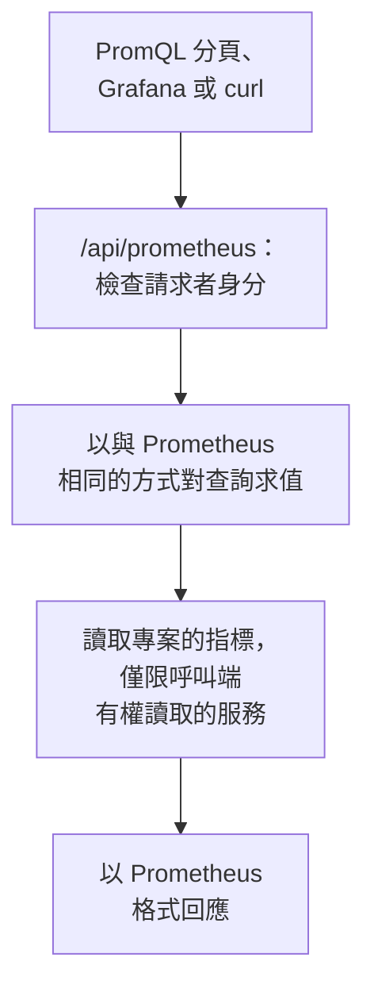

# 使用 PromQL 查詢指標

PromQL 是 Prometheus 的查詢語言，也是大多數為指標繪製圖表的人早已熟悉的語言。OneUptime 用它讀取你的專案的指標：既可以在指標的 **PromQL** 分頁中使用，也可以透過相容 Prometheus 的 API 使用，Grafana 或任何支援 Prometheus 資料來源的工具都可以指向這個 API。

:::cards
- [撰寫查詢](#撰寫查詢): 在指標頁面執行 PromQL，以圖表或表格檢視結果。
- [指標的命名方式](#指標的命名方式): OpenTelemetry 的名稱和屬性在 PromQL 中如何讀取。
- [連接 Grafana](#連接-grafana): 將 OneUptime 新增為 Prometheus 資料來源。
- [限制](#限制): 一個查詢可以讀取多少資料，以及可以執行多久。
:::

## 運作方式

PromQL 分頁和 Grafana 請求的是同一個 API。OneUptime 會檢查呼叫端是否有權讀取專案的指標，只讀取呼叫端有權讀取的服務，並以與 Prometheus 相同的方式對查詢求值。



## 開始之前

- **正在到達的指標。** 透過 [OpenTelemetry](/docs/telemetry/open-telemetry) 傳送，或者從代理程式傳送，例如 [主機 OpenTelemetry Collector](/docs/telemetry/host-otel-collector)。
- **可以讀取指標的角色。** Project Owner、Project Admin、Project Member、Viewer、Telemetry Admin、Telemetry Member 或 Telemetry Viewer，或者擁有 Read Metrics 權限的自訂角色。僅限部分服務的角色只能讀取這些服務的指標。
- **用於 Grafana 或指令碼：專案 API 金鑰**，需具備上述角色之一或 Read Metrics 權限。請參閱 [建立 API 金鑰](/docs/api-reference/api-reference#建立-api-金鑰)。在 OneUptime Cloud 上，API 金鑰需要 **Growth** 方案。

## 撰寫查詢

:::steps
### 開啟 PromQL

開啟 **指標**，然後點選 **PromQL** 分頁。

### 輸入查詢

在編輯器中輸入查詢、從 **範例** 中挑選一個，或從 **新增指標名稱** 開始，它會依 PromQL 的命名列出你的專案的指標。

### 執行查詢

點選 **執行查詢**，或按 Ctrl+Enter（在 Mac 上按 ⌘+Enter）。**圖表** 會在整個時間範圍內繪製查詢結果；**表格** 會顯示每個序列在時間範圍結束時的值。
:::

可以從以下幾個查詢開始：

```text title="PromQL"
# Requests per second, by service
sum by (job) (rate(http_requests_total[5m]))

# The 95th percentile of a latency histogram
histogram_quantile(0.95, sum by (le) (rate(http_server_request_duration_bucket[5m])))

# The five hosts using the most memory
topk(5, system_memory_usage)
```

對於無法執行的查詢，編輯器會指出哪裡出了問題、問題出在什麼位置：比如對於 `rate(http_requests_total)`，編輯器會提示該函式需要 `[5m]` 這樣的範圍。

## 指標的命名方式

OneUptime 以 OpenTelemetry 的方式儲存指標。PromQL 依照 Prometheus 本身的 OpenTelemetry 支援給它們取的名稱來讀取它們，因此為 Prometheus 撰寫的查詢在這裡同樣可用：

| 在 OneUptime 中 | 在 PromQL 中 |
| --- | --- |
| 量測器 `system.cpu.utilization` | `system_cpu_utilization` |
| 計數器 `http.requests` | `http_requests` 或 `http_requests_total` |
| 直方圖 `http.server.request.duration` | `http_server_request_duration_bucket`（帶 `le`）、`_count` 和 `_sum` |
| 摘要 `rpc.latency` | `rpc_latency`（帶 `quantile`）、`_count` 和 `_sum` |
| 屬性 `http.route` | 標籤 `http_route` |
| 資源屬性 `service.name` | 標籤 `resource_service_name`，以及 `job` |
| 資源屬性 `service.instance.id` | 標籤 `resource_service_instance_id`，以及 `instance` |

- **指標名稱和標籤名稱中的點和連字號會變成底線。** 若要依儲存時的原樣指定指標或標籤，請像 Prometheus 3 那樣為名稱加上引號：`{"http.server.request.duration", "http.route"="/checkout"}`。
- **Delta 計數器會從查詢時間範圍的起點開始累加**，因此 `rate()` 和 `increase()` 會像讀取其他任何計數器一樣讀取它們。
- **指數直方圖** 有 `_count` 和 `_sum`，但沒有桶。

## 連接 Grafana

:::steps
### 建立 API 金鑰

在 OneUptime 中，開啟 **專案設定 → 進階 → API 金鑰**，然後點選 **建立API 金鑰**。為金鑰指派一個可以讀取遙測的角色，或者 Read Metrics 權限。

### 新增 Prometheus 資料來源

在 Grafana 中，開啟 **Connections → Data sources → Add data source**，然後選擇 **Prometheus**。

### 輸入伺服器 URL

將 **Prometheus server URL** 設為你的 OneUptime 位址加上 `/api/prometheus`。在 OneUptime Cloud 上，就是 `https://oneuptime.com/api/prometheus`。**PromQL** 分頁會顯示你自己伺服器的位址，並附帶一個複製按鈕。

### 傳送 API 金鑰

在 **HTTP headers** 底下，新增標頭 `Authorization`，值為 `Bearer`，後接一個空格和你的 API 金鑰。也可以使用基本驗證：使用者名稱任意，密碼填寫 API 金鑰。

### 儲存並測試

點選 **Save & test**。Grafana 會執行一個查詢，並告訴你資料來源運作正常。
:::

其他任何 Prometheus 用戶端的用法都相同。使用 curl：

```bash title="Query OneUptime's Prometheus API"
curl -H "Authorization: Bearer $ONEUPTIME_API_KEY" \
  "https://oneuptime.com/api/prometheus/api/v1/query?query=up"
```

## API

此 API 在 `/api/prometheus` 底下回應 Prometheus HTTP API 的各個路由，支援 `GET` 或 `POST`：

| 路由 | 回應內容 |
| --- | --- |
| `/api/v1/query` | 某一時間點的查詢（`time`，預設為現在）。 |
| `/api/v1/query_range` | 從 `start` 到 `end` 每隔 `step` 的查詢。 |
| `/api/v1/series` | `match[]` 選取的序列。 |
| `/api/v1/labels` | `match[]` 選取的序列或所有指標的標籤名稱。 |
| `/api/v1/label/<name>/values` | 某個標籤的值。`__name__` 會列出指標名稱。 |
| `/api/v1/metadata` | 每個指標的類型、說明和單位。 |

時間使用 Unix 秒數或 RFC 3339，時長使用秒數或 `15s` 這樣的時長，回應採用 Prometheus 的格式。`/api/v1/status/buildinfo` 以 Prometheus 3 伺服器的身分回應；規則和警示為空，因為 OneUptime 是透過 [監測器](/docs/monitor/metrics-monitor) 發出警示。

## 支援的 PromQL 功能

- **選擇器**：支援所有比對器（`=`、`!=`、`=~`、`!~`）、範圍、`offset`、`@`（以及 `start()` 和 `end()`）和子查詢。
- **運算子**：算術運算、比較運算（含 `bool`）、`and`、`or`、`unless`，以及使用 `on`、`ignoring`、`group_left` 和 `group_right` 的向量比對。
- **彙總**：`sum`、`avg`、`min`、`max`、`count`、`group`、`stddev`、`stdvar`、`topk`、`bottomk`、`quantile` 和 `count_values`，可搭配 `by` 或 `without`。
- **函式**：`rate`、`irate`、`increase`、`delta`、`idelta`、`deriv`、`predict_linear`、`histogram_quantile`、所有 `*_over_time` 函式、`changes`、`resets`、`absent`、`label_replace`、`label_join`、`sort`、`clamp`、`round`、數學和日期函式等。

Prometheus 的原生直方圖函式（例如 `histogram_count()`）無法使用：OneUptime 以帶桶的形式儲存直方圖，由 `histogram_quantile()` 以及 `_count` 和 `_sum` 序列讀取。

## 限制

每個查詢都有上限，因此包含許多面板的儀表板也不會讓 OneUptime 超載：

| 限制 | 值 |
| --- | --- |
| 範圍查詢中單一序列的資料點 | 11,000 |
| 單一查詢可讀取並保留的樣本 | 5,000,000 |
| 單一選擇器可讀取的指標資料點 | 1,000,000 |
| 一次讀取的最長時間 | 30 秒 |
| 求值的最長時間 | 30 秒 |
| 選擇器回溯尋找序列最新樣本的時長 | 5 分鐘 |
| 子查詢未指定步長時的預設步長 | 1 分鐘 |

## 疑難排解

:::details Grafana 顯示資料來源無法運作
檢查 URL 是否以 `/api/prometheus` 結尾，以及 `Authorization` 標頭是否包含 `Bearer`、一個空格和 API 金鑰。沒有可讀取指標之角色的金鑰會被拒絕：請在 **專案設定 → 進階 → API 金鑰** 中為它指派一個角色。
:::

:::details 指標瀏覽器中的指標查不到任何結果
它的 PromQL 名稱會在儲存名稱有點的地方使用底線，而直方圖要透過 `_bucket`、`_count` 或 `_sum` 讀取。PromQL 分頁上的 **新增指標名稱** 會依 PromQL 的寫法列出每個名稱。
:::

:::details "The query reads more than 1,000,000 metric points"
查詢要求的資料超過了一次讀取所能容納的量。請新增標籤比對器、縮短時間範圍，或使用更大的步長。
:::

## 後續步驟

:::cards
- [指標瀏覽器](/docs/telemetry/metrics-explorer): 不必撰寫查詢就能為指標繪製圖表。
- [指標監控](/docs/monitor/metrics-monitor): 當指標越過臨界值時發出警示。
- [外部資料來源](/docs/dashboards/data-sources): 在儀表板上為外部 Prometheus 繪製圖表。
:::
