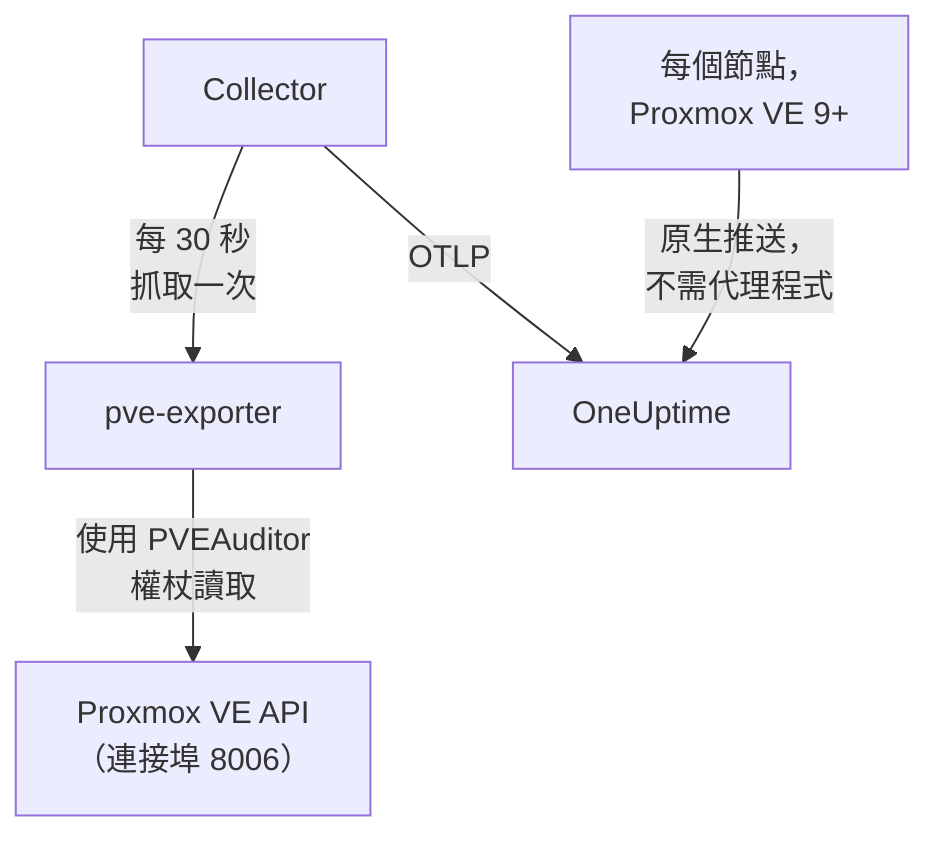

# Proxmox 代理程式

OneUptime Proxmox 代理程式會監控 Proxmox VE 叢集：它的節點、QEMU 虛擬機器、LXC 容器、儲存空間、HA 狀態、備份涵蓋範圍和複寫。它會使用唯讀權杖透過 Proxmox VE API 讀取叢集，並將發現的內容傳送到 OneUptime，叢集會連同其節點、客體和儲存空間一起出現在那裡。在 Proxmox VE 9 及更新版本上，節點也可以自行推送指標，不需要安裝任何東西。[Proxmox 監控](/docs/monitor/proxmox-monitor) 會根據送達的資料發出警示。

:::cards
- [選擇連線方式](#選擇連線方式): 代理程式，或 Proxmox VE 9 自己的推送。
- [安裝代理程式](#安裝代理程式): 一個 API 權杖，然後是安裝指令碼或 Docker Compose。
- [原生推送](#免安裝的替代方案proxmox-ve-9-原生-opentelemetry-推送): Proxmox VE 9 自行傳送其指標。
- [疑難排解](#疑難排解): 一個診斷指令碼，以及常見問題。
:::

## 運作方式

該代理程式是你在一台機器上用 Docker Compose 執行的一組容器：[prometheus-pve-exporter](https://github.com/prometheus-pve/prometheus-pve-exporter) 會在連接埠 8006 上讀取 Proxmox VE API，OpenTelemetry Collector 會每 30 秒抓取一次該匯出器，並為每個指標加上你的叢集名稱，而 Proxmox AI 代理程式讓 OneUptime AI 在調查時能夠讀取叢集。Proxmox VE 9 的原生推送則會將每個節點的指標直接傳送到 OneUptime。



叢集會隨其第一批資料，以代理程式作為 `proxmox.cluster.name` 加到每個指標上的名稱自行註冊。

## 選擇連線方式

| | 代理程式 | 原生推送 |
| --- | --- | --- |
| Proxmox VE | 任何受支援的版本 | 9.0 或更新版本 |
| 需要安裝 | 一台機器上的 Docker Compose | 無：在 Proxmox 網頁 UI 中加入一個指標伺服器 |
| 節點、客體和儲存空間 | 是 | 是 |
| HA 狀態、開機啟動、備份涵蓋範圍和複寫 | 是 | 否 |
| Proxmox AI 代理程式 | 是 | 否 |

**HA Resource in Error State**、**Guest Down**、**Guest Not Backed Up** 和 **Replication Failing** 範本需要代理程式。一個叢集請只使用其中一種方式：同時執行兩者會將每個資源回報兩次。

## 開始之前

- Docker Engine 20.10 或更新版本以及 Docker Compose v2 外掛程式，安裝在一台能透過連接埠 8006 連線到 Proxmox VE API 的機器上。
- 任一 Proxmox VE 節點上的 root shell，或 Proxmox 網頁 UI，用於建立 API 權杖。
- 一把擷取金鑰。在 **專案設定 → 遙測與 APM → 擷取金鑰** 下建立一把並複製其值。
- 從該機器到你的 OneUptime URL 的輸出 HTTPS。

### 在哪裡執行代理程式

代理程式會透過網路查詢 Proxmox VE API，因此它不必在叢集節點上執行，也不應該這樣做：請在能夠撐過節點故障的機器上執行它（獨立硬體上的小型監控虛擬機器、管理主機），或讓 `PVE_HOST` 指向虛擬 IP 或循環配置 DNS 名稱，而不是某一個節點的位址。如果代理程式的 API 目標正是剛剛停止運作的節點，你的監控也會隨之失效。唯一的例外是選用的 journald 日誌管道，它必須在 Proxmox VE 節點上執行（請參閱 [傳送 Proxmox 服務日誌](#選用傳送-proxmox-服務日誌)）。

## 安裝代理程式

:::steps
### 建立唯讀 API 權杖

代理程式會使用具有 **PVEAuditor** 角色的 API 權杖讀取叢集，該角色只能讀取，不能做其他任何事。

:::tabs
@tab Shell
在任一 Proxmox VE 節點上以 root 身分執行：

```bash
pveum user add monitoring@pam
pveum acl modify / --roles PVEAuditor --users monitoring@pam
pveum user token add monitoring@pam oneuptime --privsep 1
pveum acl modify / --roles PVEAuditor --tokens 'monitoring@pam!oneuptime'
```

只有在 `monitoring@pam` 已經存在時，第一個指令才會失敗，而且無害：API 權杖帶有自己的密鑰，因此該使用者不需要密碼或系統帳戶。`pveum user token add` 只會輸出一次權杖密鑰；權杖 ID 為 `monitoring@pam!oneuptime`。
@tab Proxmox web UI
1. 前往 *Datacenter → Permissions → API Tokens* 並按一下 **Add**。
2. 選擇（或建立）一位使用者，為權杖指定類似 `oneuptime` 的 ID，並保持 **Privilege Separation** 為勾選狀態。
3. 複製權杖 ID（`user@realm!tokenname`）和密鑰：密鑰只會顯示一次。
4. 在 *Datacenter → Permissions* 下，在路徑 `/` 上加入 **PVEAuditor** 角色兩次：一次作為權杖的 **API Token Permission**，一次作為其使用者的 **User Permission**。
:::

角色既要授予權杖，也要授予使用者，因為權限分離的權杖只能取得其使用者同樣擁有的權限。它必須位於根路徑 `/` 上，因為匯出器會讀取每個節點、客體和儲存空間物件：更窄的路徑會隱藏叢集的其餘部分，並以 `401`/`403 Permission check failed (/, Sys.Audit)` 失敗。

### 安裝並啟動代理程式

:::tabs
@tab install.sh
下載安裝指令碼，並在將要裝載代理程式的機器上執行它：

```bash
curl -sSL https://raw.githubusercontent.com/OneUptime/oneuptime/master/agents/ProxmoxAgent/install.sh -o install.sh
bash install.sh
```

該指令碼會詢問你的 OneUptime URL、擷取金鑰、叢集名稱、Proxmox VE API 主機、是否執行內建匯出器，以及權杖 ID 和密鑰——還會詢問是否允許 [AI 代理程式](#ai-代理程式) 套用修正，如果允許，再詢問它自己的權杖以及它絕不能變更的客體。它會安裝到 `/opt/oneuptime-proxmox-agent`，寫入一個權限為 `0600` 的 `.env` 檔案，並使用 Docker Compose 啟動代理程式。再次執行該指令碼會重複使用該 `.env` 中的所有內容而不再詢問，這就是你 [升級代理程式](#升級代理程式) 的方式。
@tab Docker Compose
從 [ProxmoxAgent 目錄](https://github.com/OneUptime/oneuptime/tree/master/agents/ProxmoxAgent) 下載 `docker-compose.yml` 和 `otel-collector-config.yaml` 到一個新資料夾中：

```bash
mkdir oneuptime-proxmox-agent && cd oneuptime-proxmox-agent
curl -fsSLO https://raw.githubusercontent.com/OneUptime/oneuptime/master/agents/ProxmoxAgent/docker-compose.yml
curl -fsSLO https://raw.githubusercontent.com/OneUptime/oneuptime/master/agents/ProxmoxAgent/otel-collector-config.yaml
```

在它們旁邊建立一個 `.env` 檔案。它包含權杖密鑰，因此請用 `chmod 600 .env` 保持其私密：

```bash title=".env"
ONEUPTIME_URL=YOUR_ONEUPTIME_URL
ONEUPTIME_TELEMETRY_INGESTION_KEY=YOUR_TELEMETRY_INGESTION_TOKEN
PROXMOX_CLUSTER_NAME=my-proxmox-cluster
PVE_HOST=192.168.1.10
PVE_API_TOKEN_ID=monitoring@pam!oneuptime
PVE_API_TOKEN_SECRET=your-token-secret
COMPOSE_PROFILES=pve-exporter
```

`COMPOSE_PROFILES=pve-exporter` 也會啟動內建的匯出器。啟動代理程式：

```bash
docker compose up -d
```
:::

已經在執行 prometheus-pve-exporter？在指令碼詢問是否執行內建匯出器時回答 **n**，或從 `.env` 中刪除 `COMPOSE_PROFILES`，然後讓代理程式指向你的匯出器（`host:port`，不帶通訊協定，必須是代理程式容器能夠連線的位址：`localhost` 指的是容器本身）。如果你使用 [AI 代理程式](#ai-代理程式)，請保留 `PVE_API_TOKEN_ID` 和 `PVE_API_TOKEN_SECRET`，它會用該權杖呼叫 API：

```bash
PVE_EXPORTER_URL=your-exporter-host:9221
```

### 檢查代理程式是否正在執行

```bash
docker compose ps
docker logs -f oneuptime-proxmox-agent
```

`docker compose ps` 會列出 Collector（`oneuptime-proxmox-agent`）、內建匯出器（`oneuptime-pve-exporter`，除非你使用自己的匯出器）和 AI 代理程式（`oneuptime-proxmox-ai-agent`）。Collector 啟動後，其日誌中應出現這一行：

```text
Everything is ready. Begin running and processing data.
```

### 在 OneUptime 中找到叢集

開啟 **產品 → 基礎設施 → Proxmox → 所有叢集**。在第一次抓取後大約一分鐘，叢集會以其 `PROXMOX_CLUSTER_NAME` 出現，並帶有其節點、客體和儲存空間。
:::

## 環境變數

安裝指令碼會將這些寫入 `/opt/oneuptime-proxmox-agent/.env`；Docker Compose 安裝則會從 `docker-compose.yml` 旁邊的 `.env` 中讀取它們。變更其中任何一個之後，請在該資料夾中執行 `docker compose up -d`。

| 變數 | 必要 | 說明 |
| --- | --- | --- |
| `ONEUPTIME_URL` | 是 | 你的 OneUptime URL，例如 `https://oneuptime.com` 或你的自行託管執行個體。如果執行個體只支援 HTTP，請使用 `http://` 及其連接埠。 |
| `ONEUPTIME_TELEMETRY_INGESTION_KEY` | 是 | 來自 **專案設定 → 遙測與 APM → 擷取金鑰** 的擷取金鑰。 |
| `PROXMOX_CLUSTER_NAME` | 是 | 叢集在 OneUptime 中的名稱，會作為 `proxmox.cluster.name` 資源屬性加到每個指標上。請保持不變：之後變更它會註冊另一個叢集。預設為 `proxmox-cluster`。 |
| `PVE_HOST` | 是 | 匯出器和 AI 代理程式查詢的 Proxmox VE API 主機（叢集中的任一節點），例如 `192.168.1.10`。 |
| `PVE_EXPORTER_URL` | 否 | prometheus-pve-exporter 的位址（`host:port`，不帶通訊協定）。預設為內建匯出器 `pve-exporter:9221`。 |
| `PVE_API_TOKEN_ID` | 內建匯出器或 AI 代理程式 | 完整的 Proxmox API 權杖 ID，例如 `monitoring@pam!oneuptime`。除非 AI 代理程式有自己的權杖（`ONEUPTIME_AI_PVE_API_TOKEN_ID` / `ONEUPTIME_AI_PVE_API_TOKEN_SECRET`），否則它會用這個權杖讀取 API。 |
| `PVE_API_TOKEN_SECRET` | 內建匯出器或 AI 代理程式 | Proxmox API 權杖密鑰。 |
| `PVE_VERIFY_SSL` | 否 | 驗證 Proxmox API 的 TLS 憑證（匯出器和 AI 代理程式）。預設為 `false`，因為 Proxmox 隨附的是自我簽署憑證。 |
| `COMPOSE_PROFILES` | 否 | 設定為 `pve-exporter` 可啟動內建的匯出器容器。 |

## 代理程式收集的內容

Collector 會每 30 秒抓取一次匯出器，同時開啟其叢集和節點收集器，這也涵蓋了匯出器預設開啟的 `backup-info`（叢集層級）和 `replication`（節點層級）收集器。每個序列都帶有一個識別資源的 `id` 標籤：`node/<name>`、`qemu/<vmid>`、`lxc/<vmid>` 或 `storage/<node>/<storage>`。

| 類別 | 指標 |
| --- | --- |
| 可用性 | `pve_up`、`pve_uptime_seconds` |
| 節點 | `pve_node_info`、`pve_cpu_usage_ratio`、`pve_cpu_usage_limit`、`pve_memory_usage_bytes`、`pve_memory_size_bytes` |
| 客體（VM 或 LXC） | `pve_guest_info`，以及 `qemu/*` 和 `lxc/*` ID 上的 CPU、記憶體和網路序列（`pve_network_receive_bytes`、`pve_network_transmit_bytes`） |
| 儲存空間 | `pve_disk_usage_bytes`、`pve_disk_size_bytes`、`pve_storage_info` |
| HA | `pve_ha_state` |
| 備份涵蓋範圍 | `pve_not_backed_up_total`（沒有任何備份工作涵蓋的客體；單一叢集層級序列，沒有 `id` 標籤）和 `pve_not_backed_up_info`（每個未被涵蓋的客體一個序列，帶有其 `id`）。被涵蓋是指至少有一個工作選擇了該客體：備份最近是否執行過或是否成功，匯出器並不提供。 |
| 複寫 | 每個儲存空間複寫工作的 `pve_replication_failed_syncs`、`pve_replication_duration_seconds`、`pve_replication_last_sync_timestamp_seconds`、`pve_replication_last_try_timestamp_seconds`、`pve_replication_next_sync_timestamp_seconds`、`pve_replication_info`。它們的 `id` 標籤是工作 ID（例如 `100-0`），而不是資源。 |

監控器條件和屬性篩選器是依相等而不是依前置詞比對，因此 Collector 的 `transform/pve-identity` 處理器也會將 `id` 拆分為三個屬性。內建的 Proxmox 警示範本會依這些屬性篩選，所以如果你自訂設定，請保留這個處理器：

| 屬性 | 值 | 對於 `qemu/100` |
| --- | --- | --- |
| `pve.scope` | `node`、`guest`、`storage`、`cluster`（`qemu` 和 `lxc` 都是 `guest`） | `guest` |
| `pve.type` | `node`、`qemu`、`lxc`、`storage` | `qemu` |
| `pve.id` | `id` 中第一個 `/` 之後的所有內容（`pve1`、`100`、`pve1/local`） | `100` |

原始的 `id` 標籤會保持不變。

## 選用——傳送 Proxmox 服務日誌

預設情況下，代理程式只會傳送指標，因此叢集的 **日誌** 頁面會保持空白。Proxmox VE 服務會以八個單元記錄到 systemd journal：`pveproxy`、`pvedaemon`、`pve-firewall`、`pve-ha-crm`、`pve-ha-lrm`、`pvescheduler`、`pvestatd` 和 `qmeventd`。隨附的 `otel-collector-config.yaml` 中有一個被註解掉的 `journald` 接收器，正好針對這些單元，並連接到一條同樣被註解掉的 `logs` 管道，該管道會加上 `proxmox.cluster.name`，讓日誌歸入你的叢集。

:::steps
### 在節點上執行代理程式

journal 是依主機區分的，因此遠端代理程式無法讀取它。這是唯一一種與 [在哪裡執行代理程式](#在哪裡執行代理程式) 相悖的設定：為了讓指標代理程式留在叢集之外，請改為在節點上執行第二個只收集日誌的 Collector（複製設定，然後刪除 `prometheus` 接收器和 `metrics` 管道）。

### 開啟接收器

取消註解 `otel-collector-config.yaml` 中的 `journald` 接收器和 `logs` 管道，以及 `docker-compose.yml` 中的 journal 磁碟區，讓容器能夠讀取主機的 journal：

```yaml
- /var/log/journal:/var/log/journal:ro
- /etc/machine-id:/etc/machine-id:ro
```

### 替換 Collector 映像檔

標準的 `otel/opentelemetry-collector-contrib` 映像檔是以 `FROM scratch` 建置的：它沒有 journald 接收器所執行的 `journalctl`，而且會以一個無法讀取 journal 的使用者執行。請建置下面這個包裝映像檔，並將 `docker-compose.yml` 中的 `image:` 指向它：

```dockerfile title="Dockerfile"
FROM otel/opentelemetry-collector-contrib:0.161.0 AS otelcol
FROM debian:stable-slim
RUN apt-get update \
    && apt-get install -y --no-install-recommends systemd \
    && rm -rf /var/lib/apt/lists/*
COPY --from=otelcol /otelcol-contrib /otelcol-contrib
ENTRYPOINT ["/otelcol-contrib"]
CMD ["--config", "/etc/otelcol-contrib/config.yaml"]
```

`systemd` 套件只是為了提供 `journalctl`，而這個映像檔會以 root 身分執行，root 才能讀取 journal。或者不使用 Docker 收集日誌，而是在節點本身上執行 `otelcol-contrib` 發行版本的 `.deb`，那裡已經有 `journalctl`。
:::

每個節點只會傳送它自己的 journal：若要取得每個節點的服務日誌，請在每個節點上執行只收集日誌的 Collector。

### 不使用自訂映像檔的替代方案：對 /var/log/syslog 使用 filelog

若要保留標準映像檔，請改為追蹤 syslog。在節點上安裝 rsyslog（`apt install rsyslog`；Debian 12 以及 Proxmox VE 8 及更新版本不再隨附它），將 `/var/log` 目錄掛載到容器中（`- /var/log:/var/log:ro`；掛載目錄而不是檔案，如此日誌輪替就不會卡在一個過時的檔案上），並用 `filelog` 接收器取代 journald 接收器：

```yaml
receivers:
  filelog:
    include:
      - /var/log/syslog
    start_at: end
```

你會失去依單元篩選的能力（syslog 包含所有內容，而不只是這八個服務），而且標準映像檔的使用者必須能夠讀取該檔案。將它接入同一條被註解掉的 `logs` 管道（`receivers: [filelog]`）。

## 免安裝的替代方案：Proxmox VE 9+ 原生 OpenTelemetry 推送

Proxmox VE 9.0 及更新版本隨附一個 OpenTelemetry 指標伺服器，可以將節點、客體和儲存空間指標推送到任何 OTLP/HTTP 端點，不需要安裝代理程式或匯出器。在 Proxmox 網頁 UI 中，前往 *Datacenter → Metric Server → Add → OpenTelemetry* 並填寫：

| 欄位 | 值 |
| --- | --- |
| Server | 你的 OneUptime 主機，例如 `oneuptime.com`，或你的自行託管主機 |
| Port | `443` |
| Protocol | `https` |
| Path | `/otlp/v1/metrics` |
| Headers | `{"x-oneuptime-token": "YOUR_TELEMETRY_INGESTION_TOKEN"}` |

只需加入一次：叢集的每個節點都會推送自己的指標。OneUptime 會辨識這種推送，並將它轉換為與代理程式傳送的相同的 `pve_*` 序列，因此：

- 叢集會以你的 Proxmox 叢集名稱自行註冊（獨立節點則以其節點名稱註冊），而你在 *Resource Attributes* 下設定的 `proxmox.cluster.name` 會繼續被優先使用；
- 節點、客體和儲存空間頁面、概覽圖表、指標目錄以及 CPU、記憶體和儲存空間警示範本的運作方式與使用代理程式時相同；
- 原始的 `proxmox_node_*`、`proxmox_vm_*` 和 `proxmox_storage_*` 序列會保留在 [指標瀏覽器](/docs/monitor/metrics-monitor) 中，供你查看 Proxmox VE 回報的其他任何內容（平均負載、交換空間、壓力停滯、每張網路卡的流量）。

### 節點停止回報時

每個節點只會推送它自己的狀態，因此停止運作的節點無法自己回報這一點。仍然存活的節點會替它回報：

- 在其最後一次回報大約 2 分鐘後，該節點會在節點頁面上顯示為 **離線**。節點自身頁面上的 **上次出現** 會保留它自己最後一次回報的時間。
- 大約 5 分鐘後，會為它觸發 **Node Offline**。**Cluster Quorum at Risk** 也會將它計為離線；由於該範本需要一個完整的 5 分鐘回報時間範圍，它會在節點沉默大約 7–9 分鐘後觸發。
- 隨著下一次回報，它會再次變為 **Online**，其警示也會恢復。

這裡的離線表示節點停止了回報，而不一定表示它已停止運作。節點正常運作，但其 `pvestatd` 停住或被終止、叢集檔案系統（`pmxcfs`）停止運作，或到 OneUptime 的網路被切斷，都會以同樣的方式回報。

它無法涵蓋的情況：

- 獨立主機，或整個叢集同時沉默：沒有任何節點留下來回報，因此不會觸發任何依節點的警示。叢集會改為變成 **已中斷**，就像代理程式停止時一樣。
- 沉默超過 7 天的節點不再被回報：其警示會解除，它也會從節點頁面上消失。自行託管的 OneUptime 可以用 `PVE_SILENT_NODE_RETENTION_HOURS` 變更這 7 天。
- 你從叢集中移除的節點看起來與停止運作的節點一樣。請在其頁面上使用 **Remove Node**：它會消失，其警示也會解除。否則它會維持離線狀態最多 7 天。
- 節點的客體和儲存空間：只有節點本身會保留為離線。它的虛擬機器、容器和儲存空間會在其最後一次回報大約 15 分鐘後從各自的頁面上消失，而被 HA 在另一個節點上重新啟動的客體會重新出現在那個節點下。

在 OneUptime 擷取中斷之後，新近沉默的節點只有在其他某個節點再次推送 2 分鐘後才會被回報，因此中斷本身永遠不會為每個節點都發出呼叫。已經處於離線狀態的節點會在短暫的中斷期間維持離線，並保留其警示；中斷超過 5 分鐘後，一旦其他節點推送了 2 分鐘，它就會再次被回報。

在 [指標瀏覽器](/docs/monitor/metrics-monitor) 中，這些回報是標記為 `oneuptime.proxmox.inferred` = `not-reporting` 的 `pve_up` = 0 資料點，因此你一定能將它們與節點關於自身的回報區分開來。

### 原生推送無法做到的事

原生推送只會傳送每個節點對自身的了解，因此代理程式收集的部分內容在原生推送中沒有對應項目：

| 需要代理程式 | 原因 |
| --- | --- |
| HA 狀態 | 不會推送：**HA Resource in Error State** 範本需要代理程式。 |
| 開機啟動旗標 | 不會推送：只為設定了開機啟動的客體發出呼叫的 **Guest Down** 需要代理程式。 |
| 備份涵蓋範圍和複寫 | 不會推送：**Guest Not Backed Up** 和 **Replication Failing** 需要代理程式。 |

如果你需要這些，請改為執行代理程式，並移除指標伺服器：同時執行兩者會將每個資源回報兩次。

## 以 systemd 服務執行

若要讓代理程式隨機器啟動，並在失敗時重新啟動，請安裝它的 systemd 單元。它假設代理程式位於 `/opt/oneuptime-proxmox-agent`，也就是安裝指令碼放置它的位置：

```bash
sudo cp systemd/oneuptime-proxmox-agent.service /etc/systemd/system/
sudo systemctl daemon-reload
sudo systemctl enable --now oneuptime-proxmox-agent
```

## 升級代理程式

代理程式會將其檔案所固定的 Collector 版本回報為它的 **代理程式版本**。當它比此 OneUptime 發行版本所固定的版本舊時，叢集 **概覽** 上它的旁邊會出現警告標誌。選取該標誌即可看到這些指令。在其檔案開始回報版本之前安裝的代理程式，在以這種方式升級之前不會顯示版本。

Collector 映像檔固定在 `docker-compose.yml` 中，其設定是旁邊的一個檔案，因此只提取映像檔並不能讓代理程式升級。請再次執行 `install.sh`：它會重複使用你現有 `.env` 中的每個值（不會再詢問任何內容），重新整理 `docker-compose.yml` 和 `otel-collector-config.yaml`（你編輯過的檔案會保留為 `<file>.bak.<timestamp>`），提取映像檔並重新建立代理程式，讓 Collector 讀取新的設定。

```bash
curl -sSL https://raw.githubusercontent.com/OneUptime/oneuptime/master/agents/ProxmoxAgent/install.sh -o install.sh
bash install.sh
```

改用 Docker Compose 安裝的？在代理程式的資料夾中重新下載這兩個檔案（並重新做一次你對它們所做的任何修改），然後提取映像檔並重新建立代理程式：

```bash
curl -fsSLO https://raw.githubusercontent.com/OneUptime/oneuptime/master/agents/ProxmoxAgent/docker-compose.yml
curl -fsSLO https://raw.githubusercontent.com/OneUptime/oneuptime/master/agents/ProxmoxAgent/otel-collector-config.yaml
docker compose pull
docker compose up -d --force-recreate
```

## 解除安裝代理程式

```bash
cd /opt/oneuptime-proxmox-agent
docker compose down
```

然後，如果不再需要，請在 *Datacenter → Permissions → API Tokens* 下刪除 API 權杖。

## AI 代理程式

代理程式的 `docker-compose.yml` 也會執行 **Proxmox AI 代理程式** `oneuptime-proxmox-ai-agent`（映像檔 `oneuptime/resource-ai-agent:release`）。當 OneUptime AI 調查此叢集上的事件或警示時，它會透過該代理程式執行唯讀的 `pvesh` 指令——`pvesh get /cluster/status`、`pvesh get /nodes/pve1/qemu/101/status/current`、`pvesh get /nodes/pve1/tasks --errors 1 --limit 20`——而且只有在你允許時才會套用修正，例如啟動或重新開機客體。其中並沒有 `pvesh` 二進位檔：每個指令都會變成對 `PVE_HOST` 上 Proxmox VE API 的恰好一次呼叫，使用同一個 `.env` 中的權杖。它會像 Collector 一樣以名為 `PROXMOX_CLUSTER_NAME` 的叢集註冊，並會出現在 OneUptime 中該叢集的 **AI 代理程式** 頁面上。

- **AI 調查預設為開啟。** 代理程式連線後，OneUptime AI 會用它來調查該叢集上的事件和警示，叢集的 **概覽** 會顯示代理程式的狀態。若要停止，請在代理程式執行的位置設定 `ONEUPTIME_AI_INVESTIGATION=false`（AI 代理程式頁面上 **AI 可以執行的操作** 下的 **變更** 會顯示方法），或不安裝代理程式。
- API 權杖是硬性限制。調查會使用 Collector 的 PVEAuditor 權杖（`PVE_API_TOKEN_ID` / `PVE_API_TOKEN_SECRET`），它只能讀取，不能做其他任何事；如果你執行自己的匯出器而 `.env` 中沒有權杖，請加入一個。修正需要一個屬於 AI 代理程式自己、可以控制客體電源的權杖（`VM.PowerMgmt`，例如在 `/vms` 或某一個資源池上的 `PVEVMUser` 角色），設定為 `ONEUPTIME_AI_PVE_API_TOKEN_ID` / `ONEUPTIME_AI_PVE_API_TOKEN_SECRET`。
- 除非你設定 `ONEUPTIME_AI_ALLOW_WRITES=true`，否則它是唯讀的；`ONEUPTIME_AI_WRITE_TARGETS`（VMID，例如 `100,101`，以及節點服務的 `<node>/<service>`）會限制修正可以觸及的內容。如果代理程式在此叢集的某個客體中執行，請將該客體的 VMID 放入 `ONEUPTIME_AI_PROTECTED_TARGETS`。同一個 `.env` 中的 `ONEUPTIME_AI_FIXES` 決定修正如何執行——`ask-for-approval`（由人逐一核准）、`automatic` 或 `bypass-approval`——AI 代理程式頁面會以唯讀方式顯示它（[由代理程式設定的 AI 可以執行的操作](/docs/ai/infrastructure-ai-agents#what-ai-may-do-set-by-the-agent)）。
- 與匯出器一樣，除非你設定 `PVE_VERIFY_SSL=true`，或將 `PVE_CA_FILE` 指向叢集的 CA（`/etc/pve/pve-root-ca.pem`，掛載到容器中），否則它不會驗證 API 的自我簽署憑證。
- 它以 UID 1000 執行，沒有任何 capability，根檔案系統為唯讀，而且從不讀取 `/access`、開啟主控台或變更設定。如果你不使用 OneUptime AI，請從 `docker-compose.yml` 中刪除 `oneuptime-proxmox-ai-agent` 服務。

它可以執行什麼、修正如何運作以及如何疑難排解，請參閱 [Infrastructure AI Agents](/docs/ai/infrastructure-ai-agents#proxmox-clusters)。代理程式的 README 中有為修正權杖準備的確切 `pveum` 指令。

## 疑難排解

:::details 先執行診斷指令碼
代理程式隨附一個指令碼 [`troubleshoot.sh`](https://github.com/OneUptime/oneuptime/blob/master/agents/ProxmoxAgent/troubleshoot.sh)，它會檢查整條鏈路：容器執行階段、匯出器抓取、加到每個指標上的叢集名稱、權杖的格式、Collector 自身的指標，以及 OneUptime 是否接受擷取金鑰。最後一項檢查最重要。OneUptime 會以 `401` 拒絕錯誤的金鑰（已停用的金鑰或瀏覽器金鑰為 `422`），而 Collector 會將兩者都視為永久性錯誤：它會捨棄該批次並記錄一則 `Exporting failed` 錯誤，而容器仍保持正常，這很容易被忽略。該指令碼會從代理程式的網路內部要求 `GET <url>/otlp/v1/validate`，直接得到 `200`（有效）或 `401`（無效），並在較舊的伺服器上改用 `POST /fluentd/v1/logs`。

```bash
curl -sSL https://raw.githubusercontent.com/OneUptime/oneuptime/master/agents/ProxmoxAgent/troubleshoot.sh -o troubleshoot.sh
bash troubleshoot.sh    # add -d <dir> if you installed outside /opt/oneuptime-proxmox-agent
```

它最後會輸出一個指出最可能原因的結論。
:::

:::details OneUptime 中沒有出現叢集
1. 查看 Collector 的日誌：`docker logs oneuptime-proxmox-agent`。匯出時出現 `401` 表示擷取金鑰錯誤；連線被拒表示 `ONEUPTIME_URL` 錯誤。
2. 檢查匯出器是否回應。內建匯出器不會在主機上發布其連接埠，因此請從其網路內部發出要求：`docker run --rm --network container:oneuptime-pve-exporter curlimages/curl -s "http://localhost:9221/pve?target=YOUR_PVE_HOST" | head` 應輸出 `pve_*` 行。對於你自己的匯出器，請直接要求它的 `host:9221`。
3. 檢查是否已設定 `PROXMOX_CLUSTER_NAME`：叢集是透過其 `proxmox.cluster.name` 資源屬性找到的。
:::

:::details 匯出器傳回 401 或 595 錯誤
API 權杖錯誤或缺少權限。請檢查權杖 ID 的格式（`user@realm!tokenname`）、密鑰，以及權杖及其使用者在路徑 `/` 上是否都具有 **PVEAuditor** 角色。匯出器自己的日誌會顯示 API 的回應：`docker logs oneuptime-pve-exporter`。
:::

:::details 只有節點指標，沒有客體指標
客體序列（`qemu/*` 和 `lxc/*` ID）來自匯出器的叢集收集器，隨附的設定會透過抓取參數 `cluster=1` 開啟它。如果你自訂了 `otel-collector-config.yaml`，請將 `cluster: ["1"]` 參數加回去。
:::

:::details 指標落在錯誤的叢集下
OneUptime 會依 `proxmox.cluster.name` 註冊 Proxmox 叢集，而代理程式會從 `PROXMOX_CLUSTER_NAME` 取得它。在第一批資料之後變更它，會建立第二個叢集，而不是重新命名第一個。
:::

:::details 使用原生推送時，節點顯示為離線
它停止了回報：停止運作的節點、停住的 `pvestatd`、停止的 `pmxcfs` 或到 OneUptime 的網路被切斷，看起來都一樣。它的下一次回報會讓它恢復。如果你將該節點從叢集中移除了，請在其頁面上使用 **Remove Node**；否則它會維持離線狀態最多 7 天。請參閱 [節點停止回報時](#節點停止回報時)。
:::

:::details 使用原生推送時，Guest Down、HA 或備份警示從未觸發
原生推送不會傳送 HA 狀態、開機啟動、備份涵蓋範圍或複寫。如需這些，請 [安裝代理程式](#安裝代理程式)，並移除指標伺服器：同時執行兩者會將每個資源回報兩次。
:::

## 後續步驟

:::cards
- [Proxmox 監控](/docs/monitor/proxmox-monitor): 針對節點、客體、儲存空間、HA、備份和複寫發出警示。
- [Ceph 代理程式](/docs/telemetry/ceph): 監控 Proxmox 叢集底層的 Ceph 儲存空間。
- [Infrastructure AI Agents](/docs/ai/infrastructure-ai-agents): Proxmox AI 代理程式可以執行什麼，以及修正如何運作。
- [主機 OpenTelemetry Collector](/docs/telemetry/host-otel-collector): 每個節點的作業系統層級檢視。
:::
