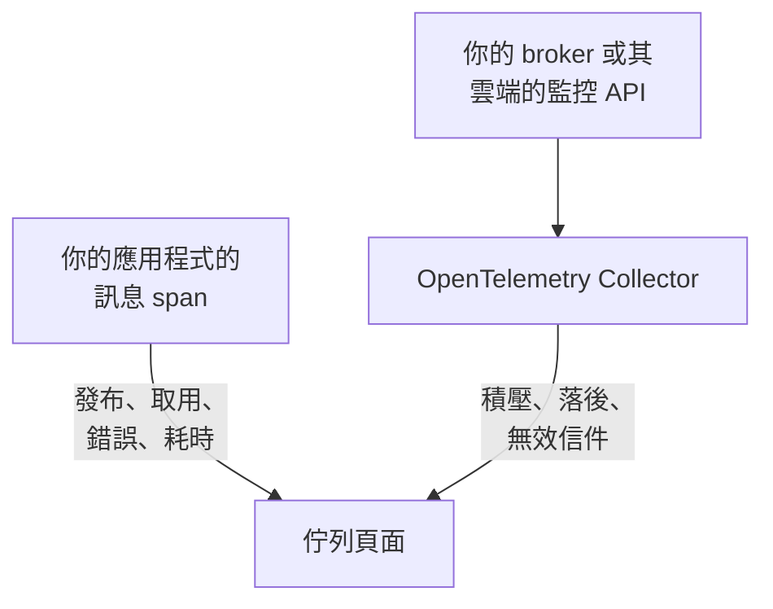

# 佇列

**Queues** 為你的應用程式使用的每個訊息佇列、主題和訂閱提供專屬頁面：哪些服務向它發布、哪些服務從它取用、有多少訊息經過、有多少失敗、處理耗時多久、它的追蹤和指標；而一旦 broker 本身的指標送達 OneUptime，還有它的積壓、消費者落後、無效信件和節流。與其他所有資源一樣，佇列也有標籤、擁有者、標籤和擁有者規則以及封存。在 **產品 → 資源 → 佇列** 下開啟它們。

:::cards
- [為應用程式進行檢測](#為應用程式進行檢測): 你的 OpenTelemetry 檢測已經傳送的訊息 span。
- [Broker 健康指標](#broker-健康指標): 來自你的 broker 的積壓、落後和無效信件，逐一說明每個系統。
- [警示](#警示): 現成的範本，以及延遲送達或計數類的指標。
- [疑難排解](#疑難排解): 沒有被建立的佇列，或一直為空的 broker 健康狀態。
:::

## 運作方式

它對每種 broker 的運作方式都相同：Apache Kafka、RabbitMQ、Apache ActiveMQ 和其他 JMS broker、Amazon SQS 和 SNS、Google Cloud Pub/Sub、Azure Service Bus、Event Hubs 和 Event Grid、Apache Pulsar、Apache RocketMQ、NATS 和 BullMQ（請參閱 [支援的訊息系統](#支援的訊息系統)），以及你的 span 在 `messaging.system` 中指明的任何其他 broker。大多數佇列會從兩個來源自動出現：

| 來源 | 需要你提供什麼 | 為佇列頁面新增什麼 |
| --- | --- | --- |
| **應用程式追蹤** | 已檢測的應用程式（OpenTelemetry），請參閱 [為應用程式進行檢測](#為應用程式進行檢測) | 發布和取用的訊息、錯誤和處理時間、兩側的服務，以及追蹤本身 |
| **Broker 指標**（一個 OpenTelemetry Collector） | 針對你的 broker 的 Collector 接收器或抓取設定，請參閱 [Broker 健康指標](#broker-健康指標) | **Broker 健康狀態**：積壓、消費者落後、無效信件、最舊訊息的存在時間、節流以及 broker 本身的訊息速率 |



追蹤會告訴 OneUptime 佇列存在以及應用程式如何使用它，但不會告訴它佇列有多滿。這來自 broker 本身或其雲端供應商的監控 API；對於 [BullMQ](#bullmq)，由於它把作業保存在 Redis 中、沒有可以查詢的 broker，則來自應用程式回報的量測值。

你也可以手動新增佇列：在 **Queues → 建立Queue** 中填入它的訊息系統和目的地名稱，對於 Azure Service Bus 和 Event Hubs 還要填入命名空間。表單在第一個步驟 **訊息系統** 中詢問這些內容，接著詢問選用的名稱和描述，標籤位於 **更多欄位**（**佇列資訊**）下。只有當你的應用程式透過模擬器或自訂網域名稱存取某個佇列時，才把命名空間留空：它們的 span 不會指明命名空間，Azure Monitor 的指標也永遠不會送達這樣的佇列（請參閱 [限制](#限制)）。

## 開始使用

:::steps
### 傳送應用程式的追蹤

為發布和取用訊息的應用程式進行檢測，並把它們的追蹤傳送到 OneUptime（請參閱 [為應用程式進行檢測](#為應用程式進行檢測)）。不需要任何 OneUptime 專屬的設定：你的檢測已經產生的訊息 span 會指明佇列。

### 傳送 broker 的指標

在 [Broker 健康指標](#broker-健康指標) 下找到你的訊息系統，並用你的擷取金鑰執行它的 Collector 設定。每個佇列的 **文件** 分頁都有該佇列的設定，可直接複製。

### 開啟佇列

開啟 **產品 → 資源 → 佇列**。探索每 10 分鐘執行一次：一旦某個佇列在 15 分鐘內收到至少 3 個 span，或某個 broker 指標指明了它，它就會出現。
:::

## 支援的訊息系統

OneUptime 依名稱識別下列訊息系統。它會把檢測寫入 `messaging.system` 的值不區分大小寫地正規化為第二欄中的值（如有 OpenTelemetry 公認值，則為該值），因此 `AmazonSQS`、`aws.sqs` 和 `aws_sqs` 是同一個系統。`nats` 和 `bullmq` 不是 OpenTelemetry 公認值：`nats` 是 Java 代理程式的 NATS 檢測回報的值，`bullmq` 是為 BullMQ 設定的值（請參閱 [BullMQ](#bullmq)）。

OneUptime 不認識的系統同樣可用：格式正確的值（`ibmmq`、`solace`、`mqtt`：小寫字母、數字、`.`、`_` 和 `-`，最多 64 個字元）會照原樣保留，因此該 broker 的佇列會被探索並以該名稱顯示；只有 broker 本身的指標需要此表中的系統。`spring_integration` 會被忽略：Spring Integration 的通道是一個處理程序內的方法呼叫，而不是 broker。

**Broker 指標** 欄說明系統的健康指標從哪裡來：collector-contrib 接收器、Prometheus 端點（`:port/path`，以 Collector 的 `prometheus` 接收器抓取）、雲端供應商的監控 API，或在 Collector 之外透過 OTLP 推送指標的程式。每個系統都連結到下文的設定，而每個佇列的 **文件** 分頁會把它變成該佇列的設定。

| 系統 | `messaging.system` | 也接受 | Broker 指標 |
| --- | --- | --- | --- |
| [Amazon SNS](#amazon-sns) | `aws.sns` | `aws_sns`, `amazonsns`, `sns` | `aws_cloudwatch` 或 `awsfirehose` 接收器（雲端監控） |
| [Amazon SQS](#amazon-sqs) | `aws_sqs` | `aws.sqs`, `amazonsqs`, `sqs` | `aws_cloudwatch` 或 `awsfirehose` 接收器（雲端監控） |
| [Apache ActiveMQ](#apache-activemq) | `activemq` | `artemis`, `activemq_artemis` | OpenTelemetry JMX Scraper（透過 OTLP 推送） |
| [Apache Kafka](#apache-kafka) | `kafka` | — | `kafka_metrics` 接收器 |
| [Apache Pulsar](#apache-pulsar) | `pulsar` | `apache_pulsar` | Prometheus（Pulsar broker）, `:8080/metrics/` |
| [Apache RocketMQ](#apache-rocketmq) | `rocketmq` | — | Prometheus（RocketMQ broker）, `:5557/metrics` |
| [Azure Event Grid](#azure-event-grid) | `eventgrid` | `azure_eventgrid`, `azure.eventgrid`, `microsoft.eventgrid` | `azure_monitor` 接收器（雲端監控） |
| [Azure Event Hubs](#azure-event-hubs) | `eventhubs` | `azure_eventhubs`, `azure.eventhubs`, `microsoft.eventhub` | `azure_monitor` 接收器（雲端監控） |
| [Azure Service Bus](#azure-service-bus) | `servicebus` | `azure_servicebus`, `azure.servicebus`, `microsoft.servicebus` | `azure_monitor` 接收器（雲端監控） |
| [BullMQ](#bullmq) | `bullmq` | — | 無內建 |
| [Google Cloud Pub/Sub](#google-cloud-pubsub) | `gcp_pubsub` | `gcp.pubsub`, `pubsub`, `google_pubsub` | `googlecloudmonitoring` 接收器（雲端監控） |
| [JMS](#jms) | `jms` | — | 無內建 |
| [NATS](#nats) | `nats` | `jetstream` | Prometheus (prometheus-nats-exporter), `:7777/metrics` |
| [RabbitMQ](#rabbitmq) | `rabbitmq` | — | `rabbitmq` 接收器 |

一個佇列是一個系統的一個目的地。對於 **Azure Service Bus** 和 **Azure Event Hubs**，命名空間也是其中的一部分，因為兩個命名空間可以各有一個名為 `orders` 的佇列。**JMS** 和 **Apache ActiveMQ** 共用佇列：Java 應用程式透過 JMS API 存取 ActiveMQ，無論 broker 是什麼，其 span 都顯示 `jms`，而 broker 本身的指標只能顯示 `activemq`，因此兩者落在同一個佇列上（請參閱 [兩次觀測何時算同一個佇列](#兩次觀測何時算同一個佇列)）。

## 如何探索佇列

每個佇列都會記錄它是由追蹤、broker 指標還是人員建立的。之後凡是指明同一個佇列的內容都會補充到它上面，而不會再建立一個（請參閱 [兩次觀測何時算同一個佇列](#兩次觀測何時算同一個佇列)）。

### 從應用程式追蹤

OneUptime 每 10 分鐘彙總你的應用程式在過去 15 分鐘內傳送的、帶有 `messaging.system`、`messaging.destination.name`、`messaging.destination`、`message_bus.destination`、`az.namespace`、`azure.resource_provider.namespace`、`aws.sqs.queue.url`、`aws.queue_url` 或 `aws.sns.topic.arn` 中任意一個的 span。除 SERVER span 外的所有 span 都計入：PRODUCER、CONSUMER、CLIENT 和 INTERNAL span，以及追蹤管線的 **Span 類型重新對應器** 賦予了其他類型（例如 Unspecified）或移除了類型的 span；SERVER span 永遠不會指明佇列。

broker 本身的 span 也是 SERVER span。[Kubernetes 代理程式](/docs/telemetry/kubernetes-agent#ebpf-追蹤的樣貌) 的 eBPF 追蹤器會記錄 Kafka、MQTT 或 NATS broker 在每次交換中的一方（它接收的訊息、它投遞的訊息），並把其中大多數以 PRODUCER 或 CONSUMER 傳送；OneUptime 把它們儲存為 SERVER，因此 broker 不會被列為它所承載主題的生產者或消費者。把訊息轉送給訂閱者的 MQTT broker 會寫出與用戶端相同的 PUBLISH，追蹤器對兩者的回報也一樣，因此對於 MQTT 和 NATS 的發布，OneUptime 依據連線另一端的連接埠來判斷：連接埠從 32768 起（作業系統為發起連線的用戶端選擇連接埠的範圍；Linux 的預設範圍從這裡開始；Windows 和 macOS 使用 49152–65535）就是訂閱者的連接埠，該 span 屬於 broker。因此，向本身接聽 32768 以上連接埠（例如隨機發布的 Docker 連接埠）的 MQTT 或 NATS broker 發布訊息的應用程式，不會被列為其主題的生產者，而只有這類應用程式使用的主題可能完全無法從追蹤器的 span 中探索到。對於從低於 32768 的連接埠（縮小的連接埠範圍，或被 NAT 改寫的連接埠）連線到 broker 的訂閱者，broker 仍會被列為投遞給它的主題的生產者。

OpenTelemetry 中的所有訊息屬性仍標示為開發中，因此同一專案中的應用程式會用最多五代名稱回報相同的內容。OneUptime 從最新的開始全部讀取，而且從不剖析 span 名稱，因為其格式在語意慣例 1.27 中改變過，而且由廠商自由選擇：

- **系統**：`messaging.system`，依 [支援的訊息系統](#支援的訊息系統) 中的方式正規化。沒有它時，使用 Azure SDK 的 `az.namespace` 或 `azure.resource_provider.namespace`（`Microsoft.ServiceBus`、`Microsoft.EventHub`）、較舊的 Azure SDK `component` 鍵、呼叫 SQS 或 SNS 的 AWS SDK span（`rpc.system` = `aws-api`；Java 代理程式的 SNS span 不帶 `messaging.system`），或 SQS 佇列 URL 或 SNS 主題 ARN 鍵。
- **目的地**：span 帶有的 `messaging.destination.template`、`messaging.destination.name`、`messaging.source.template`、`messaging.source.name`、`messaging.destination` 和 `message_bus.destination` 中的第一個。這些都沒有的 span 會改用其系統自己的鍵：SQS 佇列 URL（`aws.sqs.queue.url`、`aws.queue_url`，或 `messaging.url`、`server.address` 或 `net.peer.name` 中的佇列 URL）、SNS 主題 ARN（`aws.sns.topic.arn`），以及 RabbitMQ 的路由鍵（`messaging.rabbitmq.destination.routing_key` 或 `messaging.rabbitmq.routing_key`），當訊息經過預設交換器時，它就是佇列的名稱。
- **方向**：先看 `messaging.operation.type`，然後看 span 類型（PRODUCER 發布，CONSUMER 取用），然後是較舊的 `messaging.operation`，然後是 `messaging.operation.name`，對於 SQS 和 SNS 還有 `rpc.method` 中的 AWS SDK 作業（`SendMessage`、`ReceiveMessage`、…）。span 類型優先於較舊的鍵，因為一些檢測曾經把它們填錯：Python 的 confluent-kafka 曾在其生產者 span 上寫入 `receive`。

一旦某個佇列的 span 在一次執行所檢視的 15 分鐘時間範圍內達到至少 3 個（`MESSAGE_QUEUE_MIN_SPANS`），就會從追蹤 **建立** 它，這樣一次性的指令碼不會建立佇列；而且只在專案未超出其 [自動建立額度](#自動建立額度) 時才會建立。不會建立佇列的 span 仍會計入已存在的佇列。

每個訊息 span 在擷取時也會被標記上它的佇列，因此佇列的 **追蹤** 分頁會顯示指明它的每個 span，包括在佇列建立之前傳送的 span。

### 從 broker 指標

[Broker 健康指標](#broker-健康指標) 清單中的 broker 指標會在 broker 自己的屬性中指明它的佇列（Kafka 的 `topic`、RabbitMQ 的 `rabbitmq.queue.name`、Azure Monitor 的 `EntityName` 維度、CloudWatch 的 `QueueName`），OneUptime 在擷取時將其與該佇列比對。broker 指標不帶 `messaging.system`：每個指標依其名稱（`kafka.consumer_group.lag_sum`）識別；當兩個系統共用一個名稱時（Azure Monitor 對 Service Bus 和 Event Hubs 的指標使用相同的名稱），則依資料點攜帶的資源類型識別。

如果佇列尚不存在，下一次探索執行會建立它：在 [自動建立額度](#自動建立額度) 之內，一個 broker 指標就足夠了。因此，沒有任何已檢測應用程式接觸的佇列，只要它的 broker 回報了它，仍然會出現。

雲端監控 API（CloudWatch、Azure Monitor 和 Cloud Monitoring）會在所測量時間的幾分鐘後才發布每個數值，並以該時間儲存。因此每次執行讀取的是它們過去一小時的指標，而不是讀取 span 和其他指標所用的過去 15 分鐘：延遲送達的資料點仍會記為看到了它的佇列，或建立該佇列。

### 從訊息用戶端指標

已檢測的用戶端也可以回報指標：OpenTelemetry 的訊息用戶端指標 `messaging.client.sent.messages`、`messaging.client.consumed.messages`、`messaging.client.operation.duration` 和 `messaging.process.duration`，它們的舊名稱 `messaging.publish.duration`、`messaging.receive.duration`、`messaging.publish.messages`、`messaging.receive.messages`、`messaging.process.messages` 和 `messaging.client.published.messages`，以及 Azure SDK for Java 的 `messaging.servicebus.messages.sent`、`messaging.servicebus.receiver.lag`、`messaging.servicebus.settlement.request.duration` 和 `messaging.servicebus.settlement.sequence_number`。每個資料點都像 span 一樣指明它的系統和目的地（Azure SDK 的 Service Bus 指標不指明系統，因此由其名稱代替），並在擷取時與該佇列比對，因此會顯示在佇列的 **指標** 分頁上。你自己的、在每個資料點上（而不是在資源上，那裡的值不會被讀取）帶有 `messaging.system` 和 `messaging.destination.name` 的指標也一樣，例如佇列深度量測值（請參閱 [BullMQ](#bullmq)）。

訊息用戶端指標從不建立佇列：建立佇列的是追蹤、broker 指標或人員。指明某個已存在佇列的用戶端指標會像它的 span 一樣讓該佇列的 **最近出現** 保持最新。你自己的指標兩者都不做：它只顯示在佇列的 **指標** 分頁上。

### 兩次觀測何時算同一個佇列

佇列的身分是它的 **系統** 和 **目的地**，比較時不區分大小寫：`Orders` 和 `orders` 是同一個佇列，以最先看到的名稱顯示。對於 Azure Service Bus 和 Event Hubs，身分還包括 **命名空間**：

- 在 span 上，是 SDK 所連線主機的第一個 DNS 標籤，依序取自 `server.address`、`net.peer.name`、`peer.address` 或 `network.peer.address`，前提是該主機是命名空間主機：`<namespace>.servicebus.windows.net`，或主權雲端的 `.servicebus.usgovcloudapi.net`、`.servicebus.chinacloudapi.cn` 或 `.servicebus.cloudapi.de`。Event Hubs 與 Service Bus 共用網域；
- 在 Azure Monitor 指標上，是它所回報的命名空間的 `name`。

除此之外沒有任何內容屬於身分，因此以下這些都不會拆分佇列：broker 的位址（Kafka 用戶端很少回報它，而 Azure 命名空間會在許多位址上回應）、消費者群組或訂閱（一個主題的消費者不是個別的佇列）、分割區，以及無效信件子佇列。其中，佇列只保留 broker 的位址，用於顯示。

**JMS 和 ActiveMQ 屬於同一系列。** 無論背後是哪個 broker，每個 JMS span 都顯示 `jms`，而 broker 本身的指標（[OpenTelemetry JMX Scraper](#apache-activemq)）只能顯示 `activemq`，因此 OneUptime 依 JMS 系列識別 ActiveMQ 佇列：`orders` 的 span 和 broker 指標落在同一個佇列上。在 broker 的指標送達之前，它顯示為 JMS，此後顯示為 Apache ActiveMQ，絕不會反過來。你手動建立為 Apache ActiveMQ 的佇列就是同一個佇列。

### 如何讀取目的地名稱

檢測會用多種方式指明同一個佇列，OneUptime 會把它們回報的內容歸結為佇列自己的名稱：

| 系統 | 回報形式 | 佇列 |
| --- | --- | --- |
| Amazon SQS | `https://sqs.us-east-1.amazonaws.com/123456789012/orders`，佇列 URL（Go 的 `otelaws` 把它放在 `server.address` 中） | `orders` |
| Amazon SNS | `arn:aws:sns:us-east-1:123456789012:order-events`，主題 ARN | `order-events` |
| Google Cloud Pub/Sub | `projects/shop/topics/orders`，資源名稱 | `orders` |
| Azure Service Bus | `orders/Subscriptions/billing`，主題的訂閱 `billing` 的實體路徑 | `orders` |
| Azure Service Bus | `orders/$DeadLetterQueue`，佇列的無效信件子佇列的實體路徑 | `orders` |
| Azure Event Hubs | `telemetry/ConsumerGroups/$Default/Partitions/3`，消費者群組 `$Default` 的接收端實體路徑 | `telemetry` |
| Apache Pulsar | `orders-partition-3`，短名稱主題的一個分割區 | `persistent://public/default/orders` |
| Apache Pulsar | `acme/shop/orders`，不帶網域的主題 | `persistent://acme/shop/orders` |
| JMS | `queue://orders`，帶目的地類型前置詞 | `orders` |
| RabbitMQ | `shop:new-order:orders`，消費者上的交換器、路由鍵和佇列（語意慣例 1.30 及更新版本） | `orders` |
| RabbitMQ | `amq.default`，預設交換器，路由鍵為 `orders` | `orders` |
| RabbitMQ | `,orders`，aio-pika 經由預設交換器的 `{exchange},{routing key}` | `orders` |
| RabbitMQ | `shop,new-order`，aio-pika 的 `{exchange},{routing key}` | `shop` |

Pulsar 分割區會摺疊到它的主題中，不帶網域的名稱會依照 Pulsar 自己的方式補全（短名稱補全到 `public/default` 命名空間），因此 Java 代理程式的名稱能與 broker 的完整限定指標標籤對上。RabbitMQ span 通常指明訊息經過的交換器，發布端和取用端都是如此；預設交換器（`amq.default`、`<default>` 或空名稱）代表它的路由鍵，也就是佇列的名稱。語意慣例 1.30 用 `:` 連接交換器、路由鍵和佇列（Java 代理程式的選擇加入名稱），OneUptime 從消費者的連接名稱中取佇列，從發布者的連接名稱中取交換器。aio-pika 在發布端用逗號連接交換器和路由鍵，OneUptime 也用同樣的方式拆分。

### 忽略的內容

OneUptime 寧可不建立佇列：否則，依請求或依消費者臨時產生的名稱會為每則訊息建立一個無人擁有的佇列。以下內容永遠不會成為佇列：

- **SERVER span**，以及 `messaging.system` 為 `spring_integration` 的 span。
- **標示為暫時或匿名的目的地**：`messaging.destination.temporary`、`messaging.destination.anonymous`、`messaging.source.temporary` 或 `messaging.source.anonymous` 設為 `true`。較舊的 `messaging.temp_destination` 不可信：Python 的 pika 和 aio-pika 檢測在每次發布時都會設定它。
- **檢測用來代替名稱的預留位置**：`(temporary)`、`(anonymous)`、`<generated>`、`unknown`（跨多個主題的 Kafka 批次）、`aws:sqs`（Java 代理程式的 Lambda SQS 事件）、Azure Monitor 的 `-NamespaceOnlyMetric-`，以及被 OneUptime 本身的資料清理整個取代的值（`[REDACTED]`）。
- **產生的目的地和回覆目的地**：RabbitMQ 中 `amq.gen-JzTY20BRgKO-HjmUJj0wLg` 這類由伺服器命名的佇列、Spring 的 `spring.gen-…` 佇列、沒有群組的消費者的 Spring Cloud Stream `<destination>.anonymous.<id>` 佇列，以及 direct reply-to（`amq.rabbitmq.reply-to…`）；JMS 暫時目的地（`temp-queue://…`、`temp-topic://…`）和 TIBCO 的 `$TMP$…`；ActiveMQ 的 advisory 主題（`ActiveMQ.Advisory.…`）；NATS 收件匣（`_INBOX.…`）和 JetStream 確認 subject（`$JS.ACK.…`）；Pulsar 的系統主題（`__change_events`、`__transaction_…`，以及 `/__` 區段之下的任何內容）；還有只是一個 UUID 的目的地。
- **SNS 簡訊和行動推播**：電話號碼（`+15555550123`，或 botocore 的 `phone_number:**`）或平台端點 ARN（`arn:aws:sns:us-east-1:123456789012:endpoint/GCM/shop-app/1234`）是裝置，不是主題。
- **不可能是單一佇列的名稱**：批次中的目的地清單（`["orders","payments"]`）、含有控制字元的名稱，以及超過 255 個字元的名稱。

**UUID 會被範本化。** 目的地中的每個 UUID 都會被取代為 `{uuid}`，因此 `reply-7f1c2a9e-4b1d-4c3e-9f1a-2b3c4d5e6f70` 這類依請求產生的名稱會成為一個佇列 `reply-{uuid}`，而不是各自成為一個佇列。

### 自動建立額度

只有當專案中仍在使用、未封存的已探索佇列少於 500 個時，追蹤和 broker 指標才會自行建立佇列（`MESSAGE_QUEUE_AUTO_CREATE_BUDGET`，請參閱 [自行託管調整](#自行託管調整)）。手動建立的佇列從不計入，也從不被阻擋；已封存的佇列不計入，因此 [自動封存](#生命週期和封存) 會釋出額度；已存在的佇列會繼續被比對和更新。

### 生命週期和封存

- **最近出現** 是探索最後一次在追蹤、訊息用戶端指標或 broker 指標中看到該佇列的時間。
- **封存以移除。** 刪除已探索的佇列只能讓它消失到再次被看到為止：下一次被看到時，它會以新佇列的身分回來。要永久移除，請 **封存** 它。已封存的佇列保留其身分，因此任何指明它的內容都會繼續附加在已封存的佇列上，而不會建立新佇列。
- **自動封存。** 已探索的佇列如果 7 天（`MESSAGE_QUEUE_AUTO_ARCHIVE_DAYS`）未被看到，就會被自動封存，除非有人重新命名過它、為它寫過描述、為它加過標籤或指派過擁有者。由標籤或擁有者規則自行附加的標籤和擁有者不算。
- **還原。** 自動封存的佇列在再次被看到時會自動還原。你手動建立的佇列，以及由人員封存的佇列，永遠不會被探索封存或還原。由人員還原的佇列即使沒有任何內容看到它，也會保持還原狀態 30 天（如果封存期間更長，則為封存期間），從下一次被看到起，7 天規則再次生效。

## 為應用程式進行檢測

佇列來自你的 OpenTelemetry 檢測已經產生的訊息 span；不需要任何 OneUptime 專屬的設定。依照 [OpenTelemetry](/docs/telemetry/open-telemetry) 中的說明把追蹤傳送到 OneUptime，然後查看你所用語言的清單。

:::tabs
@tab Java
OpenTelemetry Java 代理程式不需變更程式碼即可追蹤 Kafka、RabbitMQ、JMS（ActiveMQ、Artemis、IBM MQ 以及其他所有 JMS broker）、Amazon SQS 和 SNS、Pulsar、RocketMQ 和 NATS 用戶端。OneUptime 既讀取它預設發出的屬性名稱，也讀取它在設定 `OTEL_SEMCONV_STABILITY_OPT_IN=messaging` 時發出的較新名稱（代理程式 2.31.0 及更新版本）。無論背後是哪個 broker，JMS span 都顯示 `jms`（請參閱 [JMS](#jms)）。

- **Azure Service Bus 和 Event Hubs**：Azure SDK for Java 會追蹤自身，Java 代理程式會把這些追蹤連接到 OpenTelemetry。
- **Google Cloud Pub/Sub**：一旦用戶端的 `Publisher` 和 `Subscriber` 建構器取得 OpenTelemetry 執行個體和追蹤開關（`setOpenTelemetry(GlobalOpenTelemetry.get())` 和 `setEnableOpenTelemetryTracing(true)`），用戶端就會追蹤自身。單獨呼叫其中任何一個都不會追蹤任何內容。
@tab .NET
- **Azure Service Bus 和 Event Hubs**（`Azure.Messaging.ServiceBus`、`Azure.Messaging.EventHubs`）：它們的 OpenTelemetry span 在 Azure SDK 中是實驗性功能。用環境變數 `AZURE_EXPERIMENTAL_ENABLE_ACTIVITY_SOURCE=true`（或下面的 `Azure.Experimental.EnableActivitySource` 開關）開啟它們，並訂閱 `Azure.*` 來源。
- **RabbitMQ.Client** 7 會追蹤自身：訂閱 `RabbitMQ.Client.*`。
- **MassTransit** 會追蹤自身：訂閱 `MassTransit`（它的 span 缺少哪些內容，請參閱 [限制](#限制)）。
- **Confluent.Kafka**：`OpenTelemetry.Instrumentation.ConfluentKafka` 套件。
- **Amazon SQS 和 SNS**：`OpenTelemetry.Instrumentation.AWS` 套件，搭配 `.AddAWSInstrumentation(opt => opt.SemanticConventionVersion = SemanticConventionVersion.Latest)`。它的預設屬性集（`V1_28_0`）只用 URL 指明 SQS 佇列（`aws.queue_url`，OneUptime 會讀取它），而完全不指明 SNS 主題。

```csharp
// Before any Azure client is created; or set AZURE_EXPERIMENTAL_ENABLE_ACTIVITY_SOURCE=true.
AppContext.SetSwitch("Azure.Experimental.EnableActivitySource", true);

builder.Services.AddOpenTelemetry()
    .WithTracing(tracing => tracing
        .AddSource("Azure.*")
        .AddSource("RabbitMQ.Client.*")
        .AddSource("MassTransit")
        .AddOtlpExporter());
```
@tab Node.js
- `@opentelemetry/auto-instrumentations-node` 會追蹤 `amqplib`（RabbitMQ）、`kafkajs` 和 AWS SDK（SQS 和 SNS）。
- **Azure Service Bus 和 Event Hubs**：註冊 `@azure/opentelemetry-instrumentation-azure-sdk` 中的 `createAzureSdkInstrumentation()`。
- **Google Cloud Pub/Sub**：`new PubSub({ enableOpenTelemetryTracing: true })`。
- **BullMQ**：請參閱 [BullMQ](#bullmq)，它自己的遙測需要新增兩個屬性。
@tab Python
- Kafka：`opentelemetry-instrumentation-kafka-python`、`opentelemetry-instrumentation-confluent-kafka` 或 `opentelemetry-instrumentation-aiokafka`。RabbitMQ：`opentelemetry-instrumentation-pika` 或 `opentelemetry-instrumentation-aio-pika`。SQS 和 SNS：`opentelemetry-instrumentation-botocore`，或用於 SQS 的 `opentelemetry-instrumentation-boto3sqs`。`opentelemetry-bootstrap -a install` 會挑選你已安裝的程式庫所需的那些。
- **Azure Service Bus 和 Event Hubs**：安裝 `azure-core-tracing-opentelemetry`，並設定 `settings.tracing_implementation = "opentelemetry"`（來自 `azure.core.settings`）。
- **Google Cloud Pub/Sub**：`PublisherOptions(enable_open_telemetry_tracing=True)` 和 `SubscriberOptions(enable_open_telemetry_tracing=True)`。
- Celery 的 span 不帶 `messaging.system`，也不指明 broker，因此不會建立佇列。
@tab Go
- **Amazon SQS 和 SNS**：`otelaws`（`go.opentelemetry.io/contrib/instrumentation/github.com/aws/aws-sdk-go-v2/otelaws`），透過 `otelaws.AppendMiddlewares(&cfg.APIOptions)` 新增。它的 SQS span 在 `server.address` 中攜帶佇列 URL，OneUptime 會把它讀作佇列。
- **Google Cloud Pub/Sub**：`pubsub.ClientConfig{EnableOpenTelemetryTracing: true}`。
- **Kafka**（使用 `segmentio/kafka-go`）：OpenTelemetry Go 自動檢測（`go.opentelemetry.io/auto`，eBPF，適用於 Linux）不需變更程式碼即可追蹤它的生產者和消費者。
- OpenTelemetry 的 Go contrib 程式庫沒有 Kafka、RabbitMQ 或 NATS 檢測。對於其他用戶端，請使用用戶端程式庫本身的 OpenTelemetry 支援，或在包住傳送和處理常式的 span 上設定 `messaging.system`、`messaging.destination.name` 和 span 類型。
:::

## Broker 健康指標

broker 知道任何應用程式都看不到的事：有多少訊息在等待、每個消費者群組落後多少、什麼進入了無效信件佇列。下面的每一節都有一個系統的 Collector 設定：一份完整的 OpenTelemetry Collector 設定，以傳送到 OneUptime 的 OTLP 匯出器結尾。把遙測擷取金鑰（**專案設定 → 遙測與 APM → 擷取金鑰**）填入 `x-oneuptime-token`，如果你自行託管，把 `https://oneuptime.com` 取代為你自己的主機，並以 `otel/opentelemetry-collector-contrib` 0.161.0 或更新版本執行它（這裡的每份設定都已在 0.161.0 上驗證）。較新的 Collector 會在日誌中提示 `otlphttp` 已淘汰、應改用 `otlp_http`；這兩個名稱是同一個匯出器。要收集多個系統，請把它們的接收器合併到一個 Collector 中。

每個佇列的 **Broker 健康狀態** 區段會繪製其系統所列出的指標（量測值繪製其值，每期計數依間隔加總，計數器繪製為每秒速率），並依每個指標的需要合併佇列的序列（RabbitMQ 佇列的就緒訊息和未確認訊息相加；落後最多的消費者群組即為落後量）。Collector 傳送的所有內容也都在 **指標** 瀏覽器中。在佇列還沒有收到任何列出的指標時，該區段會顯示該系統的指標來自哪裡，並連結到本頁的對應小節。

### Amazon SNS

以 Collector 的 `aws_cloudwatch` 接收器讀取主題的 CloudWatch 指標，或透過 CloudWatch Metric Stream 和 Amazon Data Firehose 把它們串流傳送到 Collector 的 `awsfirehose` 接收器。

`aws_cloudwatch` 接收器輪詢 CloudWatch 的 `GetMetricData` API，每個接收器一個命名空間，因此 SNS 需要在 [Amazon SQS](#amazon-sqs) 的執行個體旁邊有自己的執行個體。它使用 AWS SDK 的預設認證（環境、共用設定檔或執行個體角色），這些認證需要 `cloudwatch:ListMetrics` 和 `cloudwatch:GetMetricData`：

```yaml
receivers:
  aws_cloudwatch/sns:
    region: us-east-1
    metrics:
      collection_interval: 5m
      period: 1m
      delay: 10m
      discovery:
        filters:
          namespace: AWS/SNS
        limit: 500

processors:
  batch: {}

exporters:
  otlphttp:
    endpoint: https://oneuptime.com/otlp
    headers:
      x-oneuptime-token: YOUR_TELEMETRY_INGESTION_TOKEN

service:
  pipelines:
    metrics:
      receivers: [aws_cloudwatch/sns]
      processors: [batch]
      exporters: [otlphttp]
```

與 [Amazon SQS](#amazon-sqs) 一樣，不要設定 `stats`。一個 Metric Stream 會同時承載 SNS 和 SQS：在 [Amazon SQS](#amazon-sqs) 的設定中把 `AWS/SNS` 新增到串流的命名空間中。

主題從兩端得到的名稱相同：span 回報它的 ARN 或名稱，OneUptime 保留 ARN 中最後一個 `:` 之後的名稱。

| 指標 | 顯示為 | 類型 |
| --- | --- | --- |
| `amazonaws.com/aws/sns/numberofmessagespublished` (JSON 串流: `numberofmessagespublished`) | Messages published | 每期計數 |
| `amazonaws.com/aws/sns/numberofnotificationsdelivered` (JSON 串流: `numberofnotificationsdelivered`) | Notifications delivered | 每期計數 |
| `amazonaws.com/aws/sns/numberofnotificationsfailed` (JSON 串流: `numberofnotificationsfailed`) | Notifications failed | 每期計數 |
| `amazonaws.com/aws/sns/numberofnotificationsredriventodlq` (JSON 串流: `numberofnotificationsredriventodlq`) | Redriven to dead-letter queue | 每期計數 |

### Amazon SQS

以 Collector 的 `aws_cloudwatch` 接收器讀取佇列的 CloudWatch 指標，或透過 CloudWatch Metric Stream 和 Amazon Data Firehose 把它們串流傳送到 Collector 的 `awsfirehose` 接收器。

**輪詢 CloudWatch** 在 AWS 端只需要認證。接收器使用 AWS SDK 的預設認證（環境、共用設定檔或執行個體角色），這些認證需要 `cloudwatch:ListMetrics` 和 `cloudwatch:GetMetricData`：

```yaml
receivers:
  aws_cloudwatch/sqs:
    region: us-east-1
    metrics:
      collection_interval: 5m
      period: 1m
      delay: 10m
      discovery:
        filters:
          namespace: AWS/SQS
        # Metrics per scrape: about nine per queue. Must be set.
        limit: 500

processors:
  batch: {}

exporters:
  otlphttp:
    endpoint: https://oneuptime.com/otlp
    headers:
      x-oneuptime-token: YOUR_TELEMETRY_INGESTION_TOKEN

service:
  pipelines:
    metrics:
      receivers: [aws_cloudwatch/sqs]
      processors: [batch]
      exporters: [otlphttp]
```

- **不要設定 `stats`。** 不設定時，每個指標依每個期間一份摘要送達，這正是 OneUptime 讀取的內容；設定後，每個統計量都會成為單獨的序列，圖表會把它們混在一起。
- 必須設定 `discovery.limit`，它限制每次抓取讀取的指標數：每個佇列大約九個。每個指標每次抓取會產生四個 `GetMetricData` 子查詢，AWS 會對其計費。
- `delay` 會等待 CloudWatch 發布一個期間（這需要幾分鐘），因此在此設定下，佇列的 broker 指標會延遲 11 到 17 分鐘送達：以它們為基礎的監測器需要更長的時間範圍（請參閱 [警示](#警示) 下的 **延遲送達的指標**）。
- 一個接收器讀取一個區域和一個命名空間：每個區域新增一個執行個體。

**串流傳送** 會在 CloudWatch 發布指標時推送它們。為 `AWS/SQS`（和 `AWS/SNS`）命名空間建立輸出格式為 **OpenTelemetry 1.0** 的 CloudWatch Metric Stream，傳遞到目的地為 HTTP 端點的 Amazon Data Firehose 串流：也就是你的 Collector，並帶有存取金鑰。Firehose 只傳遞到 443 連接埠上的 `https://`，因此 Collector 需要憑證和公開的 443 連接埠（例如在負載平衡器後方）：

```yaml
extensions:
  awscloudwatchmetricstreams_encoding:
    format: opentelemetry1.0

receivers:
  awsfirehose:
    # Firehose delivers to HTTPS on port 443 only: expose this port as 443,
    # for example behind a load balancer.
    endpoint: 0.0.0.0:4433
    encoding: awscloudwatchmetricstreams_encoding
    access_key: ${env:FIREHOSE_ACCESS_KEY}
    tls:
      cert_file: /etc/otelcol/tls/server.crt
      key_file: /etc/otelcol/tls/server.key

processors:
  batch: {}

exporters:
  otlphttp:
    endpoint: https://oneuptime.com/otlp
    headers:
      x-oneuptime-token: YOUR_TELEMETRY_INGESTION_TOKEN

service:
  extensions: [awscloudwatchmetricstreams_encoding]
  pipelines:
    metrics:
      receivers: [awsfirehose]
      processors: [batch]
      exporters: [otlphttp]
```

輸出格式為 **JSON** 的串流（`format: json`）同樣可用：它以原始名稱傳送每個指標，OneUptime 依串流標記的 `service.name`（`SQS`、`SNS`）區分 SQS 的指標和 SNS 的指標。

無效信件佇列是帶有自己指標的一般 SQS 佇列，因此在 OneUptime 中它是一個單獨的佇列。佇列只依名稱區分，不依帳戶或區域區分（請參閱 [限制](#限制)）。

| 指標 | 顯示為 | 類型 |
| --- | --- | --- |
| `amazonaws.com/aws/sqs/approximatenumberofmessagesvisible` (JSON 串流: `approximatenumberofmessagesvisible`) | Messages visible | 量測值 |
| `amazonaws.com/aws/sqs/approximateageofoldestmessage` (JSON 串流: `approximateageofoldestmessage`) | Oldest message age | 量測值 |
| `amazonaws.com/aws/sqs/approximatenumberofmessagesnotvisible` (JSON 串流: `approximatenumberofmessagesnotvisible`) | Messages in flight | 量測值 |
| `amazonaws.com/aws/sqs/numberofmessagessent` (JSON 串流: `numberofmessagessent`) | Messages sent | 每期計數 |
| `amazonaws.com/aws/sqs/numberofmessagesreceived` (JSON 串流: `numberofmessagesreceived`) | Messages received | 每期計數 |
| `amazonaws.com/aws/sqs/numberofmessagesdeleted` (JSON 串流: `numberofmessagesdeleted`) | Messages deleted | 每期計數 |

### Apache ActiveMQ

Collector 沒有 JMX 接收器，因此請在 ActiveMQ Classic broker 旁邊以 `OTEL_JMX_TARGET_SYSTEM=activemq` 執行 OpenTelemetry JMX Scraper；它透過 OTLP 推送 broker 的目的地指標。

1. 讓 broker 接受 JMX 連線。使用 `apache/activemq-classic` 映像檔或 `bin/activemq` 指令碼時，在啟動前設定 `ACTIVEMQ_SUNJMX_START`。此範例關閉了驗證：把連接埠留在私人網路中，或用密碼檔開啟 `jmxremote.authenticate`，並為抓取器提供 `OTEL_JMX_USERNAME` 和 `OTEL_JMX_PASSWORD`。

```bash
ACTIVEMQ_SUNJMX_START="-Dcom.sun.management.jmxremote.port=1099 -Dcom.sun.management.jmxremote.rmi.port=1099 -Dcom.sun.management.jmxremote.authenticate=false -Dcom.sun.management.jmxremote.ssl=false -Djava.rmi.server.hostname=activemq"
```

2. 在能連到該連接埠的地方以 Java 執行階段執行抓取器。它直接傳送到 OneUptime；如果要改為經過你自己的 Collector，請把 `OTEL_EXPORTER_OTLP_ENDPOINT` 指向該 Collector 的 OTLP 接收器。

```bash
curl -fsSLo opentelemetry-jmx-scraper.jar https://github.com/open-telemetry/opentelemetry-java-contrib/releases/latest/download/opentelemetry-jmx-scraper.jar

export OTEL_JMX_SERVICE_URL=service:jmx:rmi:///jndi/rmi://activemq:1099/jmxrmi
export OTEL_JMX_TARGET_SYSTEM=activemq
export OTEL_JMX_TARGET_SOURCE=instrumentation
export OTEL_METRIC_EXPORT_INTERVAL=30000
export OTEL_SERVICE_NAME=activemq-prod
export OTEL_EXPORTER_OTLP_PROTOCOL=http/protobuf
export OTEL_EXPORTER_OTLP_ENDPOINT=https://oneuptime.com/otlp
export OTEL_EXPORTER_OTLP_HEADERS=x-oneuptime-token=YOUR_TELEMETRY_INGESTION_TOKEN
java -jar opentelemetry-jmx-scraper.jar
```

`OTEL_JMX_TARGET_SOURCE=instrumentation` 保留抓取器自 1.53.0-alpha 起使用的指標名稱（`activemq.message.queue.size`，目的地在 `messaging.destination.name` 中）。OneUptime 也會讀取較舊抓取器的名稱以及 `OTEL_JMX_TARGET_SOURCE=legacy` 的名稱（`activemq.message.current`，目的地在 `destination` 中）。

broker 的指標會併入其 JMS 用戶端的 span 所建立的佇列，從此以後該佇列顯示為 Apache ActiveMQ（請參閱 [兩次觀測何時算同一個佇列](#兩次觀測何時算同一個佇列)）。抓取器會回報每個目的地：OneUptime 忽略 advisory 主題，而無效信件佇列（`ActiveMQ.DLQ`，或使用個別無效信件策略時的 `DLQ.<destination>`）是單獨的佇列。ActiveMQ Artemis 的 MBean 不同，這些規則不會讀取：Artemis 佇列仍來自其 JMS span，但沒有 broker 健康狀態。

| 指標 | 顯示為 | 類型 |
| --- | --- | --- |
| `activemq.message.queue.size` | Queue size | 量測值 |
| `activemq.message.current` | Queue size (legacy names) | 量測值 |
| `activemq.message.enqueued` | Enqueued | 計數器，依每秒繪製 |
| `activemq.message.dequeued` | Dequeued | 計數器，依每秒繪製 |
| `activemq.message.expired` | Expired | 計數器，依每秒繪製 |
| `activemq.consumer.count` | Consumers | 量測值 |
| `activemq.message.enqueue.average_duration` | Average time in queue | 量測值 |
| `activemq.message.wait_time.avg` | Average time in queue (legacy names) | 量測值 |

### Apache Kafka

Collector 的 `kafka_metrics` 接收器從 broker 讀取消費者群組落後量和分割區位移；請啟用它的 `topics` 和 `consumers` 抓取器。

```yaml
receivers:
  kafka_metrics:
    brokers: ["kafka-1:9092", "kafka-2:9092"]
    # topics: each partition's log-end offset; consumers: each group's
    # committed offsets and lag. brokers: the broker count.
    scrapers: [brokers, topics, consumers]
    collection_interval: 30s
    # auth:
    #   sasl:
    #     mechanism: SCRAM-SHA-512
    #     username: ${env:KAFKA_USERNAME}
    #     password: ${env:KAFKA_PASSWORD}
    # tls:
    #   ca_file: /etc/kafka/ca.pem

processors:
  batch: {}

exporters:
  otlphttp:
    endpoint: https://oneuptime.com/otlp
    headers:
      x-oneuptime-token: YOUR_TELEMETRY_INGESTION_TOKEN

service:
  pipelines:
    metrics:
      receivers: [kafka_metrics]
      processors: [batch]
      exporters: [otlphttp]
```

對於使用 SASL 或 TLS 的叢集，請取消 `auth` 和 `tls` 的註解。接收器在 `topic` 中指明每個主題，指標正是藉此找到主題的佇列。它只在消費者群組已認可過位移的主題上回報該群組的落後量和已認可位移，並略過名稱以 `_` 開頭的主題，也就是 Kafka 的內部主題（`topic_match` 預設為 `^[^_].*$`）。

| 指標 | 顯示為 | 類型 |
| --- | --- | --- |
| `kafka.consumer_group.lag_sum` | Consumer lag | 量測值 |
| `kafka.consumer_group.lag` | Partition lag | 量測值 |
| `kafka.consumer_group.offset_sum` | Consumed | 計數器，依每秒繪製 |
| `kafka.partition.current_offset` | Produced | 計數器，依每秒繪製 |

### Apache Pulsar

每個 broker 都在其 Web 服務連接埠上提供主題和訂閱指標；請抓取每個 broker，因為一個 broker 只回報它目前擁有的主題。

```yaml
receivers:
  prometheus:
    config:
      scrape_configs:
        - job_name: pulsar-broker
          scrape_interval: 30s
          metrics_path: /metrics/
          # Every broker: each one reports only the topics it owns.
          static_configs:
            - targets: ["pulsar-broker-0:8080", "pulsar-broker-1:8080"]
          # Keeps the families the queue page charts; remove it to keep all.
          metric_relabel_configs:
            - source_labels: [__name__]
              regex: "pulsar_(msg_backlog|subscription_back_log|storage_backlog_age_seconds|in_messages_total|out_messages_total)"
              action: keep

processors:
  batch: {}

exporters:
  otlphttp:
    endpoint: https://oneuptime.com/otlp
    headers:
      x-oneuptime-token: YOUR_TELEMETRY_INGESTION_TOKEN

service:
  pipelines:
    metrics:
      receivers: [prometheus]
      processors: [batch]
      exporters: [otlphttp]
```

- 主題和訂閱序列需要 `broker.conf` 中的 `exposeTopicLevelMetricsInPrometheus=true`，這是預設值。
- Pulsar 以主題的完整名稱（`persistent://public/default/orders`）標記每個序列，以分割區的名稱（`persistent://public/default/orders-partition-3`）標記分割區的序列：分割區會加總到它們的主題中。
- 積壓以項目計算，而 Pulsar 把一批訊息算作一個項目。
- 當 `exposeConsumerLevelMetricsInPrometheus=true` 時，Pulsar 會依消費者重複 `pulsar_out_messages_total`；這些依消費者的序列不會納入圖表，因此沒有訊息會被計算兩次。
- 當 broker 無法判斷時，`pulsar_storage_backlog_age_seconds` 的值為 `-1`。
- Pulsar 3.3 及更新版本的原生 OpenTelemetry 指標（實驗性，預設關閉）使用其他名稱，不會被繪製。

| 指標 | 顯示為 | 類型 |
| --- | --- | --- |
| `pulsar_msg_backlog` | Backlog | 量測值 |
| `pulsar_subscription_back_log` | Subscription backlog | 量測值 |
| `pulsar_storage_backlog_age_seconds` | Backlog age | 量測值 |
| `pulsar_in_messages_total` | Messages in | 計數器，依每秒繪製 |
| `pulsar_out_messages_total` | Messages out | 計數器，依每秒繪製 |

### Apache RocketMQ

在 broker 的 `broker.conf` 中設定 `metricsExporterType=PROM`，讓 broker 提供其落後量和輸送量指標。

```text
metricsExporterType=PROM
metricsPromExporterPort=5557
metricsPromExporterHost=0.0.0.0
```

然後抓取每個 broker：

```yaml
receivers:
  prometheus:
    config:
      scrape_configs:
        - job_name: rocketmq-broker
          scrape_interval: 30s
          metrics_path: /metrics
          static_configs:
            - targets: ["rocketmq-broker-a:5557", "rocketmq-broker-b:5557"]

processors:
  batch: {}

exporters:
  otlphttp:
    endpoint: https://oneuptime.com/otlp
    headers:
      x-oneuptime-token: YOUR_TELEMETRY_INGESTION_TOKEN

service:
  pipelines:
    metrics:
      receivers: [prometheus]
      processors: [batch]
      exporters: [otlphttp]
```

這是 RocketMQ 5 的內建匯出器。RocketMQ 4 沒有內建匯出器；它所使用的獨立 `rocketmq-exporter` 回報的是其他指標名稱，不會被繪製。消費者群組的無效信件主題（`%DLQ%<group>`）是一個單獨的佇列。

| 指標 | 顯示為 | 類型 |
| --- | --- | --- |
| `rocketmq_consumer_lag_messages` | Consumer lag | 量測值 |
| `rocketmq_consumer_ready_messages` | Ready messages | 量測值 |
| `rocketmq_send_to_dlq_messages_total` | Sent to dead-letter queue | 計數器，依每秒繪製 |
| `rocketmq_messages_in_total` | Messages in | 計數器，依每秒繪製 |

### Azure Event Grid

Azure Monitor 有主題的傳遞和無效信件指標，由 Collector 的 `azure_monitor` 接收器讀取；它們尚未繪製在佇列頁面上，因此請在「指標」下查看它們。

接收器透過 `azure_auth` 擴充功能登入。在訂用帳戶上授予服務主體 **Monitoring Reader** 角色：

```yaml
extensions:
  azure_auth:
    service_principal:
      tenant_id: ${env:AZURE_TENANT_ID}
      client_id: ${env:AZURE_CLIENT_ID}
      client_secret: ${env:AZURE_CLIENT_SECRET}

receivers:
  azure_monitor/eventgrid:
    subscription_ids: ["${env:AZURE_SUBSCRIPTION_ID}"]
    auth:
      authenticator: azure_auth
    collection_interval: 60s
    services:
      - Microsoft.EventGrid/topics
      - Microsoft.EventGrid/systemTopics
      - Microsoft.EventGrid/domains
    maximum_number_of_records_per_resource: 1000

processors:
  batch: {}

exporters:
  otlphttp:
    endpoint: https://oneuptime.com/otlp
    headers:
      x-oneuptime-token: YOUR_TELEMETRY_INGESTION_TOKEN

service:
  extensions: [azure_auth]
  pipelines:
    metrics:
      receivers: [azure_monitor/eventgrid]
      processors: [batch]
      exporters: [otlphttp]
```

OneUptime 不會在佇列頁面上繪製 Event Grid 的指標：Azure Monitor 依 Event Grid 資源和事件訂閱回報它們，而不是以指明你某個佇列的形式回報。它們會出現在 **指標** 瀏覽器中：`azure_publishsuccesscount_total`、`azure_deliverysuccesscount_total`、`azure_deadletteredcount_total` 等等。對於 Event Grid 命名空間，請把 `Microsoft.EventGrid/namespaces` 新增到 `services`。

### Azure Event Hubs

以 Collector 的 `azure_monitor` 接收器從 Azure Monitor 讀取命名空間的指標，它會依 EntityName 維度把指標拆分到每個事件中樞。

接收器透過 `azure_auth` 擴充功能登入。在訂用帳戶上授予服務主體 **Monitoring Reader** 角色：

```yaml
extensions:
  azure_auth:
    service_principal:
      tenant_id: ${env:AZURE_TENANT_ID}
      client_id: ${env:AZURE_CLIENT_ID}
      client_secret: ${env:AZURE_CLIENT_SECRET}

receivers:
  azure_monitor/eventhubs:
    subscription_ids: ["${env:AZURE_SUBSCRIPTION_ID}"]
    auth:
      authenticator: azure_auth
    collection_interval: 60s
    services: [Microsoft.EventHub/namespaces]
    maximum_number_of_records_per_resource: 1000
    metrics:
      "Microsoft.EventHub/namespaces":
        IncomingMessages: [Total]
        OutgoingMessages: [Total]
        ServerErrors: [Total]
        UserErrors: [Total]
        QuotaExceededErrors: [Total]
        ThrottledRequests: [Total]

processors:
  batch: {}

exporters:
  otlphttp:
    endpoint: https://oneuptime.com/otlp
    headers:
      x-oneuptime-token: YOUR_TELEMETRY_INGESTION_TOKEN

service:
  extensions: [azure_auth]
  pipelines:
    metrics:
      receivers: [azure_monitor/eventhubs]
      processors: [batch]
      exporters: [otlphttp]
```

指標依命名空間（`name`）和事件中樞（`EntityName`）找到其事件中樞；span 把命名空間回報為 `<namespace>.servicebus.windows.net`。`maximum_number_of_records_per_resource` 是 Azure 對每個指標和命名空間傳回的序列數，除非你調高，否則為 10：請讓它高於你的事件中樞數量，否則其餘的將不會被回報。保持 `use_batch_api` 關閉（預設即為關閉）：自 Collector 0.155.0 起，批次 API 對 Event Hubs 命名空間一直失敗。

Azure Monitor 沒有 Event Hubs 的消費者落後指標：它的 `ConsumerLag` 只存在於 Premium 和 Dedicated 層級的應用程式指標記錄中，而此接收器不會讀取它們。

| 指標 | 顯示為 | 類型 |
| --- | --- | --- |
| `azure_incomingmessages_total` | Incoming messages | 每期計數 |
| `azure_outgoingmessages_total` | Outgoing messages | 每期計數 |
| `azure_servererrors_total` | Server errors | 每期計數 |
| `azure_usererrors_total` | User errors | 每期計數 |
| `azure_quotaexceedederrors_total` | Quota exceeded errors | 每期計數 |
| `azure_throttledrequests_total` | Throttled requests | 每期計數 |

### Azure Service Bus

以 Collector 的 `azure_monitor` 接收器從 Azure Monitor 讀取命名空間的指標，它會依 EntityName 維度把指標拆分到每個佇列和主題。

接收器透過 `azure_auth` 擴充功能登入。在訂用帳戶上授予服務主體 **Monitoring Reader** 角色：

```yaml
extensions:
  azure_auth:
    service_principal:
      tenant_id: ${env:AZURE_TENANT_ID}
      client_id: ${env:AZURE_CLIENT_ID}
      client_secret: ${env:AZURE_CLIENT_SECRET}

receivers:
  azure_monitor/servicebus:
    subscription_ids: ["${env:AZURE_SUBSCRIPTION_ID}"]
    auth:
      authenticator: azure_auth
    collection_interval: 60s
    services: [Microsoft.ServiceBus/namespaces]
    # Series Azure returns per metric and namespace (default 10): keep it
    # above your number of queues and topics.
    maximum_number_of_records_per_resource: 1000
    metrics:
      "Microsoft.ServiceBus/namespaces":
        ActiveMessages: [Average]
        DeadletteredMessages: [Average]
        IncomingMessages: [Total]
        OutgoingMessages: [Total]
        CompleteMessage: [Total]
        AbandonMessage: [Total]
        ServerErrors: [Total]
        UserErrors: [Total]
        ThrottledRequests: [Total]

processors:
  batch: {}

exporters:
  otlphttp:
    endpoint: https://oneuptime.com/otlp
    headers:
      x-oneuptime-token: YOUR_TELEMETRY_INGESTION_TOKEN

service:
  extensions: [azure_auth]
  pipelines:
    metrics:
      receivers: [azure_monitor/servicebus]
      processors: [batch]
      exporters: [otlphttp]
```

- 指標依命名空間（`name`）和實體（`EntityName`）找到其佇列或主題；SDK 的 span 把同一個命名空間指明為 `<namespace>.servicebus.windows.net`。`orders/Subscriptions/billing` 或 `orders/$DeadLetterQueue` 上的 span 屬於 `orders`，與指標相同。
- `maximum_number_of_records_per_resource` 是 Azure 對每個指標和命名空間傳回的序列數，除非你調高，否則為 10：請讓它高於你的佇列和主題數量（錯誤指標還會依結果進一步拆分每個實體），否則其餘的將不會被回報。
- Azure Monitor 不會依主題訂閱拆分：主題的計數涵蓋它的所有訂閱。
- `metrics` 清單收集的正是佇列頁面繪製的內容，每個指標都使用它所繪製的那一種彙總方式；新增一個指標（`ScheduledMessages`、`Size`、…）即可一併收集它。
- 接收器每天列出一次你的命名空間，因此新的命名空間最多可能需要 24 小時才會出現。

| 指標 | 顯示為 | 類型 |
| --- | --- | --- |
| `azure_activemessages_average` | Active messages | 量測值 |
| `azure_deadletteredmessages_average` | Dead-lettered messages | 量測值 |
| `azure_incomingmessages_total` | Incoming messages | 每期計數 |
| `azure_outgoingmessages_total` | Outgoing messages | 每期計數 |
| `azure_completemessage_total` | Completed messages | 每期計數 |
| `azure_abandonmessage_total` | Abandoned messages | 每期計數 |
| `azure_servererrors_total` | Server errors | 每期計數 |
| `azure_usererrors_total` | User errors | 每期計數 |
| `azure_throttledrequests_total` | Throttled requests | 每期計數 |

### BullMQ

BullMQ 把它的作業保存在 Redis 中，沒有可以抓取的 broker；請從應用程式以帶有 `messaging.system` 和 `messaging.destination.name` 的指標回報佇列深度，就像 OneUptime 自己的 worker 以 `queue.size` 所做的那樣。

BullMQ 自己的遙測（它的 `telemetry` 選項，由 `bullmq-otel` 套件實作）在 `bullmq.queue.name` 中指明佇列，且不設定 `messaging.system`，因此它本身不會建立佇列。在你的應用程式傳送到的 Collector 中，一個 `transform` 處理器會在新增和處理作業的 span 上以及 BullMQ 自己的指標上，加入 OneUptime 讀取的兩個鍵：

```yaml
receivers:
  otlp:
    protocols:
      grpc:
        endpoint: 0.0.0.0:4317
      http:
        endpoint: 0.0.0.0:4318

processors:
  # BullMQ names the queue in bullmq.queue.name and sets no
  # messaging.system: copy it into the keys OneUptime reads, on the spans
  # that publish (add) and process jobs, and on BullMQ's own metrics.
  transform/bullmq:
    error_mode: ignore
    trace_statements:
      - set(span.attributes["messaging.system"], "bullmq") where span.attributes["bullmq.queue.name"] != nil and span.attributes["messaging.system"] == nil and (span.kind == SPAN_KIND_PRODUCER or span.kind == SPAN_KIND_CONSUMER)
      - set(span.attributes["messaging.destination.name"], span.attributes["bullmq.queue.name"]) where span.attributes["messaging.system"] == "bullmq" and span.attributes["messaging.destination.name"] == nil
    metric_statements:
      - set(datapoint.attributes["messaging.system"], "bullmq") where datapoint.attributes["bullmq.queue.name"] != nil and datapoint.attributes["messaging.system"] == nil
      - set(datapoint.attributes["messaging.destination.name"], datapoint.attributes["bullmq.queue.name"]) where datapoint.attributes["messaging.system"] == "bullmq" and datapoint.attributes["messaging.destination.name"] == nil
  batch: {}

exporters:
  otlphttp:
    endpoint: https://oneuptime.com/otlp
    headers:
      x-oneuptime-token: YOUR_TELEMETRY_INGESTION_TOKEN

service:
  pipelines:
    traces:
      receivers: [otlp]
      processors: [transform/bullmq, batch]
      exporters: [otlphttp]
    metrics:
      receivers: [otlp]
      processors: [transform/bullmq, batch]
      exporters: [otlphttp]
```

只有新增作業的 PRODUCER span 和處理作業的 CONSUMER span 會被標記：BullMQ 的內部 span（擷取下一個作業、延長鎖定）也會指明佇列，但它們不是訊息。對於佇列深度，請在應用程式中觀測作業計數；本身攜帶這兩個鍵的量測值不需要 transform：

```ts
import { metrics } from "@opentelemetry/api";
import { Queue } from "bullmq";

const queue = new Queue("orders", { connection: { host: "redis" } });

metrics
  .getMeter("bullmq-queues")
  .createObservableGauge("queue.size", { unit: "{job}" })
  .addCallback(async (result) => {
    const counts = await queue.getJobCounts("waiting", "active", "delayed", "failed");
    for (const [state, count] of Object.entries(counts)) {
      result.observe(count, {
        "messaging.system": "bullmq",
        "messaging.destination.name": queue.name,
        state,
      });
    }
  });
```

它會顯示在佇列的 **指標** 分頁上。OneUptime 沒有自己的 BullMQ 指標可以在 **Broker 健康狀態** 下繪製。

### Google Cloud Pub/Sub

以 Collector 的 `googlecloudmonitoring` 接收器從 Cloud Monitoring 讀取主題和訂閱的指標，並在 `metrics_list` 下列出每種指標類型。

接收器以應用程式預設憑證（`GOOGLE_APPLICATION_CREDENTIALS`，或 Collector 執行時所用的服務帳戶）登入，這些憑證需要專案上的 **Monitoring Viewer** 角色：

```yaml
receivers:
  googlecloudmonitoring:
    project_id: my-gcp-project
    collection_interval: 2m
    # Only the metric types listed here are read.
    metrics_list:
      - metric_name: pubsub.googleapis.com/subscription/num_undelivered_messages
      - metric_name: pubsub.googleapis.com/subscription/oldest_unacked_message_age
      - metric_name: pubsub.googleapis.com/subscription/dead_letter_message_count
      - metric_name: pubsub.googleapis.com/subscription/ack_message_count
      - metric_name: pubsub.googleapis.com/topic/send_request_count

processors:
  batch: {}

exporters:
  otlphttp:
    endpoint: https://oneuptime.com/otlp
    headers:
      x-oneuptime-token: YOUR_TELEMETRY_INGESTION_TOKEN

service:
  pipelines:
    metrics:
      receivers: [googlecloudmonitoring]
      processors: [batch]
      exporters: [otlphttp]
```

- `metrics_list` 中沒有的指標類型永遠不會被讀取，而且這份清單在 Collector 啟動時讀取：變更後請重新啟動它。
- `collection_interval` 至少為一分鐘。Cloud Monitoring 會延遲兩到四分鐘發布 Pub/Sub 的指標。
- 訂閱指標附加到訂閱的佇列（`subscription_id`），主題指標附加到主題的佇列（`topic_id`），這也是用戶端程式庫的 span 指明它們的方式（請參閱 [限制](#限制)）。

| 指標 | 顯示為 | 類型 |
| --- | --- | --- |
| `pubsub.googleapis.com/subscription/num_undelivered_messages` | Undelivered messages | 量測值 |
| `pubsub.googleapis.com/subscription/oldest_unacked_message_age` | Oldest unacked message age | 量測值 |
| `pubsub.googleapis.com/subscription/dead_letter_message_count` | Dead-lettered messages | 每期計數 |
| `pubsub.googleapis.com/subscription/ack_message_count` | Acknowledged messages | 每期計數 |
| `pubsub.googleapis.com/topic/send_request_count` | Publish requests | 每期計數 |

### JMS

JMS 是一個 API，它的 span 不會指明背後的 broker；當 broker 是 Apache ActiveMQ 時，對它執行 OpenTelemetry JMX Scraper，它的指標就會併入同一個佇列，該佇列隨後顯示為 ActiveMQ 佇列，而 IBM MQ 等其他 JMS broker 則沒有現成的指標途徑。

JMS 應用程式的佇列無論 broker 是什麼，都會從它們的 span 出現：抓取器請參閱 [Apache ActiveMQ](#apache-activemq)。對於其他任何 broker，傳送它的指標時，在每個資料點上把 `messaging.system` 設為 `jms`，把 `messaging.destination.name` 設為佇列的名稱：這樣它們就會附加到與 span 相同的佇列，並顯示在它的 **指標** 分頁上。

### NATS

以 `-jsz=all` 對伺服器的監控連接埠執行 prometheus-nats-exporter。它的 JetStream 指標是依串流和消費者區分，而不是依 subject 區分，因此不會附加到 subject 層級的佇列。

以 `-m 8222`（或在其設定中以 `http_port: 8222`）開啟伺服器的監控連接埠，然後執行匯出器：

```bash
prometheus-nats-exporter -varz -jsz=all http://nats:8222
```

並抓取它：

```yaml
receivers:
  prometheus:
    config:
      scrape_configs:
        - job_name: nats
          scrape_interval: 30s
          metrics_path: /metrics
          static_configs:
            - targets: ["nats-exporter:7777"]

processors:
  batch: {}

exporters:
  otlphttp:
    endpoint: https://oneuptime.com/otlp
    headers:
      x-oneuptime-token: YOUR_TELEMETRY_INGESTION_TOKEN

service:
  pipelines:
    metrics:
      receivers: [prometheus]
      processors: [batch]
      exporters: [otlphttp]
```

NATS 佇列是 subject（`orders.created`），由 Java 代理程式的 span 指明，而 JetStream 的串流和消費者無法對應到單一 subject，因此 OneUptime 不會在佇列頁面上繪製其中任何一項。它們會出現在 **指標** 瀏覽器中：`jetstream_consumer_num_pending`、`jetstream_consumer_num_ack_pending`、`jetstream_stream_total_messages` 等等。

### RabbitMQ

Collector 的 `rabbitmq` 接收器以標記為 `monitoring`、且可存取每個虛擬主機的使用者身分，從管理外掛程式的 HTTP API 讀取每個佇列的深度、消費者和訊息速率。

啟用管理外掛程式並建立該使用者。光是 `monitoring` 標記不會讓它看到任何佇列：管理 API 只會向使用者列出它可存取的虛擬主機中的佇列，因此請授予它對每個要監控的虛擬主機的存取權。空白模式會授予該存取權，而不授予任何設定、發布或取用的權利：

```bash
rabbitmq-plugins enable rabbitmq_management
rabbitmqctl add_user otel 'a-strong-password'
rabbitmqctl set_user_tags otel monitoring
# Once per virtual host to monitor; "/" is the default one.
rabbitmqctl set_permissions -p / otel "" "" ""
```

```yaml
receivers:
  rabbitmq:
    endpoint: http://rabbitmq:15672
    username: ${env:RABBITMQ_USERNAME}
    password: ${env:RABBITMQ_PASSWORD}
    collection_interval: 30s

processors:
  batch: {}

exporters:
  otlphttp:
    endpoint: https://oneuptime.com/otlp
    headers:
      x-oneuptime-token: YOUR_TELEMETRY_INGESTION_TOKEN

service:
  pipelines:
    metrics:
      receivers: [rabbitmq]
      processors: [batch]
      exporters: [otlphttp]
```

- 接收器以每個佇列的 RabbitMQ 名稱回報它。大多數檢測的 span 改為指明交換器，發布者和消費者都是如此，因此它們會落在 OneUptime 中一個單獨的佇列上。對於經由預設交換器傳送的訊息，以及 Java 代理程式在設定 `OTEL_SEMCONV_STABILITY_OPT_IN=messaging` 時追蹤的消費者，span 會指明佇列本身（請參閱 [限制](#限制)）。
- 沒有虛擬主機的存取權時，接收器看不到它的任何佇列：它不會為這些佇列傳送任何內容，也不會記錄錯誤。
- 已發布、已投遞、已確認和已捨棄的計數器只有在佇列出現過該活動後才會出現：在此之前，接收器什麼都不傳送，而不是傳送 0。

| 指標 | 顯示為 | 類型 |
| --- | --- | --- |
| `rabbitmq.message.current` | Queue depth | 量測值 |
| `rabbitmq.message.published` | Published | 計數器，依每秒繪製 |
| `rabbitmq.message.delivered` | Delivered | 計數器，依每秒繪製 |
| `rabbitmq.message.acknowledged` | Acknowledged | 計數器，依每秒繪製 |
| `rabbitmq.message.dropped` | Dropped | 計數器，依每秒繪製 |
| `rabbitmq.consumer.count` | Consumers | 量測值 |

## 警示

佇列以基於其 broker 指標的 **指標** 監測器監看（請參閱 [指標監控](/docs/monitor/metrics-monitor)）。

**從佇列頁面。** **Broker 健康狀態** 中的每個量測值和每個每期計數都有 **Create monitor**：它會開啟一個基於該指標的新指標監測器，篩選條件為在該指標中指明此佇列的確切屬性值，並在指標所測量的內容有明顯不良方向時（積壓、無效信件、消費者落後、最舊訊息的存在時間、節流或錯誤）帶有起始閾值。其中四個起始時不帶閾值，因為固定閾值對它們會產生誤導：Kafka 的分割區落後量（`kafka.consumer_group.lag`），其消費者群組的落後量已經涵蓋它；ActiveMQ 的平均佇列時間（`activemq.message.enqueue.average_duration`、`activemq.message.wait_time.avg`），這是自 broker 啟動以來的平均值，在停滯之後很長時間仍保持偏高；以及 Pulsar 的積壓時間（`pulsar_storage_backlog_age_seconds`），在 broker 無法判斷時其值為 `-1`。計數器沒有監測器：它們的圖表顯示的是速率，而監測器沒有速率函式。

**計數器。** RabbitMQ、Apache ActiveMQ 和 Apache RocketMQ 的計數器以累計總和送達 Collector，`cumulative_to_delta` 處理器（較舊的 Collector 中為 `cumulativetodelta`）會把它們轉換為監測器可以據以發出警示的差值。請在專屬的名稱下轉換一份複本，絕不要轉換計數器本身：佇列頁面把這些計數器都當作累計總數讀取，並繪製其成長速度，因此被轉換為差值的計數器在 **Broker 健康狀態** 下和 **指標** 分頁上繪製出的會是無意義的內容：穩定的流量會顯示為每秒 0 則訊息。Apache Kafka 的位移（`kafka.consumer_group.offset_sum`、`kafka.partition.current_offset`）以及 Apache Pulsar 的 `pulsar_in_messages_total` 和 `pulsar_out_messages_total` 以量測值送達，`cumulative_to_delta` 不會處理它們：請改為針對這些系統的落後量和積壓量測值設定警示。

附帶一份 `rabbitmq.message.published` 複本以供警示的 [RabbitMQ](#rabbitmq) 設定：

```yaml
receivers:
  rabbitmq:
    endpoint: http://rabbitmq:15672
    username: ${env:RABBITMQ_USERNAME}
    password: ${env:RABBITMQ_PASSWORD}
    collection_interval: 30s

processors:
  # A copy of each counter to alert on, under a name of its own: the queue
  # page keeps charting the original.
  transform/alerting:
    error_mode: ignore
    metric_statements:
      - copy_metric(name="rabbitmq.message.published.delta") where metric.name == "rabbitmq.message.published"
  # Turns only the copies into deltas. `drop` keeps back each copy's first
  # point after a start, which would otherwise be the counter's whole total.
  cumulative_to_delta/alerting:
    initial_value: drop
    include:
      metrics:
        - rabbitmq.message.published.delta
      match_type: strict
  batch: {}

exporters:
  otlphttp:
    endpoint: https://oneuptime.com/otlp
    headers:
      x-oneuptime-token: YOUR_TELEMETRY_INGESTION_TOKEN

service:
  pipelines:
    metrics:
      receivers: [rabbitmq]
      processors: [transform/alerting, cumulative_to_delta/alerting, batch]
      exporters: [otlphttp]
```

`rabbitmq.message.published.delta` 的每個點是自上次抓取以來發布的訊息數，因此基於它、以 `resource.rabbitmq.queue.name` 篩選並在其時間範圍內加總的指標監測器，計算的是該時間範圍內發布的數量：15 分鐘內低於 1，就表示沒有人在發布。每次 Collector 啟動後，處理器都沒有可以從佇列第一個點減去的先前值，預設會把該點原樣傳送：也就是計數器的整個累計總數，彷彿佇列有史以來的每則訊息都在一次抓取中發布。`initial_value: drop` 會保留該點不傳送，因此佇列的複本從回報其計數器的第二次抓取開始。以同樣的方式複製另一個計數器，各自使用一個 `copy_metric` 陳述式和一個 `include` 項目。此時 ActiveMQ 的 JMX Scraper 必須經由這樣的 Collector 傳送，送到取代 `rabbitmq` 的 `otlp` 接收器；RocketMQ 的計數器則在其 `prometheus` 接收器的管線中使用同樣的兩個處理器。

**手動建立時**，請以在該指標中指明佇列的屬性進行篩選；同一系統的每個佇列使用的屬性都相同：

| 何時警示 | 指標 | 篩選條件 | 彙總方式 |
| --- | --- | --- | --- |
| Kafka 消費者群組落後 | `kafka.consumer_group.lag_sum` | `topic` = `orders` | Max |
| SQS 佇列中最舊的訊息變得太舊 | `amazonaws.com/aws/sqs/approximateageofoldestmessage` | `Dimensions.QueueName` = `orders` | Max |
| 訊息進入 Service Bus 無效信件佇列 | `azure_deadletteredmessages_average` | `name` = `shop-prod`, `metadata_entityname` = `orders` | Max |
| Pub/Sub 訂閱的積壓增加 | `pubsub.googleapis.com/subscription/num_undelivered_messages` | `resource.subscription_id` = `orders-billing` | Max |
| 沒有人取用 RabbitMQ 佇列 | `rabbitmq.consumer.count` | `resource.rabbitmq.queue.name` = `orders` | Min |

要用一個監測器監看某個系統的每個佇列，請改為依該屬性分組，而不是以它篩選：這樣每個佇列都會各自發出警示（請參閱 [依序列警示](/docs/monitor/metrics-monitor#依序列警示group-by)）。RabbitMQ 佇列的深度（`rabbitmq.message.current`）以兩個序列送達：`state` = `ready` 和 `state` = `unacknowledged`。**Create monitor** 建立的監測器會像佇列頁面一樣把它們加總：每種狀態一個查詢，`a_ready` 和 `a_unacknowledged`，以及公式 `a_ready + a_unacknowledged`，其別名 `a` 套用起始閾值。手動建立的監測器也應該這樣做，並把條件設在公式上。

**延遲送達的指標。** 雲端監控 API 會在事後幾分鐘才發布數值：在本頁的設定下，`aws_cloudwatch` 接收器的最新點已經過了 11 到 17 分鐘，若使用接收器預設的五分鐘 `period`，則最多 25 分鐘；`googlecloudmonitoring` 接收器的最新點最多已過 9 分鐘。因此，基於 SQS、SNS 或 Pub/Sub 指標的監測器需要比這更長的時間範圍，否則它看不到資料，也永遠不會觸發；**Create monitor** 會以 30 分鐘和 15 分鐘建立這些監測器。

## 限制

- **兩個叢集或帳戶上同名的目的地是同一個佇列。** Kafka 主題、RabbitMQ 佇列或 SQS 佇列只依名稱識別：span 很少指明它們的叢集（Java 代理程式、kafkajs 和 Confluent 的 .NET 用戶端都不回報 broker 位址），因此如果把叢集納入身分，反而會依檢測拆分每個主題。兩個各有名為 `orders` 主題的叢集，或兩個各有名為 `orders` 佇列的 AWS 帳戶或區域，在一個專案中共用一個佇列。Azure Service Bus 和 Event Hubs 是例外：它們的命名空間是身分的一部分。
- **Event Hubs 上的 Kafka 用戶端就是 Kafka。** 連線到 Event Hubs Kafka 端點的 Kafka 用戶端會回報 `kafka`，因此它的主題是一個 Kafka 佇列，與事件中樞本身的 Azure Event Hubs 佇列及其 Azure Monitor 指標分開。
- **沒有命名空間主機的 Service Bus span 會被分開識別。** 命名空間來自 SDK 所連線的主機。傳送到 Service Bus 模擬器或透過自訂網域名稱傳送的 span 不會指明命名空間，因此它們的佇列與 Azure Monitor 指標所附加的佇列不同。
- **RabbitMQ span 通常指明交換器；broker 的指標指明佇列。** 大多數檢測（預設的 Java 代理程式、Node.js 的 amqplib、Python 的 pika 和 aio-pika、.NET 的 RabbitMQ.Client）會指明訊息經過的交換器，發布端和取用端都是如此。它們的 span 落在以交換器命名的佇列上，而 `rabbitmq` 接收器的指標落在佇列本身。兩者會在以下情況交會：經由預設交換器傳送的訊息，其路由鍵就是佇列的名稱；以及由 Java 代理程式 2.31.0 或更新版本在設定 `OTEL_SEMCONV_STABILITY_OPT_IN=messaging` 時追蹤的消費者，其 span 會指明交換器、路由鍵和佇列（`shop:new-order:orders`），OneUptime 會從中取出佇列。MassTransit 為每種訊息類型指明一個交換器（`Namespace:Type`），會完整保留，而它的接收 span 不設定 `messaging.system`，因此不會建立佇列，也不會顯示為佇列的消費者。
- **Pub/Sub 發布者指明主題；訂閱者指明訂閱。** 每個 Google 用戶端程式庫都在發布端回報主題、在取用端回報訂閱，因此一個主題和它的每個訂閱都是個別的佇列：發布 span 和主題指標在一個佇列上，取用 span 和訂閱指標在其他佇列上。
- **Pulsar 依消費者的序列不會納入圖表**，因此投遞到訂閱的訊息不會被計算兩次。
- **Azure Storage Queues 沒有依佇列的指標。** Azure Monitor 只回報整個儲存體帳戶的訊息數，每小時一次，因此它們沒有 broker 健康狀態。
- **RocketMQ 的重試和系統主題不會從 broker 指標中篩除。** RocketMQ 以 `is_retry` 或 `is_system` 標記的序列與其他序列一樣計入。

## 自行託管調整

自行託管的安裝可以用 OneUptime 應用程式上的這些環境變數調整探索：

| 變數 | 預設值 | 控制的內容 |
| --- | --- | --- |
| `MESSAGE_QUEUE_MIN_SPANS` | `3` | 在每 10 分鐘執行一次的探索所檢視的 15 分鐘時間範圍內，一個目的地需要多少個 span，追蹤才會為它建立佇列 |
| `MESSAGE_QUEUE_AUTO_CREATE_BUDGET` | `500` | 一個專案在追蹤和 broker 指標停止建立新佇列之前，可以擁有的仍在使用、未封存的已探索佇列數。手動建立的佇列不受限制；`0` 會關閉自動建立 |
| `MESSAGE_QUEUE_AUTO_ARCHIVE_DAYS` | `7` | 未被修改的已探索佇列在被封存之前未被看到的天數（最少 1 天） |

## 疑難排解

### 我的應用程式使用的佇列沒有被建立

- 它的 span 沒有指明 OneUptime 能辨識的訊息系統：Celery 的 span、BullMQ 自己的遙測（請參閱 [BullMQ](#bullmq)）或自行實作的用戶端。請新增 `messaging.system` 和 `messaging.destination.name`，並為 span 指定 PRODUCER 或 CONSUMER 類型。
- 它的名稱是 OneUptime 會忽略的名稱（請參閱 [忽略的內容](#忽略的內容)），或只有 SERVER span 指明它。
- 過去 15 分鐘內送達的 span 少於 3 個，或專案已達到其 [自動建立額度](#自動建立額度)。

如果它的 span 確實指明了它，請以相同的系統和目的地手動建立它（**Queues → 建立Queue**）：它的 **追蹤** 分頁會從已儲存的 span 填入內容。

### Broker 健康狀態一直為空

- 檢查 Collector 的日誌。OneUptime 會以 `401` 拒絕錯誤的擷取金鑰（停用的金鑰或瀏覽器金鑰則為 `422`），而 Collector 會為它捨棄的每個批次記錄 `Exporting failed`。
- 指標指明佇列的方式與 span 不同。RabbitMQ span 通常指明交換器，而 broker 的指標描述的是佇列；Pub/Sub 主題擁有主題指標，它的訂閱擁有訂閱指標；沒有命名空間主機的 Service Bus 和 Event Hubs span 與 Azure Monitor 的指標位於不同的佇列上（請參閱 [限制](#限制)）。
- 接收器沒有回報它。Kafka 只在消費者群組認可位移之後才回報該群組的落後量；RabbitMQ 只回報其使用者可存取的虛擬主機中的佇列，且不會為其餘佇列記錄錯誤（請參閱 [RabbitMQ](#rabbitmq)）；RabbitMQ 的計數器在第一次活動時才出現；除非調高 `maximum_number_of_records_per_resource`，否則 Azure Monitor 對每個指標和命名空間傳回 10 個佇列；Cloud Monitoring 只讀取 `metrics_list` 中的類型。
- 它延遲了。`aws_cloudwatch` 會等待 `delay`（10 分鐘）讓 CloudWatch 發布，因此它的點會延遲 11 到 17 分鐘送達，而 Pub/Sub 的指標會延遲幾分鐘送達。
- 該系統沒有可繪製的指標：Azure Event Grid、NATS、ActiveMQ 以外的 JMS broker 和 BullMQ（請參閱它們各自的小節）。它們的指標在 **指標** 瀏覽器中。

### 一個目的地出現兩個佇列

- 兩個系統指明了它：Event Hubs Kafka 端點上的 Kafka 用戶端回報 `kafka`，Event Hubs SDK 回報 `eventhubs`。
- 某次 Service Bus 或 Event Hubs 觀測沒有命名空間：模擬器或自訂網域。
- RabbitMQ span 通常指明交換器，而 broker 的指標指明佇列：除非交換器和佇列同名，否則在 OneUptime 中會是兩個佇列（請參閱 [限制](#限制)）。

封存你不想要的那個：已封存的佇列會保持封存，指明它的內容也不會再建立新佇列。

### 每個請求都產生一個新佇列

依請求或依消費者命名、而 OneUptime 無法辨識的目的地（數字字尾、雜湊值）會為每個名稱產生一個佇列。UUID 已經會被摺疊（請參閱 [忽略的內容](#忽略的內容)）。請在你的檢測中把這類目的地標示為 `messaging.destination.temporary=true`，或為它們取一個穩定的名稱，然後封存已經建立的佇列。

## 後續步驟

:::cards
- [指標監控](/docs/monitor/metrics-monitor): 針對佇列的積壓、落後或無效信件設定警示。
- [OpenTelemetry](/docs/telemetry/open-telemetry): 傳送應用程式的追蹤，讓它們的佇列出現。
- [無伺服器函式](/docs/telemetry/serverless-functions#azure-functions): 由 Service Bus 或 Event Hubs 觸發的 Azure Functions。
:::
