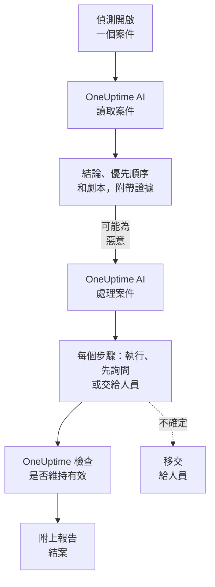

# 安全性中的 OneUptime AI

OneUptime AI 會像分析師那樣閱讀每個安全案件：案件的偵測、事件、實體和威脅情資，以及它周圍的主機和人員。它會說明發生了什麼、看起來是否真實，建議一個優先順序和一個劇本，並為每一個論斷引用背後的證據。在你允許時，它接著會端到端地處理案件：接手案件、遏制威脅、檢查它所做的是否維持有效、讓程式碼得到修正，並附上報告關閉案件。每類步驟要自主執行、先詢問人員還是交給人員，由你設定；它的每個步驟都透過人們使用的同一個劇本引擎執行，因此每個步驟都會以 OneUptime AI 的操作出現在案件的時間軸上，而且可以復原。它還能根據一句話草擬偵測規則，並在 Ask AI 中回答你關於安全資料的問題。

:::cards
- [研判一個案件](#研判一個案件): OneUptime AI 讀取什麼、得出什麼結論，以及它從不做什麼。
- [自動研判新案件](#自動研判新案件): 偵測開啟的每個案件，在開啟時就會被研判。
- [端到端處理案件](#端到端處理案件): 遏制、檢查、修正並關閉，由人員核准你選定的步驟。
- [OneUptime AI 可以在案件上做什麼](#oneuptime-ai-可以在案件上做什麼): 每類步驟可設為關閉、先詢問或自主執行。
- [何時將案件移交給人員](#何時將案件移交給人員): 它為何停止，以及誰會收到通知。
- [根據研判執行劇本](#根據研判執行劇本): 對被判讀為 可能為惡意 的案件採取行動。
- [草擬偵測規則](#草擬偵測規則): 描述要捕捉的內容，然後閱讀 Sigma 規則。
- [安全性頁面上的 Ask AI](#安全性頁面上的-ask-ai): 用日常用語詢問案件和事件。
:::

## 運作方式

研判只會讀取資料。處理案件則會採取行動，但只在你允許的範圍內，而且一旦不確定就會把案件移交給人員。兩者都使用專案自己的 AI：**啟用 AI**、專案的 LLM 提供者、AI 點數和每日 AI 限額。

## 開始之前

- 在 **專案設定 → 人工智慧 → AI 功能** 中開啟 **啟用 AI**。關閉時，安全性功能中不會顯示任何 OneUptime AI 的內容，也不會執行任何東西。
- 在 **專案設定 → 人工智慧 → LLM 提供商** 中有一個 OneUptime AI 可以使用的 LLM 提供者。OneUptime Cloud 已經提供了一個。
- 要開始研判，需要一個能處理安全案件的角色：專案擁有者、專案管理員、安全性管理員或安全性成員。安全性檢視者可以閱讀每次研判，但不能開始研判。請參閱 [角色](/docs/permissions/reference#角色)。

## 研判一個案件

開啟一個案件：**OneUptime AI** 卡片位於頁面頂端。

| 卡片顯示 | 含義 |
| --- | --- |
| **尚未研判** | 還沒有執行過研判。按一下 **AI 研判** 開始一次。 |
| **正在研判這個案例** | OneUptime AI 正在讀取案件。每項檢查在執行時都會顯示出來。 |
| 一個結論，例如 **可能為惡意** | 研判已完成。按一下 **重新研判** 從頭重新讀取案件。 |
| **研判未完成** | 執行已停止。按一下 **再試一次** 開始新的一次。 |

安全性檢視者看到的是同一張卡片：**AI 研判** 和 **再試一次** 保持灰色，旁邊有一行說明誰可以開始研判；**重新研判** 和 **設定優先順序** 不會提供。

研判會讀取：

- 案件本身：標題、優先順序、狀態、實體和 ATT&CK 對應；
- 案件的偵測，最新的在前，並附上每個偵測的一個範例事件；
- 關於案件中使用者、主機和位址的安全事件與威脅情資；
- 案件中使用者、主機和位址的風險，以及本週增加風險的來源；
- OneUptime 中與案件的主機和位址相符的主機，以及它們的負責人；
- 案件宣告的事件、備註、受保護的實體，以及已啟用的劇本。

它還能像事件調查那樣讀取 OneUptime 的其他部分：日誌、追蹤、指標、主機，以及專案 MCP 伺服器的唯讀工具。

能看到該案件的每個人都會讀到它的研判，因此研判只讀取他們所有人都能讀取的內容。只按擁有者或標籤讀取某類記錄的團隊、自訂角色或 API 金鑰，只有在該 API 金鑰或團隊中的某人能讀取安全案件或稽核日誌時才會計入。對於他們之中沒有任何一個只按擁有者或標籤讀取的記錄類型，會全部讀取；在有人這樣讀取時，被擁有者或標籤劃分出去的主機、叢集、服務或其他記錄不會讀取，也永遠不會被提及或計算。誰能讀取安全案件是在每次研判執行時決定的，因此在某人取得該存取權限之前寫下的研判，可能會提及對其劃分出去的記錄。案件本身總會讀取，它宣告的事件也會讀取，除非該事件是私人的。私人事件和警示永遠不會讀取。

### 它得出什麼結論

| 結論 | 含義 | 建議的關閉結論 |
| --- | --- | --- |
| 可能為惡意 | 證據指向惡意或未經授權的活動 | True Positive |
| 可能為良性 | 活動看起來真實但符合預期，例如管理工作或你的團隊執行的掃描 | Benign Positive |
| 可能為誤報 | 偵測似乎誤讀了正常活動 | False Positive |
| 無法判定 | 證據不足以判斷，需要有人查看 | 無 |

這個結論屬於 OneUptime AI，從來不是案件的結論：**關閉案例** 會從它建議的結論開始，由人來選擇。在結論下方，卡片會顯示：

- **建議的優先順序**，當案件的優先順序不同時，還會顯示 **設定優先順序**。
- **建議的 Playbook**，以及 **執行 Playbook**，它會以你的身分執行劇本，並經過所需的每一項核准。當該 Playbook 已在此案件上執行時，其執行狀態（例如 **等待核准** ）會取代 **執行 Playbook** 顯示：該執行位於案件的 **劇本** 中，再執行一次會再次要求同樣的核准。
- 報告：發生了什麼、結論有多確定、下一步做什麼，每個論斷後面都有一個類似 C1 的引用。
- **已檢查的證據**：研判執行過的每個查詢。按一下引用會開啟對應的查詢，展開一個查詢會用你的權限、在研判讀取的時間範圍內重新執行它。
- **詢問這個案例**，它會針對這個案件開啟 Ask AI。

每個案件清單都會在每個案件標題旁邊顯示這個結論，並可以用 **AI 研判結論** 依它篩選。

### 它從不做什麼

研判不會改變案件的任何內容：狀態、優先順序、負責人、結論和備註都不會變。它不會執行任何劇本，也不會圍堵任何人。它建議的劇本只有在有人執行時，或透過下面介紹的觸發器才會執行。對案件採取行動的是處理案件的 OneUptime AI，這是一項單獨的設定：請參閱 [端到端處理案件](#端到端處理案件)。

### 為操縱 AI 而寫的文字

事件、警示和實體的值來自專案外部，攻擊者可以寫入它們。OneUptime AI 把它們全部當作資料來讀，從不當作指令。當案件資料中的某部分讀起來像是給 AI 的指令時，卡片會先說明這一點，可能為良性 或 可能為誤報 的結論會變為 無法判定，這次研判不會啟動任何劇本，而且 OneUptime AI 不會處理這個案件：它會把案件移交給人員。

## 自動研判新案件

開啟 **產品 → 安全事件 → 人工智慧 → 設定**，然後開啟 **研判新案例**：之後偵測開啟的每個案件都會在開啟時被研判。開關一切換就會儲存。專案擁有者和專案管理員可以變更它。

新專案預設開啟此選項；之前建立的專案會保持關閉，直到有人開啟它。手動開啟的案件，以及 **傳送測試攻擊** 的測試攻擊案件，會在有人按一下 **AI 研判** 時被研判。

## 端到端處理案件

在同一頁面上，開啟 **端到端處理案例**：之後 OneUptime AI 會接手每個研判為可能惡意的案件，並在你於 **OneUptime AI 可以在案例上做什麼** 中允許的範圍內處理它。新專案預設開啟此選項；之前建立的專案會保持關閉，直到有人開啟它。專案擁有者和專案管理員可以變更它。

開啟時，人員也可以在單一案件上啟動它：案件 **OneUptime AI** 卡片上的 **AI 回應** 會處理被 OneUptime AI 研判判讀為 可能為惡意、可能為良性 或 可能為誤報 的案件。對於研判為 無法判定、資料讀起來像給 AI 的指令，或處於你的最高優先順序的案件，不提供此按鈕：這些案件歸人員處理。它需要一個能處理安全案件的角色。

### 它做什麼

OneUptime AI 依最緊急優先的順序執行案件的 **回應計畫**：**確認是否屬實**、**遏制威脅**、**修正導致其發生的問題** 和 **關閉案例**。每個步驟是執行、詢問人員還是交給人員，取決於 **OneUptime AI 可以在案例上做什麼** 中該類步驟所在的列。

| 步驟 | OneUptime AI 做什麼 |
| --- | --- |
| 接手案件 | 接手案件，並把優先順序提升到研判建議的等級。它從不降低優先順序；被它提升到你的最高優先順序的案件會交給人員 |
| 排除誤報 | 只有當 OneUptime 自己的事實毫無疑問時才標記為完成：該位址不是你的，而且沒有人從它登入。否則就把這一步交給人員 |
| 封鎖位址 | 透過你的 [封鎖清單](/docs/telemetry/security-cases#封鎖清單) 封鎖 24 小時，然後等待 OneUptime 檢查封鎖是否有效。如果沒有任何地方執行你的封鎖清單，就把這一步交給人員 |
| 停用使用者、遏制主機 | 透過你的身分提供者或 EDR，執行你某個劇本中執行此操作的步驟。沒有這樣的劇本時，就把這一步交給人員 |
| 宣告事件 | 一律先詢問：事件會呼叫人員 |
| 將案件移至「已遏制」 | 在 OneUptime 驗證了每個遏制威脅的步驟之後 |
| 修正攻擊到達的路由 | 讓「用 AI 修正」建立 Pull Request，由人員合併。OneUptime 在正式環境中驗證修正後會關閉案件；修正只是看起來完成時會詢問人員；修正不生效時會繼續處理案件 |
| 開啟 MFA、審查帳戶的變更 | 交給人員：沒有產品會告訴 OneUptime 它們是否有效 |
| 關閉案件 | 在其他每個步驟都完成且案件的偵測已安靜 24 小時後，以 True Positive 關閉，並附上 [結案報告](#結案報告) |

案件的偵測規則自己新增的步驟，以及 OneUptime 無法執行的任何操作（例如在你的 DNS 篩選器上封鎖網域），都會交給人員，並說明原因。

OneUptime AI 執行的每個步驟都會經過劇本引擎，作為案件 **劇本** 頁面上的單步執行，觸發器為 **OneUptime AI**。因此它和任何人執行的步驟一樣，會等待核准、不碰受保護的實體、顯示在案件的時間軸上、記錄在稽核日誌中，而且可以復原，時間軸也會註明這是 OneUptime AI 的操作。它要詢問的步驟會等待人員核准：在案件上、在其 **劇本** 頁面上，或在 Slack 或 Microsoft Teams 中一鍵完成。

### 它在案件上的記錄

在研判下方，**OneUptime AI** 卡片會在 **案例處理** 下顯示 OneUptime AI 如何處理這個案件：

| 卡片顯示 | 含義 |
| --- | --- |
| **OneUptime AI 未在處理這個案例** | **AI 回應** 會接手它。 |
| **正在處理這個案例** | OneUptime AI 正在執行計畫。**接管** 會讓它停止，案件交由你負責。 |
| **等待人員處理** | 它已請人核准一個步驟，有人答覆後就會繼續。 |
| **已移交給人員** | 它已停止，並說明原因。 |
| **案例已關閉** | 案件由它或人員關閉。它的 **結案報告** 位於其步驟上方。 |

其下列出它執行、詢問或留下的每個步驟，最新的在前，每個都附有原因：**已自主完成：你的設定允許這樣做。**、**你的設定要求此操作等待人員核准。**、**OneUptime 無法執行此步驟，因此由人員完成。** 它詢問過的步驟帶有 **核准** 和 **拒絕**；它執行過的步驟會連結到其執行，可在那裡復原。OneUptime 檢查的步驟會說明檢查發現了什麼；它以前在同一規則的案件上執行過的步驟會說明其維持有效的頻率：「在 15 個類似案例中有 14 個維持有效。」

### 被判讀為良性或誤報的案件

對研判判讀為 可能為良性 或 可能為誤報 的案件按一下 **AI 回應**，會在 **關閉案例** 允許時，將其以 Benign Positive 或 False Positive 關閉。關閉後，OneUptime AI 會在 **關閉案例** 同樣允許時解除案件造成的封鎖，並為案件的規則提議一個針對觸發它的值的例外。例外一律等待人員處理：**核准** 會以你的身分新增它。

## OneUptime AI 可以在案件上做什麼

在 **產品 → 安全事件 → 人工智慧 → 設定** 的 **OneUptime AI 可以在案例上做什麼** 下，每類步驟都有自己的一列，選擇後立即儲存：

- **關閉**：OneUptime AI 將此交給人員處理，並在案件上註明。
- **先詢問**：它會附上證據詢問人員，並在有人核准後執行。
- **自主執行**：它不經詢問就執行，並在案件的時間軸上註明。

| 列 | 涵蓋 | 新專案的初始設定 |
| --- | --- | --- |
| **處理案例** | 接手案件、提升其優先順序、憑證據將步驟標記為完成、將其移至「已遏制」 | 自主執行 |
| **封鎖位址** | 在你的邊緣封鎖案件的位址 24 小時 | 先詢問 |
| **遏制帳戶** | 停用案件的使用者或結束其工作階段 | 先詢問 |
| **遏制主機** | 遏制或隔離案件的主機 | 先詢問 |
| **修正程式碼** | 讓「用 AI 修正」為攻擊到達的路由建立 Pull Request | 自主執行 |
| **關閉案例** | 附上結案報告關閉案件，並在案件以無害結論關閉後解除案件的封鎖 | 先詢問 |

這些設定在 **端到端處理案例** 開啟時生效；關閉時，卡片會說明這一點。專案擁有者和專案管理員可以變更它們。

將 **封鎖位址**、**遏制帳戶** 或 **遏制主機** 設為 **自主執行** 需要安全性管理員的權限，專案擁有者和專案管理員也擁有該權限；OneUptime 會記錄是誰、在何時設定的，就像對關閉了核准的劇本步驟那樣。**封鎖位址** 會先詢問：**確認並開啟** 是安全性管理員的確認，之後該列會顯示確認的時間。在安全性管理員確認之前，OneUptime AI 在封鎖前都會先詢問。

無論這些列如何設定，OneUptime AI 都會：

- 從不對受保護的使用者、主機或位址執行操作：它會把案件移交給人員；
- 在你的所有案件中每小時最多自主執行 10 個操作，之後把下一個案件移交給人員；
- 封鎖最多 24 小時；
- 從不合併程式碼：每個 Pull Request 都由人員合併；
- 在宣告事件或新增規則例外之前一律先詢問；
- 一個案件同一時間只進行一次執行，伺服器重新啟動也絕不會遺失正在執行操作的執行。

## 何時將案件移交給人員

OneUptime AI 從不悄無聲息地退出。出現以下情況時，它會把案件移交給人員，並在卡片和時間軸上說明原因：

- 案件的部分資料讀起來像給 AI 的指令；
- 案件處於你的最高優先順序；
- 它下一步的操作對象受保護；
- 它在一小時內自主執行操作的次數已達上限；
- 專案或安全案件已關閉 AI、沒有 LLM 提供者，或專案的 AI 點數已用完或已達到每日 AI 限額；
- 它的研判無法判斷案件是否真實；
- 它執行的步驟不再有效、它啟動的步驟未完成，或有人拒絕或復原了它執行的步驟；
- 它無法判斷下一步該做什麼，或案件上剩下的事都需要人員來做。

負責該案件的人員會立即收到通知；如果沒有人負責，則由接收該優先順序案件通知的人員收到：即 **使用者設定 → 通知設定** 下的 **OneUptime AI 將安全案例移交給了人員**。安全案件的工作區通知規則會以 **OneUptime AI 移交給人員的案例** 將其張貼到自己的 Slack 或 Microsoft Teams 頻道。**接管** 移交案件時不會通知任何人，因為按下它的人已經負責該案件。

**AI 回應** 會請 OneUptime AI 從案件目前的狀態重新處理案件。

## 結案報告

當 OneUptime AI 關閉案件或請人員關閉時，它會根據案件中的內容而不是研判的措辭撰寫結案報告：發生了什麼、影響、做了什麼、修正了什麼以及需要關注什麼。該報告就是案件的關閉說明，它會出現在時間軸上，卡片會在 **結案報告** 下顯示它。當 **關閉案例** 設為 **先詢問** 時，案件會等待人員核准關閉，並可先閱讀報告。

## 如何衡量

**產品 → 安全事件 → 概覽** 會在 OneUptime AI 處理過或詢問過至少一個案件後，顯示它在最近 30 天如何處理案件：**已由 OneUptime AI 解決**（在它處理的案件中）；**使用 AI 的遏止時間** 和 **使用 AI 的關閉時間**，各自與不使用 AI 的時間並列；以及 **已請求的核准**、人員答覆的速度，以及人員復原了它的多少個步驟。

## 根據研判執行劇本

**觸發器** 為 **研判為可能惡意** 的劇本，會在研判把案件判讀為 可能為惡意 時，在該案件上執行一次。**適用案例的最低優先順序**、**僅限來自以下的偵測** 和 **僅限這些偵測規則** 會像對任何觸發器一樣縮小它的範圍，它的圍堵步驟也會像往常一樣等待核准。以下情況它不會執行：

- 研判發現了為操縱 AI 而寫的文字之後；
- 在同一個案件上第二次執行，無論這個案件被研判多少次；
- 測試攻擊的案件，除非劇本的每一步都留在 OneUptime 之內。

只有在專案的 AI 開啟時，新劇本才會提供這個觸發器。

## 草擬偵測規則

在 **偵測規則** 上，於 **Sigma 規則（YAML）** 欄位下方按一下 **AI 起草**，並寫下規則要捕捉的內容，例如一個 IP 位址在五分鐘內有十次登入失敗。**草擬規則** 會把一條 Sigma 規則放進該欄位，並像檢查已儲存的規則一樣檢查它。閱讀它，依需要修改，然後照常儲存：在你儲存之前，什麼都不會被儲存。如果欄位中已經有一條規則，按鈕會顯示為 **用 AI 重新草擬**，草稿會取代那條規則。

草擬需要一個能建立偵測規則的角色。

## 安全性頁面上的 Ask AI

**詢問 AI** 知道你在哪個安全性頁面上。在案件上，它會先讀取案件，並提供 **是真實攻擊嗎？** 這樣的問題。在其他安全事件頁面上，用日常用語提出的問題會搜尋你的安全事件。它還可以把值與威脅情資進行比對，查看某個使用者、主機或位址有多活躍，並列出適合某個案件的劇本。

Ask AI 可以為案件新增備註，並在案件上執行劇本，都以你的身分進行，而且每次之前都會先詢問。它執行的劇本會像其他劇本一樣等待核准。

當案件宣告了一個事件時，該事件的 AI 調查也會讀取這個案件：偵測到了什麼、與誰有關，以及 OneUptime AI 的研判。

## 費用和限額

研判是 OneUptime AI 的工作，和事件調查一樣。在 OneUptime Cloud 上，它從專案的 AI 點數中支付，並計入專案自己的每日 AI 限額（**專案設定 → 人工智慧 → AI 功能** 下的 **每日限制**）。事件和警示的每日限額不適用。一個案件同一時間只有一次研判，AI 日誌（**專案設定 → 人工智慧 → AI 日誌**）會列出它的呼叫。

當專案的 AI 點數用完或達到每日 AI 限額時，新案件不會被研判：卡片會說明原因，在新增點數或限額重設之後，**AI 研判** 又可以使用。處理案件的 OneUptime AI 讀取的是案件自己的計畫和檢查，而不是詢問 LLM，並且會在同樣的限額處停止：它會把案件移交給人員，並說明原因。

## 疑難排解

:::details 新案件沒有被研判
檢查 **啟用 AI** 是否已開啟，以及 **產品 → 安全事件 → 人工智慧 → 設定** 下的 **研判新案例** 是否已開啟。手動開啟的案件和測試攻擊的案件，只有在有人要求時才會被研判。開啟案件：如果有什麼阻止了研判，卡片會說明是什麼，以及在哪裡修正。
:::

:::details OneUptime AI 沒有處理某個案件
檢查 **產品 → 安全事件 → 人工智慧 → 設定** 下的 **端到端處理案例** 是否已開啟。只有當研判將案件判讀為 可能為惡意 時，它才會自行接手案件。開啟案件：在 **案例處理** 下，卡片會說明它為何沒有處理該案件，**AI 回應** 會請它處理。
:::

:::details 雖然「封鎖位址」設為「自主執行」，它仍在封鎖前詢問
**封鎖位址** 的 **自主執行** 在安全性管理員確認後才生效：該列會顯示確認的時間，或顯示尚無人確認。受保護的位址或你自己的位址永遠不會被封鎖：OneUptime AI 會把案件移交給人員。在沒有任何地方執行你的封鎖清單時，它會把這一步交給人員。
:::

:::details 卡片顯示專案的 AI 點數已用完，或已達到每日 AI 限額
專案擁有者或擁有 Manage Billing 的人可以在 **專案設定 → 人工智慧 → AI 點數** 中新增點數，或在 **專案設定 → 人工智慧 → AI 功能** 中提高或取消限額。然後在案件上按一下 **AI 研判**。
:::

:::details 卡片顯示案件中的文字讀起來像給 AI 的指令
案件資料中的一部分，例如某個事件的訊息或某個使用者名稱，是為了操縱 AI 而寫的。OneUptime AI 把它當作資料來讀，並把決定留給了你：在關閉案件之前，請自己閱讀偵測和證據。
:::

:::details 帶 AI 觸發器的劇本沒有執行
檢查劇本是否已啟用、研判是否把案件判讀為 可能為惡意，以及它的 **適用案例的最低優先順序**、**僅限來自以下的偵測** 和 **僅限這些偵測規則** 設定是否符合這個案件。它在每個案件上只執行一次，而且在研判發現了為操縱 AI 而寫的文字之後不會執行。
:::

## 後續步驟

:::cards
- [安全案件與劇本](/docs/telemetry/security-cases): 處理案件、帶著結論關閉案件，並建構劇本。
- [AI SRE](/docs/ai/ai-sre): OneUptime AI 如何調查事件和警示，以及它的限額。
- [詢問 AI](/docs/ai/ask-ai): 用日常用語詢問關於你的專案的問題。
- [LLM 提供者](/docs/ai/llm-provider): 選擇 OneUptime AI 使用的模型。
:::
