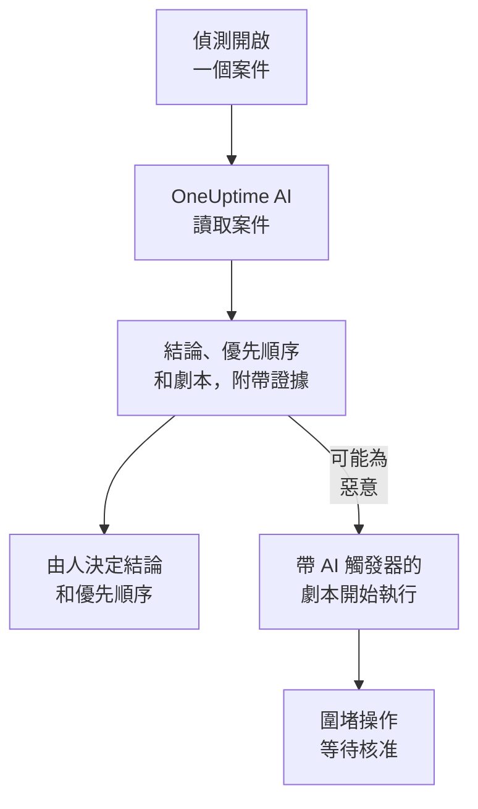

# 安全性中的 OneUptime AI

OneUptime AI 會像分析師那樣閱讀每個安全案件：案件的偵測、事件、實體和威脅情資，以及它周圍的主機和人員。它會說明發生了什麼、看起來是否真實，建議一個優先順序和一個劇本，並為每一個論斷引用背後的證據。它自己不會改變任何東西：由人來決定結論和優先順序，並執行劇本。它還能根據一句話草擬偵測規則，並在 Ask AI 中回答你關於安全資料的問題。

:::cards
- [研判一個案件](#研判一個案件): OneUptime AI 讀取什麼、得出什麼結論，以及它從不做什麼。
- [自動研判新案件](#自動研判新案件): 偵測開啟的每個案件，在開啟時就會被研判。
- [根據研判執行劇本](#根據研判執行劇本): 對被判讀為 可能為惡意 的案件採取行動。
- [草擬偵測規則](#草擬偵測規則): 描述要捕捉的內容，然後閱讀 Sigma 規則。
- [安全性頁面上的 Ask AI](#安全性頁面上的-ask-ai): 用日常用語詢問案件和事件。
:::

## 運作方式

研判只會讀取資料。它使用專案自己的 AI：**啟用 AI**、專案的 LLM 提供者、AI 點數和每日 AI 限額。

## 開始之前

- 在 **專案設定 → 人工智慧 → AI Features** 中開啟 **啟用 AI**。關閉時，安全性功能中不會顯示任何 OneUptime AI 的內容，也不會執行任何東西。
- 在 **專案設定 → 人工智慧 → LLM 提供商** 中有一個 OneUptime AI 可以使用的 LLM 提供者。OneUptime Cloud 已經提供了一個。
- 要開始研判，需要一個能處理安全案件的角色：Project Owner、Project Admin、Security Admin 或 Security Member。Security Viewer 可以閱讀每次研判，但不能開始研判。請參閱 [角色](/docs/permissions/reference#角色)。

## 研判一個案件

開啟一個案件：**OneUptime AI** 卡片位於頁面頂端。

| 卡片顯示 | 含義 |
| --- | --- |
| **尚未研判** | 還沒有執行過研判。按一下 **AI 研判** 開始一次。 |
| **正在研判這個案例** | OneUptime AI 正在讀取案件。每項檢查在執行時都會顯示出來。 |
| 一個結論，例如 **可能為惡意** | 研判已完成。按一下 **重新研判** 從頭重新讀取案件。 |
| **研判未完成** | 執行已停止。按一下 **再試一次** 開始新的一次。 |

Security Viewer 看到的是同一張卡片：**AI 研判** 和 **再試一次** 保持灰色，旁邊有一行說明誰可以開始研判；**重新研判** 和 **設定優先順序** 不會提供。

研判會讀取：

- 案件本身：標題、優先順序、狀態、實體和 ATT&CK 對應；
- 案件的偵測，最新的在前，並附上每個偵測的一個範例事件；
- 關於案件中使用者、主機和位址的安全事件與威脅情資；
- 案件中使用者、主機和位址的風險，以及本週增加風險的來源；
- OneUptime 中與案件的主機和位址相符的主機，以及它們的負責人；
- 案件宣告的事件、備註、受保護的實體，以及已啟用的劇本。

它還能像事件調查那樣讀取 OneUptime 的其他部分：日誌、追蹤、指標、主機，以及專案 MCP 伺服器的唯讀工具。

### 它得出什麼結論

| 結論 | 含義 | 建議的關閉結論 |
| --- | --- | --- |
| 可能為惡意 | 證據指向惡意或未經授權的活動 | True Positive |
| 可能為良性 | 活動看起來真實但符合預期，例如管理工作或你的團隊執行的掃描 | Benign Positive |
| 可能為誤報 | 偵測似乎誤讀了正常活動 | False Positive |
| 無法判定 | 證據不足以判斷，需要有人查看 | 無 |

這個結論屬於 OneUptime AI，從來不是案件的結論：**Close Case** 會從它建議的結論開始，由人來選擇。在結論下方，卡片會顯示：

- **建議的優先順序**，當案件的優先順序不同時，還會顯示 **設定優先順序**。
- **建議的 Playbook**，以及 **執行 Playbook**，它會以你的身分執行劇本，並經過所需的每一項核准。當該 Playbook 已在此案件上執行時，其執行狀態（例如 **等待核准** ）會取代 **執行 Playbook** 顯示：該執行位於案件的 **劇本執行記錄** 中，再執行一次會再次要求同樣的核准。
- 報告：發生了什麼、結論有多確定、下一步做什麼，每個論斷後面都有一個類似 C1 的引用。
- **Evidence checked**：研判執行過的每個查詢。按一下引用會開啟對應的查詢，展開一個查詢會用你的權限、在研判讀取的時間範圍內重新執行它。
- **詢問這個案例**，它會針對這個案件開啟 Ask AI。

每個案件清單都會在每個案件標題旁邊顯示這個結論，並可以用 **AI 研判結論** 依它篩選。

### 它從不做什麼

研判不會改變案件的任何內容：狀態、優先順序、負責人、結論和備註都不會變。它不會執行任何劇本，也不會圍堵任何人。它建議的劇本只有在有人執行時，或透過下面介紹的觸發器才會執行。

### 為操縱 AI 而寫的文字

事件、警示和實體的值來自專案外部，攻擊者可以寫入它們。OneUptime AI 把它們全部當作資料來讀，從不當作指令。當案件資料中的某部分讀起來像是給 AI 的指令時，卡片會先說明這一點，可能為良性 或 可能為誤報 的結論會變為 無法判定，而且這次研判不會啟動任何劇本。

## 自動研判新案件

開啟 **產品 → Security Events → 人工智慧 → 設定**，然後開啟 **研判新案例**：之後偵測開啟的每個案件都會在開啟時被研判。開關一切換就會儲存。Project Owner 和 Project Admin 可以變更它。

新專案預設開啟此選項；之前建立的專案會保持關閉，直到有人開啟它。手動開啟的案件，以及 **傳送測試攻擊** 的測試攻擊案件，會在有人按一下 **AI 研判** 時被研判。

## 根據研判執行劇本

**觸發器** 為 **研判為可能惡意** 的劇本，會在研判把案件判讀為 可能為惡意 時，在該案件上執行一次。**For Cases At Least**、**Only For Detections From** 和 **Only For These Detection Rules** 會像對任何觸發器一樣縮小它的範圍，它的圍堵步驟也會像往常一樣等待核准。以下情況它不會執行：

- 研判發現了為操縱 AI 而寫的文字之後；
- 在同一個案件上第二次執行，無論這個案件被研判多少次；
- 測試攻擊的案件，除非劇本的每一步都留在 OneUptime 之內。

只有在專案的 AI 開啟時，新劇本才會提供這個觸發器。

## 草擬偵測規則

在 **Detection Rules** 上，於 **Sigma Rule (YAML)** 欄位下方按一下 **Draft with AI**，並寫下規則要捕捉的內容，例如一個 IP 位址在五分鐘內有十次登入失敗。**草擬規則** 會把一條 Sigma 規則放進該欄位，並像檢查已儲存的規則一樣檢查它。閱讀它，依需要修改，然後照常儲存：在你儲存之前，什麼都不會被儲存。如果欄位中已經有一條規則，按鈕會顯示為 **用 AI 重新草擬**，草稿會取代那條規則。

草擬需要一個能建立偵測規則的角色。

## 安全性頁面上的 Ask AI

**Ask AI** 知道你在哪個安全性頁面上。在案件上，它會先讀取案件，並提供 **是真實攻擊嗎？** 這樣的問題。在其他安全事件頁面上，用日常用語提出的問題會搜尋你的安全事件。它還可以把值與威脅情資進行比對，查看某個使用者、主機或位址有多活躍，並列出適合某個案件的劇本。

Ask AI 可以為案件新增備註，並在案件上執行劇本，都以你的身分進行，而且每次之前都會先詢問。它執行的劇本會像其他劇本一樣等待核准。

當案件宣告了一個事件時，該事件的 AI 調查也會讀取這個案件：偵測到了什麼、與誰有關，以及 OneUptime AI 的研判。

## 費用和限額

研判是 OneUptime AI 的工作，和事件調查一樣。在 OneUptime Cloud 上，它從專案的 AI 點數中支付，並計入專案自己的每日 AI 限額（**專案設定 → 人工智慧 → AI Features** 下的 **每日限制**）。事件和警示的每日限額不適用。一個案件同一時間只有一次研判，AI 日誌（**專案設定 → 人工智慧 → AI 日誌**）會列出它的呼叫。

當專案的 AI 點數用完或達到每日 AI 限額時，新案件不會被研判：卡片會說明原因，在新增點數或限額重設之後，**AI 研判** 又可以使用。

## 疑難排解

:::details 新案件沒有被研判
檢查 **啟用 AI** 是否已開啟，以及 **產品 → Security Events → 人工智慧 → 設定** 下的 **研判新案例** 是否已開啟。手動開啟的案件和測試攻擊的案件，只有在有人要求時才會被研判。開啟案件：如果有什麼阻止了研判，卡片會說明是什麼，以及在哪裡修正。
:::

:::details 卡片顯示專案的 AI 點數已用完，或已達到每日 AI 限額
專案擁有者或擁有 Manage Billing 的人可以在 **專案設定 → 人工智慧 → AI 點數** 中新增點數，或在 **專案設定 → 人工智慧 → AI Features** 中提高或取消限額。然後在案件上按一下 **AI 研判**。
:::

:::details 卡片顯示案件中的文字讀起來像給 AI 的指令
案件資料中的一部分，例如某個事件的訊息或某個使用者名稱，是為了操縱 AI 而寫的。OneUptime AI 把它當作資料來讀，並把決定留給了你：在關閉案件之前，請自己閱讀偵測和證據。
:::

:::details 帶 AI 觸發器的劇本沒有執行
檢查劇本是否已啟用、研判是否把案件判讀為 可能為惡意，以及它的 **For Cases At Least**、**Only For Detections From** 和 **Only For These Detection Rules** 設定是否符合這個案件。它在每個案件上只執行一次，而且在研判發現了為操縱 AI 而寫的文字之後不會執行。
:::

## 後續步驟

:::cards
- [安全案件與劇本](/docs/telemetry/security-cases): 處理案件、帶著結論關閉案件，並建構劇本。
- [AI SRE](/docs/ai/ai-sre): OneUptime AI 如何調查事件和警示，以及它的限額。
- [詢問 AI](/docs/ai/ask-ai): 用日常用語詢問關於你的專案的問題。
- [LLM 提供者](/docs/ai/llm-provider): 選擇 OneUptime AI 使用的模型。
:::
