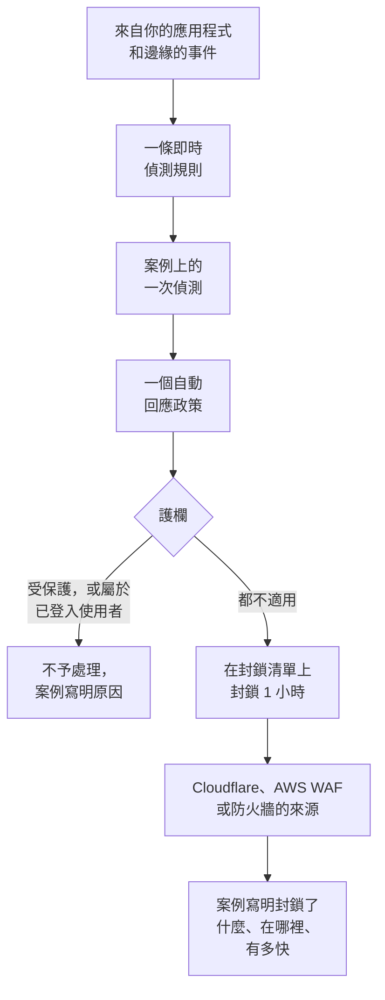

# 自動回應

自動回應政策會在偵測產生的那一刻，在任何人分流案例之前，對發動攻擊的位址進行挑戰或封鎖：探測你應用程式的掃描器，以及逐一嘗試密碼的機器人，會在首個請求後幾分鐘內被擋下。每個專案都有三個現成政策，每個都保持關閉，直到你開啟它，並且每個都從為期一週的試行開始，試行只記錄它原本會採取的動作。護欄讓政策可以放心地保持開啟：它從不處理你自己的位址或你的已登入使用者使用的位址，而且當攻擊規模超出它應獨自處理的範圍時，它會停止並呼叫一個人。

:::cards
- [開啟政策](#開啟政策): 先進行一週試行，再按一下。
- [護欄](#護欄): 政策從不做的事，以及它何時停止。
- [封鎖用時](#封鎖用時): 每個政策封鎖的速度，顯示在它的卡片和案例上。
- [你自己的政策](#你自己的政策): 作用於你選擇的技術、規則或威脅情報。
:::

## 運作方式

政策會在偵測記錄到案例上的那一刻作出處理，也就是規則觸發後的幾秒鐘。它的封鎖會像劇本步驟 **封鎖位址** 一樣進入你的 [封鎖清單](/docs/telemetry/security-cases#封鎖清單)，並以政策名稱作為建立者：執行你的封鎖清單的目標會保持它，它會顯示在案例的時間軸和稽核記錄中，並且會自行過期。它不需要任何人核准：開啟政策的人已經核准了它的封鎖。

## 開始之前

- 一個執行你的封鎖清單的目標：Cloudflare、AWS WAF，或讀取 [封鎖清單來源](/docs/telemetry/blocklist-feeds) 的防火牆或 Proxy。只要沒有任何目標執行它，頁面就會提示，政策的封鎖在任何地方都不會生效。
- 政策的規則讀取的事件：你的應用程式的存取記錄或追蹤，或者你的邊緣事件（例如 Cloudflare 的防火牆事件），以及你的登入記錄。請參閱 [安全事件](/docs/telemetry/security-events)。
- 可以開啟政策的角色：安全性管理員、專案管理員或專案擁有者。安全性成員和安全性檢視者可以看到政策及其所做的事。請參閱 [角色](/docs/permissions/reference#角色)。

## 現成政策

| 政策 | 作用於 | 動作 | 首次封鎖 |
| --- | --- | --- | --- |
| **掃描器** | Web 掃描和漏洞利用嘗試（ATT&CK T1595、T1190）：SQL 注入、路徑周遊和 Log4Shell 嘗試，以及來自同一位址的大量 Cloudflare 受控規則命中，前提是該位址的所有請求都被拒絕 | 挑戰 | 1 小時 |
| **密碼猜測** | 暴力破解和密碼噴灑（ATT&CK T1110）：來自同一位址的登入失敗，以及同一位址在登入失敗後又登入成功 | 封鎖 | 1 小時 |
| **已知惡意位址** | 任何與你的 [威脅情報](/docs/telemetry/threat-intelligence) 所列位址相關的偵測 | 封鎖 | 24 小時 |

真人能通過挑戰，指令碼和機器人則不能。掃描器只在某個位址的請求都沒有到達你的應用程式時才挑戰它：請求已經通過的位址，是需要人來處理的案例。

開啟掃描器或密碼猜測（無論是試行還是正式開啟）後，它所作用的 **規則庫** 規則會以即時方式執行，專案中沒有的規則會被新增：即時規則在事件到達幾秒後觸發，而依排程執行的規則會晚幾分鐘讀取。有人關閉的規則保持關閉。一個專案最多即時執行 50 條規則：超出後，規則保留在原排程上，政策卡片會在旁邊顯示 **依排程執行**。

## 開啟政策

:::steps
### 開啟自動回應

開啟 **產品 → 安全事件 → 劇本 → 自動回應**。每個政策都有自己的卡片：它做什麼、顯示 **關閉**、**試行**、**試行已結束** 或 **開啟** 的標籤，以及它的開關。

### 開始試行

切換政策的開關。在 7 天內，它只記錄原本會採取的動作，不影響任何流量：案例中會寫 "Trial run: the Scanners policy would have challenged 35.205.11.131 for 1 hour." 卡片會統計到目前為止的位址數，以及護欄放過了哪些位址。

### 開啟它

一週結束後，卡片會說明政策原本會做什麼，例如 "7 天內它會挑戰 1,283 個位址。沒有位址有已登入的使用者，也沒有位址屬於你。要開啟嗎？"，你的安全負責人也會透過電子郵件收到同樣的內容。按一下 **開啟**：從那時起，政策開始處理。
:::

若要在不經過一週試行的情況下開啟政策，請開啟卡片上的 **更多設定**，然後按一下 **不經試行直接開啟**。它的護欄依然有效。再次切換開關即可關閉政策；在完成一整週試行後再次開啟時，它會立即處理。

## 護欄

- **從不處理你自己的位址或受保護的位址。** **受保護的實體** 中的項目，以及 OneUptime 自動保護的一切：你的主機、雲端資源和探測器、不在網際網路上的位址範圍，以及你的應用程式前面的邊緣。請參閱 [封鎖清單](/docs/telemetry/security-cases#封鎖清單)。
- **從不處理已登入的使用者在最近 30 天內用過的位址。** 辦公室的網路、客戶的 Proxy 或某人的家：OneUptime 會在你的身分識別提供者的登入記錄中，以及你的應用程式為已登入的使用者處理的請求（追蹤或記錄中帶有使用者 ID 的請求）中尋找該位址。如果它無法核實某個位址，例如這些事件無法讀取，或者你的遮罩規則以它無法比對的方式隱藏了位址，就會把該位址交給人來處理。
- **對再次出現的位址封鎖更久。** 首次封鎖持續 1 小時，30 天內再次被封鎖的位址依序為 24 小時和 7 天。已知惡意位址從 24 小時開始。
- **每小時最多 50 次自動封鎖。** 超出後，你的政策會停止封鎖並呼叫你的安全負責人：如此規模的攻擊需要人來處理。在此期間，頁面會顯示提示。
- **有疑慮時撤銷。** 如果在政策封鎖的位址上看到已登入的使用者，政策會解除封鎖並通知你的安全負責人。

你的安全負責人是專案的安全性管理員；如果沒有，則是專案擁有者。護欄放過的每個位址都會連同原因記錄在它的案例中。

## 目標無法挑戰時

Cloudflare 和 AWS WAF 可以挑戰。讀取封鎖清單來源的防火牆不能挑戰，因此在那裡，政策的挑戰會變成相同時長的封鎖，政策卡片和案例都會說明，例如 "FortiGate feed cannot challenge, so it blocks the address there for the same time." 你自己設定的挑戰永遠不會變成封鎖。

## 封鎖用時

封鎖用時從位址的首個請求（其偵測中最早的事件）開始，到封鎖在你的邊緣生效為止。每個政策的卡片會按天顯示最近 30 天的第 50 和第 95 百分位數。被自動回應封鎖的案例會在其 **概覽** 的 **遏制用時** 下註明，例如 "首個請求後 41秒 自動封鎖"，它的時間軸會寫明封鎖了什麼、在哪裡、有多快："OneUptime challenged 35.205.11.131 at Cloudflare for 1 hour (Scanners policy), 41 seconds after its first request." 案例 **回應計畫** 中該位址的步驟即告完成，旁邊有 **解除**。

## 你自己的政策

按一下現成政策下方的 **建立政策**。你自己的政策需要一個 **名稱** 以及它作用的對象：

| 欄位 | 作用 |
| --- | --- |
| **ATT&CK 技術** | 偵測必須帶有的技術，以逗號分隔，例如 `T1110, T1190`。技術包含其子技術。 |
| **操作** | **封鎖** 或 **挑戰**。 |
| **首次封鎖時長** | 位於 **更多欄位**：1 小時、24 小時或 7 天。再次出現的位址會被封鎖更久。 |
| **偵測規則** | 位於 **更多欄位**：或由這些規則之一產生的偵測。 |
| **僅限威脅情報所列的位址** | 位於 **更多欄位**：只作用於威脅情報所列的位址。單獨使用時，作用於與這類位址相關的任何偵測。 |
| **僅限所有請求都被拒絕期間** | 位於 **更多欄位**：只在該位址的請求都沒有到達你的應用程式時才處理。 |

你自己的政策一開始為關閉，像現成政策一樣先進行一週試行，並具有相同的護欄。**編輯政策** 和 **刪除策略** 位於它的卡片上；刪除後，它的封鎖會留在你的封鎖清單中，直到過期。

## 疑難排解

:::details 政策已開啟，但沒有封鎖某個位址
查看案例的時間軸：放過某個位址的政策會寫明原因，例如已登入的使用者用過該位址。請確認有目標在執行你的封鎖清單，並且政策卡片上的規則顯示 **即時**。
:::

:::details 頁面提示本小時的自動封鎖已用完
你的政策在最近一小時內進行了 50 次自動封鎖，並呼叫了你的安全負責人。隨著這一小時的封鎖變舊，它們會重新開始。查看這次攻擊的案例，如果攻擊來自同一網路，請在 **封鎖清單** 中封鎖一個位址範圍。
:::

## 後續步驟

:::cards
- [安全案例和劇本](/docs/telemetry/security-cases): 處理你的政策所作用的案例，並手動封鎖。
- [封鎖清單來源](/docs/telemetry/blocklist-feeds): 在防火牆或 Proxy 上執行你的封鎖清單。
- [威脅情報](/docs/telemetry/threat-intelligence): 已知惡意位址所作用的來源。
:::
