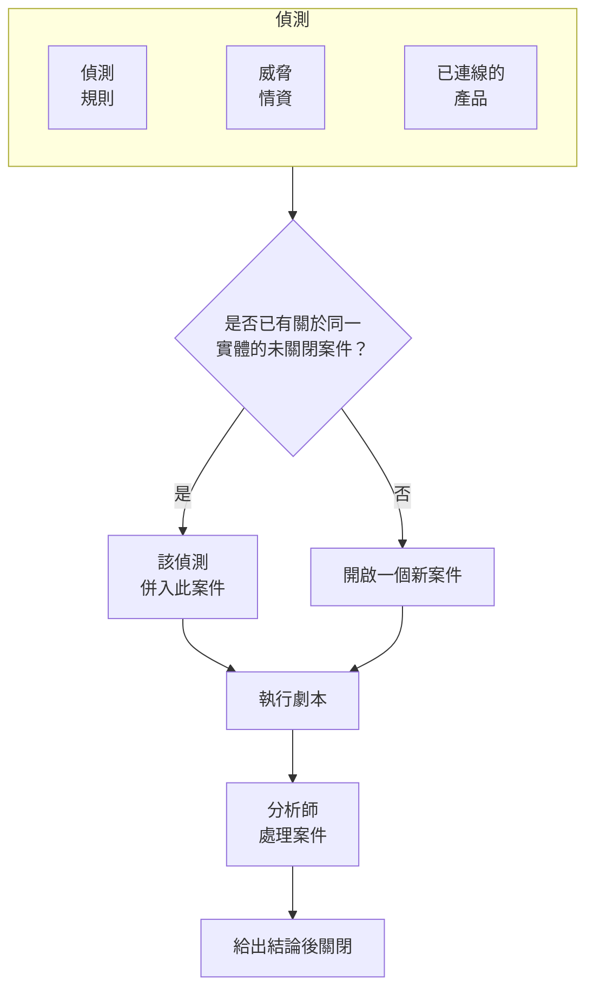

# 安全案件與劇本(SOAR)

Security Events 會把偵測規則、威脅情資和已連線的安全性產品所發現的問題轉為案件：每件值得調查的事對應一個案件，與同一使用者、主機或位址有關的所有偵測都會歸入其中。分析師在佇列中處理案件，劇本則會自動或一鍵對案件做出回應。

:::cards
- [案件從何而來](#案件從何而來): 偵測規則、威脅情資、已連線的產品和人員。
- [處理案件](#處理案件): 指派案件、調查相關實體，並在給出結論後關閉。
- [劇本](#劇本): 在案件上執行的步驟，關鍵步驟需要核准。
- [概覽](#概覽): 當下需要有人處理的事項，以及案件的處理速度。
:::

## 運作方式

開啟 **產品 → Security Events → Security Cases**。佇列預設顯示未關閉的案件；**Assigned to Me**、**Unassigned**、**已關閉** 和 **全部** 是其他檢視。

## 開始之前

案件和劇本遵循三個 Security 角色的權限。Project Owner 和 Project Admin 可以執行所有操作。

| 角色 | 能做什麼 |
| --- | --- |
| Security Admin | 一切操作，包括刪除案件和設定劇本 |
| Security Member | 開啟、指派、變更和關閉案件，撰寫備註，執行劇本，以及核准或拒絕劇本的步驟 |
| Security Viewer | 讀取案件、偵測、備註、劇本及其執行記錄 |

其中每一項權限也都可以單獨授予，從建立案件到核准劇本的步驟皆然；請參閱 [權限參考](/docs/permissions/reference)。

## 案件從何而來

| 來源 | 何時開啟案件 | 停用方式 |
| --- | --- | --- |
| 偵測規則 | 規則符合時 | 規則的 **符合時** 步驟中的 **Open a Case on Match** |
| 威脅情資 | 某個事件提到已知指標時 | 情資來源的 **符合時** 步驟中的 **Open a Case on Match** |
| 已連線的產品 | 匯入的產品本身警示達到或高於連線的閾值時 | 在連線的 **Polling** 步驟中，把 **Open Cases From** 設為 **從未** |
| 人員 | 有人從 **Security Cases** 開啟案件，或在事件面板中使用 **Open Case** 時 | 無 |

所有來源預設都是開啟的。除非你選擇其他等級，否則連線會為 **High and above** 的警示開啟案件；低於該等級的警示仍會匯入為事件。

### 偵測如何分組

每個偵測都與某個實體有關：也就是其規則分組所依據的值，例如暴力破解規則中的 IP 位址，或威脅情資符合項目所提到的指標。沒有實體的偵測會單獨存在，不與其他偵測合併。

- 如果已有與該實體有關的未關閉案件，偵測就會併入其中。案件的實體和 ATT&CK 對應會隨之擴充，其優先順序會提升到該偵測的優先順序，但絕不會降低。
- 如果沒有這樣的案件，就會開啟一個新案件，以該偵測命名，優先順序與該偵測相同。
- 再次觸發的偵測會在它所在的列上累加計數，而不是新增一列。

案件的優先順序取決於偵測的嚴重程度：

| 嚴重程度 | 優先順序 |
| --- | --- |
| Critical 或 Fatal | Critical |
| High | High |
| Medium、Unknown 或 Other | Medium |
| Low | Low |
| Informational | Informational |

## 處理案件

案件會依序經歷四種狀態。它可以略過某個狀態，例如直接從 New 關閉的誤判，也可以重新開啟。

| 狀態 | 意義 |
| --- | --- |
| New | 還沒有人查看過 |
| Investigating | 有人正在釐清發生了什麼事 |
| Contained | 威脅已無法再造成危害，但仍有清理工作要做 |
| Closed | 已處理完畢，並對其性質給出了結論 |

案件頁面上有處理它所需的一切：

- 頂端：**Assign to Me**、**Run Playbook**、**宣告事件** 和 **Close Case** 按鈕，狀態步驟，以及它們旁邊選單中的優先順序。
- **Detections**：觸發後開啟或併入此案件的偵測、觸發次數，以及最新的符合事件。
- **實體**：案件涉及的使用者、主機和位址，以及它們最近 7 天在你所有安全性事件中的活動。每個實體都可以在 **關聯分析** 中開啟。
- **MITRE ATT&CK**：案件的偵測所對應的戰術和技術，每一項都連結到 attack.mitre.org 上的對應頁面。
- **Playbook Runs**：每個劇本在此案件上逐步做了什麼，以及等待核准的步驟。
- **備註** 和 **時間軸**：團隊寫下的內容，以及發生過的一切和操作者。

若要同時處理多個案件，請在佇列中選取它們，然後使用 **Assign to Me**、**Change Status** 或 **Change Priority**。

### 關閉案件

**Close Case** 會要求填寫結論和一則選用的結案備註：

| 結論 | 意義 |
| --- | --- |
| True Positive | 確實發生了惡意或未經授權的活動 |
| Benign Positive | 活動確實存在但在預期之內，例如滲透測試或管理工作 |
| False Positive | 偵測有誤：規則或資料誤判了正常活動 |
| Undetermined | 沒有足夠的資訊可以判斷 |

概覽頁面會統計這些結論。如果某條規則的案件總是以 False Positive 關閉，就表示這條規則需要調校。

### 宣告事件

**宣告事件** 會以你選擇的嚴重程度為此案件開啟一個 OneUptime 事件（incident），並在兩者之間建立雙向連結：事件的描述會寫明此案件，案件的頁首會連結到該事件。接下來就由待命、狀態頁面和事後分析接手。此操作需要一個既能處理案件、又能建立事件的角色。

## 劇本

劇本是在案件上執行的一系列步驟。請在 **產品 → Security Events → Playbooks** 下從範本或空白建立劇本，然後在它的頁面上新增步驟。

### 劇本何時執行

| 觸發方式 | 執行時機 |
| --- | --- |
| Case Opened | 案件開啟時執行一次 |
| Detection Added | 每當有新的偵測併入未關閉的案件時 |
| Manual | 只有在有人從案件執行它時 |

任何已啟用的劇本也可以透過案件上的 **Run Playbook** 手動執行。自動執行的劇本可以用下列設定縮小範圍：

- **For Cases At Least**：只針對此優先順序或更高優先順序的案件。
- **Only For Detections From**：只在案件背後的偵測來自此來源時執行。
- **Only For These Detection Rules**：只在該偵測來自這些規則之一時執行。

已停用的劇本既不會自動執行，也無法手動執行。

### 步驟

| 類別 | 步驟 | 作用 |
| --- | --- | --- |
| 案件 | Assign the case | 把案件指派給某個人、某個團隊或兩者 |
| 案件 | Set the priority | 提高或降低案件的優先順序 |
| 案件 | Set the status | 把案件移到 Investigating、Contained 或 Closed，並附上你選擇的結論 |
| 案件 | Add a note | 在案件上寫一則備註，例如給分析師的檢查清單 |
| 案件 | Add labels | 為案件加上標籤 |
| 調查 | Check entities against threat intel | 在你的威脅情資中查詢每個實體，符合時可以提高優先順序 |
| 調查 | Look up entity activity | 統計每個實體在最近一段時間內的安全性事件，並記錄在案件上 |
| 通知 | Email people | 以電子郵件傳送案件摘要及其連結給使用者和團隊 |
| 通知 | Post to Slack | 把案件摘要張貼到某個 Slack 頻道 |
| 通知 | Post to Microsoft Teams | 把案件摘要張貼到某個 Microsoft Teams 頻道 |
| 呈報 | Page on-call | 執行一個待命策略 |
| 呈報 | Declare an incident | 開啟一個與案件連結的 OneUptime 事件 |
| 圍堵 | Suspend the user in Okta | 在 Okta 中暫停案件的每個使用者 |
| 圍堵 | End the user's Okta sessions | 將案件的每個使用者登出 Okta，並撤銷其權杖 |
| 圍堵 | Contain the host in CrowdStrike | 透過 CrowdStrike Falcon 對案件的每台主機進行網路圍堵 |
| 圍堵 | Isolate the device in Microsoft Defender | 透過 Microsoft Defender for Endpoint 隔離案件的每台主機 |
| 自動化 | Send a webhook | 把案件以 JSON 格式 POST 到某個 URL |
| 自動化 | Run a workflow | 以案件作為輸入，啟動一個 OneUptime 工作流程 |

一個劇本最多有 25 個步驟。它們會依序執行，每個步驟在前一個完成後才開始。每個步驟還可以設定：

- **Needs Approval**：在執行到此步驟之前暫停，直到有人在案件上核准它。四個圍堵類步驟會在 OneUptime 之外執行動作，因此預設開啟此項。
- **Only If Threat Intel Matched**：除非本次執行中先前的 **Check entities against threat intel** 步驟找到了已知指標，否則略過此步驟。
- **Carry On If It Fails**：即使此步驟失敗，也繼續執行下一個步驟。關閉此項時，失敗的步驟會停止本次執行。

### 圍堵

圍堵類步驟會透過與該產品的 [安全性事件連線](/docs/telemetry/security-events#連線安全性產品) 執行動作，這個連線需要的不只是讀取權限：

| 步驟 | 連線 | 所需權限 |
| --- | --- | --- |
| Suspend the user in Okta、End the user's Okta sessions | Okta System Log | 一個有權管理使用者的 API 權杖 |
| Contain the host in CrowdStrike | CrowdStrike Falcon | 一個具有 Hosts 寫入範圍的 API 用戶端 |
| Isolate the device in Microsoft Defender | Microsoft Defender XDR | 一個具有 Machine.Isolate 權限的應用程式 |

一個圍堵類步驟最多作用於案件中的 10 個使用者或主機。它會依名稱在產品中找出每一個，並在案件上說明對每一個做了什麼：已圍堵、先前已被圍堵、找不到或遭到拒絕。

### 訊息

備註、電子郵件、Slack 貼文和 Teams 貼文都可以使用案件的值：

| 預留位置 | 取代為 |
| --- | --- |
| `{{case.number}}` | 案件編號，例如 CASE-42 |
| `{{case.title}}` | 案件標題 |
| `{{case.priority}}` | Critical、High、Medium、Low 或 Informational |
| `{{case.status}}` | New、Investigating、Contained 或 Closed |
| `{{case.assignee}}` | 案件指派給了誰 |
| `{{case.url}}` | 指向 OneUptime 中此案件的連結 |
| `{{case.entities}}` | 案件涉及的使用者、主機和位址 |
| `{{case.detections}}` | 案件包含的偵測數量 |

沒有自訂訊息的電子郵件或貼文會傳送案件摘要。

### 執行與核准

每次執行都會逐步列在其案件上，以及 **產品 → Security Events → Playbooks → Playbook Runs** 下：

| 執行狀態 | 意義 |
| --- | --- |
| Queued | 等待工作程序 |
| Running | 正在執行其步驟 |
| Waiting for Approval | 停在需要核准的步驟之前 |
| Succeeded | 每個步驟都已執行或被略過 |
| Failed | 某個步驟失敗，執行已停止 |
| Cancelled | 有人取消了它，或拒絕了某個步驟 |

等待核准的步驟會在執行上顯示 **Approve** 和 **Reject**，並可附上一則選用的意見。核准後，執行會從該步驟繼續；拒絕則會結束執行。核准決定、決定者及其意見都會記錄在該步驟和案件的時間軸上。**Playbook Runs** 預設顯示等待核准的執行，**Playbooks** 選單項目會顯示它們的數量。

如果某次執行不再收到工作程序的回應（例如在重新啟動之後），它會被重新接手：佇列中的執行會在 2 分鐘後重新排入佇列，30 分鐘都沒有任何回報的執行會被判定為失敗。

## 概覽

**產品 → Security Events → 概覽** 是開啟此產品時進入的頁面：

- 指派給你的未關閉案件、尚無人接手的未關閉案件，以及等待核准的劇本步驟。
- **Mean Time to Acknowledge**、**Mean Time to Contain** 和 **Mean Time to Close**，以最近 30 天內開啟的案件計算：分別是從案件開啟到有人接手（指派給某個人，或將它移出 New 狀態）、到 Contained、到 Closed 所花的時間。仍在等待中的案件不計入平均值。
- 30 天內每天開啟的案件數（依優先順序劃分），以及 14 天內每天產生的偵測數（依來源劃分）。
- 依優先順序和狀態劃分的未關閉案件、最近 30 天的結論、案件背後的 ATT&CK 戰術、觸發最多的偵測，以及被最多偵測結果提到的實體。

在這些內容上方，一個橫條會顯示安全性的設定情況：來源、偵測、案件和劇本，各自附上數字。還沒有完成設定的專案會在那裡看到 **Turn on recommended** 和 **Send a test attack**；請參閱 [安全性入門](/docs/telemetry/security-getting-started)。沒有任何需要處理的內容時，頁面會顯示 **All quiet**，有可以呈現的資料時才會顯示圖表。

## 尋找威脅

- **實體** 會依最近一天、一週或一個月內被偵測結果提到的次數，為使用者、主機、位址和雜湊排名，並可在 30 天的事件中查詢任何值。
- **Rule Library** 提供現成的偵測規則，涵蓋身分識別、端點、雲端、網路、Web 和 Kubernetes 威脅。每一條都是針對所有已連線來源正規化後的欄位所撰寫的 Sigma 規則。**新增規則** 會把它建立為你自己的偵測規則，處於啟用狀態，並且開啟的是案件而不是警示；之後可以像其他規則一樣在 **Detection Rules** 下變更它。標記為 **推薦** 的規則會在 OneUptime 已有的資料中找出威脅，一個按鈕即可新增您還沒有的那些規則。
- **ATT&CK Coverage** 會繪製 MITRE ATT&CK 矩陣，點亮已啟用規則所涵蓋的技術，並以外框標出規則庫中的規則可以涵蓋的技術。

## 自動化

- **工作流程**：案件或備註在建立、更新或刪除時可以啟動工作流程。**Run a workflow** 步驟會啟動一個以 Webhook 為觸發器的工作流程。
- **API**：與 OneUptime 的其他部分一樣，案件、備註、偵測、劇本和執行也都有 REST API，位於 `/security-case`、`/security-case-note`、`/security-detection`、`/security-playbook` 和 `/security-playbook-run` 之下。請參閱 [API 參考](/docs/api-reference/api-reference)。
- AI 代理程式：MCP 伺服器提供了用於案件、備註、偵測和劇本的工具。請參閱 [MCP 伺服器](/docs/ai/mcp-server)。

## 疑難排解

:::details 規則符合了，但沒有開啟案件
檢查規則 **符合時** 步驟中的 **Open a Case on Match**。如果偵測涉及的實體已經有未關閉的案件，該偵測會併入那個案件，而不會另外開啟一個：請在那個未關閉案件的 **Detections** 下找它。
:::

:::details 劇本沒有執行
檢查劇本是否已啟用、它的 **觸發器** 設定是否合適（Case Opened 只在案件開啟時執行一次），以及案件是否符合它的 **For Cases At Least**、**Only For Detections From** 和 **Only For These Detection Rules** 設定。手動開啟的案件沒有偵測，因此限定了來源或規則的劇本不會在它上面執行。
:::

:::details 圍堵類步驟失敗
在案件上開啟這次執行：該步驟會針對每個使用者或主機說明產品是拒絕了操作、找不到它，還是無法連線。請檢查連線的認證資訊是否有權進行此變更，並使用連線所在列中的 **測試連線**。
:::

## 後續步驟

:::cards
- [安全性事件](/docs/telemetry/security-events): 傳送事件、撰寫偵測規則並連線安全性產品。
- [威脅情資](/docs/telemetry/threat-intelligence): 將你的事件與 STIX/TAXII 情資來源比對。
- [權限參考](/docs/permissions/reference): Security 角色以及每個角色能做什麼。
:::
