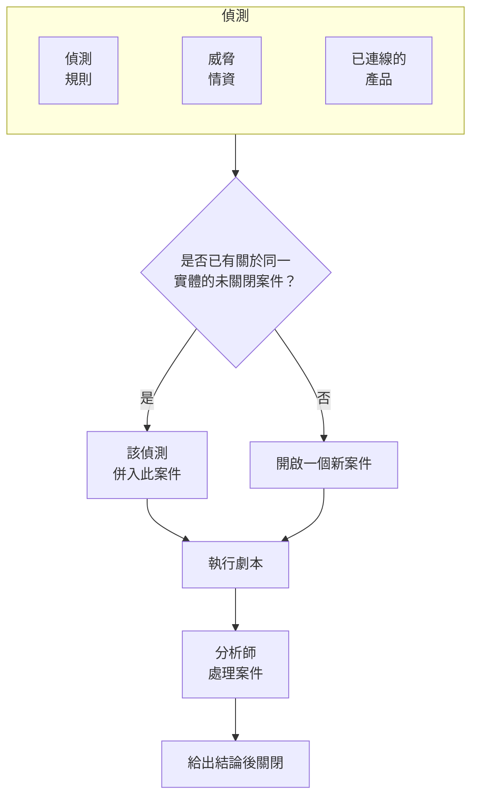

# 安全案件與劇本(SOAR)

Security Events 會把偵測規則、威脅情資和已連線的安全性產品所發現的問題轉為案件：每件值得調查的事對應一個案件，與同一使用者、主機或位址有關的所有偵測都會歸入其中。分析師在佇列中處理案件，劇本則會自動或一鍵對案件做出回應。

:::cards
- [案件從何而來](#案件從何而來): 偵測規則、威脅情資、已連線的產品、實體風險和人員。
- [處理案件](#處理案件): 指派案件、調查相關實體，並在給出結論後關閉。
- [案件優先順序與狀態](#案件優先順序與狀態): 重新命名、改顏色、調整順序，並新增你自己的。
- [回應目標](#回應目標): 每個優先順序的案件必須多快被接手並遏制。
- [通知](#通知): 新案件、指派、回應目標、任務以及等待核准的步驟會通知誰。
- [劇本](#劇本): 在案件上執行的步驟，關鍵步驟需要核准。
- [概覽](#概覽): 當下需要有人處理的事項，以及案件的處理速度。
:::

## 運作方式

開啟 **產品 → Security Events → 安全案例 → 未結案例** 查看佇列。**指派給我**、**無人認領**、**已關閉案例** 和 **全部案例** 是旁邊各自獨立的頁面，分別列出其名稱所指的案件。

## 開始之前

案件和劇本遵循三個 Security 角色的權限。Project Owner 和 Project Admin 可以執行所有操作。

| 角色 | 能做什麼 |
| --- | --- |
| Security Admin | 一切操作，包括刪除案件、移除證據和設定劇本 |
| Security Member | 開啟、指派、變更和關閉案件，撰寫備註，處理任務，新增證據，執行劇本，以及核准或拒絕劇本的步驟 |
| Security Viewer | 讀取案件、偵測、備註、任務、證據、劇本及其執行記錄 |

其中每一項權限也都可以單獨授予，從建立案件到核准劇本的步驟皆然；請參閱 [權限參考](/docs/permissions/reference)。

## 案件從何而來

| 來源 | 何時開啟案件 | 停用方式 |
| --- | --- | --- |
| 偵測規則 | 規則符合時 | 規則的 **符合時** 步驟中的 **符合時開啟案例** |
| 威脅情資 | 某個事件提到已知指標時 | 情資來源的 **符合時** 步驟中的 **符合時開啟案例** |
| 已連線的產品 | 匯入的產品本身警示達到或高於連線的閾值時 | 在連線的 **輪詢** 步驟中，把 **Open Cases From** 設為 **從未** |
| 實體風險 | 使用者、主機或位址的風險達到專案閾值時 | **設定 → 風險評分** 中的 **風險案例** |
| 人員 | 有人從 **安全案例** 開啟案件，或在事件面板中使用 **開啟案例** 時 | 無 |

所有來源預設都會開啟案件，但實體風險例外：在它出現之前建立的專案需要先開啟 **風險案例**（[實體風險](/docs/telemetry/security-entity-risk)）。除非你選擇其他等級，否則連線會為 **高及以上** 的警示開啟案件；低於該等級的警示仍會匯入為事件。

### 偵測如何分組

每個偵測都與某個實體有關：也就是其規則分組所依據的值，例如暴力破解規則中的 IP 位址，或威脅情資符合項目所提到的指標。沒有實體的偵測會單獨存在，不與其他偵測合併。

- 如果已有與該實體有關的未關閉案件，偵測就會併入其中。案件的實體和 ATT&CK 對應會隨之擴充，其優先順序會提升到該偵測的優先順序，但絕不會降低。
- 如果沒有這樣的案件，就會開啟一個新案件，以該偵測命名，優先順序與該偵測相同。
- 再次觸發的偵測會在它所在的列上累加計數，而不是新增一列。

案件的優先順序取決於偵測的嚴重程度，取專案中該級別的內建優先順序，無論你把它改成什麼名稱：

| 嚴重程度 | 優先順序 |
| --- | --- |
| Critical 或 Fatal | Critical |
| High | High |
| Medium、Unknown 或 Other | Medium |
| Low | Low |
| Informational | Informational |

## 處理案件

新專案的案件會依序經歷四種狀態，你可以重新命名它們並新增自己的狀態（請參閱 [案件優先順序與狀態](#案件優先順序與狀態)）。案件可以略過某個狀態，例如直接從 New 關閉的誤判，也可以重新開啟。

| 狀態 | 意義 |
| --- | --- |
| New | 還沒有人查看過 |
| Investigating | 有人正在釐清發生了什麼事 |
| Contained | 威脅已無法再造成危害，但仍有清理工作要做 |
| Closed | 已處理完畢，並對其性質給出了結論 |

案件和事件一樣有自己的側邊選單，案件的每個部分都有自己的頁面：

| 側邊選單區段 | 頁面 |
| --- | --- |
| **概覽** | **概覽**、**時間軸** |
| **調查** | **經過**、**偵測**、**實體**、**關聯訊號**、**證據**、**任務**、**劇本** |
| **備註** | **私人備註** |
| **進階** | **稽核日誌**、**刪除案例**——點擊 **進階** 之前保持摺疊 |

每個頁面頂端都保留案件的頁首：編號、優先順序、狀態和標題，**指派給我**、**執行劇本**、**宣告事件** 和 **關閉案例** 按鈕，以及它們旁邊 ⋯ 選單中的 **設定優先順序**、**指派給其他人**、**變更狀態**、**編輯案例** 和 **刪除案例**。因此可以在案件的任何頁面上處理它，而指向案件的連結仍會開啟它的 **概覽**。當案件的優先順序設有回應目標時，標題列還會顯示下一個目標的截止時間（[回應目標](#回應目標)）。

- **概覽**：案件的描述、標籤和狀態步驟，由誰負責、因何開啟，以及它的數字：有多少筆偵測、已開啟多久，以及確認和遏制分別花了多長時間。在 **確認用時** 和 **遏制用時** 下方，會顯示案件相對於其回應目標的情況。
- **OneUptime AI**（位於 **概覽**）：OneUptime AI 對案件的研判、它建議的優先順序和劇本，以及背後的證據。請參閱 [安全性中的 OneUptime AI](/docs/telemetry/security-ai)。
- **影響**（位於 **概覽**）：案件使哪些對象面臨風險：OneUptime 是否看到其記錄被從網際網路存取、它們的擁有者，以及它們最近發生了什麼變更。展開後可以查看每筆記錄呼叫了什麼、被什麼呼叫，監看它的監控和狀態頁，以及案件中的位址與哪些機器通訊過。
- **MITRE ATT&CK**（位於 **概覽**）：案件的偵測所對應的戰術和技術，每一項都連結到 attack.mitre.org 上的對應頁面。
- **時間軸**：案件上發生過的一切，以及操作者。
- **經過**：在整個 OneUptime 中依序發生了什麼：每次偵測及其背後的安全事件、請求到達了哪一步、擲出的例外、案件涉及的記錄上的變更、在這些記錄上引發的事件和警示，以及團隊採取的行動。掃描器的大量探測合為一行，每一行都能開啟它提到的內容，例如請求的追蹤或例外。
- **偵測**：觸發後開啟或併入此案件的偵測、觸發次數，以及最新的符合事件。
- **實體**：案件涉及的使用者、主機和位址，以及它們最近 7 天在你所有安全性事件中的活動。每個實體都可以在 **關聯分析** 中開啟。
- **關聯訊號**：案件所指的主機、叢集、服務和成員（依 OneUptime 所知），以及其偵測前後各自發生的情況：它們的日誌、追蹤和指標，其上進行中的內容和發生的變更。請參閱[關聯訊號](/docs/telemetry/security-connected-signals)。
- **證據**：保存在案件中的檔案和連結，每項都記錄新增者和新增時間。**新增檔案** 上傳不超過 10 MB 的檔案，並記錄所上傳內容的 SHA-256，讓之後下載的人能核對它是否就是所保存的內容；**新增連結** 指向保存在其他地方的證據。只有 Security Admin 能移除證據，案件的 **時間軸** 會記錄新增和移除了什麼。
- **任務**：案件中需要做什麼、由誰在做，以及是否已完成。用一行新增任務，把它交給某人，完成後勾選。接手任務的人會收到通知（自己領取的除外），選單也會在 **任務** 旁顯示未完成任務的數量。
- **劇本**：每個劇本在此案件上逐步做了什麼，以及等待核准的步驟。有執行在等待時，選單會在 **劇本** 旁顯示等待的數量。
- **私人備註**：團隊就此案件寫下的內容。
- **稽核日誌**：對案件的每一次變更，以及變更者。請參閱 [稽核日誌](/docs/configuration/audit-logs)。
- **刪除案例**：永久刪除案件及其偵測、備註、時間軸和劇本執行記錄。如需保留記錄，請改為給出結論後結案。

### 在佇列中處理案件

不必開啟案件就能處理它。在佇列的清單中，案件所在列的 ⋯ 選單裡有 **指派給我**、**指派給其他人**、**變更狀態** 和 **變更優先順序**。若要同時處理多個案件，請選取它們，然後在 **批次動作** 中使用相同的動作：它會說明哪些案件已變更、哪些保持不變以及原因。

- 若要把案件交給其他人，請使用 **指派給其他人**，並選擇一個人或一個團隊。團隊的案件會留在 **無人認領** 中，直到團隊中有人認領。
- 關閉案件的狀態會像 **關閉案例** 一樣要求填寫結論和結案備註。
- 已關閉的案件不會指派給任何人。若要再次處理，請用 **變更狀態** 重新開啟。

### 關閉案件

**關閉案例** 會要求填寫結論和一則選用的結案備註：

| 結論 | 意義 |
| --- | --- |
| True Positive | 確實發生了惡意或未經授權的活動 |
| Benign Positive | 活動確實存在但在預期之內，例如滲透測試或管理工作 |
| False Positive | 偵測有誤：規則或資料誤判了正常活動 |
| Undetermined | 沒有足夠的資訊可以判斷 |

概覽頁面會統計這些結論。如果某條規則的案件總是以 False Positive 關閉，就表示這條規則需要調校。

案件中仍有未完成的任務時，**關閉案例** 對話框會顯示數量。

從 Google SecOps 警示開啟的案件，如果其連線開啟了 **案例關閉時關閉其警示**，也會在 Google SecOps 中關閉這些警示，並附上結論和關閉說明：請參閱 [Google SecOps](/docs/integrations/google-secops#案例關閉時關閉其警示)。

### 宣告事件

**宣告事件** 會以你選擇的嚴重程度為此案件開啟一個 OneUptime 事件（incident），並在兩者之間建立雙向連結：事件的描述會寫明此案件，案件的頁首會連結到該事件。接下來就由待命、狀態頁面和事後分析接手。此操作需要一個既能處理案件、又能建立事件的角色。

## 案件優先順序與狀態

每個專案都有自己的案件優先順序與狀態，位於 **產品 → Security Events → 設定 → 案例優先順序** 和 **案例狀態**。可以重新命名、改顏色、拖曳調整順序，也可以新增自己的，例如一個「Triage」狀態，或一個高於 **嚴重** 的「Emergency」優先順序。新名稱會立即出現在所有地方：佇列、案件頁面和概覽、通知、Slack 和 Microsoft Teams，以及劇本訊息中。

其中一些是內建的，因為 OneUptime 會讀取它們的含義。它們可以重新命名和改顏色，但不能刪除或封存，並且保持各自的順序：

| 內建 | OneUptime 用它做什麼 |
| --- | --- |
| 新建狀態 | 新案件從這個狀態開始 |
| 已確認狀態 | 到達它時記錄案件的確認時間，**重新開啟** 會把已關閉的案件移回這裡 |
| 已遏止狀態 | 到達它時記錄案件的遏止時間 |
| 已關閉狀態 | **關閉案例** 會把案件移到這裡，並附上結論 |
| 嚴重、High、Medium、Low 和資訊優先順序 | 偵測會以其嚴重程度對應的優先順序開啟案件，有人手動開啟的案件從 Medium 開始 |

- 狀態的位置決定了其中的案件被視為什麼，**視為** 欄會顯示出來：從已確認狀態往下視為已確認，從已遏止狀態往下視為已遏止，從已關閉狀態往下視為已關閉。你新增的狀態會放在已關閉狀態的正上方；把案件移到會關閉它的狀態時，會先要求給出結論。
- 優先順序的排名就是它的緊急程度，最緊急的在最前：**適用案例的最低優先順序**、通知選項以及 Slack 和 Microsoft Teams 規則都依這個順序讀取。你新增的優先順序會放在最後，**偵測嚴重程度** 欄顯示哪些偵測會以哪個內建優先順序開啟案件。

要停用你自己的某個狀態或優先順序，請在它所在列使用 **封存**。之後沒有人能再選擇它，API、Terraform 和 MCP 也會拒絕它，但已經使用它的案件會保留它，你也仍然可以依它篩選。已封存的值列在表格下方摺疊的 **已封存的案例狀態** 或 **已封存的案例優先順序** 區段，在那裡用 **取消封存** 即可還原。只要還有案件使用該值，或有劇本從該優先順序起執行，**刪除** 就會被拒絕。

## 回應目標

回應目標規定了案件必須以多快的速度處理：**確認時限** 是新案件可以等待多久才有人接手，**遏制時限** 是被遏制或關閉可以花多長時間。每個案件優先順序都有自己的目標，位於 **產品 → Security Events → 設定 → 回應目標**：在優先順序所在列點選 **編輯** 可設定這兩個目標，單位為分鐘、小時或天，最長一年，留空表示不設目標。新專案的優先順序從以下目標開始：

| 優先順序 | 確認時限 | 遏制時限 |
| --- | --- | --- |
| Critical | 15 分鐘 | 4 小時 |
| High | 1 小時 | 1 天 |
| Medium | 12 小時 | 3 天 |
| Low | 1 天 | 7 天 |
| Informational | 無目標 | 無目標 |

在有回應目標之前建立的專案，在有人設定之前沒有任何目標。

- 案件的截止時間在案件開啟時依其優先順序的目標決定。之後修改的目標適用於此後開啟的案件。
- 有人接手案件時，案件即被確認：指派給某人，或移到算作已確認的狀態。到達算作已遏制的狀態或被關閉時，案件即被遏制。
- 案件的優先順序變更時，已達成或已錯過的目標維持不變。優先順序提高會讓截止時間提前：新目標從變更時起算，除非原截止時間更早。優先順序降低會讓截止時間延後，但絕不會提前：新目標從案件開啟時起算。沒有目標的優先順序會保留被提高案件的截止時間，並清除被降低案件的截止時間。
- 從未被遏制就已關閉的案件重新開啟後，會得到一個從重新開啟時起算的新遏制截止時間。
- 進入目標的最後五分之一時，案件即將錯過該目標：負責該案件的人會收到通知，目標錯過時會再收到一次。請參閱 [通知](#通知)。

目標顯示的位置：

- 案件標題列會顯示下一個目標及剩餘時間，或已逾期多久：時間充裕時為灰色，最後五分之一為琥珀色，錯過後為紅色。
- 在案件的 **概覽** 中，**確認用時** 和 **遏制用時** 下方：案件相對於每個目標的情況，或超出了多少。
- 在佇列的清單中：每個案件優先順序下方的一行，以及可以開啟並用於排序的 **截止** 欄。只有當專案的某個優先順序設有目標時，清單才會顯示它們。

## 通知

OneUptime 會就案件上的五件事通知相關人員。不需要任何人做任何設定：一個只點選了 **開啟推薦設定** 的專案，也會透過電子郵件和推播收到其 High 和 Critical 案件的通知。

| 通知 | 通知誰 | 預設方式 |
| --- | --- | --- |
| 新的安全案例 | 所有能檢視專案案件的人：當案件以他們所選的優先順序或更高的優先順序開啟，或提升到該優先順序或更高時 | 電子郵件和推播，針對 High 和 Critical 案件 |
| 指派給我的安全案例 | 案件被指派給的人，以及案件被指派給的團隊成員 | 電子郵件和推播 |
| 等待我核准的劇本步驟 | 案件相關人員中能核准該步驟的人：案件被指派給的人及其團隊的成員。如果他們都無法核准，則通知專案中所有能核准的人 | 電子郵件和推播 |
| 安全案例回應目標 | 負責該案件的人：案件被指派給的人及其團隊的成員。如果無人負責，則通知會收到該優先順序新案件通知的人 | 電子郵件和推播 |
| 指派給我的安全案例任務 | 被交付案件任務的人，自己領取的除外 | 電子郵件和推播 |

- 只有能檢視案件的人才會收到相關通知：Project Owner、Project Admin，以及 Security Admin、Security Member 和 Security Viewer 角色。僅限於某些標籤的角色，只會收到帶有這些標籤的案件的通知。
- 沒有人會因為自己做的事而收到通知：手動開啟案件、指派案件或啟動執行的人不會收到相應的通知。
- 每個人對一個案件只會收到一次通知。一個以 Medium 開啟、之後提升到 Critical 的案件，會在提升時通知選擇了 High 或 Critical 的人，而不會再次通知選擇了 Medium 的人，因為他們在案件開啟時就已經收到通知。
- 透過 **傳送測試攻擊** 發起的測試攻擊會開啟一個不通知任何人的案件。
- Critical 案件和等待核准的步驟會立即傳送，絕不會被壓在 [郵件彙總](/docs/emails/notification-rollup) 中延後傳送。即將錯過或已錯過的回應目標也是如此。
- 案件的 **時間軸** 會顯示通知了誰以及何時通知。

### 選擇你會收到的通知

每個人都可以在 **使用者設定 → 通知設定 → 安全性** 下自行選擇：每種通知的管道（電子郵件、簡訊、電話、推播、Telegram、Slack、Microsoft Teams 或 Webhook），以及在 **新的安全案例** 下選擇會通知自己的優先順序：

| 選項 | 通知哪些優先順序的案件 |
| --- | --- |
| 僅嚴重 | Critical |
| 高及以上 | Critical 和 High（預設） |
| 中及以上 | Critical、High 和 Medium |
| 低及以上 | 除了 Informational 以外的所有優先順序 |
| 所有案例 | 所有優先順序 |

這些選項依專案的案件優先順序而定，並使用它們自己的名稱：上面是新專案的選項。

安全案件不會傳送 WhatsApp 訊息。推播通知會在 OneUptime On-Call 應用程式（1.7.0 或更新版本）中開啟該案件，你可以在其中核准或拒絕等待中的劇本步驟、接手案件並將其關閉。其中的連結會在瀏覽器中開啟該案件。

### 張貼到 Slack 和 Microsoft Teams 頻道

若要張貼到頻道，請在 **產品 → Security Events → 工作區 → Slack**（或 **Microsoft Teams**）下新增一條規則。兩者都未連線時，該區段只有一個項目：**連線 Slack 或 Teams**。規則會指定要張貼到的頻道（在 Microsoft Teams 中還包括聊天），並可視需要指定它適用於哪些案件：

| 條件 | 符合內容 |
| --- | --- |
| 安全案例優先順序 | 專案的某個案件優先順序，例如嚴重或 High |
| 安全案例標題、安全案例描述 | 案件標題或描述中包含的文字，或其開頭、結尾的文字 |
| 安全案例狀態 | 專案的某個案件狀態，例如新增或已關閉 |
| 安全案例來源 | Detection Rule、Threat Intel、Connected Product、實體風險、資料安全或 Manual |
| 安全案例標籤 | 案件的標籤 |

除任務通知外，每種通知都會張貼到案件當時所符合的每條規則的頻道。一條 **安全案例優先順序** 包含 **嚴重** 和 **高** 中任一項的規則，會在 High 和 Critical 案件開啟時張貼它們，並在 Medium 案件提升到 High 時張貼它。安全案件永遠不會有專屬的頻道。

## 劇本

劇本是在案件上執行的一系列步驟。請在 **產品 → Security Events → 劇本** 下從範本或空白建立劇本，然後在它的頁面上新增步驟。沒有劇本的專案會看到範本，而不是空白清單；有了劇本之後，清單上的 **從範本建立** 會開啟這些範本，專案已有的範本會標示為 **已新增**。

### 劇本何時執行

| 觸發方式 | 執行時機 |
| --- | --- |
| Case Opened | 案件開啟時執行一次 |
| Detection Added | 每當有新的偵測併入未關閉的案件時 |
| 研判為可能惡意 | 當 OneUptime AI 的研判把案件判讀為 可能為惡意 時，執行一次 |
| Manual | 只有在有人從案件執行它時 |

任何已啟用的劇本也可以透過案件上的 **執行劇本** 手動執行。自動執行的劇本可以用下列設定縮小範圍：

- **適用案例的最低優先順序**：只針對此優先順序或更高優先順序的案件。
- **僅限來自以下的偵測**：只在案件背後的偵測來自此來源時執行。
- **僅限這些偵測規則**：只在該偵測來自這些規則之一時執行。

已停用的劇本既不會自動執行，也無法手動執行。

### 步驟

| 類別 | 步驟 | 作用 |
| --- | --- | --- |
| 案件 | Assign the case | 把案件指派給某個人、某個團隊或兩者 |
| 案件 | Set the priority | 提高或降低案件的優先順序 |
| 案件 | Set the status | 把案件移到專案的另一個狀態；如果該狀態會關閉案件，則附上你選擇的結論 |
| 案件 | Add a note | 在案件上寫一則備註，例如給分析師的檢查清單 |
| 案件 | Add labels | 為案件加上標籤 |
| 調查 | Check entities against threat intel | 在你的威脅情資中查詢每個實體，符合時可以提高優先順序 |
| 調查 | Look up entity activity | 統計每個實體在最近一段時間內的安全性事件，並記錄在案件上 |
| 調查 | Preserve the evidence | 保留案件背後請求的工作階段重播，並把它們的追蹤與例外記錄在案件上 |
| 通知 | Email people | 以電子郵件傳送案件摘要及其連結給使用者和團隊 |
| 通知 | Notify data store owners | 以電子郵件傳送案件連結給案件涉及的每個資料儲存區的擁有者 |
| 通知 | Post to Slack | 把案件摘要張貼到某個 Slack 頻道 |
| 通知 | Post to Microsoft Teams | 把案件摘要張貼到某個 Microsoft Teams 頻道 |
| 通知 | Post a status page announcement | 把你撰寫的公告發布到你選擇的狀態頁 |
| 呈報 | Page on-call | 執行一個待命策略 |
| 呈報 | Declare an incident | 開啟一個與案件連結的 OneUptime 事件 |
| 圍堵 | Suspend the user in Okta | 在 Okta 中暫停案件涉及的使用者 |
| 圍堵 | End the user's Okta sessions | 將案件涉及的使用者登出 Okta，並撤銷其權杖 |
| 圍堵 | Contain the host in CrowdStrike | 透過 CrowdStrike Falcon 對案件涉及的主機進行網路圍堵 |
| 圍堵 | Isolate the device in Microsoft Defender | 透過 Microsoft Defender for Endpoint 隔離案件涉及的主機 |
| 圍堵 | Unsuspend the user in Okta | 在 Okta 中取消暫停案件涉及的使用者 |
| 圍堵 | Lift containment in CrowdStrike | 解除 CrowdStrike Falcon 對案件涉及的主機施加的網路圍堵 |
| 圍堵 | Release the device in Microsoft Defender | 在 Microsoft Defender for Endpoint 中將案件涉及的主機解除隔離 |
| 圍堵 | 封鎖資料儲存區的公開存取 | 透過雲端連線，封鎖案件涉及的每個儲存貯體或儲存體帳戶的公開存取 |
| 圍堵 | 撤銷資料儲存區共用 | 透過雲端連線，停止在你的帳戶之外共用案件涉及的每個資料庫的快照 |
| 自動化 | Send a webhook | 把案件以 JSON 格式 POST 到某個 URL |
| 自動化 | Run a workflow | 以案件作為輸入，啟動一個 OneUptime 工作流程 |
| 自動化 | Run a runbook | 以案件作為輸入，啟動你的某個 OneUptime 執行手冊 |
| 自動化 | Fix the code with AI | 請 OneUptime AI 提交一個提取要求，修正案件的請求所引發的例外 |

一個劇本最多有 25 個步驟。它們會依序執行，每個步驟在前一個完成後才開始。每個步驟還可以設定：

- **需要核准**：在執行到此步驟之前暫停，直到有人在案件上核准它。切斷某人存取的四個步驟一律如此，除非 Security Admin 將其關閉。**Run a runbook**、**Post a status page announcement** 和兩個資料儲存區步驟預設開啟核准，因為它們會在你的系統上執行命令、向你的客戶發布內容，或變更雲端的設定；新增該步驟的人可以將其關閉。
- **僅在威脅情報符合時**：除非本次執行中先前的 **用威脅情報檢查實體** 步驟找到了已知指標，否則略過此步驟。
- **失敗時繼續**：即使此步驟失敗，也繼續執行下一個步驟。關閉此項時，失敗的步驟會停止本次執行。

### 透過 OneUptime 回應

以下四個步驟透過 OneUptime 的其他部分執行，而不是透過已連接的產品：

- **Run a runbook** 以案件作為輸入，啟動你的某個[執行手冊](/docs/runbooks/index)，Bash 步驟會把這些輸入讀作環境變數（參見[呼叫 Webhook](/docs/runbooks/triggers#呼叫-webhook)）。`ONEUPTIME_INPUT_IP`、`ONEUPTIME_INPUT_USER` 與 `ONEUPTIME_INPUT_HOST` 是案件所涉及的位址、使用者與主機，依與圍堵類步驟相同的規則選出，案件不涉及其中任何一個時為空。`ONEUPTIME_INPUT_IPS`、`ONEUPTIME_INPUT_USERS` 與 `ONEUPTIME_INPUT_HOSTS` 以 JSON 列出案件提到的所有對象，`ONEUPTIME_INPUT_CASE_NUMBER`、`ONEUPTIME_INPUT_CASE_TITLE` 與 `ONEUPTIME_INPUT_CASE_URL` 說明是哪個案件。受保護的使用者或主機絕不會在其中。執行手冊的執行紀錄會註明它是由 **Security playbook** 為該案件啟動的。
- **Preserve the evidence** 將案件背後請求的工作階段重播保留到其保留期之後，並在案件上寫一則備註，連結每個請求的追蹤、每個重播與每個例外。記錄與追蹤的保存時間不能超過專案保留遙測資料的時間，因此請在此之前匯出你需要的內容。
- **Post a status page announcement** 依你撰寫的原樣，把你寫的內容發布到你選擇的狀態頁上。不會加入案件中的任何內容。只有開啟 **通知訂閱者** 時，才會通知這些狀態頁的訂閱者。
- **Fix the code with AI** 針對案件的請求所引發的每個例外（最多三個），請 OneUptime AI 提交一個修正它的提取要求。該步驟需要開啟 OneUptime AI、一個包含程式碼並透過 GitHub App 連接的程式碼存放庫，以及一個執行器。缺少這些時，該步驟會被略過並說明缺少什麼。

### 圍堵

圍堵類步驟會透過需要的不只是讀取權限的連線執行動作：與該產品的 [安全性事件連線](/docs/telemetry/security-events#連線安全性產品)，或資料儲存區的 [雲端連線](/docs/telemetry/cloud-accounts)：

| 步驟 | 連線 | 所需權限 |
| --- | --- | --- |
| Suspend the user in Okta、End the user's Okta sessions、Unsuspend the user in Okta | Okta System Log | 一個有權管理使用者的 API 權杖 |
| Contain the host in CrowdStrike、Lift containment in CrowdStrike | CrowdStrike Falcon | 一個具有 Hosts 寫入範圍的 API 用戶端 |
| Isolate the device in Microsoft Defender、Release the device in Microsoft Defender | Microsoft Defender XDR | 一個具有 Machine.Isolate 權限的應用程式 |
| 封鎖資料儲存區的公開存取、撤銷資料儲存區共用 | 資料儲存區的雲端連線 | 已開啟 **資料安全回應**，並重新執行其設定命令 |

針對使用者或主機的步驟只會作用於案件涉及的使用者或主機，絕不會作用於案件提到的所有使用者或主機：

- 案件中某個偵測分組所依據的值，例如「不可能的旅行」規則分組所依據的帳戶，或已連線產品的警示中提到的主機。
- 案件中被你的威脅情資列為指標的使用者或主機。

依位址分組的案件，例如針對你的 VPN 的暴力破解，並不涉及上述任何一種：它的圍堵類步驟會被略過，它嘗試過的帳戶和它攻擊的閘道都不會被動到。一個步驟最多作用於 10 個使用者或主機。它會依名稱在產品中找出每一個，並在執行上說明對每一個做了什麼：已完成、先前已完成、找不到、遭到拒絕或受保護。

兩個資料儲存區步驟會作用於案件涉及的資料儲存區，最多 10 個：也就是案件所納入的資料安全問題所在的資料儲存區，以及偵測據以將案件分組的資料儲存區。它們不會動到標記為 **刻意公開** 的資料儲存區，只會變更資料儲存區的共用方式而絕不變更其資料，並在執行上說明對每個資料儲存區做了什麼（請參閱 [消除暴露](/docs/data-security/integrations#消除暴露)）。

#### 受保護的實體

選單中 **劇本** 下的 **受保護的實體** 列出任何劇本都不會圍堵的使用者和主機，例如緊急存取帳戶、網域控制站和 VPN 閘道。比對值時不區分大小寫，`*` 代表任意字元序列：`svc-*` 會保護所有服務帳戶。步驟會將受保護的使用者或主機回報為受保護，並且不會動到它。這份清單由 Security Admin 維護。

#### 核准

切斷某人存取的四個步驟會等待核准。只有 Security Admin 可以為其中某個步驟關閉 **需要核准**，OneUptime 會記錄是誰關閉的。核准時會在 **作用對象** 下列出該步驟將作用的使用者或主機，每一個都已勾選：取消勾選該步驟不該動到的那些。受保護的使用者或主機不會列為選項。啟動執行的人無法核准它的步驟：要由其他人核准，不過啟動者仍可拒絕該步驟。

#### 復原

復原類步驟和它們所復原的步驟一樣，作用於案件涉及的使用者或主機。執行停止後，被圍堵的使用者或主機在其步驟上還會有一個專屬按鈕：**解除停用**、**解除遏制** 或 **釋出**。已結束的 Okta 工作階段無法復原。每次復原都會記錄在案件的時間軸上和專案的稽核日誌中。

### 訊息

備註、電子郵件、Slack 貼文和 Teams 貼文都可以使用案件的值：

| 預留位置 | 取代為 |
| --- | --- |
| `{{case.number}}` | 案件編號，例如 CASE-42 |
| `{{case.title}}` | 案件標題 |
| `{{case.priority}}` | 案件的優先順序，使用你專案中的名稱，例如 High |
| `{{case.status}}` | 案件的狀態，使用你專案中的名稱，例如 Investigating |
| `{{case.assignee}}` | 案件指派給了誰 |
| `{{case.url}}` | 指向 OneUptime 中此案件的連結 |
| `{{case.entities}}` | 案件涉及的使用者、主機和位址 |
| `{{case.detections}}` | 案件包含的偵測數量 |

沒有自訂訊息的電子郵件或貼文會傳送案件摘要。

### 執行與核准

每次執行都會逐步列在其案件上，以及 **產品 → Security Events → 劇本 → 劇本執行記錄** 下：

| 執行狀態 | 意義 |
| --- | --- |
| Queued | 等待工作程序 |
| Running | 正在執行其步驟 |
| Waiting for Approval | 停在需要核准的步驟之前 |
| Succeeded | 每個步驟都已執行或被略過 |
| Failed | 某個步驟失敗，執行已停止 |
| Cancelled | 有人取消了它，或拒絕了某個步驟 |

等待核准的步驟會在執行上顯示 **核准** 和 **拒絕**，並可附上一則選用的意見。核准後，執行會從該步驟繼續；拒絕則會結束執行。核准決定、決定者及其意見都會記錄在該步驟上、案件的時間軸上和專案的稽核日誌中。選單中 **劇本** 下的 **待核准** 列出等待決定的執行並顯示其數量；**劇本執行記錄** 列出所有執行。在 **劇本執行記錄**、劇本的頁面和案件的 **劇本** 上，每次執行都是一行，說明它進行到哪裡，或停在哪個步驟；**顯示步驟** 會展開它的步驟。等待核准的執行和案件最新的執行會自動展開。

如果某次執行不再收到工作程序的回應（例如在重新啟動之後），它會被重新接手：佇列中的執行會在 2 分鐘後重新排入佇列，30 分鐘都沒有任何回報的執行會被判定為失敗。

## 概覽

**產品 → Security Events → 概覽** 是開啟此產品時進入的頁面：

- 指派給你的未關閉案件、尚無人接手的未關閉案件，以及等待核准的劇本步驟；每個數字都會開啟列出它們的頁面。
- **平均確認時間**、**平均遏止時間** 和 **平均關閉時間**，以最近 30 天內開啟的案件計算：分別是從案件開啟到有人接手（指派給某個人，或將它移到視為已確認的狀態）、到視為已遏止的狀態、到視為已關閉的狀態所花的時間。仍在等待中的案件不計入平均值。
- 30 天內每天開啟的案件數（依優先順序劃分），以及 14 天內每天產生的偵測數（依來源劃分）。
- 依優先順序和狀態劃分的未關閉案件、依風險分數排名最高的實體、觸發最多的偵測、案件背後的 ATT&CK 戰術，以及最近 30 天的結論。

在這些內容上方，一個橫條會顯示安全性的設定情況：來源、偵測、案件和劇本，各自附上數字。還沒有完成設定的專案會在那裡看到 **開啟推薦設定** 和 **傳送測試攻擊**；請參閱 [安全性入門](/docs/telemetry/security-getting-started)。沒有任何需要處理的內容時，頁面會顯示 **一切正常**，有可以呈現的資料時才會顯示圖表。

## 尋找威脅

- **實體風險** 依風險分數為使用者、主機和位址排名，風險最高的在前；概覽中的 **風險最高的實體** 顯示的是同一清單的前幾名。選擇一個實體即可查看它為何有風險。清單下方的 **查詢實體** 可在 30 天的事件中查詢任何值，包括網域或檔案雜湊，並在 **關聯分析** 中開啟它。
- **規則庫** 提供現成的偵測規則，涵蓋身分識別、端點、雲端、網路、Web 和 Kubernetes 威脅。每一條都是針對所有已連線來源正規化後的欄位所撰寫的 Sigma 規則。清單中一條規則占一列，顯示它能找出什麼、它標記的 MITRE ATT&CK 戰術與技術、它讀取的事件，以及過去 7 天內是否收到過這類事件（**接收中** 或 **未接收**），還有它的嚴重性。可以依類別、規則讀取的資料以及是否已新增來篩選清單，也可以依名稱、ATT&CK 技術或嚴重性搜尋；頁面網址會保留這些篩選條件。選擇一條規則即可查看詳細資料：如何開始傳送它讀取的事件、它如何執行，以及它的 Sigma 規則。**新增** 會把它建立為你自己的偵測規則，處於啟用狀態，並且開啟的是案件而不是警示；之後可以像其他規則一樣在 **偵測規則** 下變更它。標記為 **推薦** 的規則會在 OneUptime 已有的資料中找出威脅，一個按鈕即可新增您還沒有的那些規則。
- **ATT&CK 涵蓋範圍** 會列出 MITRE ATT&CK 的各個戰術，並為每個戰術顯示已啟用規則涵蓋了其中多少個技術，以及 **規則庫** 中的規則還能多涵蓋多少個技術。開啟一個戰術即可查看它的技術，或切換到 **矩陣** 查看整個矩陣。選擇一個技術即可查看涵蓋它的規則庫規則，並開啟顯示這些規則的 **規則庫**。

## 自動化

- **工作流程**：案件或備註在建立、更新或刪除時可以啟動工作流程。**執行工作流程** 步驟會啟動一個以 Webhook 為觸發器的工作流程。
- **API**：與 OneUptime 的其他部分一樣，案件、備註、任務、證據、偵測、劇本、執行、受保護的實體以及案件優先順序與狀態也都有 REST API，位於 `/security-case`、`/security-case-note`、`/security-case-task`、`/security-case-evidence`、`/security-detection`、`/security-playbook`、`/security-playbook-run`、`/security-protected-entity`、`/security-case-priority` 和 `/security-case-status` 之下。請參閱 [API 參考](/docs/api-reference/api-reference)。
- AI 代理程式：MCP 伺服器提供了用於案件、備註、任務、證據、偵測、劇本以及案件優先順序與狀態的工具。請參閱 [MCP 伺服器](/docs/ai/mcp-server)。
- Terraform：`oneuptime_security_case_priority` 和 `oneuptime_security_case_status` 資源把專案的優先順序與狀態作為程式碼管理。

## 疑難排解

:::details 規則符合了，但沒有開啟案件
檢查規則 **符合時** 步驟中的 **符合時開啟案例**。如果偵測涉及的實體已經有未關閉的案件，該偵測會併入那個案件，而不會另外開啟一個：請在那個未關閉案件的 **偵測** 下找它。
:::

:::details 案件沒有通知到任何人
查看案件的 **時間軸**，其中會顯示通知了誰。**新的安全案例** 通知會傳送給案件達到其所選優先順序的人，因此 Medium 案件不會通知任何保留預設 **高及以上** 的人。請檢查應收到通知的人能否檢視安全案件（具有某個 Security 角色，或是 Project Owner 或 Project Admin），以及他們在 **使用者設定 → 通知設定 → 安全性** 下是否開啟了該通知。
:::

:::details 案件沒有顯示截止時間
它的優先順序沒有回應目標，或者在案件開啟後才設定了目標：案件的截止時間在開啟時決定。測試攻擊的案件沒有截止時間。請參閱 [回應目標](#回應目標)。
:::

:::details 劇本沒有執行
檢查劇本是否已啟用、它的 **觸發器** 設定是否合適（Case Opened 只在案件開啟時執行一次），以及案件是否符合它的 **適用案例的最低優先順序**、**僅限來自以下的偵測** 和 **僅限這些偵測規則** 設定。手動開啟的案件沒有偵測，因此限定了來源或規則的劇本不會在它上面執行。
:::

:::details 圍堵類步驟失敗
在案件上開啟這次執行：該步驟會針對每個使用者或主機說明產品是拒絕了操作、找不到它，還是無法連線。請檢查連線的認證資訊是否有權進行此變更，並使用連線所在列中的 **測試連線**。
:::

:::details 圍堵類步驟被略過
案件不涉及任何使用者或主機，例如只涉及一個位址，或者它涉及的每個使用者或主機都受到保護。在案件上開啟這次執行：該步驟會說明是哪一種情況。
:::

:::details 無法刪除或封存某個狀態或優先順序
內建的值可以重新命名和改顏色，但永遠不能刪除或封存：它的 **封存** 被鎖定，並顯示原因。你自己的值在還有案件使用它，或有劇本從它起執行時，無法刪除：請先把這些案件移到另一個值，或者將它封存。
:::

## 後續步驟

:::cards
- [安全性事件](/docs/telemetry/security-events): 傳送事件、撰寫偵測規則並連線安全性產品。
- [威脅情資](/docs/telemetry/threat-intelligence): 將你的事件與 STIX/TAXII 情資來源比對。
- [安全性中的 OneUptime AI](/docs/telemetry/security-ai): 用 AI 研判案件、草擬偵測規則，並詢問安全性問題。
- [權限參考](/docs/permissions/reference): Security 角色以及每個角色能做什麼。
:::
