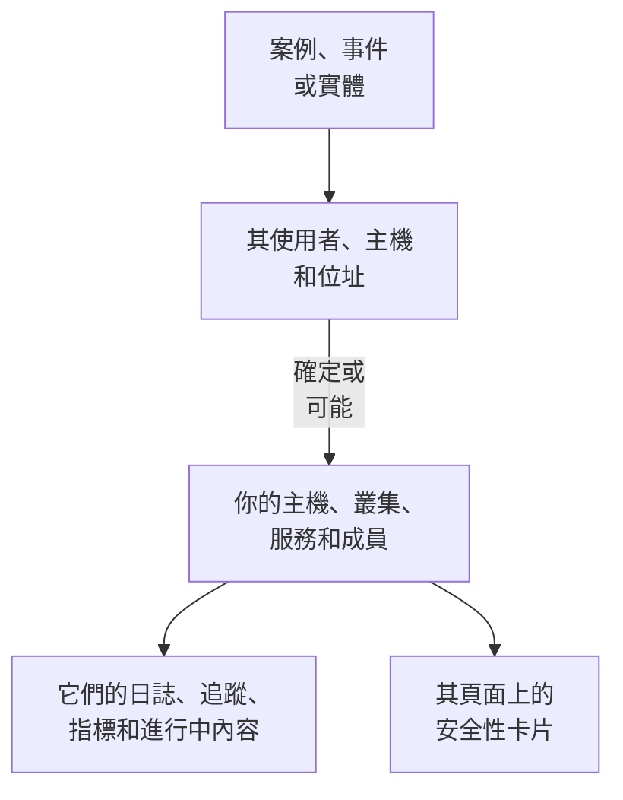

# 關聯訊號

安全案例會說明它涉及哪些使用者、主機和位址。關聯訊號會說明其中哪些 OneUptime 已經知道（你的主機、容器主機、Kubernetes 叢集、網路裝置、服務和成員），以及案例前後每一個上發生了什麼：它的日誌、追蹤和指標、其上進行中的事件和警示、監控它的監測器，以及它發生的變更。反過來，主機、叢集、服務或成員的頁面會說明 Security Events 發現了它的哪些情況。

:::cards
- [在哪裡看到](#在哪裡看到): 案例的頁面、事件的分頁、實體的頁面，以及它們所指對象的頁面。
- [值如何比對](#值如何比對): 什麼算作同一筆記錄，什麼只是可能。
- [每筆記錄顯示什麼](#每筆記錄顯示什麼): 案例前後的訊號，以及其上進行中的內容。
- [誰能看到什麼](#誰能看到什麼): 每筆記錄都以讀者自己的角色讀取。
:::

## 運作方式

OneUptime 會在專案的記錄中搜尋每個值，說明每個相符有多確定，並顯示案例前後每筆記錄上發生了什麼。

## 開始之前

- 有安全性事件流入，並且專案中有它們可以指向的主機、Kubernetes 叢集、服務或成員。請參閱[安全性入門](/docs/telemetry/security-getting-started)。
- 能讀取安全事件的角色，以及能讀取你想檢視的那類記錄的角色。

## 在哪裡看到

- **關聯訊號**：每個安全案例的一個頁面。在 **產品 → Security Events → 安全案例 → 未結案例** 下開啟一個案例，然後在其選單中開啟 **實體** 之後的 **關聯訊號**。
- **已連線**：每個安全事件的一個分頁。在 **產品 → Security Events → 事件** 下開啟一個事件。它列出該事件所指的對象，範圍是事件前後一小時。
- 實體的頁面，位於 **產品 → Security Events → 實體風險** 下：在其最近一次安全事件前後，OneUptime 在哪裡知道該使用者、主機或位址。
- 每個主機、Docker 主機、Podman 主機、Kubernetes 叢集、網路裝置、服務、成員和清單項目的頁面上的 **安全性** 卡片：指向它的未結安全案例、過去 7 天內有多少安全事件和發現指向它、其中最嚴重的一個，以及它的風險。**在 Security Events 中開啟** 會在那裡開啟它。
- 事件頁面上的 **安全性** 卡片：當某個安全案例宣告了該事件（**宣告來源**），或未結案例指向它影響的主機或叢集時（**指向其影響對象的未結案例**）。

## 值如何比對

案例或事件所指的每個使用者、主機和位址都會在專案的記錄中搜尋：

| 案例或事件所指的內容 | 比對到 | 確定程度 |
| --- | --- | --- |
| 與主機、容器主機、叢集或網路裝置回報的名稱相同的主機名稱或網域名稱 | 該記錄 | 確定 |
| 同一名稱，但未說明它是主機 | 該記錄 | 可能 |
| 記錄名稱的簡稱或全稱，例如 `web-1` 和 `web-1.acme.internal` | 該記錄 | 可能 |
| 只有一筆記錄擁有的公用 IP 位址 | 該記錄 | 確定 |
| 私人 IP 位址，或多筆記錄擁有的 IP 位址 | 擁有它的每筆記錄 | 可能 |
| 成員的電子郵件 | 該成員 | 確定 |
| 對於從你的日誌讀取的事件，日誌行傳送時所屬的記錄 | 該主機、叢集或服務 | 確定 |
| 單純的使用者名稱、URL、檔案雜湊或處理程序 | 無：沒有記錄以它們為鍵 | - |

- 可能的相符會在名稱旁顯示 **可能相符**，並說明原因。它從不計入該記錄的頁面，案例宣告的事件也從不連結到它。
- 搜尋過但不是專案記錄的內容列在 **不在 OneUptime 中** 下。當某個值可能屬於的那類記錄無法讀取時，該值從不列在那裡。
- 一個案例最多列出 10 筆記錄，確定的排在前面。

## 每筆記錄顯示什麼

- 它的訊號，每個都依該記錄和案例的期間開啟：**日誌**、**追蹤** 和 **指標**、服務的 **例外**、叢集的 **Kubernetes 事件**、記錄的 **拓撲**，以及清單中有其項目時的 **清單** 項目。
- 現在其上進行中的事件和警示，以及監控它的監測器，每個都可開啟其頁面。
- 該期間內它發生的變更：服務的部署、叢集的發布和主機的修復。

| 位置 | 期間 |
| --- | --- |
| 案例 | 從首次偵測前 30 分鐘到最後一次偵測後 30 分鐘，最多為其最後 24 小時 |
| 事件 | 事件前後各 30 分鐘 |
| 實體的頁面 | 其最近一次安全事件前後各 30 分鐘 |
| 記錄的 **安全性** 卡片 | 過去 7 天 |

## 誰能看到什麼

- 關聯訊號和記錄的 **安全性** 卡片需要能讀取安全事件的角色：Security Admin、Security Member、Security Viewer、Project Owner 或 Project Admin。其他人在任何頁面上都看不到安全資料。請參閱[角色](/docs/permissions/reference#角色)。
- 事件的 **安全性** 卡片需要能讀取安全案例的角色。
- 每筆記錄都以你自己的角色讀取。你的角色無法讀取的那類記錄會被省略，頁面會說明這一點；此刻無法讀取的那類記錄也會說明，並提供 **再試一次**。
- 只有在使用 Security Events 的專案中（過去 7 天內收到過安全事件的專案），記錄的頁面才會顯示其 **安全性** 卡片。

## 案例宣告的事件

案例上的 **宣告事件**，或宣告事件的劇本步驟，會把事件連結到該案例確定連線的主機、Docker 和 Podman 主機、Kubernetes 叢集和服務。事件會顯示在它們的頁面上，其擁有者的規則也會套用到它，事件的動態會寫明該案例以及它連結到的內容。可能的相符從不連結。

## OneUptime AI

OneUptime AI 對案例的分級會讀取它的關聯訊號：案例所指的主機、服務和成員上進行中的內容和發生的變更。事件的調查會讀取宣告它的安全案例，以及指向其影響對象的未結案例。請參閱[安全性中的 OneUptime AI](/docs/telemetry/security-ai)。

## 疑難排解

:::details 案例所指的主機沒有列出
檢查案例是否以主機自報的名稱指向該主機，或指向只有該主機擁有的公用位址。簡稱（例如 `web-1.acme.internal` 的 `web-1`）會作為可能相符列出，而單純的使用者名稱、URL、檔案雜湊或處理程序根本不會被搜尋。
:::

:::details 正確的主機被列為可能相符
可能的相符從不計入或連結，這樣兩台機器共用的名稱就不會讓你誤以為它說的是另一台。請讓你的日誌和偵測以主機回報的名稱來指向它。
:::

:::details 主機的頁面沒有安全性卡片
該卡片只在過去 7 天內收到過安全事件的專案中，向能讀取安全事件的角色顯示。在這段時間內沒有任何內容指向的主機，會顯示一行說明。
:::

:::details 頁面說你的角色無法檢視某類記錄
每筆記錄都以你自己的角色讀取。請向 Project Owner 或 Project Admin 申請能讀取該類記錄的角色。
:::

## 後續步驟

:::cards
- [安全案件與劇本](/docs/telemetry/security-cases): 處理案例，並據此宣告事件。
- [安全性事件(SIEM)](/docs/telemetry/security-events): 案例背後的事件，以及讀取它們的日誌。
- [實體風險（基於風險的警示）](/docs/telemetry/security-entity-risk): 實體的頁面、它的風險，以及它在 OneUptime 中的位置。
- [安全性中的 OneUptime AI](/docs/telemetry/security-ai): 分級如何讀取案例所指的內容。
:::
