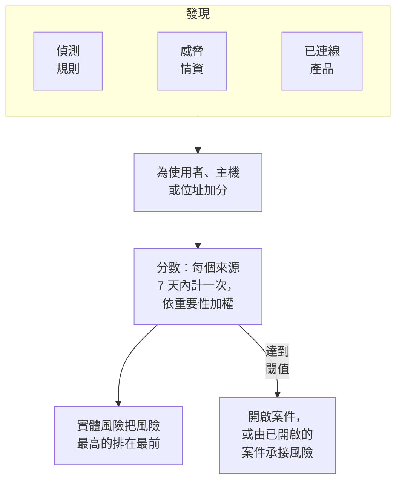

# 實體風險（基於風險的警示）

單一發現很少能說明太多。一連串登入失敗、主機上的第一次 sudo、來自新國家的登入，各自都值得看一眼；同一個帳戶在一週內三者都出現，就值得開一個案件。實體風險會把你的偵測規則、威脅情資和已連線產品對每個使用者、主機和 IP 位址的發現累加起來，把風險最高的排在最前，並在某個實體的風險達到專案閾值時針對它開啟案件。

:::cards
- [分數如何計算](#分數如何計算): 依嚴重程度計分，每個來源每週只計一次。
- [風險等級與案件](#風險等級與案件): 分數如何解讀，以及何時開啟案件。
- [實體重要性](#實體重要性): 越重要的計得越多，越不重要的計得越少。
- [實體的頁面](#實體的頁面): 它為何有風險、它的一個月，以及與它相關的案件。
- [偵測規則的風險分](#偵測規則的風險分): 規則在分數中自己的權重。
:::

## 運作方式

開啟 **產品 → Security Events → 實體風險**：目前有風險的每個使用者、主機和 IP 位址，風險最高的在前，附上其等級、重要程度、由什麼發現以及何時發現。每個實體都在自己的頁面中開啟。

## 開始之前

- 有安全性事件流入，並且有偵測規則、威脅情資或已連線產品能在其中發現問題。請參閱[安全性入門](/docs/telemetry/security-getting-started)。
- 依指向某人的欄位分組的偵測規則：**分組欄位**，例如 `principalUser`、`principalHost` 或 `principalIp`，或關聯規則分組所用的欄位。不依任何欄位分組的規則不會增加風險。
- 若要變更 **風險評分**：開關和閾值需要 Project Owner 或 Project Admin，實體清單需要可以建立偵測規則的角色。Security Viewer 可以檢視全部內容。請參閱[角色](/docs/permissions/reference#角色)。

## 分數如何計算

每個發現都會為它所涉及的使用者、主機或 IP 位址加上風險分：

| 發現的嚴重程度 | 增加 |
| --- | --- |
| 低 | 10 分 |
| 中 | 25 分 |
| 高 | 50 分 |
| 嚴重 | 75 分 |

- 資訊等級的發現不加分，嚴重程度未知的發現以中計算。
- 偵測規則的分數計入它分組所用的值。威脅情資相符項目計入指標所指的 IP 位址。已連線產品的警示計入它所指的使用者和主機，否則計入其 IP 位址。
- 每個來源只計一次。偵測規則、威脅情資來源或已連線產品的規則，無論觸發多少次，7 天內都只計一次，以其增加的最大值計算：一條嘈雜的規則永遠不會讓實體看起來比三條不同的規則更糟。
- 7 天內沒有任何發現的來源不再計入，分數隨之下降。分數每 15 分鐘檢查一次，因此即使沒有新發現，分數也會準時下降。

實體的分數是其來源的總和，再依其重要性加權。**傳送測試攻擊** 的測試攻擊，以及有人手動開啟的案件，都不會增加風險。

## 風險等級與案件

每個分數都會對照專案的閾值（除非你變更，否則為 100）解讀為一個等級：

| 風險分數 | 解讀為 | 會發生什麼 |
| --- | --- | --- |
| 1 至 49 | 低 | 列在實體風險中 |
| 50 至 99 | 中 | 列在實體風險中 |
| 100 至 199 | 高 | 開啟一個高等級案件 |
| 200 以上 | 嚴重 | 開啟一個嚴重等級案件 |

當實體的風險達到閾值時，會針對它產生一個來源為實體風險的偵測。該偵測會加入關於該實體的已開啟案件，或開啟一個以它命名的案件，例如 `High risk — k.morgan@acme-commerce.example`，並列出為風險加分最多的來源（最多 10 個），以及其分數、觸發次數和最近一次觸發時間。

一旦針對實體的風險開啟了案件，之前的發現就不會再次計入：只有之後的新來源再次累計達到閾值時，才會開啟另一個案件。已作為處理完畢關閉的案件，不會因相同的發現而重新開啟。

在 **產品 → Security Events → 設定 → 風險評分 → 風險閾值** 中變更閾值：10 到 10000 的整數。中等級從其一半開始，嚴重從其兩倍開始，所有頁面都一樣。

### 開啟或關閉風險案件

**設定 → 風險評分** 中的 **風險案例** 決定風險是否開啟案件，切換後立即儲存。新專案預設開啟。在實體風險推出之前建立的專案會維持關閉，直到有人開啟，**實體風險** 會在清單上方說明這一點。無論如何，風險都會被評分和列出。

## 實體重要性

有些實體比其他實體更重要：網域控制站、主管的帳戶、付款伺服器。有些則沒那麼重要，例如掃描行為在預期之內的弱點掃描器。在 **設定 → 風險評分 → 實體重要性** 中用 **新增實體** 列出它們：

| 重要性 | 風險的計算方式 |
| --- | --- |
| 低 | ×0.5 |
| 未列出 | ×1 |
| 高 | ×1.5 |
| 極高 | ×2 |

項目可以是一個值或一個 `*` 模式，不區分大小寫：`dc-*` 表示每個網域控制站，`*@contractors.example` 表示每個外包人員。**類型** 可將其限定為使用者、主機或 IP 位址；留空則符合全部。當多個項目都指向同一實體時，以最具體的為準：完整的值優先於模式，較長的模式優先於較短的模式。變更會在幾分鐘內反映到每個實體的分數上。

## 實體的頁面

在 **實體風險** 的某一列點選 **檢視**，或在案件的 **實體** 頁面點選實體旁的風險：

| 部分 | 顯示內容 |
| --- | --- |
| 頁首 | 它的類型和重要性、分數和等級，以及分數的計算方式 |
| **活動** | 它在過去 7 天內的安全性事件和發現 |
| **增加其風險的來源** | 每個來源、其嚴重程度、增加的分數、觸發次數和最近一次觸發時間 |
| **過去 30 天的風險** | 它每天結束時的分數，依等級著色 |
| **相關案例** | 針對它開啟的安全案件，最新的在前 |

**在關聯分析中開啟** 會繪製其事件的關係圖，**搜尋其事件** 會開啟該週的 **事件**。**重設風險** 會清除它的分數和來源，例如在計畫的測試之後：之後的發現從零開始計算，它的案件不受影響。重設需要可以刪除安全性資料的角色，並會被[稽核記錄](/docs/configuration/audit-logs)記錄。

OneUptime AI 在對案件進行分診時，會讀取案件中實體的風險。請參閱[安全性中的 OneUptime AI](/docs/telemetry/security-ai)。

## 偵測規則的風險分

偵測規則會加上其等級對應的分數，等級來自其 Sigma `level`。若要賦予它自己的權重，請開啟規則的表單，進入 **符合時**，開啟 **更多欄位**，並將 **風險分** 設定為 0（不增加風險）到 100 之間。留空則使用其等級對應的分數。

## 疑難排解

:::details 某個實體沒有出現在實體風險中
請檢查過去 7 天內是否有偵測規則、威脅情資來源或已連線產品發現了與它相關的內容，以及規則是否依指向它的欄位分組。資訊等級的發現不加分，7 天內沒有任何發現的來源不再計入。
:::

:::details 實體的風險達到了閾值，但沒有開啟案件
請檢查 **設定 → 風險評分** 中的 **風險案例** 是否已開啟。如果之前已針對該實體的風險開啟過案件，那麼只有之後的新來源才會計入下一個案件。
:::

:::details 某條規則反覆觸發，實體的分數卻沒有上升
這正是計算方式：一個來源在 7 天內只計一次，以其增加的最大值計算。降低嘈雜規則的 **風險分**，或將發現在預期之內的實體標記為低重要性。
:::

:::details 分數與其來源的總和不符
它的重要性對分數進行了加權。實體的頁面會顯示其來源的總和與權重，例如來源合計 100 × 2 = 200。
:::

## 後續步驟

:::cards
- [安全案件與劇本](/docs/telemetry/security-cases): 處理風險開啟的案件，並以結論關閉它們。
- [安全性事件(SIEM)](/docs/telemetry/security-events): 偵測規則、關聯分析，以及每個發現背後的事件。
- [威脅情資(STIX/TAXII)](/docs/telemetry/threat-intelligence): 為位址的風險加分的相符項目。
- [安全性中的 OneUptime AI](/docs/telemetry/security-ai): 分診如何讀取案件中實體的風險。
:::
