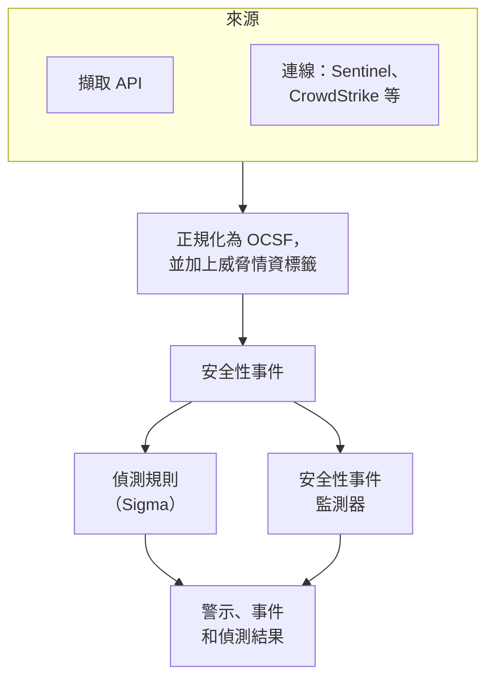
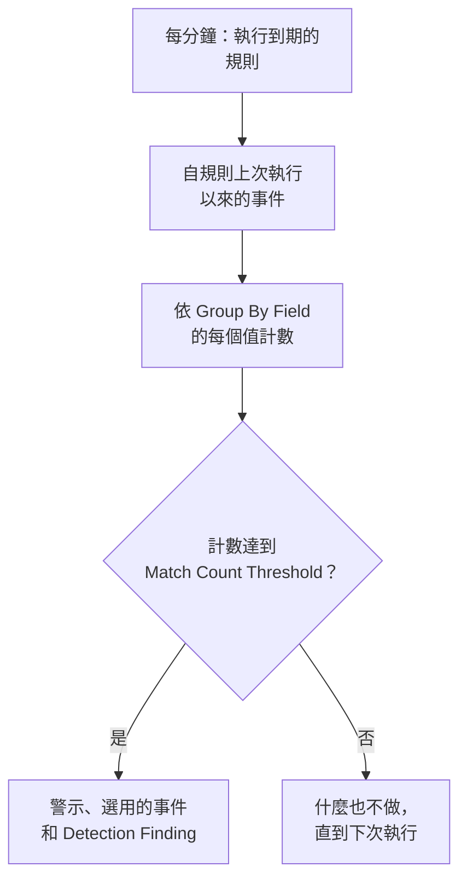

# 安全性事件(SIEM)

OneUptime 把安全性事件與你的日誌、追蹤和指標存放在一起，並且無論它們以什麼格式抵達，都統一成同一種結構：[OCSF](https://schema.ocsf.io/)（Open Cybersecurity Schema Framework）。你可以從任何來源傳送事件、搜尋它們，並用 Sigma 偵測規則、威脅情資和監測器把重要的事件變成警示。

:::cards
- [傳送事件](#傳送安全性事件): 一個 HTTPS POST、一個 Fluent Bit 輸出，或與安全性產品的連線。
- [搜尋和關聯分析](#探索安全性事件): 事件探索器和關聯分析圖。
- [偵測規則](#偵測規則): 會開啟警示的 Sigma 規則。
- [監測器](#安全性事件監測器): 滾動時間窗內的計數，以及會恢復的狀態。
:::

## 運作方式



在 **可觀測性** 下開啟 **產品 → Security Events** 。它的分頁如下：

| 分頁 | 用途 |
| --- | --- |
| **事件** | 搜尋和篩選每個事件，並開啟某個事件查看它的所有欄位 |
| **關聯分析** | 共用同一主機、使用者或 IP 位址的事件構成的圖 |
| **Detection Rules** | 依排程執行並開啟警示的 Sigma 規則 |
| **Threat Intel** | 已知惡意指標的 STIX/TAXII 情資來源 |
| **監測器** | 專案的安全性事件監測器 |
| **Connections** | OneUptime 會輪詢新記錄的安全性產品 |
| **設定指南** | 傳送事件的程式碼片段，已填入你的擷取金鑰 |

## 開始之前

只有 Project Owner 和 Project Admin 角色，以及三個 Security 角色可以讀取安全性資料；其他角色在 Security Events 中什麼也看不到。請參閱 [角色](/docs/permissions/reference#角色)。

| 角色 | 能做什麼 |
| --- | --- |
| Security Admin | 一切：事件、偵測規則、威脅情資來源和連線 |
| Security Member | 讀取事件和威脅情資，並建立、變更和刪除偵測規則和情資來源。不能設定連線，也不能刪除安全性資料。 |
| Security Viewer | 讀取事件、規則、情資來源、指標和連線 |

## 傳送安全性事件

:::steps
### 建立擷取金鑰

開啟 **專案設定 → 遙測與 APM → 擷取金鑰** ，按一下 **建立擷取金鑰** 。安全性事件與其他遙測資料使用相同的金鑰。

### 傳送你的事件

把 JSON 傳送到 `/security-events/v1/ingest`，並在 `x-oneuptime-token` 中攜帶金鑰：

:::tabs
@tab OCSF
```bash
curl -X POST "https://oneuptime.com/security-events/v1/ingest?format=ocsf" \
  -H "Content-Type: application/json" \
  -H "x-oneuptime-token: YOUR_INGESTION_TOKEN" \
  -H "x-oneuptime-service-name: my-security-source" \
  -d '{ "events": [ { "class_uid": 3002, "severity_id": 4, "status": "Failure", "message": "Failed logon for alice", "actor": { "user": { "name": "alice" } }, "src_endpoint": { "ip": "203.0.113.7", "hostname": "laptop-alice" } } ] }'
```
@tab Google UDM
```bash
curl -X POST "https://oneuptime.com/security-events/v1/ingest?format=udm" \
  -H "Content-Type: application/json" \
  -H "x-oneuptime-token: YOUR_INGESTION_TOKEN" \
  -d '{ "events": [ { "metadata": { "event_type": "USER_LOGIN" }, "principal": { "hostname": "laptop-alice", "user": { "userid": "alice" }, "ip": ["203.0.113.7"] }, "security_result": [{ "severity": "HIGH", "action": ["BLOCK"] }] } ] }'
```
@tab Generic JSON
```bash
curl -X POST "https://oneuptime.com/security-events/v1/ingest" \
  -H "Content-Type: application/json" \
  -H "x-oneuptime-token: YOUR_INGESTION_TOKEN" \
  -d '{ "events": [ { "severity": "high", "event_type": "ssh_brute_force", "message": "12 failed SSH logins in 60s", "username": "root", "hostname": "web-01", "src_ip": "203.0.113.7" } ] }'
```
:::

事件進入佇列後，端點會回應 `200`。像這些範例一樣不帶時間的事件，會放在它到達的那一刻。

### 在事件中找到它們

開啟 **產品 → Security Events → 事件** 。幾秒鐘內事件就會出現，嚴重程度、類別、使用者、主機和 IP 位址都已填好。
:::

### 格式

| `format` | 讀取的內容 | 也接受 |
| --- | --- | --- |
| `ocsf` | OCSF 事件 JSON（`class_uid`、`severity_id` 等） | 無 |
| `udm` | Google SecOps（Chronicle）UDM 事件（`metadata.event_type` 等） | `chronicle`、`google-secops` |
| `google-secops-alert` | Google SecOps 偵測和警示：SOAR Webhook 和偵測串流 | `secops-alert`、`detection` |
| `generic` | 任何其他 JSON，依常見欄位名稱讀取 | 無 |

可以用 `?format=`、`x-oneuptime-security-event-format` 標頭，或最上層的 `"format"` 欄位指定格式。不指定時，每個事件的格式會個別判斷，所以一個 Webhook 可以混合傳送偵測和原始事件。

- 內文可以是一個事件、一個事件陣列，或 `{ "events": [...] }`。
- `x-oneuptime-service-name` 標頭指定事件所屬的遙測服務。沒有它時，事件屬於以第一個事件的產品或供應商命名的服務，或屬於 `Security Events`。
- 不會因為無法對應而捨棄任何內容：來源的每個欄位都會進入事件的屬性。

### 一般 JSON 欄位

一般事件依常見欄位名稱讀取：

| 事件的欄位 | 從下列第一個存在的欄位讀取 |
| --- | --- |
| `message` | `message`、`msg`、`summary`、`description`、`title` |
| `severityName` | `severity`、`severity_name`、`level`、`priority`、`risk_level` |
| `time` | `timestamp`、`time`、`@timestamp`、`event_time`、`created_at` |
| `principalUser` | `user`、`username`、`user_name`、`account`、`actor` |
| `principalHost` | `host`、`hostname`、`computer`、`device`、`machine` |
| `principalIp` | `source_ip`、`src_ip`、`client_ip`、`ip` |
| `targetIp` | `destination_ip`、`dest_ip`、`dst_ip`、`target_ip` |
| `className` | `event_type`、`category`、`type`、`action` |
| `ruleName` | `rule`、`rule_name`、`signature`、`detection` |
| `productName` | `product`、`product_name`、`source`、`log_source` |

表示嚴重程度的字詞會變成 OCSF 等級：`info` 讀作 Informational，`warning` 讀作 Low，`error` 讀作 Medium，`alert` 讀作 Critical，`emergency` 讀作 Fatal。

### 用 Fluent Bit 轉送

若要傳送你已經在收集的安全性日誌，例如 auditd、syslog 或 Falco，請為 Fluent Bit 新增一個 `http` 輸出：

```ini title="fluent-bit.conf"
[OUTPUT]
    Name             http
    Match            security.*
    Host             oneuptime.com
    Port             443
    tls              On
    URI              /security-events/v1/ingest
    Format           json
    Json_date_key    timestamp
    Json_date_format iso8601
    Header           x-oneuptime-token YOUR_INGESTION_TOKEN
    Header           x-oneuptime-service-name my-security-source
    Retry_Limit      5
```

**設定指南** 分頁提供這些程式碼片段，並已填入你自己的主機和金鑰。

### 連線安全性產品

**Connections** 會替你輪詢安全性產品，並把它的新記錄匯入為安全性事件。連線會保存產品的設定和加密的認證資訊；工作程序會依你設定的間隔輪詢它，並略過已經匯入過的記錄。

| 產品 | 匯入內容 | 設定指南 |
| --- | --- | --- |
| Google SecOps (Chronicle) | 規則偵測、精選偵測和警示，作為 Detection Finding | [Google SecOps](/docs/integrations/google-secops) |
| Microsoft Sentinel | 事件（incident），作為 Incident Finding | [Microsoft Sentinel](/docs/integrations/microsoft-sentinel) |
| Microsoft Defender XDR | 警示，作為 Detection Finding | [Microsoft Defender XDR](/docs/integrations/microsoft-defender-xdr) |
| CrowdStrike Falcon | 警示，作為 Detection Finding | [CrowdStrike Falcon](/docs/integrations/crowdstrike-falcon) |
| Splunk Enterprise Security | Notable 事件或任意搜尋，作為 Detection Finding | [Splunk Enterprise Security](/docs/integrations/splunk) |
| Elastic Security | 偵測警示，作為 Detection Finding | [Elastic Security](/docs/integrations/elastic-security) |
| AWS Security Hub | Finding，作為 Detection Finding 和 Compliance Finding | [AWS Security Hub](/docs/integrations/aws-security-hub) |
| Okta System Log | 登入、MFA、帳戶和原則事件 | [Okta System Log](/docs/integrations/okta) |

- 連線依產品建立記錄的時間讀取記錄，而不是依記錄所描述活動的時間。每小時執行一次的 SIEM 規則會在它符合的事件之後很久才建立偵測，這些偵測仍然會被匯入。
- 第一次輪詢會回溯 24 小時，所以新連線會立即顯示最近的記錄。
- 連線所在列中的 **測試連線** 會檢查對產品的存取，以及 OneUptime 自己的工作程序是否在執行，不會匯入任何內容。**Run now** 會立即輪詢。

## 事件包含什麼

每個事件都會與型別化欄位和來源承載資料一起儲存：

| 群組 | 欄位 |
| --- | --- |
| 分類 | `categoryName`、`className`、`activityName`、`statusName`，以及它們的 OCSF ID（`categoryUid`、`classUid`） |
| 嚴重程度 | `severityName`，值為 Unknown、Informational、Low、Medium、High、Critical、Fatal 或 Other 之一，以及 `severityId` |
| 誰做的 | `principalUser`、`principalHost`、`principalIp`、`principalProcess` |
| 涉及了什麼 | `targetUser`、`targetHost`、`targetIp`、`targetPort`、`targetResource` |
| 來源 | `productName`、`vendorName`、`ruleId`、`ruleName`、`eventUid` |
| 內容 | `message`、`mitreTactics`、`mitreTechniques` 和 `observables`：從事件中擷取出的每個使用者、主機、IP 位址、網域和雜湊 |
| 屬性 | 完整的來源承載資料，展平為以點分隔的鍵 |

## 探索安全性事件

**事件** 是一個與日誌和追蹤探索器類似的遙測探索器：一張依嚴重程度顯示時間窗內事件的圖表、一個面向側邊欄、事件清單，以及一個顯示所開啟事件每個欄位和屬性的面板。時間窗、篩選條件和搜尋都保存在 URL 中，所以篩選後的檢視可以分享，重新整理後也不會遺失。

### 搜尋

搜尋列使用與其他遙測探索器相同的語法（請參閱 [搜尋語法](/docs/telemetry/search-syntax)）：

| 語法 | 意思 | 範例 |
| --- | --- | --- |
| 自由文字 | 訊息中包含它 | `failed logon` |
| `"quoted phrase"` | 這些字詞連在一起 | `"brute force"` |
| `<field>:<value>` | 型別化欄位 | `severity:Critical` |
| `@<attribute>:<value>` | 來源屬性 | `@threat.matched:true` |
| `-<filter>` | 排除這一項 | `-severity:Informational` |
| `<field>:(a OR b)` | 這些值中的任一個 | `severity:(High OR Critical)` |
| `<field>:a*` | `*` 代表任意文字，`?` 代表一個字元 | `host:web-*` |
| `@<attribute>:*` | 存在該屬性 | `@threat.indicator_id:*` |
| `@<attribute>:~text` | 屬性包含該文字 | `@finding_info.title:~ransom` |

欄位要麼是簡稱（`severity`、`class`、`category`、`activity`、`status`、`vendor`、`product`、`rule`、`user`、`host`、`ip`、`targetuser`、`targethost`、`targetip`、`observable`、`tactic`、`technique`），要麼是欄位本身的名稱，例如 `severityName` 或 `principalHost`。任何其他名稱都會被讀作來源屬性。`observable:<value>` 會找出提到某個值的每個事件，無論該值出現在活動的哪一方。

### 面向

側邊欄依 **來源**、**嚴重程度**、**事件類別**、**Category**、**活動**、**狀態**、**供應商**、**產品**、**Detection Rule**、**來源使用者** 和 **來源主機** 統計時間窗內的事件。按一下某個值只保留它的事件，按一下旁邊的減號則排除它們。圖表和每個計數描述的正是清單中的事件。

### 關聯分析

**關聯分析** 會圍繞一個主機、使用者或 IP 位址繪製事件：在你搜尋的值周圍顯示它們的事件類別，並依最嚴重的嚴重程度標示，同一批事件中出現的其他值則顯示在外圈。按一下某個類別可以列出它的事件，按一下某個值可以接著依它進行關聯分析。**事件** 中事件面板裡的每個 observable 都可以直接在 **關聯分析** 中開啟。

## 偵測規則

偵測規則是一條 [Sigma](https://sigmahq.io/) 規則，一種描述可疑活動的開放 YAML 格式，OneUptime 會依排程對你的事件執行它。符合時，它會開啟一個警示，可選擇開啟一個事件（incident），並把一個 Detection Finding 寫回安全性事件中。



### 建立規則

:::steps
1. 開啟 **產品 → Security Events → Detection Rules** ，按一下 **建立Detection Rule** 。
2. 在 **基本資訊** 中填寫 **名稱** ，並讓 **已啟用** 保持開啟。
3. 在 **Sigma Rule** 中，把規則的 YAML 貼到 **Sigma Rule (YAML)** 中。儲存時會剖析它，所以錯誤會顯示在表單中。
4. 在 **評估** 中，設定它執行的頻率以及需要多少次符合；請參閱 [評估設定](#評估設定)。
5. 在 **符合時** 中選擇符合後要做什麼：**Create Alert on Match**（開啟）、**Create Incident on Match**（關閉）和 **Write Detection Finding on Match**（開啟），以及選用的 **警示嚴重性** 和 **事件嚴重性** 。
:::

第一條規則，符合來自 `10.x.x.x` 以外的登入失敗：

```yaml title="failed-logon-burst.yml"
title: Failed logon burst
description: Repeated authentication failures from one source.
level: high
tags:
  - attack.t1110
  - attack.ta0006
detection:
  selection:
    className: Authentication
    statusName: Failure
  filter_internal:
    principalIp|startswith: '10.'
  condition: selection and not filter_internal
```

### 規則能表達什麼

OneUptime 會執行 Sigma 的布林核心：

- 選取項目是欄位對應（每個欄位都必須符合；值清單符合其中任一個即可），或是關鍵字清單，在訊息中的任何位置符合。
- 條件用 `and`、`or`、`not` 和括號，或用 `1 of selection_*`、`all of selection_*`、`any of them` 和 `all of them` 組合選取項目。
- 欄位修飾詞：`contains`、`startswith`、`endswith`、`all`、`re`、`cased`、`gt`、`gte`、`lt`、`lte`、`cidr`、`exists` 和 `windash`。除非你加上 `cased`，否則文字比較不區分大小寫。
- 欄位可以是型別化欄位（`principalUser`）、它在 Sigma 中的常見寫法（`CommandLine`、`src_ip`、`Hostname`），或任何屬性鍵，依它在事件中的寫法拼寫（`threat.matched`）。
- `level` 設定嚴重程度：`informational`、`low`、`medium`、`high` 或 `critical`，缺少時為 `medium`。`tags` 中的 ATT&CK ID（`attack.t1110`、`attack.ta0006`）會填入偵測結果的 MITRE 欄位。

像 `| count() by principalIp > 5` 這樣的彙總會在儲存時遭到拒絕：請改用 **Group By Field** 和 **Match Count Threshold** 。`logsource` 只有說明作用，不會縮小任何範圍：請把這種篩選放進選取項目，例如 `className: Authentication`。`timeframe` 會被忽略，因為規則的間隔決定了它的時間窗。

### 評估設定

| 欄位 | 作用 |
| --- | --- |
| **Evaluation Interval (Minutes)** | 規則執行的頻率：整數分鐘，1 到 1440。新規則的表單從 5 開始。 |
| **Group By Field** | 選用。此欄位值相同的符合，例如 `principalHost`，會一起計數、一起發出警示、一起去重：每台主機一個警示，而不是成百上千個。 |
| **Distinct Count Field** | 選用。統計此欄位不同值的數量，而不是符合的事件數。空值不計入。 |
| **Match Count Threshold** | 只有當一個群組在一次執行中的計數達到這個數字時才會觸發：1 到 1000000，設為 1 時任何符合都會觸發。 |

Group By 和 Distinct Count 使用與規則相同的欄位名稱。有了它們，閾值的意思就是「同一個對象、在一次執行中、達到這麼多」，不需要再在上面疊加監測器：

| 目標 | Group By Field | Distinct Count Field | 閾值 |
| --- | --- | --- | --- |
| 對任何符合發出警示 | 空白 | 空白 | 1 |
| 每台主機一個警示 | `principalHost` | 空白 | 1 |
| 暴力破解：來自同一個 IP 的 5 次登入失敗 | `principalIp` | 空白 | 5 |
| 密碼噴灑：同一個 IP 在 5 個不同帳戶上失敗 | `principalIp` | `principalUser` | 5 |
| 連接埠掃描：同一個 IP 存取 20 個不同連接埠 | `principalIp` | `targetPort` | 20 |

### 規則何時執行

OneUptime 每分鐘檢查一次已啟用、且自上次執行以來已經過了間隔時間的規則。每次執行會讀取事件時間落在上次執行與現在之間的事件，然後繼續往前：

- 時間窗首尾相接，不會滾動。間隔為 10 分鐘時，09:58 和 10:01 的失敗可能落在不同的執行中、被分開計數，所以選擇閾值時請保留餘裕。
- 出現空檔之後，例如工作程序中斷或規則重新開啟，下一次執行會涵蓋整個空檔，最多涵蓋最近 24 小時。
- 晚到的事件，也就是時間早於規則上次執行的事件，會被儲存並可以搜尋，但那條規則永遠不會讀取它。
- 每次執行最多觸發 100 個群組：計數最高的那些。

### 嚴重程度

規則的 `level` 就是它的偵測結果的嚴重程度：`informational`、`low`、`medium`、`high` 和 `critical` 分別變為 Informational、Low、Medium、High 和 Critical。它的警示和事件會依下列順序取用你專案中的某個嚴重程度：

1. 規則的 **警示嚴重性**（或 **事件嚴重性** ），如果已設定。
2. 與等級同名的嚴重程度，例如 High，不區分大小寫。
3. 依等第：`critical` 和 `high` 規則取用你最嚴重的嚴重程度，其他規則取用最輕的。

> [!TIP]
> 依 Sigma 等級（Critical、High、Medium、Low、Informational）為你的警示嚴重程度命名，每條規則不需個別設定就會落在正確的嚴重程度上。

### 警示和偵測結果

每個觸發的群組都會開啟一個標題為 `[Detection] <rule name> — <group value>` 的警示，沒有 Group By Field 的規則則為 `[Detection] <rule name>`。警示開啟期間，該群組的更多符合不會再開啟新的警示。規則只看得到符合，無法判斷攻擊是否已經停止，所以它的警示會一直保持開啟，直到有人解決。

Detection Finding 是來自產品 `OneUptime Detections`、類別為 `Detection Finding`（OCSF 類別 2004）的安全性事件，帶有規則的 MITRE 標籤、位於 `observables` 第一位的群組值，以及下列屬性：

| 屬性 | 值 |
| --- | --- |
| `oneuptime.detection.rule_id` | 觸發的規則的 ID |
| `oneuptime.detection.rule_name` | 規則的名稱 |
| `oneuptime.detection.match_count` | 這個偵測結果背後有多少個事件 |
| `oneuptime.detection.distinct_count` | 背後有多少個不同的值，適用於設定了 Distinct Count Field 的規則 |
| `oneuptime.detection.group_value` | 群組的值，適用於設定了 Group By Field 的規則 |
| `oneuptime.detection.sigma_id` | Sigma 規則自己的 `id` |

偵測結果就是一般的事件：可以在 **事件** 中搜尋它們，在 **關聯分析** 中以它們為中心展開分析。若要低調試用一條新規則，請在信任它之前關閉偵測結果以外的所有動作。

## 安全性事件監測器

安全性事件監測器會在滾動時間窗內統計符合其篩選條件的事件，並對計數執行一般的監測器條件：它會改變監測器的狀態、開啟警示或事件，並呼叫待命人員。請在 **監測 → 建立監測器** 下建立，類型選擇 **Security Events** ；**Security Events → 監測器** 會列出所有這類監測器。

它的表單會顯示 **Monitor events that include this text**、**Monitor Security Events for (time)**、**Event Severity** 和 **事件類別** 。**依遙測服務篩選** 和 **依屬性篩選** 位於 **更多欄位** 下，其標題會顯示監測器正在使用哪些。它的條件會檢查 **Security Event Count** 。

| | 偵測規則 | 安全性事件監測器 |
| --- | --- | --- |
| 符合依據 | 一條 Sigma 規則 | 針對嚴重程度、類別、訊息、服務和屬性的篩選條件 |
| 時間窗 | 首尾相接，每次執行一個 | 滾動：最近 5 秒到 24 小時 |
| 依群組計數 | 是，透過 **Group By Field** | 否：所有符合合計一個計數 |
| 開啟的內容 | 警示、事件和偵測結果 | 狀態、警示和事件 |
| 會恢復 | 否：警示會保持開啟直到被解決 | 是：計數恢復時狀態也隨之恢復 |

請把偵測本身寫成規則，並帶上它的閾值。當你需要滾動時間窗、能自行恢復的狀態、狀態頁面，或依條件使用不同的待命策略時，再使用監測器。

### 監看你的偵測

偵測結果就是事件，所以監測器可以監看規則本身：

- 風暴：在 `Detection Finding` 類別上建立一個監測器，統計每個偵測結果。一小時內有二十條不同的規則觸發，是任何單一規則都看不到的訊號。
- 頻率變化：依某條規則的 `oneuptime.detection.rule_id` 篩選。一條每週觸發一次的規則突然每小時觸發五十次，需要不同的因應方式。
- 沉默：平常總能看到幾個的偵測結果降到零，通常代表某個來源停止傳送了。請使用檢查計數是否低於某個數字的條件。

規則所在列中的 **建立監測器** 動作會開啟一個已經這樣設定好的新監測器：`Detection Finding` 類別、規則的 ID（絕不用名稱，因為重新命名會改變名稱），以及最近一小時。這樣的監測器統計的是偵測結果，每次執行每個群組一個，而不是它們背後的事件。若要在任何東西觸發之前要求一定數量的事件，請使用規則的 **Match Count Threshold** 。

## 威脅情資

**Threat Intel** 會訂閱已知惡意 IP 位址、網域、URL、電子郵件地址和檔案雜湊的 STIX/TAXII 情資來源。提到其中之一的事件會在抵達時被加上 `threat.*` 屬性，規則和監測器可以依這些屬性篩選；此外每分鐘都會把最近的事件與情資來源比對，像規則一樣開啟警示和偵測結果。請參閱 [威脅情資](/docs/telemetry/threat-intelligence)。

## 保留和計費

與其他遙測資料一樣，安全性事件依擷取的 GB 計費，並依你的遙測保留期保存：也就是專案在 **專案設定 → 遙測與 APM → 資料保留** 下的 **預設保留期（天）** ，或在其所屬遙測服務上設定的保留期。事件的保留期結束時，它就會被刪除。

## 疑難排解

:::details 事件沒有出現
檢查 `x-oneuptime-token` 中的金鑰和路徑 `/security-events/v1/ingest`。接著檢查 **事件** 中的時間窗，除非你變更過，它是過去一天：事件依它自己的時間放置，所以時間戳記較早的事件會落在時間窗之外。
:::

:::details 規則從不符合
檢查它是否處於 **已啟用** 狀態，並查看它所在列中的 **Last Evaluated** 和 **Last Error** 。開啟一個你預期會符合的事件，逐一欄位與規則比對：一般值必須等於整個欄位，所以要符合其中一部分時，請使用 `contains` 或 `*`。屬性依它在事件中的名稱書寫（寫 `threat.matched`，而不是 `attributes.threat.matched`）。閾值大於 1 時，這些符合必須落在同一次執行中。
:::

:::details 規則符合了，但沒有開啟警示
**Create Alert on Match** 已關閉，或者同一規則和群組值的警示仍處於開啟狀態，之後的符合都會併入其中。專案至少需要一個警示嚴重程度，規則才能開啟警示。
:::

:::details 規則開啟的警示太多
**Group By Field** 的每個值都會有自己的警示：請依較粗的粒度分組、提高閾值，或新增一個 Distinct Count Field。如果你在意的是頻率而不是每一次符合，請關閉 **Create Alert on Match** ，並在規則的偵測結果上設定一個監測器。
:::

## 後續步驟

:::cards
- [威脅情資](/docs/telemetry/threat-intelligence): 將你的事件與 STIX/TAXII 情資來源比對。
- [Google SecOps](/docs/integrations/google-secops): 匯入 Chronicle 的偵測和事件。
- [搜尋語法](/docs/telemetry/search-syntax): 搜尋列能理解的一切。
- [權限參考](/docs/permissions/reference): Security 角色以及每個角色能做什麼。
:::
