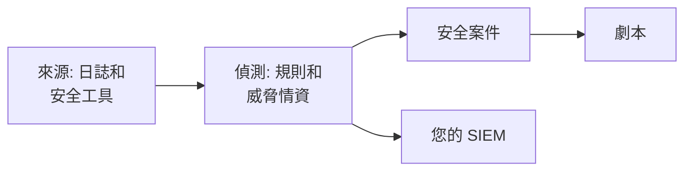

# 安全性入門

OneUptime 會從您已有的資料中找出威脅——您的日誌、您使用的安全工具，以及您傳送給它的一切——把找到的內容歸入案件，並用劇本回應。按兩下即可完成設定，不需要安裝任何東西。

:::cards
- [完成設定](#完成設定): 開啟大多數團隊需要的功能，再看一次測試攻擊開啟一個案件。
- [運作方式](#運作方式): 來源、偵測、案件和劇本，以及它們各自的作用。
- [您的日誌](#在日誌中尋找安全性事件): 您傳送到 OneUptime 的日誌中已經有的安全性事件。
- [您的 SIEM](#把-oneuptime-的發現傳送到您的-siem): 把 OneUptime 的發現傳送到 Google SecOps。
:::

## 開始之前

設定安全性需要 Project Owner、Project Admin 或 Security Admin 角色。Security Member 和 Security Viewer 角色可以查看找到的內容；請參閱 [角色](/docs/permissions/reference#角色)。

## 完成設定

:::steps
### 開啟大多數團隊需要的功能

開啟 **產品 → Security Events**。在 **概覽** 上按一下 **開啟推薦設定**。它會一次開啟三項：**在日誌中尋找安全事件**、建議的偵測規則，以及 **豐富新案例**——一個將每個新案件與威脅情資比對、並在其中留下分流檢查清單的劇本。

### 傳送測試攻擊

按一下 **傳送測試攻擊**。來自一個文件專用位址的十幾次登入失敗會經過真實的處理流程：它們會被儲存，暴力破解規則會偵測到它們，並開啟一個案件。不會呼叫任何人，也不會有 SIEM 收到它們。

### 開啟案件

按一下 **開啟案例**。真實的發現就是這個樣子：背後的事件、涉及的位址，以及 **豐富新案例** 找到的內容。完成後，請把它當作測試關閉。
:::

從此以後，**概覽** 會在 **需要注意** 下先顯示需要有人處理的內容：您的未結案件、無人認領的案件，以及等待核准的劇本步驟。沒有這些時會顯示 **一切正常**。

## 運作方式

| 部分 | 位置 | 作用 |
| --- | --- | --- |
| **來源** | **連線** | 您的日誌、OneUptime 輪詢的安全產品，以及您傳送的一切 |
| **偵測** | **偵測** | 在每個事件中尋找威脅的 Sigma 規則和威脅情資來源 |
| **安全案例** | **安全案例** | 找到的內容，依其涉及的使用者、主機或位址分組 |
| **劇本** | **劇本** | 在新案件上執行的步驟：補充資訊、傳送通知、建立事件或進行圍堵 |

在 **概覽** 頂端，需要有人處理的內容下方，每個部分都會顯示其數字：來源及其最近 24 小時的事件、已開啟的規則、未結案件，以及進行回應的劇本。尚未設定的部分會如實顯示，並開啟用來設定它的頁面。

## 在日誌中尋找安全性事件

**連線** 頂端的 **你的日誌** 不需要安裝任何東西。開啟 **在日誌中尋找安全事件** 後，OneUptime 每分鐘讀取專案的新日誌，並把辨識出的行轉成安全性事件：

| 日誌 | 會變成安全性事件的內容 |
| --- | --- |
| SSH 登入 | 伺服器驗證日誌、journal 或 syslog 中失敗與成功的 SSH 登入 |
| sudo | 以其他使用者身分執行的命令、錯誤的 sudo 密碼，以及不允許使用 sudo 的人 |
| Windows 事件 | 來自 Windows、Sysmon 和 Microsoft Defender 的登入、新處理程序、被變更的帳戶和群組、安裝的服務和被清除的日誌 |
| AWS CloudTrail | 主控台登入、在您的 AWS 帳戶中所做的變更，以及被 AWS 拒絕的呼叫 |
| Google Cloud 稽核日誌 | 在您的 Google Cloud 專案中所做的變更、被 Google 拒絕的呼叫，以及與 Google Cloud 共用的 Google Workspace 登入 |
| Azure 活動與 Entra ID 日誌 | 在您的 Azure 訂用帳戶中所做的變更、Defender for Cloud 警示，以及 Microsoft Entra ID 的登入和目錄變更 |
| CEF | 傳送 Common Event Format 的防火牆、IDS、WAF 和其他安全性產品產生的威脅、被封鎖的連線和登入 |
| LEEF | 來自傳送 Log Event Extended Format 的產品的同類內容，許多產品為 IBM QRadar 傳送這種格式 |
| Kubernetes 稽核日誌 | 對叢集的變更、在 Pod 中開啟的 shell、被讀取的 secret 和被拒絕的要求 |
| Web 攻擊 | Web 伺服器存取日誌中嘗試 SQL 注入、路徑周遊或 Log4Shell 的要求 |

您的日誌會保持原樣。只有對安全性重要的行才會變成事件：絕不會是 Web 伺服器回傳的每個頁面，也不會是對 API 的每次讀取。

## 把 OneUptime 的發現傳送到您的 SIEM

如果您的團隊已經在使用 SIEM，OneUptime 也會把找到的內容傳送到那裡。在 **連線 → 傳送到你的 SIEM** 下按一下 **新增目的地**，填寫您的 Google SecOps 的區域、執行個體和服務帳戶金鑰，並在儲存前按一下 **傳送測試事件**。請參閱 [將安全性事件傳送到 Google SecOps](/docs/integrations/google-secops#將安全性事件傳送到-google-secops)。

## 疑難排解

:::details Turn on recommended 呈現灰色
您的角色無法新增偵測規則、劇本或日誌來源。請聯絡 Project Owner、Project Admin 或 Security Admin，或請他們為您指派 Security Admin 角色。
:::

:::details Turn on recommended 未能全部開啟
卡片會列出未能開啟的每一項及原因：您的角色、您的方案，或 OneUptime 端發生錯誤。其餘都已開啟。解決卡片列出的問題後，按一下 **再試一次**：只會開啟仍缺少的部分，不會重複新增。
:::

:::details 測試攻擊沒有開啟案件
案件通常會在按鈕回應之前開啟；如果規則仍在追趕進度，它會說明這一點，案件會在一分鐘內開啟。請再次查看 **安全案例**，並在 **偵測** 下確認暴力破解規則已開啟。
:::

:::details 我的日誌沒有產生安全性事件
請確認 **在日誌中尋找安全事件** 已開啟，且 **你的日誌** 顯示了上次檢查的時間。只有上表中的那幾類行才會變成事件：不傳送 SSH、sudo、Windows、稽核、CEF、LEEF 或存取日誌的伺服器，沒有可以找到的內容。把它的一行貼上到 **你的日誌** 上的 **檢查一行日誌** 中，即可查看 OneUptime 能否讀取它。
:::

:::details 概覽顯示最後一個安全事件是幾天前到達的
此後沒有任何內容到達 Security。開啟 **連線**，檢查 **你的日誌** 和每個連線是否仍已開啟，以及各自上次檢查的時間。
:::

:::details 開啟 Security 的卡片不見了
有人用 **關閉** 把它收起來了。只要尚未監看任何威脅，**概覽** 就會提供 **設定 Security**，用它可以把卡片找回來。
:::

## 後續步驟

:::cards
- [安全性事件(SIEM)](/docs/telemetry/security-events): 傳送事件、搜尋事件並撰寫偵測規則。
- [安全案件與劇本(SOAR)](/docs/telemetry/security-cases): 處理案件，並用劇本回應。
- [威脅情資(STIX/TAXII)](/docs/telemetry/threat-intelligence): 將您的事件與已知的惡意指標進行比對。
- [Google SecOps](/docs/integrations/google-secops): 匯入 Google SecOps 的偵測結果，並把 OneUptime 的發現傳送過去。
:::
