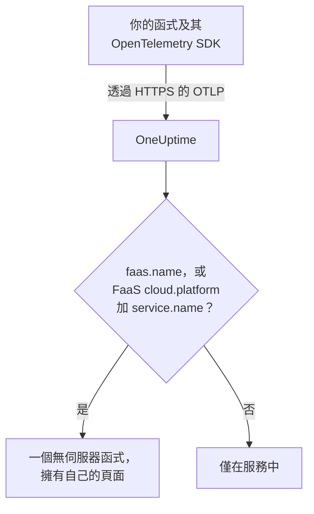

# 無伺服器函式

OneUptime 一收到無伺服器函式傳來的 OpenTelemetry 資料就會辨識該函式，並將它連同其追蹤、日誌和指標列在 **無伺服器函式** 下。它適用於 AWS Lambda、Google Cloud Functions、Azure Functions、Cloudflare Workers，以及任何能傳送 OpenTelemetry 的其他 FaaS 執行階段。不需要手動建立任何東西：用函式執行階段對應的 OpenTelemetry SDK 為函式進行檢測，並讓其 OTLP 匯出工具指向 OneUptime。

:::cards
- [OneUptime 如何辨識函式](#oneuptime-如何辨識函式): `faas.name`，或 FaaS 類型的 `cloud.platform` 加上 `service.name`。
- [傳送函式的遙測資料](#傳送函式的遙測資料): 匯出工具設定，以及 Lambda 層。
- [Azure Functions](#azure-functions): 每個 Function App 一個函式，來自 Functions 主機。
- [疑難排解](#疑難排解): 沒有出現的函式，或頁面空白的函式。
:::

## 運作方式

OneUptime 會在每個批次送達時讀取其資源屬性。帶有 `faas.name` 的資源，或帶有 FaaS 類型的 `cloud.platform`（例如 `aws_lambda` 或 `azure_functions`）並同時帶有 `service.name` 的資源，就是一個無伺服器函式：OneUptime 會隨其第一批資料建立該函式，並將遙測資料歸到它底下。



## 開始之前

- 一把擷取金鑰。在 **專案設定 → 遙測與 APM → 擷取金鑰** 下建立一把並複製其值。
- 適用於函式所用語言的 OpenTelemetry SDK 或自動檢測層。

## OneUptime 如何辨識函式

OneUptime 依 `faas.name` 資源屬性辨識每個函式。有些平台的資源偵測器從不設定它（[Azure Functions](#azure-functions) 是常見情況），因此當資源沒有 `faas.name`，但其 `cloud.platform` 是 FaaS 平台時，OneUptime 會改用其 `service.name` 作為函式的身分，並將該值作為 `faas.name` 填入它儲存的每個 span、日誌、指標和效能剖析資料中，讓函式的頁面能找到其全部遙測資料：

| 屬性 | 是否必要 | 用途 |
| --- | --- | --- |
| `faas.name` | **是**，除非設定了後面兩個 | 函式身分（例如 `checkout-handler`） |
| `cloud.platform` | 沒有 `faas.name` 時，與 `service.name` 一起 | `aws_lambda`、`gcp_cloud_functions`、`azure_functions`、`tencent_cloud_scf` 或 `alibaba_cloud_fc` |
| `service.name` | 在沒有 `faas.name` 的 FaaS 類型 `cloud.platform` 上 | 函式身分，以 `faas.name` 寫入遙測資料 |
| `faas.version` | 否 | 顯示在概覽中 |
| `faas.instance` | 否 | 在 **執行個體** 頁面上依執行個體追蹤 |
| `cloud.provider` / `cloud.region` / `cloud.account.id` | 否 | 顯示在概覽中 |
| `process.runtime.name` / `process.runtime.version` | 否 | 作為執行階段顯示在概覽中 |

你設定的 `faas.name` 永遠不會被取代。`cloud.platform` 的值必須依列出的方式拼寫（某些 Azure 偵測器傳送的帶點 `azure.functions` 也會被接受），而且 `service.name` 必須是資源屬性：`x-oneuptime-service-name` 標頭命名的是服務，而不是函式。

> [!NOTE]
> 同時設定了 `service.name` 的函式仍然也會出現在 **服務** 下。**無伺服器函式** 是為函式打造的檢視，依 `faas.name` 界定範圍。

## 傳送函式的遙測資料

:::steps
### 設定 OTLP 匯出工具的環境變數

大多數語言的自動檢測會讀取標準的 OpenTelemetry 環境變數：

```bash
OTEL_EXPORTER_OTLP_ENDPOINT="https://oneuptime.com/otlp"
OTEL_EXPORTER_OTLP_HEADERS="x-oneuptime-token=YOUR_TELEMETRY_INGESTION_TOKEN"
OTEL_RESOURCE_ATTRIBUTES="faas.name=checkout-handler,faas.version=1.4.2"
```

如果你自行託管 OneUptime，請將端點替換為 `https://YOUR-ONEUPTIME-HOST/otlp`。在 Azure Functions 上，請不要把 `faas.name` 放進 `OTEL_RESOURCE_ATTRIBUTES` —— 請參閱 [Azure Functions](#azure-functions)。

> [!WARNING]
> 擷取金鑰是機密。請使用 **伺服器** 類型的擷取金鑰，並將其設為函式的環境變數。送達瀏覽器的金鑰，任何檢視頁面原始碼的人都能讀到。

### 新增 OpenTelemetry Lambda 層（AWS Lambda）

在 AWS Lambda 上，最簡單的方式是 [OpenTelemetry Lambda 層](https://opentelemetry.io/docs/faas/lambda-auto/)。為函式的執行階段附加該層，並設定：

```bash
AWS_LAMBDA_EXEC_WRAPPER=/opt/otel-handler
OTEL_EXPORTER_OTLP_ENDPOINT=https://oneuptime.com/otlp
OTEL_EXPORTER_OTLP_HEADERS=x-oneuptime-token=YOUR_TELEMETRY_INGESTION_TOKEN
```

該層會根據函式名稱設定 `faas.name`，其資源偵測器會填入 `cloud.platform`、`cloud.region` 和 `cloud.account.id`。在其他平台上，請略過這一步。

### 叫用函式並檢查資料是否送達

檢查 OneUptime 是否接受該金鑰：

```bash
curl -i https://oneuptime.com/otlp/v1/validate \
  -H "x-oneuptime-token: YOUR_TELEMETRY_INGESTION_TOKEN"
```

帶有 `"valid": true` 的 `200` 表示 OneUptime 接受該金鑰；`401` 表示該金鑰不明、已撤銷、已停用或已到期。接著叫用函式。一旦它傳送了 span、日誌或指標，它就會出現在 **產品 → 基礎設施 → 無伺服器 → 所有函式** 下。
:::

## Azure Functions

Azure Functions 主機本身就能傳送 OpenTelemetry，因此無論 Function App 以什麼語言撰寫，都不需要變更程式碼即可回報其叫用（追蹤、日誌和指標）。Microsoft 的指南是 [Use OpenTelemetry with Azure Functions](https://learn.microsoft.com/en-us/azure/azure-functions/opentelemetry-howto)。

### Function App 如何顯示

Azure 的資源偵測器（Functions 主機自己的偵測器、`Microsoft.Azure.Functions.Worker.OpenTelemetry` 中 .NET 隔離背景工作角色的偵測器，以及 `@opentelemetry/resource-detector-azure` 中的 Node.js 偵測器）描述的是 **Function App**，而不是單一函式，而且它們都不會設定 `faas.name`：

| 屬性 | 值 |
| --- | --- |
| `service.name` | Function App 的名稱，來自 `WEBSITE_SITE_NAME` |
| `cloud.provider` | `azure` |
| `cloud.platform` | `azure_functions`；Node.js 偵測器寫的是 `azure.functions`，OneUptime 會將其改寫 |
| `cloud.region` | 應用程式的區域，來自 `REGION_NAME` |
| `cloud.resource_id` | `/subscriptions/<subscription>/resourceGroups/<group>/providers/Microsoft.Web/sites/<app>` |
| `faas.instance` | 執行個體，來自 `WEBSITE_INSTANCE_ID`：僅 Node.js 偵測器 |

因此，OneUptime 依 `service.name` 辨識函式，以 Function App 的名稱填入 `faas.name`，並顯示 **每個 Function App 一個無伺服器函式**。資源描述的是應用程式，而不是它的某個函式：無論執行的是應用程式中的哪個函式，每個執行個體回報的都是相同的應用程式層級屬性；在 Flex Consumption 方案中，有些函式甚至會在各自的執行個體上相應放大。各個函式體現在遙測資料本身之中：

- 主機會為每次叫用啟動一個 span，並以它執行的函式命名：請在函式的 **追蹤** 頁面上依該名稱搜尋。
- 主機會記錄 `faas.invoke_duration`，這是一個以秒為單位的長條圖，函式名稱位於資料點屬性 `faas.name` 中：在 **指標** 頁面或儀表板上依它將該指標分組，即可得到每個函式的延遲。

請不要像通用的 [第一步](#設定-otlp-匯出工具的環境變數) 範例那樣，在 Function App 上把 `faas.name` 加到 `OTEL_RESOURCE_ATTRIBUTES`。應用程式設定會送達應用程式的每個處理程序，因此其所有函式的遙測資料都會帶有這一個名稱，而 OneUptime 從不取代它收到的 `faas.name`。Microsoft 的指南也這麼說：不要把特定於函式的值放在資源上。保持不設定，函式就會以應用程式命名。

設定了 `OTEL_SERVICE_NAME` 時，主機和 .NET 隔離背景工作角色會用它取代應用程式的名稱。請讓同一個應用程式的所有處理程序使用相同的 `service.name`：主機和語言背景工作角色都會傳送遙測資料，回報第二個名稱的背景工作角色會產生第二個無伺服器函式。資源中沒有 FaaS 類型 `cloud.platform` 的背景工作角色不會加入任何無伺服器函式 —— 請參閱 [檢測你的函式程式碼](#檢測你的函式程式碼選用)。

:::steps
### 在 Functions 主機中啟用 OpenTelemetry

在應用程式 `host.json` 的根層級新增 `"telemetryMode": "OpenTelemetry"`：

```json title="host.json"
{
  "version": "2.0",
  "telemetryMode": "OpenTelemetry"
}
```

之後，無論應用程式使用什麼語言，主機都會傳送它自己的追蹤（每次叫用一個 span，另外還有觸發程序函式背後的 Service Bus 和 Event Hubs 處理器 span）、它的日誌，以及包括 `faas.invoke_duration` 在內的指標。

### 讓主機指向 OneUptime

將匯出工具設定為應用程式設定：

```bash
az functionapp config appsettings set \
  --name my-function-app \
  --resource-group my-rg \
  --settings \
    OTEL_EXPORTER_OTLP_ENDPOINT=https://oneuptime.com/otlp \
    OTEL_EXPORTER_OTLP_PROTOCOL=http/protobuf \
    "OTEL_EXPORTER_OTLP_HEADERS=x-oneuptime-token=YOUR_TELEMETRY_INGESTION_TOKEN"
```

如果你自行託管 OneUptime，請將端點替換為 `https://YOUR-ONEUPTIME-HOST/otlp`。`OTEL_EXPORTER_OTLP_PROTOCOL=http/protobuf` 很重要：主機的 .NET 匯出工具預設使用 gRPC，設為 `http/protobuf` 後，它會傳送到端點下的 `/otlp/v1/traces`、`/otlp/v1/metrics` 和 `/otlp/v1/logs`。只有在設定了 `OTEL_EXPORTER_OTLP_ENDPOINT` 時，主機才會傳送 OTLP。

> [!WARNING]
> 此權杖是機密：請使用 **伺服器** 類型的擷取金鑰。應用程式設定在靜態時會加密；若要改為將權杖保存在 Key Vault 中，請將 `OTEL_EXPORTER_OTLP_HEADERS` 設定為 Key Vault 參考，例如 `@Microsoft.KeyVault(SecretUri=https://my-vault.vault.azure.net/secrets/oneuptime-otlp-headers/)`，並在保存庫上為應用程式的受控識別授予 **Key Vault Secrets User** 角色。該參考會解析為所儲存的機密值本身，因此請儲存整個標頭 `x-oneuptime-token=YOUR_TELEMETRY_INGESTION_TOKEN`，而不只是權杖。

如果你仍需要 Application Insights，請保留 `APPLICATIONINSIGHTS_CONNECTION_STRING`：兩者都設定時，主機會將相同的 OpenTelemetry 資料同時傳送到 Application Insights 和 OneUptime。移除它即可只傳送到 OneUptime。

### 檢測你的函式程式碼（選用）

主機已經追蹤了每次叫用。若要從你自己的程式碼中新增與主機相連的 span 和日誌，也請在語言背景工作角色中啟用 OpenTelemetry。它會使用相同的 `OTEL_EXPORTER_OTLP_*` 設定傳送：

- **C# (isolated worker)**：新增 NuGet 套件 `Microsoft.Azure.Functions.Worker.OpenTelemetry`、`OpenTelemetry.Extensions.Hosting` 和 `OpenTelemetry.Exporter.OpenTelemetryProtocol`，然後在 `Program.cs` 中：`builder.Services.AddOpenTelemetry().UseFunctionsWorkerDefaults().UseOtlpExporter();`
- **JavaScript / TypeScript**：在 OpenTelemetry Node.js SDK 及其 OTLP 匯出工具之外執行 `npm install @azure/functions-opentelemetry-instrumentation`，並在 `package.json` 的 `main` 欄位所包含的檔案中註冊 `AzureFunctionsInstrumentation`。
- **Java**：新增 Maven 相依性 `com.microsoft.azure.functions:azure-functions-java-opentelemetry`。
- **Python**：設定應用程式設定 `PYTHON_ENABLE_OPENTELEMETRY=true`，把 Microsoft 列出的 OpenTelemetry 套件（其中包括 `opentelemetry-sdk` 和 `opentelemetry-exporter-otlp`）加到 `requirements.txt`，並在 `function_app.py` 中設定匯出工具。
- **PowerShell**：設定應用程式設定 `OTEL_FUNCTIONS_WORKER_ENABLED=True`，並從 `profile.ps1` 載入 `AzureFunctions.PowerShell.OpenTelemetry.SDK` 模組。

Microsoft 的指南中有每種語言的完整程式碼。.NET 背景工作角色（透過 `UseFunctionsWorkerDefaults()`）和 Python 背景工作角色（透過 `PYTHON_ENABLE_OPENTELEMETRY`）會告訴主機將它們的日誌交給它們自己處理，因此這些日誌不會被傳送兩次。

只有當背景工作角色的資源像主機的資源那樣描述應用程式時，也就是具有相同的 `service.name` 和 FaaS 類型的 `cloud.platform`，它的 span 和日誌才會送達函式的頁面。.NET 隔離背景工作角色（透過 `UseFunctionsWorkerDefaults()`）和 Microsoft 的 Node.js 範例（透過 `getResourceDetectors()` 所包含的 Azure 偵測器）兩者都會回報。Microsoft 的 Python 範例在建立資源時沒有使用 Azure 偵測器，因此預設情況下兩者都不回報，其遙測資料永遠到不了該函式。對於 Python，或任何未設定 Azure Functions 資源偵測器的背景工作角色，請再新增兩個應用程式設定。應用程式的每個處理程序都會讀取它們（包括主機），因此它們都會回報相同的身分：

```bash
az functionapp config appsettings set \
  --name my-function-app \
  --resource-group my-rg \
  --settings \
    OTEL_SERVICE_NAME=my-function-app \
    "OTEL_RESOURCE_ATTRIBUTES=cloud.provider=azure,cloud.platform=azure_functions"
```

將 `OTEL_SERVICE_NAME` 設定為 Function App 自己的名稱。這正是沒有該設定時主機和 Node.js 偵測器回報的名稱，因此函式會保留它已有的身分。
:::

### 限制

- **C# 同處理序應用程式** 無法使用 OpenTelemetry：請先將它們移轉到隔離背景工作角色模型。
- 主機處於 OpenTelemetry 模式時，Azure 入口網站中的 **記錄串流** 無法運作，而且入口網站的 _Recent function invocations_ 清單需要 Application Insights 中的遙測資料。請改用 OneUptime 中該函式的 **日誌** 和 **追蹤** 頁面。
- 一旦 `telemetryMode` 為 `OpenTelemetry`，`host.json` 的 `logging.applicationInsights` 區段就不再適用。
- **執行個體** 會列出 `faas.instance` 的值。在上述偵測器中，只有 Node.js 偵測器會設定它，因此對於來自主機和 .NET 背景工作角色的遙測資料，該頁面會保持空白。

## 你會得到什麼

一旦函式傳送了 span、日誌或指標，它就會出現在 **無伺服器函式** 下。它的 **概覽** 會顯示：

- **呼叫**、**錯誤率** 和 **p95 持續時間**，根據你所選時間範圍內的追蹤計算，並附有趨勢圖。
- **執行個體**：函式回報的 `faas.instance` 值的即時清單。
- 限定於該函式的完整 **日誌**、**追蹤** 和 **指標** 頁面。

## 為函式加上標籤並指派擁有者

以 `oneuptime.label.` 開頭的資源屬性會成為函式上的專案標籤：`oneuptime.label.team=payments` 會新增標籤 `team:payments`。將這些屬性加到 `OTEL_RESOURCE_ATTRIBUTES`：

```bash
OTEL_RESOURCE_ATTRIBUTES="faas.name=checkout-handler,oneuptime.label.team=payments,oneuptime.label.env=production"
```

若要改為依函式名稱加上標籤或指派擁有者，請開啟 **產品 → 基礎設施 → 無伺服器**，並使用側邊選單中的 **標籤規則** 和 **擁有者規則**。規則會在建立函式時執行，包括自動探索到的函式。若要將規則套用到已有的函式，請使用該規則的 **Run Now**（請參閱 [對現有資源執行規則](/docs/configuration/run-rules-now)）。

## 疑難排解

:::details 函式沒有出現在無伺服器函式下
請依以下順序檢查：

1. 設定變數後，函式已被叫用過：它只在執行時傳送遙測資料。
2. 在 AWS Lambda 上，已為函式的執行階段附加該層，而且 `AWS_LAMBDA_EXEC_WRAPPER` 為 `/opt/otel-handler`：沒有該包裝函式，層的檢測永遠不會啟動。
3. 在其他平台上，函式的程式碼會載入 OpenTelemetry SDK 或自動檢測：僅靠變數不會傳送任何資料。
4. 資源帶有 `faas.name`，或 FaaS 類型的 `cloud.platform` 加上 `service.name`。沒有它們時，遙測資料會改為以服務的形式歸到 **服務** 下。
5. 函式能連線到你的 OneUptime URL。位於私人網路中的函式需要一條通往它的輸出路由，例如 NAT 閘道。
:::

:::details 函式已列出，但其頁面空白
函式的 **概覽**、**日誌**、**追蹤** 和 **指標** 顯示的是 `faas.name` 與函式名稱完全相同（包括大小寫）的遙測資料。透過 FaaS 類型的 `cloud.platform` 及其 `service.name` 命名的函式不需要自己的 `faas.name`：OneUptime 會在遙測資料送達時，將 `service.name` 作為 `faas.name` 寫入其中。在 OneUptime 開始填入 `faas.name` 之前儲存的遙測資料不會更新，也不會出現在頁面中：請叫用函式以傳送新的遙測資料。也請檢查頁面頂端的時間範圍。
:::

:::details 函式顯示為已中斷連線
當 OneUptime 在 15 分鐘內沒有從函式收到任何資料時，函式會變為已中斷連線；OneUptime 每 5 分鐘檢查一次，而且它自身未在接收資料的時間不計入。只是偶爾執行的函式在兩次執行之間處於已中斷連線狀態：收到它的下一批遙測資料後，它會重新變為已連線。
:::

## 後續步驟

:::cards
- [OpenTelemetry](/docs/telemetry/open-telemetry): 從任何應用程式傳送追蹤、日誌和指標。
- [佇列](/docs/telemetry/queues): 你的函式發佈訊息和取用訊息的佇列與主題。
- [追蹤監控](/docs/monitor/traces-monitor): 針對函式的失敗或緩慢叫用發出警示。
:::
