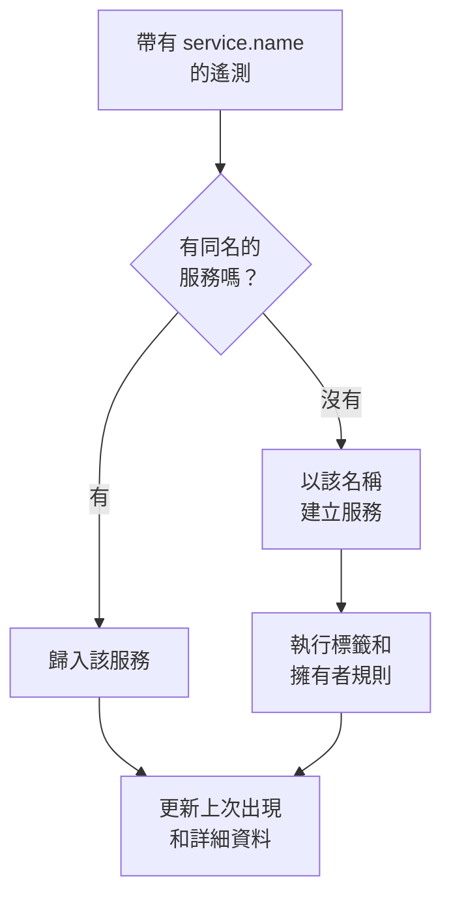

# 服務目錄

服務目錄列出你執行的應用程式和微服務。服務的遙測第一次到達時，OneUptime 會新增這個服務，然後把它的日誌、追蹤、指標、例外、事件和擁有者彙集到一個頁面上，讓任何人都能了解服務做什麼、誰負責它以及它的執行狀況。

:::cards
- [服務如何進入目錄](#服務如何進入目錄): 它的 `service.name`，隨第一批遙測而來。
- [尋找服務](#尋找服務): 清單、篩選條件和欄。
- [服務的頁面](#服務的頁面): 關於一個服務的一切。
- [封存或刪除服務](#封存或刪除服務): 保留歷史，或將其移除。
:::

## 服務如何進入目錄

你不需要建立服務。每一批遙測都會在 `service.name` 資源屬性中寫明傳送它的服務。OneUptime 把這批遙測歸入同名的服務；如果專案中還沒有這個服務，就建立它。

- **名稱就是服務的身分。** 比較時不區分大小寫，所以 `Checkout-API` 和 `checkout-api` 是同一個服務。新的 `service.name` 會產生一個新服務。
- **容器會自己命名。** 來自 Docker 和 Podman 代理程式的遙測如果沒有 `service.name`，服務會以其容器命名。
- **擷取金鑰可以指定服務。** 使用設定了 **固定的服務名稱** 的金鑰傳送的 OpenTelemetry 資料，無論其 `service.name` 為何，都會歸入該名稱的服務。請參閱 [擷取金鑰](/docs/telemetry/ingestion-keys#鎖定瀏覽器金鑰)。
- **瀏覽器和手機不是服務。** 來自瀏覽器或行動應用程式的遙測屬於 [RUM 應用程式](/docs/rum/applications)。
- **標籤可以隨遙測一起到達。** 名為 `oneuptime.label.<name>` 的資源屬性會為服務新增標籤 `<name>:<value>`，例如 `oneuptime.label.team=payments` 會新增 `team:payments`。

每次遙測到達時，服務的 **上次出現** 都會向前推進，其詳細資料也會根據隨之而來的資源屬性更新：

| 詳細資料 | 來自屬性 |
| --- | --- |
| 服務版本 | `service.version` |
| 部署環境 | `deployment.environment.name` 或 `deployment.environment` |
| 服務名稱空間 | `service.namespace` |
| 執行階段 | `process.runtime.name` 和 `process.runtime.version` |
| 技術 | `telemetry.sdk.language`，或執行階段 |
| 雲端 | `cloud.provider`、`cloud.platform`、`cloud.region` 和 `cloud.account.id` |

## 開始之前

- **正在到達的遙測** 帶有 `service.name`。請參閱 [OpenTelemetry](/docs/telemetry/open-telemetry)：`OTEL_SERVICE_NAME` 用於設定它。
- **可以讀取服務的角色。** Project Owner、Project Admin、Project Member、Viewer、Settings Admin、Settings Member 或 Settings Viewer，或者擁有 Read Service 權限的自訂角色。建立、變更和刪除服務需要 Project Owner、Project Admin、Project Member、Settings Admin 或 Settings Member，或者對應的服務權限。

## 尋找服務

前往 **產品 → 資源 → 服務**。**所有服務** 列出每個服務及其 **名稱**、**描述**、**Technology**、**上次出現**、**標籤** 和 **擁有者**。

- 依名稱或描述搜尋，並用清單上方的工具列依擁有者或標籤篩選。
- 選擇多個服務，可以一次為它們全部新增標籤或擁有者，或將它們封存。
- 點選一個服務即可開啟它的頁面。

要在服務的遙測到達之前新增它，例如先設定擁有者，請點選 **建立服務**，並在 **名稱** 中確切輸入它將來的 `service.name`。標籤和擁有者規則會像對待自動發現的服務一樣對它執行。儲存後，OpenTelemetry 設定指南會開啟，每個程式碼片段中都已填入該名稱；指南的最後一步 **等待連線** 會在服務的第一批資料送達時告訴你。

## 服務的頁面

服務的側邊選單有五個部分：

| 部分 | 頁面 |
| --- | --- |
| **基礎** | **概覽**：根據其 span 得出的請求數、錯誤率和 p95 延遲、圖表以及服務詳細資料。**建議**：依服務所用語言挑選的現成監測器。**擁有者**：對服務負責的人員和團隊。**動態**：服務經歷的一切，從它如何被建立到此後的每一次變更。 |
| **遙測** | 已經依此服務篩選的 **日誌**、**追蹤**、**指標**、**效能設定檔**、**例外** 和 **Source Maps**。 |
| **活動** | 影響此服務的 **事件**、**警示** 和 **排定維護**。 |
| **開發者** | **Terraform**、**API** 和 **AI 助理**：透過程式碼管理該服務。預設摺疊。 |
| **進階** | **設定**、**稽核日誌** 和 **刪除服務**。**進階** 預設摺疊：請先展開它。 |

擁有者的作用不止於這個頁面：範圍為 Owned（擁有）的角色會讀取你或你的團隊所擁有的服務的遙測。請參閱 [遙測](/docs/permissions/index#遙測)。

## 變更服務

:::steps
### 開啟設定

開啟服務，在側邊選單中展開 **進階**，然後點選 **設定**。

### 重新命名或新增描述

在 **服務詳細資訊** 上，點選 **編輯詳細資料** 以變更其 **名稱**、**描述** 或 **標籤**。名稱必須仍與其遙測報告的 `service.name` 一致：也要在你的 OpenTelemetry 設定中變更它，否則下一批遙測會建立一個新服務。

### 選擇顏色和技術堆疊

在 **服務設定** 上，點選 **編輯設定**。**服務顏色** 用於在圖表和清單中標示服務；新服務會得到一個專屬顏色。**技術堆疊** 是選用的：留空則顯示從遙測中偵測到的語言。
:::

同一個頁面還包含服務的資料保留設定。**遙測資料保留** 和 **依遙測類型的保留時間** 卡片可以讓服務的遙測保留得比專案預設保留期更長或更短。它們屬於 [Enterprise Edition](/docs/self-hosted/enterprise)，在 OneUptime Cloud 上屬於 Scale 方案；沒有它們時，頁面會說明它們帶來什麼，服務沿用專案的保留期。

## 自動設定標籤和擁有者

規則會在新服務建立時為其新增標籤和擁有者，自動發現的服務也包括在內。可以在 **服務 → 設定 → 擁有者規則** 和 **服務 → 設定 → 標籤規則** 中找到它們；側邊選單中的 **設定** 預設摺疊。請參閱 [標籤與擁有者規則](/docs/configuration/label-and-owner-rules)。

## 封存或刪除服務

對於不再關注、但想保留其歷史的服務，請將其封存。已封存的服務不會出現在 **所有服務** 中，但會繼續收集遙測。可以在其 **設定** 頁面上封存，也可以在清單中選擇多個服務。要還原一個服務，請開啟 **服務 → 進階 → 已封存**。

> [!WARNING]
> 刪除服務也會刪除它的原始碼對應，以及為它設定的指標管道規則和 LLM 成本預算。如果 OneUptime 仍在接收它的遙測，服務會被重新新增，但不再帶有你給它的標籤、擁有者和設定。若要把它從清單中移走並保留一切，請改為封存。

## 疑難排解

:::details 一個服務出現了兩次
有兩個 `service.name` 值到達了 OneUptime，例如來自你的設定的兩個版本，或者只在一側改了名。遙測依名稱比對：讓每個執行個體都報告同一個 `service.name`，然後封存或刪除不再需要的服務。
:::

:::details 我的服務不在目錄中
檢查它的遙測是否帶有 `service.name`。來自瀏覽器或行動應用程式的遙測會進入 Real User Monitoring，而沒有服務名稱的主機或叢集的遙測會歸入該主機或叢集。
:::

:::details 上次出現的時間落後
**上次出現** 大約每分鐘更新一次，而不是每一批都更新，所以它可能比即時遙測落後一分鐘左右。
:::

## 後續步驟

:::cards
- [日誌瀏覽器](/docs/telemetry/logs-explorer): 搜尋服務的日誌。
- [追蹤瀏覽器](/docs/telemetry/traces-explorer): 追蹤它的請求。
- [例外狀況追蹤](/docs/telemetry/exceptions): 分流它擲回的錯誤。
- [標籤與擁有者規則](/docs/configuration/label-and-owner-rules): 為新服務新增標籤和擁有者。
:::
