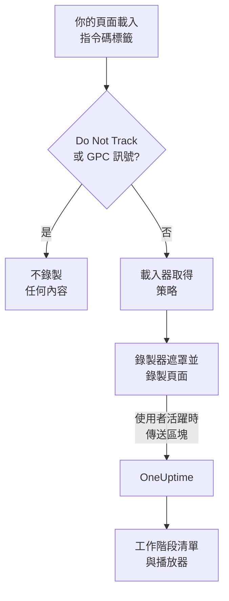
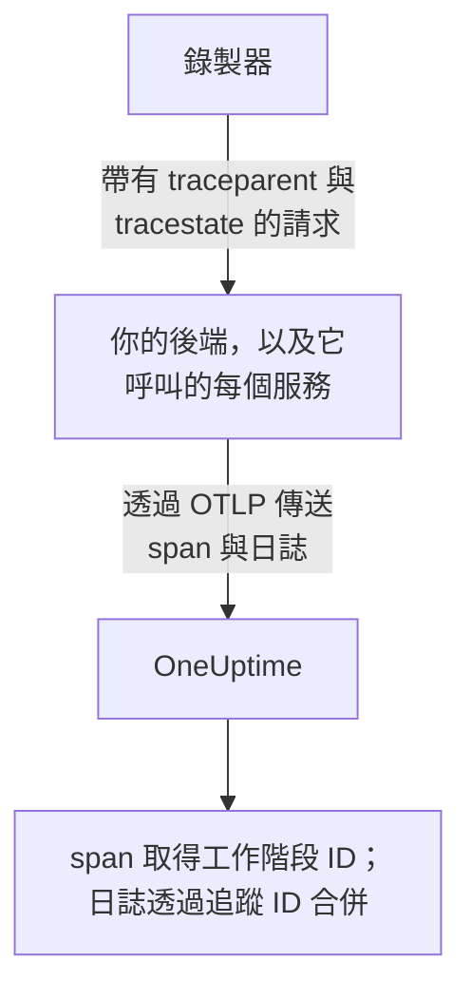
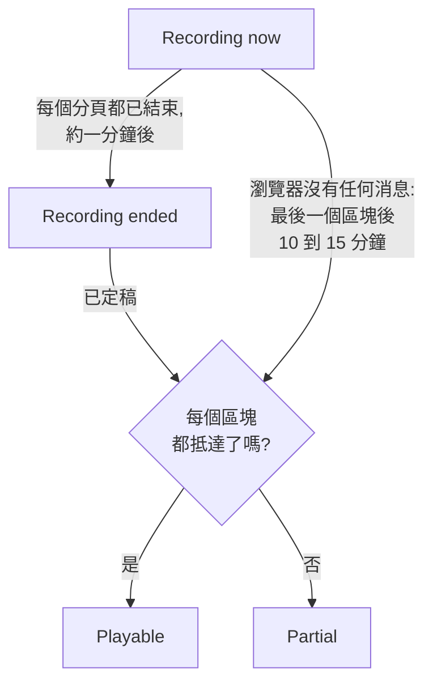
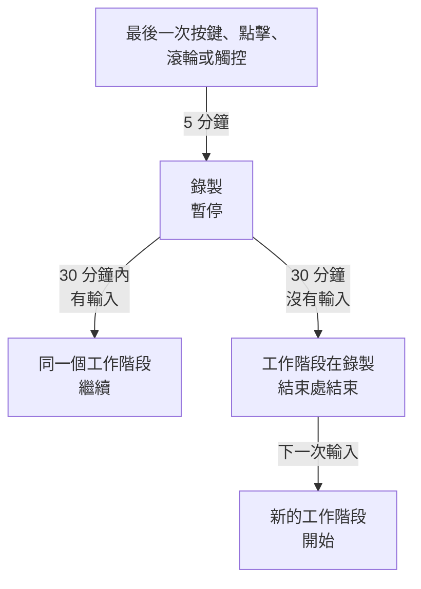

# 工作階段重播

工作階段重播會錄製真實使用者在你的 Web 應用程式或 React Native 應用程式中看到的內容，並與同一個工作階段的錯誤、追蹤與日誌並排播放。你只需加入一個指令碼標籤、選擇要遮罩的內容，就可以從它所屬的 RUM 應用程式中觀看任何工作階段。

:::cards
- [運作方式](#運作方式): 一個載入器、一份策略，以及一個邊錄邊上傳的錄製器。
- [安裝](#安裝): 每個頁面上的一個指令碼標籤，或 React Native SDK。
- [隱私](#隱私): 遮罩哪些內容、同意，以及誰可以傳送錄製。
- [與其他遙測資料關聯](#與其他遙測資料關聯): 後端追蹤、日誌與錯誤，不需要程式碼即可關聯。
- [觀看工作階段](#觀看工作階段): 工作階段清單、使用者頁面、使用者流程與播放器。
- [錄製健康狀態](#錄製健康狀態): 為什麼沒有資料抵達，以及在預算用完之前發出警示。
:::

## 運作方式

你頁面上的指令碼是一個小型載入器。它會檢查瀏覽器的隱私訊號，從 OneUptime 取得應用程式的策略，然後才載入錄製器；錄製器在錄製頁面的同時進行遮罩，並在使用者活躍時分區塊上傳。



預設情況下，每個工作階段都會被錄製並邊錄邊上傳，而不只是出了問題的工作階段。正是在什麼都沒出錯的工作階段裡，你才能找到沒人完成的結帳、所有人都放棄的表單，以及客戶說「看起來怪怪的」的頁面。

若要減少儲存量，可以搭配使用應用程式策略中的兩項設定：

| 設定 | 預設值 | 它改變什麼 |
| --- | --- | --- |
| **取樣百分比** | 100 | 有資格被錄製的工作階段數量。減半後，儲存的位元組數與靜態保存的終端使用者資料都會減半。該決定根據工作階段 ID 的雜湊，每個工作階段只做一次，所以工作階段永遠不會只錄一半。 |
| **何時上傳錄製** | _Always_ | 設為 _On error or frustration_ 時，錄製器在記憶體中保留一個滾動緩衝區，只在出問題時才上傳。這樣幾乎每個失敗的工作階段都有錄製，成本比錄製所有人低大約 15 倍，但你無法觀看沒有出問題的工作階段。 |

## 開始之前

- 一個 RUM 應用程式。在 **產品 → 資源 → 真實使用者監測** 下建立，或讓你的遙測資料建立它：請參閱 [管理應用程式](/docs/rum/applications) 。
- 一個 **瀏覽器** 擷取金鑰，來自 **專案設定 → 遙測與 APM → 擷取金鑰** 。Browser 金鑰只在你為它列出的來源上有效：請參閱 [在正式環境中設定允許的來源](#在正式環境中設定允許的來源) 。

工作階段重播預設為開啟。它的設定位於三個地方：

| 位置 | 內容 |
| --- | --- |
| 應用程式的 **Replay Policy** 頁面 | 策略（錄製、遮罩、同意、追蹤與限制）、 **錄製健康狀況** 摘要、 **錄製包含的內容** 卡片、 **Test your installation** 面板與 **Record a specific user's next session** 。 |
| 應用程式的 **健康狀況** 頁面 | 錄製是否正在抵達，如果沒有，原因是什麼。請參閱 [錄製健康狀態](#錄製健康狀態) 。 |
| **真實使用者監測 → 設定 → 工作階段重播** | 一次停止所有應用程式的專案層級開關，以及每個應用程式策略的唯讀清單。 |

## 安裝

在每個要錄製的頁面上加入一個指令碼標籤。

:::steps
### 建立 Browser 金鑰

在 **專案設定 → 遙測與 APM → 擷取金鑰** 下，按一下 **建立擷取金鑰** ，選擇 **瀏覽器** 作為 **金鑰類型** ，並在 **允許的來源** 中列出你網站的來源。然後複製該金鑰的 **密鑰金鑰** 。 [瀏覽器端設定](/docs/rum/browser-setup#設定步驟) 展示了每個畫面。

### 新增指令碼標籤

在每個頁面上放置該標籤，填入你的金鑰與應用程式的識別碼：

```html
<script
  src="https://oneuptime.com/telemetry/session-replay/v1/recorder.js"
  data-oneuptime-token="YOUR_TELEMETRY_INGESTION_KEY"
  data-oneuptime-app-identifier="storefront-web"
  crossorigin="anonymous"
  async
></script>
```

`data-oneuptime-app-identifier` 必須與 RUM 應用程式的識別碼一致，也就是你用於 `service.name` 的同一個值。應用程式側邊選單 **工作階段重播** 區段中的 **文件** 頁面，會顯示這段已填好兩個值的程式碼片段，以及適用於 Next.js / React 與 Google Tag Manager 的版本。

### 確認錄製已抵達

開啟你的某個頁面，四處點按幾秒鐘。大約一分鐘內，該工作階段就會出現在應用程式的 **工作階段重播** 頁面上，標示為 **正在錄製** 。如果沒有出現，應用程式的 **健康狀況** 頁面會說明原因：請參閱 [錄製健康狀態](#錄製健康狀態) 。
:::

`/v1/recorder.js` 處的指令碼是一個小型載入器。它會檢查 Do Not Track，取得你的應用程式的策略，然後才載入 `/latest/recorder.js` 。策略與錄製器都以 `no-store` 提供，因此任何一方的變更都會在下一次頁面載入時生效，不需要等待瀏覽器快取到期。

### 指令碼標籤屬性

| 屬性 | 必要 | 作用 |
| --- | --- | --- |
| `data-oneuptime-token` | 是 | 你的遙測擷取權杖。 |
| `data-oneuptime-app-identifier` | 是 | RUM 應用程式的識別碼。 |
| `data-oneuptime-host` | 否 | OneUptime 來源。省略時會從指令碼本身的 `src` 推導，因此只有在透過你自己的網域以 Proxy 提供指令碼時才需要它。 |
| `data-oneuptime-user-ref` | 否 | 頁面載入時已知的終端使用者參照（使用者 ID，絕不是你不想儲存的電子郵件地址）。與之後 `identify()` 設定的內容相同；這是唯一適用於 [錄製特定使用者的下一個工作階段](#錄製特定使用者的下一個工作階段) 的形式。 |
| `data-oneuptime-respect-do-not-track` | 否 | 預設遵守 Do Not Track 與 Global Privacy Control。設為 `"false"` 則無視該訊號進行錄製；請參閱 [Do Not Track](#do-not-track) 。 |
| `data-oneuptime-debug` | 否 | `"true"` 會把錄製器的決定輸出到主控台。請參閱 [工作階段重播疑難排解](/docs/rum/session-replay-troubleshooting) 。 |
| `data-oneuptime-offline-storage` | 否 | 設為 `"false"` 時，訪客離線期間錄製的區塊只保存在記憶體中，而不會同時保存到瀏覽器的 IndexedDB。請參閱 [離線模式](#離線模式) 。 |

同樣的選項也可以透過一個全域物件而不是標籤提供，標籤管理工具與打包安裝就是這樣做的：

```js
window.__ONEUPTIME_SESSION_REPLAY__ = {
  host: "https://oneuptime.com",
  token: "YOUR_TELEMETRY_INGESTION_KEY",
  appIdentifier: "storefront-web",
  userRef: "user-123", // optional
  respectDoNotTrack: true, // optional
  debug: false, // optional
  offlineStorage: true, // optional; false keeps offline chunks in memory only
};
```

### 正常安裝的樣子

開啟 DevTools → Network 並篩選 `session-replay` 。一個正常運作的頁面會產生：

1. 每次頁面載入 **一個 `GET .../session-replay/v1/config`** — 取得策略。
2. **在使用者進行操作時，大約每 15 秒一個 `POST .../session-replay/v1/chunk`** ，或在累積了 256 KB 事件時更早送出。閒置的分頁不產生事件，也就完全沒有 POST：在根據 Network 分頁判斷安裝之前，請先移動滑鼠或按一下。
3. 當分頁被隱藏時，以及頁面消失時再一次，一個以 `keepalive` 送出的 `POST` 。頁面消失 — 分頁被關閉、重新載入或導覽到其他頁面，或者頁面被放入瀏覽器的往返快取（任何 `pagehide` ） — 會將它標記為最後一個，告訴 OneUptime 該分頁的錄製已經結束；使用者從往返快取中帶回的頁面，會作為同一個工作階段中的新分頁繼續錄製。僅僅被隱藏的分頁仍處於開啟狀態，因此使用者回來後錄製會繼續。它的整個本文保持在 56 KB 以下 — 即瀏覽器每個來源 64 KB 的 keepalive 配額中錄製器所佔的份額 — 並且可以在這一個請求中以框架的形式帶上多個區塊：封口區塊、大型封口區塊被切成的各個部分（每部分最多 48 KB 事件，以便框架標頭仍然放得下），以及仍在等待重試的每個區塊。在分頁僅被隱藏時就已經超出這個預算的區塊，會改為在頁面仍然存活、可以送出時走一般路徑。

在觸發器為 _On error or frustration_ 時，第 2 步要等到觸發器觸發後才會發生 — 請參閱 [疑難排解](#疑難排解) 。

## 在 React Native 中安裝

React Native SDK 將原生檢視階層錄製為與 rrweb 相容的合成事件，因此行動裝置錄製與 Web 錄製在同一個工作階段清單與同一個播放器中開啟。它不擷取螢幕截圖。播放器會將每個錄製標示為 React Native 應用程式，其 **Fidelity** 分頁會說明無法呈現的原生介面。

:::steps
### 安裝 SDK

該 SDK 支援 iOS 與 Android 上的 React Native 應用程式。將它與用於持久發件匣的對等相依套件一起安裝：

```bash
npm install @oneuptime/react-native-replay @react-native-async-storage/async-storage
```

在不使用 Expo 的 iOS 專案中，加入這些套件後照常執行 CocoaPods 安裝；目前版本的 React Native 會自動連結 Android，不需要手動註冊。除了 Async Storage 之外，錄製器還有自己的檢視樹原生模組，因此 Expo 專案必須使用自訂的開發建置或正式建置（例如 EAS Build 或 prebuild）。Expo Go 無法執行這個 SDK，因為這兩個原生模組都無法加入 Expo Go 固定的二進位檔中。

### 啟動錄製器並包裝你的應用程式

啟動一次單例，然後把提供者放在你要錄製的應用程式部分之上：

```tsx
import {
  OneUptimeReplay,
  OneUptimeReplayProvider,
} from "@oneuptime/react-native-replay";

OneUptimeReplay.start({
  host: "https://oneuptime.com",
  token: "YOUR_TELEMETRY_INGESTION_KEY",
  appIdentifier: "storefront-mobile",
  mobileAppIdentifier: "com.example.storefront",
  appName: "Storefront", // optional, shown in session details
  appVersion: "4.2.0", // optional, shown in session details
});

export default function App() {
  return (
    <OneUptimeReplayProvider>
      <Navigation />
    </OneUptimeReplayProvider>
  );
}
```

`appIdentifier` 是 RUM 應用程式的識別碼。 `mobileAppIdentifier` 是二進位檔中發佈的 Android 應用程式 ID 或 iOS 套件組合識別碼，而不是顯示名稱。在 [`app://` 允許清單](#在正式環境中設定允許的來源) 中使用同一個值。SDK 從 `host` 取得應用程式的 Replay Policy；取樣、觸發器、同意、保留與上傳預算仍由伺服器控制。
:::

提供者擁有一個不可摺疊的原生根節點，並錄製它的檢視樹，以及觸控的開始、移動與結束事件。如果你已經自行建構錄製器執行個體，請透過 `<OneUptimeReplayProvider recorder={recorder}>` 傳入一個。 `MobileReplayRecorder` 也有匯出，用於隔離的或多用戶端的整合；大多數應用程式應使用單例。

### React Native API

直接匯入 `OneUptimeReplay` ，或在提供者之下呼叫 `useOneUptimeReplay()` 。該單例提供：

| 方法 | 作用 |
| --- | --- |
| `start(options)` | 取得策略並開始擷取。必要的選項是 `host` 、 `token` 、 `appIdentifier` 與 `mobileAppIdentifier` ； `appName` 與 `appVersion` 是選用的顯示中繼資料， `connectivity` 是用於 [離線模式](#離線模式) 的選用網路狀態來源。 |
| `stop()` | 清出可以傳送的內容，停止擷取，並解除生命週期處理常式。 |
| `identify(userRef, traits?)` | 附加已登入的使用者與選用的特徵，受 **擷取終端使用者身分** 約束。 |
| `setTags(tags)` / `addTag(key, value)` | 取代所有可搜尋的工作階段標籤，或在不取代其他標籤的情況下新增一個標籤。 |
| `track(name, properties?)` | 在重播時間軸上放置一個應用程式事件。 |
| `setRoute(route)` | 在導覽後記錄經過清理的邏輯畫面或路由。請在導覽器的路由變更回呼中呼叫它。 |
| `captureSession(reason?)` | 在 _On error or frustration_ 下，因應用程式自訂的原因（例如使用者點按「回報問題」）上傳滾動緩衝區。 |
| `captureError(error)` | 記錄一個已處理的 JavaScript 錯誤，並啟動錯誤觸發的擷取。 |
| `grantConsent()` / `revokeConsent()` | 允許上傳，或立即清除記憶體緩衝區、已儲存的發件匣、工作階段與訪客 ID。之後再次同意會以新的識別碼開始。 |
| `getSessionId()` / `onSessionChange(listener)` | 讀取或訂閱目前已取得同意的重播工作階段 ID，用於關聯追蹤與日誌。當擷取或同意結束時，監聽器也會收到 `null` 。 |
| `getDiagnostics()` | 傳回錄製器狀態與最近的決定，而不傳回所擷取檢視的內容。 |

SDK 會監聽 React Native 的 `AppState` ：進入背景時會關閉並清出已取得同意的事件，而同意之前的錄製只保留在記憶體中。在前景恢復擷取之前，SDK 會在不使用快取回應的情況下重新整理策略。它在活躍期間也會定期重新整理策略，因此停用、同意、取樣、目標設定與身分變更都會在長時間開啟的應用程式中生效。當你的整合永久卸除時呼叫 `stop()` ；一般的畫面間導覽應使用 `setRoute()` ，而不是停止並重新啟動錄製器。

**行動裝置工作階段何時因閒置而結束。** 沒有輸入五分鐘就已經會暫停擷取（請參閱 [閒置時間](#閒置時間) ）。三十分鐘內沒有任何觸控，也沒有任何被記錄的 SDK 呼叫（在擷取期間進行的 `track()` 、 `setTags()` 、 `identify()` 等）時，工作階段就會結束。它在錄製結束的最後一次活動處結束，對於已暫停的工作階段則在暫停處結束 — 而不是在應用程式回來或錄製器察覺時 — 因此在背景或暫停的時間永遠不會被加到工作階段的結尾。一直在前景開啟的應用程式不會每半小時開始一個新的工作階段。下一個工作階段在使用者回來時開始：第一次觸控、螢幕鍵盤出現或消失、應用程式回到前景，或呼叫 `captureSession()` 。它以新的螢幕快照開始。在此之前， `getSessionId()` 傳回 `null` ， `onSessionChange()` 以 `null` 被呼叫。這期間的錯誤、導覽與 `track()` 呼叫都不會被記錄。

若要將行動裝置遙測與重播關聯，請透過 `onSessionChange()` 訂閱，並將傳回的值設定為 OpenTelemetry 檢測中的 `session.id` 屬性。每次回呼觸發時都取代該屬性，值為 `null` 時也要清除它。重播 SDK 不會修補原生網路，也不會自行修改 OpenTelemetry 提供者。

### React Native 的隱私與遮罩

行動裝置擷取刻意比 Web 的遮罩模式更嚴格。原生 UI 文字、協助工具值、輸入值與圖片像素永遠不會被序列化；即使應用程式的 Web 遮罩模式允許可讀的文字，伺服器收到的也是結構性的線框。呼叫端提供的中繼資料，例如使用者參照、事件名稱、路由與可搜尋的標籤，遵循 API 約定，因此不要在這些欄位中放入機密。用 `<ReplayMask>` 包裝特別敏感的子樹，可以將該區域替換為隱私預留位置，同時保留周圍的版面配置。

同意不會從作業系統權限或你的同意橫幅中推斷。在 _Require explicit_ 下，只有當你的應用程式取得了必要的同意時才呼叫 `grantConsent()` 。呼叫 `revokeConsent()` 會捨棄佇列中與已保存的未傳送資料，以及可能把之後的工作階段與被撤銷的工作階段連結起來的識別碼。

行動裝置錄製器會擷取檢視的邊界與類型、觸控位置、邏輯路由、自訂事件與 JavaScript 錯誤。以下限制一律會在播放器的 Fidelity 分頁中揭露：

- 原生 `Image` 的像素是不透明的；只呈現其外框。
- `WebView` 的內容位於 React Native 樹之外。如果託管的頁面需要自己的錄製，請在其中安裝 Web 錄製器。
- Canvas、Skia、OpenGL、地圖、相機預覽、影片以及其他自訂繪製的介面都是不透明的。
- `ReplayMask` 或不透明介面內部的觸控路徑不會被錄製。原生橋接器會檢查觸控的即時目標及其上層元素，如果無法完成這項隱私檢查，就會抑制該手勢。
- Reanimated、native-driver 與 UI 執行緒的動畫會在檢視樹快照時取樣，而不是逐格重現。
- 在清出之前就終止 JavaScript 的原生當機需要原生當機 SDK； `captureError()` 涵蓋的是已處理的 JavaScript 錯誤，而不是處理程序層級的當機傾印。

## 識別你的使用者

在你的頁面說明工作階段屬於誰之前，每個工作階段都是匿名的。沒有這一步，清單仍然可以把同一個瀏覽器的工作階段歸到一個匿名訪客 ID 之下（請參閱下文的 [匿名訪客](#匿名訪客) ），但沒有任何東西能說出這個人是誰，也無法把這個人的第二個瀏覽器與第一個瀏覽器連結起來。一旦知道就呼叫 `identify()` ，或在指令碼載入之前把它放入佇列 — 無論哪種方式，它都會在第一個區塊上傳之前套用，因此工作階段從出現的那一刻起就可以依使用者搜尋：

```js
// After the script has loaded:
OneUptimeReplay.identify("user-123", { plan: "pro", tenant: "acme" });

// Or at any time, whether or not the script has loaded yet:
(window.OneUptimeReplayQueue = window.OneUptimeReplayQueue || []).push([
  "identify",
  "user-123",
  { plan: "pro", tenant: "acme" },
]);
```

- 參照是工作階段清單顯示的內容，也是 `user:` 搜尋比對的內容。特徵顯示在播放器的標題列與工作階段的詳細資料面板中。
- **身分屬於工作階段，而不只是頁面。** 工作階段涵蓋這次造訪中的每次頁面載入與每個分頁，只要其中任何一個頁面呼叫了 `identify()` ，整個工作階段就屬於該使用者 — 包括登入之前的頁面，因為它們屬於同一次造訪。工作階段中之後的每個頁面與分頁也都會顯示該使用者，即使它自己從不呼叫 `identify()` ：登入後重新導向到的登陸頁面、在新分頁中開啟的連結。只要 **擷取終端使用者身分** 處於開啟狀態，錄製器就會在 `localStorage` 的 `oneuptime.replay.user` 下記住目前的工作階段屬於誰 — 只記錄工作階段 ID 與參照，別無其他；在 _Require explicit_ 同意模式下，只在取得同意之後記錄 — 而且只針對這個工作階段：下一個工作階段（閒置 30 分鐘後或達到 4 小時上限後）在某個頁面識別它之前都以匿名開始，除非開始它的那個頁面自己識別過該使用者。因此，請在應用程式知道使用者的每次頁面載入時都呼叫 `identify()` ，而不只是在登入後立即呼叫。
- **不同的使用者會得到自己的工作階段。** 當 `identify()` 指定的人不是工作階段已經所屬的使用者時 — 一個人在同一個瀏覽器中登出，另一個人登入，無論在這個分頁還是另一個分頁 — 目前的工作階段結束，仍歸檔在第一位使用者名下，並為第二位使用者開始一個新的工作階段。 `onSessionChange` 監聽器會收到通知，播放器會把這次切換顯示為一段錄製的結束與下一段錄製的開始。再次識別同一位使用者不會改變任何東西；參照會在修剪前後空白後、區分大小寫地進行比較，與伺服器的比對方式完全相同。
- `identify()` 交給錄製器的內容，只有在該應用程式開啟 **擷取終端使用者身分** （預設）時，才會隨錄製一起上傳。關閉時，錄製器會把參照與特徵從區塊中拿掉，伺服器對這個人 **完全不** 儲存任何東西 — 沒有參照，沒有它的金鑰雜湊，也沒有特徵。這些工作階段是真正的假名化工作階段，代價是無法 _依使用者_ 抹除：抹除請求沒有可比對的東西，所以請改用 `BySessionId` 、 `ByDateRange` 或 `ByRumApplication` （請參閱 [抹除工作階段](#抹除工作階段) ）。如果對你來說，能夠回應依使用者的刪除請求比完全不儲存識別碼更重要，就讓這個開關保持開啟 — 儲存的鍵是一個可以比對但無法讀取的單向金鑰雜湊，只有單獨的標籤帶有參照本身。
- 有一個參照會離開瀏覽器，與這個開關無關，這是刻意的：你的頁面在 **載入時** 透過 `data-oneuptime-user-ref` 或 init 全域物件上的 `userRef` 提供的參照，會在每次頁面載入取得策略時作為請求標頭傳送，因為 [錄製特定使用者的下一個工作階段](#錄製特定使用者的下一個工作階段) 就是透過這種方式在任何錄製器存在之前比對訪客的。伺服器會把它與已設定的目標進行比較，然後捨棄；除非開啟了身分擷取，而且錄製器隨錄製再次傳送它，否則它不會寫入工作階段。傳給 `identify()` 的參照永遠不會以這種方式傳送。
- 特徵最多 20 個鍵，每個鍵 40 個字元，每個值 200 個字元，會被轉換為字串，並經過應用程式的遮罩模式：在 _Mask all text_ 下，它們會在上傳前被遮罩。
- 在儀表板中讀回身分需要與觀看錄製相同的權限（請參閱 [誰可以觀看錄製](#誰可以觀看錄製) ）；其他角色看到的是「Identity hidden」。

### 匿名訪客

一個從不呼叫 `identify()` 的頁面，仍然需要讓它的工作階段可以被分組，否則一份有四十行 _Anonymous_ 的清單無法告訴你，這是一個人遇到了同一個錯誤四十次，還是四十個人各遇到了一次。因此，錄製器會為每個瀏覽器設定檔、每個來源產生一個隨機的訪客 ID — 32 個小寫十六進位字元，保存在 `localStorage` 的 `oneuptime.replay.visitor` 下，與工作階段記錄放在一起，所以從兩個主機名稱或連接埠提供的網站會顯示為兩位訪客，只有 `identify()` 能把他們合併 — 並在每個帶有中繼資料的區塊中以 `meta.visitorId` 傳送：第一個區塊、封口區塊，以及呼叫 `identify()` 或 `setTags()` 之後的那個區塊。伺服器會檢查它的格式，並以與工作階段標頭其餘部分相同的存取規則把它儲存在工作階段上。它刻意比工作階段 ID 存在得更久：閒置 30 分鐘與 4 小時上限引起的輪替會開始一個新的工作階段，而新的工作階段帶有同一個訪客 ID，所以來自同一個瀏覽器、相隔一週的兩次造訪會一起出現在 [使用者頁面](#使用者頁面) 與播放器的其他工作階段選單中（請參閱 [播放器](#播放器) ）。

要清楚它不是什麼：

- **它不是身分。** 它是隨機的，在瀏覽器中產生，不是從你的頁面提供的任何內容或裝置的任何特徵推導出來的。同一台筆記型電腦上的兩個瀏覽器，或同一個人分別使用手機與桌上型電腦，都是兩位訪客；只有 `identify()` 能把他們合併。私密視窗會得到一個新的 ID，並隨視窗一起消失；在完全無法寫入儲存空間的地方（Safari 的私密模式、被封鎖的網站資料），這個 ID 只持續一次頁面載入。
- **它不受 Capture end-user identity 管轄。** 那個開關決定參照與特徵是否離開瀏覽器；訪客 ID 無論如何都會傳送，因為它不指向任何人。如果你不希望產生任何 ID，答案是不要使用錄製器：為該應用程式關閉工作階段重播，或讓 [Do Not Track](#do-not-track) 得到遵守。
- **它遵循與工作階段 ID 相同的同意規則。** `revokeConsent()` 會把它與工作階段一起從儲存空間中移除，同意被撤銷期間不會寫入任何內容，之後的 `grantConsent()` 會產生一個新的 — 因此撤銷同意後又回來的使用者，不會與他們要求你忘記的工作階段重新連結。在 Do Not Track 或 Global Privacy Control 下不會執行錄製器，因此不會產生任何 ID。
- **它永遠不會隨你自己的請求傳送。** 錄製器加入你的頁面傳往其自身來源之請求中的追蹤內容，指向的是工作階段，而不是訪客（請參閱 [你自己的請求會帶有什麼](#你自己的請求會帶有什麼) ）；訪客 ID 只會隨錄製傳往 OneUptime。
- **它不能作為抹除請求的目標。** 請求類型沒有改變（請參閱 [抹除工作階段](#抹除工作階段) ）； `visitor:` 搜尋會把清單縮小到一個瀏覽器的工作階段，你可以從那裡取得要抹除的工作階段 ID。

`OneUptimeReplay.getVisitorId()` 傳回目前的 ID；在錄製器啟動之前、 `stop()` 之後，以及 `revokeConsent()` 與下一次 `grantConsent()` 之間，它傳回空字串。在這項功能出現之前建置的錄製器不會傳送它，因此它們錄製的工作階段的 `visitorId` 為空：清單會把它們顯示為 _Anonymous_ ，使用者頁面會把它們歸入 **Unlinked sessions** 。會產生訪客 ID 的錄製器，會在 `getDiagnostics()` 與 **健康狀況** 頁面的 `capabilities` 中列出 `visitor-id` 。

## JavaScript API

錄製器會發佈 `window.OneUptimeReplay` 。由於它是非同步載入的，你的頁面在它抵達之前呼叫的任何東西都必須改為經過命令佇列 — `window.OneUptimeReplayQueue` 是一個由 `[command, ...arguments]` 項目組成的一般陣列，錄製器一啟動就會把它清空，它依名稱接受下面的每一個命令：

```js
(window.OneUptimeReplayQueue = window.OneUptimeReplayQueue || []).push(
  ["grantConsent"],
  ["identify", "user-123", { plan: "pro" }],
  ["setTags", { build: "1.4.2" }],
  ["onSessionChange", (sessionId, tabId) => console.log(sessionId)],
);
```

`grantConsent` 、 `revokeConsent` 、 `stop` 、 `identify` 、 `setTags` 與 `addTag` 會在錄製器啟動之前套用，因此佇列中的同意決定會決定是否有任何內容被上傳，而佇列中的身分會隨第一個區塊一起傳送。 `track` 、 `captureSession` 與 `onSessionChange` 會在啟動後立即執行。

| 方法 | 作用 |
| --- | --- |
| `identify(userRef, traits?)` | 把終端使用者附加到工作階段 — 附加到其中的每個頁面與分頁，從工作階段開始算起（請參閱 [識別你的使用者](#識別你的使用者) ）。 `traits` 是一個值為字串、數字或布林值的物件（≤ 20 個鍵，鍵 ≤ 40 個字元，值 ≤ 200 個字元），在 _Mask all text_ 下會被遮罩，而且只有在 **擷取終端使用者身分** 開啟時才會上傳。為同一位使用者再次呼叫，會在下一個區塊中重新傳送身分（以及新的特徵，如果有）；指定另一位使用者則會結束目前的工作階段，並為該使用者開始一個新的工作階段。 |
| `track(name, properties?)` | 在時間軸上記錄一個業務事件（ `"checkout_failed"` ）。 `name` ≤ 64 個字元，≤ 20 個屬性鍵，值的上限與特徵相同。每個 15 秒的區塊最多 50 個；超出的部分會讓該區塊帶有一個附上數量的「events dropped」標記。 |
| `setTags(tags)` / `addTag(key, value)` | 工作階段層級的標籤（ `{ build: "1.4.2", experiment: "new-checkout" }` ），≤ 20 個標籤，鍵 ≤ 32 個字元，值 ≤ 128 個字元。可以在工作階段清單中以 `tag:key=value` 搜尋，並顯示在工作階段的詳細資料中。 `setTags` 會 **取代** 整個對應，因此第二次呼叫 `setTags({ experiment })` 會拿掉第一次設定的 `build` 標籤； `addTag` 只設定一個鍵，其餘保持不變。請在一次 `setTags` 呼叫中建構對應，或在得知每個值時使用 `addTag` 。 |
| `captureSession(reason?)` | 在 _On error or frustration_ 下，強制這個工作階段從其滾動緩衝區開始上傳；在 _Always_ 下，它不會改變上傳，但 `reason` （≤ 80 個字元）仍會被標示在時間軸上。請在你自己的「回報問題」按鈕中使用它。 |
| `onSessionChange(listener)` | 如果存在工作階段，會立即呼叫 `listener(sessionId, tabId)` ，並在 ID 每次變更時再次呼叫 — 使用者在閒置 30 分鐘後回來時、達到 4 小時上限時、 `identify()` 指定另一位使用者時，或同一位訪客的另一個分頁先輪替了工作階段時。傳回一個取消訂閱的函式。 **選用** ：即使沒有它，傳往你自己來源的請求也會把後端的 span、日誌與例外狀況關聯到錄製（請參閱 [與其他遙測資料關聯](#與其他遙測資料關聯) ）。用它為頁面自己產生的遙測設定 `session.id` ，例如來自 OpenTelemetry 瀏覽器 SDK 的 span；請參閱 [頁面本身的瀏覽器遙測](#頁面本身的瀏覽器遙測) 。 |
| `grantConsent()` | 在 _Require explicit_ 同意模式下允許上傳。在此之前，不會上傳任何內容。 |
| `revokeConsent()` | 捨棄緩衝區中的所有內容並停止上傳。錄製器只在記憶體中繼續執行，因此之後的 `grantConsent()` 會以新的工作階段 ID 繼續。 |
| `getSessionId()` | 目前的工作階段 ID，在沒有錄製時為 `null` 。建議優先使用 `onSessionChange()` ，它還能追蹤工作階段輪替。 |
| `getVisitorId()` | [匿名訪客 ID](#匿名訪客) — 32 個十六進位字元，每個瀏覽器設定檔一個，在工作階段輪替時保持不變 — 在錄製器啟動之前、 `stop()` 之後以及同意被撤銷期間為 `""` 。它是隨機的，不是身分；不受 **擷取終端使用者身分** 管轄。 |
| `stop()` | 上傳最後一個區塊，封口工作階段，並在頁面的剩餘生命週期內停止。 |
| `setDebug(enabled)` | 從現在開始把錄製器的決定輸出到主控台。 |
| `getDiagnostics()` | 錄製器做出的所有決定，無論診斷當時是否開啟。見下文。 |

### `getDiagnostics()`

這是要貼到支援票證中的第一樣東西。依設計，它不包含任何頁面內容（請參閱 [診斷資訊從不包含的內容](/docs/rum/session-replay-troubleshooting#診斷資訊從不包含的內容) ）。

```js
copy(JSON.stringify(OneUptimeReplay.getDiagnostics(), null, 2));
```

| 欄位 | 意義 |
| --- | --- |
| `state` | `none` （沒有建立錄製器）、 `not-started` 、 `recording` （僅在記憶體中）、 `uploading` 、 `paused` （五分鐘內沒有人碰過頁面，因此在下一次輸入之前不會擷取任何內容 — 請參閱 [閒置時間](#閒置時間) ）、 `not-sampled` 或 `stopped` 。 |
| `stopReason` | 如果已停止，停止的原因： `api` （你的 `stop()` ）、 `server-directive` 、 `transport-failure` 或 `chunk-cap` 。 |
| `bootstrapDecision` | 成品為什麼建立或沒有建立錄製器： `started` 、 `privacy-signal` 、 `directive-stop` 、 `already-started` 、 `cancelled-before-start` （佇列中的 `revokeConsent` / `stop` ）或 `not-started` 。 |
| `decisions` | 每道關卡的答案： `isSampled` 、 `captureTrigger` 、 `consentMode` 、 `consentState` 、 `uploadsAllowed` 、 `uploadBlockedBy` （ `consent` 、 `transport` 或 `null` ）、 `lastDirective` 及其原因，以及 `startDecision` （ `recording-and-uploading` 、 `recording-into-memory` 、 `not-sampled` 、 `not-started` ）。 |
| `capabilities` | 這個建置版本的錄製器能擷取什麼： `click-events` 、 `web-vitals` 、 `custom-events` 、 `traits` 、 `tags` 、 `visibility` 、 `visitor-id` 。儀表板的 **健康狀況** 頁面會為最新的工作階段顯示同樣的清單，因此很容易發現來自一個開啟已久的舊頁面的錄製。 |
| `tags`, `hasTraits`, `triggerReason`, `isRecording`, `isUploading`, `sessionId`, `tabId`, `visitorId`, `version` | 工作階段的目前狀態。只有當錄製器確實在錄製時， `isRecording` 才為 true。在錄製器存在之前 `visitorId` 為 `null` ，在同意被撤銷期間為 `""` 。 |
| `records` | 最近 250 個帶有穩定代碼的決定 — 包括成品存在之前載入器做出的決定。每個代碼都在 [工作階段重播疑難排解](/docs/rum/session-replay-troubleshooting#代碼) 中有說明。 |

## 隱私

**遮罩在擷取時、在終端使用者的裝置上、在任何內容上傳之前進行。** 伺服器永遠不會收到被遮罩的內容，因此遮罩決定既不能事後復原，也不能追溯套用。在 Web 上，哪些內容被遮罩取決於模式；React Native 一律傳送 [React Native 的隱私與遮罩](#react-native-的隱私與遮罩) 中描述的更嚴格的結構性線框。應用程式 **Replay Policy** 頁面上的 **錄製包含的內容** 卡片，會用淺白的句子針對你的設定重述這些決定。

策略中的隱私設定，使用 **編輯政策** 中給出的名稱：

| 設定 | 預設值 | 作用 |
| --- | --- | --- |
| **錄製此應用程式的工作階段** | 開啟 | 應用程式自己的開關。關閉它即停止錄製這個應用程式。 |
| **遮蔽模式** | _Mask sensitive inputs only_ | 遮罩密碼、信用卡與一次性驗證碼欄位。頁面的其餘部分，包括靜態文字與一般輸入值，都依原樣錄製。請參閱 [審慎選擇遮罩模式](#審慎選擇遮罩模式) 。 |
| **同意** | _Not required_ | 上傳立即開始。如果每個工作階段都需要同意交握，請選擇 _Require explicit_ ，大多數歐盟部署都需要這樣做。 |
| **何時上傳錄製** | _Always_ | 每個被取樣的工作階段從第一個事件起就上傳。選擇 _On error or frustration_ 則只在出問題時上傳。 |
| **取樣百分比** | 100% | 可以被錄製的工作階段比例，也是控制成本的設定。0% 加上 _Always_ 什麼都不會錄製，設定這樣的值時策略頁面會發出警告。 |
| **允許的來源** | 空白：任何來源 | 列出你的網域，以限制誰可以傳送錄製。請參閱 [在正式環境中設定允許的來源](#在正式環境中設定允許的來源) 。 |
| **擷取終端使用者身分** | 開啟 | 儲存你的頁面提供的終端使用者參照與特徵，讓你能找到某位具名客戶的工作階段。關閉它可讓錄製保持假名化：關閉後，不會儲存關於這個人的任何內容，連依使用者抹除請求需要比對的鍵也不儲存（ [識別你的使用者](#識別你的使用者) ）。不管轄 [匿名訪客 ID](#匿名訪客) ，它是隨機的，不指向任何人，無論如何都會傳送。 |
| **同源追蹤傳播** | 開啟 | 在工作階段上傳期間，你的頁面傳往其自身來源的請求會帶有 W3C `traceparent` 與指出工作階段的 `tracestate` ，因此你的後端遙測不需要程式碼即可關聯到錄製。你後端的 OpenTelemetry 會把兩者轉送給它呼叫的每個服務。請參閱 [你自己的請求會帶有什麼](#你自己的請求會帶有什麼) 。 |
| **擷取國家** | 開啟 | 只擷取國家，絕不擷取 IP 位址。 |
| **錄製畫布內容** | 關閉 | 不錄製 Canvas 與 WebGL。 |
| **保留期** | 7 天 | 刻意比你其他遙測的保留期短。也可選 1、14、30 與 90 天。 |
| **每月預算（GB）** | 空白 | 這個應用程式每個日曆月上傳位元組數的選用上限。空白或 0 表示沒有上限。 |

### 審慎選擇遮罩模式

> [!WARNING]
> 預設設定會錄製一個可讀的頁面，因為線框很少足以用來偵錯。頁面上呈現的任何內容都會進入錄製：訂單編號、頁首中的電子郵件地址、引用使用者資料的錯誤橫幅。在你的標記沒有宣告為敏感的欄位中輸入的任何內容也是如此。遮罩在上傳前於瀏覽器中進行，因此之後改用更嚴格的模式，並不會清除已經錄製的內容。

三種模式，從最不私密到最私密：

| 模式 | 頁面靜態文字 | 一般輸入值 | 密碼、信用卡與 OTP 欄位 |
| --- | --- | --- | --- |
| Mask sensitive inputs only *（預設）* | 錄製 | 錄製 | 遮罩 |
| Mask inputs only | 錄製 | 遮罩 | 遮罩 |
| Mask all text | 遮罩 | 遮罩 | 遮罩 |

在 _Mask all text_ 下，重播是一個線框：文字節點、錄製器附加到點擊上的標籤、來自 `identify()` 的特徵以及來自 `track()` 的屬性都會在上傳前被遮罩，播放器也不會從位址載入頁面的任何圖片或網頁字型。錄製仍保存著這些位址，以這種模式錄製的工作階段在沒有它們的情況下播放，只有一個例外：頁面以 `data:` URL 形式持有的圖片包含在錄製本身中，仍會顯示。請封鎖可能以這種方式顯示個人圖片的元素，例如使用者上傳之文件的預覽。樣式表仍會載入，因此版面配置保持其形狀（請參閱 [重播中的圖片、樣式與字型](#重播中的圖片樣式與字型) ）。

如果你的頁面會呈現個人資料，請提高模式，或為特定元素加入遮罩或封鎖選取器：請參閱 [標記你自己的內容](#標記你自己的內容) 。當只有少數幾個區域敏感時，選取器是合適的工具；當你無法逐一列舉它們時，更嚴格的模式才是合適的工具。

### 在正式環境中設定允許的來源

工作階段重播在允許的來源清單為空白時即可開箱即用，此時會接受來自任何來源的錄製。這便於入門，但不適合正式環境。

你的擷取權杖會交給用戶端 — 在頁面的 JavaScript 中，或在行動應用程式的二進位檔中 — 因此有兩道關卡，而且它們會疊加生效：

- **在金鑰上。** 建立 **金鑰類型** 為 **瀏覽器** 的擷取金鑰。對於 Web，列出它的 **允許的來源** （ `https://app.example.com` ，或用於一層子網域的 `https://*.example.com` ）。對於 React Native，加入應用程式的確切身分，例如 `app://com.example.storefront` 。也請為金鑰設定 **到期於** ：這樣被複製的權杖會在你選擇的日期失效，而不是永不失效。
- **在應用程式上。** **Replay Policy → 允許的來源** 限制誰可以向這個應用程式寫入錄製，無論出示的是哪個金鑰。在這裡加入同樣的 Web 來源與確切的行動裝置 `app://` 身分。

`app://` 項目是字面前置詞，加上以 `mobileAppIdentifier` 提供、經過正規化的 Android 應用程式 ID 或 iOS 套件組合識別碼。比對時不區分大小寫，會先修剪空白，並把有效的反向 DNS 識別碼轉換為小寫。行動裝置身分 **不** 接受萬用字元： `app://*.example.com` 是無效的。行動裝置 SDK 不傳送瀏覽器的 `Origin` ；它在專用的標頭中傳送錄製器類型與應用程式身分。如果請求帶有真正的 `Origin` ，一律以該來源為準 — 行動裝置標頭永遠不能用來繞過瀏覽器的來源檢查。

行動裝置身分是自我宣告的 HTTP 中繼資料，不是 Apple/Google 的平台證明，也不能證明請求來自你簽署的二進位檔。從用戶端擷取出權杖的人，可以帶著同樣的應用程式身分標頭傳送非瀏覽器請求。確切的 `app://` 項目仍然可以防止應用程式之間的意外誤用，並區分你希望接受的各個行動裝置身分，但不要把它們當成真實性邊界。請設定到期時間、輪替已外洩的金鑰，並保持速率與位元組預算開啟以限制濫用；永遠不要為了保護而在應用程式中放入伺服器機密，因為它可以被擷取出來。

請求必須同時通過兩份允許清單。對於 Web 請求，由瀏覽器控制的 `Origin` 檢查可以防止一個網站重複使用另一個網站的金鑰；對於原生請求，上面的控制會限制並區隔自我宣告的身分。在向任一錄製器導入真實流量之前，先設定好這兩份清單；被拒絕的上傳會在 **健康狀況** 頁面上顯示為 `origin-not-allowed` 。

### 一律遮罩的內容

無論何種模式都一律遮罩，而且無法設定：

- **密碼** ，即使按下「顯示密碼」切換按鈕之後也是如此。曾經是密碼欄位的欄位會一直保持遮罩，類型切換本身也會被隱藏。
- **信用卡欄位** ，透過 `autocomplete` （ `cc-number` 、 `cc-csc` 、 `cc-exp` ）偵測，因為信用卡輸入方塊是 `type="text"` ，否則以類型為準的遮罩看不到它們。
- **一次性驗證碼** （ `autocomplete="one-time-code"` ）。
- **檔案輸入方塊的值** — 瀏覽器會揭露真實的檔名，而檔名常常是私人的。
- **查詢字串與片段** ：從錄製保存的頁面 URL 與每個網路請求的 URL 中移除，看起來像識別碼的路徑區段（UUID、電子郵件地址、長數字串、長的不透明權杖）會被替換。這是文字遮罩涵蓋不到的唯一管道：否則，密碼重設連結就會出現在工作階段清單中。頁面內部的位址是另一回事。連結的目標只有在 _Mask all text_ 下才會被這樣清理；在另外兩種模式下，它會像頁面的其餘部分一樣被錄製。圖片、樣式表與字型的位址在所有模式下都依頁面寫的原樣保存，包括查詢字串，因為播放要從那裡載入它們（在 _Mask all text_ 下只有樣式表；請參閱 [重播中的圖片、樣式與字型](#重播中的圖片樣式與字型) ）。如果某個元素的圖片位址帶有敏感內容（例如簽署權杖），請封鎖該元素。
- **剪貼簿事件** ：從不錄製。
- **按鍵節奏** 會被量化，因為即使值被遮罩，按鍵之間的間隔也會洩露輸入的內容。
- **請求與回應的本文和標頭** ：從不錄製。播放器中的網路行只包含方法、URL、狀態、耗時、位元組數與追蹤 ID — 別無其他。（錄製器確實會向傳往你自己來源的請求 _加入_ 追蹤內容；請參閱 [你自己的請求會帶有什麼](#你自己的請求會帶有什麼) 。）
- **點擊標籤** ：取自元素的 `aria-label` 或可見文字，絕不取自表單控制項的值，而且在被遮罩的區域內會被完全省略。

被遮罩的值不保留長度。被遮罩的欄位是一個固定寬度的預留位置，因此無法用它推斷出密碼或卡號的長度。

### 標記你自己的內容

```html
<!-- Not recorded at all: the element and its subtree are omitted. -->
<div class="oneuptime-block">...</div>

<!-- Recorded, but all text inside is masked. -->
<div class="oneuptime-mask">...</div>

<!-- Recorded, but input events inside are dropped. -->
<div class="oneuptime-ignore">...</div>
```

你也可以在應用程式的 **Replay Policy** 頁面上加入 **額外的遮蔽選取器** 與 **封鎖選取器** ，而不需要修改你的標記。在預設遮罩模式下，它們是保護你的標記沒有宣告為敏感之內容的主要工具。

### 你自己的請求會帶有什麼

錄製器從不錄製請求的標頭或本文，但它確實會向你自己頁面的部分請求 **加入** 追蹤內容，而這些內容會傳往你的後端，而不是 OneUptime。正是這一點把後端遙測關聯到錄製（請參閱 [與其他遙測資料關聯](#與其他遙測資料關聯) ）：

```text
traceparent: 00-<32 hex trace id>-<16 hex parent id>-01
tracestate:  oneuptime=sid:<32 hex session id>;p:<16 hex parent id>
```

- **哪些請求。** 在工作階段 **上傳期間** ，頁面傳往其 **自身來源** 的 `fetch` 與 `XMLHttpRequest` 呼叫，但頁面本身的 OpenTelemetry 匯出（傳往以 `/v1/traces` 、 `/v1/logs` 或 `/v1/metrics` 結尾之路徑的 `POST` 請求）除外。在 _Require explicit_ 下取得同意之前、 `revokeConsent()` 之後、 _On error or frustration_ 下觸發器觸發之前、在未被取樣的工作階段中、在錄製 [因為沒有人在頁面上而暫停](#閒置時間) 期間，或在 `stop()` 之後，都不會加入任何內容。請求已經帶有的 `traceparent` 或 `tracestate` 永遠不會被取代：請求保留自己的，錄製器只加入缺少的部分。 `;p:` 只有在錄製器自己產生了 `traceparent` 時才會出現。傳往其他來源的請求什麼也得不到，除非你在 **追蹤傳播來源** 中列出該來源，而那時也只會得到一個不帶工作階段 ID 的 `traceparent` 。
- **工作階段 ID 是什麼。** 與錄製歸檔所用的同一個隨機 32 位十六進位 ID。它不透露這個人的任何資訊，並在整個造訪期間保持不變，直到閒置 30 分鐘或 4 小時上限結束工作階段、 `identify()` 指定了另一位使用者，或 `revokeConsent()` 之後的 `grantConsent()` 產生了一個新的 ID。因閒置而結束的工作階段在使用者回來（開始下一個工作階段）之前完全不傳送任何 ID。 [匿名訪客 ID](#匿名訪客) 、使用者參照與特徵永遠不會以這種方式傳遞。
- **它去往哪裡。** 你後端的 OpenTelemetry 會把 `tracestate` 與追蹤一起保存，並在它發出的每個呼叫中轉送它 — 傳往你的其他服務，以及它帶著追蹤內容呼叫的每個第三方 API — 與追蹤 ID 完全一樣。OneUptime 在擷取時讀取每個 span 上的這個成員，把工作階段 ID 存入該 span 的工作階段 ID 欄，並從它儲存的 trace state 中移除該成員。
- **它關聯什麼。** 指出使用者的後端 span、日誌或例外狀況（ `enduser.id` 屬性、日誌行中的電子郵件地址）現在離錄製只有一次點擊之遙，即使關閉了 **擷取終端使用者身分** 也是如此：那個開關決定的是錄製保存什麼，而不是你的後端記錄什麼。如果錄製不能與使用者是誰連結起來，請同時關閉 **同源追蹤傳播** 。
- **誰可以聲稱它。** 與所有追蹤內容一樣，這個成員由用戶端寫入。知道某個工作階段 ID 的人，可以把它傳送到你的 API，讓他們自己請求的 span 被歸檔到那個工作階段下。工作階段 ID 是 128 位元的隨機值，所以他們首先需要拿到這個 ID。用戶端指定的追蹤也是如此：一個請求如果傳送它所知道的某個追蹤的 `traceparent` ，並附上它自己工作階段的成員，就會把那個追蹤的後端資料列拉進它自己工作階段的事件面板，以及該工作階段的抹除範圍。只有當一個追蹤僅屬於被抹除的工作階段時，抹除才會刪除整個追蹤；對於與其他工作階段共用的追蹤，它只刪除標有被抹除 ID 的資料列（請參閱 [抹除工作階段](#抹除工作階段) ）。

若要依應用程式關閉這項功能，請使用 **Replay Policy** 頁面上的 **同源追蹤傳播** ；請參閱 [關閉自動關聯](#關閉自動關聯) 。

### 同意

```js
// After the user accepts. Nothing is uploaded before this.
window.OneUptimeReplay.grantConsent();

// Drops everything buffered and stops uploading. A later grantConsent()
// continues on a fresh session.
window.OneUptimeReplay.revokeConsent();
```

你的橫幅通常在錄製器指令碼載入之前就已做出決定，所以請把決定放入佇列，而不是等待全域物件：

```js
(window.OneUptimeReplayQueue = window.OneUptimeReplayQueue || []).push(["grantConsent"]);
```

在 _Require explicit_ 下，錄製器從第一個事件起就在記憶體中錄製，並在取得同意時立即上傳整個緩衝區，因此橫幅被接受之前的那幾秒鐘不會遺失。在取得同意之前， **健康狀況** 頁面會顯示「waiting for consent」，這是策略給出的答案，而不是錯誤。

`revokeConsent()` 會忘記三樣東西，之後的 `grantConsent()` 會重新產生前兩樣：

- 工作階段 ID，這樣撤銷同意後又回來的使用者不會再次連結到同一個工作階段。
- [匿名訪客 ID](#匿名訪客) ，它會與工作階段一起從儲存空間中移除。同意被撤銷期間不會寫入任何內容，在下一次同意之前 `getVisitorId()` 傳回 `""` — 因此重新同意後錄製的工作階段會彼此分組，而永遠不會與使用者要求你忘記的工作階段分在一組。
- 工作階段屬於誰（ `oneuptime.replay.user` ），它會與工作階段一起從儲存空間中移除。呼叫過 `identify()` 的頁面會在記憶體中保留參照，之後的同意所開始的工作階段會再次屬於該使用者；被撤銷之工作階段的使用者不會留下任何可供之後的頁面取用的資訊。

同一道關卡也控制著 [錄製器加入你自己請求中的追蹤內容](#你自己的請求會帶有什麼) ：在 `grantConsent()` 之前或 `revokeConsent()` 之後不會傳送工作階段 ID，重新同意後，請求帶有的是新工作階段的 ID，而絕不是被撤銷之工作階段的 ID。

### Do Not Track

`navigator.doNotTrack` 與 `navigator.globalPrivacyControl` 會在送出設定請求之前得到遵守：在指令碼標籤上沒有任何說明的頁面，會對傳送其中任一訊號的使用者放棄錄製，而且不會僅僅為了弄清他們是否會被錄製而送出任何關於他們的請求。載入器會記錄 `privacy-signal` ，除此之外不會發生任何事情。

這條規則只有一個例外。如果你的法律依據確實不取決於該訊號，設定 `data-oneuptime-respect-do-not-track="false"` （或在 init 全域物件上設定 `respectDoNotTrack: false` ）即可無視該訊號進行錄製。只有頁面自己的標記才能這樣宣告：儀表板策略中的任何設定都不會放寬這一點，而沒有任何說明的頁面會遵守該訊號。

## Content Security Policy

> [!IMPORTANT]
> 如果你的網站傳送 Content Security Policy，在你允許錄製器之前，它會靜默失敗。沒有任何錯誤會從使用者的瀏覽器傳到 OneUptime，因此當沒有錄製出現時，這是首先要檢查的地方。

把 OneUptime 的來源加入你已有的指示詞中。不要取代它們，否則你會把自己的指令碼擋在頁面之外：

```text
script-src  'self' https://oneuptime.com;
connect-src 'self' https://oneuptime.com;
```

如果你自行託管 OneUptime，請改用你自己的主機。

還有一個與 CSP 相關、但涉及樣式表而不是你的策略的細節：錄製器只能保存它能讀取的樣式表。來自另一個來源的樣式表，只有在其伺服器傳送允許你網站的 `Access-Control-Allow-Origin` 標頭， **而且** 你的 `<link>` 帶有 `crossorigin="anonymous"` 時才能被讀取。否則，錄製只保存它的位址，播放時會在觀看者的瀏覽器中從那裡載入它；請參閱 [重播中的圖片、樣式與字型](#重播中的圖片樣式與字型) 。只有在該標頭就位後才加入這個屬性：沒有標頭卻有 `crossorigin` ，會讓你自己的頁面拒絕該樣式表。

使用應用程式 **Replay Policy** 頁面上的 **Test your installation** 面板，從伺服器端確認權杖、策略開關與允許的來源清單。它無法檢查你的 CSP：CSP 是你自己的網站傳送給你自己的訪客的標頭，伺服器端的任何東西都永遠看不到它。CSP 封鎖只會在那裡間接地顯現出來： `script-src` 封鎖了錄製器，面板的 _Recorder loaded on your site_ 行就會一直等待； `connect-src` 封鎖了上傳，那一行會通過，而它下面的「已收到錄製」行會一直等待。無論哪種情況，被封鎖頁面上的瀏覽器主控台都會記錄這次拒絕，那是唯一確切的證明。

## 與其他遙測資料關聯

安裝錄製器就足以把錄製與你後端的追蹤、日誌與例外狀況關聯起來。不需要在你的頁面或服務中加入任何程式碼。



在工作階段上傳期間，你的頁面 **傳往其自身來源** 的每個 `fetch` 與 `XMLHttpRequest` 都會帶有該工作階段的 W3C 追蹤內容：

- 一個由錄製器產生的 `traceparent` ，除非請求已經有了一個，或頁面上的另一個追蹤代理程式被設定為追蹤該請求，此時錄製器會把它留給那個代理程式；
- 一個 `tracestate` 成員 `oneuptime=sid:<session id>` ，除非請求已經帶有 `tracestate` 。

只有當另一個代理程式被設定為追蹤該請求時，錄製器才會把 `traceparent` 留給它：OpenTelemetry 瀏覽器 SDK 的 fetch 或 XMLHttpRequest 檢測；Datadog RUM — 當它已啟動並在追蹤該工作階段，且其 `allowedTracingUrls` 中第一個符合該請求 URL 的項目使用 `tracecontext` 傳播器時（沒有 `propagatorTypes` 的項目會使用它）；開啟了分散式追蹤且使用預設標頭名稱 `traceparent` （ `distributedTracingHeaderName` ）的作用中 Elastic APM RUM 代理程式；或開啟了分散式追蹤的 New Relic。它仍會加入自己的 `tracestate` 成員。對於前三者，只有當那個代理程式確實隨請求傳送了 W3C `traceparent` 時，請求才會被關聯，而 Datadog 只會在它所追蹤、且被取樣用於追蹤的 Datadog 工作階段中傳送。New Relic 會隨它的 `traceparent` 傳送它自己的 `tracestate` ，取代該成員的位置，因此 New Relic 的請求永遠不會被標記上工作階段，只能透過追蹤 ID 關聯（請參閱 [不會自動關聯的內容](#不會自動關聯的內容) ）。僅僅被載入的代理程式並不會阻止錄製器自己產生一個：在 `allowedTracingUrls` 中沒有你的來源項目的 Datadog RUM、在它啟動之前或 `trackingConsent` 被授予之前，或者在它不追蹤的工作階段中。

同源請求不會進行 CORS 預檢，因此這些標頭不會觸發你的 API 的 CORS 規則；唯一的例外是 [重新導向到其他來源](#重新導向到其他來源) 。

你後端的 OpenTelemetry SDK 會提取這兩個標頭，它為該請求記錄的每個 span 都會繼承 trace state，並在它呼叫其他服務時一併轉送。因此在擷取時，OneUptime 會為 **每個延續 W3C 追蹤內容的服務** 的 span，以及記錄在這些 span 上的例外狀況，標記上工作階段 ID。OTLP 日誌記錄不帶有 trace state，因此後端日誌以及透過日誌回報的例外狀況，會在你開啟錄製時 **透過追蹤 ID** 與錄製合併。當 `traceparent` 是錄製器產生的時，這個成員還會帶有父項 ID（ `;p:<parent id>` ）：那個瀏覽器 span 永遠不會被匯出，擷取時會用這個 ID 讓後端的入口 span 保持為根 span，而不是一個缺少父項的 span。同時帶有該成員與 `session.id` 屬性的 span 會依成員的 ID 歸檔，因為 `session.id` 在一些 LLM SDK 中也是對話鍵。

隨後，播放器的 **日誌** 、 **追蹤** 與 **錯誤** 分頁會在錄製的時間軸上列出這些資料列，而 **網路** 分頁上每個請求的資料列都會連結到其後端追蹤。這些標頭對隱私代表什麼，請參閱 [你自己的請求會帶有什麼](#你自己的請求會帶有什麼) 。

### 其他來源上的 API

預設情況下，傳往其他來源的請求什麼也得不到：加入任何標頭都會把一個簡單的跨來源請求變成需要預檢的請求，而不允許該標頭的 API 會因為你安裝了錄製器而開始失敗。若要關聯這樣的 API，請在 **Replay Policy** 頁面上、 **編輯政策** 的 **效能與追蹤** 步驟中，把它的來源加入 **追蹤傳播來源** 。只列出其 API 在 `Access-Control-Allow-Headers` 中允許 `traceparent` 的來源；這正是它是一份明確允許清單的原因。

傳往清單中來源的請求只會得到 `traceparent` ，沒有 `tracestate` ，因此也沒有工作階段 ID，它們的後端遙測會 **透過追蹤 ID** 、藉由錄製觀察到的追蹤 ID 與錄製比對。已經帶有 `traceparent` 的請求，以及以 `Request` 物件而不是 URL 呼叫的 `fetch` ，不受這條路徑影響。

### 瀏覽器發起的追蹤的取樣

錄製器產生的 `traceparent` 會設定取樣旗標（ `-01` ），因為否則遵循父項決定的後端會捨棄該請求的每個 span。其副作用是，預設的 `ParentBased` 取樣器會保留錄製器開始的每條追蹤，即使你的後端以比如 10% 的比例對自己的根追蹤進行取樣：包括每個正在上傳之工作階段中的同源請求，以及錄製器執行的每個工作階段（無論是否被錄製）中傳往 **追蹤傳播來源** 中來源的請求。當你的頁面執行錄製器時，追蹤量與擷取成本可能會增加。 `OTEL_TRACES_SAMPLER=parentbased_traceidratio` 的行為相同：比例只適用於根 span。

若要對瀏覽器發起的追蹤保留依比例取樣，請 **只為你的頁面直接呼叫的那個（或那些）服務** 設定一個針對已取樣遠端父項的比例取樣器。讓它們呼叫的每個服務繼續使用預設的 `ParentBased` 取樣器，以便遵循第一個躍點的決定：

:::tabs
@tab Node.js
```js
import {
  ParentBasedSampler,
  TraceIdRatioBasedSampler,
} from "@opentelemetry/sdk-trace-base";

const sampler = new ParentBasedSampler({
  root: new TraceIdRatioBasedSampler(0.1),
  remoteParentSampled: new TraceIdRatioBasedSampler(0.1),
});
```
@tab Java
```java
Sampler sampler = Sampler.parentBasedBuilder(Sampler.traceIdRatioBased(0.1))
    .setRemoteParentSampled(Sampler.traceIdRatioBased(0.1))
    .build();
```
@tab Python
```python
from opentelemetry.sdk.trace.sampling import ParentBased, TraceIdRatioBased

sampler = ParentBased(
    root=TraceIdRatioBased(0.1),
    remote_parent_sampled=TraceIdRatioBased(0.1),
)
```
@tab Go
```go
sampler := sdktrace.ParentBased(
    sdktrace.TraceIDRatioBased(0.1),
    sdktrace.WithRemoteParentSampled(sdktrace.TraceIDRatioBased(0.1)),
)
```
:::

不要在更下游的服務上設定這個委派。 `TraceIdRatioBased` 在各語言的 SDK 中對追蹤 ID 的雜湊方式不同：JavaScript 對它的 32 位元字組做 XOR 運算，Go 與 Python 使用低 64 位元，Java 使用低 64 位元有號值的絕對值。使用另一種語言的下游服務會捨棄第一個躍點保留下來之追蹤中的 span，還會對從你後端開始的追蹤重新取樣。OpenTelemetry 規格只建議在根 span 上使用這個取樣器。若要在各服務之間取得一致的取樣率，請改為在 OpenTelemetry Collector 中使用尾端取樣。

之後被你的後端捨棄的追蹤永遠不會抵達 OneUptime，因此也不會被關聯。或者關閉 [自動關聯](#關閉自動關聯) 。頁面本身的檢測設定的 `traceparent` 帶有的是該檢測的決定，而不是錄製器的。

### 關閉自動關聯

**同源追蹤傳播** 位於 **Replay Policy** 頁面上 **追蹤傳播來源** 旁邊，對每個應用程式預設開啟。關閉後，從下一次頁面載入起，錄製器不再向同源請求加入任何內容，而 **追蹤傳播來源** 對其中列出的每個來源照常運作。因此，如果你把自己的來源加到了那裡（本頁較早的版本曾建議這樣做），也請把它移除，否則你自己的請求會繼續得到 `traceparent` 。開啟診斷後，錄製器會在啟動時說明哪一項生效： `same-origin-propagation` ，帶有 `enabled` 與一個 `reason` （請參閱 [工作階段重播疑難排解](/docs/rum/session-replay-troubleshooting#代碼) ）。

### 重新導向到其他來源

伺服器把同源請求重新導向到另一個來源（被重新導向到 S3、GCS 或 Azure Blob 預先簽署 URL 的下載，從 CDN 提供的大頭貼）時，請求會帶著加入的標頭過去，於是瀏覽器必須先透過 CORS 預檢向那個來源請求許可。如果那個來源不允許 `traceparent` 與 `tracestate` ，請求就會失敗。

錄製器會注意到這一點。當它加入了標頭的請求在網路層失敗時，它會在本次頁面載入的剩餘時間裡停止加入這些標頭，並記錄 `same-origin-propagation-tripped` 。不帶本文的 `fetch` `GET` 或 `HEAD` 會依你的頁面送出的原樣重試一次，你的頁面會得到重試的結果。其他請求都不會重試： `XMLHttpRequest` 無法重試，使用其他方法或帶本文的 `fetch` 也不能，所以那個請求會失敗。若要徹底解決，請在另一個來源的 CORS 設定中允許 `traceparent` 與 `tracestate` （在 S3 上是儲存貯體的 `AllowedHeaders` ），或者關閉 **同源追蹤傳播** ，並在你把自己的來源加到了 **追蹤傳播來源** 時將其移除。

### 不會自動關聯的內容

- **錄製器看不到的請求：** 文件導覽與表單提交、頁面的伺服器端轉譯、WebSocket 與 server-sent events、 `navigator.sendBeacon` ，以及來自 Web Workers 或 Service Workers 的請求。
- **每次頁面載入中，在錄製器啟動之前送出的請求。** 錄製器是非同步載入的，通常是在頁面最初的請求送出之後。
- **工作階段未在上傳時送出的請求：** 在 _Require explicit_ 下取得同意之前、 `revokeConsent()` 之後、在 _On error or frustration_ 下觸發器觸發之前（觸發前緩衝的那幾秒只能透過你自己頁面設定的 `traceparent` 關聯），以及在未被取樣的工作階段中。
- **已經帶有 `tracestate` 的請求** ，來自 Datadog RUM、Elastic RUM 或你自己的檢測，以及 New Relic 追蹤的每個請求。錄製器不會寫入其他廠商的標頭。當錄製觀察到這些請求的 `traceparent` 時，它們仍會透過追蹤 ID 關聯。開啟分散式追蹤的 New Relic 會隨它加入的每個 `traceparent` 傳送它自己的 `tracestate` ，取代該成員，所以它的請求都不會被標記上工作階段。它的 `XMLHttpRequest` 呼叫以及以 `Request` 物件發起的 `fetch` 呼叫仍會透過追蹤 ID 關聯。當 New Relic 先載入時（其程式碼片段位於頁面的 `<head>` 中），以 URL 呼叫的 `fetch` 完全不會被關聯，因為那時 New Relic 是把它的標頭加到請求選項的一個複本上，而錄製器從來看不到這個複本。
- **沒有 `traceparent` 的請求。** trace state 只隨追蹤傳遞，所以你自己的檢測刻意不追蹤的請求（其 `ignoreUrls` 中的 URL）不會被關聯。
- **本應由另一個追蹤代理程式追蹤、卻在沒有 W3C `traceparent` 的情況下送出的請求。** 當 Datadog RUM 正在追蹤該工作階段且其 `allowedTracingUrls` 中有該 URL，或開啟了分散式追蹤的 Elastic APM RUM 代理程式處於作用中狀態時，錄製器會把 `traceparent` 留給那個代理程式，只加入自己的 `tracestate` 成員。如果那個代理程式隨後沒有傳送 `traceparent` ，你的後端會捨棄單獨的 `tracestate` ，什麼都不會被關聯。Datadog 只會在它為追蹤取樣的工作階段中傳送：當 `traceSampleRate` 低於 100 並使用預設的 `traceContextInjection: "sampled"` 時，它其他工作階段中的請求不會被關聯。 `traceSampleRate: 100` 會關聯 Datadog 追蹤的每個工作階段。 `traceContextInjection: "all"` 會讓 Datadog 在其他工作階段中也傳送 `traceparent` ，但標記為未取樣，所以只有當你的後端保留這些追蹤時它們才會被關聯（預設的 `ParentBased` 取樣器會捨棄它們）。開啟診斷後，錄製器在一次頁面載入中第一次讓步時，帶有 `reason: "agent-stand-down"` 的 `same-origin-propagation` 會指出該代理程式。如果代理程式是因為其他原因略過了該請求（在 Elastic 中是其 `disableInstrumentations` 裡的 `fetch` 或 `xmlhttprequest` ），請將它設定為向你自己的來源傳送 W3C `traceparent` 。
- **頁面本身的 OpenTelemetry 匯出。** 傳往同源、路徑以 `/v1/traces` 、 `/v1/logs` 或 `/v1/metrics` 結尾的 `POST` （透過你自己來源上的 Proxy 傳送的瀏覽器匯出工具）不會從錄製器的同源路徑得到任何內容，因此匯出你的瀏覽器遙測不會為每個批次在錄製中多出一條後端追蹤。傳往這類路徑的其他請求，例如對你自己 API 的 `GET /api/v1/logs` ，照常關聯。如果你自己的來源也在 **追蹤傳播來源** 中（本頁較早的版本曾建議把它加進去），這些匯出仍會得到那份清單的 `traceparent` ，所以請把你的來源從清單中移除。
- **不延續 W3C 追蹤內容的後端：** 傳播器中沒有 W3C `tracecontext` 的服務（Go 的 OpenTelemetry SDK 在你呼叫 `otel.SetTextMapPropagator(propagation.TraceContext{})` 之前不會傳播任何內容；僅 B3 或僅 X-Ray 的設定），以及在你的後端看到之前就移除了 `traceparent` 與 `tracestate` 的 Proxy 或 CDN。
- 你沒有在 [Trace propagation origins](#其他來源上的-api) 中列出的 **其他來源上的 API** 。
- **沒有真正自身來源的頁面：** 沙箱化的 iframe、 `about:blank` 、 `srcdoc` 與 `file:` 頁面。
- **React Native。** 該 SDK 不會檢測網路，所以請自行以 `onSessionChange()` 關聯行動裝置遙測（請參閱 [React Native API](#react-native-api) ）。

### 頁面本身的瀏覽器遙測

後端遙測不需要做這些。如果頁面還執行著 [OpenTelemetry 瀏覽器 SDK](/docs/rum/browser-setup) ，它自己的 span（文件載入、路由變更、你回報的錯誤）是這些標頭不會碰觸的單獨遙測。若要把它們也歸檔到錄製之下，請藉由 `onSessionChange` 在每個 span 開始時為它加上 `session.id` ；如果存在工作階段，它會立即觸發，並在每次工作階段輪替時再次觸發：

```js
let replaySessionId = null;

(window.OneUptimeReplayQueue = window.OneUptimeReplayQueue || []).push([
  "onSessionChange",
  (sessionId) => {
    replaySessionId = sessionId;
  },
]);

// Add to the spanProcessors of your WebTracerProvider.
const replaySessionSpanProcessor = {
  onStart: (span) => {
    if (replaySessionId) {
      span.setAttribute("session.id", replaySessionId);
    }
  },
  onEnd: () => {},
  forceFlush: () => Promise.resolve(),
  shutdown: () => Promise.resolve(),
};
```

span 處理器會為每個 span 加上它開始時有效的 ID。如果改為把 ID 寫入 `resource.attributes` ，工作階段輪替時就會為仍在匯出批次中等待的 span 重新加上標記。與自動標頭不同，監聽器在錄製器一啟動時就會拿到 ID，早於同意或觸發器，所以如果這一點很重要，請讓加上標記這件事取決於你自己的同意狀態。 [瀏覽器端設定](/docs/rum/browser-setup#將追蹤與工作階段重播連結) 展示了這在完整設定中應放在哪裡。

### 連結在哪裡

當存在某個遇到該錯誤之工作階段的錄製時，儀表板中的例外狀況會顯示一張 **Watch what the user saw** 卡片，並在例外狀況發生前十秒開啟播放器，選取錯誤分頁。span 的詳細資料提供 **Watch session at this span** ；當日誌本身帶有工作階段 ID 時，日誌行的詳細資料會在該行的時間點提供 **View session replay** ，而透過追蹤 ID 關聯的日誌則透過它的追蹤抵達錄製。反方向上，播放器中的每個網路、日誌、追蹤與錯誤行都會連結到追蹤檢視、限定在該時刻該工作階段的日誌總管，或例外狀況群組。

## 觀看工作階段

### 工作階段清單

應用程式的 **工作階段重播** 頁面會列出所選時間範圍內的工作階段（預設為過去 24 小時），最新的在前。錄製現在是否正在抵達，如果沒有，原因是什麼，都寫在應用程式的 **健康狀況** 頁面上（請參閱 [錄製健康狀態](#錄製健康狀態) ）；當清單為空時，空白狀態會指出同樣的原因。

每一行顯示：

| 欄 | 顯示內容 |
| --- | --- |
| **工作階段** | 進入路徑，其下為之後造訪的最多三個頁面（「→ /cart → /checkout → /pay +2」），接著是工作階段開始的時間，以及在空間足夠時顯示的簡短工作階段 ID。一個閃爍的圓點表示仍在錄製的工作階段。 |
| **User & device** | 一個大頭貼與一個名稱：已識別使用者的參照；來自目前錄製器、未識別之工作階段的 _Visitor a1b2c3_ （ [匿名訪客 ID](#匿名訪客) 的前六個字元）；工作階段兩者都沒有時為 _Anonymous_ ；你的角色無法讀取身分時為 _Hidden_ 。然後是瀏覽器、作業系統、裝置類型與國家。按一下名稱可把清單縮小到這個人：已識別使用者使用 `user:` 搜尋詞（顯示在搜尋方塊中），訪客使用 `visitor:` 搜尋詞，當標籤對你隱藏時則使用假名鍵篩選。 |
| **持續時間** | 持續時間、頁面數、點擊數與閒置佔比（「idle 40%」）。數字只有在測量後才會顯示；尚未定稿的工作階段顯示「counting」。 |
| **訊號** | 錯誤、憤怒點擊、無效點擊與錯誤點擊、憤怒重新整理、追蹤、例外狀況群組，以及 _Slow_ （超出了某個效能預算）。每個徽章都會在事件面板的對應分頁上開啟播放器。沒有任何可回報內容的已定稿工作階段顯示 _Clean_ ；尚未定稿的顯示 _Not counted yet_ 。 |
| **錄製** | 一個如實說明是否有錄製可看的徽章，加上觸發原因（「Always-on」、「Sampled (25%)」、「Error」、「Frustration」、「Slow page」、「Manual」）。 |
| **操作** | **Watch** 是這一行的按鈕。該行的 **⋯** 選單中有 **顯示 ID** ，可複製工作階段的完整 ID；如果工作階段出現過錯誤，還會有 **Watch from first error** ，它會在第一個錯誤處開啟播放器，並選取錯誤分頁。只有存在錄製時才會提供 **Watch** ；否則該行顯示 _Signals only_ 。按一下該行的任意位置即可開啟它；Cmd/Ctrl 加按一下會在新分頁中開啟。 |

錄製徽章的狀態：

| 徽章 | 意義 |
| --- | --- |
| **正在錄製** | 工作階段可能仍在錄製；錄製在抵達時即可播放，播放器每 30 秒重新整理一次。在工作階段的每個分頁都結束後大約一分鐘，變為 _Recording ended_ 。持續時間、頁面與訊號會在工作階段定稿時統計（見下文）。 |
| **錄製已結束** — 正在定稿 | 工作階段的所有分頁都已結束，因此不再錄製任何內容。錄製已經可以播放；持續時間、頁面與訊號會在稍後統計，屆時工作階段定稿，該行變為 _Playable_ 或 _Partial_ 。 |
| **可重播** — 6d 後到期 | 錄製已儲存，並附有它超出保留期的日期。 |
| **部分** — 約遺失 45s | 有些區塊從未抵達。播放器會跳過這些缺口，並在時間軸上標出它們。 |
| **僅中繼資料** | 只剩下工作階段的中繼資料 — 訊號、裝置與頁面清單 — 錄製已不再儲存。 |
| **錄製已遺失** | 工作階段已開啟，但錄製從未抵達，或者在處理之前就到期了。訊號與數字仍然正確；只是沒有可播放的內容。 |



**工作階段何時因閒置而結束。** 工作階段的任何分頁中三十分鐘沒有按鍵、點擊、滑鼠移動、滾輪或觸控，工作階段就會結束 — 結束在錄製結束的地方，而不是錄製器察覺的時候 — 因此在桌上一直開著的頁面，在清單中顯示的是有人真正花在它上面的時間，持續時間也與你能播放的錄製一致。在這些分鐘中，錄製已經 [暫停](#閒置時間) 了 25 分鐘，因此那段時間沒有擷取或儲存任何內容。此後，該分頁在使用者回來之前不再錄製任何內容；第一次點擊、捲動或按鍵會以同一個訪客 ID、在新的快照上開始一個新的工作階段。所以一個開了一整夜的分頁只會產生一個工作階段，而不是每半小時一個。

**工作階段何時定稿。** 一旦某個工作階段不會再有更多內容抵達，就會統計它的持續時間、頁面與訊號，徽章也會確定為 _Playable_ 或 _Partial_ 。當頁面消失 — 被關閉、重新載入、導覽離開，或進入往返快取 — 或者達到區塊上限（480 個區塊，大約兩小時的連續錄製）之後，分頁就算結束，此後 OneUptime 不再接受它的任何內容。當工作階段的每個分頁都結束後，OneUptime 會等待大約一分鐘，以防同一個應用程式的下一個頁面接續這個工作階段；如果沒有頁面接續，該行顯示 **錄製已結束** ，工作階段通常會在大約再過一分鐘內定稿。當瀏覽器始終沒有告知分頁已結束時 — 被滑掉的行動瀏覽器、當機或捨棄了背景分頁的瀏覽器 — 工作階段會改為在最後一個區塊之後 10 到 15 分鐘定稿，在此之前顯示 **正在錄製** 。仍在執行比這個 OneUptime 版本發佈的錄製器更舊之錄製器的頁面，在進入往返快取時也是如此：舊錄製器不會把這標記為結束。

當你所在的清單頁面顯示著尚未定稿的工作階段時，清單會每 30 秒自動重新整理一次，並保留你的篩選與頁碼 — 僅在其瀏覽器分頁可見時，而且最多持續到你上次載入清單或回到該分頁之後 10 分鐘；之後，按一下 **⋯** 選單中的 **重新整理** 會重新讀取清單，並重新開始這 10 分鐘。當你的指標停在清單上或某一行取得焦點時，重新整理會等待，這樣你正要開啟的那一行就不會在你手下變動。

清單上方有一排篩選標籤，每個標籤對應一個欄位。 **訊號** 只保留一類工作階段：Errors、Frustration、Identified（頁面呼叫過 `identify()` ）、Playable、Slow（效能觸發器）、Live（尚未定稿：仍在錄製，或已結束但仍在統計）或 Traced（至少帶有一個後端追蹤 ID）。 **瀏覽器** 、 **作業系統** 、 **裝置** 、 **國家** 、 **觸發器** 與 **持續時間** 各保留一個值；這一排末端的 **全部清除** 會將它們全部清空。搜尋方塊旁 **⋯** 選單中的 **排序** 區段可依 最新、最長、錯誤最多 或 挫折最多 排列清單。每頁顯示 20、50 或 100 筆。

**搜尋。** 搜尋方塊就是清單標題列中的 **搜尋…** 欄位；在頁面任何位置按 `/` 即可開啟它，它為空白時會列出可用的搜尋詞。它接受自由文字與搜尋詞，兩者可以組合使用：

| 搜尋詞 | 比對 |
| --- | --- |
| `user:jane@acme.com` | 已識別使用者的參照。永遠不會寫入 URL。 |
| `visitor:<id>` | 透過完整的 [匿名訪客 ID](#匿名訪客) 比對一個瀏覽器的每個工作階段。按一下 _Visitor_ 名稱，或按一下使用者頁面某一行中的 **工作階段** ，都會替你設定它；它在 URL 中寫作 `visitor` 。 |
| `url:/checkout` 或 `page:/checkout` | 進入 URL 或任何造訪過的路由以該路徑開頭的工作階段（完整的 `https://` URL 也可以）。 |
| `tag:build=1.4.2` | 透過 `setTags()` / `addTag()` 設定的標籤。若要比對多個標籤，請重複該搜尋詞。 |
| `browser:Chrome` `os:macOS` `device:mobile` `country:DE` | 裝置資訊。 `device:` 是 `desktop` 、 `mobile` 或 `tablet` 。 |
| `trigger:error` | 觸發原因： `error` 、 `frustration` （或 `rage` ）、 `slow` （或 `performance` ）、 `sampled` （或 `always` ）、 `manual` 。 |
| `min:2m` | 最短持續時間： `90` 、 `90s` 、 `2m` 、 `1h30m` 或 `1:30` 。 |
| `id:<sessionId>` | 把清單縮小到具有該前置詞的 ID；按 `Enter` 會直接開啟該工作階段。 |

不帶搜尋詞的文字會依其形式判讀：以 `/` 或 `http` 開頭的是 URL 前置詞，包含 `@` 的是使用者參照，其他任何內容都是對工作階段 ID 前置詞、進入與離開 URL、造訪過的路由、確切的追蹤 ID，以及 — 在你的角色可以讀取時 — 使用者標籤的自由文字搜尋。自由文字限制在 200 個字元與 30 天的時間範圍內；更大的時間範圍會傳回「narrow the range」，而不是一份空白清單。請為包含空格的值加上引號。 搜尋方塊保留你搜尋的內容，其餘條件由篩選標籤顯示： `browser:` 、 `os:` 、 `device:` 、 `country:` 、 `trigger:` 或 `min:` 搜尋詞在輸入時就會縮小清單，按 `Enter` 會把它移入對應的篩選標籤。 **⋯** 選單中的 **篩選器** 會以表單形式開啟同樣的欄位，外加一個搜尋方塊不支援的確切路由篩選。

清單的 URL 帶有完整的狀態 — `signal` 、 `browser` 、 `os` 、 `device` 、 `country` 、 `route` 、 `urlPrefix` 、 `tag` （可重複）、 `minDuration` 、 `trigger` 、 `sort` 、 `q` 、 `visitor` 、 `userKey` 、 `range` 或一對絕對的 `startTime` / `endTime` ，以及 `page` — 因此可以從事件中連結到某個篩選後的檢視。使用者參照是唯一永遠不會寫入 URL 的篩選。會被寫入的兩個人員篩選本身不指向任何人： `visitor` 是錄製器的隨機 ID，而 `userKey` 是伺服器用來儲存已識別使用者的假名鍵 — 當你按一下你的角色看到為 _Hidden_ 的名稱時，清單套用的就是這個篩選。原始鍵永遠不會顯示；該篩選的標籤顯示為「pseudonymous key」。

如果你的角色無法讀取終端使用者的身分，伺服器會捨棄 `user:` 篩選，清單會顯示 **User filter ignored** 提示，而不是悄悄地對所有人作答。 `visitor:` 與假名鍵篩選沒有這道關卡，因為這兩個搜尋詞都不會說出這個人是誰。

**當每個工作階段都是匿名的時候。** 如果頁面上的每一行都未識別，清單上方會有一則不顯眼的提示說明這一點 — _No session here is linked to a signed-in user_ — 並解釋：當你的頁面知道誰已登入時呼叫 `OneUptimeReplay.identify()` ，就能在這裡與播放器中依人分組工作階段，而在此之前，同一個瀏覽器的工作階段會依訪客 ID 分組。它連結到設定指南與使用者頁面，關閉後在該分頁中就不再顯示。它至少需要三行才會出現，而當任何一行的身分只是對你的角色隱藏時它不會出現，因為那一行很可能就是一個已識別的人。

### 使用者頁面

使用者頁面是工作階段清單旁邊的一個獨立頁面：應用程式側邊選單 **工作階段重播** 區段中的 **Replay Users** ，位於 `.../session-replay-users` ，可以從工作階段清單上方關於 `identify()` 的橫幅進入。它依人彙總顯示同一個時間範圍。工作階段清單回答「發生了什麼」，使用者頁面回答「誰遇到了麻煩，以及頻率如何」：每個已識別使用者一行，每個 [匿名訪客](#匿名訪客) 一行，以及至多一行 **Unlinked sessions** ，用於沒有傳送訪客 ID 的錄製器所錄製的內容。各行依此人最後一次出現的時間排序。由於彙總不支援，該頁面沒有搜尋、排序或篩選控制項；只有時間範圍適用，這也是兩個頁面共用的唯一內容 — URL 使用相同的 `range` 或 `startTime` / `endTime` 鍵帶有它，因此指向其中一個頁面的連結會在同一個時間範圍上開啟另一個頁面。

訪客的行只統計沒有識別出任何人的工作階段；開啟它的工作階段會顯示來自該瀏覽器的每個工作階段，包括此人登入後錄製的工作階段，因此清單的行數可能多於這個數字。

| 欄 | 顯示內容 |
| --- | --- |
| **使用者** | 依與工作階段清單相同的規則顯示的大頭貼與名稱 — 參照、 _Visitor a1b2c3_ 或 _Hidden_ — 以及此人最新工作階段的瀏覽器、作業系統與國家，對於已識別使用者，還有其帶有的特徵數量。 |
| **工作階段** | 時間範圍內有多少個工作階段，以及其中有多少仍在錄製（「2 live」）；如果沒有，則顯示首次見到此人的時間。 |
| **最近出現** | 他們最新的工作階段開始的時間。 |
| **時間** | 他們所有工作階段中錄製時間的總和，以及頁面總數。 |
| **訊號** | 他們所有工作階段中錯誤與挫折的總數（錯誤徽章說明它們發生在多少個工作階段中）；沒有時顯示 _Clean_ 。 |
| **操作** | **工作階段** 會以相同的時間範圍開啟篩選到此人的工作階段清單 — 對於已識別使用者，清單在搜尋方塊中顯示 `user:<reference>` ；對於訪客，顯示 `visitor:` ；當標籤對你隱藏時，則使用假名鍵。參照本身從不在 URL 中傳遞：連結只帶有假名鍵，清單會從你自己的瀏覽器分頁中查出名稱。 **Watch latest** 會在播放器中開啟他們最新的工作階段 — 在提供 **工作階段** 時從該行的 **⋯** 選單開啟，否則作為該行本身的連結。 |

已識別使用者依伺服器儲存其參照所用的假名鍵分組，因此對無法讀取身分的角色，彙總同樣有效；標籤與特徵只傳送給有權讀取的角色，否則該行顯示 _Hidden_ 。訪客依訪客 ID 分組。這也是該頁面坦白的限制：一個先匿名瀏覽、然後在同一個瀏覽器中登入的人， `identify()` 之前的工作階段計入其訪客行，之後的工作階段計入其使用者行。播放器的其他工作階段選單會把兩者合併；彙總不會。 **Unlinked sessions** 行不提供 **工作階段** 篩選 — 那些工作階段中沒有任何東西能把它們作為一組選出來 — 不過 **Watch latest** 仍會開啟其中最新的那個。

彙總是在伺服器上計算的（ `POST /telemetry/rum/session-replay/users` ，權限與清單相同），而不是在瀏覽器中對工作階段清單進行分組，因為清單採用鍵集分頁：一頁 20 個工作階段會對擁有 30 個工作階段的人顯示「3 sessions」，而另外 27 個在你沒有取得的頁面上。伺服器對整個時間範圍進行彙總，改為對人進行分頁。

### 使用者流程

**User Flows** 位於應用程式側邊選單的 **工作階段重播** 區段，在 `.../user-flows` 。它根據所選時間範圍（預設為一週）內的錄製，繪製人們如何在你的應用程式中從一個頁面移動到另一個頁面：他們從哪裡進入、接下來去哪個頁面、從哪裡離開，以及在哪裡兜圈子。

流程圖每一步一欄。頁面是一個方塊，高度是該步驟的工作階段數；兩個方塊之間的帶狀連線，粗細與完成該移動的工作階段數相當。從方塊伸出的紅色短線，是在那裡離開應用程式的工作階段；灰色漸隱表示路徑延續到最後一欄之外。以琥珀色繪製的帶狀連線，表示大多數工作階段回到了它們已經看過的頁面。方塊上的紅點表示有工作階段在該頁面遇到了錯誤。把指標停在方塊或帶狀連線上，可以在圖中追蹤流量；按一下可開啟詳細資料面板。

| 控制項 | 作用 |
| --- | --- |
| **From session start** | 第 1 步是每個工作階段的登陸頁面。 |
| **After a page** | 把圖錨定在一個頁面上，並從工作階段第一次抵達該頁面時開始追蹤 — 「人們在 `/pricing` 之後去哪裡？」 |
| **Before a page** | 從工作階段第一次抵達某個頁面時開始往回追蹤 — 「人們是怎麼抵達 `/checkout` 的？」錨點繪製在右側。 |
| **步驟** / **Pages per step** | 繪製多少欄，以及每欄在把其餘頁面歸入 **Other pages** 之前列出多少個頁面（按一下它可查看其中包含的內容）。 |
| **工作階段** | 所有工作階段、僅有錯誤的工作階段，或僅有挫折訊號（憤怒點擊、無效點擊、錯誤點擊、憤怒重新整理）的工作階段。 |
| **裝置** | 僅限桌上型、行動或平板裝置的工作階段。 |
| **Group IDs in URLs** | 預設開啟： `/orders/1042` 與 `/orders/1043` 是同一個頁面 `/orders/:id` 。數字、十六進位 ID 以及由字母與數字組成的長權杖都會被分組，就像錄製器已經替換為 `[redacted]` 的每個路徑區段一樣。 |
| **Hide this page** | 位於頁面的詳細資料面板中。從每條路徑中移除該頁面，使登入或同意的中介頁面不再把路徑一分為二；隱藏的頁面列在圖的上方，可以重新顯示。 |

頁面的詳細資料面板會顯示在該步驟抵達它的工作階段數、在那裡離開的工作階段數、在那裡遇到錯誤的工作階段數、在整個時間範圍內訪客從哪裡來以及接下來去了哪裡、最多五個可觀看的工作階段，以及一個指向工作階段清單（篩選到造訪過該頁面的每個工作階段）的連結。對於帶狀連線，它會顯示兩側各自的佔比，以及恰好完成該移動的工作階段。

圖的上方，幾項發現會指出你應該先看的頁面：訪客遇到錯誤比例最高的頁面、最多原本要前往某處的路徑在此結束的頁面（幾乎沒人繼續前進的頁面，例如訂單確認頁，會被視為自然的終點，從不會被列出）、挫折最多的頁面，以及人們來回往返的頁面對（A → B → A）。每項發現至少需要三個工作階段。按一下其中一項可把圖對準那個頁面。圖的下方， **Top paths** 依走過的工作階段數列出完整路徑， **Pages** 列出每個頁面的進入、離開、離開率、錯誤與挫折， **Back and forth** 列出往返循環。

每個控制項都保留在 URL 中，因此一張圖就是一個可以分享的連結。

圖的構成：每個錄製區塊依序帶有它開啟期間造訪過的頁面，區塊跨分頁依時間排序（錄製器會在每次完整頁面載入時開始一個新分頁）。連續重複的頁面 — 一次重新載入，或同一頁面上的兩個區塊 — 只計一次，同一個區塊內對同一頁面的兩次造訪也只計一次，因此圖顯示的是路徑，而不是精確的頁面檢視次數。錯誤與挫折歸屬於區塊清出時所在的頁面。該頁面讀取時間範圍內最新的 5,000 個已錄製工作階段，如果時間範圍內有更多工作階段會加以說明；只顯示已錄製的工作階段，因此取樣與擷取觸發器對它的影響與對工作階段清單的影響相同。該頁面由 `POST /telemetry/rum/session-replay/user-flow` 提供，權限與方案和工作階段清單相同。

### 播放器

播放器預設以寬版模式開啟 — RUM 側邊選單會收起，讓舞台與事件面板取得寬度；按 `W` 或使用標題列中的 **Wide** 可以恢復它。標題列是一條精簡的橫列，而不是摘要卡片，因為它不佔用的每一行都留給了錄製。第一行包含 **All recordings** （返回清單，保留你的篩選）、使用者（對於帶有 [訪客 ID](#匿名訪客) 的匿名工作階段為 _Visitor a1b2c3_ ，沒有時為 _Anonymous_ ，你的角色無法讀取身分時為 _Identity hidden_ ）、此人的其他工作階段，以及 **複製連結** 、 **工作階段詳細資料** 、 **Wide** 與 **Theater** 按鈕。第二行包含瀏覽器、作業系統、檢視區與國家、工作階段的錄製時間、簡短的工作階段 ID，以及以偏移量與實際時鐘時間兩種方式表示的播放位置，方便你一眼對照各個儀表板。

寬度在 1280px 以上時，播放器會配合視窗調整大小：舞台佔據標題列、時間軸與控制列不佔用的每一個像素，因此錄製會在螢幕允許的範圍內盡可能大地繪製，而不是放在一個固定的方框裡。它的高度永遠不會低於 720px，所以在矮的筆電視窗中，頁面會稍微捲動，而不是把錄製擠進介面框架剩下的窄條中 — 從控制列的選單中隱藏時間軸的訊號泳道，可以為畫面再騰出大約 90px。低於這個寬度時，頁面會退回一般的流動版面配置 — 舞台保持錄製的長寬比，最高為視窗高度的 70%，事件面板移到它的下方。

**此人的其他工作階段。** 標題列會在身分旁邊說明有多少個工作階段，例如 _3 sessions_ ：在這個工作階段之前 30 天內、直到現在，同一個人的每個工作階段 — 對已識別使用者透過假名使用者鍵比對，否則透過訪客 ID 比對，當工作階段兩者都有時則兩者都用，因此使用者在同一個瀏覽器中登入之前錄製的工作階段也包括在內。三十天是一個讓查詢保持輕量的固定時間範圍；保留期最長可達 90 天，更早的工作階段仍可透過清單的 `user:` 與 `visitor:` 篩選找到。這個數字會開啟一個下拉選單，依從新到舊的順序列出它們 — 時間、進入頁面、瀏覽器與裝置、持續時間、錯誤數、仍在錄製的那個帶有紅點、螢幕上正在顯示的那個帶有 _Watching_ — 旁邊的 **Older** / **Newer** 按鈕可以逐一瀏覽；用鍵盤按 `{` 與 `}` 效果相同，它們列在 `?` 快速鍵清單中。時間範圍內沒有其他工作階段的工作階段會顯示 _Only session in 30 days_ 。既沒有使用者鍵也沒有訪客 ID 的工作階段 — 由舊錄製器為一個從未識別任何人的頁面錄製的 — 會顯示 _Not linked to other sessions_ ，因為沒有可以用來查找其他工作階段的依據。當錄製播放到結尾、而同一個人還有更新的工作階段時，舞台上方的結束卡片會在 **Watch again** 旁邊提供 **Next session by this user** ，它開啟的錄製與按 `}` 開啟的相同。

舞台上方，一條 URL 列顯示播放位置所在時刻使用者所在的頁面，並帶有複製與開啟按鈕；一個標籤顯示錄製的檢視區以及繪製時的縮放比例。旁邊，舞台的適配方式有三個選項： **Fit** 把整個頁面縮放到舞台內， **寬度** 填滿舞台的寬度並垂直捲動錄製 — 這樣你可以以完整細節閱讀一個很長的頁面，而不是把它當作縮圖 — **1:1** 依錄製的像素繪製並可雙向捲動（此時標籤省略百分比，因為 1:1 依定義就是 100%）。 `Z` 在三者之間切換，所選項會保留到你開啟的下一個錄製。行動裝置錄製繪製在一個手機形狀的框架中。

使用該列中的 **Select text** 可以暫停播放，並把錄製頁面上的可見文字複製到錯誤報告、搜尋或終端機中。頁面保持唯讀：連結不會導覽，控制項與媒體無法操作，編輯、貼上、剪下、拖放與表單提交都被封鎖。檢查期間的所有捲動都會在退出時還原；開始播放、跳轉時間或切換錄製的分頁都會先退出選取模式。複製無法揭露擷取時被遮罩或封鎖的內容； _Mask all text_ 錄製中仍然是預留位置，而不是原來的文字。

播放暫停時，舞台右下角的截圖停駐列會提供 **Copy image** 與 **下載** 。兩者都以 PNG 格式擷取舞台上的畫面 — 尺寸為錄製的檢視區大小，在高密度螢幕上最多為其兩倍，指標位於舞台繪製它的位置 — 並以縮圖確認擷取的內容。 **Copy image** 會把它放到剪貼簿，可直接貼到 issue 或聊天中； **下載** 會把它儲存為 `session-replay-<session>-<offset>.png` ，以工作階段與播放位置命名（工作階段有多個分頁時還包括分頁）。圖片是在你的瀏覽器中根據重播本身重新繪製的，製作它時不會取得任何內容，因此它可能比舞台更簡單：舞台從其他網站載入的大多數圖片會被繪製成同樣大小的灰色方塊，因為瀏覽器不允許頁面讀取它們的像素；CSS 背景圖片與網頁字型會被省略，因此文字以後援字型繪製；瀏覽器不允許頁面讀取的、來自其他網站之樣式表中的規則也會被省略，只是它用 `display: none` 或 `visibility` 隱藏的內容仍保持隱藏。因此，僅供螢幕閱讀器使用的文字，以及這類樣式表裁剪、變形或移出螢幕的其他任何內容，都可能出現在圖片中，即使舞台上沒有顯示。舞台未能載入的圖片會被繪製為損壞狀態；仍在載入的圖片保持空白，包括位址剛剛變更、而舞台仍在顯示上一張圖片的那種；擷取時被遮罩或封鎖的內容仍保持遮罩。瀏覽器只允許安全頁面（ `https` ）複製圖片；在一般 http 的安裝上， **Copy image** 會說明這一點，並改為提供 **下載** 。在 **Select text** 開啟時，停駐列會移開。

舞台下方的控制項位於同一行：播放/暫停、目前時間與持續時間、−10s / +10s、速度選單（0.25× 到 8×）、 **Skip idle** 、上一個 / 下一個錯誤、下一個挫折、一個列出所有鍵盤快速鍵的 **?** 按鈕，以及一個用於滑鼠軌跡、面板跟隨、時間軸訊號泳道與是否跨分頁繼續播放的選單。

**時間軸** 顯示存在哪些錄製，以及其中發生了什麼：

- 時間軸本身依已載入的內容與仍在伺服器上的內容著色。 **Gaps** — 錄製器從未送達的區段 — 以琥珀色斜線填滿並加上標示（「18s missing」）；播放會以一則兩秒鐘的提示跳過它們，而不是在缺口之上播放變更。 **閒置** 區段（五秒或更長時間沒有滑鼠、捲動、輸入或點擊）以灰色斜線填滿並加上標示； **Skip idle** 會跳過它們，當播放位置位於其中時，舞台上方的標籤會提供同樣的跳轉。分頁處於背景（使用者切換了分頁）的區段繪製為點狀。 **Recording paused** 區段 — 錄製器因為沒有人碰觸頁面而停止（請參閱 [閒置時間](#閒置時間) ）— 繪製為直條紋並帶有虛線邊緣。播放一律會跳過它，並顯示類似 _Skipped 23m: recording paused while the page was idle_ 的提示，因為那裡沒有錄製任何內容，事件面板會標出錄製暫停與恢復的位置。
- 活動泳道顯示每個區塊中發生了多少事情。三條標記泳道分別顯示 Errors（用戶端錯誤、伺服器例外狀況與錯誤日誌）、Network / Traces（4xx、5xx 與失敗的請求、慢速請求、帶錯誤的 span）與 Navigation / Frustration（路由變更、憤怒點擊、無效點擊與錯誤點擊、憤怒重新整理）。重疊的標記會聚合成一個帶數字的標籤。空心繪製的標記是近似位置 — 它們所屬的區塊尚未解碼 — 載入後會變為實心。控制項選單中的 **Hide signal lanes** 會移除這三條泳道與圖例，把這部分高度還給錄製；時間軸會保留提示某個區段無法播放的著色與標記，並記住你的選擇。
- 將指標停在時間軸上可預覽時間、最近的路由以及兩秒內的訊號；按一下某個標記可跳到它之前一秒，並在事件面板中選取它；拖曳可拖動定位；用滾輪可每次移動一秒。

**分頁。** 工作階段的每個分頁有一段錄製，錄製器會在每次頁面載入時開始一個新的分頁 ID — 因此一個瀏覽了四個頁面的訪客，會作為一個工作階段中的四個「分頁」抵達，而一個同時開啟兩個視窗的訪客會再多出一些。標題列中的切換器先列出仍處於開啟狀態的分頁，每個都帶有一個表示仍在錄製的綠點，然後是已關閉的分頁；每個標籤都寫明該分頁所在的頁面及其持續時間（「Tab 3 · /checkout · 30s」），它們上方的一行會統計數量（「3 tabs · 1 open · 2 closed」）。切換分頁時，播放位置會停留在工作階段時鐘上的同一位置。標籤會換到額外的行上，而不是水平捲動，沒有儲存錄製的分頁會被停用並說明這一點。

超過六個分頁時，這一列就不再變長：它顯示開啟的分頁與你正在觀看的分頁，而 _All 11 tabs_ 會開啟一個列出全部分頁的選擇器。選擇器把它們分成開啟的、已關閉的或沒有錄製的，在每個標題上標註數量，在你輸入頁面或分頁編號時進行篩選，並為每一行顯示頁面、分頁開啟的時間、持續時間、錯誤與挫折訊號、一條把該分頁放到工作階段時鐘上的長條（這樣「出問題時開著的那個」就能依位置找到），以及螢幕上那個分頁的 **Watching** 。工作階段結束後，就沒有任何分頁處於開啟狀態了，因此標題會合併成一份清單。

**播放整個造訪。** 由於每次頁面載入都是一個不同的分頁，否則播放會在造訪中的每個頁面處停下來。它不會這樣：當你正在觀看的分頁播放結束、而另一個分頁有更晚的錄製時，播放器會跳到那個分頁繼續播放，並說明它跳到了哪個分頁。因此，一次四個頁面的造訪只需按一次播放即可從頭播到尾。這個連續播放遵循工作階段時鐘，每個分頁最多進入一次，後面沒有內容時就停止 — 此時結束卡片會提供 **Watch again** ，以及在同一個人有更新的工作階段時提供 **Next session by this user** 。

它從不強加於你。在結尾處被你暫停的分頁會保持暫停，而你自己在切換器中選取一個分頁，會讓你重新掌控那一段的連續播放。若要一次只看一個頁面載入，請用控制列溢位選單中的 **Stop at the end of each tab** 關閉它；所選項會被記住，此時標題列與結束卡片上的 _Continue in Tab 2_ 標籤就是繼續前進的方式 — 按一下即可切換分頁並繼續。在連續播放拒絕帶你前進的地方，你得到的也是這個標籤 — 即上面說的暫停的情形，以及它已經進入過一次的分頁。使用者透過瀏覽器的往返快取回到的頁面會顯示為一個單獨的分頁。

**即時工作階段。** 當工作階段仍在錄製時，標題列會顯示一個紅色的 **即時** 標籤，播放器每 30 秒取得一次新的錄製，而不會在存取記錄中寫入額外的項目。在工作階段的每個分頁都結束後大約一分鐘，這個標籤會熄滅；播放器會繼續每 30 秒檢查一次，直到工作階段定稿，因此數字不需要重新載入即可顯示。

**劇院模式與連結。** 按 `F` 或使用 **Theater** 可進入全螢幕，事件面板位於旁邊；按 `Esc` 退出。 **複製連結** （或 `C` ）會複製一個指向目前時刻的 URL，包括事件面板中選取的行與分頁，這樣同事開啟的正是你所看到的內容。URL 參數有 `t` （從開始算起的秒數）、 `at` （以 Unix 毫秒表示的絕對時間 — 來自日誌與例外狀況的連結使用它；優先於 `t` ）、 `tab` 、 `rail` 、 `signal` 與 `q` （事件面板中的搜尋）。

**工作階段詳細資料** （ `I` ）會開啟一個有三個分頁的側邊面板： **工作階段** （基本資訊、觀察到的追蹤 ID 與例外狀況群組、工作階段的標籤與特徵）、 **隱私** （遮罩模式、同意狀態，以及錄製該工作階段的錄製器版本）與 **Fidelity** （關於錄製未能擷取之內容的每則通知 — 來自其他來源的樣式表、canvas、iframe、過大而無法儲存的快照、錄製器錯誤 — 以及它們各自對播放代表什麼，並在 **Missing assets** 下列出你觀看時未能在瀏覽器中載入的圖片與樣式表）。

### 事件面板

在舞台旁邊，面板依錄製的時鐘列出發生的一切，並有一條跟隨播放位置的固定「now」分隔線。按一下一行可跳到它之前一秒；展開一行可查看詳細資料。每個分頁在取得數量後立即顯示它 — 從不顯示猜測的零。 `R` 可在任何寬度下隱藏並重新顯示面板；隱藏後，邊緣會留下一條窄窄的 **事件** 條，按一下即可重新開啟。（面板本身標題列中的摺疊按鈕是桌面版的功能，所以在窄螢幕上請使用 `R` 。）

| 分頁 | 列出的內容 |
| --- | --- |
| **全部** | 以下所有內容的合集。 |
| **主控台** | `console.error` 與 `console.warn` 的輸出，參數經過淺層序列化與遮罩。 |
| **網路** | 每個 `fetch` 與 XHR：方法、URL、狀態、持續時間、請求與回應位元組數、發起者。當該請求存在後端追蹤時，該行會內嵌顯示它：根 span、服務、持續時間、狀態、span 數量，以及該追蹤上的任何錯誤日誌。錄製器每個工作階段最多擷取 500 個請求。 |
| **導覽** | 路由變更、完整頁面載入與從往返快取的還原，在測量到時附有頁面的 LCP。 |
| **互動** | 帶有元素選取器與標籤的點擊，以及憤怒點擊、無效點擊、錯誤點擊與憤怒重新整理。在點擊標籤出現之前的錄製只顯示座標。 |
| **效能** | Web 指標（帶有評等的 LCP、CLS、INP、FCP、TTFB）以及觸發了的效能預算事件。 |
| **錯誤** | 錄製的用戶端錯誤，與關聯到該工作階段的伺服器端例外狀況（帶有該工作階段 ID 的標記，或位於該工作階段的某條追蹤上）合併顯示；訊息相同、且彼此相隔兩秒以內的用戶端錯誤與伺服器例外狀況會相互參照，但絕不會合併。 |
| **日誌** | 該工作階段追蹤上的後端日誌（透過追蹤 ID 合併），加上日誌總管中本身帶有工作階段 ID 的任何日誌。請參閱 [與其他遙測資料關聯](#與其他遙測資料關聯) 。 |
| **追蹤** | 關聯到該工作階段的後端追蹤：擷取時被標記上其 ID 的 span，以及其請求帶有的追蹤。每個追蹤一行，詳細資料中有一個小型瀑布圖。 |

日誌與追蹤分頁，以及錯誤分頁的伺服器端那一半，都以與日誌、追蹤與例外狀況頁面相同的權限讀取；沒有這些權限的角色會看到一個寫明所需權限的鎖定分頁。伺服器標記過的行，會透過錨定到錄製本身觀察到的追蹤，放到錄製的時鐘上；面板會說明錨定是否成功（「server times anchored via 6 traces」），或者某一行的時間是近似的。

面板的搜尋方塊（ `/` ）接受自由文字與搜尋詞： `status:500` 、 `status:>=400` 、 `status:5xx` 、 `status:failed` 、 `level:error` 、 `kind:network` 、 `trace:<id>` 、 `method:post` 、 `url:/api/orders` 、 `service:payment` 。範圍切換可以把任何分頁縮小到播放位置前後 ±30 秒。面板會跟隨播放位置，直到你捲動它；一個 **Resume following** 標籤（或 `M` ）會重新開啟跟隨。

### 鍵盤快速鍵

在播放器中按 `?` 可查看這份清單。在欄位中輸入時，快速鍵不會觸發。

| 按鍵 | 動作 |
| --- | --- |
| `Space`, `K` | 播放或暫停 |
| `J` / `L` | 後退 / 前進 10 秒 |
| `ArrowLeft` / `ArrowRight` | 後退 / 前進 5 秒 |
| `Shift + ArrowLeft` / `Shift + ArrowRight` | 後退 / 前進 30 秒 |
| `,` / `.` | 後退 / 前進 1 秒 |
| `0` … `9` | 跳到工作階段的 0% 到 90% 處 |
| `Home` / `End` | 跳到開頭 / 結尾 |
| `<` / `>` | 減速 / 加速 |
| `S` | 略過目前的閒置區段 |
| `Shift + S` | 開啟或關閉略過閒置 |
| `E` / `Shift + E` | 下一個 / 上一個錯誤 |
| `N` | 下一個挫折 |
| `[` / `]` | 面板目前分頁中的上一行 / 下一行 |
| `{` / `}` | 此使用者較舊 / 較新的工作階段 |
| `J` / `K` （面板取得焦點時） | 面板中的下一行 / 上一行 |
| `Enter` （面板取得焦點時） | 跳到面板中選取的那一行 |
| `Escape` | 清除選取，或關閉強制回應視窗 |
| `F` | 劇院模式 |
| `W` | 寬版版面配置 |
| `M` | 在面板中跟隨播放位置 |
| `R` | 顯示或隱藏事件面板 |
| `Z` | 切換舞台適配方式（Fit、Width、1:1） |
| `/` | 在面板中搜尋 |
| `C` | 複製指向此刻的連結 |
| `I` | 工作階段詳細資料 |
| `?` | 快速鍵清單 |

## 錄製健康狀態

側邊選單 **工作階段重播** 區段中的應用程式 **健康狀況** 頁面，會從伺服器端回答「有沒有在錄製，如果沒有，為什麼？」， **Replay Policy** 頁面會在策略上方以一行重複這個診斷。診斷會指出一個原因，加以量化，並提供一個動作；它從不會不加解釋地只說「disconnected」。各種狀態依檢查順序如下：

| 狀態 | 意義 | 處理方式 |
| --- | --- | --- |
| `disabled-project` | 整個專案的總開關已關閉。 | 在 **真實使用者監測 → 設定 → 工作階段重播** 下將其開啟。 |
| `disabled-app` | 這個應用程式關閉了工作階段重播。 | 在 **Replay Policy** 下將其開啟。 |
| `budget-paused` | 應用程式的每月預算或部署的每日位元組上限已經用完；作用中的錄製器已被告知停止。 | 提高預算，或等到隔天 / 下個月。設定 [儲存預算警示](#儲存預算警示) ，以便在發生之前得知。 |
| `refusing` | 上傳正在抵達，但被拒絕 — 診斷會說明主要原因以及過去 24 小時的數量，例如 `origin-not-allowed` （來自不在你允許的來源中之某個來源的 212 次上傳）或 `not-sampled` 。 | 依原因處理：編輯允許的來源、提高取樣百分比，等等。 |
| `never-loaded` | 從來沒有瀏覽器取得過這個應用程式的策略。指令碼標籤不在頁面上，或者識別碼不相符。 | 應用程式 **文件** 頁面 **工作階段重播** 區段中的設定指南會帶你完成。 |
| `loaded-never-uploaded` | 錄製器最近取得了它的策略，但從來沒有區塊抵達。詳細資料會根據策略加以解釋：取樣為 0%、同意模式是 _Require explicit_ 而頁面沒有給予同意、觸發器是 _On error or frustration_ 而什麼都沒有觸發 — 或者，在策略正常的情況下，CSP 或廣告封鎖程式拒絕了擷取 URL。 | 動作與原因相對應。 |
| `stale` | 錄製器還在取得策略，但已經超過六小時沒有區塊抵達。 | 原因與上面相同，只是發生在一個以前正常的頁面上：請檢查發生了什麼變化。 |
| `healthy-quiet` | 超過六小時沒有區塊， **而且** 過去 24 小時內也沒有頁面取得過策略，但沒有任何東西被關閉、超出預算或被拒絕。目前這個應用程式上沒有錄製器在執行 — 一個低流量或預備環境的應用程式，或者一個已不在頁面上的程式碼片段。頁面會為這兩種靜默分別加以量化。 | 如果你的頁面正在提供服務，請檢查指令碼標籤是否仍在頁面上；否則不需要任何動作。 |
| `healthy` | 區塊正在抵達：診斷顯示最新區塊的時間長度、今天的工作階段數與取樣百分比。 | 不需要任何動作。 |
| `unknown` | 無法讀取狀態端點。 | 重試；檢查頁面顯示的權限錯誤。 |

在診斷下方，頁面把錄製拆分為四個階段 — **Recorder loaded** 、 **Recording allowed** 、 **Chunks received** 與 **Sessions in 24h** — 並根據伺服器對每個階段的了解，分別標為綠色、琥珀色或紅色，因此第一個琥珀色或紅色的階段就是錄製停止的地方。再往下，它依原因列出在關卡處被拒絕的上傳與被接受後又被捨棄的區塊、今天與本月相對於上限已使用的位元組數、錄製器所收到的策略、已發佈之錄製器成品的標籤，以及最近一次回報的錄製器的功能。來自 Valkey 的計數器在無法連線到 Valkey 時顯示 **未知** — 絕不顯示 0。在頁面底部， **Ask the browser** 可以接收 `getDiagnostics()` 的輸出，並說明其中的每個代碼。

### 儲存預算警示

兩項儲存預算 — 專案的每日上傳上限與應用程式選用的 **每月預算（GB）** — 都是靜默執行的：一旦其中一項用完，錄製器就會被告知停止，錄製便不再抵達。為了讓有人知道這件事，最好是在它發生之前，OneUptime 每 5 分鐘就把每項預算的已用量寫成指標，一般的 [指標監控](/docs/monitor/metrics-monitor) 可以據此發出警示。

**設定它們。** 在應用程式 **工作階段重播** 下的 **建議** 分頁上，有四個現成的警示監看這些預算：

| 建議 | 嚴重性 | 警示條件 |
| --- | --- | --- |
| **Session Replay Daily Budget Nearly Spent** | 警告 | 專案已用掉今天上限的 80%。 |
| **Session Replay Daily Budget Spent** | 嚴重 | 專案的每日上限已用完：專案中的每個錄製器都被告知停止，直到 00:00 UTC。 |
| **Session Replay Monthly Budget Nearly Spent** | 警告 | 應用程式已用掉其每月預算的 80%。 |
| **Session Replay Monthly Budget Spent** | 嚴重 | 應用程式的每月預算已用完：其錄製器被告知停止，直到下個月 1 日（UTC）或預算被提高為止。 |

只要該應用程式開啟了工作階段重播，它一錄製過重播就會提供每日那一組，而當它在 **Replay Policy** 頁面上也設定了 **每月預算（GB）** 時，就會提供每月那一組；如果你使用工作階段重播的某個應用程式缺少其中任何一組，該分頁會說明原因。一旦提供了每日那一組， **健康狀況** 頁面 **Storage budget** 面板中的 **設定警示** 就會開啟篩選到預算警示的分頁，包括你已經建立的那些。你建立的每個警示都是該應用程式上的一個一般指標監控，它開啟的事件與警示會告訴你該做什麼。若要讓預算用得更久，可以降低 **取樣百分比** 、只在 _On error or frustration_ 時上傳，或在 **Replay Policy** 上縮小 **允許的來源** — 每一種都會在上傳被計數之前阻止它 — 或者提高 **每月預算（GB）** 。每日上限無法在儀表板中提高；在自行託管的安裝上，它是 `SESSION_REPLAY_MAX_BYTES_PER_PROJECT_PER_DAY` （請參閱 [自行託管說明](#自行託管說明) ）。

**一個每日監控涵蓋整個專案。** 每日上限屬於專案，而不是某個應用程式：所有應用程式共同消耗它，每個正在錄製的應用程式都帶有專案的數字，因此每日那一組會在每個應用程式上提供，任何一個應用程式上的每日監控都能涵蓋全部。只在一個保持工作階段重播開啟的應用程式上建立每日那一組（它的監控只看到為該應用程式寫入的資料點），並關閉其他應用程式上的每日卡片；否則，一個用完上限的日子會為每個應用程式各產生一個警示。每月那一組屬於每個應用程式本身：在你設定了預算的每個地方都建立它。

**指標。**

| 指標 | 單位 | 彙總 | 包含內容 |
| --- | --- | --- | --- |
| `oneuptime.rum.session.replay.budget.project.daily.used.bytes` | `By` | Max | 自 00:00 UTC 起計入專案每日上限的工作階段重播上傳位元組數，所有應用程式合計，依錄製器傳送時的大小計算（通常已壓縮）。 |
| `oneuptime.rum.session.replay.budget.project.daily.used.percent` | `%` | Max | 同一數值，以每日上限的百分比表示。達到 100 或以上時，專案中的每個錄製器都會被告知停止，直到 00:00 UTC。 |
| `oneuptime.rum.session.replay.budget.application.monthly.used.bytes` | `By` | Max | 自當月 1 日（UTC）起計入應用程式每月預算的工作階段重播上傳位元組數。 |
| `oneuptime.rum.session.replay.budget.application.monthly.used.percent` | `%` | Max | 同一數值，以其 **每月預算（GB）** 的百分比表示。達到 100 或以上時，其錄製器會被告知停止，直到下個月 1 日（UTC）或預算被提高為止。 |

百分比會無條件捨去到 0.01，因此 100 或以上的意義與上傳關卡認定的用完完全一致。它們沒有上限：跨越上限的那次上傳會被拒絕，但仍會被計入，所以一個用完的預算可能顯示略高於 100，而一個被調低到低於已用量的每月預算會顯示遠高於 100。

每個資料點都歸檔在為其寫入的 RUM 應用程式之下，這也是由建議建立的監控只監看其自身應用程式的原因。因此，專案的每日數字會為每個正在錄製的應用程式各寫入一次，每個的值都相同：用 Max 彙總它，永遠不要加總。

| 屬性 | 適用於 | 值 |
| --- | --- | --- |
| `projectId` | 全部四個 | 專案的 ID。 |
| `rumApplicationId` | 每月那一組 | 應用程式的 ID。請依它篩選：它永遠不會改變。 |
| `rumApplicationName` | 每月那一組 | 寫入資料點時應用程式的名稱；為空白時省略。 |

每日那一組只帶有 `projectId` ：這個數字屬於專案，每日資料點中沒有任何內容說明是哪個應用程式消耗了它。

**何時不寫入資料點。** 缺少的資料點是圖表上的一個缺口，絕不是 0：

- 今天，或者對每月那一組而言本月，還沒有計入任何上傳 — 例如在 00:00 UTC 與當天第一次上傳之間。
- 無法從 Valkey 讀取用量計數器。未知的數字永遠不會寫成 0，正如 Health 頁面顯示 **未知** 而不是 0。開啟的警示會在其時間範圍不再包含任何資料點時隨即解決，並在計數器可以讀取且預算仍高於臨界值時重新開啟，並再次發出通知。
- 該應用程式（ **Replay Policy** ）或整個專案（ **真實使用者監測 → 設定 → 工作階段重播** ）關閉了工作階段重播。
- 該應用程式從未錄製過重播。
- 該應用程式沒有每月預算：未設定的預算不會計入任何內容，所以根本沒有每月那一組。移除預算會讓每月監控靜默，每月數字只統計設定了預算期間的上傳：在月中首次設定的預算從那一刻開始計數，而不是從 1 日開始；而同一個月內移除後又重新設定的預算，會延續該月先前的計數。

**建立你自己的監控。** 你自己建立的 [指標監控](/docs/monitor/metrics-monitor) 需要與建議所用的相同設定：

- 在第一個資料點寫入後，在專案的指標總管（主導覽中的 **指標** ）與監控的指標選擇器中找到這些指標。它們不在應用程式自己的 **指標** 分頁上。
- 把 [滾動時間視窗](/docs/monitor/metrics-monitor#滾動時間視窗) 設為 15 分鐘或更長。資料點每 5 分鐘抵達一個，因此更短的時間範圍可能只包含一個資料點或一個都沒有，而空的時間範圍會解決警示：只要有一次執行延遲，就會讓警示反覆跳動。
- 把查詢的彙總設為 **最大** ，把條件的彙總設為 **Maximum Value** 。 **總和** 會把讀數加在一起 — 每日數字的各個複本（每個正在錄製的應用程式一個），以及在條件中時間範圍內的每個讀數 — 而 **計數** 統計的是讀數的個數，而不是使用它們的值。
- 依 `rumApplicationId` 篩選每月那一組以監看一個應用程式，或依它 [分組](/docs/monitor/metrics-monitor#依序列警示group-by) 以便每個應用程式一個警示。每日那一組不需要篩選：一個監控就涵蓋整個專案。
- 把 **如果沒有資料** （在條件的 **更多欄位** 下）保留為 **Ignore** 。這裡出現缺口是正常的 — 在當天或當月第一次上傳之前，或計數器無法讀取期間，不會寫入任何內容 — 而 **觸發器** 會在每個缺口處發出警示。
- 依百分比發出警示，而不是依位元組。上限以二進位單位計算 — Health 頁面上的「GB」是 1024³ 位元組 — 而圖表以十進位單位縮放位元組，所以用完預設 1 GB 上限的一天，在圖表上顯示為大約 1.07 GB。

**警示何時開啟與解決。** 超出會在下一次每 5 分鐘一次的執行中寫入，因此警示會在大約 6 分鐘內開啟。在數值重新降到臨界值以下 10 到 15 分鐘後，當最後一個等於或高於臨界值的讀數離開 15 分鐘的時間範圍時，警示解決：每日警示會在 00:10–00:15 UTC 左右自行解決，每月警示在當月 1 日的同一時間解決，或在提高預算後 10 到 15 分鐘解決。在 00:00 UTC 之前最後幾分鐘內用完的每日上限，可能根本不會產生警示：下一次執行還沒來得及寫入，這一天就結束了。

**保留與用量。** 這些序列與監控指標的保留時間相同：預設 **30 天** ，在自行託管的安裝上由 Admin Dashboard 的 **資料保留** 設定中的 **監測器指標保留期（天）** 設定。它們不計入遙測用量。以 `oneuptime.rum.session.replay.` 開頭的指標名稱（不區分大小寫）保留給它們使用：你自己的應用程式以這樣的名稱傳送的指標，或透過指標管線規則被重新命名為這樣名稱的指標，會在擷取時被捨棄，以這樣的名稱作為輸出的錄製規則也無法儲存。

## 效能錄製觸發器

在預設觸發器 _Always_ 下，每個被取樣的工作階段都會上傳，因此這些預算不會改變錄製的內容 — 它們只在時間軸上與 **效能** 分頁中標示超出預算的事件。當觸發器是 _On error or frustration_ 時，它們會把觸發範圍擴大到只是 *很慢* 的工作階段。請在 **Replay Policy** 頁面上、 **編輯政策** 的 **效能與追蹤** 步驟中設定它們：

| 預算 | 觸發條件 | 建議起點 |
| --- | --- | --- |
| **Largest Contentful Paint 預算（毫秒）** | 頁面的 LCP 超過預算 | 4000 — 「poor」LCP 的界線 |
| **長任務預算（毫秒）** | 單一主執行緒工作的封鎖時間至少達到預算 | 200+ — 瀏覽器只回報超過 50 ms 的工作 |
| **慢請求預算（毫秒）** | `fetch` / XHR 成功，但耗時至少達到預算 | 該 API 的預期逾時時間 |

每項預算在 `0` （預設）時關閉。以這種方式擷取的工作階段會以觸發原因 `performance` 顯示（在清單中為 _Slow_ ）。失敗與取消的請求不在這裡計數 — 5xx 或網路錯誤已經透過錯誤路徑觸發。

與預算無關，錄製器會把每個頁面的 Core Web Vitals — 帶有 good / needs-improvement / poor 評等的 LCP、CLS、INP、FCP 與 TTFB — 作為 **效能** 行回報。Web 指標本身永遠不會觸發上傳。CLS 與 INP 涵蓋頁面的整個生命週期：如果訪客回到該分頁後其中任何一個變大，它會作為新的一行再次回報，兩行的詳細資訊會互相連結。

錄製器依照 Google 的 `web-vitals` 程式庫的方式測量每項 Web 指標，因此對於同一次造訪，錄製給出的數字與你自己的 web-vitals 遙測相同。有三種頁面載入的測量方式與一般頁面載入不同：

- 瀏覽器在訪客開啟之前預先轉譯的頁面（Chrome 會對它預期將從網址列開啟的頁面這樣做），從頁面被開啟的那一刻開始計時：它的 FCP、LCP 與 TTFB 不包含它在無人看見時等待的時間，LCP 預算也是如此。它的每項 Web 指標的詳細資訊都會註明這一點。
- 在背景分頁中開啟的頁面不回報 FCP、LCP 或 CLS。瀏覽器只有在隱藏的頁面被顯示時才會繪製它，所以這些數字測量的是分頁，而不是頁面。
- 從往返快取還原的頁面會回報一組自己的數值：TTFB 為 0，FCP 與 LCP 計到它回到螢幕上的第一個畫面，然後是這次造訪的 CLS 與 INP。它們每一項的詳細資訊都會註明這一點。

INP 依檢視回報，而不是依頁面載入回報。在單頁應用程式中，每次路由變更（ `pushState` 、 `replaceState` 、上一頁/下一頁，或 `#/` 雜湊路由）都會關閉目前的檢視並開始一個新的檢視，因此一次經過五個路由的造訪最多會得到五行 INP，每行都標有它的路由。互動屬於它開始時所在的檢視：從 `/products` 導覽到 `/cart` 的那次點擊計入 `/products` ，也就是回應慢的那個頁面。每行 INP 也會說明慢互動是什麼 — 指標還是鍵盤、元素（一個像 `div#checkout > button.pay` 這樣的結構性選取器，與點擊的選取器建構方式相同，而且從不包含文字或屬性值），以及時間在輸入延遲、處理與呈現之間如何分配。檢視會在使用者離開它大約一秒後，或在分頁被隱藏時回報。

錯誤作為觸發器可能太嘈雜：一個在每個頁面上都擲回錯誤的第三方指令碼會讓每個工作階段都被上傳。請在 **編輯政策** 的 **錄製** 步驟中，把它們的訊息列在 **忽略的錯誤模式** 中（僅在 _On error or frustration_ 下顯示，這是它唯一起作用的觸發方式）：一個 JSON 陣列，最多包含 20 個規則運算式，每個最多 200 個字元，會與未攔截錯誤的訊息與來源 URL 進行比對，例如 `["ResizeObserver loop"]` 。相符的錯誤仍會被錄製在工作階段中；只是不再啟動上傳。來自其他來源、沒有堆疊的 `Script error.` 雜訊會被自動忽略。

## 錄製特定使用者的下一個工作階段

當一位具名的客戶回報了一個你無法重現的問題時，請設定一個一次性目標，而不是等待錯誤發生。

:::steps
### 開啟策略

開啟應用程式的 **Replay Policy** 頁面，找到 **Record a specific user's next session** 。

### 設定目標

輸入你的頁面提供的同一個終端使用者參照，然後按一下 **Record next session** 。

### 等待造訪

該使用者的下一次造訪會從第一個事件起被錄製，觸發原因為 `manual` 。
:::

以下是它的限制，以免把「已設定」誤解為「有保證」：

- 你的頁面必須在 **載入時** 提供參照 — `data-oneuptime-user-ref` 屬性或 init 全域物件上的 `userRef` — 因為目標是在取得策略時比對的，此時錄製器成品尚不存在。之後透過 `identify()` 設定的參照，對那次頁面載入來說為時已晚，不過它仍能讓工作階段可以透過 `user:` 搜尋到。
- 同意仍然適用。處於 _Require explicit_ 模式的目標工作階段，在你的頁面給予同意之前不會上傳任何內容。
- 目標在 24 小時後到期，會被第一次相符的頁面載入用掉，伺服器上只儲存參照的金鑰雜湊。

## 閒置時間

沒有人使用的分頁，在五分鐘後就不再產生任何成本。



- **什麼算作有人在。** 按鍵、滑鼠按鈕、移動的滑鼠、滾輪或對頁面的觸控。頁面自己做的事情不算，無論它對頁面的改動有多大：每次輪詢後重新轉譯的儀表板、走動的時鐘、自動捲動的輪播、向輸入欄位寫入內容的架構、動畫、正在播放的影片。
- **最初五分鐘照常錄製。** 在使用者離開一段時間之前，沒人能知道他已經走了，所以在此之前，頁面會像其他任何時刻一樣被錄製。不變的頁面在這段時間裡不會上傳任何內容，因為錄製器只傳送發生變化的部分；自己會變化的頁面會上傳這些變化。
- **五分鐘沒有輸入後，錄製暫停。** 錄製器會在錄製結尾放置一個 _Recording paused_ 標記，傳送它手上已有的內容，然後停止觀察頁面：沒有 DOM 變更、沒有快照、不擷取主控台、網路或錯誤、沒有上傳、不儲存任何內容，也不在你的頁面上做任何工作。暫停期間，你的頁面傳往其自身來源的請求不帶有工作階段 ID。背景中發生的錯誤或 5xx 既不計入工作階段，也不會在 _On error or frustration_ 下啟動上傳，對 `track()` 的呼叫會被捨棄。在暫停之前，錄製器會像分頁被隱藏時那樣回報頁面的 Web 指標，因此一個之後被已離開的人關閉的分頁仍然擁有這些資料。
- **下一次輸入會恢復同一個工作階段。** 在最後一次輸入後 30 分鐘內，使用者的下一次按鍵、點擊、捲動或觸控，會在同一個工作階段、同一個分頁中恢復錄製，基於頁面當時樣子的新快照，隨後是一個 _Recording resumed_ 標記。超過 30 分鐘後，工作階段已在錄製結束處結束，這次輸入會以同一個訪客 ID 開始一個新的工作階段。無論哪種情況，暫停後的第一個快照都顯示使用者回來時看到的頁面。沒有人在時發生的變化不會被錄製。
- **持續時間統計的是錄製，而不是離開的時間。** 在暫停期間結束的工作階段，會結束於 _Recording paused_ 標記處，無論是分頁被關閉、呼叫了 `stop()` ，還是 30 分鐘到期，因此午餐期間一直開著的分頁不會在清單中顯示為一小時長。恢復的工作階段從第一段錄製顯示到最後一段，暫停區段包含在其中，清單的閒置佔比會把這一區段計為閒置。
- **播放會跳過暫停區段。** 播放器會在時間軸上把它繪製為 _Recording paused_ ，並自動帶著提示跳過它，無論 **Skip idle** 設定為何，因為那裡沒有可看的錄製。一般的閒置區段是什麼都沒發生的錄製，它們照常遵循 **Skip idle** 。
- **儲存與成本。** 暫停期間不上傳任何內容，因此超出最初五分鐘的閒置時間，不會增加儲存的位元組數、你的每日與每月預算，也不會增加使用者瀏覽器傳送的資料。保留期從工作階段開始時計算，與閒置時間無關。
- **這不是一個設定。** 五分鐘與 30 分鐘是固定的。五分鐘遠遠超過有人不捲動、不移動滑鼠地閱讀一個畫面所需的最長時間，而在那之後、無人觀看時頁面所做的事情，並不是重播的用途。若要在沒有人在頁面上時錄製某個時刻，請呼叫 `OneUptimeReplay.captureSession()` 。它會立即恢復錄製，如果下一次檢查時仍然沒有人在，錄製會再次暫停。
- **React Native** 也以同樣的方式暫停。在沒有觸控五分鐘後，檢視樹的取樣會停止（ `getDiagnostics().status` 顯示 `paused` ），直到下一次觸控、螢幕鍵盤出現或消失，或應用程式回到前景，才會在同一個工作階段中恢復。螢幕鍵盤彈出時它從不暫停，因為在鍵盤上輸入不會抵達 SDK 能看到的任何檢視。

頁面會在下次載入時採用這一行為。從 OneUptime 更新之前就一直開著的分頁，會繼續錄製閒置時間，直到它被重新載入。

## 離線模式

兩種錄製器在裝置失去網路連線時都會繼續錄製，並在連線恢復時，依序、在同一個工作階段中上傳它們錄製的所有內容。不需要任何設定。

- **斷線不是失敗。** 無論斷線持續多久，從未抵達 OneUptime 的請求都不會計入錄製器的斷路器，也不會計入區塊。伺服器的節流也以同樣的方式等待。（瀏覽器錄製器在第一次成功上傳之前仍會把失敗計數，因為拒絕上傳 URL 的廣告封鎖程式看起來也是這樣。）
- **它會盡快上傳。** 瀏覽器錄製器在瀏覽器回報離線期間不傳送任何內容，並在瀏覽器的 `online` 事件時清空積壓；React Native SDK 會以溫和的退避重試，在應用程式回到前景時再次重試，如果你給它一個像 NetInfo 這樣的 `connectivity` 來源，就會立即重試： `connectivity: { subscribe: (listener) => NetInfo.addEventListener((state) => listener(state.isConnected)) }` 。
- **關閉的分頁或被終止的應用程式不會遺失任何內容。** 瀏覽器錄製器還會把它排入佇列的內容寫入瀏覽器的 IndexedDB（資料庫 `oneuptime-session-replay` ），包括在離線時關閉的分頁的最後幾秒，你的應用程式下一個在有網路時載入的頁面會上傳它。React Native SDK 把它的佇列壓縮後保存在 AsyncStorage 中，並在下次啟動時上傳。在沒有網路時啟動的應用程式，會依它最後收到的策略（最多三天前的）進行錄製，並在可以時取得新的策略。
- **錄製保留其實際時間。** 在飛行途中錄製、落地後上傳的工作階段，會在工作階段清單中顯示為它實際發生的時間，而不是它抵達的時間。
- **有限且私密。** 瀏覽器的佇列最多容納 240 個區塊或 4 MB，行動裝置的發件匣為壓縮後的 240 個區塊或 3 MB；超出後會捨棄最舊的區塊，播放器會顯示空缺。儲存的內容與原本會上傳的遮罩後內容相同，如果一直未傳送，會在三天後刪除，並會被 `revokeConsent()` 立即刪除。沒有取得同意的頁面不會上傳先前頁面儲存的任何內容。設定 `data-oneuptime-offline-storage="false"` 可讓排入佇列的區塊只保存在記憶體中。

在離線時 _載入_ 的網頁不會錄製：錄製器在啟動之前必須先從 OneUptime 取得應用程式的策略。

## 不會錄製的內容

其中大多數會在播放器的 **Fidelity** 分頁中註明，而不是悄無聲息地留白，同一分頁上的 **Missing assets** 清單會列出你觀看時沒有載入的圖片與樣式表：

| 未擷取的內容 | 原因 |
| --- | --- |
| Canvas / WebGL | 預設關閉。可以依應用程式開啟；它的成本很高，而且可能擷取轉譯出來的使用者資料。 |
| 來自其他來源的 iframe | 付款 iframe 仍是黑色方塊。這是刻意的。 |
| 封閉的 shadow root | 無法周遊，因此不會錄製，而不是在不遮罩的情況下錄製。 |
| 圖片 | 以位址而不是檔案的形式保存，並在你觀看時從原始網站載入 — 在 _Mask all text_ 下從不載入。以 `data:` URL 形式內嵌的圖片是錄製的一部分，在每種模式下都會顯示。請參閱 [重播中的圖片、樣式與字型](#重播中的圖片樣式與字型) 。 |
| 網頁字型 | 太大，無法錄製。當字型的伺服器允許時，播放會從原始位址載入它們 — 在 _Mask all text_ 下從不載入 — 不允許時則退回系統字型。請參閱 [重播中的圖片、樣式與字型](#重播中的圖片樣式與字型) 。 |
| `<video>` / `<audio>` | 它們不會在重播中播放：它們的來源通常是會到期的簽署 URL，播放位置也無法同步。頁面設定了海報圖片的地方會顯示它（ _Mask all text_ 下不顯示）；頁面以相對形式寫出的海報位址會先根據錄製頁面的位址解析，因此會從你的網站取得，而絕不會從 OneUptime 取得。 |
| 來自其他來源的樣式表 | 除非它們帶著 `Access-Control-Allow-Origin` 提供，並以 `crossorigin` 連結，否則不會錄製。播放時會改為從原始位址載入它們，並有一則通知說明這一點。請參閱 [錄製來自其他來源的樣式表](#錄製來自其他來源的樣式表) 。 |
| 非常大的 DOM 快照 | 錄製器無法儲存的快照會被回報，播放從下一個快照開始。 |
| 超出上限的訊號 | 主控台輸出、網路請求與點擊都有每個工作階段或每個區塊的上限；事件面板會標出擷取停止的位置。 |
| 被開啟之前的預先轉譯頁面 | Chrome 可能會在任何人開啟之前載入並執行它預期接下來會被開啟的頁面，網站的 speculation rules 也可以這樣做。錄製從訪客開啟頁面的那一刻開始，從訪客當時看到的內容錄起；從未被開啟的頁面什麼也不會錄製。 |
| React Native 中的圖片像素 | 圖片的外框作為不透明的預留位置保留；使用者的相片與下載的像素不會被複製。 |
| React Native 中的 WebView | 位於原生檢視樹之外。如有需要，請用 Web 錄製器單獨錄製託管的頁面。 |
| React Native 中的 Canvas 與自訂繪製 | Skia、OpenGL、地圖、相機/影片預覽以及類似的介面都是不透明的預留位置。 |
| React Native 中的動畫影格 | 原生動態與 UI 執行緒上的動態在快照時取樣，而不是逐格重現。 |

## 重播中的圖片、樣式與字型

錄製會保留頁面的結構、文字與樣式，但不保留頁面載入的檔案。對於圖片，它保存的是位址 — `src` 、 `srcset` 、影片的 `poster` 、頁面 CSS 中的 `url()` — 而絕不保存圖片本身。錄製器能讀取的樣式表會被完整複製進錄製；它無法讀取的樣式表，也就是沒有透過 CORS 與你的頁面共用、來自其他來源的樣式表，只保存為位址。網頁字型保存為它們的 `@font-face` 規則所指向的位址。錄製器從不為了儲存而下載圖片或字型（你的頁面以 `data:` URL 形式內嵌的圖片是標記的一部分，會隨標記一起錄製）。

**播放會在你觀看時，在你的瀏覽器中從原始位址載入這些檔案。** 圖片（包括 `srcset` 候選項目、影片海報與 CSS 背景圖片）、錄製器無法讀取的樣式表以及網頁字型，會從你的頁面當初載入它們的網站取得，就像使用者的瀏覽器取得它們那樣，只是請求來自你的瀏覽器，而且來自 OneUptime 來源。你的頁面以相對形式寫出位址的影片海報（ `poster="/media/hero.jpg"` ）會被原樣錄製，因此在播放之前，播放器會根據錄製所保留的錄製頁面位址（來源與路徑）解析它：它同樣會傳往你的網站，而絕不會傳往 OneUptime；當播放器沒有可用於解析的頁面位址時，會省略這張海報。這適用於你已經擁有的錄製，包括在 OneUptime 開始於播放期間載入這些檔案之前產生的錄製：錄製中不需要變更任何內容，因為載入它們的是播放器。

其他一切在重播內部仍然被封鎖：指令碼、 `fetch` 、XHR 與 WebSocket 連線、在框架中載入頁面、 `<object>` 與 `<embed>` 、影片與音訊，以及表單提交。在你觀看時，錄製的頁面無法執行程式碼、開啟連線、內嵌另一個頁面或提交表單。

在 _Mask all text_ 下，播放器既不從位址載入圖片，也不載入網頁字型。錄製保存著這些位址，但重播仍是該模式所承諾的線框，播放器下方的錄製說明會寫著 _Images and web fonts are not loaded_ 。樣式表仍會載入，因此版面配置保持其形狀，你的瀏覽器仍會連線到它們所來自的網站（請參閱 [觀看重播會透露什麼](#觀看重播會透露什麼) ）。你的頁面以 `data:` URL 形式持有的圖片是例外：它是錄製的一部分，而不是一個位址，因此在這種模式下和在其他模式下一樣，仍會顯示。請封鎖可能以這種方式顯示個人圖片的元素，例如使用者上傳之文件的預覽（請參閱 [標記你自己的內容](#標記你自己的內容) ）。

遮罩模式未被回報、或不是這個儀表板能辨識之模式的工作階段，為安全起見也會在不載入圖片與網頁字型的情況下播放；文字依錄製時的樣子播放。播放器以工作階段回報的遮罩模式為準，也就是最近一次頁面載入的模式：在錄製期間策略被放寬的工作階段，會依放寬後的模式播放並載入其圖片。

### 檔案要在重播中顯示需要什麼

因為請求來自你的瀏覽器而不是使用者的瀏覽器，而且來自 OneUptime 來源而不是你網站的來源，所以只有在以下情況下檔案才會顯示：

- **它不需要登入。** 你的瀏覽器沒有使用者工作階段中的任何內容，因此只有已登入使用者才能取得的檔案 — 私人大頭貼、附件、需要登入才能看到的圖片 — 不會載入。
- **它不要求來自你網站的 `Referer` 。** 重播發出的圖片與樣式表請求不帶有 `Referer` ，而來自頁面 CSS 的請求（背景圖片、字型）在 Chrome 與 Edge 中帶有你的 OneUptime 來源，因此只接受你自己網站位址的防盜連保護會拒絕它們。請讓它接受不帶 `Referer` 的請求，以及 `Referer` 為你的 OneUptime 來源的請求。
- **伺服器允許其他網站使用它。** `Cross-Origin-Resource-Policy: same-origin` 或 `same-site` 會拒絕其他任何網站，包括重播；請為靜態檔案傳送 `cross-origin` ，或者完全不傳送這樣的標頭。網頁字型，以及你的頁面用 `crossorigin` 屬性載入的圖片，還需要把 `Access-Control-Allow-Origin` 設為 `*` 或你的 OneUptime 來源。
- **它仍然存在。** 重播請求的是檔案現在的樣子。一次讓雜湊檔名改名的部署、一張被刪除的圖片，或一個過期的簽署連結，都會在使用者當初看到檔案的地方留下一個缺口。在你保留錄製的期間，讓上一次部署的檔案保持上線，就能避免這種情況。
- **你的瀏覽器能連線到它。** 位於內部網路、VPN 之後或 IP 允許清單之後的檔案，只能在能連線到它們的網路中載入。
- **與儀表板一樣透過 `https` 提供。** 在 `https` 儀表板上，瀏覽器會把透過 `http://` 載入的樣式表、字型、 `srcset` 候選項目與 `<picture>` 中的圖片作為混合內容封鎖，並把其他 `http://` 圖片（一般的 `` 、影片海報、CSS 背景）升級為 `https://` ，如果主機不回應 `https` 就會失敗。
- **你自己的瀏覽器中沒有東西拒絕它。** 廣告或追蹤器封鎖程式，或者其他擴充功能，在重播中會像在其他任何地方一樣拒絕其清單上主機的檔案，即使使用者當初看到了它們。

從 SVG sprite 檔案繪製的圖示（ `<use href="/icons.svg#close">` ）永遠不會呈現。瀏覽器只允許 `<use>` 指向頁面本身來源上的檔案，而重播的來源是 OneUptime 的，所以即使是你自己網域上的 sprite 也無法存取。內嵌在頁面中的 sprite（ `<use href="#close">` ）可以正常運作。

**自行託管：** 如果 OneUptime 前面的反向 Proxy 在儀表板上加入了 `Content-Security-Policy` 標頭，該策略同樣適用於重播內部。它的 `img-src` 、 `style-src` 與 `font-src` 必須允許你錄製的頁面載入檔案的網站（ `https:` 可以涵蓋它們），否則這些檔案不會顯示。

### 錄製來自其他來源的樣式表

錄製器能讀取的樣式表是錄製的一部分，因此無論觀看者的瀏覽器能連線到什麼，它的規則都會被播放（它引用的圖片與字型仍從各自的位址載入）。若要讓來自其他來源的樣式表被錄製，請在提供它時附帶允許你網站的 `Access-Control-Allow-Origin` 標頭（ `*` 或網站的來源）， **而且** 在它的 `<link>` 上加入 `crossorigin="anonymous"` ：

```html
<link rel="stylesheet" href="https://cdn.example.com/app.css" crossorigin="anonymous" />
```

先設定標頭，永遠不要單獨加入這個屬性：有 `crossorigin` 而沒有標頭，你自己的頁面就會拒絕該樣式表，無論對你的使用者還是在重播中都是如此。

### 觀看重播會透露什麼

載入這些檔案會讓你的瀏覽器連線到錄製頁面所使用的網站：

- 這些網站會看到你的 IP 位址與使用者代理程式，以及你觀看的時間。
- 圖片與樣式表請求不帶有 `Referer` 。播放器還會在播放之前，從錄製中拿掉錄製頁面本身的 referrer 設定 — `referrerpolicy` 屬性、 `<meta name="referrer">` 標籤 — 這樣頁面上的任何東西都無法把它加回來。來自錄製頁面 CSS 的請求 — 背景圖片與字型 — 在 Chrome 與 Edge 中帶有你的 OneUptime 來源（ `https://oneuptime.com/` 或你自己的主機），而從自身位址載入的樣式表發出的請求，最多帶有該樣式表的位址，與在你的網站上時一樣。傳往其他網站的請求都不會帶有重播的 URL 或工作階段 ID。頁面 CSS 回頭傳往 OneUptime 主機本身的請求是例外：Chrome 與 Edge 會帶著播放器的完整位址傳送它。
- 一個 `width` 與 `height` 屬性都不超過 1 的 `` ，也就是追蹤像素與轉換像素通常的樣子，在播放期間永遠不會被請求。你的頁面用作追蹤器的其他任何圖片（例如用 CSS 調整大小或隱藏的圖片），每次觀看重播時都會從你的瀏覽器重新請求，並可能在該服務中計為一次新的頁面檢視、轉換或銷售，傳送時還會帶上你的瀏覽器為該服務保存的 Cookie。請用 **封鎖選取器** 或 `.oneuptime-block` 把這類元素排除在錄製之外。
- 位址依頁面寫的原樣載入，包括查詢字串，因此仍然有效的簽署連結可以使用。若要把某個元素的位址完全排除在錄製之外，請用 `.oneuptime-block` 或 **封鎖選取器** 中的一個項目封鎖它（請參閱 [標記你自己的內容](#標記你自己的內容) ）：被封鎖的元素根本不會被錄製。封鎖無法觸及寫在樣式表中的位址：它屬於樣式表，而不是元素。

### 檔案未載入時

播放器會告訴你。當圖片或樣式表沒有在你的瀏覽器中載入時，播放器下方的第一則錄製說明會指出這一點 — _2 images didn't load in this replay_ ，並列出它們來自的網站，以及可能阻止檔案的原因，從使用者的登入到你自己瀏覽器中的廣告或追蹤器封鎖程式 — 而 **工作階段詳細資料** （ `I` ）→ **Fidelity** → **Missing assets** 會列出每個位址。兩者都涵蓋自你開啟工作階段以來播放器播放過的每個分頁，而不只是舞台上的頁面。清單保留前 200 個位址：超出時說明會指出這一點，例如 _At least 200 images didn't load in this replay_ ，清單會以 _More failed than this; only the first 200 are listed._ 結束。兩者都連結到 [重播中缺少圖片、圖示或樣式](/docs/rum/session-replay-troubleshooting#重播中缺少圖片圖示或樣式) ，那裡逐一說明了原因以及需要變更什麼。該清單涵蓋 `` 圖片與 `<link>` 樣式表。載入失敗的 CSS 背景圖片或字型不會列出，shadow root 或框架中的任何內容也不會列出，所以請在瀏覽器的開發人員工具中尋找它們。你的頁面在瀏覽器中建立的圖片（ `blob:` 位址，上傳預覽與以權杖取得的圖片通常如此）在重播中永遠不會載入，因為該位址只在使用者的分頁中有意義，它也不會列在清單中。

## 保留與刪除

錄製預設保留 7 天；每個應用程式也可選擇 1、14、30 與 90 天。到期時間從工作階段開始時計算，而不是從每個區塊抵達時計算，因此工作階段會整體到期，而不是先遺失最後幾分鐘。工作階段清單會在每一行上顯示到期時間（「expires in 6d」）。

請注意，工作階段行會與錄製一起到期：錯誤計數、挫折訊號、裝置資訊以及其餘的中繼資料，與錄製共用同一保留期，錄製消失時它們也隨之消失。而帶有工作階段 ID 標記的 span 與例外狀況，則遵循應用程式的遙測保留期，仍可在各自的總管中依工作階段 ID 搜尋到；透過追蹤 ID 關聯的後端日誌，仍可依該追蹤 ID 搜尋到。移除在背景執行，因此到期後短時間內，工作階段可能仍出現在清單中，而播放器會說明錄製已到期；該行消失後，已儲存的連結會傳回「expired on ⟨date⟩ under the application's N-day retention」。

### 抹除工作階段

若要滿足刪除請求，請透過 OneUptime 的 API 提出抹除請求 — 資源為 `/rum-session-erasure-request` ；儀表板中目前還沒有用於此操作的表單。請求需要 `CreateRumSessionErasureRequest` （或專案擁有者 / 管理員），並接受：

| 欄位 | 值 |
| --- | --- |
| `requestType` | `BySessionId` 、 `ByIdentifiedUserKey` 、 `ByDateRange` 或 `ByRumApplication` 。 |
| `targetValue` | 工作階段 ID、工作階段上儲存的終端使用者鍵（參照的單向衍生值 — 依設計從不接受原始參照），或應用程式的 ID。不用於日期範圍。 |
| `startDate` / `endDate` | `ByDateRange` 的時間範圍。 |
| `rumApplicationId` | 請求所針對的應用程式。 |

關於 `ByIdentifiedUserKey` ，坦白說有兩個限制。這個鍵在儀表板中的任何地方都不會顯示：它會作為 `identifiedUserKey` 出現在工作階段清單 API（ `POST /telemetry/rum/session-replay/list` ）的每一行中，因此目前依使用者抹除要從在那裡搜尋 `user:` 並複製該欄位開始。另外，在 **擷取終端使用者身分** 關閉期間錄製的工作階段根本沒有鍵 — 沒有儲存關於這個人的任何內容 — 因此只能透過工作階段 ID、日期範圍或應用程式來找到它。

每個請求都會記錄它的 `status` （ `Pending` 、 `InProgress` 、 `Completed` 、 `Failed` ）、 `sessionsDeleted` 與 `chunksDeleted` 計數，以及任何 `failureReason` ； `ReadRumSessionErasureRequest` 允許查看它們。抹除會移除錄製以及與這些工作階段關聯的遙測資料，在請求完成時仍在傳輸中的任何錄製會被捨棄而不是寫入。指向已抹除工作階段的連結會傳回「erased」而不是「not found」。關聯的遙測資料包括：

- 每個帶有該工作階段 ID 標記的 span 與例外狀況，包括在每個轉送了追蹤內容的服務中被 [自動](#與其他遙測資料關聯) 加上標記的後端 span，以及本身帶有該 ID 的任何日誌；
- 僅屬於被抹除之工作階段的每條追蹤中的日誌、例外狀況與 span：追蹤中每個帶標記的 span 都帶有這些工作階段的某個 ID，而且追蹤中沒有任何內容在這些 span 中的第一個之前十分鐘以上開始，或在最後一個之後十分鐘以上開始。這涵蓋了你的頁面傳往其自身來源的請求所產生的後端日誌，它們與帶標記的 span 共用追蹤 ID。

抹除不會沿著追蹤 ID 更進一步，因此它會保留：

- 播放器僅透過錄製觀察到的追蹤 ID 與錄製比對的遙測資料，因為該追蹤中沒有任何內容帶有工作階段 ID：傳往 [Trace propagation origins](#其他來源上的-api) 中列出的其他來源上 API 的請求、已經帶有 `tracestate` 的請求，以及你的頁面在不帶工作階段 ID 的請求上設定的其他追蹤 ID；
- 與其他工作階段共用的追蹤的其餘部分，或者在其第一個帶標記的 span 之前十分鐘以上開始、或在最後一個之後繼續了十分鐘以上的追蹤的其餘部分（你的頁面在訪客之間重複使用的追蹤 ID、請求加入的長時間執行的追蹤）：只移除帶有被抹除 ID 標記的資料列，因為其他資料列可能屬於其他人；
- 僅由被抹除之工作階段共用、但抹除在不同批次中處理的追蹤的其餘部分。抹除依每批最多 1,000 個工作階段判斷歸屬，因此在一次涵蓋更多工作階段的抹除中（通常是依應用程式或依日期範圍），兩個工作階段共用的追蹤可能在每個批次中都被視為共用，只有帶有被抹除 ID 標記的資料列會被移除。

請自行依追蹤 ID 刪除這些遙測資料，或讓遙測保留期將其移除。抹除只移除本專案中的資料列。另外，當工作階段被抹除時仍處於開啟狀態的分頁，會在其請求中繼續傳送已抹除的 ID，直到該工作階段結束（閒置 30 分鐘或達到 4 小時上限），因此抹除之後才加上標記的後端 span 不會被移除；遙測保留期會移除它們。

由於標記會抵達瀏覽器請求經過的每個服務，依應用程式或依日期範圍的抹除，也會在上述限制範圍內移除來自該瀏覽器流量的後端 span、日誌與例外狀況，而在一個繁忙的應用程式上，這會是大量的資料列。依使用者鍵、日期範圍或應用程式進行的抹除，透過工作階段清單找到它的工作階段，而工作階段清單會與錄製一起到期（見上文）；錄製到期後，請用 `BySessionId` 抹除遙測資料，因為該 ID 仍在帶標記的 span 上，或者讓遙測保留期將其移除。

## 誰可以觀看錄製

觀看錄製與列出工作階段是不同的權限，兩者都不由專案層級的 Viewer 角色授予。專案擁有者與管理員擁有全部權限。

| 權限 | 解鎖 |
| --- | --- |
| `ReadRumSessionReplay` (_List Session Replays_) | 工作階段清單、使用者頁面與每個工作階段的中繼資料：數字、訊號、裝置、訪客 ID — 但不包括錄製，也不包括使用者是誰。支援人員可以在不播放任何人螢幕的情況下，分類哪些工作階段出現了錯誤。 |
| `ReadRumSessionReplayPayload` (_Watch Session Replays_) | 播放錄製，並在清單、播放器與 `user:` 篩選中讀取已識別使用者的參照與特徵。 |
| `ReadRumSessionReplayAudit` (_Read Session Replay Audit_) | **重播存取日誌** — 誰觀看了什麼。 |
| `DeleteRumSessionReplay` (_Delete Session Replays_) | 刪除錄製。 |
| `CreateRumSessionErasureRequest` / `ReadRumSessionErasureRequest` | 提出與查看抹除請求。 |

基於標籤的存取控制同樣適用：僅限一組標籤的成員只能存取帶有其中某個標籤的應用程式，身分關卡也遵循相同的範圍。授權範圍限定為 **Owned** 的成員，可以存取他們自己或其所屬團隊之一擁有的應用程式，而在這些權限之一上設定的帶標籤的封鎖，無論該成員還擁有什麼，都會拿走帶有這些標籤的應用程式。請參閱 使用者、團隊與權限 中的 [遙測](/docs/permissions/index) 。

每次播放都會記錄在應用程式 **重播存取日誌** 頁面上的稽核記錄中：誰觀看了哪個工作階段、何時、來自哪個 IP 位址與使用者代理程式、觀看了多久（在播放器實際播放期間以 15 秒為單位回報，因此「< 15s」表示開啟後就關閉了），以及原因 — 觀看者是從哪個事件或例外狀況進來的（如果有）。重新整理即時工作階段不會增加項目；每次開啟播放器增加一筆。

## 疑難排解

在預設觸發器 _Always_ 下，一個正常運作的頁面會在使用者進行操作時大約每 15 秒傳送一個區塊；閒置的頁面不傳送任何內容，所以在判定安裝已損壞之前，請先與頁面互動。在 _On error or frustration_ 下，正常的頁面每次頁面載入只會向 OneUptime 送出一個請求 — 取得設定 — 在發生錯誤、5xx、挫折訊號或效能預算超標之前不傳送其他任何內容。從 Network 分頁看，這與一個無法運作的安裝完全一樣。

有兩樣東西可以告訴你面對的是哪一種情況：

- **從伺服器端** ，看應用程式的 **健康狀況** 頁面（請參閱 [錄製健康狀態](#錄製健康狀態) ）以及 **Replay Policy** 上的 **Test your installation** 面板。
- **從瀏覽器端** ，看錄製器本身的診斷。開啟它並重新載入：

  ```js
  localStorage.setItem("oneuptime.sessionReplay.debug", "true");
  // then reload the page
  ```

  此後錄製器做出的每個決定都會以穩定的代碼輸出，而 `OneUptimeReplay.getDiagnostics()` 會傳回最近的 250 個決定，連同錄製器的 `state` 、 `decisions` 與 `capabilities` ，無論這些決定發生時診斷是否開啟。它不帶有任何頁面內容，因此可以安全地貼到支援票證中， **健康狀況** 頁面上也有一個可以為你解釋它的方塊。

[工作階段重播疑難排解](/docs/rum/session-replay-troubleshooting) 說明了每個代碼以及如何處理。如果錄製能抵達並播放，但其中缺少圖片、圖示或樣式，請參閱 [重播中缺少圖片、圖示或樣式](/docs/rum/session-replay-troubleshooting#重播中缺少圖片圖示或樣式) 。

## 自行託管說明

- 工作階段重播在部署層級預設為開啟。設定 `SESSION_REPLAY_ENABLED_BY_DEFAULT=false` 可以為整個執行個體關閉它 — 此後，已經在客戶頁面上執行的錄製器會停止錄製，而不只是停止上傳。
- 設定 `SESSION_REPLAY_MAX_BYTES_PER_PROJECT_PER_DAY` 以限制磁碟用量。重播是系統中最大的資料表，不設上限的設定可能會把 ClickHouse 推向容量修剪。用完上限後， **健康狀況** 頁面會顯示「Uploads paused for today」。上限由應用程式執行，而 [儲存預算警示](#儲存預算警示) 背後的百分比由背景工作程序根據它自己的那份變數複本計算，所以兩者需要相同的值。使用 Docker Compose 時，請在 `config.env` 中設定它：一個 `app` 容器同時執行這兩者。使用 Helm 時，請在 chart 的通用 `extraEnv` 中設定它，如果你設定了 `app.extraEnv` 或 `worker.extraEnv` ，也要在其中設定，因為設定了自己 `extraEnv` 的元件會取代 chart 的通用清單，而不是附加到其中。用量計數器保存在 Valkey 中，而 Valkey 預設不做持久化，因此重新啟動 Valkey 會把它們歸零：今天的用量以及每個應用程式本月的用量，都會從 0 重新開始。
- 錄製儲存在 ClickHouse 中。不需要物件儲存。
- 反向 Proxy 加入 OneUptime 儀表板的 `Content-Security-Policy` 標頭同樣適用於重播內部，因此它的 `img-src` 、 `style-src` 與 `font-src` 必須允許你錄製的頁面載入圖片、樣式表與字型的網站。請參閱 [重播中的圖片、樣式與字型](#重播中的圖片樣式與字型) 。
- `SESSION_REPLAY_DEBUG=true` 會讓這個部署提供的每個錄製器把它的決定輸出到瀏覽器主控台。這是唯一一個不需要有人守在出問題的瀏覽器前的診斷開關，所以當客戶在一個你無法開啟主控台的頁面上回報「什麼都沒發生」時，它很有用。它不會變更任何策略 — 不變更取樣、遮罩或同意 — 但它會在每個錄製器執行的每個頁面上記錄日誌，所以請開啟它，收集一次重新載入的日誌，然後關閉。

## 後續步驟

:::cards
- [工作階段重播疑難排解](/docs/rum/session-replay-troubleshooting): 錄製器的每個代碼，以及如何處理。
- [瀏覽器端設定](/docs/rum/browser-setup): 在同樣的頁面上加入 OpenTelemetry 追蹤、日誌與 Core Web Vitals。
- [管理應用程式](/docs/rum/applications): 保留、標籤，以及誰可以觀看錄製。
- [指標監控](/docs/monitor/metrics-monitor): 針對儲存預算指標，或你的應用程式傳送的其他任何內容發出警示。
:::
