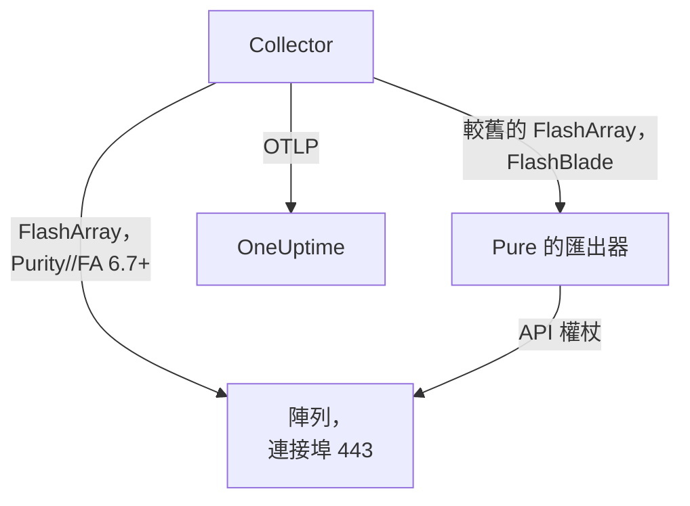

# 儲存陣列代理程式

OneUptime Storage Array 代理程式會監控儲存陣列：容量和資料縮減、延遲、IOPS 和頻寬、磁碟區、主機、Pod 和複寫、硬體健康狀態、檔案系統和儲存貯體。它是一個標準的 OpenTelemetry Collector，使用唯讀使用者的 API 權杖抓取陣列的 OpenMetrics 端點，在每個指標上加上陣列的身分資訊，並將其傳送到 OneUptime。[儲存陣列監控](/docs/monitor/storage-array-monitor) 會根據送達的資料發出警示。

:::cards
- [安裝代理程式](#安裝代理程式): 先建立唯讀使用者，再使用安裝指令碼或 Docker Compose。
- [代理程式收集的內容](#代理程式收集的內容): 每個端點，以及以它為基礎建立的頁面。
- [監控多個陣列](#監控多個陣列): 每個陣列一個代理程式，都在同一台機器上。
- [疑難排解](#疑難排解): 一個診斷指令碼，以及常見問題。
:::

## 運作方式

Storage Arrays 是一個對每個廠商都以相同方式運作的產品。它支援：

| 陣列 | 代理程式如何讀取它 | Collector 設定 |
| --- | --- | --- |
| **Pure Storage FlashArray**，Purity//FA 6.7 及更新版本 | 陣列自己的 OpenMetrics 端點（`https://<array>/metrics/...?namespace=purefa`）：Collector 旁邊不需要執行任何東西 | `otel-collector-config.yaml`（預設） |
| **Pure Storage FlashArray**，較舊的 Purity//FA | Pure 的 FlashArray OpenMetrics 匯出器，由同一個 Compose 檔案以 `pure-fa-exporter` 服務執行 | `otel-collector-config.flasharray-exporter.yaml` |
| **Pure Storage FlashBlade** | Pure 的 FlashBlade OpenMetrics 匯出器，由同一個 Compose 檔案以 `pure-fb-exporter` 服務執行 | `otel-collector-config.flashblade.yaml` |

Pure Storage 於 2026 年 2 月更名為 **Everpure**。FlashArray、FlashBlade 和 Purity 保留了原名，`purefa_*` 和 `purefb_*` 指標也沒有改名，因此本頁的所有內容都適用於以任一名稱銷售的陣列。



一個代理程式監控一個陣列：請為每個陣列執行一個代理程式（請參閱 [監控多個陣列](#監控多個陣列)）。陣列會隨其第一批資料自行註冊，名稱就是代理程式以 `storage.array.name` 加到每個指標上的名稱。

## 開始之前

- Docker Engine 20.10 或更新版本，帶 Docker Compose v2 外掛程式，所在機器能透過 HTTPS（TCP 443）連線到陣列的管理介面。
- 陣列上的一個管理員帳戶，用於建立具有內建 **readonly** 角色的使用者及其 API 權杖。
- 一把擷取金鑰。在 **專案設定 → 遙測與 APM → 擷取金鑰** 下建立一把並複製其值。

### 在哪裡執行代理程式

代理程式透過 HTTPS 與陣列的管理介面通訊，因此可以在任何裝有 Docker 並能透過 TCP 443 路由到管理網路的機器上執行：一台監控主機，或一台小型管理 VM。最好選擇自身儲存不在所監控陣列上的機器：如果陣列當機，你的監控不應隨之當機。選用的 syslog 接聽程式還需要陣列能透過 syslog 連接埠連線到代理程式（請參閱 [傳送陣列的 syslog](#選用-傳送陣列的-syslog)）。

## 安裝代理程式

:::steps
### 建立唯讀使用者和 API 權杖

代理程式只做讀取。請給它一個專用使用者，使用內建的 **readonly** 角色，絕不要用管理員，並為該使用者建立 API 權杖。建立權杖時請 **不設到期時間**，否則權杖到期的那天代理程式就會停止運作。

:::tabs
@tab Purity CLI
以管理員身分 SSH 登入 FlashArray。第一個命令會詢問新使用者的密碼；第二個命令會輸出其 API 權杖，也就是一個 UUID：

```bash
pureadmin create --role readonly oneuptime
pureadmin create --api-token oneuptime
```
@tab FlashArray GUI
1. 開啟 _Settings → Users and Policies_（在較舊的版本中為 _Settings → Access_）。
2. 在 **Users** 面板的 ⋮ 選單中選擇 **Create User…**，將使用者命名為 `oneuptime`，並為其指派 readonly 角色。
3. 在新使用者的 ⋮ 選單中選擇 **Create API Token…**，將 **Expires In** 留白，然後複製權杖。
@tab FlashBlade
以相同方式建立具有 **readonly** 角色的使用者及其 API 權杖：在 FlashBlade GUI 的使用者設定中建立，或在 Purity//FB CLI 中使用 `pureadmin`。在沒有本機使用者的版本中，請使用目錄服務（LDAP 或 Active Directory）帳戶，其所屬群組對應到 readonly 角色。FlashBlade 的 API 權杖以 `T-` 開頭。
:::

### 檢查 FlashArray 是否提供自己的指標

Pure 為 **Purity//FA 6.7.0 及更新版本** 記載了原生 OpenMetrics 端點（Pure 的 FlashArray 匯出器的淘汰通知中寫的是 6.6.11 及更新版本）。最快的確認方法是在將要執行代理程式的機器上詢問陣列：

```bash
curl -k 'https://<array>/metrics/array?namespace=purefa' --header 'Authorization: Bearer <api-token>' | grep purefa_info
```

出現 `purefa_info{...} 1` 行表示陣列原生提供其指標：請使用預設設定。出現 `404` 表示不提供：請使用匯出器設定，它會在 Collector 旁邊執行 Pure 的匯出器。Pure 已淘汰該匯出器，因此陣列升級後請改用原生設定。FlashBlade 一律透過 Pure 的 FlashBlade 匯出器，因此 FlashBlade 可以略過這一步。

### 安裝並啟動代理程式

:::tabs
@tab install.sh
下載安裝指令碼，並在將要裝載代理程式的機器上執行它：

```bash
curl -sSL https://raw.githubusercontent.com/OneUptime/oneuptime/master/agents/StorageArrayAgent/install.sh -o install.sh
bash install.sh
```

指令碼會詢問這是哪種陣列（提供原生指標的 FlashArray、執行較舊 Purity//FA 的 FlashArray，或 FlashBlade），然後詢問你的 OneUptime URL、擷取金鑰、陣列的名稱、陣列的管理位址和唯讀使用者的 API 權杖（讀取時不會回顯）。它會安裝到 `/opt/oneuptime-storage-array-agent`，下載 Compose 檔案和全部三個 Collector 設定，寫入一個 `0600` 權限的 `.env` 檔案，其中包含相符的設定和 Compose 設定檔，並用 Docker Compose 啟動代理程式。它會依你輸入的原樣為 Docker Compose 為每個值加上引號。再次執行它會重複使用現有 `.env` 中的所有內容，不會再次詢問，並在取代你編輯過的檔案之前將其保存為 `<file>.bak.<timestamp>`。
@tab Docker Compose
從 [StorageArrayAgent 目錄](https://github.com/OneUptime/oneuptime/tree/master/agents/StorageArrayAgent) 下載 `docker-compose.yml` 和三個 `otel-collector-config*.yaml` 檔案到一個新資料夾中：

```bash
curl -fsSLO https://raw.githubusercontent.com/OneUptime/oneuptime/master/agents/StorageArrayAgent/docker-compose.yml
curl -fsSLO https://raw.githubusercontent.com/OneUptime/oneuptime/master/agents/StorageArrayAgent/otel-collector-config.yaml
curl -fsSLO https://raw.githubusercontent.com/OneUptime/oneuptime/master/agents/StorageArrayAgent/otel-collector-config.flasharray-exporter.yaml
curl -fsSLO https://raw.githubusercontent.com/OneUptime/oneuptime/master/agents/StorageArrayAgent/otel-collector-config.flashblade.yaml
```

在它們旁邊建立一個 `.env` 檔案。它存放著 API 權杖，因此請用 `chmod 600 .env` 保持其私密。對於提供原生指標的 FlashArray：

```bash title=".env"
ONEUPTIME_URL=YOUR_ONEUPTIME_URL
ONEUPTIME_TELEMETRY_INGESTION_KEY=YOUR_TELEMETRY_INGESTION_TOKEN
STORAGE_ARRAY_NAME=my-storage-array
STORAGE_SYSTEM=purestorage.flasharray
STORAGE_ARRAY_COLLECTOR_CONFIG=otel-collector-config.yaml
COMPOSE_PROFILES=
PURE_FA_ENDPOINT=fa-prod-01.example.com
PURE_FA_API_TOKEN=YOUR_READ_ONLY_API_TOKEN
PURE_FB_ENDPOINT=
PURE_FB_API_TOKEN=
STORAGE_ARRAY_INSECURE_SKIP_VERIFY=true
```

對於執行較舊 Purity//FA 的 FlashArray，請設定 `STORAGE_ARRAY_COLLECTOR_CONFIG=otel-collector-config.flasharray-exporter.yaml` 和 `COMPOSE_PROFILES=flasharray-exporter`。對於 FlashBlade，請設定 `STORAGE_SYSTEM=purestorage.flashblade`、`STORAGE_ARRAY_COLLECTOR_CONFIG=otel-collector-config.flashblade.yaml` 和 `COMPOSE_PROFILES=flashblade`，並填入 `PURE_FB_ENDPOINT` 和 `PURE_FB_API_TOKEN`，而不是 `PURE_FA_*` 這一組。啟動代理程式：

```bash
docker compose up -d
```
:::

### 檢查代理程式是否正在執行

```bash
docker compose ps
docker logs -f oneuptime-storage-array-agent
```

`docker compose ps` 會列出 Collector（`oneuptime-storage-array-agent`），使用匯出器設定時還會列出匯出器（`pure-fa-exporter` 或 `pure-fb-exporter`）。Collector 啟動後，其日誌中應出現這一行：

```text
Everything is ready. Begin running and processing data.
```

### 在 OneUptime 中找到陣列

開啟 **產品 → 基礎設施 → Storage Arrays → All Storage Arrays**。第一次抓取之後（大約一分鐘），陣列就會出現，帶有它的容量、效能、未結的警示和硬體。磁碟區、主機和 Pod 會在 2 分鐘內出現，FlashBlade 的檔案系統和儲存貯體在 5 分鐘內出現，FlashArray 目錄在 30 分鐘內出現。
:::

## 環境變數

安裝指令碼會把這些變數寫入 `/opt/oneuptime-storage-array-agent/.env`；Docker Compose 安裝會從 `.env`（位於 `docker-compose.yml` 旁邊）中讀取它們。變更其中一個後，請在該資料夾中執行 `docker compose up -d`。

| 變數 | 必要 | 說明 |
| --- | --- | --- |
| `ONEUPTIME_URL` | 是 | 你的 OneUptime URL，例如 `https://oneuptime.com` 或你的自行託管執行個體。如果執行個體只支援 HTTP，請使用 `http://` 及其連接埠。 |
| `ONEUPTIME_TELEMETRY_INGESTION_KEY` | 是 | 來自 **專案設定 → 遙測與 APM → 擷取金鑰** 的擷取金鑰。 |
| `STORAGE_ARRAY_NAME` | 是 | 陣列在 OneUptime 中註冊所用的名稱，會作為 `storage.array.name` 資源屬性加到每個指標上。請保持不變：之後變更它會註冊另一個陣列。缺少它時 Collector 會拒絕啟動。 |
| `STORAGE_SYSTEM` | 否 | 平台，會作為 `storage.system` 資源屬性加上：`purestorage.flasharray` 或 `purestorage.flashblade`。預設為 `purestorage.flasharray`。 |
| `STORAGE_ARRAY_COLLECTOR_CONFIG` | 否 | 執行哪個隨附的 Collector 設定：`otel-collector-config.yaml`（FlashArray，原生：預設）、`otel-collector-config.flasharray-exporter.yaml`（較舊的 FlashArray）或 `otel-collector-config.flashblade.yaml`（FlashBlade）。 |
| `COMPOSE_PROFILES` | 否 | 啟動所選設定要抓取的匯出器：原生 FlashArray 設定留空，另外兩種設定分別為 `flasharray-exporter` 或 `flashblade`。 |
| `PURE_FA_ENDPOINT` | FlashArray | FlashArray 的管理位址：主機名稱或 IP，不含 `https://`。 |
| `PURE_FA_API_TOKEN` | FlashArray | 具有 readonly 角色的 FlashArray 使用者的 API 權杖。 |
| `PURE_FB_ENDPOINT` | FlashBlade | FlashBlade 的管理位址：主機名稱或 IP，不含 `https://`。 |
| `PURE_FB_API_TOKEN` | FlashBlade | 具有 readonly 角色的 FlashBlade 使用者的 API 權杖。 |
| `STORAGE_ARRAY_INSECURE_SKIP_VERIFY` | 否 | `true` 會在原生端點上接受陣列的自我簽署憑證；`false` 則會驗證它。預設為 `true`。Pure 的匯出器從不驗證陣列的憑證，因此它不適用於匯出器。 |

## 代理程式如何抓取

- **每個端點一個抓取作業，各自依其價值決定讀取頻率。** FlashArray：`/metrics/array` 每 60 秒一次；`/metrics/volumes`、`/metrics/hosts` 和 `/metrics/pods` 每 2 分鐘一次；`/metrics/directories` 每 30 分鐘一次，這是 Pure 自己的建議，因為計算目錄空間對陣列來說成本很高。FlashBlade：`/metrics/array` 每 60 秒一次；`/metrics/filesystems` 和 `/metrics/objectstore` 每 5 分鐘一次，同樣遵循 Pure 的建議，以低於陣列的頻率讀取檔案系統和物件儲存端點。
- **每個作業都會為其序列加上 `scrape_endpoint: <endpoint>` 標籤。** 每個端點也會匯出 `purefa_info` 或 `purefb_info`，因此 OneUptime 知道一個批次是哪些指標系列的完整清單：已刪除的磁碟區、主機、Pod、檔案系統或儲存貯體正是這樣離開清單，而不是一直滯留。請保持這些標籤與隨附時一致。
- **依磁碟區和依主機的延遲保留三個維度。** 每個磁碟區和主機最多以十六個 `dimension` 匯出其延遲。一條 `metric_relabel_configs` 規則會保留 `usec_per_read_op`、`usec_per_write_op` 和 `usec_per_mirrored_write_op`，並捨棄 QoS 速率限制、佇列、SAN 和服務時間的細分，這些細分會使大型陣列的序列數成倍增加。`purefa_array_performance_latency_usec` 上的陣列層級細分會保留。刪除該規則即可同時保留依磁碟區的細分。
- **API 權杖是 Bearer 權杖。** 原生設定會把它傳送給陣列本身；匯出器設定只透過 Compose 網路把它傳送給匯出器，而匯出器的連接埠從不發布。
- **沒有 `send_batch_max_size`。** OneUptime 每個要求都會根據一次完整的抓取重建清單，因此隨附的 `batch` 處理器從不把一次抓取拆分到多次匯出中。請保持隨附的 batch 設定不變。

## 代理程式收集的內容

Pure 的語意慣例由 FlashArray 原生端點和兩個匯出器共用。每個值都是陣列自己計算出的量測值（延遲以每次作業的微秒計，輸送量以每秒計），因此不需要計算速率，而物件由 **資料點標籤** 命名：磁碟區、Pod、目錄、檔案系統和儲存貯體用 `name`，主機用 `host`，FlashArray 硬體用 `component_name`。代理程式會新增 `storage.array.name` 和 `storage.system` 資源屬性，因此 OneUptime 會把所有內容歸到你的陣列下：

| 端點 | 指標系列 | OneUptime 據此建立的內容 |
| --- | --- | --- |
| FlashArray `/metrics/array` | `purefa_info`、`purefa_alerts_open`、`purefa_array_space_*`、`purefa_array_performance_*`、`purefa_hw_component_status`、`purefa_hw_component_temperature_celsius`、`purefa_hw_controller_info`、`purefa_drive_capacity_bytes`、`purefa_network_interface_*` | 陣列的名稱、Purity 版本和系統 ID；容量、已用空間和資料縮減；未結的警示數；陣列的健康狀態；**Hardware** 頁面（元件、磁碟機、控制器、網路介面） |
| FlashArray `/metrics/volumes` | `purefa_volume_performance_*`、`purefa_volume_space_*`、`purefa_volume_qos_*` | **磁碟區** 頁面：每個磁碟區的佈建大小和實體大小、資料縮減、讀寫延遲、IOPS 和頻寬 |
| FlashArray `/metrics/hosts` | `purefa_host_connectivity_info`、`purefa_host_connections_info`、`purefa_host_performance_*`、`purefa_host_space_*` | **主機** 頁面：每台主機的連線能力（是否有備援路徑）、已連線的磁碟區、延遲、IOPS 和頻寬 |
| FlashArray `/metrics/pods` | `purefa_pod_performance_*`、`purefa_pod_space_*`、`purefa_pod_replica_links_*`、`purefa_pod_mediator_status` | **Replication** 頁面：ActiveCluster 和 ActiveDR Pod、複本連結狀態和延遲 |
| FlashArray `/metrics/directories` | `purefa_directory_performance_*`、`purefa_directory_space_*` | **Directories** 頁面（FlashArray File Services） |
| FlashBlade `/metrics/array` | `purefb_info`、`purefb_alerts_open`、`purefb_array_space_*`、`purefb_array_performance_*`、`purefb_hardware_health` | FlashBlade 的名稱、Purity 版本和系統 ID；容量和資料縮減；未結的警示數；陣列的健康狀態；**Hardware** 頁面 |
| FlashBlade `/metrics/filesystems` | `purefb_file_systems_space_*`、`purefb_file_systems_performance_*` | **File Systems** 頁面：每個檔案系統的佈建空間和已用空間、資料縮減、延遲、IOPS 和頻寬 |
| FlashBlade `/metrics/objectstore` | `purefb_buckets_space_*`、`purefb_buckets_quota_space_bytes`、`purefb_buckets_object_count`、`purefb_buckets_performance_*`、`purefb_object_store_accounts_*` | **Buckets** 頁面：每個儲存貯體的空間、配額、物件數和效能，依帳戶分組 |

陣列在其 **概覽** 上顯示的健康狀態：當它回報未結的嚴重警示，或有硬體元件、磁碟機或控制器處於嚴重、故障、遺失或不健康狀態時為 **嚴重**；當它回報未結的警告警示，或有降級或狀態不明的元件時為 **Warning**；否則為 **OK**。在監控條件中，陣列的屬性要加上 `resource.` 前置詞（`resource.storage.array.name`、`resource.storage.system`），而資料點標籤保持原樣（`name`、`host`、`dimension`、`space`）。

## 選用 — 傳送陣列的 syslog

預設情況下，代理程式只傳送指標，因此陣列的 **日誌** 頁面會保持空白。陣列會把它們的警示和稽核事件以 syslog 轉送，而每個隨附的 Collector 設定中都有一對已註解的 `syslog` 接收器（連接埠 5514 上的 TCP 和 UDP，RFC 3164），連接到一個已註解的 `logs` 管線，該管線會加上 `storage.array.name`，讓日誌落到你的陣列上。

:::steps
### 開啟接收器

在你使用的 Collector 設定中取消註解兩個 `syslog/*` 接收器和 `logs` 管線。RFC 3164 時間戳記不含時區：除非陣列的時鐘使用 UTC，否則請把 `location` 設為陣列的時區。

### 開放連接埠

取消註解 `ports:` 區塊（位於 `docker-compose.yml` 中），讓機器發布 `5514/tcp` 和 `5514/udp`，然後執行 `docker compose up -d`。在機器的防火牆中為陣列的管理網路開放該連接埠。

### 讓陣列指向代理程式

請以管理員身分執行此操作，而不是以唯讀的監控使用者身分。在 FlashArray 上，開啟 _Settings → System → Syslog Servers_，新增 `udp://<agent-host>:5514`（或 `tcp://<agent-host>:5514`）並傳送一則測試訊息。在 FlashBlade 上，在其 syslog 設定中新增一個使用相同 URI 的 syslog 伺服器。兩種陣列都接受 `PROTOCOL://HOST:PORT` 形式，透過它們的 REST API（`syslog-servers`）也是如此。
:::

一個 syslog 接收器只會在一種傳輸方式上接聽，所以 TCP 和 UDP 是兩個接收器：如果只需要其中一個，就讓另一個保持註解狀態。標準 Collector 映像檔可以照原樣讀取 syslog：不需要自訂映像檔。

## 用專案標籤標記陣列

以 `oneuptime.label.` 開頭的資源屬性會成為儲存陣列上的專案標籤：`oneuptime.label.<dimension>=<value>` 就是標籤 `<dimension>:<value>`。在你使用的 Collector 設定的 `resource` 處理器中，緊鄰 `storage.array.name` 新增這些屬性：

```yaml
processors:
  resource:
    attributes:
      # ...existing attributes...
      - key: oneuptime.label.team
        value: storage
        action: upsert
      - key: oneuptime.label.env
        value: production
        action: upsert
```

Collector 只在啟動時讀取其設定：請執行 `docker compose restart oneuptime-storage-array-agent`。之後陣列會顯示標籤 `team:storage` 和 `env:production`。標籤比對不區分大小寫，因此現有的 `Production` 標籤會被重複使用而不是重複建立，而且代理程式絕不會移除別人在 OneUptime 中新增的標籤。

## 監控多個陣列

一個代理程式讀取一個陣列。要從同一台機器監控多個陣列，請把每個代理程式安裝到各自的資料夾中，並使用各自的 `.env`，例如 `INSTALL_DIR=/opt/oneuptime-storage-array-agent-fa02 bash install.sh`，並為每個代理程式設定各自的 `container_name`（位於其 `docker-compose.yml` 中，例如 `oneuptime-storage-array-agent-fa02`）：兩個容器不能同名。用 `-d` 把資料夾傳給診斷指令碼。

## 以 systemd 服務執行

要讓代理程式隨機器啟動並在失敗時重新啟動，請安裝它的 systemd 單元。該單元假設代理程式位於 `/opt/oneuptime-storage-array-agent`，也就是安裝指令碼放置它的位置：

```bash
sudo curl -fsSL https://raw.githubusercontent.com/OneUptime/oneuptime/master/agents/StorageArrayAgent/systemd/oneuptime-storage-array-agent.service -o /etc/systemd/system/oneuptime-storage-array-agent.service
sudo systemctl daemon-reload
sudo systemctl enable --now oneuptime-storage-array-agent
```

## 升級代理程式

代理程式會把其檔案固定的 Collector 版本回報為它的 **代理程式版本**。當該版本早於此 OneUptime 版本固定的版本時，陣列的 **概覽** 頁面上會在它旁邊出現一個警告標誌。選取它即可查看這些命令。在其檔案開始回報版本之前安裝的代理程式不會顯示版本，直到以這種方式升級為止。

Collector 映像檔固定在 `docker-compose.yml` 中，其設定是旁邊的檔案，因此只提取映像檔並不能讓代理程式升級。請再次執行 `install.sh`：它會重複使用你現有 `.env` 中的每個值（不會再詢問任何內容），重新整理 `docker-compose.yml` 和三個 Collector 設定（你編輯過的檔案會保存為 `<file>.bak.<timestamp>`），並重新建立代理程式，讓 Collector 讀取新的設定。安裝在 `/opt/oneuptime-storage-array-agent` 之外的代理程式需要指定其資料夾：`INSTALL_DIR=<folder> bash install.sh`。

```bash
curl -sSL https://raw.githubusercontent.com/OneUptime/oneuptime/master/agents/StorageArrayAgent/install.sh -o install.sh
bash install.sh
```

如果是用 Docker Compose 安裝的，請在代理程式的資料夾中重新下載 Compose 檔案和三個 Collector 設定（並重新做一次你對它們所做的任何修改），然後提取映像檔並重新建立代理程式：

```bash
curl -fsSLO https://raw.githubusercontent.com/OneUptime/oneuptime/master/agents/StorageArrayAgent/docker-compose.yml
curl -fsSLO https://raw.githubusercontent.com/OneUptime/oneuptime/master/agents/StorageArrayAgent/otel-collector-config.yaml
curl -fsSLO https://raw.githubusercontent.com/OneUptime/oneuptime/master/agents/StorageArrayAgent/otel-collector-config.flasharray-exporter.yaml
curl -fsSLO https://raw.githubusercontent.com/OneUptime/oneuptime/master/agents/StorageArrayAgent/otel-collector-config.flashblade.yaml
docker compose pull
docker compose up -d --force-recreate
```

## 解除安裝代理程式

```bash
cd /opt/oneuptime-storage-array-agent
docker compose down
```

接著，如果不再需要，請在陣列上刪除唯讀使用者及其 API 權杖。

## 疑難排解

:::details 先執行診斷指令碼
代理程式隨附一個指令碼 [`troubleshoot.sh`](https://github.com/OneUptime/oneuptime/blob/master/agents/StorageArrayAgent/troubleshoot.sh)，它會檢查整條鏈路：容器執行階段；依 Collector 連線的方式檢查陣列端點（原生端點或 Pure 的匯出器：DNS、TLS、FlashArray 是否有原生端點，以及陣列是否接受 API 權杖，指令碼會透過 stdin 把權杖交給 curl）；加到每個指標上的陣列名稱；權杖的格式；Collector 自身的指標；以及 OneUptime 是否接受擷取金鑰。最後一項檢查最重要。OneUptime 會以 `401` 拒絕錯誤的金鑰（已停用的金鑰或瀏覽器金鑰為 `422`），而 Collector 會將兩者都視為永久性錯誤：它會捨棄該批次並記錄一則 `Exporting failed` 錯誤，而容器仍保持正常，這很容易被忽略。該指令碼會從代理程式的網路內部要求 `GET <url>/otlp/v1/validate`，直接得到 `200`（有效）或 `401`（無效），在較舊的伺服器上改用 `POST /fluentd/v1/logs`。

```bash
curl -sSL https://raw.githubusercontent.com/OneUptime/oneuptime/master/agents/StorageArrayAgent/troubleshoot.sh -o troubleshoot.sh
bash troubleshoot.sh    # add -d <dir> if you installed outside /opt/oneuptime-storage-array-agent
```

它最後會輸出一個指出最可能原因的結論。
:::

:::details OneUptime 中沒有出現陣列
1. 查看 Collector 的日誌：`docker logs oneuptime-storage-array-agent`。`server returned HTTP status 401` 表示陣列拒絕了 API 權杖，`404` 表示 FlashArray 沒有原生端點，`x509` 表示在陣列的自我簽署憑證上開啟了 TLS 驗證，`no such host` 或 `connection refused` 表示 `PURE_FA_ENDPOINT` 或 `PURE_FB_ENDPOINT` 錯誤，匯出時出現 `401` 表示擷取金鑰錯誤。
2. 從代理程式的網路中詢問陣列。Collector 映像檔沒有 shell 也沒有 curl，因此請從其網路中的一個容器發出要求：`docker run --rm --network container:oneuptime-storage-array-agent curlimages/curl -sk -H 'Authorization: Bearer <api-token>' 'https://<array>/metrics/array?namespace=purefa'` 應輸出 `purefa_*` 行。
3. 檢查 `STORAGE_ARRAY_NAME` 是否已設定：陣列是透過其 `storage.array.name` 資源屬性找到的，缺少它時 Collector 會拒絕啟動。
:::

:::details 陣列顯示為已中斷連線
當 OneUptime 在 15 分鐘內沒有從陣列收到任何資料時，陣列會變為已中斷連線；OneUptime 每 5 分鐘檢查一次，而且它自身未在接收資料的時間不計入。請檢查 Collector 是否在執行（`docker compose ps`）、其日誌是否沒有抓取或匯出錯誤，以及機器是否仍能連線到陣列和你的 OneUptime URL。收到下一批資料後，陣列會重新變為已連線。
:::

:::details FlashArray 回應 404
它的 Purity//FA 沒有原生 OpenMetrics 端點。請再次執行 `install.sh` 並選擇較舊 Purity 的選項，或設定 `STORAGE_ARRAY_COLLECTOR_CONFIG=otel-collector-config.flasharray-exporter.yaml` 和 `COMPOSE_PROFILES=flasharray-exporter`（在 `.env` 中），然後執行 `docker compose up -d`。把陣列升級到 Purity//FA 6.7 或更新版本後，請切回原生設定並移除該設定檔。
:::

:::details 陣列拒絕 API 權杖
請檢查你貼上的是 API 權杖而不是使用者的密碼、該使用者仍然存在並具有 readonly 角色，以及權杖沒有到期。建立一個新權杖（在 FlashArray 上使用 `pureadmin create --api-token oneuptime`），把它放入 `.env` 並執行 `docker compose up -d`。透過 Pure 的匯出器時，被拒絕的權杖會在 Collector 的日誌中顯示為來自匯出器的 HTTP `400`，其內文為 `failed to login`。
:::

:::details x509 或 TLS 錯誤
陣列預設出示自我簽署憑證，沒有任何 Docker 映像檔信任它。請設定 `STORAGE_ARRAY_INSECURE_SKIP_VERIFY=true`（在私人管理網路中這是務實的選擇），或在陣列上安裝由 Collector 映像檔信任的 CA 所核發的憑證。
:::

:::details 無法解析 pure-fa-exporter 或 pure-fb-exporter
匯出器沒有執行：`COMPOSE_PROFILES` 必須與 `STORAGE_ARRAY_COLLECTOR_CONFIG` 相符（FlashArray 匯出器設定用 `flasharray-exporter`，FlashBlade 設定用 `flashblade`）。修正 `.env` 並執行 `docker compose up -d`；之後 `docker compose ps` 會列出匯出器。
:::

:::details 已刪除的磁碟區或主機仍留在清單中
當對某個端點的一次完整抓取中不再有某個物件時，OneUptime 會移除該物件，它透過 `scrape_endpoint` 標籤辨識這一點。如果你用自己的設定取代了隨附的 Collector 設定，請在其抓取作業上保留 `scrape_endpoint` 標籤；否則物件只有在過時時才會離開清單。
:::

:::details 指標落到錯誤的陣列下
OneUptime 依 `storage.array.name` 註冊儲存陣列，代理程式從 `STORAGE_ARRAY_NAME` 中取得該值。在第一批資料之後變更它，會建立第二個陣列，而不是重新命名第一個。
:::

:::details 不透過代理程式傳送指標
代理程式就是一個標準的 Collector 設定，因此你已經在執行的 Collector 也能完成同樣的工作：把抓取作業和 `resource` 處理器從隨附的設定複製到你自己的設定中。`storage.array.name` 資源屬性負責在 OneUptime 中註冊陣列，而刪除 `service.name` / `service.instance.id` 可以防止資料被歸到某個服務下：請兩者都保留，並保留 `scrape_endpoint` 標籤。
:::

## 後續步驟

:::cards
- [儲存陣列監控](/docs/monitor/storage-array-monitor): 針對警示、容量、延遲、硬體、主機路徑、複寫和檔案系統發出警示。
- [VMware 代理程式](/docs/telemetry/vmware): 在這個陣列上執行 VMware？也可以查看它的資料存放區和 VM。
- [主機 OpenTelemetry Collector](/docs/telemetry/host-otel-collector): 從作業系統的角度查看使用該陣列的機器。
:::
