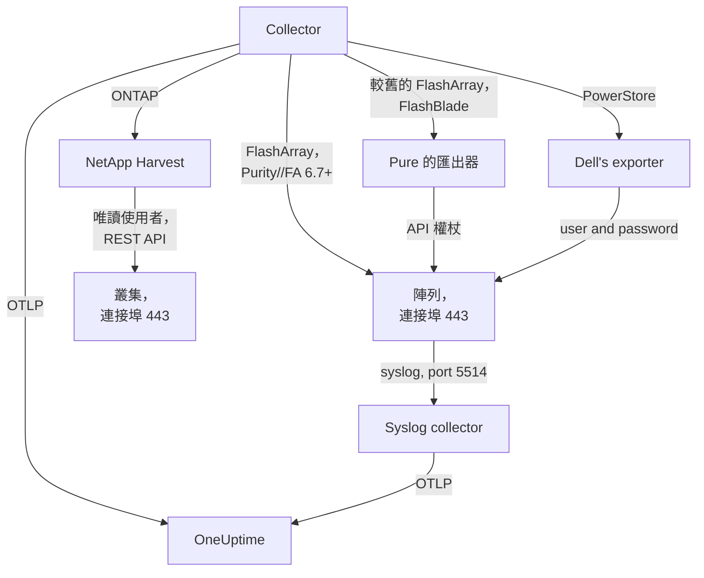

# 儲存陣列代理程式

OneUptime Storage Array 代理程式會監控儲存陣列：容量和資料縮減、延遲、IOPS 和頻寬、磁碟區、主機、Pod 和複寫、硬體健康狀態、檔案系統和儲存貯體，在 NetApp ONTAP 上還包括其 Aggregate、SVM、LUN 和 SnapMirror 關係。它是一個標準的 OpenTelemetry Collector，使用唯讀使用者的 API 權杖抓取陣列的 OpenMetrics 端點（對於 ONTAP，則抓取在其旁邊執行的 NetApp 自家 Harvest 匯出器），在每個指標上加上陣列的身分資訊，並將其傳送到 OneUptime。[儲存陣列監控](/docs/monitor/storage-array-monitor) 會根據送達的資料發出警示。

:::cards
- [安裝代理程式](#安裝代理程式): 先建立唯讀使用者，再使用安裝指令碼或 Docker Compose。
- [Dell PowerScale](#dell-powerscale): 叢集上的 SNMP、逐一輪詢的每個節點，以及其頁面顯示的內容。
- [代理程式收集的內容](#代理程式收集的內容): 每個端點，以及以它為基礎建立的頁面。
- [監控多個陣列](#監控多個陣列): 每個陣列一個代理程式，都在同一台機器上。
- [Dell PowerMax](#dell-powermax): 無需代理程式：探測器會讀取 Unisphere 背後的所有陣列。
- [疑難排解](#疑難排解): 一個診斷指令碼，以及常見問題。
:::

## 運作方式

Storage Arrays 是一個對每個廠商都以相同方式運作的產品。它支援：

| 陣列 | `storage.system` | 代理程式如何讀取它 | Collector 設定 |
| --- | --- | --- | --- |
| **Pure Storage FlashArray**，Purity//FA 6.7 及更新版本 | `purestorage.flasharray` | 陣列自己的 OpenMetrics 端點（`https://<array>/metrics/...?namespace=purefa`）：Collector 旁邊不需要執行任何東西 | `otel-collector-config.yaml`（預設） |
| **Pure Storage FlashArray**，較舊的 Purity//FA | `purestorage.flasharray` | Pure 的 FlashArray OpenMetrics 匯出器，由同一個 Compose 檔案以 `pure-fa-exporter` 服務執行 | `otel-collector-config.flasharray-exporter.yaml` |
| **Pure Storage FlashBlade** | `purestorage.flashblade` | Pure 的 FlashBlade OpenMetrics 匯出器，由同一個 Compose 檔案以 `pure-fb-exporter` 服務執行 | `otel-collector-config.flashblade.yaml` |
| **Dell PowerStore** | `dell.powerstore` | Dell 的 PowerStore Metrics Exporter，由同一個 Compose 檔案以 `powerstore-exporter` 服務建置並執行；叢集的警示透過 syslog 送達其 `powerstore-syslog` 服務 | `otel-collector-config.powerstore.yaml` |
| **NetApp ONTAP** 9.12.1 及更新版本（AFF、FAS、ASA、ONTAP Select、Cloud Volumes ONTAP），以及 **Amazon FSx for NetApp ONTAP** | `netapp.ontap` | [NetApp Harvest](https://github.com/NetApp/harvest) 26.11，由同一個 Compose 檔案以 `netapp-harvest` 服務執行：它使用唯讀使用者和密碼登入叢集的 REST API | `otel-collector-config.netapp-ontap.yaml` |
| **Dell PowerScale**（Isilon），OneFS 8.0 及更新版本 | `dell.powerscale` | 透過 SNMP 讀取每個節點（Dell 的 ISILON-MIB），使用 Collector 內建的 SNMP 接收器：Collector 旁邊不需要執行任何東西 | `otel-collector-config.powerscale.yaml` |

ONTAP 沒有自己的指標端點，因此代理程式會在 Collector 旁邊執行 NetApp 的開放原始碼匯出器 Harvest。Harvest 讀取叢集的 REST API，並在 Compose 網路上提供它讀取到的內容，每個序列都命名為 `netapp_<object>_<counter>`；Collector 抓取它並將其傳送出去。Harvest 從不寫入叢集，其傳送給 NetApp 的 AutoSupport 報告也已關閉。

**Dell PowerMax**（`dell.powermax`）無需代理程式：OneUptime 探測器會使用唯讀帳戶讀取 Unisphere for PowerMax 管理的所有陣列。請參閱 [Dell PowerMax](#dell-powermax)。

Pure Storage 於 2026 年 2 月更名為 **Everpure**。FlashArray、FlashBlade 和 Purity 保留了原名，`purefa_*` 和 `purefb_*` 指標也沒有改名，因此本頁的所有內容都適用於以任一名稱銷售的陣列。

**Dell PowerScale** 叢集的讀取方式不同：代理程式透過 SNMP 輪詢它的每個節點，使用唯讀社群字串或 SNMPv3 使用者，不需要 API 權杖。[Dell PowerScale](#dell-powerscale) 一節從啟用 SNMP 一路講到其頁面顯示的內容；下面的安裝步驟適用於 Pure Storage。



一個代理程式監控一個陣列：請為每個陣列執行一個代理程式（請參閱 [監控多個陣列](#監控多個陣列)）。陣列會隨其第一批資料自行註冊，名稱就是代理程式以 `storage.array.name` 加到每個指標上的名稱。

## 開始之前

- Docker Engine 20.10 或更新版本，帶 Docker Compose v2 外掛程式，所在機器能透過 HTTPS（TCP 443）連線到陣列的管理介面。
- 陣列上的一個管理員帳戶，用於建立具有內建 **readonly** 角色的使用者及其 API 權杖。在 ONTAP 上，需要一個叢集管理員（在 Amazon FSx for NetApp ONTAP 上為 `fsxadmin`），用於建立帶有密碼的唯讀 REST 使用者。
- 若是 Dell PowerStore，需要一台 x86-64 機器（Dell 只為 x86-64 建置其匯出器）和一個供代理程式使用的 PowerStore 使用者：請參閱 [Dell PowerStore](#dell-powerstore)。
- 一把擷取金鑰。在 **專案設定 → 遙測與 APM → 擷取金鑰** 下建立一把並複製其值。

### 在哪裡執行代理程式

代理程式透過 HTTPS 與陣列的管理介面通訊，因此可以在任何裝有 Docker 並能透過 TCP 443 路由到管理網路的機器上執行：一台監控主機，或一台小型管理 VM。最好選擇自身儲存不在所監控陣列上的機器：如果陣列當機，你的監控不應隨之當機。選用的 syslog 接聽程式還需要陣列能透過 syslog 連接埠連線到代理程式（請參閱 [傳送陣列的 syslog](#選用-傳送陣列的-syslog)）。

## 安裝代理程式

:::steps
### 建立唯讀使用者和 API 權杖

代理程式只做讀取。請給它一個專用使用者，使用內建的 **readonly** 角色，絕不要用管理員，並為該使用者建立 API 權杖。建立權杖時請 **不設到期時間**，否則權杖到期的那天代理程式就會停止運作。

:::tabs
@tab Purity CLI
以管理員身分 SSH 登入 FlashArray。第一個命令會詢問新使用者的密碼；第二個命令會輸出其 API 權杖，也就是一個 UUID：

```bash
pureadmin create --role readonly oneuptime
pureadmin create --api-token oneuptime
```
@tab FlashArray GUI
1. 開啟 _Settings → Users and Policies_（在較舊的版本中為 _Settings → Access_）。
2. 在 **Users** 面板的 ⋮ 選單中選擇 **Create User…**，將使用者命名為 `oneuptime`，並為其指派 readonly 角色。
3. 在新使用者的 ⋮ 選單中選擇 **Create API Token…**，將 **Expires In** 留白，然後複製權杖。
@tab FlashBlade
以相同方式建立具有 **readonly** 角色的使用者及其 API 權杖：在 FlashBlade GUI 的使用者設定中建立，或在 Purity//FB CLI 中使用 `pureadmin`。在沒有本機使用者的版本中，請使用目錄服務（LDAP 或 Active Directory）帳戶，其所屬群組對應到 readonly 角色。FlashBlade 的 API 權杖以 `T-` 開頭。
@tab ONTAP CLI
以管理員身分 SSH 登入叢集管理位址。第一個命令會建立一個只能讀取所有 API、不能做其他任何事情的 REST 角色；第二個命令會建立一個擁有該角色的 HTTP 使用者，並詢問其密碼：

```bash
security login rest-role create -role oneuptime-readonly -api /api -access readonly
security login create -user-or-group-name oneuptime -application http -authentication-method password -role oneuptime-readonly
```

代理程式使用此使用者和密碼登入。不涉及 API 權杖。
@tab ONTAP System Manager
1. 開啟 _Cluster → Settings → Users and Roles_。
2. 在 **Roles** 下選擇 **Add**，將角色命名為 `oneuptime-readonly`，輸入 `/api` 作為 **REST API path**，並選擇 **Read-Only** 存取權限。
3. 在 **Users** 下選擇 **Add**，將使用者命名為 `oneuptime`，為其指派新角色，新增使用 **Password** 的 **HTTP** 登入方式，並設定密碼。
@tab Amazon FSx for NetApp ONTAP
以 `fsxadmin` 身分 SSH 登入檔案系統的管理端點（其 DNS 名稱或 IP，可在 FSx 主控台中找到），並使用 FSx 預先定義的唯讀角色建立使用者。該命令會詢問其密碼：

```bash
security login create -user-or-group-name oneuptime -application http -authentication-method password -role fsxadmin-readonly
```

檔案系統的硬體由 AWS 執行，因此 FSx 不會回答任何人關於磁碟、磁碟櫃或感測器的查詢：陣列的 **硬體** 頁面會列出其節點和連接埠，並說明這一點。
:::

### 檢查 FlashArray 是否提供自己的指標

Pure 為 **Purity//FA 6.7.0 及更新版本** 記載了原生 OpenMetrics 端點（Pure 的 FlashArray 匯出器的淘汰通知中寫的是 6.6.11 及更新版本）。最快的確認方法是在將要執行代理程式的機器上詢問陣列：

```bash
curl -k 'https://<array>/metrics/array?namespace=purefa' --header 'Authorization: Bearer <api-token>' | grep purefa_info
```

出現 `purefa_info{...} 1` 行表示陣列原生提供其指標：請使用預設設定。出現 `404` 表示不提供：請使用匯出器設定，它會在 Collector 旁邊執行 Pure 的匯出器。Pure 已淘汰該匯出器，因此陣列升級後請改用原生設定。FlashBlade 一律透過 Pure 的 FlashBlade 匯出器，ONTAP 叢集則一律透過 NetApp Harvest，因此它們可以略過這一步。

### 安裝並啟動代理程式

每個 OneUptime 都提供其自身發行版本的代理程式安裝指令碼和檔案：下面的命令從 `https://oneuptime.com` 下載它們，因此在自行架設的 OneUptime 上請把這個位址換成你的 URL。安裝指令碼會先儲存為 `install.sh`，讓你可以在執行前先閱讀它。

:::tabs
@tab install.sh
下載安裝指令碼，並在將要裝載代理程式的機器上執行它：

```bash
curl -fsSL https://oneuptime.com/install/storage-array-agent -o install.sh
bash install.sh
```

指令碼會詢問這是哪種陣列（提供原生指標的 FlashArray、執行較舊 Purity//FA 的 FlashArray、FlashBlade，或 NetApp ONTAP 叢集），然後詢問你的 OneUptime URL、擷取金鑰、陣列的名稱、陣列的管理位址和唯讀使用者的 API 權杖，對於 ONTAP 則詢問唯讀使用者的名稱和密碼（讀取時不會回顯）。它會安裝到 `/opt/oneuptime-storage-array-agent`，下載 Compose 檔案、所有 Collector 設定和 Harvest 的四個檔案，寫入一個 `0600` 權限的 `.env` 檔案，其中包含相符的設定和 Compose 設定檔，並用 Docker Compose 啟動代理程式。它會依你輸入的原樣為 Docker Compose 為每個值加上引號。再次執行它會重複使用現有 `.env` 中的所有內容，不會再次詢問，並在取代你編輯過的檔案之前將其保存為 `<file>.bak.<timestamp>`。
@tab Docker Compose
從你的 OneUptime 下載 `docker-compose.yml` 和三個 `otel-collector-config*.yaml` 檔案到一個新資料夾中：

```bash
curl -fsSLO https://oneuptime.com/install/storage-array-agent/docker-compose.yml
curl -fsSLO https://oneuptime.com/install/storage-array-agent/otel-collector-config.yaml
curl -fsSLO https://oneuptime.com/install/storage-array-agent/otel-collector-config.flasharray-exporter.yaml
curl -fsSLO https://oneuptime.com/install/storage-array-agent/otel-collector-config.flashblade.yaml
```

在它們旁邊建立一個 `.env` 檔案。它存放著 API 權杖，因此請用 `chmod 600 .env` 保持其私密。對於提供原生指標的 FlashArray：

```bash title=".env"
ONEUPTIME_URL=YOUR_ONEUPTIME_URL
ONEUPTIME_TELEMETRY_INGESTION_KEY=YOUR_TELEMETRY_INGESTION_TOKEN
STORAGE_ARRAY_NAME=my-storage-array
STORAGE_SYSTEM=purestorage.flasharray
STORAGE_ARRAY_COLLECTOR_CONFIG=otel-collector-config.yaml
COMPOSE_PROFILES=
PURE_FA_ENDPOINT=fa-prod-01.example.com
PURE_FA_API_TOKEN=YOUR_READ_ONLY_API_TOKEN
PURE_FB_ENDPOINT=
PURE_FB_API_TOKEN=
POWERSCALE_ENDPOINT=
POWERSCALE_SNMP_COMMUNITY=
STORAGE_ARRAY_INSECURE_SKIP_VERIFY=true
POWERSTORE_ENDPOINT=
POWERSTORE_PASSWORD=
POWERSTORE_USERNAME=
POWERSTORE_BULK_METRICS=
POWERSTORE_API_VERSION=
POWERSTORE_REQUEST_LIMIT=
POWERSTORE_SYSLOG_PORT=
STORAGE_ARRAY_AGENT_CONTAINER_NAME=oneuptime-storage-array-agent
```

若是 Dell PowerStore，還要下載 `otel-collector-config.powerstore.yaml`、`powerstore-exporter.Dockerfile` 和 `powerstore-syslog.yaml`，設定 `STORAGE_SYSTEM=dell.powerstore`、`STORAGE_ARRAY_COLLECTOR_CONFIG=otel-collector-config.powerstore.yaml` 和 `COMPOSE_PROFILES=powerstore`，並填入 `POWERSTORE_ENDPOINT`、`POWERSTORE_USERNAME` 和 `POWERSTORE_PASSWORD`，密碼放在單引號中。

對於執行較舊 Purity//FA 的 FlashArray，請設定 `STORAGE_ARRAY_COLLECTOR_CONFIG=otel-collector-config.flasharray-exporter.yaml` 和 `COMPOSE_PROFILES=flasharray-exporter`。對於 FlashBlade，請設定 `STORAGE_SYSTEM=purestorage.flashblade`、`STORAGE_ARRAY_COLLECTOR_CONFIG=otel-collector-config.flashblade.yaml` 和 `COMPOSE_PROFILES=flashblade`，並填入 `PURE_FB_ENDPOINT` 和 `PURE_FB_API_TOKEN`，而不是 `PURE_FA_*` 這一組。

對於 NetApp ONTAP 叢集或 Amazon FSx for NetApp ONTAP，還需要下載 ONTAP 設定和 Harvest 的四個檔案：

```bash
curl -fsSLO https://oneuptime.com/install/storage-array-agent/otel-collector-config.netapp-ontap.yaml
curl -fsSLO https://oneuptime.com/install/storage-array-agent/netapp-harvest.yml
curl -fsSLO https://oneuptime.com/install/storage-array-agent/netapp-harvest-rest.yaml
curl -fsSLO https://oneuptime.com/install/storage-array-agent/netapp-harvest-keyperf.yaml
curl -fsSLO https://oneuptime.com/install/storage-array-agent/netapp-harvest-restperf.yaml
```

並使用以下 `.env`。請像這裡一樣把密碼放在單引號中：這樣無論密碼包含什麼，Docker Compose 都會依原樣讀取。包含 `'` 的密碼則改放在雙引號中，並用 `\"`、`\\` 和 `$$` 分別表示 `"`、`\` 和 `$`：

```bash title=".env"
ONEUPTIME_URL=YOUR_ONEUPTIME_URL
ONEUPTIME_TELEMETRY_INGESTION_KEY=YOUR_TELEMETRY_INGESTION_TOKEN
STORAGE_ARRAY_NAME=ontap-prod-01
STORAGE_SYSTEM=netapp.ontap
STORAGE_ARRAY_COLLECTOR_CONFIG=otel-collector-config.netapp-ontap.yaml
COMPOSE_PROFILES=netapp-ontap
NETAPP_ONTAP_ENDPOINT=ontap-prod-01.example.com
NETAPP_ONTAP_USERNAME=oneuptime
NETAPP_ONTAP_PASSWORD='YOUR_READ_ONLY_USER_PASSWORD'
STORAGE_ARRAY_INSECURE_SKIP_VERIFY=true
STORAGE_ARRAY_AGENT_CONTAINER_NAME=oneuptime-storage-array-agent
```

啟動代理程式：

```bash
docker compose up -d
```
:::

### 檢查代理程式是否正在執行

```bash
docker compose ps
docker logs -f oneuptime-storage-array-agent
```

`docker compose ps` 會列出 Collector（`oneuptime-storage-array-agent`），使用匯出器設定時還會列出匯出器（`pure-fa-exporter`、`pure-fb-exporter` 或 `netapp-harvest`）。Collector 啟動後，其日誌中應出現這一行：

```text
Everything is ready. Begin running and processing data.
```

### 在 OneUptime 中找到陣列

開啟 **產品 → 基礎設施 → 儲存陣列 → 所有儲存陣列**。第一次抓取之後（大約一分鐘），陣列就會出現，帶有它的容量、效能、未結的警示和硬體。磁碟區、主機和 Pod 會在 2 分鐘內出現，FlashBlade 的檔案系統和儲存貯體在 5 分鐘內出現，FlashArray 目錄在 30 分鐘內出現。ONTAP 叢集會在 Harvest 讀取它之後出現，其完整清單在大約 3 分鐘內出現，即 Harvest 輪詢其設定的間隔。陣列的 **拓撲** 頁面將其主機、磁碟區、檔案系統和硬體繪製在一張地圖上：請參閱 [拓撲](/docs/telemetry/topology#開啟資源自己的地圖)。
:::

## Dell PowerStore

代理程式透過 Dell 的 PowerStore Metrics Exporter（版本 `powerstore-metrics-exporter_v1.0.3`）讀取 PowerStore 叢集。Dell 將它以二進位檔而非映像檔的形式發布，因此 `powerstore-exporter` 服務在第一次啟動時會依 `powerstore-exporter.Dockerfile` 建置 Dell 文件中描述的映像檔，並驗證二進位檔的 SHA-256；這次建置需要存取一次 `quay.io` 和 `github.com`。

PowerStore 沒有 API 權杖，因此 Dell 的匯出器以使用者名稱和密碼登入。在 PowerStore Manager 的 _Settings → Users_ 下，新增一個僅供代理程式使用的本機使用者，角色為 **Storage Operator**：匯出器從 PowerStore 的五分鐘大量指標封存讀取效能資料，此封存由匯出器自行開啟，PowerStoreOS 4.1 及更新版本需要它，而根據 Dell 的 README，Operator 角色無法開啟它。在較舊的 PowerStoreOS 上，唯讀的 **Operator** 角色搭配 `POWERSTORE_BULK_METRICS=false` 就足夠。只有匯出器會從 `.env` 讀取密碼。

Dell 的匯出器不讀取警示，因此由叢集自行傳送：`powerstore-syslog` 服務在連接埠 5514 上透過 TCP 和 UDP 接收其遠端 syslog，並把每一行記錄到陣列的 **日誌** 頁面，PowerStore 的記錄放在屬性中（`powerstore.alert.id`、`powerstore.alert.state`、`powerstore.event.code`），嚴重性取自 Dell 的事件代碼（`powerstore.alert.severity`）。在 PowerStore Manager 中開啟 _Settings → Security → Remote Logging_，新增這台機器的連接埠 5514，並在其防火牆中開放該連接埠。連接埠 6514 上透過 TLS 的 syslog 在 `powerstore-syslog.yaml` 中有說明。

Dell 的匯出器不回報主機和複寫工作階段，因此此版本兩者都沒有。

## 環境變數

安裝指令碼會把這些變數寫入 `/opt/oneuptime-storage-array-agent/.env`；Docker Compose 安裝會從 `.env`（位於 `docker-compose.yml` 旁邊）中讀取它們。變更其中一個後，請在該資料夾中執行 `docker compose up -d`。

| 變數 | 必要 | 說明 |
| --- | --- | --- |
| `ONEUPTIME_URL` | 是 | 你的 OneUptime URL，例如 `https://oneuptime.com` 或你的自行託管執行個體。如果執行個體只支援 HTTP，請使用 `http://` 及其連接埠。 |
| `ONEUPTIME_TELEMETRY_INGESTION_KEY` | 是 | 來自 **專案設定 → 遙測與 APM → 擷取金鑰** 的擷取金鑰。 |
| `STORAGE_ARRAY_NAME` | 是 | 陣列在 OneUptime 中註冊所用的名稱，會作為 `storage.array.name` 資源屬性加到每個指標上。請保持不變：之後變更它會註冊另一個陣列。缺少它時 Collector 會拒絕啟動。 |
| `STORAGE_SYSTEM` | 否 | 平台，會作為 `storage.system` 資源屬性加上：`purestorage.flasharray`、`purestorage.flashblade` 或 `netapp.ontap`。預設為 `purestorage.flasharray`。 |
| `STORAGE_ARRAY_COLLECTOR_CONFIG` | 否 | 執行哪個隨附的 Collector 設定：`otel-collector-config.yaml`（FlashArray，原生：預設）、`otel-collector-config.flasharray-exporter.yaml`（較舊的 FlashArray）、`otel-collector-config.flashblade.yaml`（FlashBlade）或 `otel-collector-config.netapp-ontap.yaml`（ONTAP）。 |
| `COMPOSE_PROFILES` | 否 | 啟動所選設定要抓取的匯出器：原生 FlashArray 設定留空，其他設定分別為 `flasharray-exporter`、`flashblade` 或 `netapp-ontap`。 |
| `PURE_FA_ENDPOINT` | FlashArray | FlashArray 的管理位址：主機名稱或 IP，不含 `https://`。 |
| `PURE_FA_API_TOKEN` | FlashArray | 具有 readonly 角色的 FlashArray 使用者的 API 權杖。 |
| `PURE_FB_ENDPOINT` | FlashBlade | FlashBlade 的管理位址：主機名稱或 IP，不含 `https://`。 |
| `PURE_FB_API_TOKEN` | FlashBlade | 具有 readonly 角色的 FlashBlade 使用者的 API 權杖。 |
| `POWERSTORE_ENDPOINT` | PowerStore | PowerStore 叢集的管理位址：主機名稱或 IP，不含 `https://`。 |
| `POWERSTORE_USERNAME` | PowerStore | Dell 的匯出器登入時使用的 PowerStore 使用者。 |
| `POWERSTORE_PASSWORD` | PowerStore | 該使用者的密碼。只有匯出器會讀取它。 |
| `POWERSTORE_BULK_METRICS` | 否 | `true` 從 PowerStore 的大量指標封存讀取效能資料；`false` 逐一讀取每個物件。預設為 `true`。 |
| `POWERSTORE_API_VERSION` | 否 | PowerStoreOS 3.6 及更新版本用 `v3`，否則用 `v1`。預設為 `v3`。 |
| `POWERSTORE_REQUEST_LIMIT` | 否 | 匯出器同時向叢集傳送的要求數。預設為 `16`。 |
| `POWERSTORE_SYSLOG_PORT` | 否 | 這台機器透過 TCP 和 UDP 接收叢集 syslog 的連接埠。預設為 `5514`。 |
| `NETAPP_ONTAP_ENDPOINT` | ONTAP | 叢集管理位址（在 FSx 上為檔案系統的管理端點）：主機名稱或 IP，不含 `https://`。 |
| `NETAPP_ONTAP_USERNAME` | ONTAP | 唯讀 REST 使用者，例如 `oneuptime`。 |
| `NETAPP_ONTAP_PASSWORD` | ONTAP | 該使用者的密碼。只有 Harvest 會讀取它，並完全依原樣讀取。 |
| `POWERSCALE_NODES` | PowerScale | 每個節點的位址，以逗號分隔，絕不是 SmartConnect 區域名稱。安裝指令碼會據此寫入下面的輪詢。 |
| `POWERSCALE_ENDPOINT` | PowerScale | 讀取叢集本身健康狀況、容量和配額所經由的節點：`POWERSCALE_NODES` 中的第一個。 |
| `POWERSCALE_SNMP_RECEIVERS` | PowerScale | Collector 執行的輪詢：`snmp/cluster`、`snmp/quotas`，然後是 `snmp/node-1` 及之後各項，每個節點一個。 |
| `POWERSCALE_NODE_<n>` | PowerScale | 節點 `<n>` 的位址，從 `1` 到 `252`。IPv6 位址要放在方括號中，例如 `[fd00::11]`。 |
| `POWERSCALE_SNMP_VERSION` | 否 | `v2c` 或 `v3`。預設為 `v2c`。 |
| `POWERSCALE_SNMP_COMMUNITY` | SNMP v2c | 叢集的唯讀社群字串。 |
| `POWERSCALE_SNMP_USER` | SNMPv3 | 叢集的 SNMPv3 唯讀使用者。 |
| `POWERSCALE_SNMP_SECURITY_LEVEL` | 否 | `auth_priv`、`auth_no_priv` 或 `no_auth_no_priv`。預設為 `auth_priv`。 |
| `POWERSCALE_SNMP_AUTH_PROTOCOL` | 否 | `MD5`、`SHA`、`SHA224`、`SHA256`、`SHA384` 或 `SHA512`，與 `isi snmp settings view` 顯示的一致。預設為 `SHA`。 |
| `POWERSCALE_SNMP_AUTH_PASSWORD` | SNMPv3 | SNMPv3 使用者的驗證密碼。 |
| `POWERSCALE_SNMP_PRIVACY_PROTOCOL` | 否 | `DES`、`AES`、`AES192`、`AES256`、`AES192C` 或 `AES256C`。預設為 `AES`。 |
| `POWERSCALE_SNMP_PRIVACY_PASSWORD` | SNMPv3 | SNMPv3 使用者的隱私密碼，用於 `auth_priv` 層級。 |
| `STORAGE_ARRAY_INSECURE_SKIP_VERIFY` | 否 | `true` 會在原生端點上和 Harvest 中接受陣列的自我簽署憑證；`false` 則會驗證它。預設為 `true`。Pure 的匯出器從不驗證陣列的憑證，因此它不適用於匯出器。 |
| `STORAGE_ARRAY_AGENT_CONTAINER_NAME` | 否 | 代理程式的容器名稱。預設為 `oneuptime-storage-array-agent`。同一台機器上第二個陣列的代理程式需要自己的容器名稱：請參閱 [監控多個陣列](#監控多個陣列)。除非你自行設定，否則安裝指令碼會依新代理程式的資料夾為它命名，並在你再次執行指令碼時保留該名稱。 |

## 代理程式如何抓取

- **每個端點一個抓取作業，各自依其價值決定讀取頻率。** FlashArray：`/metrics/array` 每 60 秒一次；`/metrics/volumes`、`/metrics/hosts` 和 `/metrics/pods` 每 2 分鐘一次；`/metrics/directories` 每 30 分鐘一次，這是 Pure 自己的建議，因為計算目錄空間對陣列來說成本很高。FlashBlade：`/metrics/array` 每 60 秒一次；`/metrics/filesystems` 和 `/metrics/objectstore` 每 5 分鐘一次，同樣遵循 Pure 的建議，以低於陣列的頻率讀取檔案系統和物件儲存端點。
- **每個作業都會為其序列加上 `scrape_endpoint: <endpoint>` 標籤。** 每個端點也會匯出 `purefa_info` 或 `purefb_info`，因此 OneUptime 知道一個批次是哪些指標系列的完整清單：已刪除的磁碟區、主機、Pod、檔案系統或儲存貯體正是這樣離開清單，而不是一直滯留。請保持這些標籤與隨附時一致。
- **依磁碟區和依主機的延遲保留三個維度。** 每個磁碟區和主機最多以十六個 `dimension` 匯出其延遲。一條 `metric_relabel_configs` 規則會保留 `usec_per_read_op`、`usec_per_write_op` 和 `usec_per_mirrored_write_op`，並捨棄 QoS 速率限制、佇列、SAN 和服務時間的細分，這些細分會使大型陣列的序列數成倍增加。`purefa_array_performance_latency_usec` 上的陣列層級細分會保留。刪除該規則即可同時保留依磁碟區的細分。
- **API 權杖是 Bearer 權杖。** 原生設定會把它傳送給陣列本身；匯出器設定只透過 Compose 網路把它傳送給匯出器，而匯出器的連接埠從不發布。
- **PowerStore 每 5 分鐘一次。** Dell 的匯出器在 `/metrics/<cluster>/<part>` 提供叢集的每個部分：設定每 60 秒讀取一次 `cluster`（即其心跳），每 5 分鐘讀取一次 `appliance`、`capacity`、`hardware`、`port`、`volume`、`volumeGroup`、`nas` 和 `file`，因為 PowerStore 以五分鐘樣本計算它們。
- **沒有 `send_batch_max_size`。** OneUptime 每個要求都會根據一次完整的抓取重建清單，因此隨附的 `batch` 處理器從不把一次抓取拆分到多次匯出中。請保持隨附的 batch 設定不變。
- **ONTAP：Harvest 輪詢叢集，Collector 抓取 Harvest。** Harvest 每 3 分鐘讀取一次叢集的設定和狀態，每分鐘讀取一次其效能（延遲以每次作業的微秒計，作業數和位元組數以每秒計），每 3 分鐘讀取一次其 EMS 事件，並在 `netapp-harvest:12990` 上提供所有內容的最新值，Collector 每 60 秒抓取一次該端點，並加上 `scrape_endpoint: harvest` 標籤。三個 `netapp-harvest-*.yaml` 檔案把 Harvest 限制為只讀取 OneUptime 需要的內容。Harvest 自己的 `netapp_metadata_*` 序列說明它完整列出了哪些物件，因此已刪除的磁碟區會離開清單，而 Harvest 無法讀取的物件則保留其最後的計數。Collector 會捨棄 Harvest 對自身的量測以及依磁碟的效能序列，並把每個 SnapMirror 關係的排程轉換為 `netapp_snapmirror_schedule_seconds`（每小時一次的排程為 3600），SnapMirror Behind Schedule 用它與落後進行比較。

## 代理程式收集的內容

Pure 的語意慣例由 FlashArray 原生端點和兩個匯出器共用；ONTAP 的語意慣例則來自 Harvest，見表格之後的說明。每個值都是陣列自己計算出的量測值（延遲以每次作業的微秒計，輸送量以每秒計），因此不需要計算速率，而物件由 **資料點標籤** 命名：磁碟區、Pod、目錄、檔案系統和儲存貯體用 `name`，主機用 `host`，FlashArray 硬體用 `component_name`。代理程式會新增 `storage.array.name` 和 `storage.system` 資源屬性，因此 OneUptime 會把所有內容歸到你的陣列下：

| 端點 | 指標系列 | OneUptime 據此建立的內容 |
| --- | --- | --- |
| FlashArray `/metrics/array` | `purefa_info`、`purefa_alerts_open`、`purefa_array_space_*`、`purefa_array_performance_*`、`purefa_hw_component_status`、`purefa_hw_component_temperature_celsius`、`purefa_hw_controller_info`、`purefa_drive_capacity_bytes`、`purefa_network_interface_*` | 陣列的名稱、Purity 版本和系統 ID；容量、已用空間和資料縮減；未結的警示數；陣列的健康狀態；**硬體** 頁面（元件、磁碟機、控制器、網路介面） |
| FlashArray `/metrics/volumes` | `purefa_volume_performance_*`、`purefa_volume_space_*`、`purefa_volume_qos_*` | **磁碟區** 頁面：每個磁碟區的佈建大小和實體大小、資料縮減、讀寫延遲、IOPS 和頻寬 |
| FlashArray `/metrics/hosts` | `purefa_host_connectivity_info`、`purefa_host_connections_info`、`purefa_host_performance_*`、`purefa_host_space_*` | **主機** 頁面：每台主機的連線能力（是否有備援路徑）、已連線的磁碟區、延遲、IOPS 和頻寬 |
| FlashArray `/metrics/pods` | `purefa_pod_performance_*`、`purefa_pod_space_*`、`purefa_pod_replica_links_*`、`purefa_pod_mediator_status` | **複寫** 頁面：ActiveCluster 和 ActiveDR Pod、複本連結狀態和延遲 |
| FlashArray `/metrics/directories` | `purefa_directory_performance_*`、`purefa_directory_space_*` | **目錄** 頁面（FlashArray File Services） |
| FlashBlade `/metrics/array` | `purefb_info`、`purefb_alerts_open`、`purefb_array_space_*`、`purefb_array_performance_*`、`purefb_hardware_health` | FlashBlade 的名稱、Purity 版本和系統 ID；容量和資料縮減；未結的警示數；陣列的健康狀態；**硬體** 頁面 |
| FlashBlade `/metrics/filesystems` | `purefb_file_systems_space_*`、`purefb_file_systems_performance_*` | **檔案系統** 頁面：每個檔案系統的佈建空間和已用空間、資料縮減、延遲、IOPS 和頻寬 |
| FlashBlade `/metrics/objectstore` | `purefb_buckets_space_*`、`purefb_buckets_quota_space_bytes`、`purefb_buckets_object_count`、`purefb_buckets_performance_*`、`purefb_object_store_accounts_*` | **儲存貯體** 頁面：每個儲存貯體的空間、配額、物件數和效能，依帳戶分組 |
| PowerStore `cluster`、`appliance`、`capacity` | `powerstore_cluster`、`powerstore_metro_*`、`powerstore_appliance`、`powerstore_perf_*`、`powerstore_cap_*` | 叢集的名稱和狀態；**專用設備** 頁面：每台專用設備的容量、資料縮減、延遲、IOPS 和頻寬 |
| PowerStore `hardware`、`port` | `powerstore_hardware_*`、`powerstore_wear_metrics_by_drive`、`powerstore_fc_port_*`、`powerstore_eth_port_*`、`powerstore_metricFcPort_*`、`powerstore_metricEthPort_*` | **硬體** 頁面：節點、風扇、電源供應器、電池、磁碟機和前端連接埠，每個都附上其專用設備 |
| PowerStore `volume`、`volumeGroup`、`nas`、`file` | `powerstore_volume_*`、`powerstore_metricVolume_*`、`powerstore_volumegroup_*`、`powerstore_metricVg_*`、`powerstore_nas_server_operational_status`、`powerstore_metricNas_*`、`powerstore_filesystem_*`、`powerstore_metricFilesystem_*` | **磁碟區**、**磁碟區群組**、**NAS 伺服器** 和 **檔案系統** 頁面 |
| ONTAP，透過 Harvest | `netapp_cluster_*`、`netapp_node_*`、`netapp_aggr_*`、`netapp_svm_*`、`netapp_volume_*`、`netapp_lun_*`、`netapp_snapmirror_*` | 叢集的名稱、版本和 UUID；其容量（其各資料 Aggregate 的總和）和資料縮減；**磁碟區** 頁面；**Aggregate**、**SVM**、**LUN** 和 **SnapMirror** 頁面，每個物件一個頁面 |
| ONTAP 硬體，透過 Harvest | `netapp_disk_*`、`netapp_shelf_*`、`netapp_environment_sensor_*`、`netapp_net_port_*`、`netapp_nic_*`、`netapp_fcp_*` | **硬體** 頁面：節點、磁碟、磁碟櫃及其電源供應器、風扇、模組和感測器，節點的感測器，以及乙太網路和光纖通道連接埠 |
| ONTAP 的未解決問題和事件 | `netapp_health_*`、`netapp_ems_events` | 未結的警示數和 **進行中警示** 卡片（已損壞的磁碟、磁碟櫃故障、HA 接管、已中斷的連接埠、系統健康警示），以及 EMS 範本 |
| PowerScale `snmp/cluster` | `powerscale_cluster_*`、`powerscale_ifs_*` | 叢集的名稱、OneFS 版本、健康狀況和節點數；`/ifs` 的容量；整個叢集的輸送量、網路和 CPU |
| PowerScale `snmp/quotas` | `powerscale_quota_*` | **配額** 頁面：每個配額的用量、其限制，以及它離限制有多近 |
| PowerScale `snmp/node-<n>` | `powerscale_node_*`、`powerscale_protocol_*`、`powerscale_drive_*`、`powerscale_fan_*`、`powerscale_temperature_*`、`powerscale_power_sensor_*`、`powerscale_interface_*`、`powerscale_chassis_*` | **節點** 頁面：每個節點的健康狀況、CPU、輸送量和通訊協定效能；**硬體** 頁面：它的磁碟機、感測器和連接埠 |

在 ONTAP 上，每個序列都來自 Harvest：物件由其標籤命名（`volume` 位於其 `svm` 中，以及 `aggr`、`lun`、`node`、`disk`、`shelf`，SnapMirror 關係則用 `destination_location`），狀態是一個值為 1 或 0 的 `netapp_*_new_status`，或是由其標籤說明狀態的 `netapp_*_labels` 序列，而每個未解決的問題都是一個在問題持續期間存在的 `netapp_health_*_alerts` 序列。

**所有儲存陣列** 的 **健康狀況** 欄讀取陣列最新資料中陣列本身的警示和硬體：當它回報未結的嚴重警示，或有硬體元件、磁碟機或控制器處於嚴重、故障、遺失或不健康狀態時為 **嚴重**；當它回報未結的警告警示，或有降級或狀態不明的元件時為 **警告**；否則為 **OK**；代理程式中斷連線期間為 **未知**。陣列的 **概覽** 會判斷更多內容，如下一節所述。在監控條件中，陣列的屬性要加上 `resource.` 前置詞（`resource.storage.array.name`、`resource.storage.system`），而資料點標籤保持原樣（`name`、`host`、`dimension`、`space`）。

PowerStore 的警示以日誌形式送達，因此 PowerStore 的健康狀況就是其硬體的健康狀況。代理程式自行計算 `powerstore_cap_physical_used_percent` 和 `powerstore_filesystem_logical_used_percent`，並在節點為 Healthy 時將其狀態讀作 1。

## 陣列頁面顯示的內容

陣列的 **概覽** 依需要注意的內容顯示其健康狀態：**健康**、**效能下降** 或 **不健康**，並在 **需要注意** 中依緊急程度依序列出，每一項只需一步即可到達要查看的地方：

- **陣列本身。** 陣列以嚴重等級發出的未結警示為嚴重，警告等級的警示需要查看。超過可用容量的 80% 時需要查看，超過 90% 時為嚴重，這正是 Capacity Above 80% 和 Capacity Above 90% 警示觸發的水準。平均讀取或寫入延遲超過 5 ms 的 FlashArray，或讀取耗時超過 10 ms 的 FlashBlade，需要查看。
- **硬體。** 陣列回報為嚴重、故障、遺失或不健康的元件、磁碟機、控制器或網路介面為嚴重：在更換零件之前，備援已經失去。回報為降級、不明、無法辨識或未就緒的需要查看。未安裝、已關機或未使用的零件從不列出。
- **主機。** 無法再透過兩個控制器存取陣列的主機需要查看，並說明原因：只透過一個控制器、路徑不平均，或完全沒有路徑。
- **Pod。** 陣列回報其複本連結不健康的 Pod 為嚴重，落後超過一分鐘的需要查看。
- **檔案系統。** 剩餘空間不足已佈建大小 10% 的 FlashBlade 檔案系統需要查看。
- **ONTAP 叢集本身的物件。** ONTAP 回報為離線的磁碟區、Aggregate 或 LUN，已損壞的磁碟，處於錯誤狀態的磁碟櫃零件，超過嚴重門檻的節點感測器，以及已中斷的連接埠為嚴重；已停止的 SVM、風扇或電源供應器故障的節點，以及超過警告門檻的感測器需要查看，並用 ONTAP 自己的措辭說明原因。ONTAP 回報為不健康的 SnapMirror 關係為嚴重，落後超過一個半排程間隔的需要查看。

**主機**、**複寫** 和 **檔案系統** 清單依同樣的規則顯示每個部分的狀態，並在下方說明原因；ONTAP 叢集的 **磁碟區**、**Aggregate**、**SVM**、**LUN** 和 **SnapMirror** 清單也是如此，其中每一列都會開啟它自己的頁面：其狀態、需要注意的內容、其上未解決的項目、監看它的叢集警示、ONTAP 回報的相關資訊以及它的圖表。每個平台的頁面都使用該平台自己的用語：ONTAP 磁碟區會列出其 SVM、其 Aggregate 及其使用程度，其頁面繪製 ONTAP 的序列。在 Amazon FSx for NetApp ONTAP 上，**硬體** 頁面會列出節點和連接埠，並說明為什麼沒有磁碟或磁碟櫃。主機和檔案系統各自的頁面會說明其中需要注意的內容以及監看它的陣列警示，只需一步即可開啟其餘警示；每個部分的頁面，包括磁碟區和儲存貯體的頁面，都會說明其上未解決的項目。代理程式中斷連線期間，健康狀態顯示為 **健康狀態不明**：陣列的最後一次回報已不再正確。上面的每條門檻都是其警示範本觸發的門檻，[儲存陣列監控](/docs/monitor/storage-array-monitor)中列出了它們。

在 PowerStore 上，**專用設備**、**磁碟區群組** 和 **NAS 伺服器** 索引標籤列出只有 PowerStore 才有的部分，**硬體** 頁面會標出每個元件所屬的專用設備，因為每台專用設備為元件取的名稱都相同。

## 選用 — 傳送陣列的 syslog

PowerStore 的 syslog 收集器依隨附設定執行（請參閱 [Dell PowerStore](#dell-powerstore)）：本節適用於 Pure 的陣列。

預設情況下，代理程式只傳送指標，因此陣列的 **日誌** 頁面會保持空白。陣列會把它們的警示和稽核事件以 syslog 轉送，而每個隨附的 Collector 設定中都有一對已註解的 `syslog` 接收器（連接埠 5514 上的 TCP 和 UDP，RFC 3164），連接到一個已註解的 `logs` 管線，該管線會加上 `storage.array.name`，讓日誌落到你的陣列上。

:::steps
### 開啟接收器

在你使用的 Collector 設定中取消註解兩個 `syslog/*` 接收器和 `logs` 管線。RFC 3164 時間戳記不含時區：除非陣列的時鐘使用 UTC，否則請把 `location` 設為陣列的時區。

### 開放連接埠

取消註解 `ports:` 區塊（位於 `docker-compose.yml` 中），讓機器發布 `5514/tcp` 和 `5514/udp`，然後執行 `docker compose up -d`。在機器的防火牆中為陣列的管理網路開放該連接埠。

### 讓陣列指向代理程式

請以管理員身分執行此操作，而不是以唯讀的監控使用者身分。在 FlashArray 上，開啟 _Settings → System → Syslog Servers_，新增 `udp://<agent-host>:5514`（或 `tcp://<agent-host>:5514`）並傳送一則測試訊息。在 FlashBlade 上，在其 syslog 設定中新增一個使用相同 URI 的 syslog 伺服器。兩種陣列都接受 `PROTOCOL://HOST:PORT` 形式，透過它們的 REST API（`syslog-servers`）也是如此。
:::

一個 syslog 接收器只會在一種傳輸方式上接聽，所以 TCP 和 UDP 是兩個接收器：如果只需要其中一個，就讓另一個保持註解狀態。標準 Collector 映像檔可以照原樣讀取 syslog：不需要自訂映像檔。

## 用專案標籤標記陣列

以 `oneuptime.label.` 開頭的資源屬性會成為儲存陣列上的專案標籤：`oneuptime.label.<dimension>=<value>` 就是標籤 `<dimension>:<value>`。在你使用的 Collector 設定的 `resource` 處理器中，緊鄰 `storage.array.name` 新增這些屬性：

```yaml
processors:
  resource:
    attributes:
      # ...existing attributes...
      - key: oneuptime.label.team
        value: storage
        action: upsert
      - key: oneuptime.label.env
        value: production
        action: upsert
```

Collector 只在啟動時讀取其設定：請執行 `docker compose restart oneuptime-storage-array-agent`。之後陣列會顯示標籤 `team:storage` 和 `env:production`。標籤比對不區分大小寫，因此現有的 `Production` 標籤會被重複使用而不是重複建立，而且代理程式絕不會移除別人在 OneUptime 中新增的標籤。

## 監控多個陣列

一個代理程式讀取一個陣列。要從同一台機器監控多個陣列，請把每個代理程式安裝到各自的資料夾中，並使用各自的 `.env` 和各自的容器名稱，因為兩個容器不能同名：`INSTALL_DIR=/opt/oneuptime-storage-array-agent-fa02 STORAGE_ARRAY_AGENT_CONTAINER_NAME=oneuptime-storage-array-agent-fa02 bash install.sh`。若未設定 `STORAGE_ARRAY_AGENT_CONTAINER_NAME`，指令碼會依資料夾為容器命名，在此例中就是同一個名稱。它會把名稱保存在該代理程式的 `.env` 中，所以再次執行指令碼來升級代理程式時也會保留它；而若代理程式的 `container_name` 曾由你在 `docker-compose.yml` 中編輯過，它也會保留那個名稱。使用 Docker Compose 時，請改為將 `STORAGE_ARRAY_AGENT_CONTAINER_NAME` 設定在每個代理程式的 `.env` 中。用 `-d` 把資料夾傳給診斷指令碼。

第二個 PowerStore 代理程式也需要自己的 syslog 連接埠：將 `POWERSTORE_SYSLOG_PORT` 設為例如 `5515`，寫在其 `.env` 中。

## 以 systemd 服務執行

要讓代理程式隨機器啟動並在失敗時重新啟動，請安裝它的 systemd 單元。該單元假設代理程式位於 `/opt/oneuptime-storage-array-agent`，也就是安裝指令碼放置它的位置：

```bash
sudo curl -fsSL https://oneuptime.com/install/storage-array-agent/systemd/oneuptime-storage-array-agent.service -o /etc/systemd/system/oneuptime-storage-array-agent.service
sudo systemctl daemon-reload
sudo systemctl enable --now oneuptime-storage-array-agent
```

## 升級代理程式

代理程式會把其檔案固定的 Collector 版本回報為它的 **代理程式版本**。當該版本早於此 OneUptime 版本固定的版本時，陣列的 **概覽** 頁面上會在它旁邊出現一個警告標誌。選取它即可查看這些命令。在其檔案開始回報版本之前安裝的代理程式不會顯示版本，直到以這種方式升級為止。

Collector 映像檔固定在 `docker-compose.yml` 中，其設定是旁邊的檔案，因此只提取映像檔並不能讓代理程式升級。請再次執行 `install.sh`：它會重複使用你現有 `.env` 中的每個值（不會再詢問任何內容），重新整理 `docker-compose.yml`、所有 Collector 設定和 Harvest 的檔案（你編輯過的檔案會保存為 `<file>.bak.<timestamp>`），並重新建立代理程式，讓 Collector 讀取新的設定。安裝在 `/opt/oneuptime-storage-array-agent` 之外的代理程式需要指定其資料夾：`INSTALL_DIR=<folder> bash install.sh`。它會保留自己的容器名稱。

```bash
curl -fsSL https://oneuptime.com/install/storage-array-agent -o install.sh
bash install.sh
```

如果是用 Docker Compose 安裝的，請在代理程式的資料夾中重新下載 Compose 檔案和各個 Collector 設定（對於 ONTAP，還要下載 ONTAP 設定和 Harvest 的四個檔案，並重新做一次你對它們所做的任何修改），然後提取映像檔並重新建立代理程式：

```bash
curl -fsSLO https://oneuptime.com/install/storage-array-agent/docker-compose.yml
curl -fsSLO https://oneuptime.com/install/storage-array-agent/otel-collector-config.yaml
curl -fsSLO https://oneuptime.com/install/storage-array-agent/otel-collector-config.flasharray-exporter.yaml
curl -fsSLO https://oneuptime.com/install/storage-array-agent/otel-collector-config.flashblade.yaml
curl -fsSLO https://oneuptime.com/install/storage-array-agent/otel-collector-config.powerstore.yaml
curl -fsSLO https://oneuptime.com/install/storage-array-agent/powerstore-exporter.Dockerfile
curl -fsSLO https://oneuptime.com/install/storage-array-agent/powerstore-syslog.yaml
curl -fsSLO https://oneuptime.com/install/storage-array-agent/otel-collector-config.netapp-ontap.yaml
curl -fsSLO https://oneuptime.com/install/storage-array-agent/netapp-harvest.yml
curl -fsSLO https://oneuptime.com/install/storage-array-agent/netapp-harvest-rest.yaml
curl -fsSLO https://oneuptime.com/install/storage-array-agent/netapp-harvest-keyperf.yaml
curl -fsSLO https://oneuptime.com/install/storage-array-agent/netapp-harvest-restperf.yaml
curl -fsSLO https://oneuptime.com/install/storage-array-agent/otel-collector-config.powerscale.yaml
docker compose pull
docker compose up -d --force-recreate
```

PowerStore 代理程式也會重新下載 `otel-collector-config.powerstore.yaml`、`powerstore-exporter.Dockerfile` 和 `powerstore-syslog.yaml`；當新版本移動了標記時，`docker compose up` 會重新建置匯出器的映像檔。

## 解除安裝代理程式

```bash
cd /opt/oneuptime-storage-array-agent
docker compose down
```

接著，如果不再需要，請在陣列上刪除唯讀使用者及其 API 權杖。在 ONTAP 上，請執行 `security login delete -user-or-group-name oneuptime -application http -authentication-method password`，然後執行 `security login rest-role delete -role oneuptime-readonly -api /api`。

在 PowerStore 上執行 `docker compose --profile powerstore down`，讓匯出器和 syslog 收集器也停止。

## Dell PowerMax

Dell PowerMax 無需代理程式。OneUptime 探測器每 5 分鐘會使用唯讀帳戶登入一次 Unisphere for PowerMax 的 REST API，並讀取該 Unisphere 管理的所有陣列。每個陣列都會以其 Symmetrix ID（例如 `000220200269`）出現在 **儲存陣列** 中，你可以重新命名它。密碼會加密儲存，不會再次顯示，而且只會傳送給你選擇的探測器。

- **Unisphere for PowerMax 10.1 或更新版本**，管理執行 PowerMaxOS 10 或 5978 的陣列。從 Unisphere 10.3 起，唯讀帳戶也能看到連接埠和 SRDF 群組。
- **一個能透過 TCP 8443 連線到 Unisphere 的探測器**，通常是位於 Unisphere 網路中的 [自訂探測器](/docs/probe/custom-probe)。在 OneUptime Cloud 上，共用探測器絕不會收到儲存密碼，因此請選擇你專案自己的探測器。
- **一個具有 Monitor 角色的 Unisphere 使用者**，在它需要讀取的每個陣列上都具有該角色，如需效能資料還需 **PerfMonitor** 角色。不需要其他權限：OneUptime 絕不會變更陣列。

:::steps
### 建立唯讀使用者

在 Unisphere for PowerMax 的 **Settings → Users and Groups** 下，建立一個本機使用者或選擇一個目錄使用者。在每個陣列上為其授予 **Monitor** 角色，如需效能資料再授予 **PerfMonitor**。

### 檢查 Unisphere 是否收集效能資料

在 **Settings → Performance → System Registrations** 下，檢查每個陣列的 **Diagnostic** 收集是否已開啟：未開啟時，OneUptime 會列出陣列的清單和警示，但不會繪製任何效能圖表。若要每 5 秒查看一個儲存群組，請同樣在那裡為其註冊 **Real Time**，每個陣列最多 100 個。

### 連線 Unisphere

前往 **產品 → 基礎設施 → 儲存陣列 → 連線**，然後按一下 **連線 Unisphere**。輸入你開啟 Unisphere 時使用的位址（例如 `https://unisphere.example.com:8443`）、使用者名稱和密碼，然後選擇探測器。

### 測試連線

**測試連線** 會讓探測器登入並讀取該帳戶能看到的內容：每個陣列、其儲存群組和磁碟區，以及 Unisphere 是否收集其效能資料。Unisphere 預設使用自我簽署憑證：測試會顯示該憑證，**信任此憑證** 會把它的 SHA-256 指紋填入表單。請先將該指紋與 Unisphere 本身的指紋核對，例如在探測器所在的機器上執行 `openssl s_client -connect unisphere.example.com:8443`。

### 命名並連線

為連線命名，或保留主機名稱，然後按一下 **連線**。幾分鐘內，它的頁面會顯示第一次收集以及它找到的每個陣列，每個陣列都連結到其在 **儲存陣列** 中的頁面。
:::

探測器會讀取 Unisphere 有文件說明的 REST 端點：傳統的 `/univmax/restapi` 用於陣列、容量、健康狀態、警示和儲存池，批次的 `/univmax/rest/v1` 用於儲存群組、磁碟區、導向器、連接埠、SRDF 群組和效能。每次呼叫都只是讀取。它會將讀取到的內容作為以下序列傳送，並把 Unisphere 的毫秒換算為微秒、把其每秒 MB 換算為每秒位元組數：

| 序列 | 包含內容 |
| --- | --- |
| `powermax_array_*` | 陣列：其型號和微碼，可用、已用和已訂閱容量，資料縮減，健康分數，Unisphere 是否收集其效能，以及其 5 分鐘的回應時間、IOPS、輸送量、快取和忙碌程度數值 |
| `powermax_alert_open` | Unisphere 為該陣列開啟的每個 Minor 及以上層級的警示對應一個序列，直到有人確認或清除它 |
| `powermax_storage_group_*` | 每個儲存群組：其容量和磁碟區，其 5 分鐘的回應時間、IOPS 和輸送量，以及註冊即時收集時的 5 秒數值 |
| `powermax_volume_*` | 儲存群組中的每個磁碟區：其容量，以及其儲存群組註冊即時收集時的數值 |
| `powermax_srp_*` | 每個儲存資源池：其容量和回應時間 |
| `powermax_director_*` | 每個導向器：其角色、狀態和忙碌程度，以及它未上線期間的 `powermax_director_offline` |
| `powermax_port_*` | 每個連接埠：其通訊協定、速度、光功率等級和忙碌程度，以及有人依賴的連接埠停擺期間的 `powermax_port_offline` |
| `powermax_srdf_group_*` | 每個 SRDF 群組：其遠端陣列和模式、落後和輸送量，以及它暫停或離線期間的 `powermax_srdf_group_not_healthy` |

- **每 5 分鐘**，或者為了減輕忙碌的 Unisphere 的負擔改為每 10 分鐘（連線表單中的 **更多欄位**）：Unisphere 每 5 分鐘計算一次效能。
- **只收集 Unisphere 自己管理的陣列。** 它透過 SRDF 看到的遠端陣列會列在連線的頁面上，並由其所在站台的 Unisphere 讀取：請把那個 Unisphere 也連線上。
- **每個陣列最多 5,000 個儲存群組和 10,000 個磁碟區**，每次收集最多 200 則新警示（其餘的會在後續收集中送達）。清單被截斷時，連線的頁面會註明。
- **Unisphere 10.1 和 10.2** 不會向唯讀帳戶列出連接埠或 SRDF 群組：探測器會逐一讀取導向器，從儲存群組中取得 SRDF 群組，並註明這一點。

## Dell PowerScale

代理程式透過 SNMP 讀取 Dell PowerScale（Isilon）叢集，資料來自 Dell 的 ISILON-MIB，使用 Collector 內建的 SNMP 接收器：不需要 API 權杖，Collector 旁邊也不執行任何東西。一個叢集就是一個儲存陣列，它的節點、配額、磁碟機、感測器和連接埠就是它的清單。

- **每個節點都透過它自己的位址輪詢。** 節點只為它自己的磁碟機、感測器和連接埠回應 SNMP，因此代理程式依每個節點在代理程式可達網路上的位址輪詢它，絕不使用 SmartConnect 區域名稱，因為該區域會把每次輪詢交給它選中的任一節點。一個叢集最多有 252 個節點。
- **叢集本身的物件透過第一個節點讀取一次：** 每 60 秒讀取其健康狀況、容量、輸送量、CPU 和節點數（`snmp/cluster`），每 5 分鐘讀取其 SmartQuotas（`snmp/quotas`）。每個節點的健康狀況、CPU、通訊協定效能（NFS、SMB、S3、HDFS 等）、磁碟機、感測器和連接埠每 60 秒從該節點本身讀取（`snmp/node-<n>`）。
- **OneFS 以文字或其他單位提供的讀數**（感測器讀數、以十分之一百分點為單位的 CPU、以位元為單位的輸送量）會在傳送前由 Collector 轉換為數字，因此每個圖表和範本讀取的都是普通的 gauge。

### 在叢集上啟用 SNMP

以管理員身分透過 SSH 登入任一節點：OneFS 會將 SNMP 設定套用到整個叢集。如果叢集已經為其他工具回應 SNMP，請為代理程式提供相同的唯讀社群字串或 SNMPv3 使用者，並跳過此步驟。否則，請啟用 SNMP 服務，並使用你自己的唯讀社群字串啟用 SNMP v2c，不要使用 OneFS 預設的 `I$ilonpublic`：

```bash
isi snmp settings modify --service yes
isi snmp settings modify --snmp-v1-v2c-access yes -c '<read-only-community>'
```

或者啟用 SNMPv3，它會對每次輪詢進行驗證和加密。OneFS 只有一個 SNMPv3 唯讀使用者，在你重新命名之前名為 `general`：為它設定至少八個字元且不含空格的密碼：

```bash
isi snmp settings modify --service yes
isi snmp settings modify --snmp-v3-access yes -u '<read-only-user>' --snmp-v3-password '<authentication-password>' --snmp-v3-priv-password '<privacy-password>'
```

`isi snmp settings view` 會顯示設定，包括該使用者的驗證通訊協定和隱私通訊協定。允許從代理程式所在機器到每個節點的 UDP 161，並用 `isi network interfaces list` 列出各節點的位址。

### 在 PowerScale 叢集上安裝代理程式

使用 PowerScale 設定執行安裝指令碼：

```bash
curl -fsSL https://oneuptime.com/install/storage-array-agent -o install.sh
STORAGE_ARRAY_COLLECTOR_CONFIG=otel-collector-config.powerscale.yaml bash install.sh
```

指令碼會詢問你的 OneUptime URL、擷取金鑰和叢集的名稱，然後詢問每個節點的位址（以逗號分隔）和 SNMP 版本，再詢問唯讀社群字串，或 SNMPv3 使用者及其兩個密碼，每一項讀取時都不會回顯。如果使用者的通訊協定不是 SHA 和 AES，需要把 `POWERSCALE_SNMP_AUTH_PROTOCOL` 和 `POWERSCALE_SNMP_PRIVACY_PROTOCOL` 放在 `bash install.sh` 前面；不使用隱私保護的使用者則需要 `POWERSCALE_SNMP_SECURITY_LEVEL=auth_no_priv`。指令碼會為每個節點寫入一項輪詢到 `.env` 中：

```bash title=".env"
STORAGE_SYSTEM=dell.powerscale
STORAGE_ARRAY_COLLECTOR_CONFIG=otel-collector-config.powerscale.yaml
POWERSCALE_ENDPOINT='10.20.0.11'
POWERSCALE_SNMP_COMMUNITY='YOUR_READ_ONLY_COMMUNITY'
POWERSCALE_SNMP_VERSION='v2c'
POWERSCALE_NODES='10.20.0.11,10.20.0.12,10.20.0.13'
POWERSCALE_SNMP_RECEIVERS='[snmp/cluster, snmp/quotas, snmp/node-1, snmp/node-2, snmp/node-3]'
POWERSCALE_NODE_1='10.20.0.11'
POWERSCALE_NODE_2='10.20.0.12'
POWERSCALE_NODE_3='10.20.0.13'
```

叢集新增節點時，請把它的位址加入 `POWERSCALE_NODES`（在 `.env` 中），然後再次執行 `install.sh`：它會寫入該節點的輪詢並重新建立代理程式。使用 Docker Compose 時，請下載 `docker-compose.yml` 和 `otel-collector-config.powerscale.yaml`，並把這些行放進快速入門的 `.env`，取代其中的 `STORAGE_SYSTEM`、`STORAGE_ARRAY_COLLECTOR_CONFIG` 和 `POWERSCALE_*` 行。`troubleshoot.sh` 會用 `snmpget`（如果機器上有）向每個節點查詢叢集的名稱。

### PowerScale 的頁面顯示的內容

叢集的 **概覽** 從 OneFS 本身回報的健康狀況取得其健康狀況，統計其節點和配額，並繪製每個通訊協定的延遲和負載、輸送量、最繁忙的節點和已用容量。**節點** 列出每個節點及其健康狀況、型號、OneFS 版本、CPU 和輸送量；**配額** 列出每個配額及其已用掉的限制比例，最大的排在最前；**硬體** 列出每個節點的磁碟機、風扇、溫度和電源感測器及其讀數，以及連接埠。容量是 `/ifs` 的容量，OneFS 為虛擬熱備援預留的空間計為已用：它不可用於寫入。

### 代理程式暫時還不讀取的內容

- **OneFS 的事件及其儲存池。** SNMP 兩者都不傳送：它們來自 OneFS API，將由 OneUptime 探測器讀取（[#11249](https://github.com/OneUptime/oneuptime/issues/11249)）。在此之前，請把事件作為 SNMP Trap 傳送到 [自訂探測器](/docs/probe/custom-probe)，並把叢集的節點作為 [網路裝置](/docs/monitor/network-device-monitor) 新增到該探測器：Trap 送達 UDP 162，**收到的 SNMP Trap（Trap OID）** 條件會據此發出警示。對於 SNMPv3 Trap，請為這些網路裝置設定叢集的 SNMPv3 使用者（[SNMPv3 Trap 和 Inform](/docs/monitor/network-device-monitor#snmpv3-trap-和-inform)）。在叢集上建立通道並向它傳送一則警示：

```bash
isi event channels create oneuptime snmp --host <probe-address> --community '<trap-community>' --use-snmp-trap true
isi event alerts modify <alert> --channel oneuptime
```

- **資料縮減** 由 OneFS 僅透過其 API 回報，將隨同一個探測器一起提供。

## 疑難排解

:::details 先執行診斷指令碼
代理程式隨附一個指令碼 [`troubleshoot.sh`](https://oneuptime.com/install/storage-array-agent/troubleshoot.sh)，它會檢查整條鏈路：容器執行階段；依 Collector 連線的方式檢查陣列端點（原生端點或 Pure 的匯出器：DNS、TLS、FlashArray 是否有原生端點，以及陣列是否接受 API 權杖，指令碼會透過 stdin 把權杖交給 curl）；加到每個指標上的陣列名稱；權杖的格式；Collector 自身的指標；以及 OneUptime 是否接受擷取金鑰。最後一項檢查最重要。OneUptime 會以 `401` 拒絕錯誤的金鑰（已停用的金鑰或瀏覽器金鑰為 `422`），而 Collector 會將兩者都視為永久性錯誤：它會捨棄該批次並記錄一則 `Exporting failed` 錯誤，而容器仍保持正常，這很容易被忽略。該指令碼會從代理程式的網路內部要求 `GET <url>/otlp/v1/validate`，直接得到 `200`（有效）或 `401`（無效），在較舊的伺服器上改用 `POST /fluentd/v1/logs`。

```bash
curl -fsSL https://oneuptime.com/install/storage-array-agent/troubleshoot.sh -o troubleshoot.sh
bash troubleshoot.sh    # add -d <dir> if you installed outside /opt/oneuptime-storage-array-agent
```

它最後會輸出一個指出最可能原因的結論。
:::

:::details OneUptime 中沒有出現陣列
1. 查看 Collector 的日誌：`docker logs oneuptime-storage-array-agent`。`server returned HTTP status 401` 表示陣列拒絕了 API 權杖，`404` 表示 FlashArray 沒有原生端點，`x509` 表示在陣列的自我簽署憑證上開啟了 TLS 驗證，`no such host` 或 `connection refused` 表示 `PURE_FA_ENDPOINT` 或 `PURE_FB_ENDPOINT` 錯誤，匯出時出現 `401` 表示擷取金鑰錯誤。
2. 從代理程式的網路中詢問陣列。Collector 映像檔沒有 shell 也沒有 curl，因此請從其網路中的一個容器發出要求：`docker run --rm --network container:oneuptime-storage-array-agent curlimages/curl -sk -H 'Authorization: Bearer <api-token>' 'https://<array>/metrics/array?namespace=purefa'` 應輸出 `purefa_*` 行。
3. 檢查 `STORAGE_ARRAY_NAME` 是否已設定：陣列是透過其 `storage.array.name` 資源屬性找到的，缺少它時 Collector 會拒絕啟動。
:::

:::details 陣列顯示為已中斷連線
當 OneUptime 在 15 分鐘內沒有從陣列收到任何資料時，陣列會變為已中斷連線；OneUptime 每 5 分鐘檢查一次，而且它自身未在接收資料的時間不計入。請檢查 Collector 是否在執行（`docker compose ps`）、其日誌是否沒有抓取或匯出錯誤，以及機器是否仍能連線到陣列和你的 OneUptime URL。收到下一批資料後，陣列會重新變為已連線。
:::

:::details FlashArray 回應 404
它的 Purity//FA 沒有原生 OpenMetrics 端點。請再次執行 `install.sh` 並選擇較舊 Purity 的選項，或設定 `STORAGE_ARRAY_COLLECTOR_CONFIG=otel-collector-config.flasharray-exporter.yaml` 和 `COMPOSE_PROFILES=flasharray-exporter`（在 `.env` 中），然後執行 `docker compose up -d`。把陣列升級到 Purity//FA 6.7 或更新版本後，請切回原生設定並移除該設定檔。
:::

:::details 陣列拒絕 API 權杖
請檢查你貼上的是 API 權杖而不是使用者的密碼、該使用者仍然存在並具有 readonly 角色，以及權杖沒有到期。建立一個新權杖（在 FlashArray 上使用 `pureadmin create --api-token oneuptime`），把它放入 `.env` 並執行 `docker compose up -d`。透過 Pure 的匯出器時，被拒絕的權杖會在 Collector 的日誌中顯示為來自匯出器的 HTTP `400`，其內文為 `failed to login`。
:::

:::details x509 或 TLS 錯誤
陣列預設出示自我簽署憑證，沒有任何 Docker 映像檔信任它。請設定 `STORAGE_ARRAY_INSECURE_SKIP_VERIFY=true`（在私人管理網路中這是務實的選擇），或在陣列上安裝由 Collector 映像檔信任的 CA 所核發的憑證。
:::

:::details 無法解析 pure-fa-exporter、pure-fb-exporter 或 netapp-harvest
匯出器沒有執行：`COMPOSE_PROFILES` 必須與 `STORAGE_ARRAY_COLLECTOR_CONFIG` 相符（FlashArray 匯出器設定用 `flasharray-exporter`，FlashBlade 設定用 `flashblade`，ONTAP 設定用 `netapp-ontap`）。修正 `.env` 並執行 `docker compose up -d`；之後 `docker compose ps` 會列出匯出器。
:::

:::details ONTAP：Harvest 無法登入，或缺少某個物件
查看 Harvest 的日誌：`docker compose logs netapp-harvest`。出現 `401` 或 `Unauthorized` 表示叢集拒絕了該使用者或其密碼：請檢查該使用者是否具有 **http** 登入方式和唯讀 REST 角色（`security login show -user-or-group-name oneuptime`），修正 `.env` 並執行 `docker compose up -d`。某個物件上出現 `403` 或 `not authorized` 表示該角色無法存取那個 API；上面的角色可以存取整個 `/api`。在 Amazon FSx for NetApp ONTAP 上，無論誰詢問，FSx 對磁碟、磁碟櫃和感測器都會這樣回答：這是預期的行為，**硬體** 頁面也會說明這一點。`connection refused` 或 `no such host` 表示 `NETAPP_ONTAP_ENDPOINT` 錯誤：它應是叢集管理位址（在 FSx 上為管理端點），而不是某個節點或 SVM 的位址。診斷指令碼也會檢查所有這些。
:::

:::details PowerStore 什麼也沒有傳送
用 `docker compose logs powerstore-exporter` 查看匯出器的日誌：`401` 表示使用者名稱或密碼錯誤，`403` 出現在 `latest_five_min_metrics` 上則表示該使用者的角色無法開啟大量指標封存（授予 **Storage Operator**，或在早於 4.1 的 PowerStoreOS 上設定 `POWERSTORE_BULK_METRICS=false`）。匯出器啟動後需要一分鐘才會回應。**日誌** 頁面上沒有警示：請檢查叢集的 _Remote Logging_ 設定、連接埠 5514 上的防火牆和 `docker compose logs powerstore-syslog`。
:::

:::details PowerScale 叢集或節點沒有傳送任何資料
Collector 日誌中的 `Error scraping metrics`（附帶 `request timeout`）指出了一個不回應來自代理程式所在機器之 SNMP 要求的節點：代理程式所用版本的 SNMP 已關閉、社群字串或 SNMPv3 使用者不屬於該叢集，或者 UDP 161 遭到封鎖。`bash troubleshoot.sh` 會用 `snmpget` 詢問每個節點。能回應卻不在 **節點** 中的節點，就是不在 `POWERSCALE_NODES` 中：加入它，然後再次執行 `install.sh`。
:::

:::details 已刪除的磁碟區或主機仍留在清單中
當對某個端點的一次完整抓取中不再有某個物件時，OneUptime 會移除該物件，它透過 `scrape_endpoint` 標籤辨識這一點。如果你用自己的設定取代了隨附的 Collector 設定，請在其抓取作業上保留 `scrape_endpoint` 標籤；否則物件只有在過時時才會離開清單。
:::

:::details 指標落到錯誤的陣列下
OneUptime 依 `storage.array.name` 註冊儲存陣列，代理程式從 `STORAGE_ARRAY_NAME` 中取得該值。在第一批資料之後變更它，會建立第二個陣列，而不是重新命名第一個。
:::

:::details 不透過代理程式傳送指標
代理程式就是一個標準的 Collector 設定，因此你已經在執行的 Collector 也能完成同樣的工作：把抓取作業和 `resource` 處理器從隨附的設定複製到你自己的設定中。`storage.array.name` 資源屬性負責在 OneUptime 中註冊陣列，而刪除 `service.name` / `service.instance.id` 可以防止資料被歸到某個服務下：請兩者都保留，並保留 `scrape_endpoint` 標籤。
:::

:::details 測試連線提示 Unisphere 的憑證不受信任
除非有人安裝了憑證授權單位簽發的憑證，否則 Unisphere for PowerMax 會使用自我簽署憑證。將測試顯示的指紋與 Unisphere 本身的指紋核對，然後按一下 **信任此憑證** 並再次測試。Unisphere 的憑證更新後，收集會以 **伺服器的憑證已變更** 停止，直到你信任新的憑證：在此之前不會傳送任何內容給 Unisphere。
:::

:::details 測試連線提示該帳戶無權讀取陣列
對於在陣列上沒有角色的帳戶，Unisphere 會回傳 `403`。請在 **Settings → Users and Groups** 下為該使用者在每個陣列上授予 **Monitor** 角色，如需效能資料再授予 **PerfMonitor**。帳戶沒有角色的陣列會連同原因一起列在連線的頁面上，其他陣列照常讀取。
:::

:::details PowerMax 不顯示回應時間或 IOPS
Unisphere 沒有為該陣列收集效能資料，或者該帳戶缺少 **PerfMonitor**：連線的頁面會說明是哪種情況。請在 **Settings → Performance → System Registrations** 下開啟 **Diagnostic** 收集。磁碟區的數值以及儲存群組每 5 秒的數值，還需要在那裡為該儲存群組註冊 **Real Time**。
:::

## 後續步驟

:::cards
- [儲存陣列監控](/docs/monitor/storage-array-monitor): 針對警示、容量、延遲、硬體、主機路徑、複寫和檔案系統發出警示。
- [VMware 代理程式](/docs/telemetry/vmware): 在這個陣列上執行 VMware？也可以查看它的資料存放區和 VM。
- [主機 OpenTelemetry Collector](/docs/telemetry/host-otel-collector): 從作業系統的角度查看使用該陣列的機器。
:::
