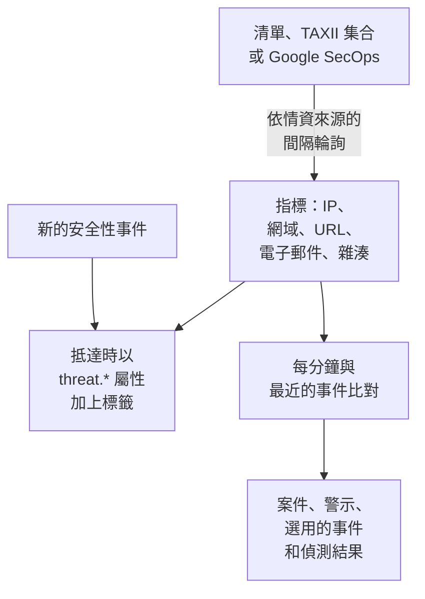

# 威脅情資(STIX/TAXII)

威脅情資來源會把已知惡意的 IP 位址、網域、URL、電子郵件地址和檔案雜湊帶進 OneUptime，並在你的 [安全性事件](/docs/telemetry/security-events) 提到其中之一時通知你。一個情資來源讀取一個來源：https 位址上的指標清單（例如 OneUptime 一鍵新增的免費清單）、來自你自己的 MISP、OpenCTI 或 OpenTAXII 伺服器或某個供應商、包含 STIX 2.1 指標的 TAXII 2.1 集合，或是 Google SecOps 在你的事件中找到的指標。

:::cards
- [新增免費清單](#新增免費清單): Feodo Tracker、Emerging Threats 和 Tor 出口節點，一鍵新增。
- [訂閱情資來源](#訂閱情資來源): 清單的位址、TAXII 集合或 Google SecOps 連線。
- [會擷取什麼](#會擷取什麼): OneUptime 保留的指標模式，以及保留多久。
- [如何找到符合項目](#如何找到符合項目): 事件抵達時加上標籤，並每分鐘比對一次。
- [威脅等級](#威脅等級): 指標的 confidence 如何變成嚴重程度。
:::

## 運作方式



## 開始之前

- 對於清單：一個 `https` 位址，下載後是每行一個指標的文字檔。
- 對於 TAXII 情資來源：一個發布 STIX 2.1 `indicator` 物件的 TAXII 2.1 伺服器，以及要輪詢的集合 ID。TAXII 情資來源可以匿名登入，也可以使用 bearer 權杖或 HTTP 基本驗證登入。
- 對於 Google SecOps 情資來源：一個服務帳戶能搜尋指標符合項目的 [Google SecOps 連線](/docs/integrations/google-secops#設定託管連接器)，`roles/chronicle.viewer` 角色就可以。
- 不支援要求 TLS 用戶端憑證（雙向 TLS）的伺服器，例如 CISA AIS。MITRE 的公開 ATT&CK 伺服器發布的是技術和組織，而不是指標，所以指向它的情資來源會一直是空的。
- 一個可以建立情資來源的角色：Project Owner、Project Admin、Security Admin 或 Security Member。Security Viewer 可以讀取情資來源和指標。請參閱 [角色](/docs/permissions/reference#角色)。

## 新增免費清單

**威脅情報** 上的 **免費清單** 卡片可以一鍵新增免費的封鎖清單：在清單上按一下 **新增清單**，OneUptime 就會建立一個依清單排程下載它的情資來源。專案已在讀取的清單會顯示 **已新增**。

| 清單 | 發布者 | 讀取 | 信賴度 | 符合時開啟 |
| --- | --- | --- | --- | --- |
| Feodo Tracker 殭屍網路 C2 伺服器 | abuse.ch | 每小時 | 90，Critical | 一個案件和一個警示 |
| Emerging Threats 遭入侵的主機 | Proofpoint Emerging Threats | 每天 | 70，High | 一個案件和一個警示 |
| Tor 出口節點 | The Tor Project | 每小時 | 30，Low | 一個案件 |

每個清單的圖塊都連結到其條款：Feodo Tracker 可免費用於任何用途（CC0），Emerging Threats 清單採用 BSD 授權。從清單新增的情資來源和其他情資來源一樣編輯和刪除。

## 訂閱情資來源

:::steps
### 前往 Threat Intel

開啟 **產品 → Security Events → 偵測 → 威脅情報** 。

### 建立情資來源

按一下 **建立威脅情報來源**，選擇它的 **來源**：**指標清單**、**TAXII 集合** 或 **Google SecOps**。下一步只詢問該來源需要的內容：清單的 **清單 URL**、集合的 **TAXII 伺服器** 和 **登入**，或是 **Google SecOps 連線**。**符合時** 在最後。各欄位請見下表。

### 檢查第一次輪詢

一兩分鐘內，情資來源所在列會顯示 **最近輪詢** ，**最近一次輪詢摘要** 會說明這次輪詢取回了什麼。指標會出現在情資來源下方的 **指標** 表格中。
:::

| 欄位 | 填寫內容 |
| --- | --- |
| **來源** | 指標從哪裡來。它在建立情資來源時決定：換一個來源就是一個新的情資來源。 |
| **清單 URL** | 對於清單：一個文字檔的 `https` 位址，檔案每行一個 IP 位址、網域、URL 或檔案雜湊。 |
| **信賴度** | 對於清單：清單的可信程度，1 到 100。清單上的每個指標都會取得這個值，它決定 [威脅等級](#威脅等級)；留空則為 Medium。 |
| **Google SecOps 連線** | 對於 Google SecOps：用其金鑰讀取 Google SecOps 找到之指標的連線。沒有連線時，**連線 Google SecOps** 會開啟 **連線**。 |
| **TAXII API 根 URL** | 伺服器的 TAXII 2.1 API 根，例如 `https://taxii.example.com/api1/`。集合在它之下定址。 |
| **集合 ID** | 發布指標的集合。 |
| **輪詢間隔（分鐘）** | 讀取來源的頻率：1 到 1440 分鐘，預設 60。清單最多每 15 分鐘讀取一次。 |
| **最低信賴度** | 對於 TAXII 集合或 Google SecOps：信賴度低於此值的指標會被略過，0 到 100，設為 0 時全部保留。沒有信賴度的指標一律通過。 |
| **登入** | OneUptime 的登入方式：公開集合選 **無需登入**，伺服器營運方提供的權杖選 **Bearer 權杖**，HTTP 基本驗證選 **使用者名稱與密碼**。 |
| **API 權杖**、**Basic Auth 使用者名稱** 和 **Basic Auth 密碼** | 只詢問所選登入方式需要的項目。 |
| **符合時開啟案例** | 預設開啟：每個提到指標的事件都會開啟一個與該指標有關的 [案件](/docs/telemetry/security-cases)，或併入已有的、與該指標有關的未關閉案件。 |
| **警示和事件** | 預設 **建立警示**：每個符合的指標都會開啟一個警示。 |
| **警示嚴重性** | 此情資來源開啟的每個警示的嚴重程度。留空時使用每個指標的威脅等級。 |
| **宣告事件** 或 **兩者** | 在 **警示和事件** 下。事件會驅動待命呈報、SLA 和狀態頁面，而對於指標符合，通常警示就已足夠。 |
| **事件嚴重性** | 與 **警示嚴重性** 相同，用於事件。 |
| **符合時寫入 Detection Finding** | 預設開啟：每次符合都會在事件串流中寫入一個偵測結果。 |

TAXII 情資來源的權杖和密碼會經過加密，儲存後不會再顯示。若要變更它們，請在情資來源所在列中選擇 **更新憑證** ，再選擇 **Bearer 權杖**、**使用者名稱與密碼** 或會清除已儲存內容的 **無需登入** ：你的選擇會取代情資來源的登入方式，所以儲存權杖會清除已儲存的密碼，反之亦然。

### 如何輪詢情資來源

每次輪詢都會透過 TAXII 的 `added_after` 游標請求自上次以來新增的物件，並最多讀取 10 頁、每頁 500 個物件。因此大型集合會在多次輪詢中完成同步：仍有剩餘頁面時，**最近一次輪詢摘要** 會說明。若要更快完成一次大型的首次同步，請把 **輪詢間隔（分鐘）** 調低，最低到 1，直到追上為止。

輪詢會以使用者代理程式 `OneUptime/<version> (+https://oneuptime.com)` 表明身分。如果供應商的防火牆回應 `403`，請請對方放行它：許多防火牆會封鎖看起來像無名指令碼的請求。

已停用的情資來源既不會被輪詢，也不會被比對。它已經擁有的指標會繼續為新事件加上標籤，直到過期為止。

### 如何讀取清單

- 每次輪詢都會下載整份清單並逐行讀取：讀取每行的第一個值，直到空格、定位字元、逗號或分號為止。以 `#`、`;` 或 `//` 開頭的行是註解，位址或網域後面的連接埠會被去掉，像 `198.51.100.0/24` 這樣的位址範圍會被略過。
- 一個值在最後一次讀到它的輪詢之後 2 天內保持為作用中的指標，清單刪除的值從下一次輪詢起不再符合。沒有變化的清單每天也會重新寫入一次。
- 一份清單最多包含 50,000 個指標。**最近一次輪詢摘要** 會說明讀取了多少個、略過了多少行、遺漏了多少個。
- 位址必須使用 `https`，並遵守與連線相同的輸出規則：在 OneUptime Cloud 上，私人位址會被拒絕。

### 如何讀取 Google SecOps

- 每次輪詢都會讀取 Google SecOps 自上次輪詢以來記錄的指標符合項目，以及 Mandiant 的屬性：符合的網域、位址或檔案雜湊，它的信賴度、類別，以及與它相關的行動和攻擊者。第一次輪詢讀取最近 7 天。
- 一個指標在 Google SecOps 最後一次看到它之後 30 天內保持作用中，或直到它的來源表示它不再作用；分析師在 Google SecOps 中設為靜音的指標在這裡也不再符合。
- Google SecOps 標記為作用中入侵的符合項目為 Critical，高優先順序的符合項目至少為 High。

## 會擷取什麼

對於 TAXII 集合，OneUptime 會保留模式為下列類型之一上的簡單相等比較的 STIX `indicator` 物件。清單和 Google SecOps 提供同樣的類型：

| 類型 | 範例模式 |
| --- | --- |
| IPv4 位址（`ipv4-addr`） | `[ipv4-addr:value = '198.51.100.7']` |
| IPv6 位址（`ipv6-addr`） | `[ipv6-addr:value = '2001:db8::7']` |
| 網域名稱（`domain-name`） | `[domain-name:value = 'evil.example']` |
| URL（`url`） | `[url:value = 'http://evil.example/payload']` |
| 電子郵件地址（`email-addr`） | `[email-addr:value = 'billing@evil.example']` |
| 檔案雜湊，SHA-256（`file-hash-sha256`） | `[file:hashes.'SHA-256' = 'e3b0…b855']` |
| 檔案雜湊，SHA-1（`file-hash-sha1`） | `[file:hashes.'SHA-1' = 'da39…0709']` |
| 檔案雜湊，MD5（`file-hash-md5`） | `[file:hashes.MD5 = 'd41d…427e']` |

以 `OR` 連接的比較，無論在同一個 `[...]` 內還是跨多個，都沒有問題，每個值都會成為一個獨立的指標：

```text
[domain-name:value = 'evil.example' OR domain-name:value = 'evil2.example']
[ipv4-addr:value = '198.51.100.7'] OR [url:value = 'http://evil.example/x']
```

任何其他模式，包括帶有 `AND`、`FOLLOWEDBY`、`NOT`、`LIKE`、`MATCHES`、`WITHIN` 之類時間限定詞或其他物件類型的模式，都會被整個略過，並在 **最近一次輪詢摘要** 中計為不支援。只翻譯 `AND` 模式的一部分，會比情資來源作者的原意符合多得多的內容。

### 指標保持有效多久

- 指標從它的 `valid_from` 開始符合，直到它的 `valid_until`。沒有 `valid_until` 時，它從 `valid_from` 起保持有效 365 天，再次輪詢也不會延長。
- 已撤銷的指標，或被更新為過去的 `valid_until` 的指標，會在更新被輪詢到時立即停止符合。供應商從更新後的模式中移除的值也是如此。
- 值以小寫儲存，符合時不區分大小寫。

**指標** 表格會依儲存的樣子列出指標，並顯示 **狀態** 為 **使用中**、**已過期** 或 **已撤銷** 。重新輪詢的指標可能會暫時顯示兩次，已過期或已撤銷的列會一直留在清單中，直到儲存清理將其移除，最多在過期後約一個月。比對一律會檢查有效期和撤銷狀態，所以這樣的列永遠不會符合。

## 如何找到符合項目

### 事件抵達時加上標籤

每個傳入的安全性事件，無論來自擷取 API 還是某個連線，都會在儲存前與你的有效指標進行檢查。當它的某個 observable（從事件中擷取出的 IP、主機、網域、雜湊和使用者）等於某個指標的值時，事件會被加上下列屬性：

| 屬性 | 值 |
| --- | --- |
| `threat.matched` | 在已加上標籤的事件上一律為 `"true"` |
| `threat.indicator_id` | STIX 指標的 ID；對於那些來源，則為 `list` 或 `google-secops` |
| `threat.indicator_type` | 指標的類型，例如 `ipv4-addr` 或 `file-hash-sha256` |
| `threat.indicator_value` | 符合的值，小寫 |
| `threat.feed` / `threat.feed_id` | 指標來自的情資來源 |
| `threat.confidence` | 指標的 STIX confidence |
| `threat.match_count` | 事件的 observable 中有多少個與指標符合 |

當多個指標與同一個事件符合時，由 confidence 最高的那個填入這些值。它們是一般屬性，所以你可以在 **事件** 中搜尋它們，用它們篩選安全性事件監測器，並在偵測規則中使用它們：

```yaml title="threat-intel-logon.yml"
title: High-confidence indicator in a successful logon
level: critical
detection:
  selection:
    threat.matched: 'true'
    threat.confidence|gte: 80
    className: Authentication
    statusName: Success
  condition: selection
```

加上標籤時只知道事件抵達時已經存在的指標：事件之後永遠不會被重新加上標籤。

### 每分鐘比對一次

每分鐘，每個已啟用情資來源的有效指標都會與事件時間晚於該情資來源上次檢查的事件進行比對。這樣可以捕捉到在事件加上標籤之後才抵達的情資。

- 第一次檢查涵蓋最近 15 分鐘。發生中斷後，下一次檢查最多補上最近 24 小時。
- 每個時間窗只檢查一次。在其時間窗檢查完之後才抵達的情資，只會套用到之後的事件。
- 晚到的事件，也就是時間早於上次檢查的事件，抵達時仍會被加上標籤，但不會被比對。
- 每次檢查都會把每個符合的指標值記錄為 Detection Finding，每個情資來源最多 10,000 個。警示、事件和案件只為出現在最多事件中的 100 個值開啟；其餘的值共用一個關於該情資來源的案件，情資來源的 **最近一次比對錯誤** 會說明有多少符合。

### 符合會帶來什麼

- 一個標題為 `[Threat Intel] <feed name> — <indicator value>` 的警示，在保持開啟期間每個情資來源和值只有一個。警示解決後，下一次符合會開啟一個新的。警示不會自動解決。
- 一個事件，只在 **警示和事件** 設為 **宣告事件** 或 **兩者** 時建立，並以同樣的方式去重。
- 一個 Threat Intel 偵測結果，在開啟 **符合時寫入 Detection Finding** 時寫入：一個來自產品 `OneUptime Threat Intel` 的 `Detection Finding` 事件（OCSF 類別 2004），以指標的威脅等級作為嚴重程度，並帶有下列屬性：

| 屬性 | 值 |
| --- | --- |
| `oneuptime.threat.feed_id` / `oneuptime.threat.feed_name` | 情資來源 |
| `oneuptime.threat.indicator_id` | STIX 指標的 ID；對於那些來源，則為 `list` 或 `google-secops` |
| `oneuptime.threat.indicator_type` / `oneuptime.threat.indicator_value` | 符合了什麼 |
| `oneuptime.threat.confidence` | 指標的 confidence |
| `oneuptime.threat.match_count` | 這個偵測結果背後有多少個事件 |

偵測結果本身永遠不會被比對，所以一次符合不會引發另一次符合。

## 威脅等級

指標沒有 Sigma 等級：由它們的 STIX `confidence` 設定威脅等級。

| 指標的 confidence | 威脅等級 |
| --- | --- |
| 90 到 100 | Critical |
| 70 到 89 | High |
| 40 到 69 | Medium |
| 1 到 39 | Low |
| 未評分（0 或缺少） | Medium |

未評分的指標視為 Medium：畢竟有人選擇把它放進了情資來源。威脅等級就是偵測結果的嚴重程度，並依下列順序從你專案的嚴重程度中為警示選擇嚴重程度：

1. 情資來源的 **警示嚴重性**（或 **事件嚴重性** ），如果已設定：它會套用到該情資來源的每次符合。
2. 與威脅等級同名的嚴重程度，例如 High，不區分大小寫。
3. 依等第：Critical 和 High 取用你最嚴重的嚴重程度，Medium 和 Low 取用最輕的。

威脅等級屬於每個指標，而不屬於情資來源，所以同一個情資來源可能在同一分鐘內開啟一個 Critical 警示和一個 Low 警示。**最低信賴度** 會依同一個數字篩選：最小值設為 70 時只保留 High 和 Critical 指標，外加一律通過的未評分指標。

## 監看情資來源的符合項目

情資來源所在列中的 **建立監測器** 動作會開啟一個新的安全性事件監測器，統計該情資來源的偵測結果：事件類別為 `Detection Finding`，依 `oneuptime.threat.feed_id` 中的情資來源 ID 篩選（絕不用名稱，因為重新命名會改變名稱），時間範圍為最近一小時。可以用它發現突然激增的符合，或一個原本活躍的情資來源突然安靜下來。

## 保留和計費

指標是設定，不是遙測資料，不會以擷取的資料計費。符合時寫入的偵測結果是一般的安全性事件，與其他事件一樣計費和保留：請參閱 [安全性事件](/docs/telemetry/security-events#保留和計費)。

## 疑難排解

:::details 輪詢後設定了 Last Error
`401` 或 `403`：認證資訊錯誤或缺少；請用 **更新憑證** 取代。`403` 也可能是供應商的防火牆封鎖了使用者代理程式。`404`：請檢查 **TAXII API 根 URL** （通常以 `/api1/` 之類的路徑結尾）和 **集合 ID** 。下一次輪詢成功後，錯誤就會清除。
:::

:::details 情資來源有在輪詢，但沒有出現指標
請閱讀 **最近一次輪詢摘要** 。沒有取回物件：集合是空的，或沒有發布指標。不支援的模式：供應商使用了本頁列為會被略過的模式功能。低於最低 confidence：請調低 **最低信賴度** 。已失效：供應商傳送的指標已經被撤銷或已經過期。
:::

:::details 有指標，但什麼都沒有符合
比對是把指標的值與事件的 observable 比較，而不是與每個欄位比較：請在 **事件** 中開啟一個你預期會符合的事件，檢查它的 observable 中是否包含該值。只有狀態為 **使用中** 的指標才會符合。如果情資來源的 **狀態** 顯示 **比對失敗** ，可以透過它所在列的 **檢視錯誤** 查看原因。
:::

:::details 清單情資來源的最近的錯誤顯示位址回傳了網頁
**清單 URL** 開啟的是一個頁面，例如登入頁或錯誤頁，而不是清單：請在瀏覽器中開啟它，並複製檔案本身的位址。文字中不含任何 IP 位址、網域、URL 或檔案雜湊的清單也會以同樣方式被拒絕，情資來源的指標保持原樣。
:::

:::details Google SecOps 情資來源的最近的錯誤顯示 HTTP 403
連線的服務帳戶無法搜尋指標符合項目：請授予它 `roles/chronicle.viewer`。如果連線已被刪除，情資來源會說明這一點：編輯它並選擇另一個 **Google SecOps 連線**。
:::

:::details 有符合，但沒有開啟警示
**警示和事件** 設為 **宣告事件** 或 **都不**，或者同一情資來源和值的警示仍處於開啟狀態，之後的符合都會併入其中。專案至少需要一個警示嚴重程度，情資來源才能開啟警示。
:::

## 後續步驟

:::cards
- [安全性事件](/docs/telemetry/security-events): 傳送事件、搜尋它們並撰寫偵測規則。
- [Google SecOps](/docs/integrations/google-secops): 匯入 Chronicle 的偵測和事件。
- [權限參考](/docs/permissions/reference): Security 角色以及每個角色能做什麼。
:::
