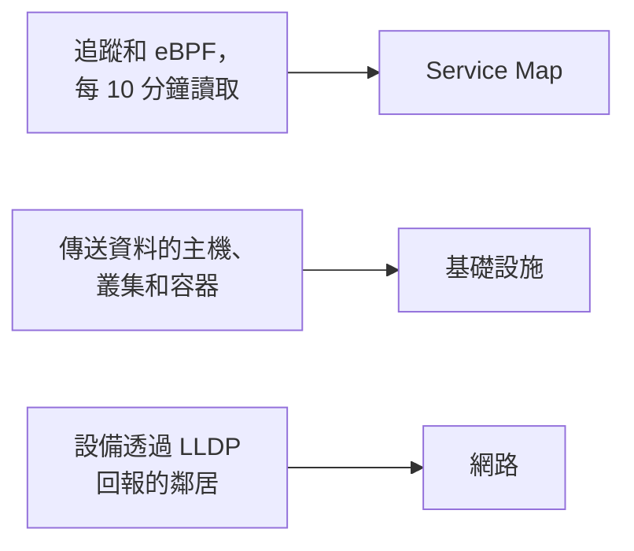

# 拓撲

拓撲描繪你的系統如何連接：哪些服務呼叫哪些服務、什麼在哪裡執行，以及你的網路設備如何佈線。OneUptime 根據你已經在傳送的遙測建立它，因此不必手動繪製，而且一眼就能看出錯誤和事件在哪裡。

:::cards
- [開啟拓撲](#開啟拓撲): 同一頁面上的三個檢視。
- [閱讀服務地圖](#閱讀服務地圖): 誰呼叫誰，以及這些呼叫有多健康。
- [探索你的基礎設施](#探索你的基礎設施): 每個服務在哪裡執行。
- [開啟資源自己的地圖](#開啟資源自己的地圖): 深入檢視一個 vCenter、叢集或主機。
- [查看你的網路](#查看你的網路): 設備及其連結，即時顯示。
:::

## 地圖如何建立

拓撲的每個檢視都由不同類型的遙測建立：

- **只繪製曾經活躍的內容。** 檢視會顯示在時間範圍內傳送過資料的服務和資源，以及在該範圍內觀察到的連線。開啟 **顯示不活躍項目** 可一併繪製沉默的部分。
- **呼叫依最近的時間區間統計。** OneUptime 每 10 分鐘尋找一次服務之間的呼叫，流量數字涵蓋最近 15 分鐘，而不是整個時間範圍。
- **網路檢視是即時的。** 它顯示設備目前的連接方式，因此沒有時間範圍。

## 開始之前

- **正在到達的遙測。** 服務地圖需要追蹤：請參閱 [OpenTelemetry](/docs/telemetry/open-telemetry)。基礎設施檢視需要一台傳送資料的主機或一個叢集：請參閱 [Kubernetes 代理程式](/docs/telemetry/kubernetes-agent)。網路檢視需要網路設備：請參閱 [網路設備監控](/docs/monitor/network-device-monitor)。
- **能夠讀取遙測的角色。** Project Owner、Project Admin、Project Member、Viewer、Telemetry Admin、Telemetry Member 或 Telemetry Viewer，或者擁有 Read Telemetry Service 權限的自訂角色。

## 開啟拓撲

前往 **產品 → 可觀測性 → 拓撲**。**資產清單 → Topology Map** 會開啟同一個頁面。頁面開啟時顯示 **過去 1 天** 的 **Service Map**。

| 檢視 | 它回答的問題 |
| --- | --- |
| **Service Map** | 哪些服務彼此相依？ |
| **基礎設施** | 你的基礎設施中什麼在哪裡執行？ |
| **網路** | 你的網路設備是如何連接的？ |

在時間選擇器旁邊，**顯示不活躍項目** 會加入在該範圍內沒有傳送資料的內容，重新整理按鈕會重新載入檢視。**顯示內容 · 關於這些資料** 說明檢視繪製了什麼以及多久計算一次。網址列會記住你所在的檢視，因此你分享的連結會開啟同一個檢視。

## 閱讀服務地圖

**Service Map** 會繪製每個傳送過資料的服務，以及它們呼叫的資料庫、API 和訊息代理程式，即使後者自己不傳送遙測。箭頭從呼叫端指向被呼叫端，線越粗表示請求越多。上方的計數顯示它繪製了多少服務、相依性和連線，以及其中多少需要注意。

每個服務都會顯示其狀態，依據它在最近 15 分鐘內收到的呼叫計算：

| 狀態 | 條件 |
| --- | --- |
| **健康** | 收到的呼叫中最多 1% 失敗。 |
| **Some errors** | 超過 1% 且少於 5% 失敗。 |
| **High error rate** | 5% 或更多失敗。 |
| **Entry point** | 它沒有收到呼叫，但發出過呼叫：例如 Web 前端或排程工作。 |
| **No calls observed** | 它既沒有發出也沒有收到呼叫。 |

有進行中事件或警示的服務會改為顯示其數量，並且與處於 **Some errors** 或 **High error rate** 的服務一樣，算作需要注意。

:::steps
### 找出需要注意的服務

點選 **需要注意**，只保留這些服務及其直接連線，或在地圖上方的搜尋方塊中依名稱搜尋。

### 開啟一個服務

點選一個服務，查看它最近 15 分鐘的請求、錯誤和平均延遲，它的 **進行中的事件** 和 **進行中的警示**，以及指向 **此服務的追蹤** 和 **清單詳細資料** 的連結。

### 開啟一個連線

點選一個箭頭，查看它的請求速率、錯誤率和平均延遲。在你已檢測的兩個服務之間，它還有呼叫、錯誤和延遲的 **History**。
:::

**連線標籤** 會在每個箭頭上寫一個數字：**請求速率**、**錯誤率** 或 **平均延遲**，也可以在滑鼠停留之前不顯示。**表格** 列出同樣的服務及其 **請求**、**錯誤率**、**平均延遲** 和 **連線**，**在地圖上顯示** 會把其中一個繪製到地圖上。

## 探索你的基礎設施

**基礎設施** 顯示你的服務在哪裡執行：叢集、主機、Pod、容器，以及其他傳送資料的資源。同一工作負載的複本會合併為一個項目，你可以開啟任何內容查看其內部。

- **依你的方式瀏覽。** 以 **清單** 或 **地圖** 顯示，從整個基礎設施一直到單一 Pod。上方的計數顯示它繪製了多少資源和工作負載、能放置多少服務，以及省略了多少沉默的資源。
- **尋找資源。** 依名稱搜尋，然後點選 **檢視詳細資料** 開啟它的頁面。
- **在檢視之間切換。** 資源上列出的服務會在 **Service Map** 中開啟，服務所執行的資源會在 **基礎設施** 中開啟。

## 開啟資源自己的地圖

vCenter、Kubernetes 叢集、主機、Docker 或 Podman 主機、Docker Swarm、Proxmox 或 Ceph 叢集以及儲存陣列，各自都有自己的 **拓撲** 頁面。它依據該資源自己的清單深入繪製這一個資源：什麼在什麼裡面，每個部分依其狀態著色，每個未關閉的事件和警示都顯示在它所涉及的部分上。

- **找出需要注意的內容。** **需要注意** 只保留有問題的部分及通往每個部分的路徑，搜尋可以找到資源中任何位置的部分。
- **仔細檢視。** 點選某個部分可查看它是什麼以及指向其自身頁面的連結，點選 **聚焦於此** 則只繪製該部分、其內部內容及與其關聯的內容。
- **雙向往返。** **在拓撲中開啟** 會在 **基礎設施** 中開啟該資源，而其 **開啟 vCenter 拓撲**、**開啟叢集拓撲**、**開啟主機拓撲** 或 **開啟儲存陣列拓撲** 按鈕會帶你回來。

## 查看你的網路

**網路** 是你的網路設備的即時地圖，依據設備透過 LLDP（在 Cisco 設備上還有 CDP）回報的鄰居建立。它沒有時間選擇器：連線會自行重新整理。

如果你把設備分組到站點中，檢視會在你的站點上開啟：選擇一個站點，或切換到 **All devices**。**Map options** 用於排列地圖並選擇要包含的內容，**匯出 PDF** 會儲存你看到的地圖。網路設備的頁面也會繪製同樣的地圖：請參閱 [網路拓撲](/docs/monitor/network-device-monitor#網路拓撲)。

## 疑難排解

:::details 服務地圖顯示了服務，但沒有連線
OneUptime 每 10 分鐘在你的追蹤中尋找一次服務之間的呼叫。當請求把追蹤內容（`traceparent` 標頭）從一個已檢測的服務帶到下一個服務時（就像 OpenTelemetry 的 HTTP 和 gRPC 檢測那樣）、當服務為它呼叫的資料庫和 API 回報用戶端 Span 時，或者當 Kubernetes 代理程式在啟用 eBPF 的情況下執行時，它就能看到呼叫。
:::

:::details 我移除的服務仍然在地圖上
它在時間範圍內傳送過資料。請選擇較短的範圍，或等到它最後的遙測超出該範圍。開啟 **顯示不活躍項目** 時，地圖還會繪製已經停止傳送資料的內容。
:::

:::details 地圖提示只顯示了其中一部分
非常大的專案會達到地圖的上限，並會有通知說明它顯示了多少資源或連線。搜尋一個服務，或在表格中使用 **在地圖上顯示**，以繪製可讀的一部分。
:::

## 後續步驟

:::cards
- [服務目錄](/docs/telemetry/services): 關於一個服務的一切。
- [追蹤瀏覽器](/docs/telemetry/traces-explorer): 每個箭頭背後的請求。
- [資產清單概觀](/docs/inventory/overview): 地圖繪製的每個資源。
- [網路設備監控](/docs/monitor/network-device-monitor): 把你的網路放到地圖上。
:::
