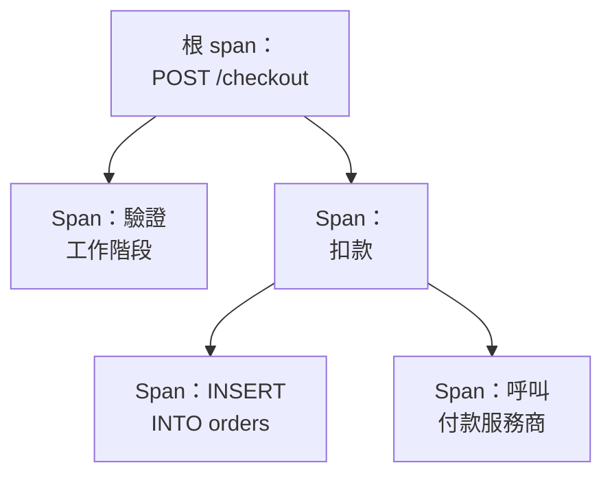

# 追蹤瀏覽器

追蹤瀏覽器幫你找到經過你的服務的請求：慢的、失敗的、涉及某個客戶帳戶的。搜尋並篩選你的服務傳送的 span，然後開啟一條追蹤，以瀑布圖、火焰圖或服務地圖檢視請求的每一步。

:::cards
- [尋找請求](#尋找請求): 搜尋 span，然後依服務、狀態或種類篩選。
- [閱讀追蹤](#閱讀追蹤): 時間花在了哪裡，哪一步失敗了。
- [用圖表展示 span](#用圖表展示-span): 請求數和回應時間，依你的方式分組。
- [追蹤洞察](#追蹤洞察): 錯誤率、延遲和最慢的請求。
- [用 AI 尋找並修正慢速操作和失敗的操作](#用-ai-尋找並修正慢速操作和失敗的操作): 修正它們、並補上追蹤所缺檢測的 Pull Request。
:::

## 追蹤和 span

一條追蹤就是一個請求在你的系統中經過的路徑。它的每一步，例如一個 HTTP 處理常式、一次資料庫查詢或對另一個服務的呼叫，都是一個 span，而 span 會巢狀在啟動它們的 span 之內。追蹤的第一個 span 沒有父項，它就是根 span：請求的入口。

瀏覽器的每一列都是一個 span。預設情況下，清單顯示 **Entry spans**，也就是請求或訊息進入某個服務的 span，因此一個請求會在它到達的每個服務中各出現一次，而資料庫查詢和內部呼叫不會出現在清單中。要讓每個請求只顯示一列，請在側欄的 **Span 類型** 下選擇 **Root spans**；要顯示每一項操作，請選擇 **All spans**。

瀏覽器有五個分頁：

| 分頁 | 用途 |
| --- | --- |
| **檢視者** | 搜尋和篩選 span，並開啟它們的追蹤。開啟時顯示最近一小時的 span，最新在前，每頁 50 個。 |
| **洞察** | 每個服務的請求率、錯誤率和延遲，以及值得一看的請求。 |
| **人工智慧** | OneUptime 在你的追蹤中發現的慢速操作、失敗的操作和缺少的追蹤檢測，以及 OneUptime AI 對它們做了什麼。請參閱 [用 AI 尋找並修正慢速操作和失敗的操作](#用-ai-尋找並修正慢速操作和失敗的操作)。 |
| **設定指南** | 如何使用你的某個 [擷取金鑰](/docs/telemetry/ingestion-keys)，透過 OpenTelemetry 傳送追蹤。 |
| **設定** | span 到達時會發生什麼：**管道**、**捨棄過濾器**、**清理規則** 和 **記錄規則**。 |

## 開始之前

- **正在到達的追蹤。** 使用 [OpenTelemetry](/docs/telemetry/open-telemetry) 檢測你的服務。**設定指南** 分頁會顯示適合你的語言的程式碼。
- **可以讀取遙測的角色。** Project Owner、Project Admin、Project Member、Viewer、Telemetry Admin、Telemetry Member 或 Telemetry Viewer，或者擁有 Read Telemetry Service Traces 權限的自訂角色。角色的範圍決定你能看到誰的 span：請參閱 [遙測](/docs/permissions/index#遙測)。

## 尋找請求

:::steps
### 開啟檢視者

前往 **產品 → 可觀測性 → 追蹤**。**檢視者** 依最新在前的順序列出最近一小時的 span，每個都帶有狀態、服務、名稱和持續時間。

### 選擇時間範圍

在時間選擇器中選擇一個範圍，或者在清單上方的圖表上拖曳，放大某個峰值。雙擊圖表即可縮小回去。請參閱 [放大時間範圍](/docs/telemetry/charts-and-time-ranges)。

### 搜尋

輸入查詢並按 Enter，例如 `service:checkout status:error duration:>500`。單獨的詞會搜尋 span 名稱，`@key:value` 會搜尋某個屬性，例如 `@http.route:/orders`。請參閱 [搜尋語法](/docs/telemetry/search-syntax#追蹤)。

### 用篩選條件縮小範圍

點選 **篩選器** 側欄中的某個值，把它新增為篩選標籤。側欄可以依 **服務**、傳送該 span 的主機、叢集或其他資源、**狀態**、**Span 類型**、**有例外**、**Span 種類**、**Span 名稱**、**服務執行個體** 和 **主機名稱** 篩選。

### 開啟 span

點選一列將其展開：它的屬性，以及它記錄的日誌和例外。點選 **See full trace** 開啟整條追蹤。
:::

你的搜尋、篩選標籤和時間範圍都儲存在頁面網址中，因此重新整理、書籤或分享出去的連結都會開啟相同的 span。

## 閱讀追蹤

追蹤頁面以請求的幾個數字開頭：

| 數字 | 含義 |
| --- | --- |
| 持續時間 | 整個請求花了多長時間。 |
| Span 數 | 追蹤包含多少個 span。 |
| 服務數 | 請求經過了多少個服務。 |
| 錯誤數 | 有多少個 span 以錯誤狀態結束。點選它只顯示這些 span。 |
| 深度 | 巢狀 span 最深的一條鏈。 |

在它們下方，從四種檢視中選擇一種：

| 檢視 | 顯示內容 |
| --- | --- |
| **Waterfall** | 時間軸上的每個 span，巢狀在啟動它的 span 之下。開啟 **Critical path** 可以標示出決定請求耗時的那條 span 鏈。 |
| **火焰圖** | 以堆疊長條顯示同一棵樹，最寬的長條耗時最長。 |
| **Service map** | 請求經過的服務，以及它們之間的呼叫。 |
| **Operations** | 每個服務和 span 名稱一列，顯示呼叫數、錯誤、自身耗時和總耗時。從同一個父 span 呼叫 10 次或以上的操作會被標記：這通常是 N+1 查詢，或可以批次處理的迴圈。 |

在任意檢視中點選一個 span 即可開啟它的面板，其中有屬性、事件、日誌、例外和連結分頁，有的話還有它的效能剖析或 LLM 呼叫。用檢視旁邊的搜尋框（按 `/`）依名稱、ID 或服務搜尋追蹤中的 span，開啟 **Errors only** 則只保留失敗的 span。

大型追蹤每次載入 500 個 span。點選追蹤底部的按鈕可以載入更多，或全部載入。

> [!TIP]
> **使用 AI 修正效能問題** 只會出現在值得修正的追蹤上：其中有 N+1 查詢、本可以平行卻依序執行的呼叫，或一個占用請求大部分時間的呼叫，並且確實耗費了時間（這些呼叫合計 100 ms 或以上，單一呼叫 500 ms 或以上，且至少占請求的十分之一）。它會說明發現了什麼，例如「同一筆資料庫查詢在 ReportService.build 中執行了 40 次」，並啟動一個 AI 任務，開啟一個修正該問題的 pull request。如果連接了多個儲存庫，且沒有一個與此追蹤的服務或程式碼相符，它會先詢問程式碼在哪個儲存庫中。如果此追蹤的修正已經完成，它會連結到該修正的任務，而不是再提供一次修正。如果有其他原因讓 AI 無法工作，例如方案、已用完的 AI 點數或沒有在線的 Runner，它會說明原因，並提供解決問題的連結。請參閱 [程式碼](/docs/ai/ai-agent)。

## 用圖表展示 span

清單上方的圖表依狀態拆分，顯示 span 數量隨時間的變化。在圖表標題中選擇其他度量，即可改為顯示它們的平均、中位數（P50）或 P95 回應時間。

想看更多，請把清單從 **跨度** 切換到 **Analytics**。選擇時間序列、排行清單或表格；度量請求數、錯誤數或回應時間（平均值、P50、P90、P95、P99、最小值或最大值）；依 span 名稱、服務、狀態、span 種類或任意屬性分組，然後再依第二個欄位分組。排行清單或表格顯示前 5 到 100 個分組。

## 追蹤、儲存和分享

- 點選清單上方的 **已暫停** 開啟即時更新。按鈕隨後顯示為 **即時**，清單每 10 秒檢查一次新的 span。再次點選即可暫停。
- **已儲存的檢視** 會以一個名稱為專案中的每個人保留搜尋、篩選條件和時間範圍。儲存的檢視與 [日誌瀏覽器](/docs/telemetry/logs-explorer#儲存檢視) 中的用法相同。
- **日誌** 和 **指標** 按鈕會針對同一時間視窗開啟對應的瀏覽器，並盡可能帶上它們能使用的篩選條件。指向按鈕即可看到它無法帶過去的內容。

## 追蹤洞察

**洞察** 分頁彙總某個時間範圍內的請求：

- 請求數、錯誤率，以及 P50、P95 和 P99 延遲；
- 依錯誤率排序的服務健康表，需要關注的服務排在最前；
- 最近失敗的請求，以及最慢的請求。

用時間選擇器旁邊的下拉式選單把它限定到部分服務。

## 用 AI 尋找並修正慢速操作和失敗的操作

OneUptime 每小時在每個服務最近一小時的追蹤中尋找很慢、會失敗或其追蹤無法說明原因的操作，並將發現連同證據記錄為 AI 洞察。接著 OneUptime AI 會調查每一則，並開啟一個修正它的 Pull Request。絕不會自動合併：每個 Pull Request 都由你的團隊審查。

操作是一個服務中同名的 span，例如 `GET /orders`。服務在最近一小時內傳送了至少 100 個 span 後，OneUptime 就會讀取它，並記錄三類發現：

| 發現 | OneUptime 何時記錄 | Pull Request |
| --- | --- | --- |
| **慢速操作** | 在至少 20 個 span 上，操作的 P99 為 1 秒或更長，且其最慢的請求重複一種耗費實際時間的模式：同一呼叫一再重複、本可並行卻依次進行的呼叫，或佔用請求大部分時間的單一呼叫。 | 讓操作更快。 |
| **失敗的操作** | 操作至少有 20 個 span 失敗，佔 5% 或更多，且最近的失敗透過例外或錯誤訊息說明了原因。 | 修正它失敗的原因。 |
| **缺少的追蹤檢測** | 追蹤無法說明原因：一個服務的 500 個或更多 span 每個都是其追蹤的根，下面沒有該服務的 span；一個慢速請求把 60% 或更多的時間（且 500 ms 或更多）花在一個下面沒有任何追蹤的 span 中；或者一個操作的失敗既沒有記錄錯誤訊息，也沒有記錄例外。 | 補上缺少的追蹤檢測。 |

只有在找到出錯的程式碼後，OneUptime AI 才會自行為失敗的操作開啟 Pull Request。來自其他地方的失敗，例如某個相依服務停機，不會得到 Pull Request，除非有人透過 **用 AI 修正** 要求一個。

### 開啟

**追蹤 → 人工智慧 → 設定** 中有 **尋找並修正慢速操作和失敗的操作** 開關，新專案預設開啟。當 **啟用 AI** 關閉時，仍會發現慢速操作和失敗的操作，但 OneUptime AI 不會對它們做任何事。要開啟 Pull Request，OneUptime AI 需要在 [程式碼](/docs/ai/ai-agent) 中連接的儲存庫：頁面會先說明缺少什麼。每個儲存庫的程式碼都在該儲存庫於「程式碼」中選擇的 Runner 上修改。

OneUptime AI 每天（UTC）最多自行開啟 5 個 Pull Request，每則發現一個，且絕不超過儲存庫對開啟中的 AI Pull Request 的上限。

### AI 規則

沒有規則時，OneUptime AI 會立即調查它在你的追蹤中發現的每個問題，並為每個它能修正的問題開啟 Pull Request。**更多設定** 下的 **AI 規則** 會分三步縮小範圍：

| 步驟 | 決定什麼 |
| --- | --- |
| **比對** | 哪些服務：所選的服務、帶有特定標籤的服務，或名稱符合某個模式的服務。 |
| **調查** | **立即**，或 **僅在等待後仍被發現時**：在等待期間消失的問題不會被調查。 |
| **修正** | **不修正**、**修正前先詢問** 或 **無需詢問直接修正**。先詢問時，Pull Request 交給人來開啟：這則發現會提供 **用 AI 修正**。 |

在 **更多欄位** 中，規則會選擇 OneUptime AI 可為其使用的程式碼儲存庫、MCP 伺服器和 LLM 供應商。若未選擇任何項目，它可以使用全部，並使用專案的預設 LLM 供應商。

### 查看它做了什麼

- **追蹤 → 人工智慧 → 洞察** 列出 OneUptime 發現的內容，每則發現都附有證據和 **在追蹤中開啟**，它會在 **檢視者** 中開啟這則發現所涉及的、發現當時那一小時的 span。對於失敗的操作，**建立監測器** 會針對其失敗的 span 設定一個追蹤監測器。
- **追蹤 → 人工智慧 → 日誌** 依最新優先列出每次調查和每個 Pull Request，以及各自的狀態和每次調查的發現。
- 在「程式碼」中，任務會說明是 OneUptime 啟動的，並附有指向其發現的連結，Pull Request 則會說明開啟它的原因。

## span 到達時會發生什麼

**設定** 分頁包含 OneUptime 在 span 到達時套用的規則，與日誌的做法相同。它們作用於之後到達的 span，而不是已儲存的 span。每個 span 保留多久，也是在它到達時決定的：請參閱 [資料保留](/docs/telemetry/data-retention)。

| 規則 | 作用 |
| --- | --- |
| **捨棄過濾器** | 捨棄你不想保留的 span，或者只保留其中的一部分樣本。請參閱 [捨棄或取樣記錄](/docs/telemetry/drop-filters-and-scrub-rules#捨棄或取樣記錄)。 |
| **清理規則** | 遮蓋 span 屬性中的敏感資料。請參閱 [清理敏感資料](/docs/telemetry/drop-filters-and-scrub-rules#清理敏感資料)。 |
| **管道** | 變更並擴充 span：每個管道以篩選條件比對 span，然後依序執行它的處理器。 |
| **記錄規則** | 每分鐘把 span 數、錯誤數和持續時間轉換為新的指標。請參閱 [日誌記錄規則](/docs/telemetry/log-recording-rules)。 |

## 疑難排解

:::details 追蹤顯示找不到 span
span 通常在請求結束後一分鐘內到達。點選追蹤頁面上的 **重新整理** 再檢查一次。
:::

:::details 有些 span 位於瀑布圖的頂層
它們指向一個 OneUptime 尚未收到的父 span，通常是因為寫入父 span 的服務還沒有把追蹤傳送到 OneUptime。也檢測那個服務。
:::

:::details 清單的列數遠多於請求數
每一列是一個 span，而不是一個請求：使用預設的 **Entry spans** 時，一個請求會在它到達的每個服務中各出現一次，使用 **All spans** 時則每項操作各出現一次。在側欄的 **Span 類型** 下選擇 **Root spans**，讓每個請求只顯示一列。
:::

## 後續步驟

:::cards
- [搜尋語法](/docs/telemetry/search-syntax): 搜尋框能理解的所有篩選條件。
- [追蹤監控](/docs/monitor/traces-monitor): 在請求失敗或變慢時收到警示。
- [例外狀況追蹤](/docs/telemetry/exceptions): 分流你的 span 記錄的錯誤。
- [日誌瀏覽器](/docs/telemetry/logs-explorer): 閱讀一個請求寫下的日誌行。
:::
