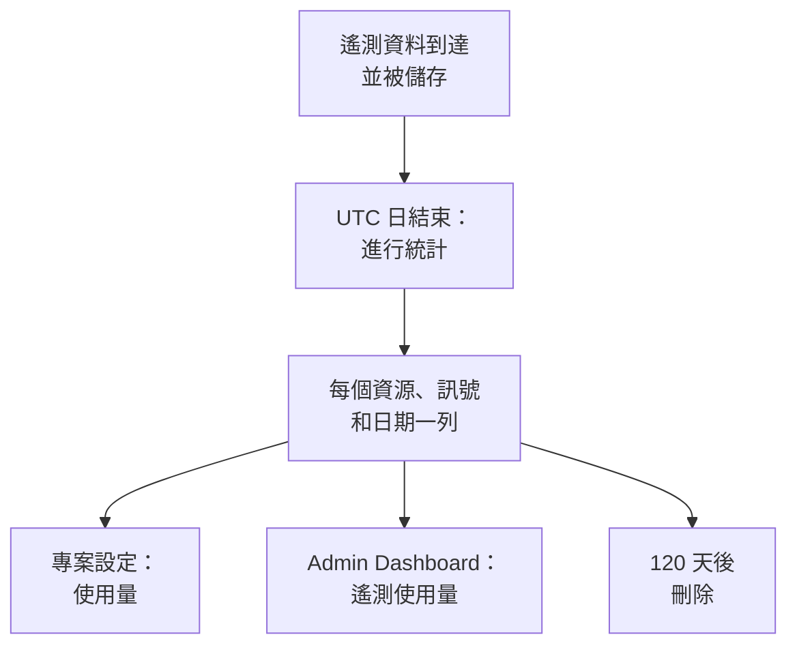

# 遙測使用量

查看每個專案及其中每個服務或資源傳送了多少遙測資料：日誌、指標、追蹤及其例外、效能剖析資料、工作階段重播和安全事件。每個 OneUptime 安裝都會統計使用量，無論是否啟用計費，因此你不必查詢 ClickHouse 就能找出是什麼佔滿了儲存空間。

:::cards
- [使用量如何統計](#使用量如何統計): 每天一次，依資源和訊號統計。
- [查看專案的使用量](#查看專案的使用量): 專案設定 → 遙測與 APM → 使用量。
- [查看所有專案的使用量](#查看所有專案的使用量): Admin Dashboard，供執行個體管理員使用。
- [使用量保留多長時間](#使用量保留多長時間): 未變更時為 120 天。
:::

## 使用量如何統計

每天一次，在一天按 UTC 結束後，OneUptime 會依訊號統計每個專案的每個資源當天傳送的資料，並把統計結果儲存為每個資源、訊號和日期一列。



- **一天結束後才會統計。** 每一天大約在隔天 08:00 UTC 前統計完成，因此今天的使用量明天才會顯示。未能統計的日期會在一週內重試。
- **大小是儲存的大小。** 每個訊號依儲存它的列在壓縮前的大小統計。工作階段重播依錄製器上傳的位元組數統計。
- **追蹤包含其例外，效能剖析資料包含其樣本。**
- **OneUptime 自己的遙測不計入。** 監測器、警示、事件和 SLO 的讀數、資料可觀測性的讀數以及工作階段重播預算指標，都由 OneUptime 自己寫入。
- **在 OneUptime Cloud 上，遙測依這些列計費。** 在沒有計費的安裝上，使用量的統計不產生任何費用，也不會為其收費，即使之後啟用了計費也是如此。
- **預算與使用量分開計數。** [擷取預算](/docs/telemetry/ingestion-budgets) 在遙測資料抵達時依解壓縮後的大小計數，因此可以在當天就擋下當天的遙測資料。設定了預算時，此頁面最上方會顯示今天的預算。

## 開始之前

- **能讀取專案遙測的角色。** 專案擁有者、專案管理員、專案成員、檢視者、遙測管理員、遙測成員或遙測檢視者，或者某個帳單角色。角色必須涵蓋整個專案：僅限於某些標籤的角色看不到使用量。
- **專案中有遙測資料。** 使用量統計的是專案的 [擷取金鑰](/docs/telemetry/ingestion-keys) 傳送的遙測資料。

## 查看專案的使用量

:::steps
### 開啟使用量

前往 **專案設定 → 遙測與 APM → 使用量**。側邊選單中的 **遙測與 APM** 預設為收合：點選它即可展開。

### 選擇時間範圍

頁面預設顯示 **過去 30 天**。在 **遙測使用量** 卡片右上角的方塊中選擇 **過去 7 天** 或 **過去 90 天**。時間範圍截止到昨天，也就是已統計的最近一天。

### 找出增長的部分

**依資源統計的使用量** 卡片列出在該時間範圍內傳送過資料的每個服務和資源，用量最大的排在最前。點選欄標題可依該欄排序，點選資源名稱可開啟其頁面。
:::

該頁面有三張卡片：

| 卡片 | 顯示內容 |
| --- | --- |
| **遙測使用量** | 該時間範圍的 **總計**、每個訊號的總計，以及每天的圖表，各訊號堆疊顯示。 |
| **依資源統計的使用量** | 每個 **資源** 及其類型、每個訊號一欄、**總計**，以及其遙測資料的 **保留期**。 |
| **遙測使用歷史記錄** | 每個訊號、資源和日期一列，可依 **產品**、**天** 和 **服務** 篩選。 |

未指明服務的遙測資料會列為 **未知服務**。此後已被刪除的資源，或你的角色無法讀取其類型的資源，會以其類型和 ID 的開頭列出。

## 誰能看到什麼

| 角色 | 能看到 |
| --- | --- |
| 專案擁有者、專案管理員、帳單管理員、帳單成員、帳單檢視者、Manage Billing | 每個資源傳送了多少資料、保留多長時間，以及在 OneUptime Cloud 上的費用 |
| 專案成員、檢視者、遙測管理員、遙測成員、遙測檢視者 | 每個資源傳送了多少資料以及保留多長時間 |

使用量的費用只在 OneUptime Cloud 上顯示：沒有計費的安裝不會為使用量收費。價格請參閱 [帳單與用量](/docs/configuration/billing#使用歷程)。

## 查看所有專案的使用量

在自行託管的安裝上，執行個體管理員可以在 Admin Dashboard 中查看所有專案的使用量：

:::steps
### 開啟遙測使用量

在 Admin Dashboard 中開啟選單，點選 **遙測使用量**。清單顯示在該時間範圍內傳送過資料的每個專案，用量最大的排在最前，每個訊號一欄，另有 **總計**。

### 找出用量最大的專案

在卡片右上角選擇時間範圍，然後點選欄標題依該欄排序：**總計**、某個訊號，或依名稱排序的 **專案**。

### 開啟專案

點選專案名稱。它在 Admin Dashboard 中 **專案** 下的 **遙測使用量** 頁面依日期、訊號和資源顯示其使用量，與專案成員看到的一致。
:::

## 使用量保留多長時間

無論是否啟用計費，使用量都會保留 120 天，除非你變更。這是使用量統計資料的保留時間，而不是遙測資料本身的保留時間：後者請參閱 [資料保留](/docs/telemetry/data-retention)。

:::steps
### 開啟資料保留

在 Admin Dashboard 中，前往 **設定 → 資料保留**。

### 設定天數

在 **遙測使用量保留** 卡片上，點選 **編輯遙測使用量保留**，在 **遙測使用量保留期（天）** 中輸入 30 到 1095 之間的天數，然後點選 **儲存變更**。留空則為 120 天。
:::

早於該時間的使用量每天刪除一次。保留期絕不短於 30 天：已統計的日期絕不會被刪除後再統計一次。

## 透過 API 讀取使用量

`GET /api/telemetry-usage/project` 會傳回一個專案在一段 UTC 日期範圍內的使用量，與頁面顯示的一致。使用擁有上述角色之一的 [API 金鑰](/docs/permissions/index#api-金鑰) 呼叫它：

```bash
curl 'https://oneuptime.com/api/telemetry-usage/project?startDay=2026-10-01&endDay=2026-10-31' \
  -H "ApiKey: $ONEUPTIME_API_KEY"
```

`startDay` 和 `endDay` 是寫成 `YYYY-MM-DD` 的日期，兩端都包含在內，範圍最長可達 1095 天。回應包含總計、每天依訊號的使用量和每個資源依訊號的使用量，單位為 GB；只有在啟用計費且該金鑰能讀取帳單時才包含費用。

## 疑難排解

:::details 使用量頁面顯示「尚無遙測使用量」
一天按 UTC 結束後才會統計，約在隔天 08:00 UTC 前完成：今天才開始傳送資料的專案明天才會顯示第一天。請在各個探索器中確認專案收到了遙測資料。
:::

:::details 數字比我的 ClickHouse 磁碟用量還大
使用量是列在壓縮前的大小。ClickHouse 會壓縮它儲存的資料，因此它使用的磁碟要小好幾倍。
:::

:::details 資源以其類型和 ID 列出
該資源在傳送遙測資料後已被刪除，或者你的角色無法讀取這類資源。它的使用量仍會被統計。
:::

## 後續步驟

:::cards
- [捨棄過濾器與清理規則](/docs/telemetry/drop-filters-and-scrub-rules): 停止儲存你不需要的遙測資料。
- [資料保留](/docs/telemetry/data-retention): 依需要保留遙測資料，不多留一天。
- [帳單與用量](/docs/configuration/billing): OneUptime Cloud 上遙測的費用。
- [擷取金鑰](/docs/telemetry/ingestion-keys): 把遙測傳送到你的專案。
- [擷取預算](/docs/telemetry/ingestion-budgets): 限制專案一天內每個訊號最多傳送多少。
:::
