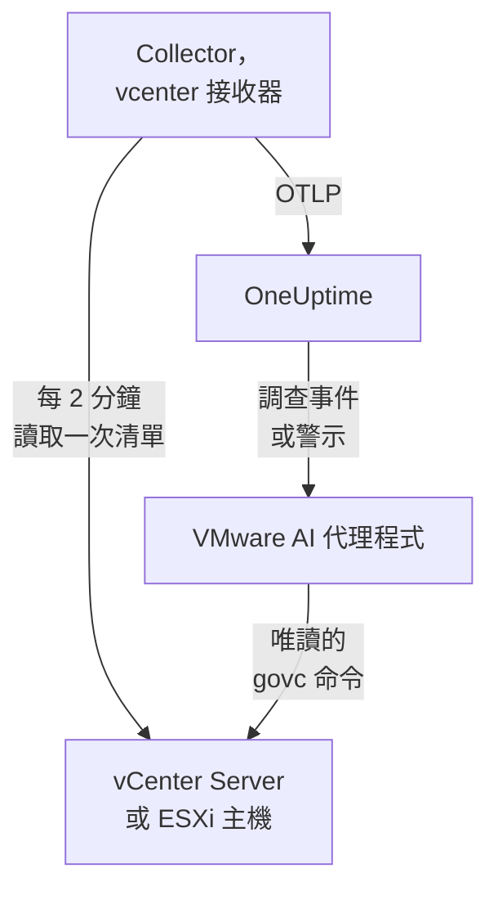

# VMware 代理程式

OneUptime VMware 代理程式會監控 VMware vSphere：vCenter Server、ESXi 主機、虛擬機器、資料存放區、叢集、資源集區和 vSAN。它是一個標準的 OpenTelemetry Collector，其 [`vcenter` 接收器](https://github.com/open-telemetry/opentelemetry-collector-contrib/tree/main/receiver/vcenterreceiver) 會使用唯讀使用者讀取 vSphere API，為每個指標加上你的 vCenter 名稱，並傳送到 OneUptime：vCenter 上不需要外掛程式，VM 內部也不需要安裝任何東西。[VMware 監控](/docs/monitor/vmware-monitor) 會根據收到的資料發出警示。

:::cards
- [安裝代理程式](#安裝代理程式): 先建立唯讀使用者，再使用安裝指令碼、Docker Compose 或 systemd。
- [代理程式收集的內容](#代理程式收集的內容): 每個 vSphere 物件、它的身分和它的指標。
- [AI 代理程式](#ai-代理程式): 讓 OneUptime AI 在調查時讀取 vCenter。
- [疑難排解](#疑難排解): 一個診斷指令碼，以及常見問題。
:::

## 運作方式

一個代理程式監控一個 vSphere 端點：一個 **vCenter Server**，涵蓋它所管理的每個資料中心、叢集和主機；或一台不受任何 vCenter 管理的 **獨立 ESXi 主機**。每個 vCenter 執行一個代理程式。Collector 每次收集時會走訪一次整個清單（預設每 2 分鐘一次），並為每個物件傳送一個資源。同一個 Compose 檔案也會在旁邊執行供 OneUptime AI 使用的 VMware AI 代理程式。不想執行 Docker 嗎？同一個 Collector 使用相同的設定，也能在任何 Linux 機器上作為 systemd 服務執行。



vCenter 會隨其第一批資料，以代理程式作為 `vmware.vcenter.name` 加到每個指標上的名稱自行註冊。若要完全不執行代理程式就監控 vCenter，請參閱 [免代理程式的 VMware](/docs/telemetry/vmware-agentless)：你的其中一個探測器會用唯讀帳戶收集相同的資料。

## 開始之前

- Docker Engine 20.10 或更新版本，搭配 Docker Compose v2 外掛程式；或者，若不使用 Docker 安裝，則需要一台裝有 systemd 235 或更新版本的 Linux 機器（x86_64 或 arm64）。無論哪種方式，該機器都必須能透過 HTTPS（TCP 443）連到 vCenter。
- vCenter Server 或 ESXi 7.0 或更新版本：接收器支援 vSphere 7 和 8。
- 一個能建立 vSphere 使用者，並在最上層 vCenter 物件上為其指派角色的帳戶。
- 一把擷取金鑰。在 **專案設定 → 遙測與 APM → 擷取金鑰** 下建立一把並複製其值。

### 在哪裡執行代理程式

代理程式透過 HTTPS 與 vCenter 通訊，因此不必在它附近執行；理想情況下，它既不應在 vCenter Server Appliance 上執行，也不應在它所監控叢集中的 VM 裡執行：一旦該叢集停擺，你的監控也會一起停擺。獨立硬體上的一台小型管理 VM、一台監控主機，或任何執行 Docker（或者不用 Docker 時，任何具有 systemd 的 Linux 機器）並能透過 TCP 443 連到 vCenter 的機器，都是合適的位置。選用的 syslog 接聽程式還要求 ESXi 主機能透過 syslog 連接埠連到代理程式（請參閱 [傳送 ESXi syslog](#選用-傳送-esxi-syslog)）。

## 安裝代理程式

:::steps
### 建立唯讀 vSphere 使用者

代理程式只會讀取：清單、效能計數器和 vSAN 統計資料。請給它一個專用帳戶，並使用內建的 **Read-Only** 角色，絕不要用管理員。

:::tabs
@tab vSphere Client
1. 建立帳戶：開啟 _Menu → Administration → Single Sign On → Users and Groups_，選擇 `vsphere.local` 網域（或你的身分識別來源），按一下 **Add**，將使用者命名為 `oneuptime` 並設定密碼。該使用者就是 `oneuptime@vsphere.local`。
2. 指派角色：在 _Hosts and Clusters_ 清單中選取最上層的 **vCenter Server** 物件，開啟 **Permissions** 索引標籤，按一下 **Add**，選擇該使用者，將角色設為 **Read-Only**，並勾選 **Propagate to children**。
@tab govc
在具有管理員認證的機器上：

```bash
govc sso.user.create -p 'a-strong-password' -R ReadOnly oneuptime
govc permissions.set -principal oneuptime@vsphere.local -role ReadOnly -propagate=true /
```
@tab PowerCLI
在以管理員身分連線到 vCenter 的工作階段中：

```powershell
New-SsoPersonUser -UserName oneuptime -Password 'a-strong-password'
New-VIPermission -Entity (Get-Folder -NoRecursion) -Principal 'VSPHERE.LOCAL\oneuptime' -Role ReadOnly -Propagate:$true
```
@tab ESXi Host Client
對於獨立 ESXi 主機（沒有 vCenter），請在 _Host → Manage → Security & Users → Users_ 下建立使用者，並在 _Host → Manage → Security & Users → Permissions_ 下為其指派 Read-Only 角色。或者在主機的 shell 中執行 `esxcli system account add`，再執行 `esxcli system permission set --id oneuptime --role ReadOnly`。
:::

> [!IMPORTANT]
> 傳播是大家最容易漏掉的部分。接收器會走訪資料中心、叢集、主機、VM、資料存放區和資源集區，使用者看不到的每個物件都會被默默略過。在 vCenter 物件上指派但未啟用傳播的 Read-Only 角色，只會得到一個空的清單和一個全是零的儀表板。

### 安裝並啟動代理程式

:::tabs
@tab install.sh
下載安裝指令碼，並在將要裝載代理程式的機器上執行它：

```bash
curl -sSL https://raw.githubusercontent.com/OneUptime/oneuptime/master/agents/VMwareAgent/install.sh -o install.sh
bash install.sh
```

指令碼會詢問你的 OneUptime URL、擷取金鑰、vCenter 名稱、vCenter 端點和唯讀認證（讀取密碼時不會回顯），以及 AI 代理程式是否可以套用修正（如果可以，還會詢問它專用的 vSphere 使用者以及它絕不能變更的 VM）。它會安裝到 `/opt/oneuptime-vmware-agent`，寫入一個 `0600` 權限的 `.env` 檔案，並用 Docker Compose 啟動代理程式。它會依你輸入的原樣為 Docker Compose 為每個值加上引號，因此包含 `$`、`#`、空格或引號的密碼也能依輸入的原樣運作。再次執行指令碼會重複使用現有 `.env` 中的所有內容，不會再次詢問，這就是 [升級代理程式](#升級代理程式) 的方式。
@tab Docker Compose
從 [VMwareAgent 目錄](https://github.com/OneUptime/oneuptime/tree/master/agents/VMwareAgent) 下載 `docker-compose.yml` 和 `otel-collector-config.yaml` 到一個新資料夾中，然後在它們旁邊建立一個 `.env` 檔案。它存放著密碼，因此請用 `chmod 600 .env` 保持其私密：

```bash title=".env"
ONEUPTIME_URL=YOUR_ONEUPTIME_URL
ONEUPTIME_TELEMETRY_INGESTION_KEY=YOUR_TELEMETRY_INGESTION_TOKEN
VMWARE_VCENTER_NAME=my-vcenter
VCENTER_ENDPOINT=https://vcsa.example.com
VCENTER_USERNAME=oneuptime@vsphere.local
VCENTER_PASSWORD=a-strong-password
VCENTER_INSECURE_SKIP_VERIFY=true
VCENTER_COLLECTION_INTERVAL=2m
```

包含 `$`、`#`、空格或引號的密碼要放在單引號中（請參閱 [vCenter 拒絕登入](#疑難排解)）。啟動代理程式：

```bash
docker compose up -d
```
@tab systemd
代理程式不需要 Docker：它就是一個 OpenTelemetry Collector 二進位檔和一個設定檔。在裝有 systemd 235 或更新版本的 Linux 機器（x86_64 或 arm64；Ubuntu 18.04、Debian 10、RHEL 8 或更新版本）上，將代理程式固定的 `otelcol-contrib` 版本與同一個 `otel-collector-config.yaml` 一起作為 systemd 服務執行。代理程式為此提供的單元 [`oneuptime-vmware-agent-native.service`](https://github.com/OneUptime/oneuptime/blob/master/agents/VMwareAgent/systemd/oneuptime-vmware-agent-native.service) 會以一個臨時的非特權使用者執行 Collector，不帶任何 capabilities，也沒有任何可寫入的位置。

下載 Collector、設定和單元，並將它們安裝到 `/opt/oneuptime-vmware-agent`：

```bash
cd "$(mktemp -d)"
VERSION=0.161.0   # the collector release the agent pins
ARCH=$(uname -m | sed 's/x86_64/amd64/;s/aarch64/arm64/')
curl -fL -o otelcol-contrib.tar.gz \
  https://github.com/open-telemetry/opentelemetry-collector-releases/releases/download/v${VERSION}/otelcol-contrib_${VERSION}_linux_${ARCH}.tar.gz
curl -fsSLO https://raw.githubusercontent.com/OneUptime/oneuptime/master/agents/VMwareAgent/otel-collector-config.yaml
curl -fsSL -o oneuptime-vmware-agent.service \
  https://raw.githubusercontent.com/OneUptime/oneuptime/master/agents/VMwareAgent/systemd/oneuptime-vmware-agent-native.service

sudo install -d -m 0755 /opt/oneuptime-vmware-agent
sudo tar --no-same-owner --preserve-permissions -xzf otelcol-contrib.tar.gz -C /opt/oneuptime-vmware-agent otelcol-contrib
sudo install -m 0644 otel-collector-config.yaml /opt/oneuptime-vmware-agent/otel-collector-config.yaml
sudo install -m 0644 oneuptime-vmware-agent.service /etc/systemd/system/oneuptime-vmware-agent.service
```

設定寫在 `/opt/oneuptime-vmware-agent/.env` 中：與 Docker 安裝的 `.env` 相同的變數。它存放著密碼，因此在開啟之前，請讓它只有 root 可讀：

```bash
sudo touch /opt/oneuptime-vmware-agent/.env
sudo chmod 600 /opt/oneuptime-vmware-agent/.env
sudoedit /opt/oneuptime-vmware-agent/.env
```

在其中寫入以下內容：

```bash
ONEUPTIME_URL=YOUR_ONEUPTIME_URL
ONEUPTIME_TELEMETRY_INGESTION_KEY=YOUR_TELEMETRY_INGESTION_TOKEN
VMWARE_VCENTER_NAME=my-vcenter
VCENTER_ENDPOINT=https://vcsa.example.com
VCENTER_USERNAME="oneuptime@vsphere.local"
VCENTER_PASSWORD="a-strong-password"
VCENTER_INSECURE_SKIP_VERIFY=true
VCENTER_COLLECTION_INTERVAL=2m
```

讀取這個檔案的是 systemd，而不是 shell：請把使用者名稱和密碼放在雙引號中，每個 `\` 寫成 `\\`，每個 `"` 寫成 `\"`（`DOMAIN\user` 寫成 `"DOMAIN\\user"`），而 `$`、`#`、`'` 和空格則照原樣寫入。這是所有 systemd 版本都以相同方式讀取的形式；較舊的版本（例如 RHEL 8 的版本）即使在單引號內也會丟掉反斜線。接著啟動代理程式，並讓它在每次開機時啟動：

```bash
sudo systemctl daemon-reload
sudo systemctl enable oneuptime-vmware-agent
sudo systemctl restart oneuptime-vmware-agent
```

這種安裝只會執行 Collector：[AI 代理程式](#ai-代理程式) 只以容器映像檔的形式提供。每個 vCenter 執行一個代理程式：如果你要從 Docker 安裝移轉過來，請先在那裡執行 `docker compose down`，否則每個指標都會送達兩次。
:::

### 驗證安裝

檢查代理程式是否在執行，並閱讀 Collector 的日誌：

```bash
docker compose ps
docker logs -f oneuptime-vmware-agent
```

用 systemd 安裝的嗎？請改為檢查服務及其日誌：

```bash
systemctl status oneuptime-vmware-agent --no-pager
sudo journalctl -u oneuptime-vmware-agent -f
```

Collector 啟動後，其日誌中應出現這一行：

```text
Everything is ready. Begin running and processing data.
```

### 在 OneUptime 中找到 vCenter

在第一次完整的清單走訪完成之前不會傳送任何資料，因此請等待一個收集間隔（預設 2 分鐘）。然後開啟 **產品 → 基礎設施 → VMware → 所有 vCenter**：vCenter 就在那裡，帶有它的資料中心、叢集、ESXi 主機、虛擬機器、資料存放區和資源集區。
:::

## 環境變數

Docker Compose 從 `.env`（位於 `docker-compose.yml` 旁邊）中讀取這些變數；systemd 安裝會從 `/opt/oneuptime-vmware-agent/.env` 中讀取它們，其單元提供相同的預設值。

| 變數 | 必要 | 說明 |
| --- | --- | --- |
| `ONEUPTIME_URL` | 是 | 你的 OneUptime URL，例如 `https://oneuptime.com` 或你的自行託管執行個體。如果執行個體只支援 HTTP，請使用 `http://` 及其連接埠。 |
| `ONEUPTIME_TELEMETRY_INGESTION_KEY` | 是 | 來自 **專案設定 → 遙測與 APM → 擷取金鑰** 的擷取金鑰。 |
| `VMWARE_VCENTER_NAME` | 是 | vCenter 在 OneUptime 中的名稱，會作為 `vmware.vcenter.name` 資源屬性加到每個指標上。請保持不變：之後變更它會註冊另一個 vCenter。預設為 `vmware-vcenter`。 |
| `VCENTER_ENDPOINT` | 是 | vCenter Server 或獨立 ESXi 主機的通訊協定和主機，**不含** `/sdk`，例如 `https://vcsa.example.com`。 |
| `VCENTER_USERNAME` | 是 | 具有 Read-Only 角色的 vSphere 使用者，例如 `oneuptime@vsphere.local`（Active Directory 身分識別來源則為 `DOMAIN\user`）。 |
| `VCENTER_PASSWORD` | 是 | 該使用者的密碼。如果其中包含 `$`、`#`、空格或引號，在 Docker 安裝的 `.env` 中要用單引號括起來（`install.sh` 會替你完成），在 systemd 安裝的檔案中則用雙引號括起來（請參閱 [疑難排解](#疑難排解)）。 |
| `VCENTER_INSECURE_SKIP_VERIFY` | 否 | `true` 會接受 vCenter 預設的自我簽署（VMCA）憑證；`false` 會保持 TLS 驗證開啟。預設為 `false`。 |
| `VCENTER_COLLECTION_INTERVAL` | 否 | 讀取整個清單的頻率。對於非常大的 vCenter，請調高到 `5m` 或 `10m`。預設為 `2m`。 |

AI 代理程式自己的設定請見 [AI 代理程式](#ai-代理程式)。

## 代理程式收集的內容

每隔 `VCENTER_COLLECTION_INTERVAL`，接收器會走訪整個 vSphere 清單，並為每個物件傳送一個 OpenTelemetry 資源。每個物件的身分都在它的 **資源屬性** 中——`vcenter.datacenter.name`、`vcenter.cluster.name`、`vcenter.host.name`、`vcenter.vm.name` / `vcenter.vm.id`、`vcenter.datastore.name`、`vcenter.resource_pool.name` / `vcenter.resource_pool.inventory_path`——代理程式還會在此之上加上 `vmware.vcenter.name`，因此 OneUptime 會把所有內容歸到你的 vCenter 之下：

| vSphere 物件 | 身分（資源屬性） | 指標 |
| --- | --- | --- |
| 資料中心 | `vcenter.datacenter.name` | `vcenter.datacenter.cluster.count`、`vcenter.datacenter.host.count`、`vcenter.datacenter.vm.count`、`vcenter.datacenter.datastore.count`、`vcenter.datacenter.disk.space`、`vcenter.datacenter.cpu.limit`、`vcenter.datacenter.memory.limit` |
| 叢集 | + `vcenter.cluster.name` | `vcenter.cluster.cpu.effective`、`vcenter.cluster.cpu.limit`、`vcenter.cluster.memory.effective`、`vcenter.cluster.memory.limit`、`vcenter.cluster.host.count`、`vcenter.cluster.vm.count`、`vcenter.cluster.vm_template.count`、`vcenter.cluster.vsan.*`（輸送量、作業、延遲、壅塞） |
| ESXi 主機 | + `vcenter.host.name`（主機在叢集中時還有 `vcenter.cluster.name`） | `vcenter.host.cpu.usage` / `.capacity` / `.utilization` / `.reserved`、`vcenter.host.memory.usage` / `.utilization` / `.capacity`、`vcenter.host.disk.latency.avg` / `.latency.max` / `.throughput`、`vcenter.host.network.usage` / `.throughput` / `.packet.rate` / `.packet.drop.rate` / `.packet.error.rate`、`vcenter.host.vsan.*` |
| 虛擬機器 | + `vcenter.host.name`、`vcenter.vm.name`、`vcenter.vm.id`（執行個體 UUID）；`vcenter.resource_pool.*` 或 `vcenter.virtual_app.*` | `vcenter.vm.disk.usage`、`vcenter.vm.disk.utilization`、`vcenter.vm.memory.usage` / `.utilization` / `.ballooned` / `.swapped` / `.swapped_ssd`；僅限已開機的 VM：`vcenter.vm.cpu.usage`、`vcenter.vm.cpu.readiness`、`vcenter.vm.cpu.utilization`、`vcenter.vm.disk.latency.avg` / `.latency.max` / `.throughput`、`vcenter.vm.network.*`、`vcenter.vm.vsan.*` |
| VM 範本 | `vcenter.vm_template.name`、`vcenter.vm_template.id` | 僅 `vcenter.vm.disk.usage` |
| 資料存放區 | + `vcenter.datastore.name` | `vcenter.datastore.disk.usage`、`vcenter.datastore.disk.utilization` |
| 資源集區 | + `vcenter.resource_pool.name`、`vcenter.resource_pool.inventory_path` | `vcenter.resource_pool.cpu.usage` / `.cpu.shares`、`vcenter.resource_pool.memory.usage` / `.memory.shares` / `.memory.ballooned` / `.memory.swapped` / `.memory.granted` |

計數和容量類指標會依 **資料點屬性** 展開，而這正是你在監控條件中用來篩選和分組的依據：

| 屬性 | 值 | 所在指標 |
| --- | --- | --- |
| `direction` | 磁碟為 `read` / `write`，網路為 `transmitted` / `received` | 磁碟延遲和輸送量、網路輸送量和封包速率 |
| `disk_state` | `available` / `used` | `vcenter.datastore.disk.usage`、`vcenter.vm.disk.usage`、`vcenter.datacenter.disk.space` |
| `status` | `red` / `yellow` / `green` / `gray`（物件在 vSphere 中的整體狀態） | `vcenter.datacenter.cluster.count` / `.host.count` / `.vm.count` |
| `power_state` | 主機：`on` / `off` / `standby` / `unknown`；VM：`on` / `off` / `suspended` / `unknown` | `vcenter.datacenter.host.count` / `.vm.count`、`vcenter.cluster.vm.count` |
| `effective` | `true` / `false`（以字串儲存） | `vcenter.cluster.host.count` |
| `object` | 網路卡、磁碟或 vCPU 執行個體（例如 `vmnic0`） | 主機和 VM 依裝置劃分的磁碟和網路序列 |
| `cpu_reservation_type` | `total` / `used` | `vcenter.host.cpu.reserved` |
| `type` | 記憶體：`guest` / `host` / `overhead`、`private` / `shared`；vSAN：`read` / `write` / `unmap` | 資源集區記憶體序列、vSAN 延遲和作業 |

單位是接收器自己的 OTLP 單位，由 OneUptime 換算後顯示：CPU 使用量和容量為 `MHz`，使用率和 CPU 就緒為 `%`，主機、VM 和資源集區的記憶體為 `MiBy`，叢集和資料中心的記憶體以及所有磁碟空間為 `By`，主機和 VM 的磁碟延遲為 `ms`，vSAN 延遲為 `us`（微秒）。在監控條件中，身分屬性要加上 `resource.` 前置詞（`resource.vcenter.host.name`、`resource.vmware.vcenter.name`），而資料點屬性則保持原樣（`disk_state`、`power_state`、`status`）。

`vcenter.host.memory.capacity` 在上游預設為關閉；隨附的設定會將其開啟，因為 OneUptime 計算主機記憶體使用率時要除以它。`otel-collector-config.yaml` 中的一則註解列出了其他選用指標（`vcenter.vm.cpu.time`、`vcenter.vm.memory.granted`、`vcenter.host.memory.active`、`vcenter.host.memory.ballooned`、`vcenter.host.memory.granted`、`vcenter.vm.network.broadcast.packet.rate`、`vcenter.vm.network.multicast.packet.rate`）：可以用相同方式開啟其中任何一個。

### VM 電源狀態

接收器不會傳送 VM 的電源狀態指標。它 **只為已開機的 VM** 傳送 `vcenter.vm.cpu.*`，因此 OneUptime 會根據每次收集中送達的內容推斷狀態：回報了 CPU 指標的 VM 為 **Powered on**；只回報了記憶體和磁碟使用量的 VM 為 **Powered off**（或已暫停：vSphere 在這裡不區分兩者）。VM 範本沒有電源狀態。這種推斷 **一次讀取一整次收集**，所以隨附的 `batch` 處理器設定了很大的 `send_batch_size`，並刻意不設定 `send_batch_max_size`：一次收集如果被拆分到兩次匯出中，就會把清單計數歸零並把 VM「關機」。請保持隨附的 batch 設定不變。

## OneUptime 中的 vCenter


**概覽** 頁面會先回答「這個 vCenter 是否健康」：有效主機、依容量加權的主機 CPU 和記憶體、最滿的資料存放區，以及 VM 最差的 CPU 就緒時間。當某項效能降低時，它會指出負責的物件，你不必自己去找。

### ESXi 主機


### 虛擬機器


已關機的虛擬機器和範本也會列出。vCenter 只為已開機的 VM 回報 CPU 計數器，因此它們的 CPU 欄位會顯示 N/A，而不是一個容易誤導的零。

### 資料存放區


## 選用 — 傳送 ESXi syslog

預設情況下，代理程式只傳送指標，因此 vCenter 的 **日誌** 頁面會保持空白。ESXi 主機（以及 vCenter 本身）可以把 syslog 轉送到任何接聽程式，而隨附的 `otel-collector-config.yaml` 中有一對已註解的 `syslog` 接收器（連接埠 5514 上的 TCP 和 UDP，RFC 3164：ESXi 自己的格式），連接到一個已註解的 `logs` 管線，該管線會加上 `vmware.vcenter.name`，讓日誌落到你的 vCenter 上。

:::steps
### 開啟接收器

取消註解兩個 `syslog/*` 接收器和 `logs` 管線（位於 `otel-collector-config.yaml` 中）。

### 開放連接埠

取消註解 `ports:` 區塊（位於 `docker-compose.yml` 中），讓機器發布 `5514/tcp` 和 `5514/udp`，然後執行 `docker compose up -d`。使用 systemd 時不需要發布連接埠，因為 Collector 直接在機器上接聽：請改為執行 `sudo systemctl restart oneuptime-vmware-agent`。在機器的防火牆中為 ESXi 管理網路開放該連接埠。

### 讓每台 ESXi 主機指向代理程式

在 vSphere Client 中選取主機，開啟 _Configure → System → Advanced System Settings_，編輯 `Syslog.global.logHost` 並將其設為 `udp://<agent-host>:5514`（或 `tcp://<agent-host>:5514`；多個目標以逗號分隔）。然後在 _Configure → System → Firewall → Edit → syslog_ 下允許輸出流量。或者在每台主機上使用 `esxcli`：

```bash
esxcli system syslog config set --loghost='udp://<agent-host>:5514'
esxcli system syslog reload
esxcli network firewall ruleset set --ruleset-id=syslog --enabled=true
```

使用 PowerCLI 對整個叢集進行設定：`Get-VMHost | Get-AdvancedSetting -Name Syslog.global.logHost | Set-AdvancedSetting -Value 'udp://<agent-host>:5514' -Confirm:$false`。
:::

一個 syslog 接收器只會在一種傳輸方式上接聽，所以 TCP 和 UDP 是兩個接收器：如果只需要其中一個，就讓另一個保持註解狀態。對於 TLS syslog（`ssl://`），請在代理程式前面終止 TLS；接收器本身使用一般的 TCP 和 UDP。標準 Collector 映像檔可以照原樣讀取 syslog：不需要自訂映像檔。

## 用專案標籤標記 vCenter

以 `oneuptime.label.` 開頭的資源屬性會成為 vCenter 上的專案標籤：`oneuptime.label.<dimension>=<value>` 就是標籤 `<dimension>:<value>`。在 `resource` 處理器（位於 `otel-collector-config.yaml` 中）裡，緊鄰 `vmware.vcenter.name` 新增這些屬性：

```yaml
processors:
  resource:
    attributes:
      # ...existing attributes...
      - key: oneuptime.label.team
        value: platform
        action: upsert
      - key: oneuptime.label.env
        value: production
        action: upsert
```

Collector 只在啟動時讀取其設定：請執行 `docker compose restart oneuptime-vmware-agent`，使用 systemd 時則執行 `sudo systemctl restart oneuptime-vmware-agent`。之後 vCenter 會顯示標籤 `team:platform` 和 `env:production`。標籤比對不區分大小寫，因此現有的 `Production` 標籤會被重複使用而不是重複建立，而且代理程式絕不會移除別人在 OneUptime 中新增的標籤。

## 以 systemd 服務執行

Docker 安裝也可以在 systemd 下執行，使其隨機器啟動並在失敗時重新啟動。它的單元會包裝 Docker Compose，並假設代理程式位於 `/opt/oneuptime-vmware-agent`，也就是安裝指令碼放置它的位置：

```bash
sudo curl -fsSL https://raw.githubusercontent.com/OneUptime/oneuptime/master/agents/VMwareAgent/systemd/oneuptime-vmware-agent.service -o /etc/systemd/system/oneuptime-vmware-agent.service
sudo systemctl daemon-reload
sudo systemctl enable --now oneuptime-vmware-agent
```

不使用 Docker 的安裝本身就是一個 systemd 服務，帶有自己的單元。

## 升級代理程式

代理程式會把其檔案固定的 Collector 版本回報為它的 **代理程式版本**。當該版本早於此 OneUptime 版本固定的版本時，vCenter 的 **概覽** 頁面和 **所有 vCenter** 清單中會在它旁邊出現一個警告標誌。選取它即可查看這些命令。在其檔案開始回報版本之前安裝的代理程式不會顯示版本，直到以這種方式升級為止。

Collector 固定在 `docker-compose.yml` 中（不使用 Docker 時則由你下載的版本固定），其設定是旁邊的一個檔案，因此只提取映像檔並不能讓代理程式升級：

:::tabs
@tab install.sh
請再次執行 `install.sh`：它會重複使用你現有 `.env` 中的每個值（不會再詢問任何內容），重新整理 `docker-compose.yml` 和 `otel-collector-config.yaml`，並重新建立代理程式，讓 Collector 讀取新的設定。

```bash
curl -sSL https://raw.githubusercontent.com/OneUptime/oneuptime/master/agents/VMwareAgent/install.sh -o install.sh
bash install.sh
```
@tab Docker Compose
在代理程式的資料夾中重新下載這兩個檔案（並重新做一次你對它們所做的任何修改），然後提取映像檔並重新建立代理程式：

```bash
curl -fsSLO https://raw.githubusercontent.com/OneUptime/oneuptime/master/agents/VMwareAgent/docker-compose.yml
curl -fsSLO https://raw.githubusercontent.com/OneUptime/oneuptime/master/agents/VMwareAgent/otel-collector-config.yaml
docker compose pull
docker compose up -d --force-recreate
```
@tab systemd
再次執行安裝命令：它們會下載此 OneUptime 固定的版本以及最新的 `otel-collector-config.yaml` 和單元，並保持你的 `.env` 不變（請重新做一次你對設定所做的任何修改）。然後重新啟動服務：

```bash
cd "$(mktemp -d)"
VERSION=0.161.0   # the collector release the agent pins
ARCH=$(uname -m | sed 's/x86_64/amd64/;s/aarch64/arm64/')
curl -fL -o otelcol-contrib.tar.gz \
  https://github.com/open-telemetry/opentelemetry-collector-releases/releases/download/v${VERSION}/otelcol-contrib_${VERSION}_linux_${ARCH}.tar.gz
curl -fsSLO https://raw.githubusercontent.com/OneUptime/oneuptime/master/agents/VMwareAgent/otel-collector-config.yaml
curl -fsSL -o oneuptime-vmware-agent.service \
  https://raw.githubusercontent.com/OneUptime/oneuptime/master/agents/VMwareAgent/systemd/oneuptime-vmware-agent-native.service

sudo install -d -m 0755 /opt/oneuptime-vmware-agent
sudo tar --no-same-owner --preserve-permissions -xzf otelcol-contrib.tar.gz -C /opt/oneuptime-vmware-agent otelcol-contrib
sudo install -m 0644 otel-collector-config.yaml /opt/oneuptime-vmware-agent/otel-collector-config.yaml
sudo install -m 0644 oneuptime-vmware-agent.service /etc/systemd/system/oneuptime-vmware-agent.service
sudo systemctl daemon-reload
sudo systemctl restart oneuptime-vmware-agent
```
:::

## 解除安裝代理程式

:::tabs
@tab Docker Compose
```bash
cd /opt/oneuptime-vmware-agent
docker compose down
```
@tab systemd
```bash
sudo systemctl disable --now oneuptime-vmware-agent
sudo rm /etc/systemd/system/oneuptime-vmware-agent.service
sudo systemctl daemon-reload
sudo rm -r /opt/oneuptime-vmware-agent
```
:::

接著，如果不再需要，請在 vCenter 中移除 `oneuptime` 使用者的權限；如果你為 AI 代理程式建立過專用使用者，也一併移除。

## AI 代理程式

代理程式的 `docker-compose.yml` 也會執行 **VMware AI 代理程式**，也就是 `oneuptime-vmware-ai-agent`（映像檔 `oneuptime/resource-ai-agent:release`）。當 OneUptime AI 調查此 vCenter 上的事件或警示時，會透過它執行唯讀的 `govc` 命令——`govc vm.info web-01`、`govc events -n 50 /DC/vm/web-01`、`govc metric.sample -n 12 /DC/vm/web-01 cpu.usage.average`——並且只在你允許時套用修正，例如把 VM 重新開機。它和 Collector 一樣，註冊為名為 `VMWARE_VCENTER_NAME` 的 vCenter，並顯示在 OneUptime 中該 vCenter 的 **人工智慧 → AI 代理程式** 頁面上。

- **AI 調查預設為開啟。** 代理程式連線後，OneUptime AI 會用它來調查該 vCenter 上的事件和警示，vCenter 的 **概覽** 頁面會顯示代理程式的狀態。若要停止，請在代理程式執行的位置設定 `ONEUPTIME_AI_INVESTIGATION=false`（AI 代理程式頁面上 **AI 可以執行的操作** 下的 **變更** 會顯示方法），或不安裝代理程式。
- **vSphere 角色就是硬性界限。** 調查會以 Collector 的 **Read-Only** 使用者（`VCENTER_USERNAME` / `VCENTER_PASSWORD`）登入，該使用者只能讀取，別無他用。修正需要一個 AI 代理程式專用的使用者，其角色可以為 VM 開機、關機和重設（`VirtualMachine.Interact.PowerOn`、`PowerOff` 和 `Reset`），只在 AI 可以修正的資料夾上指派，並設定為 `ONEUPTIME_AI_VCENTER_USERNAME` / `ONEUPTIME_AI_VCENTER_PASSWORD`。
- 除非你設定 `ONEUPTIME_AI_ALLOW_WRITES=true`，否則它是 **唯讀** 的；`ONEUPTIME_AI_WRITE_TARGETS`（VM 和主機名稱或清單路徑）會限制修正可以觸及的範圍。它絕不會變更以 `VCENTER_ENDPOINT` 中的主機命名的 VM（通常是 vCenter 應用裝置），而且只透過這個名稱識別應用裝置：當 `VCENTER_ENDPOINT` 是 IP 位址，或應用裝置的 VM 另有名稱時，請把該 VM 連同代理程式執行所在的 VM 一起放入 `ONEUPTIME_AI_PROTECTED_TARGETS`。`ONEUPTIME_AI_FIXES`（位於同一個 `.env` 中）決定修正如何執行——`ask-for-approval`（由人逐一核准）、`automatic` 或 `bypass-approval`——AI 代理程式頁面會以唯讀方式顯示它（[AI 可以執行的操作，由代理程式設定](/docs/ai/infrastructure-ai-agents#what-ai-may-do-set-by-the-agent)）。
- 若要驗證 vCenter 的憑證而不是略過驗證，請把它的 CA 掛載到容器中並設定 `VCENTER_CA_FILE`；在有多個資料中心的 vCenter 上，請設定 `GOVC_DATACENTER`。
- 它以 UID 1000 執行且不帶任何 capabilities，絕不執行客體作業、快照、`esxcli` 或任何會建立或摧毀 VM 的操作。如果你不使用 OneUptime AI，請把 `oneuptime-vmware-ai-agent` 服務從 `docker-compose.yml` 中刪除。
- 不使用 Docker 的安裝沒有 AI 代理程式：它只以容器映像檔的形式提供。若要新增一個，請在任何能連到 vCenter 的機器上用 Docker 執行它——下載 `docker-compose.yml`，在它旁邊寫一個 `.env`，填入 `/opt/oneuptime-vmware-agent/.env` 中的設定，並依 Docker Compose 的要求用單引號括起來，然後用 `docker compose up -d oneuptime-vmware-ai-agent` 只啟動 AI 代理程式（不要啟動 Collector，它已經在執行）。

它可以執行什麼、修正如何運作以及如何排解它的問題：[Infrastructure AI Agents](/docs/ai/infrastructure-ai-agents#vmware-vcenter)。代理程式的 README 中有修正角色的確切命令。

## 疑難排解

:::details 先執行診斷指令碼
代理程式隨附一個指令碼 [`troubleshoot.sh`](https://github.com/OneUptime/oneuptime/blob/master/agents/VMwareAgent/troubleshoot.sh)，它會檢查整條鏈路：容器執行階段、vCenter 是否回應並接受認證、加到每個指標上的 vCenter 名稱、權杖的格式、Collector 自身的指標，以及 OneUptime 是否接受擷取金鑰。最後一項檢查最重要。OneUptime 會以 `401` 拒絕錯誤的金鑰（已停用的金鑰或瀏覽器金鑰為 `422`），而 Collector 會將兩者都視為永久性錯誤：它會捨棄該批次並記錄一則 `Exporting failed` 錯誤，而容器仍保持正常，這很容易被忽略。該指令碼會從代理程式的網路內部要求 `GET <url>/otlp/v1/validate`，直接得到 `200`（有效）或 `401`（無效），在較舊的伺服器上改用 `POST /fluentd/v1/logs`，並以相同方式要求 `<VCENTER_ENDPOINT>/sdk/vimServiceVersions.xml`，因此 DNS、防火牆和 TLS 故障會以 Collector 遇到時的樣子完整呈現。

```bash
curl -sSL https://raw.githubusercontent.com/OneUptime/oneuptime/master/agents/VMwareAgent/troubleshoot.sh -o troubleshoot.sh
bash troubleshoot.sh    # add -d <dir> if you installed outside /opt/oneuptime-vmware-agent
```

它最後會輸出一個指出最可能原因的結論。
:::

:::details 不使用 Docker 安裝時
診斷指令碼需要 Docker。沒有 Docker 時，Collector 直接在機器上執行，因此請直接檢查同一條鏈路：服務及其日誌、Collector 自身網路路徑上的 vCenter API、OneUptime 是否接受擷取金鑰（`"valid":true` 以及 `"keyType":"Server"`），以及 Collector 自身的計數器。它在 `127.0.0.1:8890` 上提供這些計數器，而不是 `8888`，以便能與另一個 Collector 並行執行：

```bash
systemctl status oneuptime-vmware-agent --no-pager
sudo journalctl -u oneuptime-vmware-agent -n 100 --no-pager
curl -sk https://<vcenter-host>/sdk/vimServiceVersions.xml
curl -s -H "x-oneuptime-token: <key>" https://<oneuptime-host>/otlp/v1/validate
curl -s http://127.0.0.1:8890/metrics | grep -E 'otelcol_(receiver_accepted|exporter_sent|exporter_send_failed)_metric_points'
```

這個日誌的讀法與容器日誌相同，因此下面的項目同樣適用。不斷重新啟動的服務會記錄原因：`Failed with result 'resources'` 表示 systemd 無法讀取 `/opt/oneuptime-vmware-agent/.env`，`cannot unmarshal the configuration` 或 `requires positive value` 表示其中某個值不是 Collector 接受的值。systemd 以自己的規則讀取 `.env`，較舊的版本（例如 RHEL 8 的版本）即使在單引號內也會丟掉反斜線：請把使用者名稱和密碼放在雙引號中，每個 `\` 寫成 `\\`，每個 `"` 寫成 `\"`，這是所有版本都照原樣讀取的唯一形式。由於 Collector 信任機器的 CA 存放區，你可以保持 TLS 驗證開啟：把 vCenter 的根憑證（`.0` 檔案，位於 `certs/lin/` 下，包含在 `https://<vcenter>/certs/download.zip` 中）新增到 `/usr/local/share/ca-certificates/` 並使用 `.crt` 名稱，然後在 Debian 和 Ubuntu 上執行 `update-ca-certificates`；或者新增到 `/etc/pki/ca-trust/source/anchors/`，然後在 RHEL 上執行 `update-ca-trust`；之後重新啟動服務。
:::

:::details OneUptime 中沒有出現 vCenter
1. 查看 Collector 的日誌：`docker logs oneuptime-vmware-agent`。登入錯誤（`incorrect user name or password`、`InvalidLogin`）表示認證錯誤，`x509: certificate signed by unknown authority` 表示在自我簽署憑證上開啟了 TLS 驗證，`connection refused` 或 `no such host` 表示 `VCENTER_ENDPOINT` 錯誤，匯出時出現 `401` 表示擷取金鑰錯誤。
2. 檢查 vCenter 是否能從代理程式的網路中回應。Collector 映像檔沒有 shell 也沒有 curl，因此請從其網路中的一個容器發出要求：`docker run --rm --network container:oneuptime-vmware-agent curlimages/curl -sk https://<vcenter-host>/sdk/vimServiceVersions.xml` 應輸出一份提到 `urn:vim25` 的 XML 文件。
3. 檢查 `VMWARE_VCENTER_NAME` 是否已設定：vCenter 是透過其 `vmware.vcenter.name` 資源屬性找到的。
4. 等待一個收集間隔：在第一次完整的清單走訪完成之前不會傳送任何資料。
:::

:::details vCenter 顯示為已中斷連線
當 OneUptime 在 15 分鐘內沒有從 vCenter 收到任何資料時，vCenter 會變為已中斷連線；OneUptime 每 5 分鐘檢查一次，而且它自身未在接收資料的時間不計入。請檢查 Collector 是否在執行、其日誌是否沒有匯出錯誤，以及一次收集能否在 `VCENTER_COLLECTION_INTERVAL` 內完成（請參閱下方關於大型清單的項目）。收到下一批資料後，vCenter 會重新變為已連線。
:::

:::details x509 或 TLS 錯誤
vCenter 應用裝置出示的是由它們自己的 VMCA 核發的憑證，沒有任何 Docker 映像檔信任它。請設定 `VCENTER_INSECURE_SKIP_VERIFY=true`（在私人管理網路中這是務實的選擇），或把 vCenter 的機器憑證換成 Collector 映像檔信任的 CA 所核發的憑證。**不要** 把端點指向 `http://` URL：vCenter 只透過 HTTPS 提供其 API。
:::

:::details vCenter 拒絕登入（401 或 InvalidLogin）
請使用完整的主體名稱——`oneuptime@vsphere.local`，或者對於 Active Directory 身分識別來源使用 `DOMAIN\user` / `user@domain.example`——並檢查密碼在 `.env` 中是如何撰寫的。Docker Compose v2 會展開未加引號的值和雙引號值中的 `$VAR` 參照，並把空格後接 `#` 視為註解的開頭，因此包含 `$`、`#`、空格或引號的密碼必須放在單引號中——`VCENTER_PASSWORD='p@ss$word'`——這正是 `install.sh` 寫入的形式。本身包含單引號的密碼要放在雙引號中，每個 `$` 寫成 `$$`，`"` / `\` 以反斜線跳脫。被鎖定的帳戶（失敗嘗試過多）也會拒絕正確的密碼：請檢查 _Administration → Single Sign On → Users and Groups_。
:::

:::details 出現了主機，但沒有 VM、資料存放區或叢集（NoPermission）
Read-Only 角色是在沒有 **Propagate to children** 的情況下指派給 vCenter 物件的，或指派在比 vCenter 根更窄的物件上。使用者看不到的物件會被默默略過。請在啟用傳播的情況下修正最上層 vCenter 物件上的權限；下一次收集就會填滿清單。
:::

:::details 所有 VM 都顯示為已關機
VM 的電源狀態是根據與其記憶體和磁碟資料點在同一次收集中送達的 `vcenter.vm.cpu.*` 資料點推斷的（請參閱 [VM 電源狀態](#vm-電源狀態)）。如果你修改了 `batch` 處理器並新增了 `send_batch_max_size`，大型清單就會被拆分到多次匯出中，CPU 資料點會落到與其餘資料不同的要求裡：請還原隨附的 batch 設定。
:::

:::details 大型清單：收集緩慢，出現 vpxd.stats.maxQueryMetrics 錯誤
每次收集都會走訪整個清單，並為每批物件執行一次效能查詢。對於擁有數千台 VM 的 vCenter：

- 把 `VCENTER_COLLECTION_INTERVAL` 調高到 `5m` 或 `10m`。耗時超過間隔的收集會被略過，而不是重疊執行，因此間隔太短只會留下空缺。
- 接收器每次效能查詢最多要求 `max_query_metrics: 256` 個實體。vCenter 以 `vpxd.stats.maxQueryMetrics` 加以限制（vCenter 7 和 8 中預設為 256）。如果管理員調低了它，Collector 會記錄 `The maximum number of performance metrics per query exceeded`：請把 `max_query_metrics`（位於 `otel-collector-config.yaml` 中）相應調低，或在 _vCenter → Configure → Advanced Settings_ 下調高 vCenter 設定。
- 注意 Collector 的記憶體：隨附的 `memory_limiter` 允許 512 MiB。如果日誌顯示限制器正在捨棄資料，請調高 `limit_mib`（並給容器更多記憶體）。
:::

:::details 監控獨立 ESXi 主機（沒有 vCenter）
讓 `VCENTER_ENDPOINT` 指向主機本身（`https://esxi01.example.com`），並使用具有 Read-Only 角色的本機 ESXi 使用者。一台主機知道的所有內容都會被收集：主機本身、它的 VM、資料存放區和資源集區。獨立主機沒有資料中心或叢集物件，因此這些頁面會保持空白；它也沒有 vCenter REST API，因此診斷指令碼會把認證檢查回報為無法判定（這種情況下答案在 Collector 的日誌中）。
:::

:::details 指標落到錯誤的 vCenter 下
OneUptime 依 vCenter 的 `vmware.vcenter.name` 註冊 vCenter，代理程式從 `VMWARE_VCENTER_NAME` 取得該值。在第一批資料之後變更它，會建立第二個 vCenter，而不是重新命名第一個。
:::

:::details 不透過代理程式傳送指標
vSphere 沒有自己的 OpenTelemetry 推送，因此代理程式（或任何帶有 `vcenter` 接收器的 OpenTelemetry Collector）就是接入途徑。如果你已經在執行 Collector，請把 `vcenter` 接收器新增到其中一個，而不是執行這個代理程式：把 `vcenter` 接收器和 `resource` 處理器從隨附的 `otel-collector-config.yaml` 複製到你自己的設定中。`vmware.vcenter.name` 資源屬性是在 OneUptime 中註冊 vCenter 的依據，而刪除 `service.name` / `service.instance.id` 可以避免資料被歸到某個服務下：兩者都要保留。
:::

## 後續步驟

:::cards
- [VMware 監控](/docs/monitor/vmware-monitor): 針對主機、VM、資料存放區、叢集、資料中心和 vSAN 發出警示。
- [免代理程式的 VMware](/docs/telemetry/vmware-agentless): 改為讓探測器收集 vCenter。
- [Infrastructure AI Agents](/docs/ai/infrastructure-ai-agents): VMware AI 代理程式可以執行什麼，以及修正如何運作。
- [主機 OpenTelemetry Collector](/docs/telemetry/host-otel-collector): VM 內部或代理程式所在機器的作業系統視圖。
:::
