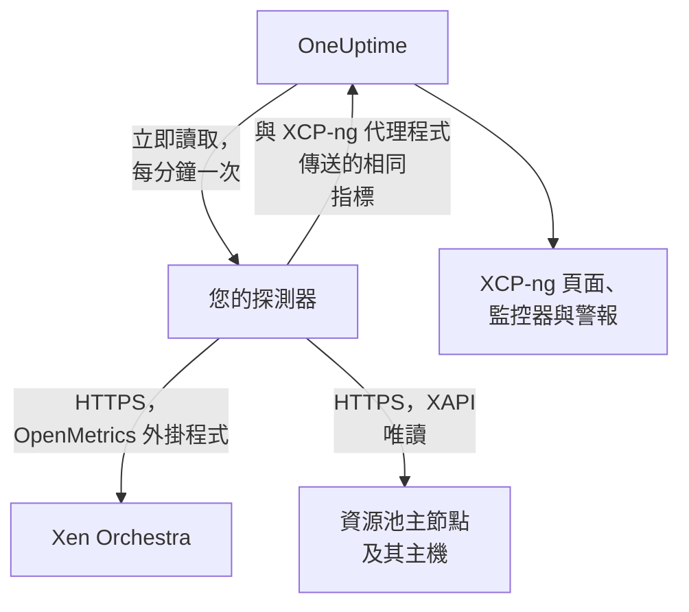

# 免代理程式的 XCP-ng

無需安裝任何東西即可監控 XCP-ng 資源池：由 OneUptime 探測器讀取它們，要麼透過管理它們的 Xen Orchestra，要麼對於沒有 Xen Orchestra 的資源池，直接從資源池主節點上的 XAPI 讀取。每個資源池都會獲得與 [XCP-ng 代理程式](/docs/telemetry/xcp-ng) 傳送的資源池相同的頁面、[XCP-ng 監控器](/docs/monitor/xcp-ng-monitor) 與範本。沒有需要安裝、升級或保持執行的代理程式。

:::cards
- [開始之前](#開始之前)：一個能連到 Xen Orchestra 或資源池的探測器，以及唯讀存取權限。
- [連線 Xen Orchestra](#連線-xen-orchestra)：它管理的每個資源池，透過一個連線。
- [連線沒有 Xen Orchestra 的資源池](#連線沒有-xen-orchestra-的資源池)：一個資源池，從其主節點讀取。
- [疑難排解](#疑難排解)：每則訊息的含義以及解決方法。
:::

## 運作方式

探測器每分鐘讀取每個連線，並將讀取到的內容傳送到 OneUptime：

- **Xen Orchestra**：探測器使用外掛程式的密鑰讀取 Xen Orchestra 的 OpenMetrics 外掛程式，與 XCP-ng 代理程式的做法完全相同，因此 Xen Orchestra 管理的每個資源池都會以相同的序列送達。
- **資源池的 XAPI**：探測器登入資源池主節點，執行 Xen Orchestra 外掛程式自己執行的讀取：資源池的記錄，以及從每台執行中的主機讀取的該主機的指標。它將這些轉換為外掛程式提供的相同序列，因此資源池的讀取方式與透過 Xen Orchestra 完全一樣。它還會將資源池的 XAPI 訊息（例如當機的虛擬機器或 HA 失去的主機）發布到資源池的動態中。

每個資源池都會在首次讀取時依其 UUID 註冊，與代理程式的資源池一樣，並顯示在 **XCP-ng → 所有資源池** 下。

## 選擇哪種連線方式

| | 從探測器讀取 Xen Orchestra | 從探測器讀取資源池的 XAPI | XCP-ng 代理程式 |
|---|---|---|---|
| 您執行的內容 | 您已在執行的探測器，或新的探測器 | 您已在執行的探測器，或新的探測器 | 代理程式，執行在單獨的機器上 |
| 讀取的對象 | Xen Orchestra 管理的每個資源池 | 一個資源池 | Xen Orchestra 管理的每個資源池 |
| 所需內容 | OpenMetrics 外掛程式的密鑰，以及選用的唯讀 API 權杖 | 資源池帳戶：root，或擁有 read-only 角色的 Active Directory 使用者 | OpenMetrics 外掛程式的密鑰 |
| 密鑰保存位置 | 在 OneUptime 中加密，只傳送給探測器 | 在 OneUptime 中加密，只傳送給探測器 | 在代理程式的 `.env` 檔案中 |
| 資源池動態中的 XAPI 訊息 | 不包含 | 包含 | 不包含 |

三者都傳送相同的序列。一個資源池同一時間只由其中一個讀取，因此無論由誰讀取，其歷史記錄始終是一條線。

## 開始之前

- **一個能透過 TCP 443 連到該位址的探測器。** 通常是同一網路中的 [自訂探測器](/docs/probe/custom-probe)。在 OneUptime Cloud 上，共用探測器從不接收 XCP-ng 密鑰，因此請新增您自己的探測器。在自行託管的執行個體上，執行個體自己的探測器也可以讀取。
- **對於 Xen Orchestra：** 已開啟 OpenMetrics 外掛程式的 Xen Orchestra 6.9 或更新版本：依照 [開啟 OpenMetrics 外掛程式](/docs/telemetry/xcp-ng#啟用-openmetrics-外掛程式) 操作並複製其密鑰。選用：擁有內建 **Read only** 角色的 Xen Orchestra 使用者的 API 權杖：OneUptime 會檢查它是否唯讀，並在其到期前提醒您。
- **對於沒有 Xen Orchestra 的資源池：** XCP-ng 8.2 或更新版本，以及其主節點的位址。XAPI 的角色只適用於 Active Directory 使用者，因此它唯一的本機帳戶 `root` 可以變更資源池中的一切。要以唯讀方式存取，請將資源池加入 Active Directory，並為某位使用者授予 `read-only` 角色。

> [!IMPORTANT]
> 請透過 Xen Orchestra 或透過其 XAPI 連線一個資源池，不要兩者都用：第二個讀取該資源池的連線會把它留給第一個。

## 連線 Xen Orchestra

:::steps
### 開啟連線
在 OneUptime 中開啟 **XCP-ng → 連線**，然後按一下 **連線 XCP-ng**。

### 選擇 Xen Orchestra
在 **讀取對象** 下選擇 **Xen Orchestra**。輸入 **Xen Orchestra 位址**，即您在瀏覽器中開啟它所用的位址，例如 `https://xo.example.com`，並選擇能連到它的探測器。

### 輸入外掛程式的密鑰
貼上 **OpenMetrics 密鑰**。如果有唯讀使用者的 **API 權杖**，也請新增。

### 測試連線並信任憑證
按一下 **測試連線**。Xen Orchestra 使用自簽憑證，因此測試會顯示該憑證：檢查其指紋，然後按一下 **信任此憑證**。結果會列出 Xen Orchestra 提供的資源池及其主機、虛擬機器與儲存庫。

### 命名並連線
名稱預設為 Xen Orchestra 的主機名稱，它讀取的每個資源池都會顯示該名稱。按一下 **連線 XCP-ng**，連線頁面隨即開啟。
:::

## 連線沒有 Xen Orchestra 的資源池

:::steps
### 從連線頁面開始
在 OneUptime 中開啟 **XCP-ng → 連線**，然後按一下 **連線 XCP-ng**。

### 選擇資源池
在 **讀取對象** 下選擇 **沒有 Xen Orchestra 的資源池**。輸入 **資源池主節點位址**，例如 `https://10.0.0.10`，並選擇能連到它的探測器。

### 輸入帳戶
輸入 **使用者名稱** 與 **密碼**：`root`，或擁有 read-only 角色的 Active Directory 使用者，並連同網域一起書寫，例如 `EXAMPLE\oneuptime`。

### 測試連線並信任主節點的憑證
按一下 **測試連線**。每台 XCP-ng 主機都使用自簽憑證，因此測試會顯示主節點的憑證：檢查其指紋，然後按一下 **信任此憑證**。結果會說明主節點執行的 XCP-ng 版本以及該帳戶可以讀取的內容，並在該帳戶可以變更資源池時提醒您。

### 為資源池命名並連線
按一下 **連線 XCP-ng**，連線頁面隨即開啟。
:::

連線頁面會顯示其讀取情況。在一分鐘內開始的首次讀取之前，它顯示 **檢查中**，之後顯示 **收集中**，它讀取的資源池會出現在 **它讀取的資源池** 下。

如果 20 分鐘內沒有探測器來讀取該連線（因為探測器離線或版本過舊），頁面會顯示 **未在收集** 並說明原因。當沒有任何探測器可以讀取該連線時，頁面會立即顯示 **未在收集** 並說明需要變更的內容：缺少密鑰、使用者名稱或密碼，未設定讀取它的探測器，其探測器無權讀取它（OneUptime Cloud 上的共用探測器，或其他專案的探測器），或其探測器已中斷連線。

## 代理程式已在傳送的資源池

由 XCP-ng 代理程式註冊的資源池，會由第一個讀取它的連線接手：其歷史記錄作為一條線延續，資源池的動態會提示可以停止代理程式。

> [!WARNING]
> 一旦探測器讀取了代理程式的資源池，請停止 XCP-ng 代理程式。兩者同時執行時，每個指標都會送達兩次。

要切換回來，請開啟資源池的 **設定** 頁面。其 **資料收集** 卡片為探測器讀取的資源池提供 **使用 XCP-ng 代理程式**，為代理程式傳送的資源池提供 **使用探測器收集**。切換回代理程式的資源池會一直由代理程式負責，無論連線讀取什麼。

## 憑證

探測器從不略過憑證驗證。每個連線都會完成完整的 TLS 交握，然後：

- 如果沒有受信任的憑證，該憑證必須由探測器所在機器信任的憑證授權單位為您輸入的位址簽發；
- 如果有受信任的憑證，該位址必須出示正是這一憑證，並以其 SHA-256 指紋識別，無論憑證上寫的是什麼名稱。Xen Orchestra 自己的憑證不包含任何位址，正是以這種方式被信任的。

要檢查指紋，請在探測器所在的機器上執行 `openssl s_client -connect xo.example.com:443 </dev/null | openssl x509 -noout -fingerprint -sha256`，並將其與憑證本身比較：在資源池主節點上執行 `openssl x509 -noout -fingerprint -sha256 -in /etc/xensource/xapi-ssl.pem`。

對於資源池，您信任的是主節點的憑證。資源池本身會列出其每台主機提供的憑證，探測器讀取其他每台主機時都會固定到該憑證。當另一台主機成為主節點時，探測器只會跟隨到資源池在上次讀取時擔保過的主機。當憑證變更時，讀取會以 **憑證已變更** 停止，並顯示新憑證：在您於連線頁面信任它之前，不會傳送任何內容。

## 已儲存的密鑰

密鑰、權杖與密碼都經過加密且只能寫入：任何人都無法讀回它們，API 也從不傳回它們。它們只會傳送給讀取該連線的探測器，探測器只將其保存在記憶體中。

已儲存的密鑰只會傳送到輸入時對應的位址、經由對應的探測器、發往對應的憑證。在 **編輯連線** 中變更位址、探測器或受信任的憑證都需要重新輸入密鑰，因此能編輯連線的人無法把它傳送到別處，未重新輸入的已儲存 API 權杖會被捨棄。信任探測器在已儲存位址上找到的憑證則會保留它們。**移除 API 權杖** 會從 OneUptime 中刪除權杖：也請在 Xen Orchestra 中撤銷它。

## API 權杖

API 權杖是選用的：指標透過外掛程式的密鑰送達。有權杖時，每次讀取最多每小時檢查它一次：

- **它只讀取。** 使用者是管理員、或角色可以變更任何內容的權杖，會測試失敗，並在連線頁面上顯示為問題。OneUptime 只保存唯讀權杖。
- **它讀取 OneUptime 需要的內容。** 對於使用者無權讀取的清單，Xen Orchestra 會傳回空清單，因此權杖必須能讀取警報、訊息與備份記錄。內建的 **Read only** 角色三者都能讀取。
- **它何時到期。** Xen Orchestra 會在權杖到期的那一刻捨棄它。在此兩週前，連線頁面以及它讀取的每個資源池的動態都會提示。請為同一位使用者建立新權杖，並在 **編輯連線** 中輸入。

## 參考

| 設定 | 預設值 | 說明 |
|---|---|---|
| 讀取間隔 | 1 分鐘 | 1 到 60 分鐘。每分鐘一次與 XCP-ng 代理程式一致；大型 Xen Orchestra 可降低讀取頻率以減輕其負擔。 |
| 同時讀取數 | 每個探測器 4 個 | 比其間隔還慢的讀取會被略過，從不堆積。 |
| 最大讀取量 | 約 48 MiB | 更大的 Xen Orchestra 需要使用 XCP-ng 代理程式。 |
| XAPI 訊息 | 每次讀取 200 則 | 從資源池連線的那一刻起，每則只送達一次，最舊的優先。 |
| 連線測試 | 90 秒內開始 | 沒有探測器及時領取、或執行超過 150 秒的測試，會被判定為失敗。 |

## 疑難排解

:::details 憑證不受信任
Xen Orchestra 與 XCP-ng 主機預設使用自簽憑證。請將顯示的指紋與憑證核對，然後按一下 **信任此憑證**。
:::

:::details 憑證已變更
在您信任新憑證之前，不會傳送任何內容。如果您已更新憑證，請檢查新指紋並信任它，然後在 **編輯連線** 中重新輸入密鑰。
:::

:::details Xen Orchestra 拒絕了密鑰
請從 Xen Orchestra 的 **Settings → Plugins → openmetrics** 重新複製密鑰，並在 **編輯連線** 中輸入。
:::

:::details OpenMetrics 外掛程式沒有回應
請在 Xen Orchestra 的 **Settings → Plugins** 中載入 **openmetrics**，並開啟 **Auto-load**，使其在重新啟動後自動恢復。
:::

:::details 此 Xen Orchestra 沒有 OpenMetrics 外掛程式
該外掛程式需要 Xen Orchestra 6.9 或更新版本，在 Xen Orchestra Appliance 上還需要 Premium 授權。沒有授權時，請改為透過 XAPI 連線每個資源池。
:::

:::details 沒有已連線的資源池
Xen Orchestra 沒有回報任何已連線的資源池。請在 Xen Orchestra 中新增或重新連線資源池，然後再次測試。
:::

:::details 該 API 權杖可以變更 Xen Orchestra
OneUptime 只保存唯讀權杖。請為一位只擁有內建 **Read only** 角色副本、沒有其他角色的使用者建立權杖。
:::

:::details 該 API 權杖無法讀取警報、訊息或備份
請為權杖的使用者授予 Xen Orchestra 內建 **Read only** 角色的副本，該角色三者都能讀取。
:::

:::details API 權杖已到期
請在 Xen Orchestra 中為唯讀使用者建立新權杖，並在 **編輯連線** 中輸入。在此期間，指標會繼續送達。
:::

:::details XAPI 拒絕了登入
請檢查使用者名稱與密碼。Active Directory 使用者要連同網域一起書寫，例如 `EXAMPLE\oneuptime`。
:::

:::details 此主機不是資源池主節點
資源池的成員會以訊息中列出的主節點位址回應。請輸入該位址，然後再次測試。
:::

:::details 該帳戶無法讀取資源池
請為該 Active Directory 使用者授予資源池的 read-only 角色，或使用擁有該角色的帳戶。
:::

:::details 探測器沒有收到回應
探測器所在網路無法透過 TCP 443 連到該位址。請在防火牆中放行，或選擇同一網路中的探測器。
:::

:::details 探測器未領取此工作
探測器已離線，或執行的 OneUptime 版本早於 XCP-ng 讀取功能。請在 **自訂探測器** 表格中檢查它是否已連線，並更新它。
:::

:::details 此連線過大，無法由探測器讀取
其指標超出了探測器單次上傳的大小上限。請為它使用 [XCP-ng 代理程式](/docs/telemetry/xcp-ng)。
:::

## 後續步驟

:::cards
- [XCP-ng 監控器](/docs/monitor/xcp-ng-monitor)：針對資源池、主機、虛擬機器與儲存庫發出警報。
- [自訂探測器](/docs/probe/custom-probe)：在資源池所在網路中執行探測器。
- [XCP-ng 代理程式](/docs/telemetry/xcp-ng)：改用代理程式讀取 Xen Orchestra。
:::
