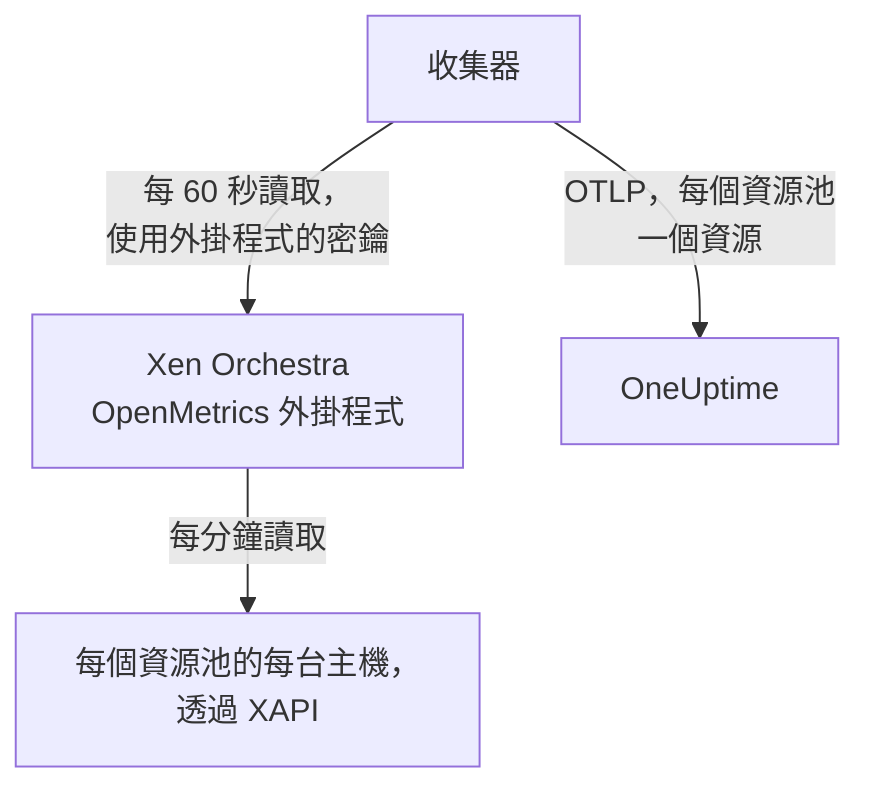

# XCP-ng 代理程式

OneUptime 的 XCP-ng 代理程式監控由 Xen Orchestra 管理的 XCP-ng 資源池：它們的主機、虛擬機器、儲存庫和虛擬磁碟。它是一個標準的 OpenTelemetry Collector，使用外掛程式的密鑰讀取 Xen Orchestra 內建的 OpenMetrics 外掛程式，並把讀到的內容傳送到 OneUptime，每個資源池都會連同其清冊出現在那裡。資源池或 Xen Orchestra 的任何密碼都不會到達代理程式。[XCP-ng 監測器](/docs/monitor/xcp-ng-monitor) 會針對傳入的資料發出警示。

:::cards
- [安裝代理程式](#安裝代理程式): 啟用外掛程式，然後使用安裝指令碼或 Docker Compose。
- [Xen Orchestra 的憑證](#xen-orchestra-的憑證): 代理程式如何信任 Xen Orchestra，絕不略過驗證。
- [代理程式收集的內容](#代理程式收集的內容): 外掛程式的每個序列，以及實際上是速率的計數器。
- [疑難排解](#疑難排解): 一個診斷指令碼，以及常見問題。
:::

## 你會得到什麼

- **每個資源池各自呈現。** Xen Orchestra 管理的每個資源池都會成為 OneUptime 中的一個 XCP-ng 資源池，以其 XAPI UUID 識別，並以 Xen Orchestra 中的名稱命名。同一個 Xen Orchestra 後面的兩個資源池就是兩個資源池，在 OneUptime 中重新命名資源池也是安全的：遙測資料依 UUID 關聯到它。
- **它的清冊。** 資源池的主機、虛擬機器、儲存庫和虛擬磁碟，以及它們的狀態和指標。控制網域（dom0）會以虛擬機器的形式回報，除非你要求顯示，資源池的頁面會隱藏它們。
- **每個 Xen Orchestra 一個代理程式。** 外掛程式會提供其 Xen Orchestra 所連線的每個資源池，因此一個代理程式即可讀取全部資源池，之後連線的資源池會在下一次讀取時出現。

## 運作方式

代理程式是你在一台機器上用 Docker Compose 執行的一個容器：一個標準的 OpenTelemetry Collector，沒有 OneUptime 自己的映像檔。它每 60 秒以外掛程式的密鑰作為 Bearer 權杖，透過 Xen Orchestra 自己的位址和憑證向 Xen Orchestra 要求 `/openmetrics/metrics`。外掛程式透過 XAPI 以 60 秒的解析度讀取每台主機的指標。收集器保留資源池的序列，依資源池分組，並透過 OTLP 傳送到 OneUptime。



每個資源池在第一次傳送資料時自行註冊，使用代理程式以 `xcp_ng.pool.id` 標在其序列上的 UUID，以及 Xen Orchestra 給它的名稱 `xcp_ng.pool.name`。在 Xen Orchestra 中沒有名稱的資源池會被命名為「Pool」加上其 UUID 的開頭部分，直到你重新命名它。

## 開始之前

- Xen Orchestra 6.9 或更新版本，已連線到你要監控的資源池，並附有其 OpenMetrics 外掛程式。在 Xen Orchestra Appliance（XOA）上，該外掛程式需要 Premium 授權；從原始碼建置的 Xen Orchestra 內含該外掛程式。
- 在一台能透過 HTTPS 連到 Xen Orchestra 的機器上，安裝附有 Docker Compose v2 外掛程式的 Docker Engine 20.10 或更新版本，以及 `curl` 和 `openssl`。
- Xen Orchestra 上的一張憑證，其中寫明代理程式所連線的位址。Xen Orchestra 為自己產生的自我簽署憑證沒有寫任何位址，因此目前的任何 TLS 用戶端都無法驗證它；從原始碼建置的 Xen Orchestra 在你為它設定憑證之前只提供明文 HTTP：請參閱 [Xen Orchestra 的憑證](#xen-orchestra-的憑證)。
- 一把擷取金鑰。在 **專案設定 → 遙測與 APM → 擷取金鑰** 下建立一把並複製其值。
- 從該機器到你的 OneUptime URL 的輸出 HTTPS。

### 支援的版本

| | 支援 | 原因 |
| --- | --- | --- |
| Xen Orchestra | 6.9 或更新版本，附 OpenMetrics 外掛程式 `xo-server-openmetrics` 1.9 | 該外掛程式在 Xen Orchestra 重新啟動後仍保留其密鑰，包含讀取時記憶體流失的修正，並提供資源池頁面讀取的每個序列：主機和虛擬機器的狀態、儲存庫和虛擬磁碟。較舊的外掛程式可能在重新啟動時產生新的密鑰，把代理程式擋在門外，直到有人重新複製它。 |
| XCP-ng | 8.3 LTS | Vates 提供支援至 2028 年 11 月 30 日。XCP-ng 8.2 已於 2025 年 9 月 16 日結束生命週期。 |
| XenServer | 尚未試過 | Xen Orchestra 會用相同的序列回報它所管理的 XenServer 資源池，所以應該可以運作，但還沒有人用 OneUptime 試過。 |

### 在哪裡執行代理程式

代理程式透過 HTTPS 與 Xen Orchestra 通訊，因此它可以在任何裝有 Docker 並能連到它的機器上執行：Xen Orchestra 所在的機器本身、一台監控主機或一台小型管理虛擬機器。最好選擇一台其虛擬機器不在受監控資源池上執行的機器：資源池停擺時，你的監控不應跟著停擺。一個代理程式讀取一個 Xen Orchestra；如需讀取多個，請參閱 [讀取多個 Xen Orchestra](#讀取多個-xen-orchestra)。

## 啟用 OpenMetrics 外掛程式

代理程式透過 Xen Orchestra 的 OpenMetrics 外掛程式，使用外掛程式的密鑰讀取每個資源池。

:::steps
### 啟用外掛程式

在 Xen Orchestra 中開啟 *Settings → Plugins*，找到 **openmetrics** 並啟用它。它第一次啟動時會產生一個密鑰，Xen Orchestra 會在重新啟動之間保留它。

### 複製其密鑰

開啟外掛程式的設定並複製它的 **Prometheus secret**：你會在下一步把它交給代理程式。你也可以在那裡輸入並儲存你自己的密鑰。請妥善保管：擁有它的人可以讀取每個資源池的指標。

### 檢查它是否回應

外掛程式在 Xen Orchestra 自己的位址上、使用其自己的憑證，在 `/openmetrics/metrics` 上回應，而且只回應附有其密鑰的要求。它的健康檢查不需要密鑰，因此只有這一個要求可以用 `-k` 略過憑證驗證；代理程式從不這樣做：

```bash
curl -k https://xo.example.com/openmetrics/health
```

只要外掛程式在執行，它就會傳回 `{"status":"ok"}`。傳回 `404` 表示外掛程式未啟用。
:::

## 安裝代理程式

:::steps
### 安裝並啟動代理程式

每個 OneUptime 都提供其自身發行版本的代理程式安裝指令碼和檔案：下面的命令從 `https://oneuptime.com` 下載它們，因此在自行架設的 OneUptime 上請把這個位址換成你的 URL。安裝指令碼會先儲存為 `install.sh`，讓你可以在執行前先閱讀它。

:::tabs
@tab install.sh
下載安裝指令碼，並在將要裝載代理程式的機器上執行它：

```bash
curl -fsSL https://oneuptime.com/install/xcp-ng-agent -o install.sh
bash install.sh
```

指令碼會詢問你的 OneUptime URL、擷取金鑰、你在瀏覽器中開啟 Xen Orchestra 時所用的位址（例如 `https://xo.example.com` 或 `https://10.0.0.5:8443`）、外掛程式的密鑰（輸入時不顯示），以及這個 Xen Orchestra 在 OneUptime 中的名稱。接著它讀取 Xen Orchestra 的憑證：這台機器已經信任的憑證會用其 CA 套件驗證；其他任何憑證都會連同其 SHA-256 指紋顯示出來，在你把該指紋與 Xen Orchestra 所在機器上的指紋核對之後，回答 **y** 即可只信任該憑證。它從不關閉驗證。最後，在安裝任何東西之前，它會用密鑰向外掛程式要求指標，並列出 Xen Orchestra 回報的資源池。它安裝到 `/opt/oneuptime-xcp-ng-agent`，以 `0600` 權限寫入 `.env` 檔案和 `xo-ca.pem`（代理程式為 Xen Orchestra 信任的憑證），並用 Docker Compose 啟動代理程式。再次執行指令碼時，它會重複使用該 `.env` 中的所有內容，而不會再次詢問；這就是 [升級代理程式](#升級代理程式) 的方法。
@tab Docker Compose
從你的 OneUptime 下載 `docker-compose.yml` 和 `otel-collector-config.yaml` 到一個新資料夾中：

```bash
mkdir oneuptime-xcp-ng-agent && cd oneuptime-xcp-ng-agent
curl -fsSLO https://oneuptime.com/install/xcp-ng-agent/docker-compose.yml
curl -fsSLO https://oneuptime.com/install/xcp-ng-agent/otel-collector-config.yaml
```

在它們旁邊建立一個 `.env` 檔案。它包含外掛程式的密鑰，因此請用 `chmod 600 .env` 保持私密：

```bash title=".env"
ONEUPTIME_URL=YOUR_ONEUPTIME_URL
ONEUPTIME_TELEMETRY_INGESTION_KEY=YOUR_TELEMETRY_INGESTION_TOKEN
XO_SCHEME=https
XO_ADDRESS=xo.example.com
XO_OPENMETRICS_SECRET='your-plugin-secret'
XO_NAME='Xen Orchestra'
XO_TLS_SERVER_NAME=
```

`XO_ADDRESS` 是 Xen Orchestra 的 `host` 或 `host:port`，不加 `https://`。請用單引號括住外掛程式的密鑰，並把其中的每個 `$` 寫成 `$$`：收集器會再讀取一次該值，會把 `$` 當成變數的開頭。含有 `'` 的密鑰無法放在單引號中：請讓安裝指令碼寫入它，或在 Xen Orchestra 中選擇另一個密鑰。

然後把 Xen Orchestra 的憑證儲存為 `xo-ca.pem`，放在 `docker-compose.yml` 旁邊：代理程式只依據這個檔案驗證 Xen Orchestra。若要信任 Xen Orchestra 自己的憑證，請讀取它，並在使用之前把它的指紋與 Xen Orchestra 所在機器上的指紋核對：

```bash
openssl s_client -connect xo.example.com:443 -servername xo.example.com </dev/null 2>/dev/null \
  | openssl x509 -out xo-ca.pem
openssl x509 -in xo-ca.pem -noout -fingerprint -sha256
```

如果憑證由你自己的 CA 簽發，請改為把該 CA 的憑證複製到 `xo-ca.pem`；如果由公用 CA 簽發，請複製這台機器的 CA 套件（`cp /etc/ssl/certs/ca-certificates.crt xo-ca.pem`）。啟動代理程式：

```bash
docker compose up -d
```
:::

### 檢查代理程式是否正在執行

```bash
docker compose ps
docker logs -f oneuptime-xcp-ng-agent
```

`docker compose ps` 會顯示收集器 `oneuptime-xcp-ng-agent`。啟動後，它的日誌中應出現這一行：

```text
Everything is ready. Begin running and processing data.
```

### 在 OneUptime 中找到資源池

開啟 **產品 → 基礎設施 → XCP-ng → 所有資源池**。Xen Orchestra 回報的每個資源池都會在第一次讀取約一分鐘後出現，使用 Xen Orchestra 給它的名稱，並附上其主機、虛擬機器和儲存空間。它的 **拓撲** 頁面會把它們畫成一張圖：請參閱 [拓撲](/docs/telemetry/topology#開啟資源自己的地圖)。
:::

## Xen Orchestra 的憑證

代理程式在每次讀取時都會驗證 Xen Orchestra 的憑證，只依據 `xo-ca.pem`，從不略過驗證：外掛程式的密鑰隨每個要求一起傳送。`xo-ca.pem` 包含以下三者之一：

- **Xen Orchestra 自己的憑證**，透過其 SHA-256 指紋固定（`XO_TLS_FINGERPRINT`）：代理程式只信任該憑證。
- **簽發它的 CA**（`XO_CA_FILE`），用於你自己的 CA 簽發的憑證。
- **這台機器的 CA 套件**，用於這台機器已經信任的憑證，例如公用 CA 簽發的憑證。

無論哪種情況，憑證都必須寫明代理程式所連線的位址。代理程式驗證憑證所簽發的名稱，也就是其主體別名（subject alternative names），就像目前每個 TLS 用戶端那樣，而從不驗證主體本身。Xen Orchestra 為自己產生的自我簽署憑證沒有寫任何名稱，因此無論是否固定，代理程式都無法信任它，並會以 `x509: certificate is not valid for any names` 失敗；安裝指令碼遇到這樣的憑證會停止並說明原因。

### 為 Xen Orchestra 設定寫明其位址的憑證

使用你自己的 CA 或公用 CA 簽發的憑證，或者在 Xen Orchestra 所在的機器上產生一張寫明 Xen Orchestra 位址的自我簽署憑證，把它的名稱和位址寫進主體別名：

```bash
sudo mkdir -p /etc/ssl/xo
sudo openssl req -x509 -newkey rsa:2048 -nodes -days 825 \
  -subj "/CN=xo.example.com" \
  -addext "subjectAltName=DNS:xo.example.com,IP:10.0.0.5" \
  -keyout /etc/ssl/xo/key.pem -out /etc/ssl/xo/cert.pem
```

讓 xo-server 的 HTTPS 接聽程式指向這兩個檔案（執行 xo-server 的使用者，預設是 root，必須能夠讀取它們），寫在獨立的設定檔中：在 XOA 上是 `/etc/xo-server/config.httpscert.toml`，對於從原始碼建置的 Xen Orchestra，則放在 xo-server 的 `config.toml` 旁邊。Xen Orchestra 的接聽程式有編號，第二個 `http.listen.1` 就是它的 HTTPS 接聽程式：

```toml
[http.listen.1]
port = 443
cert = '/etc/ssl/xo/cert.pem'
key = '/etc/ssl/xo/key.pem'
```

接著用 `systemctl restart xo-server` 重新啟動 xo-server，再安裝代理程式，或重新執行安裝指令碼：它會讀取新憑證並顯示其指紋供你核對。也可以讓 Xen Orchestra 自己申請 Let's Encrypt 憑證，XOA 就能這樣做（請參閱 Xen Orchestra 的文件）：它受到公開信任，所以代理程式不需要任何設定。如果憑證用不同於 `XO_ADDRESS` 中位址的名稱寫明 Xen Orchestra，請把 `XO_TLS_SERVER_NAME` 設定為該名稱；安裝指令碼在可以時會根據憑證填入它。

固定的憑證續約後，代理程式會停止讀取 Xen Orchestra，直到它信任新憑證。重新執行安裝指令碼：它會顯示新的指紋並停止，不做任何變更。請在 Xen Orchestra 所在的機器上核對該指紋，然後用它再執行一次指令碼：`XO_TLS_FINGERPRINT=<new fingerprint> bash install.sh`。如果用 Docker Compose 安裝，請重新寫入 `xo-ca.pem` 並執行 `docker compose up -d --force-recreate`。

## 環境變數

安裝指令碼會把它們寫入 `/opt/oneuptime-xcp-ng-agent/.env`；Docker Compose 安裝會從 `.env`（位於 `docker-compose.yml` 旁邊）讀取它們。變更變數後，請在該資料夾中執行 `docker compose up -d`。

| 變數 | 必要 | 說明 |
| --- | --- | --- |
| `ONEUPTIME_URL` | 是 | 你的 OneUptime URL，例如 `https://oneuptime.com` 或你的自行託管執行個體。如果執行個體只支援 HTTP，請使用 `http://` 及其連接埠。 |
| `ONEUPTIME_TELEMETRY_INGESTION_KEY` | 是 | 來自 **專案設定 → 遙測與 APM → 擷取金鑰** 的擷取金鑰。 |
| `XO_URL` | 安裝指令碼 | 你在瀏覽器中開啟 Xen Orchestra 時所用的位址，例如 `https://xo.example.com` 或 `https://10.0.0.5:8443`。安裝指令碼會從中推得 `XO_SCHEME` 和 `XO_ADDRESS`。 |
| `XO_SCHEME` | 否 | `https`，預設值。`http` 只用於實驗環境：此時密鑰會以未加密的形式在網路上傳輸。 |
| `XO_ADDRESS` | 是 | Xen Orchestra 的 `host` 或 `host:port`，不加通訊協定。 |
| `XO_OPENMETRICS_SECRET` | 是 | OpenMetrics 外掛程式的密鑰，作為 Bearer 權杖傳送。其中的每個 `$` 都寫成 `$$`。 |
| `XO_NAME` | 否 | 這個 Xen Orchestra 在 OneUptime 中的名稱，以 `xen_orchestra.name` 設定在它讀取的每個資源池上，並顯示在每個資源池的 **設定** 中。預設是 Xen Orchestra 的位址。 |
| `XO_TLS_FINGERPRINT` | 安裝指令碼 | Xen Orchestra 自己憑證的 SHA-256 指紋，格式與 `openssl x509 -fingerprint -sha256` 的輸出相同，冒號可省略，用於代理程式只信任該憑證的情況。安裝指令碼會拒絕與之不符的憑證。 |
| `XO_CA_FILE` | 安裝指令碼 | 簽發 Xen Orchestra 憑證的 CA 套件；安裝指令碼會用它驗證憑證，並把它複製到 `xo-ca.pem`。 |
| `XO_TLS_SERVER_NAME` | 否 | 當 `XO_ADDRESS` 是憑證中未寫明的位址時，用來驗證 Xen Orchestra 憑證的名稱。留空：使用 `XO_ADDRESS` 中的主機。 |

## 代理程式收集的內容

代理程式每分鐘讀取一次外掛程式，外掛程式透過 XAPI 以 60 秒的解析度讀取每台主機的循環資料庫（round-robin database）。代理程式保留 `xcp_*` 序列，並把每個序列的資源池移到傳送它們所用的資源上，成為 `xcp_ng.pool.id`（資源池的 UUID，永不改變）和 `xcp_ng.pool.name`：

| 類別 | 序列 |
| --- | --- |
| 資源池 | `xcp_pool_connected`，只要 Xen Orchestra 連線著該資源池就存在 |
| 主機 | `xcp_host_status`（其電源狀態以及是否已啟用）、`xcp_host_uptime_seconds`、`xcp_host_cpu_average`、`xcp_host_cpu_core_usage`、`xcp_host_load`、`xcp_host_load_average`、`xcp_host_memory_*`、`xcp_host_running_vcpus`、依實體介面的 `xcp_host_network_*`、依儲存庫的 `xcp_host_disk_*`、`xcp_host_power_consumption_watts` |
| 虛擬機器 | `xcp_vm_status`、`xcp_vm_uptime_seconds`、`xcp_vm_cpu_usage`、`xcp_vm_cpu_core_usage`、`xcp_vm_runstate_*`（CPU 爭用）、`xcp_vm_memory_*`、依介面的 `xcp_vm_network_*`、依磁碟的 `xcp_vm_disk_*`、`xcp_vm_power_consumption_watts` |
| 儲存空間 | `xcp_sr_physical_size_bytes`、`xcp_sr_physical_usage_bytes`、`xcp_sr_virtual_size_bytes`、`xcp_vdi_virtual_size_bytes`、`xcp_vdi_physical_usage_bytes` |
| XOSTOR | `xcp_xostor_*`，在執行 XOSTOR 的資源池上 |

控制網域會以附有 `is_control_domain="true"` 的虛擬機器形式回報。來自 Xen Orchestra 的每個序列都保留其名稱和標籤，例如 `uuid`、`host_name`、`vm_name`、`sr_name` 和 `tags`；[XCP-ng 監測器](/docs/monitor/xcp-ng-monitor#收集的指標) 列出了它們全部。

### 實為速率的計數器

Xen Orchestra 把八個輸送量序列宣告為計數器並命名為 `_total`，儘管每個序列存放的都是 XAPI 的每秒速率：`xcp_host_network_receive_bytes_total`、`xcp_host_network_transmit_bytes_total`、`xcp_vm_network_receive_bytes_total`、`xcp_vm_network_transmit_bytes_total`、`xcp_vm_network_receive_errors_total`、`xcp_vm_network_transmit_errors_total`、`xcp_vm_disk_read_bytes_total` 和 `xcp_vm_disk_write_bytes_total`。如果當成計數器讀取，每張網路和磁碟輸送量圖表都會出錯：下降的速率會被讀成計數器重設。代理程式的 `transform/xcp-ng-rates` 處理器會把它們變成量測（gauge），名稱和值不變，因此 OneUptime 會照它們本來的樣子把它們存為速率，單位為每秒位元組數或每秒錯誤數。OneUptime 也會轉換仍以計數器形式送達的任何序列，例如來自你自己設定的收集器的序列。

### OneUptime 新增的內容

OneUptime 會在每個資源池的資料送達時為其衍生四個 0/1 序列，警示範本會讀取它們：

| 序列 | 為 1 的條件 |
| --- | --- |
| `xcp_ng.host.running` | Xen Orchestra 回報主機為 Running；為 Halted 或狀態為 Unknown 時為 0 |
| `xcp_ng.host.enabled` | 主機已啟用；處於維護模式或正在撤離、XAPI 不會在其上啟動任何虛擬機器時為 0 |
| `xcp_ng.vm.running` | 虛擬機器為 Running；為 Halted、Paused 或 Suspended 時為 0 |
| `xcp_ng.vm.stopped_after_running` | 過去 24 小時內執行過的虛擬機器為 Halted 或 Paused |

它還會在每個資料點上標上 `xcp_ng.scope`（`pool`、`host`、`vm`、`sr`、`vdi` 或 `xostor`）和 `xcp_ng.id`（該物件的 UUID），監測器和儀表板會依它們篩選：請參閱 [資源識別](/docs/monitor/xcp-ng-monitor#資源識別)。

### 代理程式不保留的內容

- Xen Orchestra 自己的處理序序列（`xo_*`），它們不屬於任何資源池，以及收集器自己的讀取序列。
- Xen Orchestra 透過 IPMI 讀取的主機功率：外掛程式傳送這項讀數時不附其資源池，因此它也不屬於任何資源池。每台虛擬機器的估計份額 `xcp_vm_power_consumption_watts` 會保留。

## 資源池的頁面顯示什麼

從 **產品 → 基礎設施 → XCP-ng → 所有資源池** 開啟一個資源池。它的選單包含：

| 頁面 | 顯示什麼 |
| --- | --- |
| **概覽** | 資源池的健康狀態和需要注意的事項、它的主機、虛擬機器和儲存空間、最忙碌的虛擬機器和主機，以及讀取它的 Xen Orchestra 和代理程式版本。 |
| **主機**、**虛擬機器**、**儲存空間** | 每台主機、每台虛擬機器和每個儲存庫，各有自己的頁面和圖表。**虛擬機器** 會隱藏控制網域，除非你要求顯示，儲存庫的頁面會顯示其虛擬磁碟。 |
| **拓撲** | 資源池、它的主機、每台主機上的虛擬機器以及它們使用的儲存庫，畫成一張圖。 |
| **資源使用情況** | 資源池的主機、虛擬機器、儲存空間、磁碟和網路隨時間變化的圖表，每台主機、虛擬機器或每個儲存庫一條線。 |
| **建議** | 可以啟用的 [警示範本](/docs/monitor/xcp-ng-monitor#現成的警示範本)，每個範本一個監測器。 |
| **指標**、**日誌** | 探索器中資源池的每個序列，限定在該資源池。代理程式只傳送指標，因此 **日誌** 只顯示你附上資源池的 `xcp_ng.pool.id` 傳送的日誌。 |
| **事件**、**警示**、**排定維護** | 提到該資源池的那些。 |
| **動態** | 資源池在 OneUptime 中發生的事情：何時被新增、變更、封存或還原，誰是它的擁有者，以及在它上面執行過的擁有者規則和標籤規則。 |
| **擁有者** | 手動或透過擁有者規則得知它的人。 |
| **設定** | 它的名稱、讀取它的 Xen Orchestra、它在那裡的名稱和代理程式版本，以及其遙測資料的保留時間。 |
| **文件** | 這份設定說明，已填好你的 URL 和金鑰。 |

資源池的 **概覽** 會根據需要注意的事項給出它的健康狀態：**健康**、**效能下降** 或 **不健康**，並在 **需要注意** 下依緊急程度由高到低顯示：

- **嚴重：** 處於 Halted 狀態或處於 Xen Orchestra 無法判定的狀態（Unknown）的主機；使用率超過 95%、虛擬機器已無法寫入的儲存庫。
- **值得一看：** 已停用、處於維護模式或正在撤離的主機；過去 24 小時內執行過、現為 Halted 或 Paused 的虛擬機器；使用率超過 90%、Storage Repository Near Full 警示會觸發的儲存庫，或透過精簡佈建配置超出其大小的儲存庫。

暫停的虛擬機器（Suspended）是刻意暫停的，永遠不計入，一天內沒人看過執行的虛擬機器和控制網域也一樣。ISO 媒體櫃和卸除式媒體不包含虛擬機器磁碟，因此資源池的儲存數字不包括它們。

當 Xen Orchestra 連續 15 分鐘不再回報某個資源池時，該資源池會變為 **已中斷**，其頁面保留它最後回報的內容。不再出現在 Xen Orchestra 回報中的主機、虛擬機器、儲存庫或虛擬磁碟會在 15 分鐘後離開清冊；停止虛擬機器絕不會移除它。

## 用專案標籤標記資源池

以 `oneuptime.label.` 開頭的資源屬性會成為代理程式讀取的每個資源池上的專案標籤：`oneuptime.label.<dimension>=<value>` 就是標籤 `<dimension>:<value>`。請把這些屬性新增到 `resource` 處理器（位於 `otel-collector-config.yaml` 中），放在 `oneuptime.agent.version` 旁邊：

```yaml
processors:
  resource:
    attributes:
      # ...existing attributes...
      - key: oneuptime.label.team
        value: platform
        action: upsert
      - key: oneuptime.label.env
        value: production
        action: upsert
```

收集器只在啟動時讀取其設定：請執行 `docker compose restart oneuptime-xcp-ng-agent`。之後資源池會顯示標籤 `team:platform` 和 `env:production`。標籤比較時不區分大小寫，因此現有的標籤 `Production` 會被重複使用而不是重複建立，代理程式也絕不會移除有人在 OneUptime 中新增的標籤。重新執行安裝指令碼會取代已編輯的 `otel-collector-config.yaml`，並把你的版本儲存在旁邊，名為 `otel-collector-config.yaml.bak.<timestamp>`。

## 讀取多個 Xen Orchestra

一個代理程式讀取一個 Xen Orchestra 及其管理的每個資源池。若要從同一台機器讀取第二個 Xen Orchestra，請在獨立的資料夾中用獨立的 `.env` 安裝第二個代理程式，例如 `INSTALL_DIR=/opt/oneuptime-xcp-ng-agent-lab bash install.sh`，並為它指定自己的 `container_name`，寫在它的 `docker-compose.yml` 中（例如 `oneuptime-xcp-ng-agent-lab`）：兩個容器不能同名。給每個代理程式指定自己的 `XO_NAME`，這樣每個資源池的 **設定** 會顯示是哪個 Xen Orchestra 在讀取它，並用 `-d` 把資料夾傳給診斷指令碼。

切勿讓兩個代理程式透過同時管理同一資源池的兩個 Xen Orchestra 讀取該資源池：依其 UUID 它在 OneUptime 中是一個資源池，會被重複回報。

## 以 systemd 服務執行

若要讓代理程式隨機器一起啟動並在失敗時重新啟動，請安裝它的 systemd 單元。該單元假定代理程式位於 `/opt/oneuptime-xcp-ng-agent`，也就是安裝指令碼放置它的位置：

```bash
sudo curl -fsSL https://oneuptime.com/install/xcp-ng-agent/systemd/oneuptime-xcp-ng-agent.service -o /etc/systemd/system/oneuptime-xcp-ng-agent.service
sudo systemctl daemon-reload
sudo systemctl enable --now oneuptime-xcp-ng-agent
```

## 升級代理程式

代理程式會把其檔案固定的收集器版本作為 **代理程式版本** 回報，顯示在每個資源池的 **概覽** 和 **設定** 中。當它比此 OneUptime 版本固定的版本舊時，旁邊會出現一個警告標記。選擇它即可看到下面這些命令。

收集器映像檔固定在 `docker-compose.yml` 中，其設定是旁邊的一個檔案，所以只提取映像檔並不能讓代理程式升級。請重新執行 `install.sh`：它會重複使用你現有 `.env` 中的每個值（不會再次詢問），以同樣的方式驗證 Xen Orchestra 的憑證，重新整理 `docker-compose.yml` 和 `otel-collector-config.yaml`（你編輯過的檔案會保留為 `<file>.bak.<timestamp>`），提取映像檔並重新建立代理程式，讓收集器讀取新設定。安裝在 `/opt/oneuptime-xcp-ng-agent` 以外的代理程式需要指定其資料夾：`INSTALL_DIR=<folder> bash install.sh`。

```bash
curl -fsSL https://oneuptime.com/install/xcp-ng-agent -o install.sh
bash install.sh
```

用 Docker Compose 安裝的？請在代理程式的資料夾中重新下載這兩個檔案（並重新套用你對它們所做的修改），然後提取映像檔並重新建立代理程式。你的 `.env` 和 `xo-ca.pem` 會保留：

```bash
curl -fsSLO https://oneuptime.com/install/xcp-ng-agent/docker-compose.yml
curl -fsSLO https://oneuptime.com/install/xcp-ng-agent/otel-collector-config.yaml
docker compose pull
docker compose up -d --force-recreate
```

## 解除安裝代理程式

```bash
cd /opt/oneuptime-xcp-ng-agent
docker compose down
```

然後，如果沒有其他東西讀取它，請在 Xen Orchestra 中關閉 OpenMetrics 外掛程式。

## 疑難排解

:::details 先執行診斷指令碼
代理程式附有一個指令碼 [`troubleshoot.sh`](https://oneuptime.com/install/xcp-ng-agent/troubleshoot.sh)，它依資料傳輸的順序檢查整條鏈路：容器；從代理程式自身網路連到 Xen Orchestra 的位址；外掛程式的健康檢查；依據 `xo-ca.pem` 驗證 Xen Orchestra 的憑證，以及固定的憑證是否仍是它出示的憑證；外掛程式的密鑰；Xen Orchestra 回報的資源池；擷取金鑰的格式；收集器自身的指標；以及 OneUptime 是否接受該擷取金鑰。最後一項檢查最重要。OneUptime 會以 `401` 拒絕錯誤的金鑰（已停用的金鑰或瀏覽器金鑰為 `422`），而收集器把兩者都視為永久錯誤：它會捨棄該批次並只記錄一條 `Exporting failed` 錯誤，在容器保持健康時很容易被忽略。指令碼會從代理程式的網路呼叫 `GET <url>/otlp/v1/validate`，立即得到 `200`（有效）或 `401`（無效），在較舊的伺服器上則改用 `POST /fluentd/v1/logs`。它從不印出密鑰或金鑰。

```bash
curl -fsSL https://oneuptime.com/install/xcp-ng-agent/troubleshoot.sh -o troubleshoot.sh
bash troubleshoot.sh    # add -d <dir> if you installed outside /opt/oneuptime-xcp-ng-agent
```

它最後會輸出一個指出最可能原因的結論。
:::

:::details Xen Orchestra 拒絕密鑰（401）
收集器記錄 `server returned HTTP status 401 Unauthorized`。從 *Settings → Plugins → openmetrics* 重新複製密鑰，把 `XO_OPENMETRICS_SECRET`（位於 `.env` 中）設定為它，用單引號括住，並把每個 `$` 寫成 `$$`，然後在代理程式的資料夾中執行 `docker compose up -d`。6.8 之前的 Xen Orchestra 可能在重新啟動時產生新的密鑰：請升級它。
:::

:::details 外掛程式沒有回應（404、500、502 或 503）
Xen Orchestra 有回應，但它的 OpenMetrics 外掛程式沒有。請在 *Settings → Plugins → openmetrics* 下啟用外掛程式，並確認 Xen Orchestra 為 6.9 或更新版本。XOA 需要 Premium 授權才能使用該外掛程式。只要外掛程式在執行，`/openmetrics/health` 不需密鑰即傳回 `{"status":"ok"}`。
:::

:::details 憑證錯誤
- `x509: certificate is not valid for any names`：憑證沒有寫明任何位址，例如 Xen Orchestra 自己的自我簽署憑證。[為 Xen Orchestra 設定寫明其位址的憑證](#為-xen-orchestra-設定寫明其位址的憑證)。
- `x509: certificate is valid for <names>, not <address>`：請用其中一個名稱連線，或把 `XO_TLS_SERVER_NAME` 設定為其中之一。
- `x509: cannot validate certificate for <IP> because it doesn't contain any IP SANs`：`XO_ADDRESS` 是憑證中未寫明的 IP 位址。請把 `XO_TLS_SERVER_NAME` 設定為憑證中寫明的名稱，或重新執行會自動完成這一步的安裝指令碼。
- `x509: certificate signed by unknown authority`：`xo-ca.pem` 既不包含該憑證，也不包含簽發它的 CA。憑證已續約，或檔案中是另一張憑證：請在 Xen Orchestra 所在的機器上核對新的指紋，並用它執行安裝指令碼（`XO_TLS_FINGERPRINT=<new fingerprint> bash install.sh`），或重新寫入該檔案。
- `unable to read CA cert`：`xo-ca.pem` 遺失或無法讀取。請重新執行安裝指令碼。
:::

:::details 讀取逾時（context deadline exceeded）
Xen Orchestra 收集指標的時間超過了代理程式的上限 50 秒，因此那次讀取什麼也不會傳送：通常是它的某個資源池中有一台主機沒有回應它。請在 Xen Orchestra 中檢查資源池的主機；代理程式會在一分鐘後再次讀取。
:::

:::details 資源池顯示為已中斷
當某個資源池連續 15 分鐘沒有讀到任何資料時，OneUptime 會把它標記為已中斷；OneUptime 每 5 分鐘檢查一次，它自己沒有接收資料的時間不計入。

1. 如果這個 Xen Orchestra 的所有資源池都已中斷，請檢查代理程式：在代理程式的資料夾中執行 `docker compose ps` 和 `docker logs oneuptime-xcp-ng-agent`。
2. 如果只有一個，表示 Xen Orchestra 已不再回報它：在 Xen Orchestra 的 *Settings → Servers* 下，資源池的伺服器必須處於已連線狀態。資源池的主機、虛擬機器和儲存空間會保持 Xen Orchestra 最後回報的樣子。
:::

:::details 缺少某個資源池
Xen Orchestra 只回報它所連線的資源池，而代理程式只讀取這個 Xen Orchestra。請在 Xen Orchestra 的 *Settings → Servers* 下連線資源池的伺服器；該資源池會在下一次讀取時出現在 OneUptime 中。由另一個 Xen Orchestra 管理的資源池需要在那個 Xen Orchestra 旁邊部署自己的代理程式。
:::

:::details 輸送量圖表看起來不對
存放速率的八個 `_total` 序列必須以量測的形式送達 OneUptime。如果你用自己的設定取代了隨附的 `otel-collector-config.yaml`，請保留其中的 `transform/xcp-ng-rates` 處理器。請照原樣讀取它們，單位為每秒位元組數或每秒錯誤數：對它們再求每秒速率就成了速率的速率。
:::

:::details 不透過代理程式傳送指標
代理程式只是收集器的一份標準設定，因此你已在執行的收集器也可以完成同樣的工作：把隨附設定中的讀取作業和處理器複製到你的設定中。資源屬性 `xcp_ng.pool.id` 會在 OneUptime 中註冊每個資源池，`groupbyattrs` 處理器會讓每個資源池成為一個資源，而刪除 `service.name` 和 `service.instance.id` 可避免資料落到某個服務底下：請保留這三項，以及 `transform/xcp-ng-rates`。
:::

## 外掛程式尚未涵蓋的內容

Xen Orchestra 的 OpenMetrics 外掛程式提供的是指標，因此你在 XCP-ng 資源池中關注的部分內容還不在其中：

- 除 XOSTOR 之外的 **警報**、**HA 狀態**、**資源池主節點**、**缺少的修補程式**、**備份** 和 **快照**，以及主機實體介面（PIF）的 **連結狀態**。它們來自 Xen Orchestra 的 REST API，見 [#10997](https://github.com/OneUptime/oneuptime/issues/10997)。
- **沒有 Xen Orchestra 的資源池**，或位於沒有外掛程式所需 Premium 授權的 XOA 之後的資源池：它們直接透過 XAPI 讀取，見 [#10999](https://github.com/OneUptime/oneuptime/issues/10999)。
- **不需代理程式即可連線**，從 OneUptime 探測器連線，就像 VMware 那樣：[#10996](https://github.com/OneUptime/oneuptime/issues/10996)。

## 後續步驟

:::cards
- [XCP-ng 監控](/docs/monitor/xcp-ng-monitor): 資源池、主機、虛擬機器和儲存庫的警示。
- [Proxmox 代理程式](/docs/telemetry/proxmox): 以同樣的方式監控 Proxmox VE 叢集。
- [主機 OpenTelemetry Collector](/docs/telemetry/host-otel-collector): 從虛擬機器內部看到的作業系統視圖。
:::
