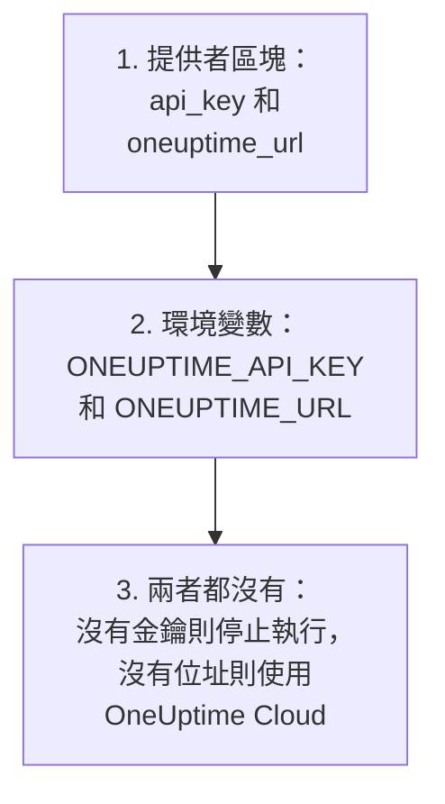
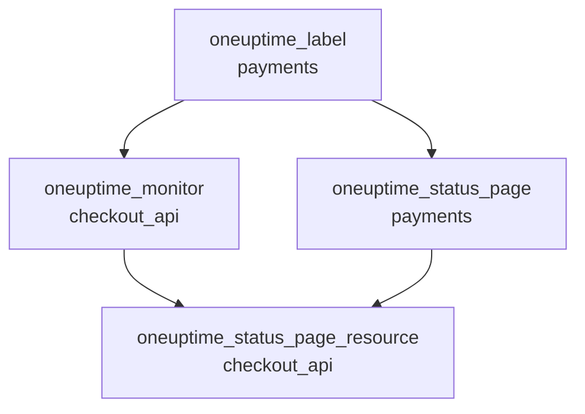

# 完整指南

本指南介紹首次 apply 之後的內容：提供者如何找到 API 金鑰，如何為一個或多個專案組織設定，資源之間如何相互引用，如何讀取你不管理的記錄，如何保證 state 的安全，以及如何升級。第一次使用提供者？請從 [快速入門](/docs/terraform/quick-start) 開始。

:::cards
- [設定提供者](#設定提供者): API 金鑰和位址，以及提供者從哪裡讀取它們。
- [組織設定](#組織設定): 檔案、專案，以及用一個區塊建立多個資源。
- [讀取已有的內容](#讀取已有的內容): 資料來源，以及查詢如何相符。
- [保證 state 安全](#保證-state-安全): 遠端後端，以及永遠不要提交的內容。
:::

## 設定提供者

提供者接受兩項設定。每項都來自提供者區塊，否則來自環境變數：

| 設定 | 環境變數 | 兩者都未設定時 |
| --- | --- | --- |
| `api_key` | `ONEUPTIME_API_KEY` | 提供者在計畫任何內容之前就會停止：`Missing API Key` |
| `oneuptime_url` | `ONEUPTIME_URL` | `https://oneuptime.com`，即 OneUptime Cloud |



`oneuptime_url` 是你的 OneUptime 的位址，不帶 `/api`：位址沒有協定時，提供者會加上 `https://`，並在末尾加上 `/api`。`api_key` 是敏感值，因此 Terraform 從不輸出它。

金鑰必須是你所管理專案的 API 金鑰，並且有權建立、讀取、更改和刪除設定中的每種記錄：請參閱 [建立專案 API 金鑰](/docs/terraform/quick-start#建立專案-api-金鑰)。自行託管 OneUptime 的主 API 金鑰不屬於任何專案，因此用它執行的建立操作會以 `ProjectId required` 失敗。

### 向提供者提供金鑰

:::tabs
@tab 環境變數
```bash
export ONEUPTIME_API_KEY="<your-api-key>"
# Only on a self-hosted OneUptime:
export ONEUPTIME_URL="https://oneuptime.example.com"
```

```hcl title="main.tf"
provider "oneuptime" {}
```
@tab Terraform 變數
```hcl title="variables.tf"
variable "oneuptime_api_key" {
  description = "API key of the OneUptime project"
  type        = string
  sensitive   = true
}

provider "oneuptime" {
  api_key = var.oneuptime_api_key
}
```

```hcl title="terraform.tfvars"
oneuptime_api_key = "<your-api-key>"
```
:::

環境變數能讓金鑰不出現在任何檔案中。變數檔案在你自己的機器上很方便：把 `terraform.tfvars` 新增到 `.gitignore`。在管線中，請設定 `TF_VAR_oneuptime_api_key`，而不是寫入該檔案。

### 在 CI/CD 中執行

把金鑰作為機密交給作業，放在環境變數 `ONEUPTIME_API_KEY` 中：

:::tabs
@tab GitHub Actions
```yaml title=".github/workflows/oneuptime.yml"
name: OneUptime
on:
  push:
    branches: [main]

jobs:
  apply:
    runs-on: ubuntu-latest
    env:
      ONEUPTIME_API_KEY: ${{ secrets.ONEUPTIME_API_KEY }}
    steps:
      - uses: actions/checkout@v4
      - uses: hashicorp/setup-terraform@v3
      - run: terraform init -input=false
      - run: terraform plan -input=false -out=tfplan
      - run: terraform apply -input=false tfplan
```
@tab GitLab CI
```yaml title=".gitlab-ci.yml"
apply:
  image:
    name: hashicorp/terraform:latest
    entrypoint: [""]
  rules:
    - if: $CI_COMMIT_BRANCH == $CI_DEFAULT_BRANCH
  script:
    - terraform init -input=false
    - terraform plan -input=false -out=tfplan
    - terraform apply -input=false tfplan
```
:::

在 GitHub 中，在 **Settings → Secrets and variables → Actions** 下新增機密；在 GitLab 中，新增一個同名的已遮罩 CI/CD 變數。把 state 放在 [遠端後端](#保證-state-安全) 中，這樣每次執行都會從上一次執行留下的 state 開始。

## 組織設定

一種效果很好的組織方式：

```text
oneuptime/
├── main.tf          # the terraform and provider blocks
├── variables.tf     # input variables
├── outputs.tf       # the IDs other configurations need
├── shared.tf        # labels, teams and monitor statuses
├── monitors.tf      # monitors and monitor groups
├── status-pages.tf  # status pages and their domains
└── on-call.tf       # on-call policies and escalation rules
```

- **每個專案一份設定。** 一個 API 金鑰屬於一個專案，因此一份設定自然只管理一個專案。
- **共享的記錄只定義一次。** 在一個檔案中定義標籤、團隊和監測器狀態，其他地方都透過位址引用它們。

### 管理多個專案

要在一份設定中管理多個專案，請為每個專案給提供者設定一個別名，每個別名使用對應專案的金鑰。資源用 `provider` 指定它使用的別名：

```hcl
provider "oneuptime" {
  alias   = "production"
  api_key = var.production_api_key
}

provider "oneuptime" {
  alias   = "staging"
  api_key = var.staging_api_key
}

resource "oneuptime_label" "staging_critical" {
  provider = oneuptime.staging

  name  = "critical"
  color = "#FF5733"
}
```

像上面一樣，把 `production_api_key` 和 `staging_api_key` 宣告為標記了 `sensitive` 的變數。

### 用一個區塊建立多個資源

`for_each` 為 map 中的每個項目建立一個資源。這些監測器共享條件，只有名稱和位址不同：

```hcl
variable "websites" {
  type = map(string)
  default = {
    homepage = "https://example.com"
    docs     = "https://docs.example.com"
  }
}

resource "oneuptime_monitor" "website" {
  for_each = var.websites

  name                = "Website: ${each.key}"
  monitor_type        = "Website"
  monitoring_interval = "*/5 * * * *"

  monitor_steps = [{
    monitor_destination      = each.value
    monitor_destination_type = "URL"

    criteria = [
      {
        name                  = "Offline"
        filter_condition      = "Any"
        change_monitor_status = true
        monitor_status_id     = data.oneuptime_monitor_status.offline.id

        filters = [
          {
            check_on    = "Is Online"
            filter_type = "False"
          }
        ]
      }
    ]
  }]
}
```

向 map 中新增一個網站，下一次 apply 就會建立它的監測器。刪除一個，apply 就會刪除對應的監測器。

## 引用其他資源

引用另一個資源屬性的資源依賴於那個資源，Terraform 會按這些引用安排工作順序。這裡，標籤最先建立、最後刪除，因為監測器和狀態頁面引用了它：



```hcl
resource "oneuptime_label" "payments" {
  name        = "payments"
  description = "Payment infrastructure"
  color       = "#2ECC71"
}

resource "oneuptime_monitor" "checkout_api" {
  name         = "Checkout API"
  description  = "Availability of the checkout API"
  monitor_type = "Manual"
  labels       = [oneuptime_label.payments.id]
}

resource "oneuptime_status_page" "payments" {
  name                  = "Payments Status"
  page_title            = "Payments Status"
  is_public_status_page = true
  labels                = [oneuptime_label.payments.id]
}

resource "oneuptime_status_page_resource" "checkout_api" {
  status_page_id = oneuptime_status_page.payments.id
  monitor_id     = oneuptime_monitor.checkout_api.id
  display_name   = "Checkout API"
}
```

你很少需要 `depends_on`：只有當 Terraform 無法從屬性中看出某種順序時才新增它。像 `labels` 這樣的 ID 列表是集合，調整順序不會改變任何內容。

## 讀取已有的內容

每個資源都有一個同名的資料來源。資料來源讀取一條不由目前設定管理的記錄，比如在儀表板中或由另一份設定建立的記錄，這樣你就可以引用它，而不必接管它。

```hcl
data "oneuptime_label" "critical" {
  name = "critical"
}

data "oneuptime_monitor_status" "offline" {
  is_offline_state = true
}

data "oneuptime_status_page" "main" {
  id = "5f8a1b2c-3d4e-4f6a-8b9c-0d1e2f3a4b5c"
}

resource "oneuptime_monitor" "database" {
  name         = "Database Health"
  monitor_type = "Manual"
  labels       = [data.oneuptime_label.critical.id]
}
```

查詢如何相符：

| 你設定的內容 | 找到的內容 | 錯誤 |
| --- | --- | --- |
| `id` | 具有該 ID 的記錄 | 沒有記錄具有該 ID 時為 `Not Found` |
| 其他任意簡單引數，一個或多個 | 與它們全部相符的唯一記錄 | 沒有相符時為 `Not Found`，相符多於一條時為 `Ambiguous Match` |
| `id` 加另一個引數，或什麼都不設定 | 無 | `Invalid Lookup` |

簡單引數指文字、數字以及真或假：名稱、優先順序、像 `is_offline_state` 這樣的旗標。不能按列表、JSON 值、時間戳記或機密查詢。如果要接管一條記錄而不只是讀取它，請 [匯入它](/docs/terraform/importing-resources)。

## 保證 state 安全

Terraform 的 state 儲存著它管理的所有內容的 ID 和屬性，其中包括機密。請把它放在支援鎖定的遠端後端中，這樣團隊共享同一份 state，兩次執行也不會同時寫入它。任何標準後端都可以，例如 S3 儲存貯體：

```hcl
terraform {
  backend "s3" {
    bucket       = "my-terraform-state"
    key          = "oneuptime/production.tfstate"
    region       = "us-east-1"
    encrypt      = true
    use_lockfile = true
  }
}
```

`use_lockfile` 需要 Terraform 1.10 或 OpenTofu 1.10 及以上版本。在此之前，S3 後端使用 DynamoDB 資料表（`dynamodb_table`）加鎖。

- **不要手動編輯 state。** 請使用 `terraform state mv` 和 `terraform state rm`。
- **不要提交 `terraform.tfstate`，也不要提交含有機密的 `.tfvars` 檔案。**

## 漂移，以及不會造成漂移的情況

`terraform plan` 會把 OneUptime 與你的設定進行比較，並列出不同之處。有些差異永遠不會顯示：

- **時間按時刻比較。** `2030-06-01T02:00:00Z` 與伺服器寫出同一時刻的方式視為相同。
- **伺服器新增的預設值**，無論是在監測器的步驟中還是在 JSON 值中，都不算與你所寫內容的差異。
- **伺服器持續更新的內容**，例如監測器的目前狀態，也不算差異。

但每次執行都會計算的值就是差異：`timestamp()` 每次執行都會給出一個新時間，所以計畫總會顯示它。請改為寫固定時間：

```hcl
resource "oneuptime_scheduled_maintenance_event" "database_upgrade" {
  title       = "Database upgrade"
  description = "Planned PostgreSQL upgrade"
  starts_at   = "2030-06-01T02:00:00Z"
  ends_at     = "2030-06-01T04:00:00Z"
}
```

## 升級提供者

:::steps
### 閱讀發行說明

[Terraform Registry](https://registry.terraform.io/providers/oneuptime/oneuptime) 和 [提供者的 GitHub 發布](https://github.com/OneUptime/terraform-provider-oneuptime/releases) 列出了變更內容。

### 提高版本限制

`{{TERRAFORM_PROVIDER_VERSION}}` 已經會選用每個 {{TERRAFORM_PROVIDER_MAJOR}}.x 版本。新的主版本需要新的限制。

### 下載新版本

```bash
terraform init -upgrade
```

### 先計畫再套用

執行 `terraform plan`，只有當計畫為空或只顯示你預期的更改時才套用。
:::

在自行託管的 OneUptime 上，請先升級 OneUptime，再升級提供者：提供者不能比你的 OneUptime 更新。請參閱 [自架設定](/docs/terraform/self-hosted)。

## 後續步驟

:::cards
- [監控步驟](/docs/terraform/monitor-steps): 決定監測器檢查什麼，以及每個結果意味著什麼。
- [範例](/docs/terraform/examples): 常用資源的現成設定。
- [匯入資源](/docs/terraform/importing-resources): 把你在儀表板中建立的內容交給 Terraform 管理。
- [疑難排解](/docs/terraform/troubleshooting): 常見錯誤及其解決方法。
:::
