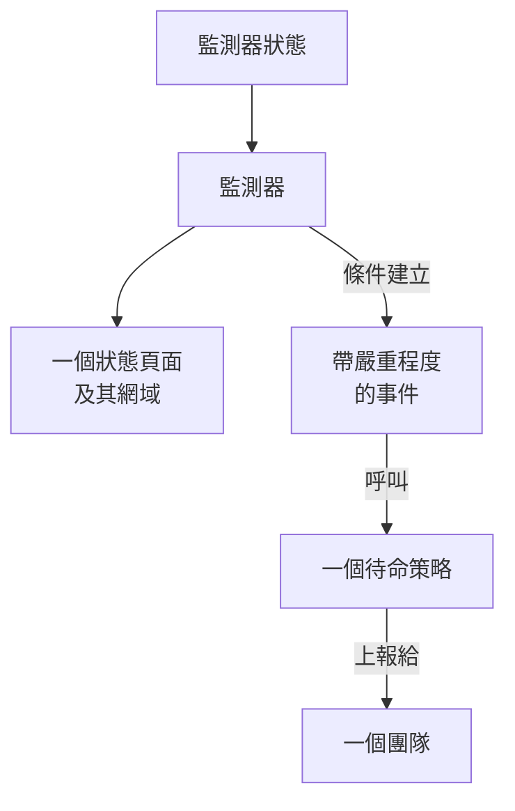

# 範例

適用於大多數專案最先建立的資源的現成設定。每個區塊都可以直接在下面的提供者設定之上套用，其中大多數來自提供者的端到端測試，這些測試在每次變更時都會把它們套用到真實的 OneUptime 上。

:::cards
- [監測器](#監測器): 網站、API、ping、連接埠、SSL 憑證、heartbeat 和手動監測器。
- [狀態頁面](#狀態頁面): 帶有一個群組和一個監測器的狀態頁面，以及自訂網域。
- [團隊和待命](#團隊和待命): 一個團隊，以及呼叫該團隊的待命策略。
- [事件和維護](#事件和維護): 嚴重程度、狀態、一個宣告的事件和一個維護時段。
:::



## 提供者設定

每個範例都假定使用以下設定，API 金鑰放在環境變數 `ONEUPTIME_API_KEY` 中：

```hcl title="main.tf"
terraform {
  required_providers {
    oneuptime = {
      source  = "oneuptime/oneuptime"
      version = "{{TERRAFORM_PROVIDER_VERSION}}"
    }
  }
}

provider "oneuptime" {
  # On a self-hosted OneUptime, add your OneUptime's address:
  # oneuptime_url = "https://oneuptime.example.com"
}
```

## 標籤

標籤用於對記錄進行排序和篩選。大多數資源在 `labels` 中接受一組標籤 ID：

```hcl
resource "oneuptime_label" "production" {
  name        = "production"
  description = "Production infrastructure"
  color       = "#FF5733"
}
```

## 監測器

下面的監測器使用每個專案一開始就有的三個狀態來設定自己的狀態，這些狀態透過資料來源讀取：

```hcl
data "oneuptime_monitor_status" "operational" {
  name = "Operational"
}

data "oneuptime_monitor_status" "degraded" {
  name = "Degraded"
}

data "oneuptime_monitor_status" "offline" {
  name = "Offline"
}
```

每個監測器的 `monitor_steps` 說明它檢查什麼，以及如何判定每個結果：[監控步驟](/docs/terraform/monitor-steps) 解釋了每個屬性。

### 網站監測器

網站無回應時為 offline，以 200 回應時為 online。端到端測試 `35-monitor-with-steps` 會套用一個執行這些檢查的監測器：

```hcl
resource "oneuptime_monitor" "website" {
  name                = "Website"
  description         = "Homepage availability and status code"
  monitor_type        = "Website"
  monitoring_interval = "*/5 * * * *"
  labels              = [oneuptime_label.production.id]

  monitor_steps = [{
    monitor_destination      = "https://example.com"
    monitor_destination_type = "URL"
    request_type             = "GET"

    criteria = [
      {
        name                  = "Offline"
        description           = "The website does not respond"
        filter_condition      = "Any"
        change_monitor_status = true
        monitor_status_id     = data.oneuptime_monitor_status.offline.id

        filters = [
          {
            check_on    = "Is Online"
            filter_type = "False"
          }
        ]
      },
      {
        name                  = "Online"
        description           = "The website responds with 200"
        filter_condition      = "All"
        change_monitor_status = true
        monitor_status_id     = data.oneuptime_monitor_status.operational.id

        filters = [
          {
            check_on    = "Is Online"
            filter_type = "True"
          },
          {
            check_on    = "Response Status Code"
            filter_type = "Equal To"
            value       = "200"
          }
        ]
      }
    ]
  }]
}
```

### API 監測器

一個帶標頭和 JSON 請求內文的 `POST`，回應緩慢時為 degraded。端到端測試 `35-monitor-with-steps` 會套用一個類似的 API 監測器：

```hcl
resource "oneuptime_monitor" "orders_api" {
  name         = "Orders API"
  description  = "Health check of the orders API"
  monitor_type = "API"

  monitor_steps = [{
    monitor_destination      = "https://api.example.com/v1/health"
    monitor_destination_type = "URL"
    request_type             = "POST"
    request_headers = {
      "Content-Type" = "application/json"
      "Accept"       = "application/json"
    }
    request_body = jsonencode({ check = "health" })

    criteria = [
      {
        name                  = "Offline"
        description           = "The API does not answer, or answers with an error"
        filter_condition      = "Any"
        change_monitor_status = true
        monitor_status_id     = data.oneuptime_monitor_status.offline.id

        filters = [
          {
            check_on    = "Is Online"
            filter_type = "False"
          },
          {
            check_on    = "Response Status Code"
            filter_type = "Greater Than Or Equal To"
            value       = "500"
          }
        ]
      },
      {
        name                  = "Slow"
        description           = "The API takes more than two seconds"
        filter_condition      = "All"
        change_monitor_status = true
        monitor_status_id     = data.oneuptime_monitor_status.degraded.id

        filters = [
          {
            check_on    = "Response Time (in ms)"
            filter_type = "Greater Than"
            value       = "2000"
          }
        ]
      },
      {
        name                  = "Online"
        description           = "The API answers in time"
        filter_condition      = "All"
        change_monitor_status = true
        monitor_status_id     = data.oneuptime_monitor_status.operational.id

        filters = [
          {
            check_on    = "Is Online"
            filter_type = "True"
          }
        ]
      }
    ]
  }]
}
```

### Ping 監測器

Ping 監測器接受主機名稱或 IP 位址，而不是 URL：

```hcl
resource "oneuptime_monitor" "gateway" {
  name         = "Gateway"
  description  = "The gateway answers ping"
  monitor_type = "Ping"

  monitor_steps = [{
    monitor_destination      = "gateway.example.com"
    monitor_destination_type = "Hostname"

    criteria = [
      {
        name                  = "Unreachable"
        filter_condition      = "Any"
        change_monitor_status = true
        monitor_status_id     = data.oneuptime_monitor_status.offline.id

        filters = [
          {
            check_on    = "Is Online"
            filter_type = "False"
          }
        ]
      },
      {
        name                  = "Reachable"
        filter_condition      = "All"
        change_monitor_status = true
        monitor_status_id     = data.oneuptime_monitor_status.operational.id

        filters = [
          {
            check_on    = "Is Online"
            filter_type = "True"
          }
        ]
      }
    ]
  }]
}
```

### 連接埠監測器

連接埠監測器額外新增要檢查的 `port`，寫成數字：

```hcl
resource "oneuptime_monitor" "database_port" {
  name         = "Database port"
  description  = "PostgreSQL accepts connections"
  monitor_type = "Port"

  monitor_steps = [{
    monitor_destination      = "db.example.com"
    monitor_destination_type = "Hostname"
    port                     = 5432

    criteria = [
      {
        name                  = "Closed"
        filter_condition      = "Any"
        change_monitor_status = true
        monitor_status_id     = data.oneuptime_monitor_status.offline.id

        filters = [
          {
            check_on    = "Is Online"
            filter_type = "False"
          }
        ]
      },
      {
        name                  = "Open"
        filter_condition      = "All"
        change_monitor_status = true
        monitor_status_id     = data.oneuptime_monitor_status.operational.id

        filters = [
          {
            check_on    = "Is Online"
            filter_type = "True"
          }
        ]
      }
    ]
  }]
}
```

### SSL 憑證監測器

與儀表板中新建的 SSL 憑證監測器一樣，憑證無效時為 offline，14 天內到期時為 degraded：

```hcl
resource "oneuptime_monitor" "certificate" {
  name         = "example.com certificate"
  description  = "The TLS certificate of example.com"
  monitor_type = "SSL Certificate"

  monitor_steps = [{
    monitor_destination      = "https://example.com"
    monitor_destination_type = "URL"

    criteria = [
      {
        name                  = "Not valid"
        description           = "Expired, self-signed, untrusted or not reachable"
        filter_condition      = "Any"
        change_monitor_status = true
        monitor_status_id     = data.oneuptime_monitor_status.offline.id

        filters = [
          {
            check_on    = "Is Not A Valid Certificate"
            filter_type = "True"
          }
        ]
      },
      {
        name                  = "Expires soon"
        description           = "Valid, and expires in 14 days or less"
        filter_condition      = "All"
        change_monitor_status = true
        monitor_status_id     = data.oneuptime_monitor_status.degraded.id

        filters = [
          {
            check_on    = "Is Valid Certificate"
            filter_type = "True"
          },
          {
            check_on    = "Expires In Days"
            filter_type = "Less Than Or Equal To"
            value       = "14"
          }
        ]
      },
      {
        name                  = "Valid"
        filter_condition      = "All"
        change_monitor_status = true
        monitor_status_id     = data.oneuptime_monitor_status.operational.id

        filters = [
          {
            check_on    = "Is Valid Certificate"
            filter_type = "True"
          }
        ]
      }
    ]
  }]
}
```

### 手動監測器

手動監測器不檢查任何東西：它的狀態由你自己設定。它不需要 `monitor_steps`：

```hcl
resource "oneuptime_monitor" "payment_provider" {
  name         = "Payment provider"
  description  = "Set by hand during the provider's incidents"
  monitor_type = "Manual"
}
```

### Heartbeat 監測器

傳入請求監測器等待請求，而不是傳送請求：這裡是一個每晚報到的備份任務。25 小時內沒有收到請求時，它會變為 offline：

```hcl
resource "oneuptime_monitor" "nightly_backup" {
  name         = "Nightly backup"
  description  = "The backup job sends a heartbeat when it finishes"
  monitor_type = "Incoming Request"

  monitor_steps = [{
    criteria = [
      {
        name                  = "No heartbeat"
        filter_condition      = "Any"
        change_monitor_status = true
        monitor_status_id     = data.oneuptime_monitor_status.offline.id

        filters = [
          {
            check_on    = "Incoming Request"
            filter_type = "Not Recieved In Minutes"
            value       = "1500"
          }
        ]
      },
      {
        name                  = "Heartbeat received"
        filter_condition      = "All"
        change_monitor_status = true
        monitor_status_id     = data.oneuptime_monitor_status.operational.id

        filters = [
          {
            check_on    = "Incoming Request"
            filter_type = "Recieved In Minutes"
            value       = "1500"
          }
        ]
      }
    ]
  }]
}

output "nightly_backup_heartbeat_key" {
  value     = oneuptime_monitor.nightly_backup.incoming_request_secret_key
  sensitive = true
}
```

任務使用 `terraform output -raw nightly_backup_heartbeat_key` 輸出的金鑰，把請求傳送到 `https://oneuptime.com/heartbeat/YOUR_SECRET_KEY`：請參閱 [傳入請求監控](/docs/monitor/incoming-request-monitor)。伺服器監測器的代理程式也以同樣的方式透過 `server_monitor_secret_key` 進行驗證。

### 監測器群組

監測器群組以單一狀態顯示一組監測器：

```hcl
resource "oneuptime_monitor_group" "storefront" {
  name        = "Storefront"
  description = "Everything the shop needs"
}

resource "oneuptime_monitor_group_resource" "website" {
  monitor_group_id = oneuptime_monitor_group.storefront.id
  monitor_id       = oneuptime_monitor.website.id
}

resource "oneuptime_monitor_group_resource" "orders_api" {
  monitor_group_id = oneuptime_monitor_group.storefront.id
  monitor_id       = oneuptime_monitor.orders_api.id
}
```

## 狀態頁面

### 帶有一個群組和一個監測器的狀態頁面

狀態頁面顯示資源，並且可以把它們分到不同的群組中。端到端測試 `42-status-page-resources` 會套用這套設定：

```hcl
resource "oneuptime_status_page" "public" {
  name                  = "Public Status"
  description           = "Customer-facing status page"
  page_title            = "System Status"
  page_description      = "Check our system status and incident history"
  is_public_status_page = true
}

resource "oneuptime_status_page_group" "services" {
  status_page_id = oneuptime_status_page.public.id
  name           = "Services"
}

resource "oneuptime_status_page_resource" "website" {
  status_page_id       = oneuptime_status_page.public.id
  status_page_group_id = oneuptime_status_page_group.services.id
  monitor_id           = oneuptime_monitor.website.id
  display_name         = "Website"
}
```

### 自訂網域

三個資源協同工作：專案的網域、狀態頁面，以及把兩者連接起來的狀態頁面網域。`full_domain` 和 CNAME 驗證權杖由伺服器填寫：不要設定它們。端到端測試 `12-status-page-domain` 和 `25-status-page-with-domain` 會套用這套設定：

```hcl
resource "oneuptime_domain" "company" {
  domain = "example.com"
}

resource "oneuptime_status_page_domain" "status" {
  domain_id      = oneuptime_domain.company.id
  status_page_id = oneuptime_status_page.public.id
  subdomain      = "status"
}

output "status_page_address" {
  # The subdomain and the domain, such as status.example.com.
  value = oneuptime_status_page_domain.status.full_domain
}
```

新網域必須先通過 DNS 驗證，狀態頁面才會在該網域上回應。

## 團隊和待命

### 團隊及其成員

```hcl
resource "oneuptime_team" "sre" {
  name        = "SRE"
  description = "Site reliability engineering"
}

variable "alice_user_id" {
  description = "Alice's user ID, the last part of the address of her page under Users"
  type        = string
}

resource "oneuptime_team_member" "alice" {
  team_id = oneuptime_team.sre.id
  user_id = var.alice_user_id
}
```

已經在專案中的人會立即加入團隊。其他人會收到邀請，接受後即加入團隊。端到端測試 `33-team-crud` 會套用這個團隊。

### 呼叫團隊的待命策略

策略的第一條規則呼叫團隊；如果沒有人確認，策略會從頭再來，最多兩次：

```hcl
resource "oneuptime_on_call_policy" "primary" {
  name                                             = "Primary on-call"
  description                                      = "First line for production incidents"
  repeat_policy_if_no_one_acknowledges             = true
  repeat_policy_if_no_one_acknowledges_no_of_times = 2
}

resource "oneuptime_escalation_rule" "first_line" {
  on_call_duty_policy_id    = oneuptime_on_call_policy.primary.id
  name                      = "Page the SRE team"
  description               = "Moves on after 5 minutes without an acknowledgement"
  order                     = 1
  escalate_after_in_minutes = 5
}

resource "oneuptime_team_on_call_duty_escalation_rule" "sre" {
  on_call_duty_policy_id                 = oneuptime_on_call_policy.primary.id
  on_call_duty_policy_escalation_rule_id = oneuptime_escalation_rule.first_line.id
  team_id                                = oneuptime_team.sre.id
}
```

監測器的條件透過它們所建立事件上的 `on_call_policy_ids` 呼叫策略：請參閱 [事件和警示](/docs/terraform/monitor-steps#事件和警示)。

## 事件和維護

### 嚴重程度和狀態

嚴重程度表示事件影響的大小，狀態是事件生命週期中的各個階段。`order` 表示每一項的排列位置：

```hcl
resource "oneuptime_incident_severity" "sev1" {
  name        = "SEV-1"
  description = "Full outage, all hands"
  color       = "#E74C3C"
  order       = 1
}

resource "oneuptime_incident_state" "mitigated" {
  name        = "Mitigated"
  description = "Impact contained, fix in progress"
  color       = "#F39C12"
  order       = 3
}
```

`oneuptime_alert_severity` 和 `oneuptime_alert_state` 以同樣的方式用於警示。端到端測試 `03-incident-severity` 和 `04-incident-state` 會套用它們。

### 宣告事件

事件通常由監測器建立，但事件本身也是一種資源，這很適合演練日。它是一個真實的事件，所以請不要讓演練出現在你的狀態頁面上：

```hcl
resource "oneuptime_incident" "drill" {
  title                     = "Disaster recovery drill"
  description               = "A game day: we fail over the database"
  incident_severity_id      = oneuptime_incident_severity.sev1.id
  is_visible_on_status_page = false

  should_status_page_subscribers_be_notified_on_incident_created = false
}
```

端到端測試 `28-incident-crud` 會套用一個事件。

### 排定維護

一個時間固定、顯示在你的狀態頁面上的維護時段：

```hcl
resource "oneuptime_scheduled_maintenance_event" "database_upgrade" {
  title                       = "Database maintenance"
  description                 = "Planned PostgreSQL upgrade: writes pause briefly"
  starts_at                   = "2030-06-01T02:00:00Z"
  ends_at                     = "2030-06-01T04:00:00Z"
  is_visible_on_status_page   = true
  monitors                    = [oneuptime_monitor.website.id]
  change_monitor_status_to_id = data.oneuptime_monitor_status.degraded.id
}
```

時間使用 RFC 3339 格式，同一時刻換一種寫法不算更改。端到端測試 `30-scheduled-maintenance-crud` 會套用維護事件。

要在事件進行期間讓其監測器處於某個狀態，請用 `monitors` 關聯這些監測器，並把 `change_monitor_status_to_id` 設為你的某個監測器狀態：事件開始時監測器切換到該狀態，事件結束時恢復為正常運作。在事件開始之前，Terraform 會就地修改 `change_monitor_status_to_id`。事件開始後，其監測器已經處於該狀態，修改它的 apply 會以「Change Monitor Status to can no longer be changed: this event has already started.」失敗。

## 探針

你自己的探針從你的網路發起檢查。它的金鑰是探針登入時使用的機密，所以請透過變數傳入：

```hcl
variable "probe_key" {
  description = "The key the probe signs in with"
  type        = string
  sensitive   = true
}

resource "oneuptime_probe" "eu_west" {
  key           = var.probe_key
  name          = "EU West"
  description   = "Probe in our eu-west-1 network"
  probe_version = "1.0.0"

  should_auto_enable_probe_on_new_monitors = true
}
```

執行探針時，把 `PROBE_ID` 設為探針的 `id`，把 `PROBE_KEY` 設為金鑰：請參閱 [自訂探針](/docs/probe/custom-probe)。端到端測試 `23-probe-crud` 會套用探針。

## 後續步驟

:::cards
- [監控步驟](/docs/terraform/monitor-steps): 監測器檢查和條件的每個屬性。
- [匯入資源](/docs/terraform/importing-resources): 把你在儀表板中建立的內容交給 Terraform 管理。
- [完整指南](/docs/terraform/complete-guide): 資料來源、state、CI/CD 和升級。
:::
