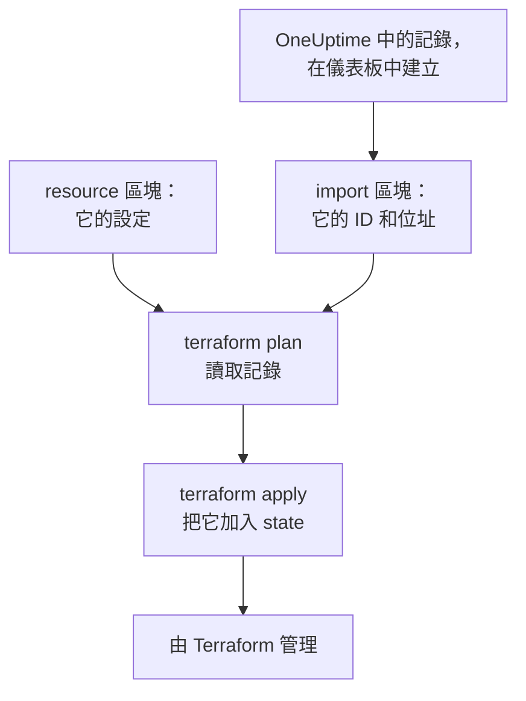
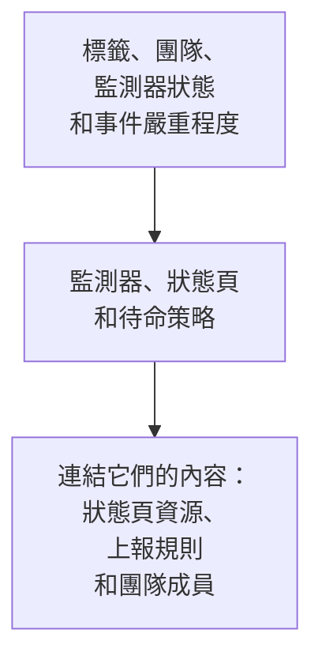

# 匯入資源

用 Terraform 管理 OneUptime，不必從頭再來。匯入你已有的監測器、狀態頁、團隊和其他記錄，之後 Terraform 就會依照它們現有的樣子管理它們。匯入只會讀取：在你套用計畫好的變更之前，OneUptime 中什麼都不會改變。

:::cards
- [匯入的運作方式](#匯入的運作方式): 匯入會讀取什麼，你又要寫什麼。
- [匯入一個資源](#匯入一個資源): 從儀表板中它的頁面開始，分四個步驟完成。
- [匯入多個資源](#匯入多個資源): 整個清單的 import 區塊，以及 Terraform 替你寫出的設定。
- [停止管理某個資源](#停止管理某個資源): 把它交還給儀表板，而不刪除它。
:::

## 匯入的運作方式

匯入會把 OneUptime 中已有的記錄，與你設定中的 `resource` 區塊連結起來。你要寫一個 `import` 區塊，其中包含記錄的 ID 和它要放到的位址。下一次 `terraform plan` 會依 ID 讀取該記錄，顯示它將被匯入，並列出記錄與你的設定之間的每一處差異。`terraform apply` 會把它加入 Terraform 的 state，之後該記錄就會像 Terraform 建立的任何東西一樣受到管理。



依照記錄現有的樣子寫 `resource` 區塊。兩者不同的地方，計畫會同時顯示匯入和一項變更，套用它就會變更 OneUptime 中的記錄。

### 可以匯入什麼

提供者的每個資源都可以依 ID 匯入，`oneuptime_file` 除外：OneUptime API 無法讀回檔案，所以提供者會回應 `Import Not Supported`。資料來源從不匯入。若要在設定中使用某筆記錄而不管理它，請改用[資料來源](/docs/terraform/complete-guide#讀取已有的內容)讀取它。

## 開始之前

- **Terraform 1.5 或更新版本，或 OpenTofu 1.6 或更新版本。** 本頁的 `import` 區塊需要這些版本。較舊的 Terraform 請透過[命令列](#透過命令列匯入)匯入。
- **能讀取你要匯入內容的 API 金鑰。** 匯入會用提供者的金鑰讀取每筆記錄，之後要管理它，還需要變更和刪除它的權限。請參閱[建立專案 API 金鑰](/docs/terraform/quick-start#建立專案-api-金鑰)。
- **設定中的提供者**，依照[快速入門](/docs/terraform/quick-start#讓-terraform-指向-oneuptime)中的方式設定。

## 匯入一個資源

儀表板會寫出你正在檢視的資源的設定及其 `import` 區塊，所以你很少需要手寫。

:::steps
### 開啟資源的 Terraform 頁面

在儀表板中開啟監測器、狀態頁或其他資源。在它的側邊選單中開啟 **開發者**，然後開啟 **Terraform**。

### 複製它的設定

該頁面會依資源目前的設定寫出它的 `resource` 區塊，並寫出一個包含其 ID 的 `import` 區塊。把兩者都放進一個 `.tf` 檔案：

```hcl title="status-pages.tf"
resource "oneuptime_status_page" "public_status" {
  name       = "Public Status"
  page_title = "Acme Status"

  # Secrets are not shown here: master_password, embedded_overall_status_token.
  # Terraform leaves them as they are in OneUptime.
}

import {
  to = oneuptime_status_page.public_status
  id = "68a1b2c3-d4e5-4f6a-8b9c-0d1e2f3a4b02"
}
```

它會寫出與預設值不同的設定，每個 ID 後面的註解會說明該 ID 指向的記錄。機密從不顯示：資源需要的機密會從標記為 `sensitive` 的變數讀取，註解會列出被省略的那些。

### 執行計畫

執行 `terraform plan`。它會以 `Plan: 1 to import, 0 to add, 0 to change, 0 to destroy.` 結束：Terraform 找到了這筆記錄，而且你的設定與它一致。

### 套用

執行 `terraform apply`。狀態頁現在已進入 Terraform 的 state，下一次計畫會回應 `No changes.` 之後你可以刪除 `import` 區塊，也可以把它留作資源來源的備註：資源一旦受到管理，它就不再有任何作用。
:::

### 自己撰寫這些區塊

不使用儀表板時，兩個區塊都由你自己撰寫。先用資源需要的屬性寫出 `resource` 區塊，然後執行 `terraform plan`。你的設定與記錄不同的地方，計畫會在匯入旁邊顯示變更：

```text
  # oneuptime_label.critical will be updated in-place
  # (imported from "68a1b2c3-d4e5-4f6a-8b9c-0d1e2f3a4b03")
  ~ resource "oneuptime_label" "critical" {
      ~ color = "#FF5733" -> "#000000"
    }

Plan: 1 to import, 0 to add, 1 to change, 0 to destroy.
```

把記錄的值複製到你的設定中（此處為 `color = "#FF5733"`），然後再次執行計畫，直到計畫只顯示匯入、沒有變更。記錄的 ID 可以在三個地方找到：

| 位置 | 方式 |
| --- | --- |
| 資源的頁面 | 它的詳細資料卡片最後有一行 **ID**。點選 ID 或旁邊的複製按鈕，即可複製完整的 ID。 |
| 網址列 | ID 位於清單名稱之後：`/dashboard/<project-id>/monitors/<monitor-id>`。 |
| API | 每筆記錄都在 `_id` 中帶有自己的 ID。 |

## 匯入多個資源

若要匯入某一類的所有監測器、狀態頁或其他資源，請從它們的清單開始。

:::steps
### 開啟清單的 Terraform 頁面

開啟清單，然後在它的側邊選單中依序開啟 **開發者** 和 **Terraform**，例如 **監測 → 開發者 → Terraform**。

### 複製 import 區塊

該頁面會為每筆記錄（前 100 筆）寫出一個 `import` 區塊，位址由記錄的名稱產生。把它們放進一個獨立的檔案，例如 `imports.tf`：

```hcl title="imports.tf"
import {
  to = oneuptime_monitor.homepage
  id = "68a1b2c3-d4e5-4f6a-8b9c-0d1e2f3a4b01"
}

import {
  to = oneuptime_monitor.checkout_api
  id = "68a1b2c3-d4e5-4f6a-8b9c-0d1e2f3a4b05"
}
```

### 讓 Terraform 寫出設定

執行計畫，並為 Terraform 寫出的設定指定一個檔名。該檔案必須尚未存在：Terraform 只會寫入新檔案。

```bash
terraform plan -generate-config-out=monitors.tf
```

Terraform 會讀取每筆記錄並寫出 `resource` 區塊，對象是每個還沒有對應區塊的 `import` 區塊。它會警告設定產生是實驗性功能，所以請閱讀它寫出的內容。

### 檢查並套用

在新檔案中，把其他記錄的 ID 換成對它們資源的參照，例如 `labels = [oneuptime_label.critical.id]`，這樣 Terraform 就知道要依什麼順序處理。執行 `terraform plan`，直到它只顯示匯入，然後執行 `terraform apply`。
:::

### 整個專案

逐一清單地匯入專案，從被其他記錄參照的記錄開始。這樣每個資源區塊都可以透過位址而不是 ID 參照前面的資源：



每個專案一開始就有的記錄，例如它的監測器狀態和事件嚴重程度，通常用資料來源讀取會比匯入更好：這樣 Terraform 可以參照它們，但從不變更或刪除它們。當 `terraform plan` 回應 `No changes.` 時，專案就匯入完成了。

## 透過命令列匯入

`terraform import` 一次匯入一個資源，適用於所有版本的 Terraform 和 OpenTofu。先寫出 `resource` 區塊，然後用區塊的位址和記錄的 ID 執行命令：

```bash
terraform import oneuptime_status_page.public_status 68a1b2c3-d4e5-4f6a-8b9c-0d1e2f3a4b02
terraform import oneuptime_label.critical 68a1b2c3-d4e5-4f6a-8b9c-0d1e2f3a4b03
terraform import oneuptime_team.sre 68a1b2c3-d4e5-4f6a-8b9c-0d1e2f3a4b04
```

每個命令都會以 `Import successful!` 結束。與 `import` 區塊不同，這個命令會立即寫入 state，不會先提供計畫讓你檢查：之後請執行 `terraform plan`，並修改設定，直到計畫回應 `No changes.`

## 停止管理某個資源

若要把資源交還給儀表板而不刪除它，請把它的 `resource` 區塊換成保留記錄的 `removed` 區塊：

```hcl
removed {
  from = oneuptime_team.sre

  lifecycle {
    destroy = false
  }
}
```

計畫會說明該團隊將不再由 Terraform 管理，而且不會銷毀任何東西。套用它，然後刪除 `removed` 區塊。帶有 `destroy = false` 的 `removed` 區塊需要 Terraform 1.7 或更新版本，或 OpenTofu 1.10 或更新版本。在較舊的版本上，請改為執行 `terraform state rm oneuptime_team.sre`。

> [!WARNING]
> 刪除 `resource` 區塊會在下一次 apply 時刪除它在 OneUptime 中的記錄。在 Terraform 中，沒有 `destroy = false` 的 `removed` 區塊也會這樣做：請一律寫上 `lifecycle` 區塊。

## 須知

- **匯入不會變更任何內容，但下一次 apply 會。** 套用一個在匯入旁邊顯示變更的計畫，會變更 OneUptime 中的記錄。請先讓計畫只顯示匯入。
- **機密不會被讀回。** OneUptime 從不傳回的機密，例如監測器機密的 `secret_value`，在匯入後不在 state 中。如果你的設定設定了它，第一次計畫會把它顯示為一項變更，套用後會再次寫入該機密。
- **每筆記錄只用一份設定。** 匯入到兩份設定中的記錄，每次 apply 都會被改回各自設定所寫的樣子。
- **匯入的記錄就是受管理的記錄。** `terraform destroy` 會把它們從 OneUptime 中刪除，就像 Terraform 建立的記錄一樣。

## 疑難排解

:::details 訊息「Cannot import non-existent remote object」
沒有記錄具有該 ID，或者提供者的 API 金鑰無權讀取它：OneUptime 對這兩種情況的回應相同。請檢查 ID，以及金鑰能否讀取該類記錄。
:::

:::details 訊息「Import Not Supported」
`oneuptime_file` 是唯一無法匯入的資源。請不要匯入它，改為讓 Terraform 建立一個新檔案。
:::

:::details 訊息「Invalid ID format」
傳入的不是記錄的 ID，例如是一個名稱。匯入需要 ID，也就是類似 `68a1b2c3-d4e5-4f6a-8b9c-0d1e2f3a4b02` 的 UUID：請從資源的頁面複製它。
:::

:::details 訊息「Target generated file already exists」
`-generate-config-out` 指定了一個已經存在的檔案。請指定一個新檔案，或把該檔案的內容移到別處再刪除它。
:::

:::details 訊息「Resource already managed by Terraform」
`terraform import` 收到的位址已在 state 中。請把記錄匯入到另一個位址，或用 `terraform state list` 查看該位址中有什麼。
:::

## 後續步驟

:::cards
- [完整指南](/docs/terraform/complete-guide): 資料來源、資源之間的參照以及 state。
- [監控步驟](/docs/terraform/monitor-steps): 查看並變更匯入的監測器所檢查的內容。
- [範例](/docs/terraform/examples): 常用資源的現成設定。
- [疑難排解](/docs/terraform/troubleshooting): 常見錯誤及其修正方式。
:::
