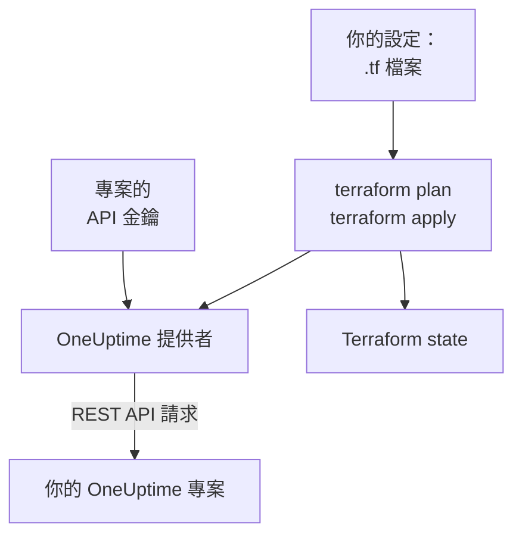

# Terraform 概觀

OneUptime 的 Terraform 提供者讓你以程式碼的方式管理 OneUptime 專案。在 `.tf` 檔案中描述監測器、狀態頁面、待命策略、團隊、標籤以及專案中的其他記錄，用 `terraform plan` 檢視將要發生的更改，再用 `terraform apply` 完成更改。它既適用於 OneUptime Cloud，也適用於自行託管的 OneUptime，並且同樣支援 OpenTofu 和 Terraform。

:::cards
- [提供者的運作方式](#提供者的運作方式): 你的設定、計畫，以及背後的 API 請求。
- [安裝提供者](#安裝提供者): 提供者區塊，以及該選的版本。
- [讓儀表板來寫](#讓儀表板來寫): 為已有資源產生設定和 import 區塊。
- [可以管理的內容](#可以管理的內容): 資源、資料來源，以及它們的屬性怎麼寫。
:::

## 提供者的運作方式

提供者是 Terraform 從登錄庫下載的外掛。執行 `terraform apply` 時，它把計畫中的每項更改轉換成一次對 OneUptime REST API 的請求，請求使用專案的 API 金鑰。Terraform 會把它建立的內容記錄在 state 中，因此下一次計畫只顯示此後發生變化的內容。



一個 API 金鑰屬於一個專案，並決定 Terraform 能在其中讀取和更改什麼，所以一份設定管理一個專案。要管理多個專案，請為每個專案給提供者設定一個 [別名](/docs/terraform/complete-guide#管理多個專案)。

## 開始之前

- **Terraform 1.5 或更高版本，或 OpenTofu 1.6 或更高版本。** 儀表板產生的 `import` 區塊需要這些版本。
- **專案的 API 金鑰。** [快速入門](/docs/terraform/quick-start#建立專案-api-金鑰) 介紹了如何在 **專案設定 → 進階 → API 金鑰** 中建立。
- **在 OneUptime Cloud 上，需要 Growth 方案或更高。** 專案的 API 金鑰只在該方案上有效。

## 安裝提供者

把提供者新增到一個 `.tf` 檔案中。`terraform init` 從 Terraform Registry 下載它，`tofu init` 從 OpenTofu Registry 下載它：

```hcl title="main.tf"
terraform {
  required_providers {
    oneuptime = {
      source  = "oneuptime/oneuptime"
      version = "{{TERRAFORM_PROVIDER_VERSION}}"
    }
  }
}

provider "oneuptime" {
  # The API key comes from the ONEUPTIME_API_KEY environment variable.
  # On a self-hosted OneUptime, add your OneUptime's address:
  # oneuptime_url = "https://oneuptime.example.com"
}
```

不要把金鑰寫進檔案：在執行 Terraform 之前匯出它，或者透過標記為 `sensitive` 的變數傳入。[完整指南](/docs/terraform/complete-guide#設定提供者) 列出了向提供者提供金鑰和位址的所有方式。

### 選擇版本

提供者的版本跟隨 OneUptime 的版本：提供者 {{TERRAFORM_PROVIDER_MAJOR}}.x 由 OneUptime {{TERRAFORM_PROVIDER_MAJOR}}.x 產生。上面的限制 `{{TERRAFORM_PROVIDER_VERSION}}` 會選用最新的 {{TERRAFORM_PROVIDER_MAJOR}}.x 版本，這對 OneUptime Cloud 來說是正確的。在自行託管的 OneUptime 上，請使用不比你的 OneUptime 更新的最新提供者：[自架設定](/docs/terraform/self-hosted) 介紹了如何固定版本。

## 讓儀表板來寫

已有的資源不必手寫。OneUptime 儀表板中的每個資源（監測器、狀態頁面、工作流程、待命策略等）在側邊選單中都有一個 **開發者** 區段，開啟之前處於摺疊狀態。其中的 **Terraform** 頁面會根據你自己的專案替你寫好設定。

:::steps
### 開啟資源

開啟你想交給 Terraform 管理的監測器、狀態頁面或其他資源。

### 開啟它的 Terraform 頁面

在側邊選單中依次開啟 **開發者** 和 **Terraform**。

### 複製設定

該頁面根據資源的目前設定寫出設定，並附帶一個 `import` 區塊。每個 ID 後面的註解給出它所指向記錄的名稱（`incident_severity_id = "..." # Critical Incident`）。

### 計畫並套用

執行 `terraform plan`：它會顯示該資源將被匯入，且沒有需要更改的內容。套用之後，Terraform 就會接管該資源。
:::

在設定下方，**進一步擴充** 列出了人們常在該資源旁邊新增的內容，並透過位址引用該資源：事件的負責團隊、狀態頁面的監測器群組、待命策略的上報規則。

列表頁面（例如 **事件** 或 **監測器**）也有同樣的區段。在那裡，**Terraform** 頁面會用你專案自己的記錄寫出一個新資源，填好大多數人會設定的欄位：一個使用你的某個嚴重程度的事件，一個帶有儀表板為新監測器提供的條件、並關聯到你的狀態的監測器。它還提供現成的 **常用設定**（帶有一個群組和一個監測器的狀態頁面、呼叫團隊的待命策略、每週的待命輪值），並為你已有的每個資源（前 100 個）提供一個 `import` 區塊，可直接用於 `terraform plan -generate-config-out`。兩個頁面都會提供適用於你的 OneUptime 的提供者區塊：正確的 `oneuptime_url`，以及與你的 OneUptime 相符的版本限制。

這些頁面從不顯示機密。當設定需要機密時（例如監測器的 `Authorization` 標頭），會從標記為 `sensitive` 的 Terraform 變數中讀取。不需要的機密會被省略，Terraform 會保持它們在 OneUptime 中的原樣。

同一區段中還有一個 **API** 頁面，提供該資源的 `curl` 命令；以及一個 **AI 助理** 頁面，可把 Claude、GitHub Copilot 或 Cursor 連接到 [MCP 伺服器](/docs/ai/mcp-server)。

## 可以管理的內容

對於可以透過 OneUptime API 建立的每種記錄，提供者都有一個名為 `oneuptime_<name>` 的資源。大多數設定從以下資源開始：

| 資源 | 說明 |
| --- | --- |
| `oneuptime_monitor` | 監測器：網站、API、ping、連接埠、SSL 憑證、伺服器、傳入請求、手動以及其他所有類型 |
| `oneuptime_monitor_status` | 監測器狀態，例如 Operational、Degraded 或 Offline |
| `oneuptime_monitor_group` | 以單一狀態顯示的監測器群組 |
| `oneuptime_status_page` | 公開或私有的狀態頁面 |
| `oneuptime_status_page_domain` | 狀態頁面的自訂網域 |
| `oneuptime_domain` | 專案中已為狀態頁面驗證的網域 |
| `oneuptime_label` | 用於排序和篩選記錄的標籤 |
| `oneuptime_team`, `oneuptime_team_member` | 團隊，以及團隊成員 |
| `oneuptime_on_call_policy`, `oneuptime_escalation_rule` | 待命策略，以及它按順序呼叫的規則 |
| `oneuptime_incident`, `oneuptime_incident_severity`, `oneuptime_incident_state` | 事件，以及事件的嚴重程度和狀態 |
| `oneuptime_alert`, `oneuptime_alert_severity`, `oneuptime_alert_state` | 警示，以及警示的嚴重程度和狀態 |
| `oneuptime_scheduled_maintenance_event` | 排定維護時段 |
| `oneuptime_probe` | 你自己的探針，從你的網路發起檢查 |

[Terraform Registry](https://registry.terraform.io/providers/oneuptime/oneuptime/latest/docs) 列出了每個資源及其所有屬性。

### 讀取已有的內容

每個資源都有一個同名的資料來源，例如 `data "oneuptime_label"`。資料來源讀取一條不由目前設定管理的記錄，例如在儀表板中建立的記錄。可以按 `id` 查詢，也可以按其他簡單引數查詢：你設定的每個引數都必須相符，並且必須恰好有一條記錄與它們全部相符。

```hcl
data "oneuptime_monitor_status" "offline" {
  name = "Offline"
}

# Any plain argument works. Set several, and all of them must match.
data "oneuptime_monitor_status" "offline_state" {
  is_offline_state = true
}
```

沒有相符或相符多於一條都會產生錯誤，而不是傳回空結果或任意結果。規則見 [完整指南](/docs/terraform/complete-guide#讀取已有的內容)。

### 已重新命名的資源

資源名稱會把 IoT、vCenter 這樣的詞保持完整：`oneuptime_iot_fleet` 和 `oneuptime_vcenter`，而舊版提供者中是 `oneuptime_io_t_fleet` 和 `oneuptime_v_center`（它們的標籤規則、負責人和動態也是如此）。舊名稱仍可作為已棄用的別名使用，使用舊名稱的計畫會給出提示。要切換，請在設定中重新命名資源並新增一個 `moved` 區塊，Terraform 會保留現有資源，而不是替換它：

```hcl
# Was: resource "oneuptime_io_t_fleet" "factory"
resource "oneuptime_iot_fleet" "factory" {
  name = "Factory floor"
}

moved {
  from = oneuptime_io_t_fleet.factory
  to   = oneuptime_iot_fleet.factory
}
```

把資源移到另一種類型需要 Terraform 1.8 或更高版本。在更舊的引擎上，暫時保留舊名稱即可：它仍然可用。

## 屬性的寫法

屬性遵循 OneUptime API，使用 snake_case：

| 值的類型 | 寫法 | 範例 |
| --- | --- | --- |
| 文字、數字、真或假 | 原樣書寫 | `is_public_status_page = false` |
| 對另一條記錄的引用 | 它的 ID，通常是另一個資源的 `id` | `incident_severity_id = oneuptime_incident_severity.sev1.id` |
| 引用列表 | 一組 ID，順序無關緊要 | `labels = [oneuptime_label.critical.id]` |
| 顏色、網域和其他包裝值 | 它們的普通值 | `color = "#FF5733"` |
| 日期和時間 | RFC 3339 格式的文字 | `starts_at = "2030-06-01T02:00:00Z"` |
| 監測器的檢查 | 有類型的巢狀屬性：請參閱 [監控步驟](/docs/terraform/monitor-steps) | `monitor_steps = [{ ... }]` |
| 其他結構化設定 | 用 `jsonencode()` 寫的 JSON | `log_monitor = jsonencode({ ... })` |

有兩類值屬於伺服器，你不需要填寫：

- **資源內部的 ID。** 監測器的步驟和條件，以及它們的事件範本和警示範本，都有伺服器分配並在每次 apply 中保持不變的 ID，因此事件會一直指向觸發它們的條件。
- **伺服器持續更新的內容。** 監測器的目前狀態，或它最後一次收到 heartbeat 的時間，可能在 `terraform plan` 和 `terraform apply` 結束之間發生變化。對於你沒有設定的內容，提供者會保留計畫中的值，下一次 refresh 再讀取伺服器的值，因此這既不會讓 apply 失敗，也不會顯示為更改。

## 取得協助

- 錯誤報告和功能請求：[github.com/OneUptime/oneuptime/issues](https://github.com/OneUptime/oneuptime/issues)。
- 提供者由 [OneUptime 主要存放庫](https://github.com/OneUptime/oneuptime) 中的 OneUptime OpenAPI 規格產生。已發布的提供者存放庫是唯讀的，所以請在主要存放庫中報告問題。

## 後續步驟

:::cards
- [快速入門](/docs/terraform/quick-start): 建立 API 金鑰，十分鐘內套用你的第一批資源。
- [完整指南](/docs/terraform/complete-guide): 驗證、專案結構、資料來源、state 和升級。
- [監控步驟](/docs/terraform/monitor-steps): 決定監測器檢查什麼，以及每個結果意味著什麼。
- [範例](/docs/terraform/examples): 常用資源的現成設定。
- [匯入資源](/docs/terraform/importing-resources): 把你在儀表板中建立的內容交給 Terraform 管理。
:::
