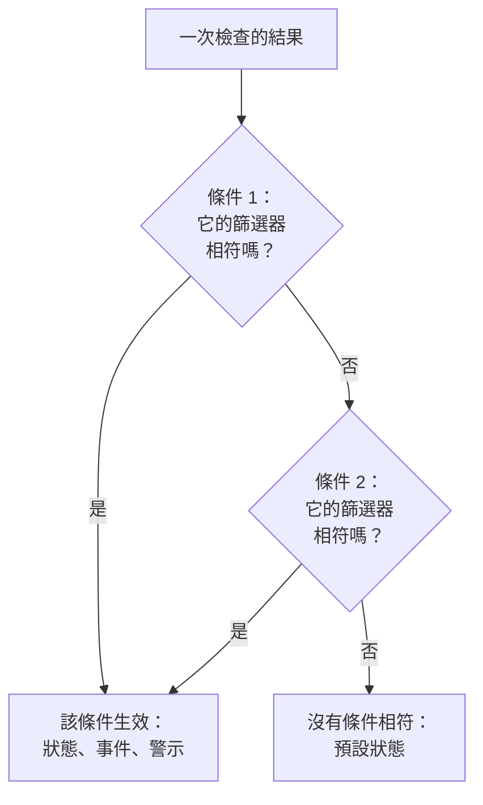
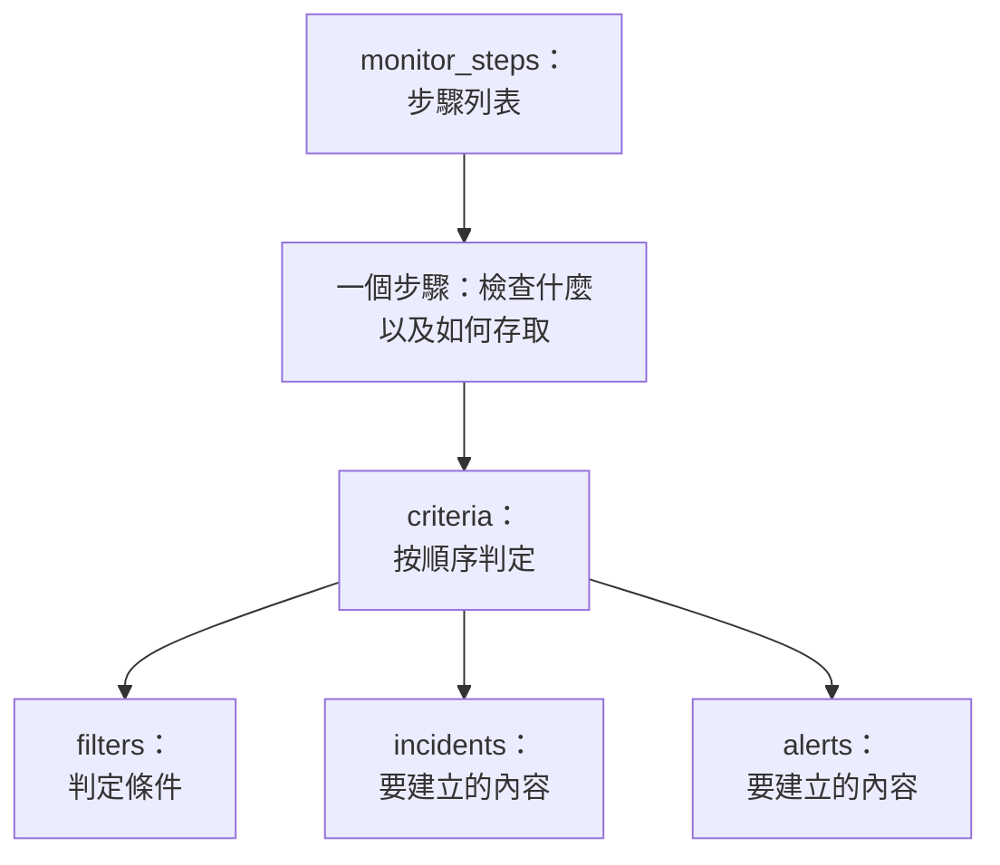

# 監控步驟

`monitor_steps` 是 `oneuptime_monitor` 的一個屬性，說明監測器檢查什麼，以及如何判定每個結果：要檢查的位址、要傳送的請求，以及把結果變成監測器狀態、事件或警示的條件。本頁解釋它的每個部分。

:::cards
- [如何判定一次檢查](#如何判定一次檢查): 按順序排列的條件，以及第一個相符的條件。
- [編寫步驟](#編寫步驟): 步驟的結構、一個完整範例，以及值的兩條規則。
- [篩選器參考](#篩選器參考): 篩選器可以檢查什麼，以及如何比較。
- [常見錯誤](#常見錯誤): 最常出問題的地方，以及解決辦法。
:::

## 如何判定一次檢查

每次檢查都會給出一個結果：探針的回應、指令碼的傳回值，或檢查讀取的遙測資料。然後，步驟的條件按順序判定這個結果。第一個篩選器相符的條件決定會發生什麼：它可以更改監測器的狀態、建立事件和建立警示。對這次檢查而言，它之後的條件不會被檢視。



因此條件的順序很重要：把會發出警示的條件放在前面，最嚴重的放在最前，健康狀態的條件放在最後。[條件屬性](#條件屬性) 解釋了原因，以及唯一的例外。

## 編寫步驟

`monitor_steps` 是直接用 HCL 編寫的有類型物件列表。沒有 `jsonencode()`，沒有 `{_type, value}` 包裝，沒有 camelCase 鍵，也不需要寫 ID：提供者把你的 HCL 轉換為 API 的格式，伺服器為每個步驟、條件、事件範本和警示範本分配 ID。伺服器會在每次 apply 中保留這些 ID，按名稱（否則按位置）把每個條件和範本與它所替換的那個對應起來，因此探針結果會留在各自的步驟上，事件也會一直指向觸發它們的條件。



最小的有用步驟檢查一個位址，並有一個帶一個篩選器的條件：

```hcl
resource "oneuptime_monitor" "example" {
  name         = "Example"
  description  = "The smallest monitor_steps"
  monitor_type = "Website"

  monitor_steps = [{
    monitor_destination      = "https://example.com"
    monitor_destination_type = "URL"
    request_type             = "GET"

    criteria = [
      {
        name             = "Check if online"
        description      = "The website responds"
        filter_condition = "All"

        filters = [
          {
            check_on    = "Is Online"
            filter_type = "True"
          }
        ]
      }
    ]
  }]
}
```

在 `monitor_steps` 中處處適用兩條規則：

- **不用的就省略。** 你沒有設定的屬性不會傳送給 API。永遠不要把 `[]`、`{}` 或 `""` 當作預留位置：提供者會拒絕空字串、空列表和空 map，因此缺少值始終表示「未設定」。
- **篩選器的值是字串。** 篩選器的 `value` 是字串，即使是數字也一樣：寫 `value = "200"`，而不是 `value = 200`。像 `port` 這樣的數值設定是數字。

:::details 從 monitor_steps 還是 JSON 的提供者 1.x 移轉
在提供者 1.x 中，`monitor_steps` 是用 `jsonencode({ _type = "MonitorSteps", value = { ... } })` 寫的 JSON 字串。請改用本頁的有類型屬性重寫：去掉 `_type` 和 `value` 包裝，把 camelCase 鍵寫成 snake_case（`monitorDestination` 變為 `monitor_destination` 和 `monitor_destination_type`，`filterCondition` 變為 `filter_condition`，`checkOn` 變為 `check_on`），並刪除每個 `id`。現在所有 ID 都由伺服器分配，這也解決了 issue [#2291](https://github.com/OneUptime/oneuptime/issues/2291) 中寫死的隨機 ID 的問題。以 JSON 字串儲存的 state 不會自動升級：請套用新的設定。
:::

### 完整範例

這個網站監測器檢查的內容與提供者端到端測試中的網站監測器（測試 `35-monitor-with-steps`）相同：網站無回應時為 offline，以 200 回應時為 online。

```hcl
resource "oneuptime_monitor_status" "operational" {
  name                 = "Operational"
  description          = "Monitor is operational"
  color                = "#2ecc71"
  priority             = 1
  is_operational_state = true
}

resource "oneuptime_monitor_status" "offline" {
  name                 = "Offline"
  description          = "Monitor is offline"
  color                = "#e74c3c"
  priority             = 3
  is_operational_state = false
}

resource "oneuptime_monitor" "website" {
  name         = "Website"
  description  = "Website monitor with explicit steps"
  monitor_type = "Website"

  monitor_steps = [{
    monitor_destination      = "https://example.com" # what to check
    monitor_destination_type = "URL"                 # URL, Hostname or IP
    request_type             = "GET"                 # the HTTP method

    criteria = [ # judged in order: the first match decides
      {
        name                  = "Offline"
        description           = "Check if website is offline"
        filter_condition      = "Any"
        change_monitor_status = true
        create_incidents      = false
        create_alerts         = false
        monitor_status_id     = oneuptime_monitor_status.offline.id

        filters = [
          {
            check_on    = "Is Online"
            filter_type = "False"
          }
        ]
      },
      {
        name                  = "Online"
        description           = "Check if website is online"
        filter_condition      = "All" # All: every filter, Any: at least one
        change_monitor_status = true
        create_incidents      = false
        create_alerts         = false
        monitor_status_id     = oneuptime_monitor_status.operational.id

        filters = [
          {
            check_on    = "Is Online"
            filter_type = "True"
          },
          {
            check_on    = "Response Status Code"
            filter_type = "Equal To"
            value       = "200" # a string, even for a number
          }
        ]
      }
    ]
  }]
}
```

條件可以像這裡的 `oneuptime_monitor_status.offline.id` 一樣透過資源引用狀態，也可以透過 [資料來源](/docs/terraform/complete-guide#讀取已有的內容) 引用你專案中已有的狀態。

## 步驟屬性

`monitor_steps` 的每一項是一個要檢查的物件：

| 屬性 | 類型 | 適用於 | 說明 |
| --- | --- | --- | --- |
| `monitor_destination` | string | 網站、API、Ping、IP、連接埠、SSL 憑證、NTP | 要檢查的 URL、主機名稱或 IP 位址。需要 `monitor_destination_type`。 |
| `monitor_destination_type` | string | 同上 | `URL`、`Hostname` 或 `IP`，取決於監測器類型接受什麼：網站、API 和 SSL 憑證監測器用 URL；Ping、IP、連接埠和 NTP 監測器用主機名稱或 IP 位址。 |
| `port` | number | 連接埠、NTP | 要檢查的 TCP 連接埠，例如 `443`。對於 NTP，是時間伺服器回應的 UDP 連接埠：未設定時為 `123`。 |
| `request_type` | string | 網站、API | HTTP 方法：`GET`、`POST`、`PUT`、`DELETE`、`HEAD` 或 `PATCH`。未設定時伺服器使用 `GET`。 |
| `request_headers` | map(string) | 網站、API | 要傳送的標頭：`{ "Accept" = "application/json" }`。 |
| `request_body` | string | API | 文字形式的請求內文。 |
| `do_not_follow_redirects` | bool | 網站、API | 在第一個回應處停止，而不是跟隨重新導向。 |
| `allow_self_signed_certificates` | bool | 網站、API | 接受自我簽署的 TLS 憑證。 |
| `tls_client_certificate` | string | 網站、API | 用於雙向 TLS 的用戶端憑證：PEM，或 `{{monitorSecrets.name}}` 引用。 |
| `tls_client_key` | string（敏感） | 網站、API | 用戶端憑證的私密金鑰。與憑證一起設定。 |
| `tls_client_key_passphrase` | string（敏感） | 網站、API | 私密金鑰的密碼短語。 |
| `request_timeout_in_ms` | number | 由探針執行的檢查 | 單次嘗試允許的時長，單位為毫秒。探針會把超過 60000 的值降為 60000。 |
| `retry_count` | number | 由探針執行的檢查 | 首次嘗試失敗後的重試次數：`0` 只檢查一次，`3` 最多檢查四次。探針會把超過 3 的值降為 3。 |
| `custom_code` | string | Custom JavaScript Code、Synthetic | 步驟執行的指令碼。 |
| `screen_size_types` | list(string) | Synthetic | `Mobile`、`Tablet` 和 `Desktop`。 |
| `browser_types` | list(string) | Synthetic | `Chromium` 和 `Firefox`。 |
| `retry_count_on_error` | number | Synthetic | 指令碼失敗時的重試次數：`0` 只執行一次。 |
| `criteria` | list（必填） | 全部 | 如何判定每個結果：請參閱 [條件屬性](#條件屬性)。 |

### 各監測器類型的設定

除位址外還有更多設定的監測器類型，會把設定（日誌查詢、資料庫連線、要監視的叢集）放在各自的屬性中，以 `jsonencode()` 寫成原始 JSON：`log_monitor`、`trace_monitor`、`llm_monitor`、`metric_monitor`、`exception_monitor`、`profile_monitor`、`dns_monitor`、`domain_monitor`、`dnssec_monitor`、`sql_monitor`、`database_monitor`、`external_status_page_monitor`、`network_device_monitor`、`kubernetes_monitor`、`docker_monitor`、`docker_swarm_monitor`、`host_monitor`、`podman_monitor`、`proxmox_monitor`、`vmware_monitor`、`ceph_monitor`、`storage_array_monitor`、`iot_monitor` 和 `probe_status_monitor`。

它們的 JSON 與儀表板的相同，鍵使用 camelCase。其中的 ID 按 API 的寫法書寫：`{ _type = "ObjectID", value = "..." }`。一個統計某個服務錯誤數的 Logs 監測器：

```hcl
resource "oneuptime_service" "checkout" {
  name = "checkout"
}

resource "oneuptime_monitor" "checkout_errors" {
  name         = "Checkout errors"
  monitor_type = "Logs"

  monitor_steps = [{
    log_monitor = jsonencode({
      attributes          = {}
      body                = "error"
      severityTexts       = ["Error"]
      telemetryServiceIds = [{ _type = "ObjectID", value = oneuptime_service.checkout.id }]
      lastXSecondsOfLogs  = 300
    })

    criteria = [
      {
        name             = "Errors found"
        filter_condition = "Any"

        filters = [
          {
            check_on    = "Log Count"
            filter_type = "Greater Than"
            value       = "0"
          }
        ]
      }
    ]
  }]
}
```

> [!TIP]
> 寫對這個 JSON 最簡單的方法：先在儀表板中設定好監測器，然後開啟它的 **開發者** 區段和 **Terraform**。該頁面會寫出監測器的 `monitor_steps`，連同 `jsonencode()` 在內。

## 條件屬性

`criteria` 的每一項是一條規則：當它的篩選器相符時，執行它所規定的操作。

條件從上往下判定，第一個相符的條件說了算，所以要把會發出警示的條件放在前面，最嚴重的放在最前（先嚴重，再警告），健康狀態的條件放在最後。把健康條件放在最上面，是建置出一個永遠不發出警示的監測器最常見的方式：像 `Is Online` 為 `True`，或指標值 `Greater Than` `0` 這樣寬泛的規則幾乎與每次檢查都相符，它下面的條件永遠不會被檢視。放在最後時，它只會在上面的條件都沒有相符時才相符，這正是你想要的。

分組的指標監測器是唯一的例外。當指標監測器的查詢被分組時（在 `metric_monitor` 的 JSON 中，於 `metricViewConfig.queryConfigs[].metricQueryData.groupByAttributeKeys` 設定了 `groupByAttributeKeys`），監測器會為每個分組（每台主機、每個容器或每個掛載點）分別建立警示或事件，並且會判定所有條件，因此在同一次檢查中，嚴重條件和警告條件可能分別對不同主機觸發。同時違反兩者的主機仍只會被呼叫一次，由第一個相符的條件觸發，所以最嚴重的條件仍應放在最前。請參閱 [指標監控](/docs/monitor/metrics-monitor)。

| 屬性 | 類型 | 說明 |
| --- | --- | --- |
| `name` | string（必填） | 儀表板顯示的名稱。 |
| `description` | string | 儀表板顯示的描述。 |
| `filter_condition` | string（必填） | `All`：所有篩選器都必須相符。`Any`：相符一個即可。 |
| `filters` | list（必填） | 判定條件，至少一個：請參閱 [篩選器參考](#篩選器參考)。 |
| `change_monitor_status` | bool | 相符時是否更改監測器的狀態。 |
| `monitor_status_id` | string | 要切換到的 `oneuptime_monitor_status` 的 ID。當 `change_monitor_status` 為 `true` 時設定。 |
| `create_incidents` | bool | 相符時是否建立事件。 |
| `incidents` | list | 要建立的事件。除非 `create_incidents = true`，否則省略。 |
| `create_alerts` | bool | 相符時是否建立警示。 |
| `alerts` | list | 要建立的警示。除非 `create_alerts = true`，否則省略。 |
| `is_enabled` | bool | 未設定時伺服器上為 `true`。設為 `false` 可以保留條件但不用它判定。 |
| `incident_grouping` | string (JSON) | 僅限傳入請求監測器：為請求中找到的每個值建立一個事件，例如 `jsonencode({ groupByJSONPath = "..." })`。 |
| `open_for_every_email` | bool | 僅限傳入郵件監測器：設為 `true` 時，每封相符的郵件都會新建一個事件（和警示），而不是一次只有一個。 |

### 事件和警示

`incidents` 的每一項接受 `title` 和 `description`（兩者都必填）、`incident_severity_id`、`auto_resolve_incident`、`remediation_notes`、`on_call_policy_ids`、`label_ids`、`owner_team_ids`、`owner_user_ids`、`show_incident_on_status_page` 和 `is_private`。`alerts` 的每一項接受同樣的屬性，但使用 `alert_severity_id` 和 `auto_resolve_alert`，並且沒有 `show_incident_on_status_page`。

這個條件會把監測器標記為 offline，建立一個呼叫待命策略的事件，並在網站恢復後解決它：

```hcl
criteria = [
  {
    name                  = "Offline"
    description           = "The site is unreachable"
    filter_condition      = "Any"
    change_monitor_status = true
    monitor_status_id     = oneuptime_monitor_status.offline.id
    create_incidents      = true

    filters = [
      {
        check_on    = "Is Online"
        filter_type = "False"
      }
    ]

    incidents = [
      {
        title                 = "Website is down"
        description           = "The website did not respond to the probe."
        incident_severity_id  = oneuptime_incident_severity.critical.id
        auto_resolve_incident = true
        on_call_policy_ids    = [oneuptime_on_call_policy.primary.id]
      }
    ]
  }
]
```

## 篩選器參考

篩選器有 `check_on`（檢視什麼）、`filter_type`（如何比較）和 `value`（與什麼比較，寫成字串；對於 `True`、`False` 這類真假檢查則省略）。

篩選器也可以判定一個時間區間，而不是最近一次檢查：設定 `evaluate_over_time = true`，在 `evaluate_over_time_minutes` 中設定區間長度，並在 `evaluate_over_time_type` 中設定如何讀取區間：`Average`、`Sum`、`Maximum Value`、`Minimum Value`、`All Values` 或 `Any Value`。

`All Values` 表示區間中的每次檢查都違反了規則，因此只有當區間被資料覆蓋時它才會相符：剛建立的監測器會等待區間填滿，而不是在第一次檢查時就相符。區間至少應為監測器 `monitoring_interval` 的兩倍；否則區間中只有一次檢查，「所有值」就和「任意值」意思相同。`Any Value` 在一次違反規則的檢查時就會相符，這是有意設計的。

`evaluate_over_time_no_data_policy` 規定區間中資料不足時篩選器的行為：`Ignore`（預設）不相符，`Trigger` 像 heartbeat 那樣把缺失的資料視為故障，`Treat As Zero` 則把區間當作單一零值進行比較。

### 篩選器可以檢查什麼

各監測器類型最常用的 `check_on` 值。儀表板的條件編輯器提供相同的值，並列出全部值：

| 監測器類型 | `check_on` 值 |
| --- | --- |
| 網站 / API | `Is Online`、`Response Time (in ms)`、`Response Status Code`、`Response Body`、`Response Header`、`Response Header Value`、`JavaScript Expression`、`Is Request Timeout` |
| Ping / IP | `Is Online`、`Response Time (in ms)`、`Packet Loss (in %)`、`Jitter (in ms)`、`Is Request Timeout` |
| 連接埠 | `Is Online`、`Response Time (in ms)`（儀表板中的總連線時間）、`Port DNS Lookup Time (in ms)`、`Port TCP Connect Time (in ms)`、`Is Request Timeout` |
| SSL 憑證 | `Is Valid Certificate`、`Is Not A Valid Certificate`、`Is Self Signed Certificate`、`Is Expired Certificate`、`Expires In Days`、`Expires In Hours` |
| 傳入請求 | `Incoming Request`、`Request Body`、`Request Header`、`Request Header Value`、`JavaScript Expression` |
| 傳入郵件 | `Email Received`、`Email Subject`、`Email From Address`、`Email To Address`、`Email Body` |
| 伺服器 | `Is Online`、`CPU Usage (in %)`、`Memory Usage (in %)`、`Disk Usage (in %)`（配合 `disk_path`）、`Server Process Name` |
| 日誌 | `Log Count` |
| 追蹤 | `Span Count` |
| 例外狀況 | `Exception Count` |
| 效能剖析 | `Profile Count` |
| AI / LLM | `Bad AI Answers (in %)`、`Bad AI Answers`、`AI Answers` |
| 指標 | `Metric Value`（指標篩選器可以接受 `metric_monitor_options` JSON） |
| 自訂程式碼 / Synthetic | `Result Value`（可以比較傳回資料中的某個欄位，在 `custom_code_monitor_options` JSON 中指定，例如 `jsonencode({ resultValuePath = "status" })` — 見下文）、`Error`、`Execution Time (in ms)` |
| DNS | `DNS Is Online`、`DNS Response Time (in ms)`、`DNS Record Value`、`DNS Record Exists` |
| 網域 | `Domain Expires In Days`、`Domain Is Expired`、`Domain Registrar`、`Domain Name Server` |
| DNSSEC | `DNSSEC Chain Is Valid`、`DNSSEC DS Record Exists At Parent`、`DNSSEC Signature Expires In Days` |
| SQL 查詢 | `SQL Is Online`、`SQL Query Row Count`、`SQL Query Scalar Value` |
| 資料庫健康 | `Database Is Online`、`Database Metric`（配合在 `database_monitor_options` JSON 中指定序列，例如 `jsonencode({ metricType = "oneuptime.monitor.database.connections.used.percent" })`）、`Database Collection Error` |
| 外部狀態頁面 | `External Status Page Is Online`、`External Status Page Active Incidents`、`External Status Page Component Status` |
| NTP | `NTP Is Online`、`NTP Is Synchronized`、`NTP Stratum`、`NTP Clock Offset (in ms)`、`NTP Response Time (in ms)`、`NTP Root Dispersion (in ms)`（`NTP Is Online` 和 `NTP Is Synchronized` 不接受 `value`） |
| 網路裝置（SNMP） | `SNMP Device Is Online`（它回應 ping 或 SNMP）、`SNMP Walk Is Succeeding`（能回應但無法遍歷時為 false）、`SNMP OID Value`（SNMP 篩選器可以接受 `snmp_monitor_options` JSON） |

### 篩選器如何比較

| 種類 | `filter_type` 值 |
| --- | --- |
| 真或假 | `True`、`False` |
| 數字 | `Equal To`、`Not Equal To`、`Greater Than`、`Less Than`、`Greater Than Or Equal To`、`Less Than Or Equal To` |
| 文字 | `Contains`、`Not Contains`、`Starts With`、`Ends With`、`Is Empty`、`Is Not Empty` |
| Heartbeat | `Recieved In Minutes`、`Not Recieved In Minutes`（拼寫與 API 一致） |
| 伺服器處理程序 | `Is Executing`、`Is Not Executing` |
| 指令碼 | `Evaluates To True` |
| 異常偵測（用於指標、日誌和追蹤） | `Anomalously High`、`Anomalously Low`、`Anomalous` |

一個在 SSL 憑證 14 天內到期時相符的篩選器：

```hcl
filters = [
  {
    check_on    = "Expires In Days"
    filter_type = "Less Than Or Equal To"
    value       = "14"
  }
]
```

提供者在計畫時就會檢查 `check_on`、`filter_type` 和其他固定列表，因此拼寫錯誤會在向 API 傳送任何內容之前就失敗。這些值是 API 為儀表板條件編輯器中各選項起的名稱。

### 比較指令碼結果中的某個欄位

自訂程式碼監測器或 Synthetic 監測器的指令碼會傳回 `data`，由 `Result Value` 篩選器進行比較。當 `data` 是物件或陣列時，`custom_code_monitor_options` 指定要比較其中的哪個欄位：即儀表板 Result Value 篩選器中的 **欄位路徑**。巢狀欄位用點號，陣列元素用 `[n]`；要比較整個值，則省略該屬性：

```hcl
monitor_steps = [{
  custom_code = <<-EOT
    const response = await axios.get("https://api.example.com/health");
    // For example { status: "UP", checks: [{ name: "db", latency: 12 }] }
    return { data: response.data };
  EOT

  criteria = [
    {
      name             = "Unhealthy"
      filter_condition = "Any"
      filters = [
        {
          check_on                    = "Result Value"
          filter_type                 = "Not Equal To"
          value                       = "UP"
          custom_code_monitor_options = jsonencode({ resultValuePath = "status" })
        },
        {
          check_on                    = "Result Value"
          filter_type                 = "Greater Than"
          value                       = "500"
          custom_code_monitor_options = jsonencode({ resultValuePath = "checks[0].latency" })
        }
      ]
    }
  ]
}]
```

`Greater Than` 和其他數字條件只與數值類型的欄位相符，傳回資料中不存在的欄位只與 `Is Empty` 相符。路徑和條件的運作方式請參閱 [依傳回的資料發出警示](/docs/monitor/custom-code-monitor#依傳回的資料發出警示)。

## 常見錯誤

1. **空預留位置。** `incidents = []`、`request_headers = {}` 和 `description = ""` 會被拒絕：請改為省略該屬性。
2. **該用字串的地方用了數字。** 篩選器的 `value` 是字串，即使是數字也一樣：`value = "200"`。像 `port`、`retry_count`、`request_timeout_in_ms` 和 `evaluate_over_time_minutes` 這樣的數值設定接受數字。
3. **目標類型錯誤。** 對單純的主機名稱使用 `monitor_destination_type = "URL"`，或對完整 URL 使用 `Hostname`，都會導致檢查失敗。網站和 API 監測器接受 URL；Ping、IP 和連接埠監測器接受主機名稱或 IP 位址。
4. **沒有狀態的狀態更改。** 沒有 `monitor_status_id` 的 `change_monitor_status = true` 會相符，但沒有可切換的狀態。
5. **ID。** `monitor_steps` 的任何一項都沒有 `id` 屬性。如果你是從舊的 JSON 移轉過來的，請刪除它們：ID 由伺服器分配。
6. **手寫的 JSON。** 用 `jsonencode()` 編寫 `log_monitor` 和其他設定，這樣 Terraform 會為它們加上引號，並且每次都以相同的方式寫出 JSON。對於 `metric_monitor`，請提供儀表板寫出的完整物件：伺服器會對它進行正規化。

## 沒有條件相符時

未與任何條件相符的檢查會把監測器置於預設狀態：專案的正常運作狀態，也就是儀表板為新監測器選擇的狀態。條件啟用了自動解決的未解決事件也會被解決。如果想自己決定每種結果，請像本頁的範例那樣，在列表末尾放一個寬泛的健康條件。

## 沒有步驟的監測器

`monitor_steps` 是選用的，但沒有它而建立的監測器沒有用來判定結果的條件：探針會跳過沒有步驟的監測器，它會一直停留在初始狀態。你的 state 會讓該屬性保持為空，計畫也保持乾淨。手動監測器從不需要步驟：它的狀態由你自己設定。其他所有類型都至少需要一個步驟才能檢查任何東西。

## 傳輸格式

在提供者背後，API 仍使用自己的 JSON，其中每個複雜物件都被包裝為 `{_type, value}`：

```json
{
  "_type": "MonitorSteps",
  "value": {
    "monitorStepsInstanceArray": [
      {
        "_type": "MonitorStep",
        "value": {
          "monitorDestination": { "_type": "URL", "value": "https://example.com" },
          "requestType": "GET",
          "monitorCriteria": {
            "_type": "MonitorCriteria",
            "value": { "monitorCriteriaInstanceArray": [ { "_type": "MonitorCriteriaInstance", "value": { "...": "..." } } ] }
          }
        }
      }
    ]
  }
}
```

提供者在寫入時根據你的 HCL 建置它，在讀取時再轉換回 HCL，並省略伺服器管理的內容（ID 和伺服器新增的預設值）。只有當你自己讀取 API 的回應時才會遇到它，例如在讀取 `monitorSteps` 的指令碼中。

## 後續步驟

:::cards
- [範例](/docs/terraform/examples): 現成可用的 Ping、連接埠、SSL 憑證和 API 監測器。
- [完整指南](/docs/terraform/complete-guide): 資料來源、state 和升級。
- [指標監控](/docs/monitor/metrics-monitor): 指標查詢、分組和異常偵測。
- [疑難排解](/docs/terraform/troubleshooting): 包括對監測器 apply 後出現的不一致結果。
:::
