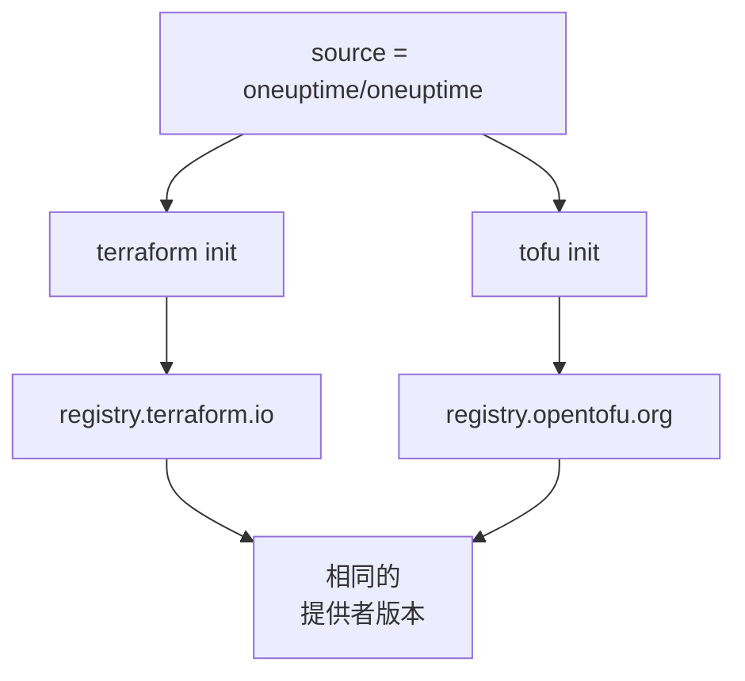

# OpenTofu

OneUptime 提供者在 [OpenTofu](https://opentofu.org) 上的運作方式與在 Terraform 上相同。它發佈在 [OpenTofu Registry](https://search.opentofu.org/provider/oneuptime/oneuptime/latest) 上，每個發行版本在發佈之前都會在兩者下通過相同的端對端測試。你的設定不需要改變：凡是本文件執行 `terraform` 的地方，都可以改為執行 `tofu`。

:::cards
- [在 OpenTofu 中使用提供者](#在-opentofu-中使用提供者): 相同的設定，用 `tofu` 執行。
- [與 Terraform 的不同之處](#與-terraform-的不同之處): 登錄檔、鎖定檔、`.tofu` 檔案和版本。
- [把設定移到 OpenTofu](#把設定移到-opentofu): 分四個步驟切換現有設定。
- [可重複使用的模組](#可重複使用的模組): 為一個服務提供監測器、待命策略和狀態頁。
:::

## 在 OpenTofu 中使用提供者

你需要 OpenTofu 1.6 或更新版本。像在 Terraform 中一樣宣告提供者：

```hcl title="main.tf"
terraform {
  required_providers {
    oneuptime = {
      source  = "oneuptime/oneuptime"
      version = "{{TERRAFORM_PROVIDER_VERSION}}"
    }
  }
}

provider "oneuptime" {
  # The API key comes from the ONEUPTIME_API_KEY environment variable.
  # On a self-hosted OneUptime, add your OneUptime's address:
  # oneuptime_url = "https://oneuptime.example.com"
}
```

然後用 `tofu` 執行它：

```bash
export ONEUPTIME_API_KEY="<your-api-key>"
tofu init
tofu plan
tofu apply
```

`tofu init` 會從 OpenTofu Registry 下載提供者。[快速入門](/docs/terraform/quick-start)、[完整指南](/docs/terraform/complete-guide)、[監控步驟](/docs/terraform/monitor-steps)、[範例](/docs/terraform/examples)和[匯入資源](/docs/terraform/importing-resources)中的所有內容都原樣適用，儀表板的 **Terraform** 頁面寫出的設定也不需變更即可使用。

### 不要在來源位址中寫登錄檔

`source = "oneuptime/oneuptime"` 沒有指定登錄檔，所以每個引擎都從自己的登錄檔讀取它：



不要寫主機名稱。寫了主機名稱，每個引擎都會使用那個登錄檔：寫成 `registry.terraform.io/oneuptime/oneuptime` 時，OpenTofu 也會從 Terraform Registry 下載，而 Terraform 會以 `authentication signature from unknown issuer` 拒絕 OpenTofu Registry 的副本。

## 與 Terraform 的不同之處

| 項目 | 在 OpenTofu 下 |
| --- | --- |
| 登錄檔 | `oneuptime/oneuptime` 即 `registry.opentofu.org/oneuptime/oneuptime`，它發佈的版本與 Terraform Registry 相同。 |
| 簽章 | `tofu init` 會提示略過了簽章驗證：OpenTofu Registry 沒有這個提供者的簽署金鑰，所以 OpenTofu 用登錄檔的總和檢查碼來驗證下載內容。 |
| `terraform` 區塊 | 仍然是 `terraform`：它是語言的一部分，OpenTofu 會原樣讀取。 |
| `.tofu` 檔案 | OpenTofu 1.8 及更新版本也會讀取 `.tofu` 檔案；對於 `.tf` 檔案，如果存在同名的 `.tofu` 檔案，就會略過它。Terraform 只讀取 `.tf` 檔案。 |
| `required_version` | OpenTofu 的版本從 1.6.0 開始，所以為 Terraform 寫的 `>= 1.5.0` 接受任何 OpenTofu。 |
| 鎖定檔 | 寫的是 `registry.opentofu.org/oneuptime/oneuptime`。切換引擎會重寫該項目：請提交這次變更。 |
| State | OpenTofu 會原樣讀取 Terraform 寫入的 state。 |
| 變數 | `TF_VAR_name` 在 OpenTofu 下同樣會設定變數。 |
| CLI 設定檔 | `~/.tofurc` 或 `~/.terraformrc`，或 `TF_CLI_CONFIG_FILE` 指定的檔案。 |
| `removed` 區塊 | 其中的 `lifecycle` 區塊需要 OpenTofu 1.10 或更新版本。沒有它時，Terraform 會銷毀記錄，而 OpenTofu 會忘記資源並保留記錄。 |
| 移到已重新命名的資源類型 | 用 `moved` 區塊從 `oneuptime_io_t_fleet` 移到 `oneuptime_iot_fleet`，或在其他已重新命名的類型之間移動，需要 OpenTofu 1.12 或更新版本。 |

## 把設定移到 OpenTofu

由 Terraform 管理的設定可以連同其 state 原樣移到 OpenTofu：

:::steps
### 安裝 OpenTofu

安裝 OpenTofu：1.6 就足以使用提供者，而 1.12 或更新版本還能把資源移到已重新命名的類型，例如從 `oneuptime_io_t_fleet` 移到 `oneuptime_iot_fleet`。

### 用 tofu 初始化

在設定所在的資料夾中執行 `tofu init`。它會從 OpenTofu Registry 下載提供者，並提示它變更了鎖定檔：提供者的項目現在指向 OpenTofu Registry。

### 執行計畫

執行 `tofu plan`。它會讀取 Terraform 留下的 state，並回應 `No changes.`

### 提交鎖定檔

提交 `.terraform.lock.hcl`，從現在起用 `tofu` 執行這份設定，CI 中也是如此。
:::

## 可重複使用的模組

OneUptime 存放庫中的 [`Examples/opentofu/`](https://github.com/OneUptime/oneuptime/tree/master/Examples/opentofu) 包含可以直接執行的設定，以及一個為一個服務完成設定的模組：為你提供的每個位址建立一個網站監測器，為它建立的所有內容加上一個標籤，建立一個帶有一條上報規則的待命策略，以及一個列出這些監測器的狀態頁。它是一般的 HCL，所以在 Terraform 下也能使用。

```hcl title="main.tf"
module "storefront" {
  source = "github.com/OneUptime/terraform-provider-oneuptime//modules/monitoring-and-incident-response?ref=vX.Y.Z"

  service_name          = "storefront"
  status_page_is_public = true

  monitors = {
    homepage = { url = "https://example.com" }
    checkout = { url = "https://example.com/checkout" }
    api      = { url = "https://api.example.com/health", expected_status_code = "204" }
  }
}
```

把 `vX.Y.Z` 換成已發佈的提供者版本，例如[提供者的發行版本](https://github.com/OneUptime/terraform-provider-oneuptime/releases)中最新的那個：模組與提供者一起發佈，它的存放庫在每個發行版本中都會變化。

該模組不會建立監測器狀態或事件嚴重程度。它會依名稱查詢每個專案一開始就有的那些：`Operational`、`Offline` 和 `Critical Incident`。如果你的專案重新命名了它們，請設定 `operational_monitor_status_name`、`offline_monitor_status_name` 或 `incident_severity_name`。

在你指定要通知誰之前，它的上報規則不會通知任何人：請用模組的輸出為它加入一個團隊：

```hcl title="main.tf"
resource "oneuptime_team" "storefront" {
  name = "Storefront"
}

resource "oneuptime_team_on_call_duty_escalation_rule" "storefront" {
  on_call_duty_policy_id                 = module.storefront.on_call_policy_id
  on_call_duty_policy_escalation_rule_id = module.storefront.escalation_rule_id
  team_id                                = oneuptime_team.storefront.id
}
```

## 後續步驟

:::cards
- [快速入門](/docs/terraform/quick-start): 建立 API 金鑰並套用你的第一批資源。
- [登錄檔使用](/docs/terraform/registry): 版本如何編號，以及鎖定檔。
- [自架設定](/docs/terraform/self-hosted): 你自己的 OneUptime，以及離線機器的鏡像。
- [疑難排解](/docs/terraform/troubleshooting): 常見錯誤及其修正方式。
:::
