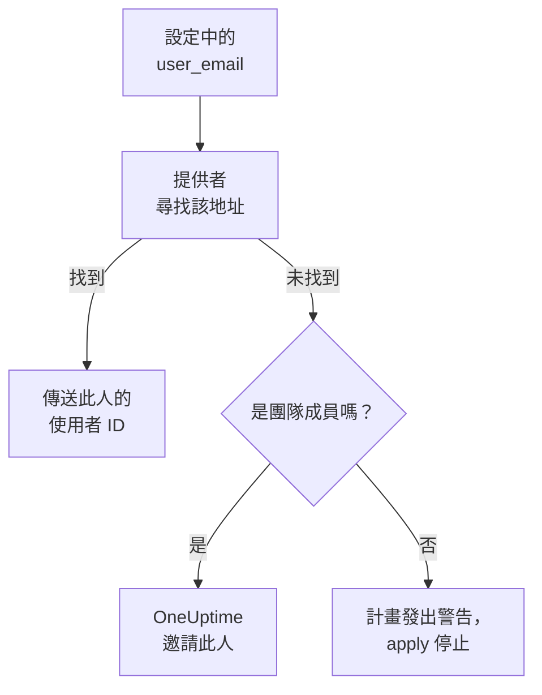

# 人員與團隊

把專案裡有誰記在 Terraform 設定中：團隊和團隊成員、誰在待命、誰擁有什麼。用電子郵件地址指定每個人：提供者會找到此人，並邀請專案裡的新人。

:::cards
- [用電子郵件地址指定人員](#用電子郵件地址指定人員): 每個使用者 ID 旁邊的屬性。
- [讓新人加入](#讓新人加入): 邀請某人，並給此人一個團隊、待命輪次和要擁有的東西。
- [讓人離開](#讓人離開): 移除某人，以及 OneUptime 隨之移除的內容。
- [匯入已有的成員](#匯入已有的成員): 依其團隊和地址匯入。
:::

## 運作方式

提供者在 API 金鑰所屬專案的人員中尋找該地址：專案的成員，以及受邀加入專案的人。它把找到的人的 ID 傳給 API。用專案裡無人使用的地址指定的團隊成員，會改為邀請這個地址。



只會搜尋 API 金鑰自己的專案。專案以外的人永遠不會被找到，提供者也無法得知某個地址在別處是否有帳戶。

## 開始之前

- **能讀取專案團隊的 API 金鑰。** 提供者透過團隊找到人員。
- **要新增新人，需要能邀請人員的金鑰。** 請參閱[邀請成員](/docs/permissions/inviting-people)。

## 用電子郵件地址指定人員

每個指定人員的資源，都在使用者 ID 旁邊接受此人的電子郵件地址。兩者擇一提供：

| 使用者 ID | 電子郵件地址 |
| --- | --- |
| `user_id` | `user_email` |
| `owner_users` | `owner_user_emails` |
| `assigned_to_user_id` | `assigned_to_user_email` |
| `override_user_id` | `override_user_email` |

尋找地址時不區分大小寫，並依你寫的樣子保存在 state 中。使用者 ID 會被填入，讓其他資源可以參照它。

## 讓新人加入

此設定把專案新人 Alice 加入一個團隊，從她第一天起給她待命輪次，並讓已在專案中的 Bob 成為一個監測器的擁有者：

```hcl title="people.tf"
resource "oneuptime_team" "sre" {
  name        = "SRE"
  description = "Site reliability engineering"
}

# New to the project: OneUptime invites her.
resource "oneuptime_team_member" "alice" {
  team_id    = oneuptime_team.sre.id
  user_email = "alice@example.com"
}

resource "oneuptime_on_call_policy_schedule" "weekly" {
  name     = "SRE weekly"
  timezone = "UTC"
}

resource "oneuptime_on_call_schedule_layer" "weekly" {
  on_call_duty_policy_schedule_id = oneuptime_on_call_policy_schedule.weekly.id
  name                            = "Weekly"
  starts_at                       = "2030-01-07T09:00:00Z"
  hand_off_time                   = "2030-01-14T09:00:00Z"
}

# Named through her membership, so she is invited first.
resource "oneuptime_on_call_schedule_layer_user" "alice" {
  on_call_duty_policy_schedule_id       = oneuptime_on_call_policy_schedule.weekly.id
  on_call_duty_policy_schedule_layer_id = oneuptime_on_call_schedule_layer.weekly.id
  user_id                               = oneuptime_team_member.alice.user_id
}

resource "oneuptime_monitor" "api" {
  name         = "Public API"
  monitor_type = "Manual"
}

# In the project already: named by his address.
resource "oneuptime_monitor_user_owner" "api" {
  monitor_id = oneuptime_monitor.api.id
  user_email = "bob@example.com"
}
```

`terraform apply` 透過電子郵件邀請 Alice，與從儀表板發出的邀請一樣。如果她沒有帳戶，OneUptime 會為她建立一個。在她接受之前，`has_accepted_invitation` 維持 `false`，而她接受邀請不會成為計畫中的變更。已在專案中的人會立即加入新團隊。

要讓此設定邀請的人待命或成為擁有者，請用 `user_id = oneuptime_team_member.<name>.user_id` 參照其成員資格：這樣 Terraform 會先邀請此人，再在其他地方指定此人。專案裡無人使用的地址，在計畫中是警告，在 apply 中是錯誤。

## 尋找某人

資料來源 `oneuptime_user` 依 `email`、`name` 或 `id` 尋找某人，並讀取此人的使用者 ID、姓名、是否已加入，以及所在的團隊：

```hcl
data "oneuptime_user" "alice" {
  email = "alice@example.com"
}

output "alice_teams" {
  value = data.oneuptime_user.alice.team_ids
}
```

其他資料來源也可以依記錄所指人員的地址查找記錄，與其 ID 並列。下面這個讀取 Alice 在 SRE 團隊中的成員資格：

```hcl
data "oneuptime_team_member" "alice" {
  team_id    = oneuptime_team.sre.id
  user_email = "alice@example.com"
}
```

## 讓人離開

從設定中刪除此人的成員資格並套用。離開專案中的最後一個團隊後，此人就離開了專案，OneUptime 會把此人從每個待命排班、升級規則和代班中移除，也從此人擁有的東西中移除：除已結束的事件、警示和維護事件之外的一切。請在同一次變更中刪除指定此人的區塊，否則下一次計畫會為一個已不在專案中的人重新建立它們。

此人的 OneUptime 帳戶仍歸此人所有：離開的只是專案。必須保留成員的團隊，不會讓已接受邀請的最後一名成員離開。

## 匯入已有的成員

沒有任何畫面顯示成員資格的 ID，所以請依其團隊的 ID 和此人的地址匯入：

```bash
terraform import oneuptime_team_member.alice 6b1d1c2e-4f3a-4b5c-8d6e-7f8091a2b3c4/alice@example.com
```

地址會維持你寫的樣子，所以請依設定中的寫法來寫。成員資格本身的 ID 也能匯入它，此時地址從 OneUptime 讀取，為小寫。

擁有者和待命列也以同樣方式匯入，依它們所屬的內容。監測器的擁有者依監測器的 ID 和此人的地址匯入。指向團隊或排班的列，例如擁有者團隊，或升級規則呼叫的團隊，依兩個 ID 匯入：

```bash
terraform import oneuptime_monitor_user_owner.api 68a1b2c3-d4e5-4f6a-8b9c-0d1e2f3a4b01/bob@example.com
terraform import oneuptime_escalation_rule_team.sre 68a1b2c3-d4e5-4f6a-8b9c-0d1e2f3a4b06/6b1d1c2e-4f3a-4b5c-8d6e-7f8091a2b3c4
```

## 有人變更了地址時

在 OneUptime 中變更地址的人，對 Terraform 來說仍是同一個人：在你寫入新地址之前什麼都不會變，寫入後只有 `user_email` 改變。

## 疑難排解

:::details 計畫提示某個地址還不在此專案中
專案中以及受邀的人中，都沒有人使用這個地址。請先用 `oneuptime_team_member` 邀請此人。如果該成員資格在同一設定中，請用 `user_id = oneuptime_team_member.<name>.user_id` 參照它，而不是用地址。如果此人在 OneUptime 中改了地址，請使用新地址。
:::

:::details apply 提示該使用者已受邀加入此團隊
此人已在團隊中。請匯入該成員資格，而不是建立它，做法見[匯入已有的成員](#匯入已有的成員)。
:::

## 後續步驟

:::cards
- [匯入資源](/docs/terraform/importing-resources): 把專案的其餘部分也納入 Terraform 管理。
- [邀請成員](/docs/permissions/inviting-people): OneUptime 中邀請的運作方式。
- [範例](/docs/terraform/examples): 常用資源的現成設定。
:::
