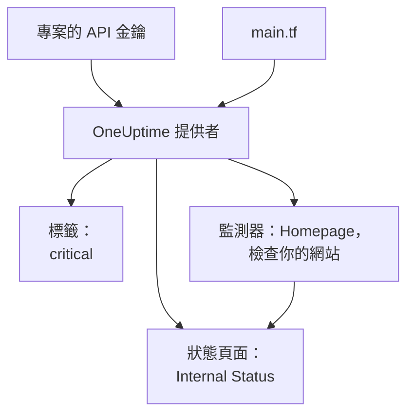

# 快速入門

本指南帶你在大約十分鐘內，從零開始得到一個由 Terraform 管理的 OneUptime 專案。你將建立一個 API 金鑰，讓 Terraform 指向你的專案，並套用一個標籤、一個檢查你網站的監測器，以及一個顯示它的私有狀態頁面。然後修改其中一個資源，最後清理。

:::cards
- [開始之前](#開始之前): Terraform、一個專案，以及支援 API 金鑰的方案。
- [建立你的第一批資源](#建立你的第一批資源): 從 API 金鑰到已套用的計畫，共六個步驟。
- [修改資源](#修改資源): 編輯設定，計畫並套用。
- [疑難排解](#疑難排解): 首次執行可能遇到的錯誤。
:::



## 開始之前

- **Terraform 1.5 或更高版本，或 OpenTofu 1.6 或更高版本。** 使用 OpenTofu 時，凡是本指南執行 `terraform` 的地方都改為執行 `tofu`。
- **一個 OneUptime 專案。** 位於 [oneuptime.com](https://oneuptime.com) 或你自己的 OneUptime 上，且你可以在其中建立 API 金鑰。
- **在 OneUptime Cloud 上，需要 Growth 方案或更高。** 專案的 API 金鑰只在該方案上有效。

## 建立你的第一批資源

:::steps
### 建立專案 API 金鑰

在 OneUptime 儀表板中，開啟 **專案設定 → 進階 → API 金鑰**，然後點選 **建立API 金鑰**。為它填寫 **名稱**，例如 `terraform`，並在 **存取** 下選擇 **專案管理員**：Terraform 會建立、讀取、更改和刪除它管理的每種記錄，而 **專案管理員** 可以完成所有這些操作。如果想要權限更窄的金鑰，請選擇 **稍後選擇權限**，然後在金鑰頁面上只新增你需要的權限。

金鑰從今天起一年後過期。要選擇其他日期，請在建立前展開 **更多欄位**，或稍後在金鑰頁面上更改日期。金鑰建立後會開啟它的頁面：從 **API 金鑰詳細資訊** 卡片中複製 **API 金鑰**。

### 讓 Terraform 能使用金鑰

把金鑰放進你執行 Terraform 的 shell 的環境變數 `ONEUPTIME_API_KEY` 中，這樣它就永遠不會出現在檔案裡：

:::tabs
@tab Linux
```bash
export ONEUPTIME_API_KEY="<your-api-key>"
```
@tab macOS
```bash
export ONEUPTIME_API_KEY="<your-api-key>"
```
@tab Windows
```powershell
$env:ONEUPTIME_API_KEY = "<your-api-key>"
```
:::

### 讓 Terraform 指向 OneUptime

新建一個空資料夾，並在其中建立一個名為 `main.tf` 的檔案：

```hcl title="main.tf"
terraform {
  required_providers {
    oneuptime = {
      source  = "oneuptime/oneuptime"
      version = "{{TERRAFORM_PROVIDER_VERSION}}"
    }
  }
}

provider "oneuptime" {
  # The API key comes from ONEUPTIME_API_KEY.
  # On a self-hosted OneUptime, add your OneUptime's address:
  # oneuptime_url = "https://oneuptime.example.com"
}
```

在自行託管的 OneUptime 上，請先閱讀 [自架設定](/docs/terraform/self-hosted)，再選擇提供者版本。

### 描述你的資源

把這些區塊新增到 `main.tf`。它們讀取每個專案一開始就有的兩個監測器狀態，並建立一個標籤、一個每五分鐘檢查一次 `https://example.com` 的監測器（把這裡換成你自己的網站），以及一個顯示該監測器的私有狀態頁面：

```hcl title="main.tf"
data "oneuptime_monitor_status" "operational" {
  name = "Operational"
}

data "oneuptime_monitor_status" "offline" {
  name = "Offline"
}

resource "oneuptime_label" "critical" {
  name        = "critical"
  description = "Resources that page on-call when down"
  color       = "#FF5733"
}

resource "oneuptime_monitor" "homepage" {
  name                = "Homepage"
  description         = "Checks that the homepage responds"
  monitor_type        = "Website"
  monitoring_interval = "*/5 * * * *"
  labels              = [oneuptime_label.critical.id]

  monitor_steps = [{
    monitor_destination      = "https://example.com"
    monitor_destination_type = "URL"
    request_type             = "GET"

    criteria = [
      {
        name                  = "Offline"
        description           = "The homepage does not respond"
        filter_condition      = "Any"
        change_monitor_status = true
        monitor_status_id     = data.oneuptime_monitor_status.offline.id

        filters = [
          {
            check_on    = "Is Online"
            filter_type = "False"
          }
        ]
      },
      {
        name                  = "Online"
        description           = "The homepage responds"
        filter_condition      = "All"
        change_monitor_status = true
        monitor_status_id     = data.oneuptime_monitor_status.operational.id

        filters = [
          {
            check_on    = "Is Online"
            filter_type = "True"
          }
        ]
      }
    ]
  }]
}

resource "oneuptime_status_page" "internal" {
  name                  = "Internal Status"
  description           = "Status of our internal services"
  page_title            = "Service Status"
  is_public_status_page = false
}

resource "oneuptime_status_page_resource" "homepage" {
  status_page_id = oneuptime_status_page.internal.id
  monitor_id     = oneuptime_monitor.homepage.id
  display_name   = "Homepage"
}

output "monitor_id" {
  value = oneuptime_monitor.homepage.id
}
```

監測器的 `monitor_steps` 說明它檢查什麼，以及每個結果意味著什麼：每次檢查後，第一個相符的條件決定它的狀態。[監控步驟](/docs/terraform/monitor-steps) 解釋了每個部分。

### 計畫並套用

:::tabs
@tab Terraform
```bash
terraform init
terraform plan
terraform apply
```
@tab OpenTofu
```bash
tofu init
tofu plan
tofu apply
```
:::

`init` 會下載提供者。計畫以 `Plan: 4 to add, 0 to change, 0 to destroy.` 結尾。輸入 `yes` 套用它；完成後，Terraform 會輸出新監測器的 ID。

### 檢查儀表板

在 OneUptime 儀表板中：

- **監測器** 列出了帶有 `critical` 標籤的 `Homepage`。它的第一次檢查會在幾分鐘內到來。
- **狀態頁面** 列出了顯示 `Homepage` 的 `Internal Status`。
- **專案設定 → 基礎 → 標籤** 列出了 `critical`，顏色就是你設定的顏色。

再次執行 `terraform plan`。它會回答 `No changes.`：OneUptime 中的內容與設定完全一致。
:::

## 修改資源

修改設定，而不是儀表板。在 `main.tf` 中把標籤的 `color` 設為 `"#2ECC71"`，然後計畫並套用：

```bash
terraform plan
terraform apply
```

計畫以 `Plan: 0 to add, 1 to change, 0 to destroy.` 結尾：標籤會被就地修改。如果有人在儀表板中修改了由 Terraform 管理的資源，這一更改會出現在下一次計畫中，套用後會恢復為設定中的內容。

## 清理

如果這只是試用，請刪除設定建立的內容：

```bash
terraform destroy
```

這會刪除標籤、監測器、狀態頁面及其資源。兩個監測器狀態會保留：資料來源只讀取它們。

## 疑難排解

:::details 訊息「Missing API Key」
提供者沒有找到 API 金鑰。在你執行 Terraform 的 shell 中匯出 `ONEUPTIME_API_KEY`，或在提供者區塊中設定 `api_key`，然後重新執行命令。
:::

:::details 訊息「the OneUptime API returned status 400: Invalid API Key」
金鑰輸入有誤、已過期或已刪除，或者它屬於另一個 OneUptime，而不是 `oneuptime_url` 指向的那個。請從金鑰頁面重新複製金鑰，或建立一個新金鑰。
:::

:::details 訊息「the OneUptime API returned status 402: API keys need the Growth plan」
在 OneUptime Cloud 上，專案的 API 金鑰只在 Growth 或更高方案上有效。在 **專案設定 → 帳單與發票 → 帳單** 中升級專案後，同一個金鑰即可重新使用。
:::

:::details 訊息「the OneUptime API returned status 422: You do not have permissions to create Monitor」
金鑰沒有該類記錄的權限。在金鑰頁面上授予它 **專案管理員**，或訊息中提到的權限。
:::

:::details 訊息「No monitor status matches {name = "Offline"}」
你專案的監測器狀態使用了其他名稱。請使用你在 **監測 → 設定 → 監測器狀態** 中看到的名稱，或改為按 `is_offline_state = true` 查詢狀態。
:::

## 後續步驟

:::cards
- [完整指南](/docs/terraform/complete-guide): 驗證、專案結構、資料來源、state 和升級。
- [監控步驟](/docs/terraform/monitor-steps): 決定監測器檢查什麼，以及每個結果意味著什麼。
- [範例](/docs/terraform/examples): 常用資源的現成設定。
- [匯入資源](/docs/terraform/importing-resources): 把你在儀表板中建立的內容交給 Terraform 管理。
:::
