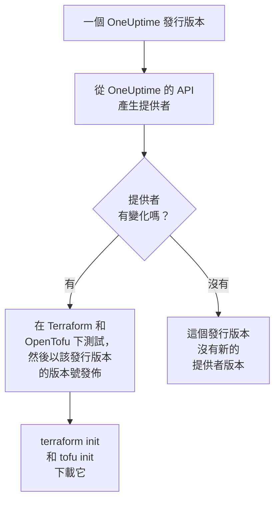

# 登錄檔使用

OneUptime 提供者發佈在 [Terraform Registry](https://registry.terraform.io/providers/oneuptime/oneuptime) 和 [OpenTofu Registry](https://search.opentofu.org/provider/oneuptime/oneuptime/latest) 上。`terraform init` 和 `tofu init` 會從那裡下載它：不需要手動安裝任何東西。本頁介紹發佈了哪些內容、版本如何編號，以及如何改用較新的版本。

:::cards
- [發佈了什麼](#發佈了什麼): 各個平台的提供者、它的參考文件以及它的版本。
- [版本如何編號](#版本如何編號): 提供者的版本就是發佈它的 OneUptime 發行版本。
- [鎖定檔](#鎖定檔): 每台機器安裝的版本和總和檢查碼。
- [改用較新的版本](#改用較新的版本): 閱讀變更內容，下載新版本，然後執行計畫。
:::

## 發佈了什麼

每個 OneUptime 發行版本都會從 OneUptime 自己的 API 產生提供者。如果提供者有變化，該發行版本會在提供者通過 Terraform 和 OpenTofu 下的端對端測試後，以該發行版本的版本號發佈它：



| 內容 | 位置 |
| --- | --- |
| 提供者，適用於 Linux、macOS、Windows、FreeBSD、OpenBSD 和 Solaris | 由 `terraform init` 和 `tofu init` 下載，附帶 OneUptime 簽署的總和檢查碼 |
| 每個資源和資料來源的參考文件，包含其每個屬性 | 登錄檔的文件，依產品分組：監測器、狀態頁、事件、待命等 |
| 在 OpenTofu 中使用提供者的指南 | 登錄檔的指南 |
| 每個版本，最新的在前 | 登錄檔的版本清單 |

參考文件說明每個屬性是什麼。本文件則示範如何把它們組合起來使用：請從 [Terraform 概觀](/docs/terraform/index)開始。

## 版本如何編號

提供者的版本就是發佈它的 OneUptime 發行版本的版本：提供者 {{TERRAFORM_PROVIDER_MAJOR}}.0.20 隨 OneUptime {{TERRAFORM_PROVIDER_MAJOR}}.0.20 一起推出。提供者沒有變化的發行版本不會發佈提供者，所以版本之間會有空缺，而只指定一個確切版本的限制可能會指向一個不存在的版本。請改為寫一個範圍：

| 你使用的是 | 限制 | Terraform 安裝的版本 |
| --- | --- | --- |
| OneUptime Cloud | `{{TERRAFORM_PROVIDER_VERSION}}` | 最新的 {{TERRAFORM_PROVIDER_MAJOR}}.x 提供者 |
| 自架的 OneUptime | 以你的 OneUptime 版本為終點的範圍，例如 `>= {{TERRAFORM_PROVIDER_MAJOR}}.0, <= {{TERRAFORM_PROVIDER_MAJOR}}.0.40` | 不比你的 OneUptime 更新的最新提供者 |

在自架的 OneUptime 上，比你的 OneUptime 更新的提供者可能會傳送你的 OneUptime 尚未具備的設定：[自架設定](/docs/terraform/self-hosted#選擇提供者版本)說明了如何撰寫它的範圍。

```hcl title="main.tf"
terraform {
  required_providers {
    oneuptime = {
      source  = "oneuptime/oneuptime"
      version = "{{TERRAFORM_PROVIDER_VERSION}}"
    }
  }
}
```

來源位址沒有指定登錄檔：Terraform 從 Terraform Registry 讀取它，OpenTofu 從 OpenTofu Registry 讀取它，兩者發佈相同的版本。

## 鎖定檔

`terraform init` 會把它選定的版本及其下載內容的總和檢查碼記錄在 `.terraform.lock.hcl` 中。請提交這個檔案：這樣每台機器和每次 CI 執行都會安裝完全相同的版本，直到你選擇另一個版本。總和檢查碼涵蓋登錄檔發佈的每個平台，所以一個鎖定檔可以同時用於 Linux、macOS 和 Windows 機器。

```hcl title=".terraform.lock.hcl"
provider "registry.terraform.io/oneuptime/oneuptime" {
  version     = "{{TERRAFORM_PROVIDER_MAJOR}}.0.20"
  constraints = "{{TERRAFORM_PROVIDER_VERSION}}"
  hashes = [
    "h1:...",
    "zh:...",
  ]
}
```

鎖定檔中寫有登錄檔。OpenTofu 寫的是 `registry.opentofu.org/oneuptime/oneuptime`，而 Terraform 在同一位置寫的是 `registry.terraform.io/oneuptime/oneuptime`，所以切換引擎會變更鎖定檔：`init` 會取代該項目，並提示你提交這次變更。

## 改用較新的版本

:::steps
### 閱讀變更內容

[OneUptime 的發行版本](https://github.com/OneUptime/oneuptime/releases)說明了每個發行版本變更了什麼，包括提供者。[提供者的發行版本](https://github.com/OneUptime/terraform-provider-oneuptime/releases)連結到自上一個發行版本以來的變更。

### 下載新版本

```bash
terraform init -upgrade
```

`init -upgrade` 會選用你的限制所允許的最新版本，顯示它，並更新 `.terraform.lock.hcl`。限制 `{{TERRAFORM_PROVIDER_VERSION}}` 接受每個 {{TERRAFORM_PROVIDER_MAJOR}}.x 發行版本；新的主要版本需要新的限制。

### 在套用之前執行計畫

執行 `terraform plan`，只有當它為空或只顯示你預期的變更時才套用。提交更新後的鎖定檔。
:::

在自架的 OneUptime 上，請先升級 OneUptime，再提高提供者範圍的終點。

## 程式碼在哪裡

提供者在 [OneUptime 主要存放庫](https://github.com/OneUptime/oneuptime)中從 OneUptime API 產生，每個版本都由發佈它的那個發行版本建置。它自己的存放庫 [OneUptime/terraform-provider-oneuptime](https://github.com/OneUptime/terraform-provider-oneuptime) 存放的是產生器寫出的內容，所以變更都在主要存放庫中進行：請在 [github.com/OneUptime/oneuptime/issues](https://github.com/OneUptime/oneuptime/issues) 回報問題，包括文件問題。

## 後續步驟

:::cards
- [自架設定](/docs/terraform/self-hosted): 適用於你自己的 OneUptime 的版本範圍，以及離線機器的鏡像。
- [OpenTofu](/docs/terraform/opentofu): 相同的提供者和設定，使用 `tofu`。
- [完整指南](/docs/terraform/complete-guide): 驗證、專案結構、資料來源、state 和升級。
- [疑難排解](/docs/terraform/troubleshooting): 常見錯誤及其修正方式。
:::
